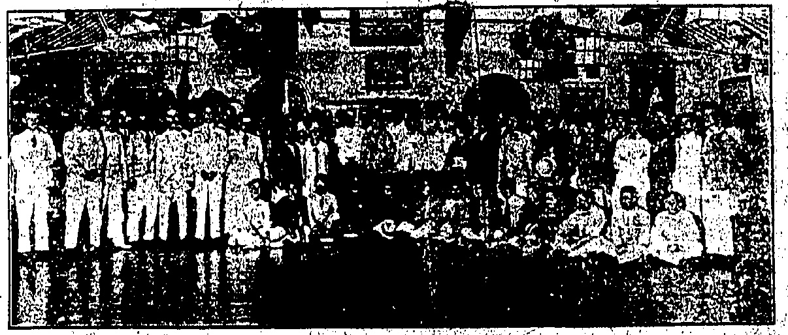
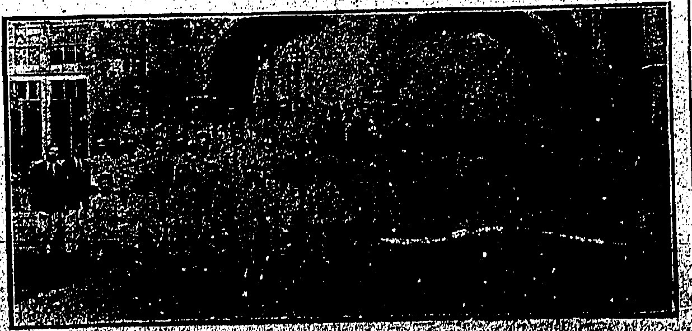
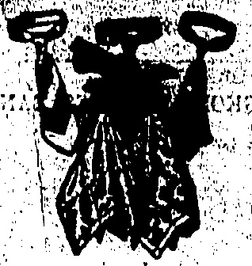
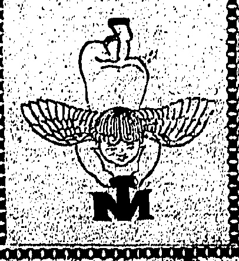

Our stock is comprehensive. It includes Bearings for Buick, Cadillac, Chandler, Chevrolet, Cleveland, Dodge Brothers, Essex, Ford, Hudson, Jewett, Marmon, Maxwell, Oakland, Oldsmobile, Overland, Paige, Studebaker, Willy Knight AND most other Cars and Trucks in South China.

THE DRAGON MOTOR CAR CO., LTD

# Othina

Temperature 75, Barometer 29.81

Rainfall 0.02 in., Humidity 77

No. 19,509 HONGKONG, MONDAY, JUNE 1, 1925. PRICE, $3.00 Per m

TO-DAY'S closing rate 2/3 1/16

TO-DAY'S opening rate 2/3 1/16

GENTS' SOCKS

English: Make, Soft finish, Whites, Blacks, Greys and Brown. All sizes. $1.00 pair.

White Lisle Thread

Half Hose

Extra spliced, Bard Wearing.

All sizes.

$1.75 pair.

Men's White Cashmere finished

Half Hose. Unshrinkable.

All sizes.

Men's Seamless Ribbed White

"Meroni" Half Hose, a good

Tennis Sock.

$1.95 pair.

The Gent's Outfitters

HONGKONG.

WHITEAWAY, LAIDLAW & CO., LTD.

◇◇◇◇◇◇◇◇◇◇◇◇◇

Telephoto

LENS?

for all sizes

from 3h 2h

to $\frac{1}{2}$ plate

## REIGN OF TERROR

WHOLE

TOWN

BANDITS' VILLAINY.

How Kamchuk Was Sacked

With the return of Mr. Rasmussen to Pakkai, further particulars of his capture and release by bandits have been received.

RAID ON TOWN.

(From Our Own Correspondent

Pakkai, Kongmoon, May 29.

Once again the folly of leaving an inland township unprotected has been amply demonstrated. Just as the Romans withdrew when their Empire was tottering to its ruins and left the ancient Britons to the tender mercies of invaders, so did the “Fook” garrison at Kamchuk (where Mr. Rasmussen was captured) depart for Canton to increase the strength of the hemmed-in Communistic Government, leaving Kamchuk to be ravaged by “To

On May 22, the garrison embarked for Canton whither they had been ordered by General Li Fook-lam who is holding out in Honam. Since the Saikwan coup, the Kamchuk Volunteers have been disbanded. Accordingly, the place could offer little or no resistance to the marauders.

Like vultures' eager for their prey, a band from two to three hundred strong entered Kamchuk openly on the morning of May 23, the day after the regulars' departure, and secreted themselves in the opium divans, etc. Not thinking that the bandits had come to start trouble but, rather, to exact further "squeeze" from the gambling saloons, business houses opened their doors as usual.

In the afternoon, Mr. and Mrs. Rasmussen arrived in an A.P.C. motor-boat to inspect one of the up-country sub-agencies, and stepped on a hornet's nest. Mr. Rasmussen was hailed when on the river and captured, but was released the next day as has already been reported.

About ten in the morning, the reign of terror started. In Kamchuk is a rice and wine shop, the master of which, as a Volunteer officer who had shot down several pirates, was singled out for first attention. He fled only in the nick of time and his shop was ransacked and then burned down.

Spreading out from this point, the bandits entered each building—tenement or shop—and pillaged methodically. No resistance was offered and organised opposition was impossible now that the outlaws had got the upper hand. Practically every house was cleaned out and then the pirates set fire to the township. Fortunately a heavy rain began to fall and by nightfall, the fire had burned itself out but not before 70 per cent. of the buildings had been destroyed or partially damaged.

Next day, the bandits remained collecting their huge loot. Rice, cattle and even doors were packed away.

Having served his apprenticeship, as he openly brags, by shooting down Captain Willox and instigating the "Tai Lee" piracy, Pang Cheong, former Boatswain of the Hongkong-Kongmoon boat, directed the gang's operations in most businesslike manner.

There were no casualties but over ten persons were forced away into captivity, for ransom.

Subsequently regular soldiers from Lak Lau (about three miles away) arrived and took charge.

Before the bandits left Kamchuk, they indulged in target practice at vessels passing on the rapids, taking pot-shots and firing volleys. However, all the craft successfully ran the gauntlet and escaped. At present all the Canton and Fatshan junkes for this part of the delta go via Yungki instead of making the rapids. Other encounters with pirates are reported. I learn that Sheung Shul Hau in the Sanwui

A story which has gained publicity that a European Police office was a hot at by one of a gang of four men at Magazine Gap Road last night has, on inquiry approved to be without

district was attacked and that many houses were plundered but details are lacking.

The Canton-Kongmoon tow-boat had a narrow escape from a mine. It was near Ho Tong, not far from this port, when the mine blew up about 150 feet from the junk and her lunch.

It is stated that unless of sum of $250,000 is paid to the Government, certain lands and foreshore rights will be declared “national property.” People at Chekhom threaten a general strike in protest.

The Sunning (Toishan) people have appealed to the Government to abolish the tax on roofs or upper structures.

## Week-End Holiday

## AFTER TWENTY YEARS

A week-end of sunshine with showers not heavy enough to interfere with our enjoyment, has afforded the unity for sampling the seu hir at the Colony's many beaches—launches, buses, cars and all means of locomotions being in great demand. A few hardy spirits pursued the elusive ball of golf or tennis but bathing, on the whole, has been the most favoured pastime. The holiday has coincided with unusually good indoor programmes offered by theatre and cinemas.

Hongkong before

A resident of twenty made sim one of the most s.s. Rhenexor to-day

London May 31.—An “Observer” correspondent states that followers of Captain Amundsen's record are confident that he is alive and that when he started from Spitzbergen on the 21st his programme included far more than a few hours return flight to the North Pole.—Reuter.

Mr. H. Percy Smith, whose first acquaintance with the Colony dates back to the time when there was no Peak tram, leaves behind him a Hongkong vastly different from that in which no first set foot, both as regards development of the Colony and the personnel of its inhabitants.

To his friendship with one whose connection with the Colony dates back to still earlier times, Sir Paul Chater, Mr. Percy Smith attributes much of the success which has attended his business life in the Far East. He also holds in grateful remembrance in this regard and for his personal friendship Mr. J. Arnold, the

## SWIMMING GALA FLASHLIGHT

Last Thursday night, the V.R.C. was the venue of popular run when the swimmers who represented Japan at the last Far East Olympiad gave an exhibition together to a number of local and Chinese swimmers. The above photo was taken in the gymnasium which was decorated for the occasion.

THREATS

TRUCULENT CHINESE HOUSEBOY.

His Worship found the accused guilty and sentenced him to four months' hard labour, and to find two sureties to guarantee that he would be on good behaviour for a period of one year, or an additional two months' imprisonment.

Before Mr. S. B. B. McElderry, at the Central Magistracy this morning, a young Chinese was charged with intimidating an amah in the employment of Mrs. G. Cousins, of 4, "Felix Villas, to leave the service of her mistress.

Four Months' Jail.

Evidence was given by the amah and Mrs. Cousins that the accused, who was under notice to leave at the end of May, threatened the amah last Thursday and again on Saturday, that she would have to be protected by the police if she decided to work longer in the house.

SPRING

CATHOLIC UNION CLUB

CONCFRT.

ORPHANAGE TO BENEFIT.

Pretty scenes were enacted at the Catholic Union Club on Saturday evening when amongst other items spring fantasy was given in which took part about twenty girls dressed in costumes of many colours representing most faithfully the flowers the little girls personated. This item alone was well worth the charge for entrance which was made in order that St. Anthony's Orphanage, West Point, might benefit, but there were other items also good, although not so

Mrs. Guy Cumming, who was responsible for designing and making the costumes and who helped in the direction, is heartily to be congratulated on the success of the entertainment which should result in a substantial sum being raised for the Orphanage.

## ITALIAN CONVENT

PITMAN'S SHORTHAND RESULTS.

Results of Examinations held at the Convent some months ago, are at hand, and the list of the successful Candidates is as follows:—

Speed: (140 words a minute) Misses Beatrice Gill, Anna Lyen, and Mary Medina.

(100 words) Misses Hedviges Silva, Julia Remedios, Anita King, Nellie Gubbay, Anita Silice, Emma Mercer, Lolita Rocha.

(80 words) Misses Violet May and Florrie Nevie.

Theory: Mrs. M. Vessonna, Misses Jean Rosario, Olga King, Stella Jounilho, Estelita Xavier, Benedicta Xavier, Celeste Ozorio, Florence Lyen, Irene Rapp, Bernice Chenalloy, Mrs. M. Howe, Misses E. Nind, Winifred Littleton, May Gaubert, Rosina Sully, Kathleen Rapp, Eva Coysh, Celeste Gill.

Elementary: Misses Ester Chan,

Florence Lyon, Bernice Chenalloy,

Irene Rapp, Katie Rapp, Annie Cross, May Gaubert, Winnie Littleton, Rosina Sully, Celeste Gill.

The concert was under the patronage of the Rev. Father Spada, and the following committee was responsible for the management: Mr. M. F. Baptista, Mrs. T. R. Nicol, Miss A. de Souza, Mrs. G. Cuming, Miss L. M. de Souza (Hon. Treasurer), and Mr. M. da Silva (Hon. Secretary).

Father of the present Secretary of the Hongkong, Canton and Macao Steamboat Company. Mr Arnold, in addition to his work in connection with the Steamboat Company was responsible for a good deal oauditing work which upon his retirement he passed to Mr Smith.

Another sphere in which Mr. Smith has been and been directly responsible for great development, is the teemasonry movement in Hongkong and the Far East. He is the founder of many Lodges and Chapters and the high ranks in the craft which he holds include those of District Grand Master of the Grand Lodge of Hongkong and South China, as well as D.G.S.P. of the Grand Royal Arch Chapter. Sin 1915 Mr. Smith has also been a Justice of the Peace for Hongkong.

As a personal and old school friend of Sir William Wilkins of the Consular service, Mr. Percy Smith visited his brother, Mr. C, D. Wilkinson, in Hongkong as far back as 1889 when he spent a few months' holiday in Hbngkong. His business connection here, however, extends back to 1904 when he took up accountancy work, at first on his own. Prior to that Mr. Smith had partnered his brother in accountancy, having been articled with him from the time that he left Wolverhampton Grammar School. His work immediately prior to his departure from Home had been in Birmingham and Wolverhampton where he was a partner in the firm of Alien Edward and Smith, chartered accountancy.

The first partnership in a business connection which eventually materialised into the well-known firm of Messrs. Percy Smith, Seth and Fleming, was that with Mr. Seth, which was later joined by Mr. Fleming of Manila. The partnership with Mr. Fleming has recently been dissolved but the firm in Manila is still known as Fleming, Percy Smith and Seth, and the original title will also be retained in Hongkong although through ill-health Mr. Percy Smith is not only leaving Hongkong but has also retired from the firm.

By his genial personality and happy disposition Mr. Percy Smith has established himself as a great favourite in social circles and a host of friends will wish him a happy time during his retirement and a speedy recovery of health. He does not anticipate returning again to Hongkong but at the foot of Cader Idris and other Welsh hills at Barmouth is looking to spend most of his days, at any rate, in the summer. The scenery there, any that know Barmouth will recall, is not un-similiar to that of Hongkong, although more open and affording a richer variety. Some of the spots most replete with historic significance in the Principality are within easy reach of Barmouth. Mr. Smith intends to pass the winters in Madeira.

## CHEAPER FLYING

A remarkable feat has been accomplished by the well-known airman Alan Cobham, who flew a light aeroplane, called the De Havilland Moth, from Choydon to Zurich and back about a thousand miles, in thirteen hours, forty-nine minutes actual flying time, with an interval of only three quarters of an hour between the outward and homeward journeys, both of which were made without stop.

## ENGLISH

We constantly receive new stocks of these English twill silk bow and wide-end ties. The designs and colouring represent the latest from London, whilst the dyes are white fast. Foulard ties are thin yet strong and slip round the collar easily, making them the ideal ties for hot weather.

Call and see t_m.

Silk Handkerchiefs in beautiful colour are also being shown.

## MACKINTOSH

Men's Wear Specialists

(1)(2)(3)(4)(5)(6)(7)(8)(9)(10)(11)(12)(13)(14)(15)(16)(17)(18)(19)(20)(21)(22)(23)(24)(25)(26)(27)(28)(29)(30)(31)(32)(33)(34)(35)(36)(37)(38)(39)(40)(41)(42)(43)(44)(45)(46)(47)(48)(49)(50)(51)(52)(53)(54)(55)(56)(57)(58)(59)(60)(61)(62)(63)(64)(65)(66)(67)(68)(69)(70)(71)(72)(73)(74)(75)(76)(77)(78)(79)(80)(81)(82)(83)(84)(85)(86)(87)(88)(89)(90)(91)(92)(93)(94)(95)(96)(97)(98)(99)(100)(101)(102)(103)(104)(105)(106)(107)(108)(109)(110)(111)(112)(113)(114)(115)(116)(117)(118)(119)(120)(121)(122)(123)(124)(125)(126)(127)(128)(129)(130)(131)(132)(133)(134)(135)(136)(137)(138)(139)(140)(141)(142)(143)(144)(145)(146)(147)(148)(149)(150)(151)(152)(153)(154)(155)(156)(157)(158)(159)(160)(161)(162)(163)(164)(165)(166)(167)(168)(169)(170)(171)(172)(173)(174)(175)(176)(177)(178)(179)(180)(181)(182)(183)(184)(185)(186)(187)(188)(189)(190)(191)(192)(193)(194)(195)(196)(197)(198)(199)(200)(201)(202)(203)(204)(205)(206)(207)(208)(209)(210)(211)(212)(213)(214)(215)(216)(217)(218)(219)(220)(221)(222)(223)(224)(225)(226)(227)(228)(229)(230)(231)(232)(233)(234)(235)(236)(237)(238)(239)(240)(241)(242)(243)(244)(245)(246)(247)(248)(249)(250)(251)(252)(253)(254)(255)(256)(257)(258)(259)(260)(261)(262)(263)(264)(265)(266)(267)(268)(269)(270)(271)(272)(273)(274)(275)(276)(277)(278)(279)(280)(281)(282)(283)(284)(285)(286)(287)(288)(289)(290)(291)(292)(293)(294)(295)(296)(297)(298)(299)(300)(301)(302)(303)(304)(305)(306)(307)(308)(309)(310)(311)(312)(313)(314)(315)(316)(317)(318)(319)(320)(321)(322)(323)(324)(325)(326)(327)(328)(329)(330)(331)(332)(333)(334)(335)(336)(337)(338)(339)(340)(341)(342)(343)(344)(345)(346)(347)(348)(349)(350)(351)(352)(353)(354)(355)(356)(357)(358)(359)(360)(361)(362)(363)(364)(365)(366)(367)(368)(369)(370)(371)(372)(373)(374)(375)(376)(377)(378)(379)(380)(381)(382)(383)(384)(385)(386)(387)(388)(389)(390)(391)(392)(393)(394)(395)(396)(397)(398)(399)(400)(401)(402)(403)(404)(405)(406)(407)(408)(409)(410)(411)(412)(413)(414)(415)(416)(417)(418)(419)(420)(421)(422)(423)(424)(425)(426)(427)(428)(429)(430)(431)(432)(433)(434)(435)(436)(437)(438)(439)(440)(441)(442)(443)(444)(445)(446)(447)(448)(449)(450)(451)(452)(453)(454)(455)(456)(457)(458)(459)(460)(461)(462)(463)(464)(465)(466)(467)(468)(469)(470)(471)(472)(473)(474)(475)(476)(477)(478)(479)(480)(481)(482)(483)(484)(485)(486)(487)(488)(489)(490)(491)(492)(493)(494)(495)(496)(497)(498)(499)(500)(501)(502)(503)(504)(505)(506)(507)(508)(509)(510)(511)(512)(513)(514)(515)(516)(517)(518)(519)(520)(521)(522)(523)(524)(525)(526)(527)(528)(529)(530)(531)(532)(533)(534)(535)(536)(537)(538)(539)(540)(541)(542)(543)(544)(545)(546)(547)(548)(549)(550)(551)(552)(553)(554)(555)(556)(557)(558)(559)(560)(561)(562)(563)(564)(565)(566)(567)(568)(569)(570)(571)(572)(573)(574)(575)(576)(577)(578)(579)(580)(581)(582)(583)(584)(585)(586)(587)(588)(589)(590)(591)(592)(593)(594)(595)(596)(597)(598)(599)(600)(601)(602)(603)(604)(605)(606)(607)(608)(609)(610)(611)(612)(613)(614)(615)(616)(617)(618)(619)(620)(621)(622)(623)(624)(625)(626)(627)(628)(629)(630)(631)(632)(633)(634)(635)(636)(637)(638)(639)(640)(641)(642)(643)(644)(645)(646)(647)(648)(649)(650)(651)(652)(653)(654)(655)(656)(657)(658)(659)(660)(661)(662)(663)(664)(665)(666)(667)(668)(669)(670)(671)(672)(673)(674)(675)(676)(677)(678)(679)(680)(681)(682)(683)(684)(685)(686)(687)(688)(689)(690)(691)(692)(693)(694)(695)(696)(697)(698)(699)(700)(701)(702)(703)(704)(705)(706)(707)(708)(710)(711)(712)(713)(714)(715)(716)(717)(718)(719)(720)(721)(722)(723)(724)(725)(726)(727)(728)(729)(730)(731)(732)(733)(734)(735)(736)(737)(738)(739)(740)(741)(742)(743)(744)(745)(746)(747)(748)(749)(750)(751)(752)(753)(754)(755)(756)(757)(758)(759)(760)(761)(762)(763)(764)(765)(766)(767)(768)(769)(770)(771)(772)(773)(774)(775)(776)(777)(778)(779)(780)(781)(782)(783)(784)(785)(786)(787)(788)(789)(790)(791)(792)(793)(794)(795)(796)(797)(798)(799)(800)(801)(802)(803)(804)(805)(806)(807)(808)(809)(810)(811)(812)(813)(814)(815)(816)(817)(818)(819)(820)(821)(822)(823)(824)(825)(826)(827)(828)(829)(830)(831)(832)(833)(834)(835)(836)(837)(838)(839)(840)(841)(842)(843)(844)(845)(846)(847)(848)(849)(850)(851)(852)(853)(854)(855)(856)(857)(858)(859)(860)(861)(862)(863)(864)(865)(866)(867)(868)(869)(870)(871)(872)(873)(874)(875)(876)(877)(878)(879)(880)(881)(882)(883)(884)(885)(886)(887)(888)(889)(890)(891)(892)(893)(894)(895)(896)(897)(898)(899)(900)(901)(902)(903)(904)(905)(906)(907)(908)(909)(910)(911)(912)(913)(914)(915)(916)(917)(918)(919)(920)(921)(922)(923)(924)(925)(926)(927)(928)(929)(930)(931)(932)(933)(934)(935)(936)(937)(938)(939)(940)(941)(942)(943)(944)(945)(946)(947)(948)(949)(950)(951)(952)(953)(954)(955)(956)(957)(958)(959)(960)(961)(962)(963)(964)(965)(966)(967)(968)(969)(970)(971)(972)(973)(974)(975)(976)(977)(978)(979)(980)(981)(982)(983)(984)(985)(986)(987)(988)(989)(990)(991)(992)(993)(994)(995)(996)(997)(998)(999)(1000)(1001)(1002)(1003)(1004)(1005)(1006)(1007)(1008)(1009)(1010)(1011)(1012)(1013)(1014)(1015)(1016)(1017)(1018)(1019)(1020)(1021)(1022)(1023)(1024)(1025)(1026)(1027)(1028)(1029)(1030)(1031)(1032)(1033)(1034)(1035)(1036)(1037)(1038)(1039)(1040)(1041)(1

## WHEN YOU CAN

## ICE COLD DRINKS

## AND

## ICE CREAM

FANG YUK Dassoz

the late STEVELING,

14 D'GOLDEN STREET

THE MANY SEXY MODERATE

Consecuating Year