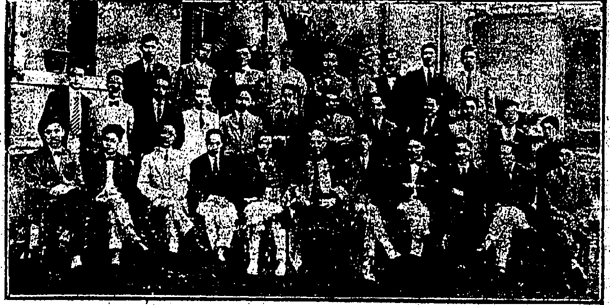
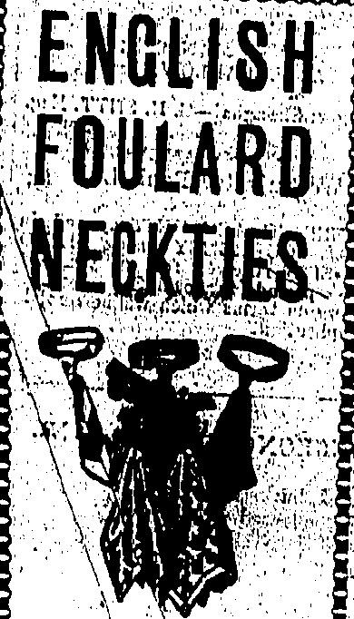

NEW DEPARTURE BALL BEARINGS:

We have a comprehensive stock. It includes Bearings for Bulk, Cadillac, Chandler, Chevrolet, Cleveland, Dodge Brothers, Essex, Ford, Hudson, Jewett, Marmon, Maxwell, Oakland, Oldsmobile, Overland, Paige, Studebaker, Willys Knight AND most other Cars and Trucks in South China.

THE DRAGON MOTOR CAR CO., LTD.

# Uminsa Jhtril

Temperature 78, Barometer 29.79

Rainfall 0.00 in., Humidity 93

THE DOLLAR

To-day's closing rate 2/3 1/16

To-day's opening rate 2/3 1/16

PRICE, $3.00 Per Month.

Catalogues & specifications from

Sola Agents:

ALEX. ROSS & CO. (CHINA)

☀️🌥️🌥️🌥️🌥️🌥️🌥️🌥️🌥️🌥️🌥️🌥️🌥️🌥️🌥️🌥️🌥️🌥️

Men's Seamless Ribbed White

"Meroni" Half Hose, a good

Tennis Sock.

$1.95 pair.

# SHANGHAI STUDENT RIOTERS AGAIN ATTACK POLICE

DAVIE, BOAG & CO., LTD.

Bank of Canton Building.

Samples and particulars on application.

FOR REAL FINE MAJONG SETS MADE OF IVORY ANB BONE SOLD AT Lowest Possible Prices SUNG SAN CHAN, 140, Wallington Street, 1st Dist. SAM PAI LaU, Ghaing Ks Long, Shanghai

## STREET BATTLE

POLICE OPEN FIRE

Shanghai is reported to be calm after further exciting events yesterday when the student rioters again came into serious conflict with the police.

FIGHT IN STREET.

Coincidently with the arrival of Prince George who is going to Weihaiwei to-morrow, the anti-Japanese rioting was resumed this morning.

As a result the Municipal Council declared a state of emergency.

An excited meeting of 1,500 students and workers at the Chinese Chamber of Commerce yesterday evening forced, the Chairman of the Chamber to sign a notice calling a general strike to-day.

They also passed a resolution in favour of boycotting foreign banks and bank notes, placing the control of the municipal police in Chinese hands, withdrawal of the foreign warships from the Huangpu River, release of the arrested rioters, punishment of the "murderers" of the students and workmen, compensation for the sufferers in the riots, and suspension of municipal taxes.

An hysterical workman orator collapsed and died during a meeting.

The students this morning

massed in the street and attacked

the police, but they were met with

a deluge from a fire hose. The

rioters tore up paving stones and

hurled them at the police. A

number of police and onlookers

were injured. The police fired on

the rioters seriously wounding five,

after which the crowd dispersed.

The students are endeavouring to enlist the co-operation of the workers for stressful services, but the Municipal Council is taking measures accordingly.

A student attacked a Sikh constable in the street but was himself seriously wounded.

The city is calm at present but the situation depends to some extent on the backing which the Reds intend to give the rioters.

## Tupan'a Powers

Two long-expected mandates were issued last night. SHANGHAI, May 31.

(By Courtesy of Daily Bulletin.)

were issued last night.

The first, which deals with the powers of the Tupan of the Shanghai Municipal District, says that he must control the administrative affairs and supervise local self-government there. Included in his powers are the supervision of the district, control of the harbour, labour reforms, registration of the inhabitants and houses, control of fire brigades, anti-plague measures, public peace, foreign intercourse, certain monetary matters, public buildings and newly-constructed roads.

The Commissioner of Foreign Affairs at Shanghai and the Suprintendents of Police and Water Police and the Harbour Bureau are placed under the Tupan.

The second mandate deals with the system of local self-government in Shanghai and the powers of the local self-government institutions, which include supervision under the Tupan of roads, bridges, buildings, light trams, water works, telephones, sanitation, relief work, education, recreation, financial affairs, and the disposal and control of municipal property.

## General Strike Threat

The situation is tenser to-day, following a meeting attended by fifteen hundred, mostly students, at the Chinese Chamber of Commerce last evening, whereat many wild resolutions were passed.

A student named Ling Ku-yung presided. Members of the Chamber vainly attempted to keep down the excitement and moved that a special meeting, consisting of two delegates from each society represented, be appointed to deal with the business under discussion. The extremists demanded a motion in favour of a general strike also that the acting Chairman of the chamber, who was not present be called on to explain his attitude.

The extremists motion was carried a large unproviding action obviously being terrorised.

The meeting then sent a delegation to bring the acting Chairman who came subsequently, announcing under compulsion that the Chamber would to-day issue circular-stationing—"In view of the assassination of our brethren, we have decided on a general strike." The audience then shouted. "Let us overthrow modern Imperialism and abolish unequal treaties. Let Labourers, merchants and students join in one body and fight together in common cause."

Additional resolutions carried included: "Boycott of foreign banknotes; withdrawal of Chinese deposits from foreign banks; control of the Municipal police to be placed in Chinese hands; withdrawal of foreign war"

### OUR KING. To-morrow's Birthday Ceremony

## PARADE OF TROOPS

A replicon on a miniature scale, though without the colour of the imposing scenes which are witnessed at the tooput of the colours by the Guard out White-hall...will be wasassed on the grounds of the Manking Cricket Club to-morrow working on the occasion of the thday of His Majesty the King.

Representative detachments from all units, the East Surreys, R.E.'s, R.G.A., Punjab and the local Volunteer Corps will march under the command of their respective officials to be in position by 9 a.m. Command will be taken by H.F. the Officer Commanding the Tops in China, Major General C.C. Ward, C.B., C.M.G., and the order to present will be given when H.E. the Governor, Sir R.E. Stubbs, K.C.M.G., arrives on the ground. This he is due to do at 9 a.m.

The trams have ceased running and the students are endeavouring to secure the cooperation of the employees in the essential services. The Councill is declaring a state of emergency.

The inquest on those killed passed off quietly. The verdict is not yet known.

The march past and salute will

The crowds immediately fled, leaving Nanking Road practically empty except for the police patrolling and the Volunteers with their armoured cars.

The casualties among the horors to-day were heavier than were at first realised. Altogether eighteen were shot, of whom t rec succumbed. The situation continues quiet. The inquest was a simple one and the verdict was that the deceased met their death from gunshot wounds received in rioting.

Helen From Oneside

When they were hesed this (Continued at foot of next Column)

Photo courtesy A. Fong.

The first clash occurred when the students hustled the police near Louza Station. The waiting firemen ineffectually drenched the crowd, which vigorously attacked the police. The latter threatened to use their firearms, and finally were forced to fire, four students being seriously wounded and sent to hospital.

ships from the Whangpu; release of the students and labourers arrested; trial of the murderers of the students and labourers; compensation for the sufferers; recognition of the right of labourers to strike.

A hundred small organisations which supported the strike had announced that the strike would begin at eleven this morning, and at that hour the students became active, though the strike was virtually abortive.

During the hysterical proceedings, Ziu Wu-ding, an employee of the Commercial Press, swooned and subsequently died.

This morning, Nanking Road was filled with moving crowds with armed police guarding strategic points and Chinese shops which did not close, as the students were menacing the latter.

The Chamber of Commerce has since informed the police that it does not approve of a general strike.

## Another Clash

University students of Morrison Hall (Lendon Mission Society). In the centre of the front row is the waarden, the Rev. Dr. T. W. Penree, LL.D. O.B.E.

## DOCK

## AN INTERESTING UNIVERSITY HOSTEL GROUP

constitute the remainder of the proceedings which it is anticipated will last about three-quarters of an hour.

A ball will be given at Government House in the evening.

## EMPRESS OF AUSTRALIA

The Empress of Australia will arrive in Hongkong from Canada via Japan ports and Shanghai at 6 p.m. on Thursday; instead of at 6 p.m. on Wednesday as previously advised, and will dock at Kowloon Wharf, at her usual berth.

## SHARE POINTS

Owing to the late arrival of the s.s. Empress of Australia the marriage of Mr. Nowell Bernard White and Miss Pearl C. Thompson will not take place until Saturday. The ceremony is to take place St. John's Cathedral at 3 o'clock and will be followed by a reception on the Hongkong Hotel Roof Garden.

morning the rioters vigorously bombarded the police and firemen with upturned metal, injuring a number, including no lookers. The latter were hemmed in by the massing rioters, who filled the street.

## Shareholders

At noon a student who attacked a Sikh constable in a side street was shot and seriously injured.

TO-DAY'S MEETING.

An extraordinary general meeting of the Hongkong and Vhampa Dock Company, Limited, was held this morning for the purpose of confirming as special resolutions the resolutions in regard to the raising of new capital passed at a meeting held a few weeks ago.

Dr. F. H. Kew drew the attention of Mr. D. G. M. Bernard, the Chairman, to the wording of the resolution under which the directors were empowered to dispose of the unissued new shares as they thought fit. It was to be presumed, he said, that the shareholders were to go given the first opportunity of taking up the shares when it was decided to issue them.

Causal at present prevail, but the situation depends upon the extent of the outside backing the rioters are receiving.

According to Chinese reports, $70,000 recently reached Shanghai for the purpose of subsidising the rioters.

The Council is prepared for almost any eventuality, and intends to hold a special meeting of rate-payers to tomorrow some of the resolutions of which the student proclamations rigorously oppose.

There were minor disturbances in the outlying districts this evening. Some arrests were made but there were uncasualties. Otherwise the city is further but considerable interest which is to the right of those arrested tomorrow.

Questions relating to the disposal of the unissued new shares in connection with the raising by the Doc Company of new capital were mentioned at a meeting to-day, the opinion being expressed that the shareholders were not sufficiently safeguarded by the phrasing of the resolution.

The Chairman: That would be a matter entirely for the directors. For instance, if we had fifty shares how could we offer them en bloc?

Dr. Kew: It is not a question of fifty but many more than fifty. I think they ought to be offered to shareholders and if they are not taken up the directors would do as they like with them. That seems to me the fair thing to do. I am referring to the unissued shares it is not proposed to deal with in the present issue.

The Chairman said he had only just realised Dr. Kew was referring to the unissued shares. He was afraid he could not bind his successors.

Dr. Kew: The shares may go up and I think the shareholders should have the chance before the general public. The shares might go up to premium and under the resolution the directors might take them all, for all the shareholders are to know.

The Chairman asked Dr. Kew

## COURT MARTIAL

if he wished to move an amend-

Gunner Birbeck of Lyemum Battery who was alleged to have deserted on May 15, and to have given himself up at Kowloon City four days later, was charged with desertion and insubordination at a district court martial at Victoria Barracks this morning.

The insubordination clause was inserted owing to an alleged statement at a preliminary hearing of the case against him that he refused to soldier any more.

Lieut M. J. Richards on his behalf contended that it had not been proved that the prisoner was not on duty at any period during the days in question and as regarded the alleged insubordination as the statement attributed to the prisoner had been made during the hearing of the case he held that it was not evidence.

The sentence of the Court was a final not divulged.

DrKew: Cannot you have the object in recorded in the minutes and considered at the board meeting?

The Chairman: No minute issued by the directors would be binding.

Dr. Kew: I do not wish to bind them; merely to jog their memories.

The Chairman: do not think the directors would need that.

After consultation with fellow directors the Chairman said that a minute could be recorded that it was the expressed "wish that shareholders should be given the choice." From the point of view of equity the shareholders could depend that the directors would not take them themselves.

Mr. P. M. da Silva: But that minute will not be binding.

The Chairman then put the resolutions and on Mr. da Silva seconding they were passed with no dissentients.

In explaining the resolutions prior to that after Mr. R. M. Dyer, Chief Manager, had read them, the Chairman had said:

Gentlemen,—The object of this meeting is to confirm as special resolutions the resolutions which were passed as extraordinary resolutions at the meeting of the Company held on May 18 last. As I then explained, the purpose of the resolutions is to raise further capital for the objects specified in the Chairman's speech at the annual general meeting held on March 30 last and in order to give effect to this it is necessary to alter Article 17 which at present limits the extent of a member's holding of shares. Sixty thousand of the new shares will be offered at once to the present shareholders at a premium of $10 per share in the manner indicated in the resolutions and the remaining—unissued shares will be subsequently dealt with as the Directors think fit.

I do not think there is anything further with which I need deal but if any shareholder would like to ask questions or seek any explanation, I shall be pleased to endeavour to answer such questions and give such explanation to the best of my ability.

It no questions are asked or explanation sought, I shall assume that you approve of the alterations in the Articles of Association as presented, and will thereupon propose the resolutions regarding the same which are set out in the notice convening this meeting.

Supporting the Chairman at the meeting were Messrs. A. H. White, T. G. Weall, A. Cameron, R. M. Dyer, Chief Manager, R. F. Mattingley, Company Solicitor, and E. L. Hosie, Company Secretary. Shareholders present were Messrs. G. P. Lammer, N. V. Croucher, H. Burkitt, P. M. N. Silva, Tang Shiu-kin, Tang Chignon and Dr. F. H. Kew.

## COOLIE KILLED

A fatal accident occurred at the junction of Queen's Road West and Pokfulam Road at 10.30 last night in which a motor car belonging to Mr. Foon Luk-chi, a well-known Chinese resident, was concerned according to the report given by the Police this morning the motor car ran into a pavement while sound cools were sleeping. One of the men was killed up, rights, and another was taken in hospital with severe injuries.

## 0

We constantly evolve new stocks of these blish twill silk bow and wend ties. The designs and curing represent the last from London, whilst the quite fast. Roulard are thin yet strong and round the collar is making them the ideal for hot weather.

## Call and see them

Silk Handkerchiefs in beautiful colourings are also being shown:

## MACKINTOSH

HOT WEATHER NEED NOT WORRY

## WHEN YOU CAN

## OBTAIN

## ICE COLD DRINKS

## AND

## DELICIOUS

## ICE CREAM

MORINAGA'S SODA FOUNTAIN

Asmatic Bldg. Tel. C.4702