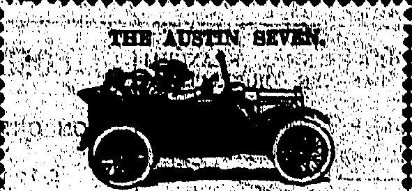
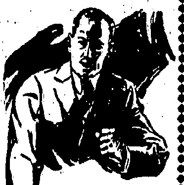
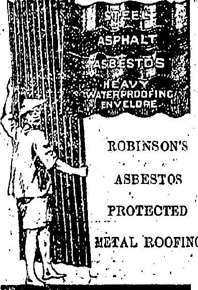
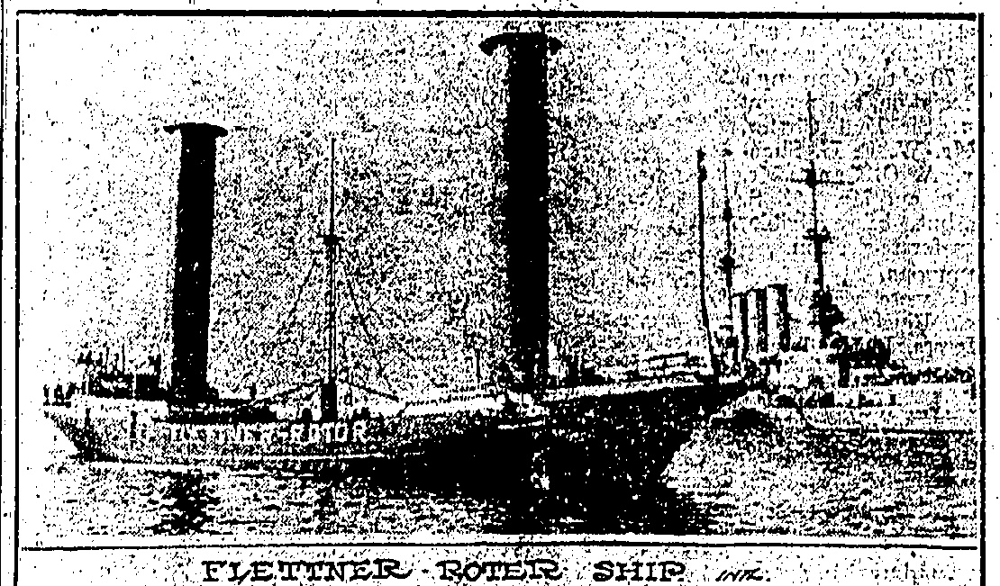
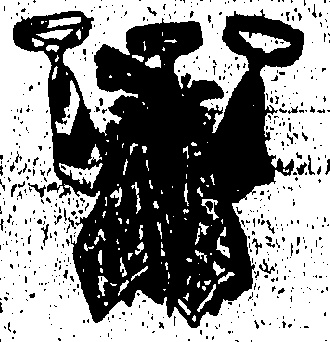

THE DRAGON MOTOR CAR CO., LTD.

Telephone Central 1246 or 1247.

33 Wong Nel Chung Road...Happy Valley.

# China தைவி

Temperature 78, Barometer 29.58

Rainfall 0.00 in., Humidity 95

E STABLISHED THE DOLLAR.

,513 HONGKONG, FRIDAY, JUNE 5, 1925.

To-day's closing rate 2/3 5/16

To-day's opening rate 2/3 5/16

PRICE, $3.00 Per Month

Catalogues & specifications from

ALEX. ROSS & CO. (CHINA), LTD.

☀️🌥️🌥️🌥️🌥️🌥️🌥️🌥️🌥️🌥️🌥️🌥️🌥️

## ◇◇◇◇◇◇◇◇◇◇◇◇

## GENTS SOCKS

## SUMMER USE

Extra spliced, Hard Wearing. All sizes.

Men's White Cushmore finished

Half Hose. Ulshrinkable.

All sizes.

Men's White "Meroni" Half Home, Extra spiced heels and toad. Unabridkable.

Men's Seamless Ribbed White

"Meroni" Half Hose, a good

Tennis Sock

$1.95 pair.

The Gent's Outfitters HONGKONG.

◇◇◇◇◇◇◇◇◇◇◇◇◇◇◇

DAVIE, BOAG & CO., LTD.

Bank of Canton Building.

Samples and particulars on application.

FOR REAL FINE MAJONG SETS MADE OF IVORY AND BONE SOLD AT Lowent Possible Prices SUNG SAN CHAN, 140 Wollington Street Agent: SAM FAL LAIL Obesity Ks Lung.

## HUNDRED MORE FOREIGN

## CRUISERS MOVING

SAILS

JAPAN ALSO HELPS:

## British Trade

Three hundred American marines and two hundred Japanese have sailed from Manila and Sasebo, respectively, for Shanghai where the situation still remains serious.

## TO ARRIVE ON SUNDAY

### Reuter's Service.)

The U.S.S. Jason, with 300 marines, sailed from Cavite to Shanghai yesterday and will arrive on Sunday.

The small cruiser Tatsuta is sailing from Sasebo, with 200 marines, to Shanghai late this afternoon.

The Japanese cruiser Tatsuta has sailed for Shanghai with 200 marines aboard.

All the messengers and practically all the Chinese operators employed by the Great Northern Telegraph and Eastern Extension Telegraph Companies have gone on strike.

Shanghai, June 4.

No attacks on foreigners are reported to-day, but the strike is spreading.

Practically all the Chinese staffs of the Eastern Extension and the Great Northern Telegraphs have joined the strike.

The newspapers estimate that 100,000 men are out, chiefly coolies.

The Students' attempts to secure a general strike including the shopkeepers have failed.

It is noteworthy that demonstrations up to the present have been almost entirely anti-British and anti-Japanese.

### Peking Strike Fails. Peking Juno

Reuter learns in well-informed quarters that while the dangerous possibilities in the situation at Shanghai have not diminished, up to the present there has not been any united action on the part of the Powers apart from the dispatch of ships and the landing of bluejackets and marines.

It necessary further troops could be despatched from Indo-China and from Manila, but intervention is not desired and up to the present has not been suggested.

## Home Labour Folly

Following the receipt of an appeal for help from the Shanghai Strike Committee, the Council of the Trade Union Congress has requested the Premier, Mr. Stanley Baldwin, to withdraw the British armed forces involved in the Shanghai dispute.

I've Council is shortly holding a special meeting to consider the situation.

Those to Blame.

The Italian Minister on behalf of the Diplomatic Corps has replied to the note from the Wajchiaopu declaring that the police only fired when they were attacked. The responsibility therefore rests with the demonstrators.

The Minister points out that the Mixed Court before which the culprits were summoned released them on bail.

The reply hopes the Chinese Government will envisage the incident with the same conciliatory spirit as the diplomats with a view to the restoration of order at the soonest possible moment.

#### Text of the Note. Peking. June

The following is the translation of the Note handed to the Walchaiopu this afternoon by the Italian Minister as the Senior Minister of the interested Powers:—“I have the honour in the name of my colleagues and my own to acknowledge receipt of the letter dated June 1 which you were good enough to address to me with regard to the disorders which occurred in the International Settlement of Shanghai on May 80.

"While deploring with you the events referred to during which a certain number of unfortunate victims were killed and others were seriously injured we believe it is necessary to specify the circumstances under which the police were led to make use of their arms.

## Crowd's Attack

“Demonstrating groups who were in the act of distributing subversive and clearly anti-foreign pamphlets in the concession on the Nanking Road were requested to disperse and the leaders were arrested.

“The crowd which refused to obey the orders of the police then

## PRINCE HERE

BOUND FOR ENGLAND.

JAPANESE EMPIEROR'S BLOND BON.

A distinguished visitor passing through Hongkong is Prince Chichibu, who arrived in the harbour at 8.30 this morning on board the Japanese cruiser Idizumo commanded by Captain Shiseoka.

attacked them and attempted an assault on the police station.

## 3 ,000-TON ROTOR SHIP TO BE BUILT

Prince, Chichib, who is 24 years of age, is the second son of H.I.M. the Emperor of Japan and, unlike his brother, the Prince Regent, has not done any travelling before. His departure from Tokyo on May 25, for Yokohama was witnessed by cheering crowds, who lined the entire route from the Palace. The Imperial Prince, foreign diplomats and notable personages bade the Prince farewell at the station, some of those present including Sir Charles Eliot the British

The Waichaiopu has sent another Note to the Italian Minister complaining of further cases of the Shanghai police firing on the people more of whom have been killed and injured; alleging that the shooting was not justified; declaring that the attitude of the authorities of Shanghai is causing the strikes; and urging the representative of the Powers to send without delay the most emphatic instructions to their consuls to cease the practice of firing in order to avoid further bloodshed.

According to an Exchange Berlin message, the Weser Shipbuilding Company has received an order to build a 3,000-tons rotor cargo ship. Both the naval authorities and the German shipping companies are interested in this vessel, as it is desired to obtain fuller experience of the rotor principle. The "rotor-ship," invented by the German Herr Flettner, has, in place of sails, two cylinders 60 feet high and 9 feet in diameter. These cylinders, revolved by a small motor, turn in the wind about 120 times a minute, and, as the propelling force of wind on a revolving body is much greater than on a stationary body, it is claimed by the inventor that this "rotors" have 15 times the efficiency of sails.

## (Signed) CERRUTI

Earlier cables relating to the Shanghai riots will be found on page 9.

Damage to the extant of 3200 was chusd by a collision between a cargo junk and the steam launch Man Yoo in the harbour yesterday.

"It was then, and only then, that the police made use of their arms."

## Good For Evil

“While awaiting further information we hope the Chinese Government will continue to envisage this unfortunate incident with the same conciliatory spirit which inspires the interested diplomatic representatives to the end that order and tranquility may be re-established in Shanghai with the least possible delay.”

“It would therefore result that the responsibility of the events which followed rests on the demonstrators and not on the authorities of the Concession.

“On the other hand subsequently the same authorities gave proof that they were very well disposed, and the Mixed Court before whom the culprits were summoned ordered their provisional release on bail.”

## Another Protest

Ambassador, a companying the Prince to Yokohama. On arriving

he cruiser Idzumo, where the Prince Regent, who had been inspecting the reconstruction work, welcomed the defacting Prince and bade him farewell. The Idzumo weighed one for amidst cheers from the crowd, which included representatives of athletic associations on the boats. The vessel then proceeded via the Loochoos and Formosa before arriving in Hongkong.

Mr. Y. Murakami (Japanese Consil General) accompanied by Captain R. Neville, A.D.G., representing His Excellency the Governor, boarded the vessel and landed at Murray Pier at 10 o'clock this morning with the royal visitor and his party, which consists of his chief of staff, Vicount Matsudara, and about ten other members. The landing was quite informal and the Prince and his party then left for the residence of the Japanese Consul General at Conduit Road. The Prince will be the guest of Mr. Murakami until tomorrow morning when he will embark on the S.S. Hakozaki Mura for England. Prince Chichibu's education has been in the hands of French professors, and naturally he is a fluent speaker of that language. The object of the Prince's visit to England is to prosecute his studies in English and generally acquire a knowledge of European customs. During the time the Prince will be away—about two years—it is stated that he will be staying in London with any eminent British family who are friends of the Japanese sovereign.

The cruiser Idzumo will be returning to Japan in about ten days' time.

## CANTON'S DREAD

## RIFLE INTERPORT

Shanghai's score in the inter-port rifle contest is 921 points which therefore beats Hong-

## FIGHTING EXPECTED TO-NIGHT

A STATE OF WAR

Who Will Strike The First Blow?

A resident at Taishatautells me

Fighting is expected to break out in Canton either to-night or to-morrow morning, though it is just possible a conflict may even yet be averted.

LATEST REPORTS

Conditions in Canton this evening are tantamount to a state of war. Everywhere the Yunnanese are on the qui vive and thousands of troops have been stationed at strategical points. To-day it appears as if the Yunnanese and Kwangsi-ites (the mercenaries with whom the Communist adherents of the late Dr. Sun Yat-sen have found fault) are merely sitting tight and awaiting the next move by the other side.

## STOP PRESS

## MORE SHANGHAI RIOTS

## Shanghai, June 6

Japanese managers yesterday fired on the rioters wounding five when a crowd attempted to seize Japan-China Cotton Mill at Pointung across the Huangpu River.

A Japanese inspector and a large force of police drove out the rioters after windows and furniture had been broken. The machinery was not injured.

## LATEST NEWS

### (Rcutter's Service.)

The Secretary of the Shanghai Municipal Council says that during the raids on premises occupied by strike leaders, the Police secured irrefutable evidence that Bolshevik money and activities were behind the present disturbances.

It was further established that Russians are merely using the Chinese students as tools in efforts to extend the Moscow programme.

Evidence will be made known in due time.

The strike has been considerably extended overnight. Few, if any, of the “boys” and coolies remain in commercial employment.

Foreigners brought out arranged issues of the morning papers which estimate the strikers yesterday evening to be 150,000. The strikers are resorting to the old-time Chinese method of threatening the lives of families of workers remaining loyal to that the place is strongly fortified and that guards are constantly being increased there, all ready for action.

Further reports have trickled into the city of clashes on the East River sector. No decision has been reached.

Also at Sun Kai, on the North River, engagements are stated to have taken place.

From one source I am told that the mercenaries entertain no fears regarding the possibility of General Hsu Shung-chi marching victoriously back from Swatow, along the Canton-Kowloon Railway.

General Chan Kwing-ming may have a say in this as he may use the opportunity to attack the Communist rear. However, I am also informed that the olive branch may really be extended at last, so that the opposing Cantonese factions may unite against the non-Cantonese army. To date, some of Chan's former subordinates have been incorporated in Hsu's divisions but Hsu will not leave Swatow and risk a flank attack from Chan while taking the offensive against Canton.

Residents in the eastern outskirts of Canton have been warned to leave for Shameen as fighting is expected to break out either to-night or to-morrow night as the Communists have been concentrating at several points on the river. Where the blow will be struck from all is a matter for conjecture, from my house I can see the guards being mounted at the White Cloud Mountains, once more a chain of fortifications.

Although a considerable number of merchants feel that neither side will actually fire the first shot for fear of imperilling Canton, as many more are of the opinion that the game of bluff cannot last for ever.

### Mr. Sun Fo Here

Significance may be attached to the arrival in Hongkong from Shanghai of Mr. Sun Fo, the son of the late Dr. Sun and former Mayor of Canton. It is felt that he will go on to Canton when the situation is a little clearer.

Two generals who have much influence on Canton's destiny are also reported to be in Hongkong.

It is reported that General Hsu Shung-chi, has requested. Ngai Bong-ping. (former Canton chief of police when Dr. Sun was there) to proceed to Swatow.—“Wah Tsz Yat Po.”

The cross-river ferries have stopped running. Railway traffic is at a standstill.

Instances of spasmodic firing have occurred.

Captain D. R. Kilbee of the Indo-China s.s. Waishing reports that at eleven o'clock last night, his ship was under way from Canton to Hongkong. Below Taishek Barrier, a rifleman on the river-bank opened fire at the vessel which arrived here this morning without further incident.

Prior to the departure of the Fatshan from Canton yesterday afternoon, a shot was heard on shore.

## RIVER MISHAP

HONGKONG STEAMERS COLLIDE

When the China Navigation steamer Fatshan (Hongkong-Canton) and the Tung On Go's s.a. Hangchoong (Canton Macao) were entering Canton, harbour yesterday morning, the two vessels collided.

The storm of the Hongcheng was damaged and the two seals dock rolling on the storm part of the Fatshan was carried away by an anchor. Captain Ritchin commands the Fatahad and Captain Jonkyn the Hangcheng. Both vessels left

## X0000000000000000000000000

## FOULARD NECKTIES

We constantly receive new stocks of these English twill silk bow and wide-end ties. The designs and colouring represent the latest from London, whilst the dyes are quite fast. Foulard ties are thin yet strong and slip round the collar easily, making them the ideal ties for hot weather.

Call and see them.

Silk. Handkerchips in beautiful colourings are also being shown.

## MACKINTOSH

Men's Wear Specialists

Alexandra Building.

Des Voeur Road.

(1)(2)(3)(4)(5)(6)(7)(8)(9)(10)(11)(12)(13)(14)(15)(16)(17)(18)(19)(20)(21)(22)(23)(24)(25)(26)(27)(28)(29)(30)(31)(32)(33)(34)(35)(36)(37)(38)(39)(40)(41)(42)(43)(44)(45)(46)(47)(48)(49)(50)(51)(52)(53)(54)(55)(56)(57)(58)(59)(60)(61)(62)(63)(64)(65)(66)(67)(68)(69)(70)(71)(72)(73)(74)(75)(76)(77)(78)(79)(80)(81)(82)(83)(84)(85)(86)(87)(88)(89)(90)(91)(92)(93)(94)(95)(96)(97)(98)(99)(100)(101)(102)(103)(104)(105)(106)(107)(108)(109)(110)(111)(112)(113)(114)(115)(116)(117)(118)(119)(120)(121)(122)(123)(124)(125)(126)(127)(128)(129)(130)(131)(132)(133)(134)(135)(136)(137)(138)(139)(140)(141)(142)(143)(144)(145)(146)(147)(148)(149)(150)(151)(152)(153)(154)(155)(156)(157)(158)(159)(160)(161)(162)(163)(164)(165)(166)(167)(168)(169)(170)(171)(172)(173)(174)(175)(176)(177)(178)(179)(180)(181)(182)(183)(184)(185)(186)(187)(188)(189)(190)(191)(192)(193)(194)(195)(196)(197)(198)(199)(200)(201)(202)(203)(204)(205)(206)(207)(208)(209)(210)(211)(212)(213)(214)(215)(216)(217)(218)(219)(220)(221)(222)(223)(224)(225)(226)(227)(228)(229)(230)(231)(232)(233)(234)(235)(236)(237)(238)(239)(240)(241)(242)(243)(244)(245)(246)(247)(248)(249)(250)(251)(252)(253)(254)(255)(256)(257)(258)(259)(260)(261)(262)(263)(264)(265)(266)(267)(268)(269)(270)(271)(272)(273)(274)(275)(276)(277)(278)(279)(280)(281)(282)(283)(284)(285)(286)(287)(288)(289)(290)(291)(292)(293)(294)(295)(296)(297)(298)(299)(300)(301)(302)(303)(304)(305)(306)(307)(308)(309)(310)(311)(312)(313)(314)(315)(316)(317)(318)(319)(320)(321)(322)(323)(324)(325)(326)(327)(328)(329)(330)(331)(332)(333)(334)(335)(336)(337)(338)(339)(340)(341)(342)(343)(344)(345)(346)(347)(348)(349)(350)(351)(352)(353)(354)(355)(356)(357)(358)(359)(360)(361)(362)(363)(364)(365)(366)(367)(368)(369)(370)(371)(372)(373)(374)(375)(376)(377)(378)(379)(380)(381)(382)(383)(384)(385)(386)(387)(388)(389)(390)(391)(392)(393)(394)(395)(396)(397)(398)(399)(400)(401)(402)(403)(404)(405)(406)(407)(408)(409)(410)(411)(412)(413)(414)(415)(416)(417)(418)(419)(420)(421)(422)(423)(424)(425)(426)(427)(428)(429)(430)(431)(432)(433)(434)(435)(436)(437)(438)(439)(440)(441)(442)(443)(444)(445)(446)(447)(448)(449)(450)(451)(452)(453)(454)(455)(456)(457)(458)(459)(460)(461)(462)(463)(464)(465)(466)(467)(468)(469)(470)(471)(472)(473)(474)(475)(476)(477)(478)(479)(480)(481)(482)(483)(484)(485)(486)(487)(488)(489)(490)(491)(492)(493)(494)(495)(496)(497)(498)(499)(500)(501)(502)(503)(504)(505)(506)(507)(508)(509)(510)(511)(512)(513)(514)(515)(516)(517)(518)(519)(520)(521)(522)(523)(524)(525)(526)(527)(528)(529)(530)(531)(532)(533)(534)(535)(536)(537)(538)(539)(540)(541)(542)(543)(544)(545)(546)(547)(548)(549)(550)(551)(552)(553)(554)(555)(556)(557)(558)(559)(560)(561)(562)(563)(564)(565)(566)(567)(568)(569)(570)(571)(572)(573)(574)(575)(576)(577)(578)(579)(580)(581)(582)(583)(584)(585)(586)(587)(588)(589)(590)(591)(592)(593)(594)(595)(596)(597)(598)(599)(600)(601)(602)(603)(604)(605)(606)(607)(608)(609)(610)(611)(612)(613)(614)(615)(616)(617)(618)(619)(620)(621)(622)(623)(624)(625)(626)(627)(628)(629)(630)(631)(632)(633)(634)(635)(636)(637)(638)(639)(640)(641)(642)(643)(644)(645)(646)(647)(648)(649)(650)(651)(652)(653)(654)(655)(656)(657)(658)(659)(660)(661)(662)(663)(664)(665)(666)(667)(668)(669)(670)(671)(672)(673)(674)(675)(676)(677)(678)(679)(680)(681)(682)(683)(684)(685)(686)(687)(688)(689)(690)(691)(692)(693)(694)(695)(696)(697)(698)(699)(700)(701)(702)(703)(704)(705)(706)(707)(708)(710)(711)(712)(713)(714)(715)(716)(717)(718)(719)(720)(721)(722)(723)(724)(725)(726)(727)(728)(729)(730)(731)(732)(733)(734)(735)(736)(737)(738)(739)(740)(741)(742)(743)(744)(745)(746)(747)(748)(749)(750)(751)(752)(753)(754)(755)(756)(757)(758)(759)(760)(761)(762)(763)(764)(765)(766)(767)(768)(769)(770)(771)(772)(773)(774)(775)(776)(777)(778)(779)(780)(781)(782)(783)(784)(785)(786)(787)(788)(789)(790)(791)(792)(793)(794)(795)(796)(797)(798)(799)(800)(801)(802)(803)(804)(805)(806)(807)(808)(809)(810)(811)(812)(813)(814)(815)(816)(817)(818)(819)(820)(821)(822)(823)(824)(825)(826)(827)(828)(829)(830)(831)(832)(833)(834)(835)(836)(837)(838)(839)(840)(841)(842)(843)(844)(845)(846)(847)(848)(849)(850)(851)(852)(853)(854)(855)(856)(857)(858)(859)(860)(861)(862)(863)(864)(865)(866)(867)(868)(869)(870)(871)(872)(873)(874)(875)(876)(877)(878)(879)(880)(881)(882)(883)(884)(885)(886)(887)(888)(889)(890)(891)(892)(893)(894)(895)(896)(897)(898)(899)(900)(901)(902)(903)(904)(905)(906)(907)(908)(909)(910)(911)(912)(913)(914)(915)(916)(917)(918)(919)(920)(921)(922)(923)(924)(925)(926)(927)(928)(929)(930)(931)(932)(933)(934)(935)(936)(937)(938)(939)(940)(941)(942)(943)(944)(945)(946)(947)(948)(949)(950)(951)(952)(953)(954)(955)(956)(957)(958)(959)(960)(961)(962)(963)(964)(965)(966)(967)(968)(969)(970)(971)(972)(973)(974)(975)(976)(977)(978)(979)(980)(981)(982)(983)(984)(985)(986)(987)(988)(989)(990)(991)(992)(993)(994)(995)(996)(997)(998)(999)(1000)(1001)(1002)(1003)(1004)(1005)(1006)(1007)(1008)(1009)(1010)(1011)(1012)(1013)(1014)(1015)(1016)(1017)(1018)(1019)(1020)(1021)(1022)(1023)(1024)(1025)(1026)(1027)(1028)(1029)(1030)(1031)(1032)(1033)(1034)(1035)(1036)(1037)(1038)(1039)(1040)(1041)(1

HOT WEATHER

NEED NOT WORRY

## WHEN YCU CAN

## ICE COLD DRINKS

## DELICIOUS

## ICE CREAM

## MORINAGA'S

SODA

TANG YUK, Dormer

The late SIE TIDG

14 Dagler Street

ZERAL VERMODATE