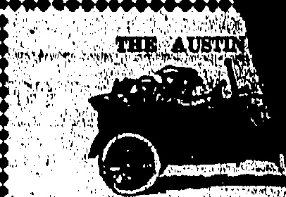
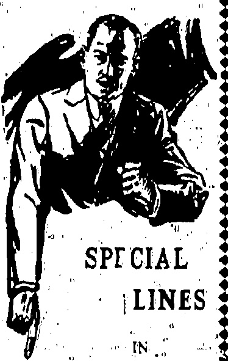
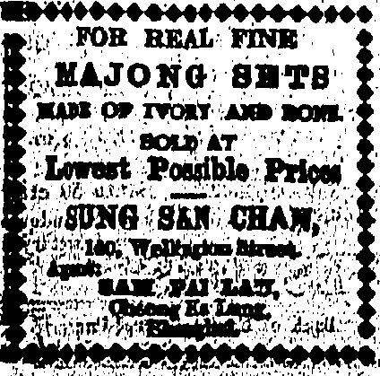
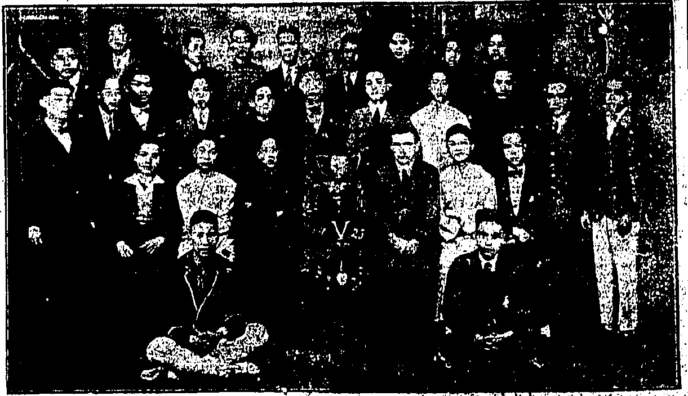
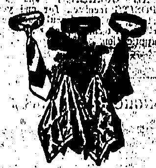
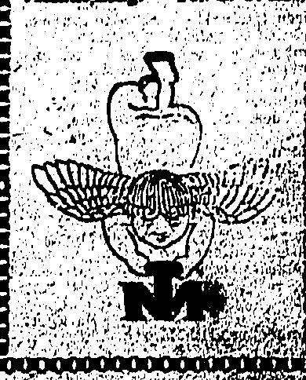

We carry an ample stock of these for Dodge Brothers, (akland, Oldsmobile, "cripps-Booth, Maxwell, Ford, Chevrolet, Marmon, Hudson, Elgin, Grant Six" Hur mobile, Resex Briscoe, Cleveland, Jewett, Buick, handler, verland and Paige Motor, ars

THE DRAGON MOTOR CAR Co., Ltd

# China

Temperature 78, Barometer 29.58

Rainfall 0.00 in., Humidity 95

ESTABLISHED

# Jhail

No. 19,514

1845

THE DOLLAR.

To-day's closing rate 2/3 5/16

To-day's opening rate 2/3 5/16

PRICE, $3.00 Per Month.

Catalogues & specifications

Solo Agenta:

ALEX. ROSS & CO. (CHINA).

◇◇◇◇◇◇◇◇◇◇◇◇◇◇◇

# SUMMER USE

Lustre Cotton Half Hose

English Make, Soft Gniab, Whites, Blacks, Grays and

Extra spiced, Fard Wearing

All sizes..

Men's White C�nmere finished

Half. Home. Unkhrinkable.

All sizes.

### $1.25 pair

Men's White "Meroni" Ealf

Men's Seamless Ribbed White

"Meroni" Half Hole, a good

Tennis Sock.

$1.95 pair.

The Gent's Outfitters

HONGKONG.

◇◇◇◇◇◇◇◇◇◇◇◇◇◇

## Sole Agents:

DAVIE, BOAG & CO., LTD.

Bank of Canton Building.

Examples and particulars on application.

## SHANGHAI QUIETER?

STRIKE SPREADS.

Evidently the Shanghai situation is much quieter as Japan has decided to postpone the sailing of the Tatsuta with 200 marine board.

DEMANDS REFUSED.

Japan Refuses To Consider Resolution.

(Reuter's Service.)

Tokio.• June 5

The Foreign Office declined to consider a resolution presented by Chinese students yesterday demanding, inter alia, the replacement of the Japanese Consuls-General in Shanghai and Tsingtao, compensation for the Shanghai casualties, punishment of the guilty, abolition of extraterritoriality and retrocession of leased territory.

Some Policemen Strike.

About 400 Chinese of the Settlement police lower ranks are absent without leave.

The absentees form less than 20 per cent sof the Chinese on the police force.

Tokyo, June 5.

Chinese students this afternoon presented a resolution to the Foreign Office demanding inter alia replacement of the Japanese Consul-Generals at Shanghai and Tsingtao, compensation for the casualties." punishment of the guilty abolition of extraterritoriality, retrocession of the released territory, and cancellation of the Taonan-fu and Tsitsihar Railway construction contract.

The Foreign Office has replied that it is impossible to consider the demands.

The Foreign Office has sent a further note to the diplomats saying that there are further reports of the police firing while the arrested men have not all been freed as requested in the first note.

The Foreign Office again requests that most urgent instructions be sent to the consular authorities at Shanghai immediately to order, cessation of the practice of firing.

## Japan Waits

The Navy Office has postponed the departure of the Tatsuta mentioned yesterday pending further developments in Shanghai.

Yesterday's cables stated that the small Japanese cruiser Tatsuta was sailing from Sasebo for Shanghai with 200 marines aboard. also that the U.S.S. Jason, with 300 marines had sailed from Cavite to Shanghai and would arrive on Sunday.

Telegram Dislocation:

Senders of telegrams are informed that telegrams to Shanghai are accepted at senders' risk only.

## Earlier Cables

The Chamber of Commerce has decided against a general strike but advocated the boycott of the goods and currency of the countries concerned in the Shanghai affair, and the withdrawal of deposits from their banks. The American and Chinese staffs of the Y.M.C.A. and other American Missionary institutions have passed a resolution expressing the opinion that the evidence so far does not show any ground that the firing by the police was necessary.

## Tsingtao Parallel

Mail reports of the Japanese Mill Strike at Taingtao last week show that the Chinese police were unable to suppress the riots until they fired on the strikers

The Shanghai and Tsingtao cases are strikingly parallel, but the Chinese have ignored the Tsingtao incident.

Strike circulars to-day call on domestic servants to walk out. Unemployed Russians, Boy Scouts, women and foreign volunteers are minimising the effects of the strike. As regards Foreigners, the food situation is merely inconvenient; whereas the poorer Chinese are beginning to feel the pinch of hunger and the danger is looming up of their looting provision shops.

Peking Boycott Delayed.

Hithorto there has been no sign of any steps being taken to carry out the reported decision of the local Chamber of Commerce to institute a boycott against the countries concerned in the Shanghai affair.

It is learned that Tuan Chi-jui (the Chief Executive) has tele-

## CHINA'S FATE

## Soviet's Hidden

CIVIL WAR PLAN.

The Bataan is a steel twin screw passenger and cargo ferry boat for service between Manila and the province of Bataan at the Northern side of Manila Bay.

The small steamer Bataan recently launched by Messrs Balley & Co., Ltd., for Teodoro Yangco of Manila sailed for that port on Thursday after undergoing her official trials.

#### BUILT BY W. S. BAILEY & COMPANY

Foreigners brought out abridged issues of the morning papers which estimate the strikers yesterday evening to be 150,000.

The strikers are resorting to the old-time Chinese method of threatening the 'lives of families of workers' remaining loyal to foreigners.

## FAST VESSEL

The vessel is 141 feet long, built under Lloyds survey and Huted with an oil fired boiler and two sets of high speed triple expansion engines having independent pump. The official trials were highly satisfaction, an average speed of over 13½ knots being easily obtained against the contract speed of 12 knots only.

SEEKING. THE COMPLETE

Evidence will be made known in due time.

The strike has been considerably extended overnight. Few, if any, of the “boys” and coolies remain in commercial employment.

Photo by Mao Fong.

The fifth form at St. Stephen's College with trophies, the right of the prizes is Mr. H. G. Hughes, B.A. (Cantab).

graphed to Marshal Chang Tso-lin, "inviting him to come to Peking or send a delegate to discuss the situation. The Corps Diplomatique are meeting" tomorrow to consider the second protest from the Waichiaopu.

It was further established that Russians are merely using the Chinese students as tools in efforts to extend the Moscow programme.

(Reuter's Service.)

The Secretary of the Shanghai Municipal Council says that during the raids on premises occupied by strike leaders, the Police secured irrefutable evidence that Bolshevik money and activities were behind the present disturbances.

## Shanghai, June 5

\(i\gamma_{1}\gamma_{2}\gamma_{3}\gamma_{4}\gamma_{5}\gamma_{6}\gamma_{7}\gamma_{8}\gamma_{9}\gamma_{10}\gamma_{11}\gamma_{12}\gamma_{13}\gamma_{14}\gamma_{15}\gamma_{16}\gamma_{17}\gamma_{18}\gamma_{19}\gamma_{20}\gamma_{21}\gamma_{22}\gamma_{23}\gamma_{24}\gamma_{25}\gamma_{26}\gamma_{27}\gamma_{28}\gamma_{29}\gamma_{30}\gamma_{31}\gamma_{32}\gamma_{33}\gamma_{34}\gamma_{35}\gamma_{36}\gamma_{37}\gamma_{38}\gamma_{39}\gamma_{40}\gamma_{41}\gamma_{42}\gamma_{43}\gamma_{44}\gamma_{45}\gamma_{46}\gamma_{47}\gamma_{48}\gamma_{49}\gamma_{50}\gamma_{51}\gamma_{52}\gamma_{53}\gamma_{54}\gamma_{55}\gamma_{56}\gamma_{57}\gamma_{58}\gamma_{59}\gamma_{60}\gamma_{61}\gamma_{62}\gamma_{63}\gamma_{64}\gamma_{65}\gamma_{66}\gamma_{67}\gamma_{68}\gamma_{69}\gamma_{70}\gamma_{71}\gamma_{72}\gamma_{73}\gamma_{74}\gamma_{75}\gamma_{76}\gamma_{77}\gamma_{78}\gamma_{79}\gamma_{80}\gamma_{81}\gamma_{82}\gamma_{83}\gamma_{84}\gamma_{85}\gamma_{86}\gamma_{87}\gamma_{88}\gamma_{89}\gamma_{90}\gamma_{91}\gamma_{92}\gamma_{93}\gamma_{94}\gamma_{95}\gamma_{96}\gamma_{97}\gamma_{98}\gamma_{99}\gamma_{100}\gamma_{101}\gamma_{102}\gamma_{103}\gamma_{104}\gamma_{105}\gamma_{106}\gamma_{107}\gamma_{108}\gamma_{109}\gamma_{110}\gamma_{111}\gamma_{112}\gamma_{113}\gamma_{114}\gamma_{115}\gamma_{116}\gamma_{117}\gamma_{118}\gamma_{119}\gamma_{120}\gamma_{121}\gamma_{122}\gamma_{123}\gamma_{124}\gamma_{125}\gamma_{126}\gamma_{127}\gamma_{128}\gamma_{129}\gamma_{130}\gamma_{131}\gamma_{132}\gamma_{133}\gamma_{134}\gamma_{135}\gamma_{136}\gamma_{137}\gamma_{138}\gamma_{139}\gamma_{140}\gamma_{141}\gamma_{142}\gamma_{143}\gamma_{144}\gamma_{145}\gamma_{146}\gamma_{147}\gamma_{148}\gamma_{149}\gamma_{150}\gamma_{151}\gamma_{152}\gamma_{153}\gamma_{154}\gamma_{155}\gamma_{156}\gamma_{157}\gamma_{158}\gamma_{159}\gamma_{160}\gamma_{161}\gamma_{162}\gamma_{163}\gamma_{164}\gamma_{165}\gamma_{166}\gamma_{167}\gamma_{168}\gamma_{169}\gamma_{170}\gamma_{171}\gamma_{172}\gamma_{173}\gamma_{174}\gamma_{175}\gamma_{176}\gamma_{177}\gamma_{178}\gamma_{179}\gamma_{180}\gamma_{181}\gamma_{182}\gamma_{183}\gamma_{184}\gamma_{185}\gamma_{186}\gamma_{187}\gamma_{188}\gamma_{189}\gamma_{190}\gamma_{191}\gamma_{192}\gamma_{193}\gamma_{194}\gamma_{195}\gamma_{196}\gamma_{197}\gamma_{198}\gamma_{199}\gamma_{200}\gamma_{201}\gamma_{202}\gamma_{203}\gamma_{204}\gamma_{205}\gamma_{206}\gamma_{207}\gamma_{208}\gamma_{209}\gamma_{210}\gamma_{211}\gamma_{212}\gamma_{213}\gamma_{214}\gamma_{215}\gamma_{216}\gamma_{217}\gamma_{218}\gamma_{219}\gamma_{220}\gamma_{221}\gamma_{222}\gamma_{223}\gamma_{224}\gamma_{225}\gamma_{226}\gamma_{227}\gamma_{228}\gamma_{229}\gamma_{230}\gamma_{231}\gamma_{232}\gamma_{233}\gamma_{234}\gamma_{235}\gamma_{236}\gamma_{237}\gamma_{238}\gamma_{239}\gamma_{240}\gamma_{241}\gamma_{242}\gamma_{243}\gamma_{244}\gamma_{245}\gamma_{246}\gamma_{247}\gamma_{248}\gamma_{249}\gamma_{250}\gamma_{251}\gamma_{252}\gamma_{253}\gamma_{254}\gamma_{255}\gamma_{256}\gamma_{257}\gamma_{258}\gamma_{259}\gamma_{260}\gamma_{261}\gamma_{262}\gamma_{263}\gamma_{264}\gamma_{265}\gamma_{266}\gamma_{267}\gamma_{268}\gamma_{269}\gamma_{270}\gamma_{271}\gamma_{272}\gamma_{273}\gamma_{274}\gamma_{275}\gamma_{276}\gamma_{277}\gamma_{278}\gamma_{279}\gamma_{280}\gamma_{281}\gamma_{282}\gamma_{283}\gamma_{284}\gamma_{285}\gamma_{286}\gamma_{287}\gamma_{288}\gamma_{289}\gamma_{290}\gamma_{291}\gamma_{292}\gamma_{293}\gamma_{294}\gamma_{295}\gamma_{296}\gamma_{297}\gamma_{298}\gamma_{299}\gamma_{300}\gamma_{301}\gamma_{302}\gamma_{303}\gamma_{304}\gamma_{305}\gamma_{306}\gamma_{307}\gamma_{308}\gamma_{309}\gamma_{310}\gamma_{311}\gamma_{312}\gamma_{313}\gamma_{314}\gamma_{315}\gamma_{316}\gamma_{317}\gamma_{318}\gamma_{319}\gamma_{320}\gamma_{321}\gamma_{322}\gamma_{323}\gamma_{324}\gamma_{325}\gamma_{326}\gamma_{327}\gamma_{328}\gamma_{329}\gamma_{330}\gamma_{331}\gamma_{332}\gamma_{333}\gamma_{334}\gamma_{335}\gamma_{336}\gamma_{337}\gamma_{338}\gamma_{339}\gamma_{340}\gamma_{341}\gamma_{342}\gamma_{343}\gamma_{344}\gamma_{345}\gamma_{346}\gamma_{347}\gamma_{348}\gamma_{349}\gamma_{350}\gamma_{351}\gamma_{352}\gamma_{353}\gamma_{354}\gamma_{355}\gamma_{356}\gamma_{357}\gamma_{358}\gamma_{359}\gamma_{360}\gamma_{361}\gamma_{362}\gamma_{363}\gamma_{364}\gamma_{365}\gamma_{366}\gamma_{367}\gamma_{368}\gamma_{369}\gamma_{370}\gamma_{371}\gamma_{372}\gamma_{373}\gamma_{374}\gamma_{375}\gamma_{376}\gamma_{377}\gamma_{378}\gamma_{379}\gamma_{380}\gamma_{381}\gamma_{382}\gamma_{383}\gamma_{384}\gamma_{385}\gamma_{386}\gamma_{387}\gamma_{388}\gamma_{389}\gamma_{390}\gamma_{391}\gamma_{392}\gamma_{393}\gamma_{394}\gamma_{395}\gamma_{396}\gamma_{397}\gamma_{398}\gamma_{399}\gamma_{400}\gamma_{401}\gamma_{402}\gamma_{403}\gamma_{404}\gamma_{405}\gamma_{406}\gamma_{407}\gamma_{408}\gamma_{409}\gamma_{410}\gamma_{411}\gamma_{412}\gamma_{413}\gamma_{414}\gamma_{415}\gamma_{416}\gamma_{417}\gamma_{418}\gamma_{419}\gamma_{420}\gamma_{421}\gamma_{422}\gamma_{423}\gamma_{424}\gamma_{425}\gamma_{426}\gamma_{427}\gamma_{428}\gamma_{429}\gamma_{430}\gamma_{431}\gamma_{432}\gamma_{433}\gamma_{434}\gamma_{435}\gamma_{436}\gamma_{437}\gamma_{438}\gamma_{439}\gamma_{440}\gamma_{441}\gamma_{442}\gamma_{443}\gamma_{444}\gamma_{445}\gamma_{446}\gamma_{447}\gamma_{448}\gamma_{449}\gamma_{450}\gamma_{451}\gamma_{452}\gamma_{453}\gamma_{454}\gamma_{455}\gamma_{456}\gamma_{457}\gamma_{458}\gamma_{459}\gamma_{460}\gamma_{461}\gamma_{462}\gamma_{463}\gamma_{464}\gamma_{465}\gamma_{466}\gamma_{467}\gamma_{468}\gamma_{469}\gamma_{470}\gamma_{471}\gamma_{472}\gamma_{473}\gamma_{474}\gamma_{475}\gamma_{476}\gamma_{477}\gamma_{478}\gamma_{479}\gamma_{480}\gamma_{481}\gamma_{482}\gamma_{483}\gamma_{484}\gamma_{485}\gamma_{486}\gamma_{487}\gamma_{488}\gamma_{489}\gamma_{490}\gamma_{491}\gamma_{492}\gamma_{493}\gamma_{494}\gamma_{495}\gamma_{496}\gamma_{497}\gamma_{498}\gamma_{499}\gamma_{500}\gamma_{501}\gamma_{502}\gamma_{503}\gamma_{504}\gamma_{505}\gamma_{506}\gamma_{507}\gamma_{508}\gamma_{509}\gamma_{510}\gamma_{511}\gamma_{512}\gamma_{513}\gamma_{514}\gamma_{515}\gamma_{516}\gamma_{517}\gamma_{518}\gamma_{519}\gamma_{520}\gamma_{521}\gamma_{522}\gamma_{523}\gamma_{524}\gamma_{525}\gamma_{526}\gamma_{527}\gamma_{528}\gamma_{529}\gamma_{530}\gamma_{531}\gamma_{532}\gamma_{533}\gamma_{534}\gamma_{535}\gamma_{536}\gamma_{537}\gamma_{538}\gamma_{539}\gamma_{540}\gamma_{541}\gamma_{542}\gamma_{543}\gamma_{544}\gamma_{545}\gamma_{546}\gamma_{547}\gamma_{548}\gamma_{549}\gamma_{550}\gamma_{551}\gamma_{552}\gamma_{553}\gamma_{554}\gamma_{555}\gamma_{556}\gamma_{557}\gamma_{558}\gamma_{559}\gamma_{560}\gamma_{561}\gamma_{562}\gamma_{563}\gamma_{564}\gamma_{565}\gamma_{566}\gamma_{567}\gamma_{568}\gamma_{569}\gamma_{570}\gamma_{571}\gamma_{572}\gamma_{573}\gamma_{574}\gamma_{575}\gamma_{576}\gamma_{577}\gamma_{578}\gamma_{579}\gamma_{580}\gamma_{581}\gamma_{582}\gamma_{583}\gamma_{584}\gamma_{585}\gamma_{586}\gamma_{587}\gamma_{588}\gamma_{589}\gamma_{590}\gamma_{591}\gamma_{592}\gamma_{593}\gamma_{594}\gamma_{595}\gamma_{596}\gamma_{597}\gamma_{598}\gamma_{599}\gamma_{600}\gamma_{601}\gamma_{602}\gamma_{603}\gamma_{604}\gamma_{605}\gamma_{606}\gamma_{607}\gamma_{608}\gamma_{609}\gamma_{610}\gamma_{611}\gamma_{612}\gamma_{613}\gamma_{614}\gamma_{615}\gamma_{616}\gamma_{617}\gamma_{618}\gamma_{619}\gamma_{620}\gamma_{621}\gamma_{622}\gamma_{623}\gamma_{624}\gamma_{625}\gamma_{626}\gamma_{627}\gamma_{628}\gamma_{629}\gamma_{630}\gamma_{631}\gamma_{632}\gamma_{633}\gamma_{634}\gamma_{635}\gamma_{636}\gamma_{637}\gamma_{638}\gamma_{639}\gamma_{640}\gamma_{641}\gamma_{642}\gamma_{643}\gamma_{644}\gamma_{645}\gamma_{646}\gamma_{647}\gamma_{648}\gamma_{649}\gamma_{650}\gamma_{651}\gamma_{652}\gamma_{653}\gamma_{654}\gamma_{655}\gamma_{656}\gamma_{657}\gamma_{658}\gamma_{659}\gamma_{660}\gamma_{661}\gamma_{662}\gamma_{663}\gamma_{664}\gamma_{665}\gamma_{666}\gamma_{667}\gamma_{668}\gamma_{669}\gamma_{670}\gamma_{671}\gamma_{672}\gamma_{673}\gamma_{674}\gamma_{675}\gamma_{676}\gamma_{677}\gamma_{678}\gamma_{679\gamma_{680}}

## DOUGHTY SPORTSMEN WITH THEIR TROPHIES

10000000000

NEW YORK, June 5.

Much attention has been attracted to a statement by the Washington correspondence of the Associated Press declaring that he possesses information pointing to direct Soviet participation, in the impending armed struggle for the control of the whole of China. Preparations have already been made, contemplating a civil war in the northern provinces on an extensive scale which will dwarf the present outbreaks in the sour

The correspondent states that ultimately the struggle is likely

to approximate to the Russo-Japanese war.

The correspondent adds that considerable quantities of arms and amputation have crossed the frontier from Russia while Russian instructors are co-operating with General Feng's officers in Mongolia.

The actual campaigning will be carried on by General Feng Yu-hsiang and General Chang Tso-lin but supplies will be furnished by Moscow and Tokyo.

Up to the present American officials have withheld comment.

## A STATE OF WAR

## DEATH AT HOME

The deceased, who was 66 years of age, leaves a widow and two children—a son and a daughter—both of whom are married.

## RETIRED HONGKONG INSPECTOR

General

## GANG ON ROOF

News has been received of the death of Mr. W. C. Ford, a former Inspector of Police in Hongkong, at his home near Bristol on April 23. The late Mr. Ford joined the Hongkong Police Force in September 1882, and retired on pension in January 1905. At the time of his retirement he was in charge of work in connection with ricshas and weights and measures.

## ARMED ROBBERS CHASED

CANTON FOREIGNERS DANGER.

A gang of three armed robbers took to the roof of No 84 Wyndham Street at 2.30 this morning when the neighbourhood rang with the sound of police whistles. A Weihaiwei constable gave chase and stopped the escape of one of the men by shooting him in the leg. The injured man is now in hospital.

Late this afternoon I was informed that the Yunnanese mercenary headquarters in Canton is considering or has even gone to the extent of suggesting to the Consular body that steps be taken to protect foreigners from stray shots which may fall into Shameen (a British and French concession) and Tungshan (a suburb to the east of Canton where many Europeans and

## ONE MAN BHOT

WARNING TO CONSUL

MOTOR ACCIDENT

A Chinese woman was taken to the Government Civil Hospital with injuries after she was knocked down by motor car at Morrisian Gap Road yesterday. The driver, who held a learner's, licence only to use the road round the race course, was brought before Mr S.D. McElidry at the Central Ministry this morning, and formally reinvited for one work.

LATEST POSITION.

Communist Strike

Anxiety is felt regarding the safety of foreigners in Canton and Shameen should indiscriminate firing break out and the watchful presence of warships is desired.

Americans have residences).

There is no secret made of the fact that the anti-Communists are hourly expecting attack from either direction, involving danger to both places.

Begins:

British and American residents in Tungshan are seriously considering a request that gunboats be stationed to the east of Canton in case of emergency.

Tungshan is in close proximity to Taishatau and the terminus of the Canton-Kowloon Railway. Any offensive from the direction of the East River or this railway, or an attack on the heights overlooking Canton city would mean stray shots falling into Tungshan.

When the drive against Lung Chai-kwang was made years ago, Canton was subjected to firing from points further out than Shameen and a night watchman on the concession was hit by a ricochet. It is feared that something similar may happen but the danger from this side is not so great.

EARLIER NEWS

To-day, the outward position was one of stalemate. The mercenaries have given the impression that they will not start fighting unless attacked and, meanwhile, will keep their hold on the city.

On the other hand, the Communistic element of the Kuomintang is resorting to a general economic strike in Canton city, to starve out the non-Cantonese troops by cutting off all communication.

I have already reported the stoppage on the three railways entering Canton. Since then, the cross-river ferries, both native craft and motor-boats have been "got at" by Communist labourites. To day a cargo-coolie strike is threatened and it may not be long if even the essential services are suspended. If Canton was economically isolated, the mercenaries could still carry on by commanding supplies. Such a stoppage would seriously inconvenience everybody, including the foreign communities.

There are some who predict that the economic strike has as its object not so much the staying out of the anti-Communists but rather the holding-up of the city's commerce so that the merchants will be according to the cedent when the Corporate war

lords had to be bought out to prevent bloodshed and destruction. It is felt that fighting may even be averted at this moment if the merchants and bourgeois will come forward to negotiate, by payment, of course, for the Yunnanese and Kwangsi-ites to vacate the city. With trade as it is, money will not be so easily found as in previous instances.

Inquiries in Hongkong this morning tended to show that the report of the cargo stoppage is substantiated by the river-boats not accepting cargo for Canton during the week-end.

Yesterday's and last night's steamers were full of people from Canton.

## FIGHTING BEGUN?

## CANTONESE DRIVING YUNNANESE:

GENERAL STRIKE.

REPORT NOT GENERALLY SUBSTANTIATED.

(Router's Service.)

Fighting broke out yesterda evening.

The Cantonese are driving the Yunnanese from the city.

strike is possible.

Telegraphic communication with Hongkong is suspended.

Reuter's cable was despatched via London and must therefore mean that fighting started on Thursday evening

Up to 5 p.m. yesterday (Friday) when the night-boats left Canton, no fighting had occurred. The "China Mail's" Canton correspondent is certain on this point. His intelligence is borne out by the advice received by one of the Colony's leading mercantile houses from their Canton Office.

If fighting had actually started even as late as last night, wireless messages would have got through to the Naval authorities by now. No such report had come down when the “China Mail” made inquiries.

The first news of the general strike seem only too true. According to one of the best informed gentlemen in the Colony, the strike may not be directed principally against the Yunnanese but is also a move sympathetic to the strikers in Shanghai.

## HONGKONG BANK NOTES

HOW MUCH HAVE YOU GOT?

Returns of the average amount of Bank Notes in circulation and of Specie in Reserve in Hongkong, during the month ended March 31, 1925, as certified by the Managers of the respective Banks

Sterling Securities deposited with the Crown Agents valued at £1,041,600.

Securities with the Crown

Agents and Straits Government £3,091,000

3 Securities with the Crown

Agents £130,000

A gang of four men entered a Chinese nunnery at Lam Ti, in the New Territories, on Thursday night, and stole a small sum of money after threatening the inmates with choppers and other weapons.

An inmate 24 Portland Street Yamati, averted, a fire by removing from the staircase, a towel, soaked in kerosene which had been set, alight and thrown them by some person. The incident occurred at 1:15, his rooting. No damage was done.

## XONONONONONONONONONON

# ENGLISH FOULARD NECKTIES

We constantly receive new stocks of these English twill silk bow and wide-end ties. The designs and colourings represent the latest from London, whilst the dyes are quite fast. Foulard ties are thin yet strong and slip round the collar easily, making them the ideal ties for hot weather.

Call and see them.

Silk Handkerchiefs in beautiful colourings are also being shown.

## MACKINTOSH

Men's Wear Specialists.

Des Vocux Road.

HOT WEATHER

NEED NOT WORRY

WHEN YOU OAN

## ICE COLD DRINKS

## AND

## DELICIOUS

## ICE CREAM

MORINAGA'S

SODA FOUNTAIN

TANG LYUK D

To Life STRENGTH

TO VITALITY INVOLVE

