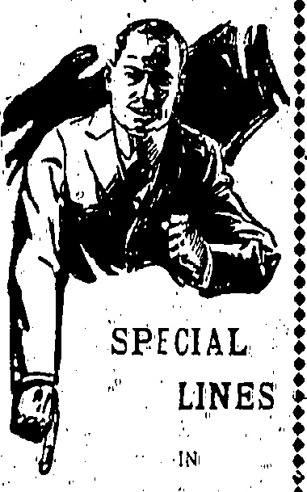
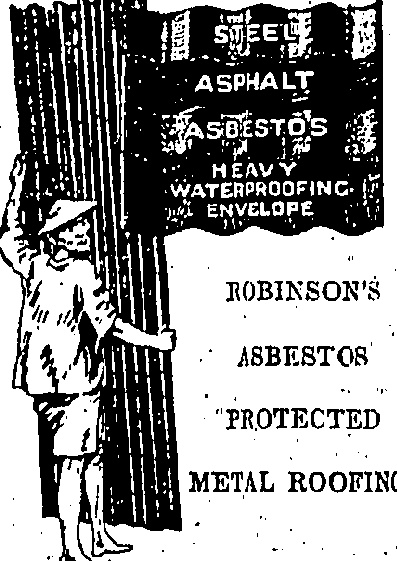
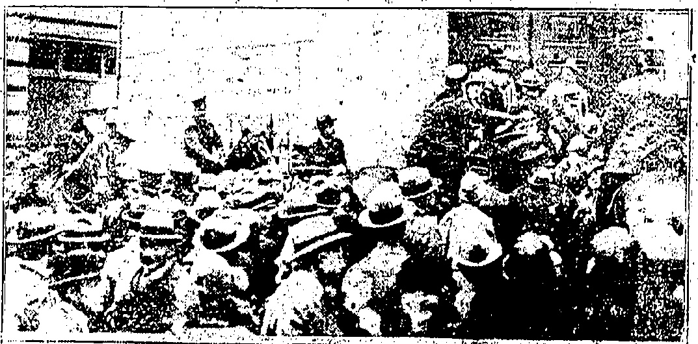
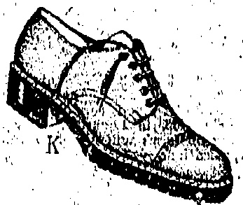

<table border=1 style='margin: auto; word-wrap: break-word;'><tr><td colspan="2">We</td></tr><tr><td style='text-align: center; word-wrap: break-word;'>Take</td><td style='text-align: center; word-wrap: break-word;'>The</td></tr><tr><td style='text-align: center; word-wrap: break-word;'></td><td style='text-align: center; word-wrap: break-word;'>ICE</td></tr><tr><td style='text-align: center; word-wrap: break-word;'></td><td style='text-align: center; word-wrap: break-word;'>Out</td></tr><tr><td style='text-align: center; word-wrap: break-word;'></td><td style='text-align: center; word-wrap: break-word;'>of</td></tr><tr><td style='text-align: center; word-wrap: break-word;'></td><td style='text-align: center; word-wrap: break-word;'>SERVICE</td></tr><tr><td colspan="2">THE DRAGON MOTOR CAR CO., LTD.</td></tr><tr><td colspan="2">Telephone Central 1246 or 1247</td></tr><tr><td colspan="2">33 Wong Nei Chung Road, Happy Valley, A. J. Allison......SERVICE Manager</td></tr></table>

# Chinaピピ Hitail

Temperature 79, Barometer 29.58

Rainfall 078-in., Humidity 91

ESTABLISHED

No. 19,515

THE DOILAR

To-day's closing rate 2/3 5/16

To-day's opening rate 2/3 6/16

## HONGKONG, MONDAY, JUNE 8, 1925

### PRICE, $3.00 Per Month

Catalogues & specifications from

Sola Agents:

ALEX. ROSS & CO. (CHINA), LTD.

◇◇◇◇◇◇◇◇◇◇◇◇◇◇◇

## SUMMER USE

The Gent's Outfitters

HONGKONG

DAVIE, BOAG & CO., LTD.

Bank of Canton Building.

Samples and particulars on application.

## WHO WILL WIN?

FIGHT TO A FINISH.

Startling events which took place in Canton yesterday portend a fight to the finish between the alien militarists and the Cuntonese Reds.

## Foreigners Warncd

(Frôm Our Own Corréspondent.)

Canton Sunday 2:45 p.m.

Yesterday's action of the gunboats has brought on a real state of war. All Saturday night till the small hours of this morning and to day, there has been intermittent sniping from both sides.

Shameen is in little or no danger as the shots are not falling in that direction. But there is no telling what may happen to Europeans in or outside the city.

"Consuls have warned their subjects to find shelter in Shameen or leave" Canton, and some of the girls at St. Hilda's School (near the East Parade ground) sailed for Hongkong "to-day. Other residents in Tungshan have left for Shameen.

After the gunboats and armed launches had passed out into the Back Reach, the Yunanese began to take up positions behind sandbag barricades on the Western and Central Bund. Snipers were busy on both sides of the river and several proved their marksmanship. One Yunnanese post was close by the Tung On S. S. Co.'s wharf. When the s.s. Sai On went alongside this morning, the position was obscured by the vessel. The mercenaries accordingly left that post but returned when the steamer sailed shortly after 3 o'clock and re-opened fire at the opposite bank. On the other side, the Communists had their points of vantage from which they replied to the rifles on the city side. At most only two or three rounds could have been fired from artillery and both sides used rifles and measers.

## Forlorn Hopes

In the small hours of this morning (about 2 a.m.) the Communists sent out a forlorn hope to land in Canton. They embarked in the night in several fast launches from Honam and crossed the river under cover of Dutch Folly Island in the middle of the river. Before they had reached the Bund, they were sighted by the Yunnanese sentinels. Guards were called out from the vicinity. The launches used machine guns and the mercenaries on the Bund replied with mausers. Eventually the launches were driven off. This morning bodies were seen in the "river and it is believed that some of the attacking party were killed. The Yunnanese immediately withdrew their dead and wounded.

About 410 a.m. the attack was repeated but further down the river. This was also unsuccessful and the Communists retreated very quickly.

## Housetop Ambush

Carrying the fight into enemy territory, the Yunnanese sallied across the river at 5:35 a.m. There were only about forty of them and they ventured out into the river in small commandeered rowing boats. It was light then but I could not follow their movements as they were hidden behind shipping, having zig-zagged as soon as they started. When they returned about an hour later, the commander told me that they had reached some Honam steps but had not landed as they had spotted. Communists in ambush on housetops! This is given for what it is worth.

During the day, both sides spotted away at one another. The Bund was deserted and the Honam front was lined with sandbags and nothing else. The firing resembled the letting off of firecrackers, by lads in Hongkong streets after the first flush of China New Year.

I saw at least two Yunnanese dead carried away and seven wounded. I cannot say what casualties there were on the Honam side as cross-river traffic has ceased on account of the general strike. Inside the city and in the western suburb people were walking about quite calmly.

Several determined efforts were made during the day to take and re-take Dutch Folly. This island, almost within a stone's throw of the Bund, was in the hands of the Communists. Trenches

had been dug and from these, Commu ist marines opened fire at Yunnanese outposts and pickets on the Bund. After several mercenaries had been picked off, the Yunnanese burst open the doors of the Tai Sam Yuen restaurant as its roof is the highest in the vicinity. Previous to this, the staff had locked and barricaded the doors and fled. Finding a vantage point on the restaurant roof which had battlements of a kid, the mercenaries took cover and sent over volley after volley with their mausers. Finding their position untenable, the marines withdrew. Some fled in waiting while others jumped into the river, with full equipment in sheer fright.

## THE SHANGHAI RIOTS

## "London Chinese

## $250,000 Bribe?

At the moment of writing, firing seems to have slackened.

(From Our Own Correspondent.)

Canton, Saturday 4:30 p.m. Fighting broke out a short while ago through the River defence Flotilla steaming up the Canton River in line and opening an aimless bombardment.

There were about twelve of these craft in all, ranging from obsolete wooden gunboats to armed launches. Most of them were equipped with small quick-firers, probably 3-pounders. For what their shots were intended nobody knows. In connection with their actually firing the first shots brought on the war, some conflicting, but neverheles important, rumours are current.

From a source friendly to the Yunnanese, learn that the Flotilla was bought over by the mercenaries for a quarter of a million dollars. Presuming that this is true, the Wingfung (flagship of the Communists) became suspicious and they fled up the River to pass out through Pak Ngo Tam (the passage by Sha.

(Continued on page 9.)

When the river streamers arrived this morning, the Paul Beau was leading and it dropped anchor in the stream. The Sai On went ahead to her wharf and the Kinshan followed suit. The Honam was already anchored in the river. As far as I could see, none of the shot were directed at the boats and the mercenaries on the Bund were particularly anxious to avoid hitting the steamers.

## ·

"INTERFERING POWERS."

I was privileged to watch the return action from a roof forty feet away. The Communists re-conustered and stole back on to the Island from the far side. They opened fire once more and caught mercenaries unaware. The latter returned to their unfailing roof, almost out of the range of the fire from the marines and banged away till the marines retreated once more.

SOUTH FOLLOWING EVENTS: CLOSELY

(Runter's Service)

A special meeting of the Union of Chinese Associations held in London, has passed in resolution protesting against "the rise of armed forces by interfering flowers to suppress the strike who shot down defenceless workers and students" and recording full support of the strikers.

When I left, the Island was, apparently, vacant, neither side venturing to take possession as it has no means of retreat. The marines were by no means accurate in their shooting although they did smash a considerable part of the restaurant's front. Some of their shots went wider than where I was a spectator.

London: June 7.

Moscow telegrams show that the Soviets are closely and sympathetically watching events in China. "The newspapers are publishing detailed accounts.

## Wednesday Developments

Through walkouts of almost all workers in cotton-mills and in many other factories and industrial establishments, the ranks of Chinese out in the general strike were yesterday swelled to an estimated 100,000.

Mounted police rode into a crowd of 10,000 persons who stormed the doors of Madison Square Garden, New York, into which 15,000 others had already fought their way to hear Eugene Debs, former radical prisoner and defeated Socialist candidate for President, who spoke at the behest of the Working's Circle National Convention. Several women were hurt and one woman was trampled by a horse. Eugene Debs was in prison during the war for making hostile speeches to the Allies' cause.

RIOT AT DEBS-FIEETING MAIDON SQUARE GARDEN

Many reports of assaults on foreigners, particularly seriously injured, were received.

wounded in clashes in the North-ern section. None was between mobs and police.

An American Volunteer was arrested by Chapel authorities when he stepped over the border, but was released after being detained some hours.

Hundreds of foreign men and women volunteered for emergency duty in response to the Council's appeal.

## WORSE THAN A BARGAIN SALES

Two British cruisers arrived in port. Landing parties will be brought ashore to-day.

Shooting Affray.

Yangtzepoo district was the scene of Wednesday's shooting affray, which resulted in the death of two rioters and the wounding of several more. The disturbance occurred at a Japanese ice factory on Lay Road, within a few minutes walk of the Yangtzepoo Police Station. A crowd of about 3,000 assembled at the gates of the factory, forced their way in-side and for the next few minutes set about smashing up everything breakable. Matters became very serious and the Sikh constable on duty nearby summoned assistance which came from a squad of foreign and Chinese Police. The mob turned its attention to the Police who were forced to fire. One of the rioters was killed instantly while several suffered minor wounds. Later a hand to hand struggle took place between the police and the crowd and one of the most troublesome rioters received a blow on the head from a police baton which killed him.

## KRENG SITUATI

## POSSIBLE

## Serious

## Kaifeng, June 8

The students' sympathetic strike is growing in intensity against the foreigners and the situation is very serious.

## HONGKONG GOVERNORS

ANOTHER SUGGESTION.

Sir Charles Eliot To Return to the Colony?

With the near approach of His Excellency the Governor's departure from Hongkong rumour is busier than ever with the intriguing subject of his successor.

A “China Mail” correspondent writes pointing out that a recent cable referred to the appointment of a new Ambassador at Tokyo without specifying the nature of the future activities of the Rt. Hon. Sir Charles Eliot, who has acted as British Ambassador to Japan since 1919. Would it be too great a flight of the imagination, he asks, to infer that the Home Government has him in view as the future Governor of Hongkong?

Of Sir Charles' eminent suitability for the post there can be no two ways of thinking. As the first Vice-Chancellor of the University of Hongkong, which post he held for many

## AMERICAN RESIDENT CHARGED

years, he had peculiar opportunities of studying Oriental psychology, and the long list of important posts he has held speaks volumes as to his administrative and diplomatic ability. Amongst them are the High Commissionership of Samoa and British East Africa, also that of Commander-in-Chief of the latter Protectorate and H.M.'s High Commissionership in Siberia. Besides these he has held numerous posts in connection with the Embassy in the Near East and the United States of America.

ALLEGED RFCKLESS

DRIVING.

INDIAN CONSTABLE BADLY INJURED.

Before Mr. S. B. B. McElberry, at the Central Magistracy this morning, a young American named H. T. Werschkul, was charged on four counts arising out of a motor accident at Repulse Bay Road last Saturday afternoon. The charges were that he did (1) unlawfully drive a motor car without a proper licence, (2) drive while in an intoxicated condition, (3) fail to stop after causing injuries to an Indian guard of the Repulse Bay Hotel, and (4) drive recklessly.

A formal adjournment was made

A formal adjournment was made for one week; bail being fixed at $2,000.

Mr. M. H. Turner appeared for the defence.

The accident happened near the Repulse Bay Hotel, and it is alleged that the car did not stop until it reached Shaukiwan Road where Divisional Inspector Blackman was on the lookout after a telephone message had been sent to the Police station there. The car was lying on the compound of the Central Police Station this morning. The glass of the right headlight was smashed and the number plate was defted. The Indian, although not in danger of his life, sustained a serious fracture of the hip which is likely to keep him in hospital for a long time.

## MORPHIA FOUND

## EUROPEAN STEAMER SEIZURE

## BECRET BARREL

Concealed in barrels made to appear as if they contained mercantile chemicals, a quantity of morphs was seized by the Imports and Exports Department on board the s.a. Amazon Maru, on her arrival from European ports.

There were about 25 barrels in the whole lot and about half of these had morphia inside. The drug is worth a considerable sum of money.

The only arguments which rise to the mind in connection with such an appointment are those concerned with the nature of the political opinions of Sir Charles, which are not exactly coincident with those of the Party in power; also Sir Charles Eliot's age, which is just over 60: "Are these sufficient to over-ride the many and stronger arguments in favour of his appointment as Governor to Hongkong?" asks our correspondent, and dealing with the latter question the writer recalls Sir Charles Eliot's robust physique and Keen mental faculties which, he states, "so far from diminishing as the years' roll by seem ever to leave him with a clearer vision and a greater mastery in the direction of his faculties to the desired end."

“It is fairly obvious,” writes our correspondent. “that it is not the intention of the Government to appoint a new Governor to administrative during what is undoubtedly the most trying period of the year. Again indulging the imaginative element, excusable enough in view of the suitability of Sir Charles, what more desirable than that he should have a few months' holiday when his post is filled in Japan and that he should then return to the Colony in connection with which he has held an important post with much distinction.”

## SEARCH INCIDENT

##### A P.W.D. EMPLOYEE IN TROUBLE

A Chinese draughtsman of the P.W.D., was charged before Mr. E.W. Hamilton at the Kowloon Magistracy this morning with refusing to be searched at King Lane at 9.30 last night.

A Wei-hai-wei constable stated in evidence that he stopped the defendant as he wanted "to search him. The defendant asked what right witness had to search him, and witness pointed to his khaki uniform and revolver. Defendant refused to submit and had to be arrested.

The defendant stated that the constable approached him and felt him up and down when he (defendant) caught hold of the constable's hands and questioned his authority, whereupon, the constable assaulted him and arrested him.

His Worship was unable to accept the evidence of one man against another and discharged the defendant with a caution, saying that he would report the matter to the head of the P.W.D

## BRÚTAL MURDER

## BODY THROWN INTO THE SEA

The partly decomposed body of a Chinese was found washed ashore on a beach in the mainland during the week-end in circumstances pointing to the man having been brutally murdered. The right side of the face bore a hole apparently caused by a bullet, and there were several stab wounds on the body. A piece of rope hanging from the girdle points to the theory that a stone weight was used to sink the body in the sea.

Ony Singapore correspondent cables that the Inspector, General of Police, Mr. Donham, is succeeding Mr. Hammond as Managing Director of Anglo-Dutch Plants, tions in Java.

## (X)(X)(X)(X)(X)(X)(X)(X)(X)(X)(X)(X)

## HOMES FOR YOUR FEET

You choose your home with great care. It must look well, be comfortable, and be well built. (choose your shoes with equal care: You will spend more time in them. Buy "K's." "K's" are made from the finest materials by men old in their trade, and proud of their craftsmanship. Behind "K's is sixty years' reputation for quality. They are built on insoles cut from choice hide—one secret of their lasting wear and never failing appearance. In "K's your feet will be comfortable and even more so in those soled with creape rubber; the soles which give such wonderful wear.

## FOR EASE USE "K"s

## "K" agen's for Hongkong

### MACKINTOSH CO.,LTD

Men's Wear Specialists.

Alexandra Building,

Des Voeux Road.

HOT WEATHER

NEED NOT WORRY

WHEN YOU CAN

OBTAIN

## ICE COLD DRINKS

## AND

## DELICIOUS

## ICE CREAM

at

MORINAGA'S

SODA FOUNTAIN

Asiatic Bldg. Tel. C. 4702

TANG YUK, Dantir,

the late SIHS TING,

14, D'Agular Street.

TERMS VERY MODEMATES

Consultation Free