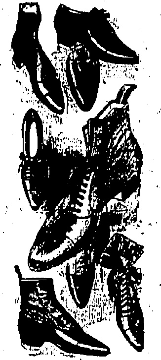
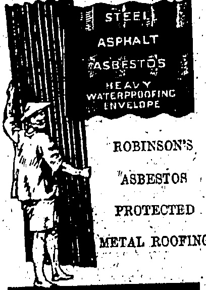
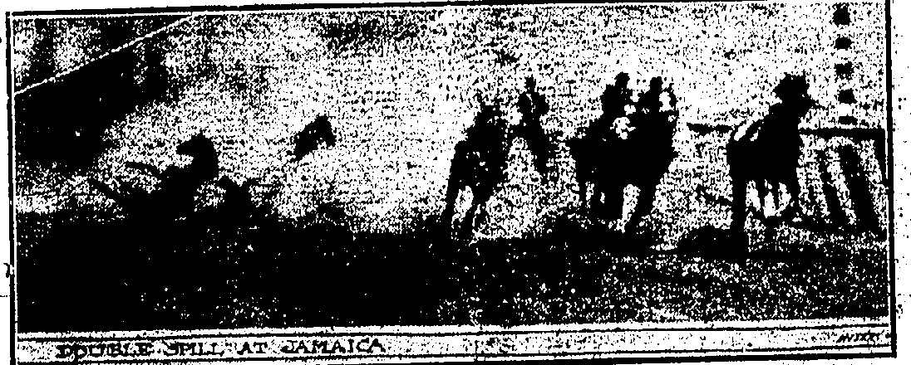
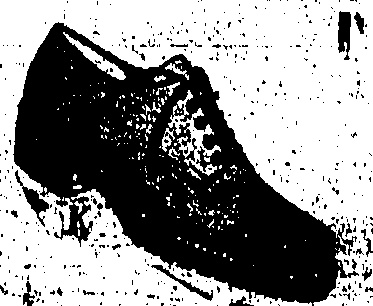

BOYON MOTOMETERS. The Accurate Boyce is the Motorists' choice. Your Gar deserves one. All Models in stock. Prices from $7.0.

Telephone Central 1246 or 1247

33, Wong Nei Chung Road, Happy Valley.

# Uhnra

# JUsil

TESTABLE SHIELD

THE DOLLAR

To-day's closing rate 2/3 5/16

To-day's opening rate 2/3 5/16

PRICE, $3.00 Per Month.

ALEX. ROSS & CO. (CHINA), LTD.

◇◇◇◇◇◇◇◇◇◇◇◇◇◇◇

# SPECIAL SALE

Saturday,

June 20th

## ENTIRE STOCK

## ( )

HEAVILY REDUCED

RATES

GENTS'

LADIE3'

CHILDREN'S

WHITEAWAY, LAIDLAW & CO., LTD.

HONGKONG.

DAVIE, BOAG & CO., LTD.

Bank of Canton Building.

Samples and particulars on application

FOR REAL FINE MAJONG SHTS MARK OF IVORY AND BONE.

BOLD AT

Lowest Possible Prices

SUNG SAN CHAN,

140, Wellington Street.

Agent: CAM FAI LAU,

Oheong Ka Long,

Shanghai

## HANKOW TRAGEDY

RIOTERS ATTEMPT TO RUSH ARMOURY.

SUDDEN CRISIS.

FALSE REPORTS.

Foreigners Compelled To

(Reuter's Service.)

Owing to a state of extreme emergency suddenly arising, machine guns had to be used against rioters at Hankow yesterday.

Hankow, June 11.

Following false reports in this morning's vernacular papers, an anti-foreign riot took place this evening.

The volunteers were called out. The rioters rushed the Bund. They tore up seats and wrought destruction in Japanese shops. They severely mauled a Japanese shopkeeper.

Later the rioters broke down a barricade and attempted to rush the British volunteer armoury.

The rioters were in heavy numbers totally outnumbering the defence force of the armoury.

The fire brigade ineffectually turned hoses on the mob after which, there being a state of extreme emergency, under orders of the Navy, the rioters were fired on with machine guns.

Eight were killed. The number of wounded is not yet known. At present all is quiet and the Chinese authorities guaranteed continued peace.

[Hankow, June 11.—Following a coolies' dispute last night at Messrs. Butterfield and Swire's upper wharf, in which a great deal of stone throwing took place, a squad of Chinese police fired over the crowd and scattered it. A dozen arrests were made. The trouble was apparently purely Chinese, but this morning when the upper wharf coolies attempted to resume work they were mobbed and prevented from doing so.

A strike was declared, the students haranguing the coolies.—Reuter.]

In spite of the official statement that the Note would not be made public till to"morrow, the Note that was handed in to Signor Cerruti, Italian Minister, this evening was handed out to the pressmen in French and Chinese at nine o'clock.

## China's Third Note

The Note takes cognisance of the fact that the Powers view the incident in the same conciliatory spirit as the Chinese Government and that instructions have been given to the police of the International Settlement to cease the use of arms.

The Note goes on to insist that the steps taken by the authorities of the Settlement to hinder a "pacific student demonstration" were badly devised and denies that there was the state of imminent danger to which the Powers' communication referred.

The Concession authorities and not the unarmed students are therefore responsible for the deplorable events. The Government, in view of the indignation prevailing to-day throughout the country, begs to give general advice to the Concession authorities which the latter should follow, namely to raise the state of siege, re-embark the marines, disarm the volunteers and police, free the arrested men, restore the occupied schools, for the restoration of order in Shanghai with the briefest possible delay.

The Note asks the Ministers to instruct their consular representatives accordingly.

## Chang Hueh-liang

(Courtegy of the Daily Bulletin.)

It is officially announced that Chang Hsueh-liang has proceeded to Shanghai with a bodyguard, and that he is staying some little time at Nanking en route.

Peking, June 11.

Hongkong-Events.

Yesterday an editorial with some violent expressions was published in the "China News," a vernacular paper better known as the "Ching Kwok San Man Po." Late last night, the Police raided the office and printing works in Stanley Street and the paper did not appear this morning.

On the premises for some time, the Police made a search. Sub

sequently, some of the staff were seen to leave with their personal effects.

Entering the local journalistic field about a year ago, this paper was decidedly anti-Sun in its expressions. Suddenly, it became the most outspoken of the Kuomintang publications. Of late it has contained a good deal about the Revolutionary Government. At the time of the change a fight took place in the premises and court proceedings resulted.

Yesterday the Secretariat for Chinese Affairs issued a notification. Students and labourers were exhorted to be sober-minded and to be aware of agitation by unruly spirits who have no inter

## TWO LIVES LOST

The strategy by which the students and other agitators have been kept continually on the move, has resulted in them being pushed entirely over the Settlement boundaries. Even then they were unable to secure permanent meeting places, for the

### (North China Daily News.)

STARTLING EARLY MORNING

ACCIDENT

Things were so quiet yesterday that the various detachments of the Defence Forces had little to do of a more strenuous nature than cleaning buttons and equipment to the satisfaction of the orderly officers. Still more sailors were landed and the Commandant now is in the position of having almost more men than he requires. Rumours that some of the S.V.C. units consequently would be relieved were not at all kindly received by those said to be mainly concerned, who evidently are most anxious to remain at their posts.

## Agitators Ejected

The wall at Conningth Road Central near the Ping On wharf was the scene of a tragedy at 2.30 this morning when a motor car owned by a Chinese lying at Mongkok ran into the harbour with five passengers.

We see no reason to be alarmed at the report that the Central Government (?) is sending 2,000 "peace-preservation troops" to Shanghai, but we hope that the Diplomatic Corps will lose no time in making it clearly understood that their respective Governments will not tolerate any monkey-tricks on the part of any individual military commander in the neighbourhood of Shanghai. We can but hope that the agitators will soon realize the folly of their attitude, for it is they and not the foreigner, who will suffer in the long run.

The boat people in the vicinity rescued all the occupants with the exception of one person who was drowned. Another of those rescued died in hospital this morning.

The driver of the root or car is reported to have bolted:

All five occupants were on the staff of Messrs. Lee and Russ, solicitors.

Mr. Lee Wing-chee, one of the two who lost their lives, a senior interpreter leaves a family. He

Bonny Marinelli, jockey, may die, it is feared, as the result of his fall on Upton at the first turn at Jamaica race track. Just after he and his mourn, felt, I, Fator, on Firearm, came galloping through the dust cloud, toppling into Marinelli and his mount. The footsteps anapped this picture at this moment, with the two horses and two men on the ground. Marinelli's skull was crushed and he was injured internally. Fator's collarbone was broken. The picture is one of the most unusual ever made on a race track.

est whatever in Hongkong. All are asked to keep the peace and continued protection is promised.

## TWO JOCKEYS BADLY INJURED IN AN ODD SPILL

## SHANGHAI TROUBLE

## Monday's Calm

DOUBLE EXPILL AT JAMAICA

(Shanghai Mercury.)

The local situation to-day is comparatively calm. It is obvious that the landing of several hundreds of marines and blue-jackets has had the desired effect. News from the outports however, is not so satisfactory. The anti-foreign agitation appears to be spreading and demonstrations are being held in nearly every town. Just exactly how far things will go before the matter is settled it is impossible to say.

## "Peace Troops"

# SHEAF OF QUESTIONS IN COMMONS.

has been with the firm for som years.

Mr. Wong Woon-cheung, a junior interpreter, was only married three months ago.

OFFICIAL ATTITUDE.

Of the three who escaped none were permanently injured. A clerk jumped out of the car on to the Praya before it went over the side. In falling he became unconscious for a time but recovered. One of the other two could swim and he reached safety while the last men was fished out by

Much sympathy will go out to the relatives and friends of the deceased.

China's Disorders the Root Cause of the Strike.

The party were returning iron a dinner at West Point.

A number of questions lodged in the House of Commons regarding the Shanghai trouble, elicited long replies from Mr. Ronald McNeill, Under Secretary—of Foreign Affairs, who expressed the opinion that the trouble was mainly due to unsettled conditions owing to the lack of a strong central government, the destructive wars and the irritation of the Chinese with petty local rulers resulting in discontent which had been skillfully directed by interested parties

Reking, June 11—It is unofficially arrested that Chang Ta-lin has proposed to the Government the appointment of Liu Yang-Zhang as Minister for War and Cheng Chien as active Tadun of Klingouli—(Courtesy of the D�y Bulletin)

Chinese authorities had no-greaterliking for their propaganda, so they have been reduced to holding scratch meetings at the far end of the Nantao Bund and these last no longer than it takes to summon the nearest police post, when the crowds are quickly broken up.

That the Home Government has a sound grasp of the Shanghai trouble is apparent from another official statement made in the House of Commons yesterday.

## London, June 11

It was a sad blow yesterday when the employees of the Aquarius mineral water factory joined the ranks of the hood-winked strikers. Still, at a pinch one can mix it with plain water instead, or even ignore any addition, as they do in the country of origin, so the wound is not fatal. Messrs. Caldbeck, Macgregor and Company have been in existence for sixty and something odd years—one forgets in the general excitement whether it is one year more or one year less than the life of the "North China Daily News"—and this is the first strike the Company has ever experienced, which is a good illustration of the depth of absurdity to which the working classes have fallen under the influence of Bolsheviks.

The Hongkow market showed signs of life yesterday morning and quite a few Chinese gardeners brought their vegetables to sell. The Russian and Japanese stall keepers have been doing business all the time. There was no meat to be had here however.

# STOP PRESS.

## A MASS MEETING

(Router's Service.)

A mass meeting of 25,000 students and workers was held at the recreation ground in the Shanghai Chinese city yesterday evening under the auspices of the Citizens Association. The participants wearing black arm bands made stirring speeches.

Resolutions were passed (1) to sever economic relations with the British and Japanese on June 12; (2) to urge the Central Government to secure satisfaction for the shooting on May 30 from the British and Japanese; and (3) failing settlement in a fortnight to declare at general strike throughout the country.

The meeting afterwards marched in procession to the native city. During the march two Japanese posing as Chinese students were violently handled and taken to a police station and locked up.

Special trains: conveyed the crowds to and from the native city and the Chapel suburb.

STEALING $1,000 OF ROPE

Two Chinese at work on the s.s. Hyson lying at anchor in the harbour were in the act of discharging yoga into a sampan controlling two of their confederates on Wednesday night when a parrot launch appeared on the scene. All four men jumped into the water, but not all managed to get away at one fell into the hands of the Police. About 200 fathoms of the ship's rope valued at $1,000 had been sent over the side. The arrested man was charged at the Kowloon Magistracy this morning and sentenced to one month's hard labour.

against the foreigners whose treaty rights they represent as inimical to the well-being of China.

Mr. McNeill added that for some time past the British Government had been giving close attention to the question whether industrial conditions were playing an appreciable part in the general widespread unrest in China.

Mr. McNeill expressed the opinion that such conditions were hardly operative at all as the cause of the present troubles, though any such discontent as far as it existed should be welcomed as the symptom of a desire for better things.

He pointed out that the strike began in a Japanese cotton mill where the conditions were equal or superior to anything in China.

Mr. McNeill declared that the British Government had long been exerting active pressure on the international authorities at Shanghai to secure improved factory conditions in the foreign settlement, especially as regards child labour with the aim of making the settlement a model for the rest of China. It now intends to seek a solution of the difficulties in a conciliatory spirit while insisting on the maintenance of law and order in the foreign settlement.

## Police Warning

Finally Mr. McNeill stated that a warning had been given before the police fired, but he was without official information of the precise nature of the warning. He also did not know the number of students arrested and subsequently released but had requested a report on these matters.

## Hotel Staffs Back

Mr. Walter J. Hawker, manager of the Hongkong and Shanghai Hotels Ltd., yesterday received a telegram from Mr. J.H. Taggart, who is in Shanghai, to the effect that the situation there is easier.

The Majestic, Palace and Kalee Hotels staffs have already resumed work; and the Astor House Hotel staff is resuming work.

Mr. Taggart proposes to leave for Hongkong on Monday next.

## A Kongmoon Strike

(From Our Own Correspondent.)

Pakkai, Kongmoon, June 10.

Labourers have ceased work and students have struck. A demonstration took place in the streets of Kongmoon to-day to express sympathy with the strikers in Shanghai.

### THIEFS SUCCESS. EUROPEAN LADY ROBBED

HANDBAG SNATCHED

Following close upon the conviction of a Chinese youth for stealing a handbag from a European lady at Battery Path comes the report of another robbery at the other popular hunting ground of anatchers, Fedder Street.

Mrs. Munton, of 16 Peek Road, was walking in Peddar Street at 5:30 p.m. yesterday when the chief came from behind and ran away with her handbag worth $15. The contents of the bag included a small of money. Fortunately for the thief, there was nothing to obstruct his escape.

005511

## NOOK NOOK NOOK NOOK NOOK NOOK NOOK NOOK

New York June 11.—The

Belgian loan of $50,000 at seven

per oint, at ninety-eight, 10-

desmable in thirty years is about

to be launched by Messrs. Morgans.

—Renters American Service

HOMES FOR YOUR PRICE

You choose your home with great care. It must look well, be comfortable, and be well built. Choose your shoes with equal care. You will spend more time in them. Buy "K"s. "K"s are made from the finest materials by men old in their trade, and proud of their craftsmanship. Behind "K"s is alky years' reputation for quality. They are built on insoles cut from choice hide—one secret of their lasting wear and never failing appearance. In "K"s your feet will be comfortable and even more so in those soled with crepa rubber: the soles which give such wonderful wear.

FOR EASE USE "K"

## "K" agents for Hongkong:

## MACKINTOSH

Men's Wear Specials.

Alexandra Building.

Des Vœux Road.

HOT WEATHER

NNED NOT WORRY

WHEN YOU OAN

## OBTAIN

## ICE COLD DRINKS

## AND

## DELICIOUS

TANG YUE, Dwayne,

Mrs. Han Hint, TNG,

14c D'Agalac Stout,

TERMS YET MODERN

Consolidated Form