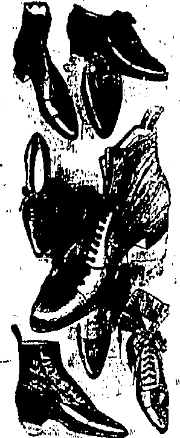
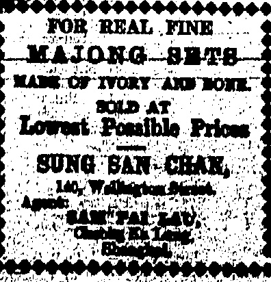
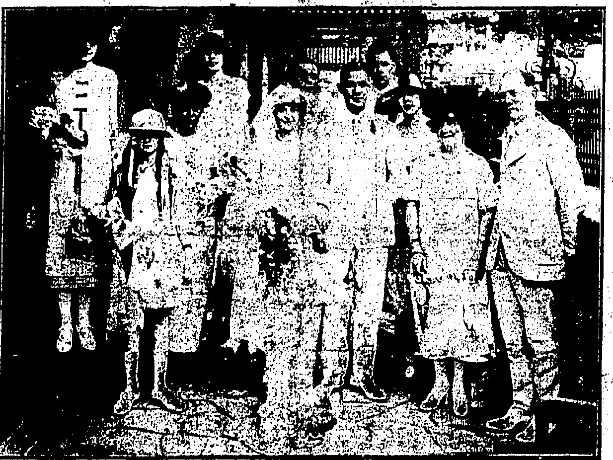
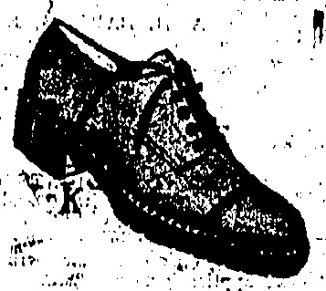
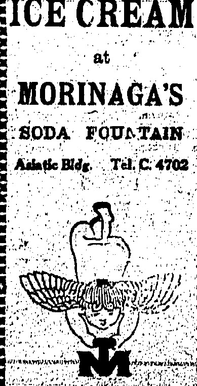

## ⚠️🔥🔥🔥🔥🔥🔥🔥🔥🔥🔥🔥🔥🔥🔥🔥🔥🔥🔥🔥🔥🔥🔥🔥🔥🔥🔥🔥🔥🔥🔥🔥🔥🔥🔥🔥🔥🔥🔥🔥🔥🔥🔥🔥🔥🔥🔥🔥🔥🔥🔥🔥🔥🔥🔥🔥🔥🔥🔥🔥🔥🔠

Our BUMPERS are built to endure and they do make safety sure. Large stock on hand suitable for all cars. Prices, fitted, from..... $35

THE DRAGON MOTOR CAR CO., LTD.

Telephone Central 1246 or 1247 E

33, Wong Nei Chung Road, Happy Valley

# China the Retail

Temperature 78, Barometer 29.68

Rainfall 0.00 in., Humidity 82

E STABLISHED

To-day's closing rate 2/3 7/16

To-day's opening rate 2/3 7/16

Catalogues & specifications from

Sola Aronte :

ALEX. ROSS & CO. (CHINA), LTD.

PRICE, $3.00 Per Month.

# SPECIAL SALE

ONE WEEK ONLY

Monday,

June 15th

to

Saturday,

June 20th

HEAVILY REDUCED

RATES

INCLUDED

AT

GENTS'

LADIES'

CHILDREN'S.

WHITEAWAY, LAIDLAW

& CO., LTD.

HONGKONG.

◇◇◇◇◇◇◇◇◇◇◇◇◇◇◇

ROBINSON'S

ASBESTOS

METAL ROOFING

DAVIE, BOAG & CO., LTD.

Bank of Canton Building.

Samples and particulars on application

## HANKOW QUIET

## DRASTIC

Execution

TUPAN'S THREAT.

Warning

The Tupan at Hankow has threatened to execute any Chinese disturbing the concession and has thus restored order in that city.

Soldiers Ready.

(Reuter's Service.)

The situation remains quiet largely due to the efforts of Tupan Hsiao Yao-nan who to-day issued a proclamation threatening the execution of any Chinese disturbing the concessions.

It is estimated that about 5,000 Chinese soldiers are stationed round the concessions, which is an ostensible deterrent to a possible further outbreak.

This morning's vernacular papers were restrained regarding last night's affair.

This is possibly due to its lateness for Press purposes but it is learned from an authoritative Chinese source that it was a police instruction in order to avoid excitement of the public.

Signor Cerruti, the Italian Minister, this afternoon handed in the reply of the interested Powers to the Note sent in by the Waichiaopu yesterday evening. A translation follows:—I have the honour to acknowledge the receipt in the name of my colleagues and myself of the Note you were good enough to send me on the eleventh of this month.

Having examined it attentively the diplomatic representatives of the interested Powers, animated by a lively desire to see solved as soon as possible a situation both distressing and full of dangers, have believed that the most appropriate means of re-establishing law and order in Shanghai would consist of discussing on the spot the measure to be adopted for taking account of the local situation.

Onus on Peking.

Outbreaks.

“My colleagues and I have consequently given the necessary instructions to our delegates in Shanghai to consider with the Consular body and the delegates of the Chinese Government the best means of finding a remedy for a state of affairs which we all deplore.

## Trade Union Cable

"In giving this proof, evidencing their desire to contribute to calmness of mind, the interested diplomatic representatives cannot abstain from recalling to the Chinese Government that it incurs heavy responsibility in that which concerns the maintenance of order at Shanghai, Peking and, generally speaking throughout China. Please accept, etc."

## London, June 12

The International Federation of Trade. Unions has cabled the Chinese workers expressing “utmost satisfaction at the noble stand for improved conditions.” Hankow Riets

Hankow, June 12.

A dead Japanese was afterwards discovered, with his body so tightly wedged in the gutter that there was difficulty in extricating it.

Among other damage in the British Concession, the rioters broke down the boundary wall. The situation this morning was still quiet.

The Chinese authorities are patrolling the outer boundaries of the British Concession, and the Volunteers and the Naval authorities are guarding the inner defences.

## Police Stoned

A wireless message from Han-

kow states that prior to the

shooting a large crowd stoned the

Chinese police of the British

Concession, wrecked Japanese

shops and attacked the shop-

Thereupon the Consul-General asked the Chinese authorities to send troops to the Concession border, and requested the landing of naval detachments from the International war vessels.

The requests were responded to, and co-operating with Chinese troops, under was restored at 11 o'clock last night by one hundred and thirty volunteers of the Bri-

tish Concession, seventy-five American and French, and 130 Japanese, also fifty Russians from the Russian Concession which was restored to China.

## SHOT IN FACE

H.M.S. Hollyhock is proceeding to Hankow from Nanking, carrying one hundred Marines from H.M.S. Hawkins who had been sent to Chinkiang where they were not required.

## Discord Among Strikers

The discord existing among the striking elements is exemplified by Chinese circulars which are being distributed in the French concession, and which accuse the Communists of taking advantage of the disturbances to carry out BAMBOO POLE ATTACK.

i

CHINESE, CONSTABLES BADLY

An affray took place in Main Street, Shaukiwan yesterday, as a result of which two Chinese policemen and a Chinese coolie are in hospital.

A Chinese couple was being taken into custody, for refusing to be searched when the other man, now in hospital with a bullet wound in the face, attempted to rescue his comrade by making a desperate attack with a bamboo pole.

Owing to faulty cable connection the Eastern Extension Telegraph Co., notices that tricgrams to Sharghai and beyond are subject to delay.

## CABLES TO NORTH

1

According to the "Rosta News Agency," the General Council of Trade Unions and the Soviet Union have telegraphed 50,000 roubles to Peking to help the Chinese strikers and the families of those killed in the riots.

## CANTON TAKEN

Tenders for the construction of a road from Causeweay Bay to North Point will be received at the Colonial Secretary's Office until noon of Monday, June 22, states the current number of the "Government Gazette"

The policemen disabled the assailant by using their revolvers, but not until they had got the worst of it, one sustaining a fractured skull and the other a deep wound in the head.

Many meetings of protest against the action of the foreign police at Shanghai were held at Moscow yesterday. Resolutions of sympathy with the national movement in China were adopted. Students demonstrated to show solidarity with the Chinese revolutionary students.

2

Many Meetings At Moscow.

Moscow June 12

their own plots. The circulars assert that the Communists received large funds from Russia and add “we weep for the deaths of our brethren while they laugh in the dark. We are fighting for our national rights and freedom while they are selling our freedom to Russia. Citizens, it is not the Foreigners who are killing us, but the Communists, who cry over-throw Imperialism while acting as hounds for the Russian huntsman.”

## CITY IN THE HANDS OF THE REDS

While attacking the Communists the circulars contain the usual demands for redress from foreign aggression.

YUNNANESSE DEFEATED.

이윤

Group taken at the Hongkong Hotel Roof Garden at the reception after the wedding last Saturday of Mr. Nowell Bernard White, manager of Mac's Cafeteria, to Miss Pearl Clifford Thompson of Philadelphia. Left to right are Miss Rose White and Miss Stella Bander, bridemaids; Mrs. H. J. B. White; Miss Maud White; the bride; Mr. H. J. White, of the Hongkong Hotel; the bridegroom; Mr. G. H. White, best man; Mrs. M. A. R. Souza, matron of honour; Mrs. J. H. Taggart; and Mr. J. P. Bourne who gave the bride away. Mrs. White is the groom's mother; Mr. H. J. and Mr. G. H. his brothers; Mrs. Souza, Miss Maud and Miss Rose, his sisters.

## Final Attack

Surrender

A wireless message received in Hongkong stated that the Yunnan-ese and Kwangan-ites had surrendered. This may have meant defeat as other reports are to the effect that the mercenaries are in flight.

## KOWLOON BOWLS

LAST SATURDAYS PRETTY WEDDING.

Fighting continues on the East River front where the Cantonese are advancing rapidly on the city but the fighting is not expected to lust.

In the final assault which really began the night before last and continued yesterday, firing was fairly heavy.

## NEW CLUB HOUSE TO BE BUILT

Late last night Hongkong learned that the non-Cantonese mercenaries holding Canton city had been routed by the Kuomintang Communists. Neither Shameen nor the city are in any great danger.

Shameen was not threatened by falling shots but a small naval party

$25.000 BUNGALOW TYPE.

Debentures are shortly to be issued in connection with the erection of a new Club house for the Kowloon Bowling Green Club. They will be for sums of $50 and will bear interest at 6 per cent.

வேண்டியிருந்தது.

The decision to apply for authority to go ahead with the new building was made at a meeting last night, presided over by Mr. P. T. Farrell. It was generally agreed that the present wood structure of a temporary nature was no longer sufficient for the growing needs of the Club and two plans of the type of building to supersede it were considered.

One suggestion put forward was that the new building should take the form of a bungalow with red roof and another that it should be a reinforced concrete structure with a flat roof. Eventually it was decided that the latter type would be more suitable for the Club's needs and the members have in view a building which will be 50 per cent. bigger than the present one containing dressing rooms and a spacious bar. The building is to be fitted out with modern flush system.

Matters have now proceeded far enough for the location of the site to be made. It will be a little to the west of the old building and will interfere but little with the old club house which may be used whilst the new one is being constructed. It is anticipated that a start will be made with the new building in the Autumn and that it will be made for use in time for the start of the New season in the spring. The anticipated cost is in the number of $100,000.

## STRUCK" A WAITER

## QUEEN'S ROAD CENTRAL CHASE

SOLDIER FINED.

At the Central Magistracy this morning, before Mr. R. A. D. Forrest, a charge of assaulting a Chinese waiter at the Queen's Cafeteria was preferred against Private Thomas Seaman of the East Surreys.

Evidence was given that the accused struck the complainant a blow on the head with the heavy part of his cane at 11.15 last night and ran away along Queen's Road with the fokis in pursuit. Later two Indian constables also joined in the chase, but the accused soon found himself in the hands of Sergeant W. R. Chester-Woods at Battery Path.

The Magistrate imposed a fine of $15 and ordered the payment of $5 as compensation to the complaint.

## BOYS FALL

## HONGKONG BANK ACCIDENT

A Chinese boy dropped down from the top floor of the Hong Kong and Shanghai Bank at 11:30 p.m. yesterday. He was picked up with a fractured skull and sent to the Government Civil Hospital.

## DOG BITES LAD

A dog belonging to Mr. T. R. Parsons bin a small boy, son of Mr. Stone of the Folded Accounts Department, Jessardley. The animals are sent to Kennidie Town for food and food.

was landed when the firing was at its height and the gates were closed, thus preventing a number of would-be refugees from embarking for Hongkong on the night boats.

General Ngai Bong-ping is the soldier of the hour. Within a short while of his appointment as commander-in-chief of the forces attacking Canton city and on the seventh day of the campaign, the Cantonese inflicted a signal defeat and put their rivals to flight.

"About noon yesterday it became evident that the Cantonese holding Honum (the southern bank) were starting a grand assault on the north bank."

Maintaining their cross-river firing, the Cantonese sent across five armed vessels from the Cement Works, under covering fire from artillery. The embarking force were engaged by the mercenaries and heavy fighting lasted about an hour and a half until the non-Cantonese withdrew toward the heights overlooking the city.

Meanwhile two other gunboats had put off from Shek Wai Tong and stormed Wongsha, driving back the defenders. The attackers are Cantonese under General Leung Hung-kai from the Sze Yap districts and they effected a landing on the Wongsha station which is just outside the west of Canton.

While the river offensives were being launched, other Cantonese naval craft moved up into position near Dutch Folly Island (close to the north bank) in the middle of the River and delivered a searching fire along the Bund, causing the Yunnanese posts to retreat, leaving their dead and wounded behind.

Wounded behind.

Once a foothold was secured, other naval boats moved across and landed storming parties at the end of the East Bund and near Tungshan. Some of the advance party were very anxious to get to grips, landing shrapnel pieces which were immediately mounted and turned on the White Cloud Mountains and the Goddess of Mercy Hills which lie to the north

All the non-Cantonese mercenaries in the city retired on the fortifications on the heights but they offered very little resistance. They made little reply to the shrapnel and fled down the back of the heights towards the North and East. Other Cantonese detachments are moving forward to cut them off from entering the North River region.

Casualties yesterday were the heaviest so far, on both sides, in the campaign.

Later in the afternoon, the Yunnanese and Kwangsi-ites were cleared from the city which is now entirely in Cantonese hands.

Ngài Bong-ping has issued a proclamation.

Reports of looting by the defeated troops and the breaking out of fire in Canton have not been confirmed.

Rally  Unlikely.

Some think that the mercenaries might still be able to rally and offer battle outside of Canton, as they did successfully against Shen Hung-ying, after they had jointly ousted Chan Kwing-ming. However, this time the Yunnanese are hemmed in on nearly every side and they are facing much more powerful opposition.

Once again it seems that the so-called Cadet Corps, trained and commanded by Russians whose headquarters are at Whampoa, have proved the best fighting force for the Cantonese. The attacking detachments, so it is stated, comprised mostly Cadets brought up from Whampoa to Honam.

On the arrival of the night-boasts last night, a Kwangsi man was assaulted in the street here.

MOTOR ACCIDENT

A motor car ran into a group of people at Des Vaux Road yesterday, causing injuries to two men and two women. The driver of the car had been detained by the police.

## （）（）（）（）（）（）（）（）（）（

HONFS FOR YOUR FEET.

You choose your home with great care, it must look well, be comfortable, and be well built. Choose your shoes with equal care. You will spend more time in them. Buy "K"s, "K"s are made from the finest materials by men old in their trade, and proud of their craftsmanship. Behind "K"s is sixty years' reputation for quality. They are built on insolus cut from choice b�—one secret of their lasting wear and never failing appearance. In "K"s your feet will be comfortable and even more so in those soled with crepe rubber; the soles which give such wonderful wear.

FOR EASE USE "K"s.

"K" agents for Hongkong.

## MACKINTOSH

Men's Wear Specialists.

Alexandra Building,

Des Voaux Road

(1) (2) (3) (4) (5) (6) (7) (8) (9) (10) (11) (12) (13) (14) (15) (16) (17) (18) (19) (20) (21) (22) (23) (24) (25) (26) (27) (28) (29) (30) (31) (32) (33) (34) (35) (36) (37) (38) (39) (40) (41) (42) (43) (44) (45) (46) (47) (48) (49) (50) (51) (52) (53) (54) (55) (56) (57) (58) (59) (60) (61) (62) (63) (64) (65) (66) (67) (68) (69) (70) (71) (72) (73) (74) (75) (76) (77) (78) (79) (80) (81) (82) (83) (84) (85) (86) (87) (88) (89) (90) (91) (92) (93) (94) (95) (96) (97) (98) (99) (100) (101) (102) (103) (104) (105) (106) (107) (108) (109) (110) (111) (112) (113) (114) (115) (116) (117) (118) (119) (120) (121) (122) (123) (124) (125) (126) (127) (128) (129) (130) (131) (132) (133) (134) (135) (136) (137) (138) (139) (140) (141) (142) (143) (144) (145) (146) (147) (148) (149) (150) (151) (152) (153) (154) (155) (156) (157) (158) (159) (160) (161) (162) (163) (164) (165) (166) (167) (168) (169) (170) (171) (172) (173) (174) (175) (176) (177) (178) (179) (180) (181) (182) (183) (184) (185) (186) (187) (188) (189) (190) (191) (192) (193) (194) (195) (196) (197) (198) (199) (200) (201) (202) (203) (204) (205) (206) (207) (208) (209) (210) (211) (212) (213) (214) (215) (216) (217) (218) (219) (220) (221) (222) (223) (224) (225) (226) (227) (228) (229) (230) (231) (232) (233) (234) (235) (236) (237) (238) (239) (240) (241) (242) (243) (244) (245) (246) (247) (248) (249) (250) (251) (252) (253) (254) (255) (256) (257) (258) (259) (260) (261) (262) (263) (264) (265) (266) (267) (268) (269) (270) (271) (272) (273) (274) (275) (276) (277) (278) (279) (280) (281) (282) (283) (284) (285) (286) (287) (288) (289) (290) (291) (292) (293) (294) (295) (296) (297) (298) (299) (300) (301) (302) (303) (304) (305) (306) (307) (308) (309) (310) (311) (312) (313) (314) (315) (316) (317) (318) (319) (320) (321) (322) (323) (324) (325) (326) (327) (328) (329) (330) (331) (332) (333) (334) (335) (336) (337) (338) (339) (340) (341) (342) (343) (344) (345) (346) (347) (348) (349) (350) (351) (352) (353) (354) (355) (356) (357) (358) (359) (360) (361) (362) (363) (364) (365) (366) (367) (368) (369) (370) (371) (372) (373) (374) (375) (376) (377) (378) (379) (380) (381) (382) (383) (384) (385) (386) (387) (388) (389) (390) (391) (392) (393) (394) (395) (396) (397) (398) (399) (400) (401) (402) (403) (404) (405) (406) (407) (408) (409) (410) (411) (412) (413) (414) (415) (416) (417) (418) (419) (420) (421) (422) (423) (424) (425) (426) (427) (428) (429) (430) (431) (432) (433) (434) (435) (436) (437) (438) (439) (440) (441) (442) (443) (444) (445) (446) (447) (448) (449) (450) (451) (452) (453) (454) (455) (456) (457) (458) (459) (460) (461) (462) (463) (464) (465) (466) (467) (468) (469) (470) (471) (472) (473) (474) (475) (476) (477) (478) (479) (480) (481) (482) (483) (484) (485) (486) (487) (488) (489) (490) (491) (492) (493) (494) (495) (496) (497) (498) (499) (500) (501) (502) (503) (504) (505) (506) (507) (508) (509) (510) (511) (512) (513) (514) (515) (516) (517) (518) (519) (520) (521) (522) (523) (524) (525) (526) (527) (528) (529) (530) (531) (532) (533) (534) (535) (536) (537) (538) (539) (540) (541) (542) (543) (544) (545) (546) (547) (548) (549) (550) (551) (552) (553) (554) (555) (556) (557) (558) (559) (560) (561) (562) (563) (564) (565) (566) (567) (568) (569) (570) (571) (572) (573) (574) (575) (576) (577) (578) (579) (580) (581) (582) (583) (584) (585) (586) (587) (588) (589) (590) (591) (592) (593) (594) (595) (596) (597) (598) (599) (600) (601) (602) (603) (604) (605) (606) (607) (608) (609) (610) (611) (612) (613) (614) (615) (616) (617) (618) (619) (620) (621) (622) (623) (624) (625) (626) (627) (628) (629) (630) (631) (632) (633) (634) (635) (636) (637) (638) (639) (640) (641) (642) (643) (644) (645) (646) (647) (648) (649) (650) (651) (652) (653) (654) (655) (656) (657) (658) (659) (660) (661) (662) (663) (664) (665) (666) (667) (668) (669) (670) (671) (672) (673) (674) (675) (676) (677) (678) (679) (680) (681) (682) (683) (684) (685) (686) (687) (688) (689) (690) (691) (692) (693) (694) (695) (696) (697) (698) (699) (700) (701) (702) (703) (704) (705) (706) (707) (708) (709) (710) (711) (712) (713) (714) (715) (716) (717) (718) (719) (720) (721) (722) (723) (724) (725) (726) (727) (728) (729) (730) (731) (732) (733) (734) (735) (736) (737) (738) (739) (740) (741) (742) (743) (744) (745) (746) (747) (748) (749) (750) (751) (752) (753) (754) (755) (756) (757) (758) (759) (760) (761) (762) (763) (764) (765) (766) (767) (768) (769) (770) (771) (772) (773) (774) (775) (776) (777) (778) (779) (780) (781) (782) (783) (784) (785) (786) (787) (788) (789) (790) (791) (792) (793) (794) (795) (796) (797) (798) (799) (800) (801) (802) (803) (804) (805) (806) (807) (808) (809) (810) (811) (812) (813) (814) (815) (816) (817) (818) (819) (820) (821) (822) (823) (824) (825) (826) (827) (828) (829) (830) (831) (832) (833) (834) (835) (836) (837) (838) (839) (840) (841

NEED NOT WORRY

ONE

WHEN YOU CAN

OBTAIN

## ICE COLD DRINKS

## AND

## DELICIOUS

## ICE CREAM

TANGY TUK DARMAN

Summer 4

24th SUNDAY

14 DAYS OF SUNDAY