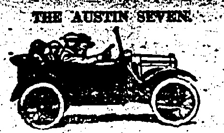
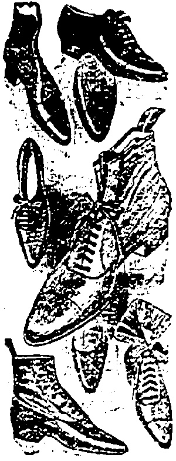
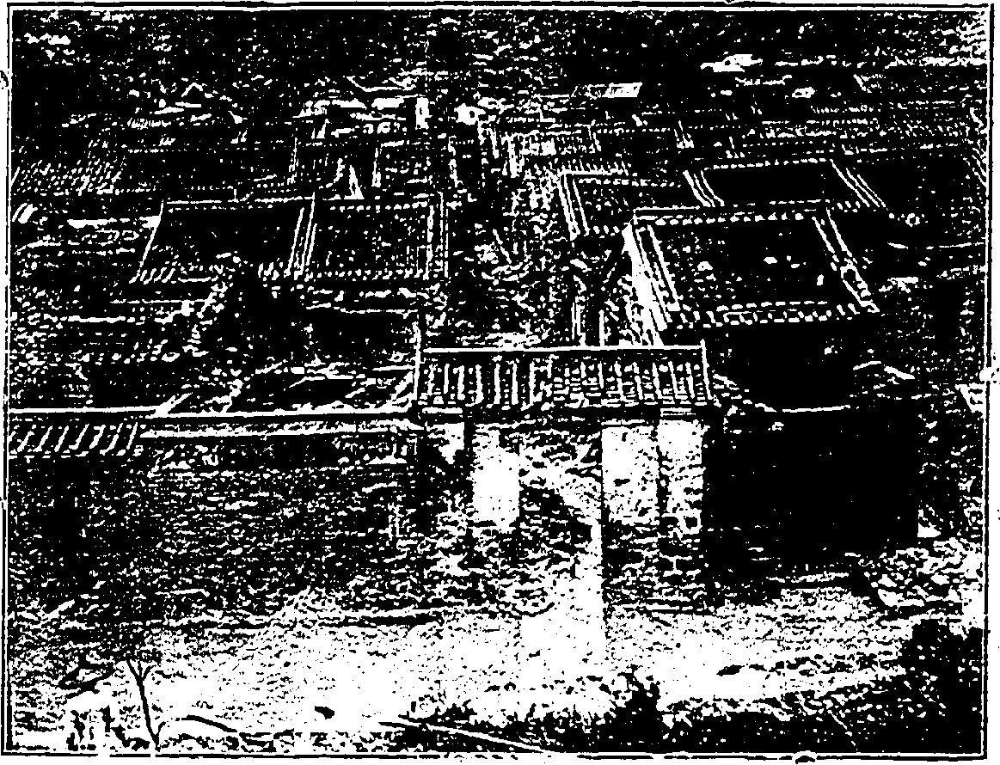
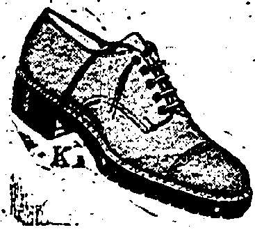

We have a comprehensive stock. It includes Bearings for Buick, Cadillac, Chandler, Chevrolet, Cleveland, Dodge Brothers, Essex, Ford, Hudson, Jewett, Marmon, Maxwell, Oakland, Oldsmobile, Overland, Paige, Studebaker, Willys Knight AND most other Cars and Trucks in South China.

# China Jitail

THE DRAGON MOTOR CAR CO., LTD.

Temperature 75, Barometer 29.78

Rainfall 10.19 in., Humidity 98

ESTABLISHED

THE DOLLAR.

To-day's closing rate 2/3 7/16

To-day's opening rate 2/3 7/16

No. 19,522

RICE, $3.00 Per Month.

Catalogues & specifications from

Solo Agente:

ALEX. ROSS & CO. (CHINA), LTD.

# SPECIAL SALE

WHITEAWAY'S

FOR

ONE WEEK ONLY

Monday,

June 15th

TO

Saturday,

June 20th

ENTIRE STOCK

INCLUDED

AT

HEAVILY REDUCED

RATES

GENTS'

LADIES'

CHILDREN'S.

WHITEAWAY, LAIDLAW & CO., LTD.

DAVIE, BOAG & CO., LTD.

Rank of Canton Building.

FOR REAL FINE MAJONG SETS

MADE OF IVORY AND BONE.

SOLD AT

Lowest Possible Prices

SUNG SAN CHAN,

140, Wellington Street.

Agent:

## SHANGHAI TROUBLES

## HOW GREATER BLOODSHED WAS AVERTED

FOMENTERS OF UNREST?

The British Co-operating With the Powers.

Had the mob in Shanghai seized the arms in the Police Station on May 30 there would have been greater bloodshed, declared Mr. A. M. Samuel in the House of Commons, when he pointed to the co-operation of the Powers and the surest remedy for the disturbances.

## LABOUR CONDITIONS

### (Reuter's Service.)

Replying to a suggestion by Mr. Will Thorn (Labour) that the trouble in Shanghai was due to low wages and the employment of children, Mr. A. M. Samuel, Parliamentary Secretary of the Department of Overseas Trade, for the Foreign Office emphasised that the British Government had done all it could to improve conditions of labour within the International Settlement and had no control outside. The mob at Shanghai was very large and murderous. Had they succeeded and seized the arms at the police station there undoubtedly would have been greater bloodshed. The British policy in respect of the trouble in China had been adopted in concert with the other Powers interested and no points of difference had arisen. Mr. Samuel paid a tribute to the firm and tactful manner in which the Italian Minister, Signor Cerruli, the senior diplomat in Peking, was handling the situation. He (Mr. Samuel) emphasised that the Government respected China, and would gradually lend all support with a view to securing China's prosperity and peace. The casualties in Shanghai were 21 Chinese killed, 65 Chinese wounded, and one American wounded.

The position in China was the subject of a number of questions by Labour members and others in the House of Commons.

The Hankow Affair.

The British Consul at Hankow reported that the firing there was inevitable. Had the Chinese authorities co-operated with the defence force, a deplorable loss of life would have been avoided.

The disturbances in Hankow and Shanghai were a symptom of the deep and widespread unrest exploited by interested parties to stir up feeling against those Powers with the largest interests in China who, therefore, were deeply concerned to co-operate with China in the task of progress and reform. The surest remedy for the anti-foreign feeling in China would lie in an attempt by the Treaty Powers to carry out the decisions of the Washington Conference in regard to co-operation between China and the Powers in measures beneficial to China. The Government was considering the best means of overcoming the difficulties arising largely from the absence of an effective Government in China. It trusted that the forthcoming conference on the internal Tariff of China would afford an opportunity of removing such obstacles, dissipating the present atmosphere of distrust and inaugurating an era of fruitful co-operation between China and the Powers.

An Important Point.

Mr. Samuel emphasised that no Chinese were killed by British forces. The casualties were inflicted by the Police of the International Municipality of Shanghai.

Asked whether he would order that future demonstrators would not be fired on with ball cartridge, Mr. Samuel replied that the Government was not in a position to give instructions to an International Municipality. He added that the industrial conditions in the International Settlement in Shanghai were better than in the Chinese area over which we had no control.

## Optimistic View

Replying to Mr. Ramsay Mac-Donald Mr. Stanley Baldwin, Prime Minister, gave the assurance that the Government was co-operating with the other Powers in taking every step possible to prevent the disturbances becoming a really big International trouble in the Far East. There was every reason to believe that the Powers and the Chinese

desire to attain peace, and enable an attempt to come to an arrangement on the Tariff which would keep and consolidate the Central Government of China.

## $45,000 IN DRUGS

## THE HANKOW RIOT

(Courtesy of the Daily Bulletin. Polling Time 15

The British Note in reply to the Chinese Note as regards the riot at Hankow was handed in to the Under-Secretary of the Waichiao

pu last evening.

## Bedstead Hiding

From your Note it is clear that your Excellency is not in possession of the true facts, which are as follows:—At seven o'clock in the evening of June 11, a mob broke into the British Concession at Hankow armed with stones, with which they attacked the police and members of the Municipal Council. Sailors from His Majesty's gunboat Bee were landed, upon which the mob were dispersed without firing. As the situation became critical, the Volunteers were called out. The mob then attacked the Volunteers and the naval posts with poles and stones, inflicting some slight casualties. The Volunteers showed great restraint and refrained from firing, even when the mob charged almost up to within the bayonets. At nine o'clock, the Consul-General appealed to the Foreign Affairs Commissioner for protection. After some delay, the latter arranged for the despatch of troops, but in the meantime the mob attacked and looted a Japanese shop, and next beat the inmates, one of whom died from his injuries. The mob, which was highly excited, shouting "Kill the foreigners!" attacked the British post guarded by barbed wire. A fire-engine held back the mob for twenty minutes, but in spite of this the mob forced their way through the barbed wire and, armed with long poles, began to climb it, showering bricks upon the defenders, several of whom were badly hurt. Then only firing took place, killing three or four and wounding the same number. The mob retreated, and the wounded were taken to the British Hospital. All the foreign naval forces co-operated in the defence of the British, French and former Russian Concessions, Your Excellency will see from the above account that the impression that the

As Shen Juai-lin could not be found, it was stated that he was in hiding from the students.

The Note says:—

SEQUEL IN COURT.

MARCHANT.

Before Mr. S. B. E. McElderry, at the Central Magistracy this morning, Matthew Tonkin, 37, native of England, and Moses Sansonovitch, 52, native of Brazil, both merchants, were formally charged with the unlawful importation of drugs into the Colony.

The prosecution was a sequel to the discovery of a large quantity of heroin packed in tin tubes and concealed in the leg posts of a consignment of sixteen cases bed-steads consigned from Antwerp to Shanghai by the s.s. Glentani. The seizure was made by revenue

Part of Wongneichong village showing where roofs have given way and walls collapsed through the floods.

officers who found on a minute examination of the bedsteads that the legs were made to screw off.

## LAST NIGHT'S HEAVY RAIN

Mr. H. A. Taylor, Assistant Superintendent of the Imports and Exports Office, informed His Worship that the actual amount of the seizure had not yet been ascertained, but it was about 150 lbs. of heroin. He asked for a few days' adjournment as he considered that it might be necessary to send a cable to the Colonial Office regarding the matter and probably await evidence from there. Mr. Taylor said that the evidence against the first accused was quite clear, but so far there was very little evidence against the second accused.

Mr. C. H. Lyson appeared for the defence.

A Chinese coolie working at the Government quarries at North Point was killed yesterday when a motor lorry loaded with stone ran over him.

Mr. T. Ramsay, assistant managing director of Messrs. W. S. Bailey and Co., Ltd., has authorised the "China Mail" to state that there is no foundation in a report published this morning that the shipyard employees, about 700 in number, may go on strike to-Bay Messrs. Bailey and Co. add that the rumours are entirely without foundation.

The case was adjourned until noon on Friday, bail being fixed at $10,000 and $500 respectively.

The value of the seizure amounts to about $15,000.

The friendly attitude of these workers and their stated willingness to resume is important in view of recent events and the resultant possibility of a general strike

## WANTON MURDER

that the arrival of new machinery meant that hand packing was to be dispensed with altogether, have agreed to recommence work, all misapprehensions apparently having been cleared up.

The management confidently hopes for a resumption of work to-morrow morning.

# SHANGHAI BRITON KILLED.

FATAL SHOTS.

WOMAN WOUNDED.

Shanghai has been shocked by the brutal and wanton murder of a British resident whose fate was narrowly escaped by a lady who was with him at the time.

Terrible End to a Motor Car Drive.

### (Reuter's Service.)

Shanghai, June 16.

The Briton Mr. William Mackenzie was murdered last night while driving his car outside the Settlement boundaries with a lady, Miss Duncan, who was wounded. Seven Chinese stopped the car and turned flashlights on the occupants.

They fired at Mr. Mackenzie who had restarted the car. He was hit in the neck and fell forward.

## STOP PRESS

## PROTEST AND REPLY

### (Reuter's Service.)

The Commissioner for Foreign Affairs has protested to the British Consul regarding the firing on the mob. He says the firing was unnecessary and holds the Consul personally and the officer who ordered the firing, to be responsible therefor. He requests the withdrawal of the Naval contingent and that orders should given to refrain from firing in future.

The Consul replied yesterday evening that the protest was not reasonable and without foundation in fact. He corrects erroneous statements contained in the protest. He says that the firing was most necessary in view of the danger to foreign lives and property in the Concession, particularly following the serious damage already done by the rioters and the murder of a Japanese the same evening. He also states that fire was opened only as a last resort and even then was most restricted.

## Hankow Quiet

## Hankow, June 15

The situation remains quiet. The volunteers and Navy men are still standing by. H.M.S. Despatch is expected this afternoon.

The Consular body has written to Tupan Hsiao Yao-nan recapitulating the circumstances of Thursday night's riot, saying that the disturbances need not have happened, requesting that proper measures be taken to prevent a recurrence.

The British Cigarette Company's workers, who struck on May 23, following the arrival of new labour saving machinery and the previous dismissal of a number of women workers due to the packing department being over

Miss Duncan, though wounded, took the steering wheel and guided the car more than a thousand yards, when it ran into a ditch near the Columbia Country Club, to which she ran.

In the course of a letter dated Shanghai, June 10, Mrs. Herbert Sutor writes to her father, Mr. D. McNeill, in Hongkong:

“You are not getting many letters these days, but things have been so worrying and unsettled that we have not had time or heart to write. The Police did all they could do to quieten the mob, but it was useless. They drove the Police from Sincere's to Lonza Station, and then in the end the odds were so great that the Police had to fire. Fancy six men against a mad mob of 3,000.

“We could not get fresh meat for some days, but did quite well. The French told the shopkeepers that if they closed up they would lose their licences. They called off the boycott from the French Commission very quickly. Many—in fact, nearly all—have been left to do for ourselves, but we do not mind that.

"The Shanghai Scots have their headquarters in the Golf Club on the Racccourse, and the Americans have theirs in the New World. During the worst part of the trouble the Chinese were kept off the Nanking Road. It was just like a military town. But for a week we were at their mercy, the Chinese sniffing, throwing bricks, and sniping, whilst our poor boys were almost dronning with fatigue, after standing 36 hours!"

"Whilst it is certain that the Municipal Council will not stand any nonsense, it is felt that only international intervention can settle the trouble effectually."

## CITY NOW QUIET

## CANTON SETTING DOWN

A STRIKE UNLIKELY.

(From Our Own Correspondent.)

CANTON, June 15

Fighting was audible yesterday afternoon to the North of Canton where, presumably the Cantonese are following up the remnants of the fleeing meccenary armies.

Most of the Yunnanese who remained behind were either disarmed, killed, or taken into custody by the victors to save them from the wrath of street mobs. Canton is now quiet and the Kuomintang is in process of restoring the old order of things

Some Yunnanese detachments have been incorporated in pro-Kuomintang contingents.

Rumours of a general strike are current in Canton. However, the stoppages engineered by the Cantonese to hinder the mercenaries cannot very well be described as being in sympathy with trouble at other ports.

## A General's Moustaches

A story, not without its humorous aspect, is related by the vernacular papers regarding the flight of General Yang Hsi-man (Yunnanese commander-in-chief) from Canton. He proceeded to Shameen by motor car on Friday when the debacle began. Accompanied by one of the British Vice-Consuls, so the story goes, he embarked on one of the night boats for Hongkong, still wearing his moustache, "after the style of the Chinese character for eight." A previous allusion to the general's having discarded his moustache to disguise himself had caused much amusement.

On arrival in Hongkong he was escorted by the Police to the King Edward Hotel where a guard of detectives was mounted.

According to the report, Yang was recoised on the river steamer and had to part with $3,400 in notes—all that he had with him—so that he would not be molested and to assure his passage.

In Hongkong he is said to have given the detectives the slip by sailing on the s.s. President Jackson for Shanghai without the police knowing. The report also

## X00000000000000000000000000

## “K” SHOES

## HOMES FOR YOUR FEZ

You choose your home with great care. It must look well, be comfortable, and be well built. Choose your voices with equal care. You will spend more time in them. Buy "K's" "K's" are mad: from the finest materials by men old in their trade, and proud of their craftsmanship. Behind "K's is sixty years' reputation for quality. They are built on insoles cut from choice hide-one secret of their lasting wear and never failing appearance. In "K's your fee will be comfortable and even more so in those soled with crep� rubber; the soles which give such wonderful wear.

FOR EASE USE "K's.

## "K" agen:s for Hongkong

## MACKINTOSH

Men's Wear Specialists.

(X)(X)(X

## (X)

HOT WEATHER

NEED NOT WORRY

WHEN YCU CAN OBTAIN

## ICE COLD DRINKS

AND

## DELICIOUS

## ICE CREAM

## MORINAGA'S

SODA FOUNTAIN

Asiatic Bldg. Tel. C. 4702

TANG YUK, Dxtun,

the Plats SERN TING,

1C Di Agular Street