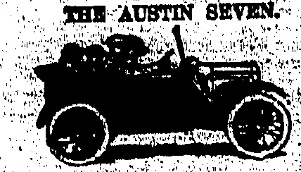
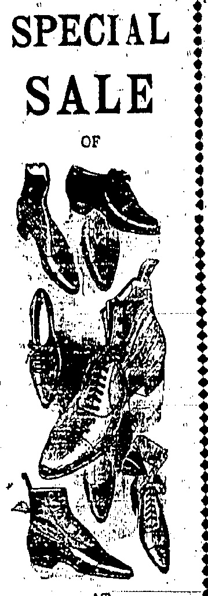
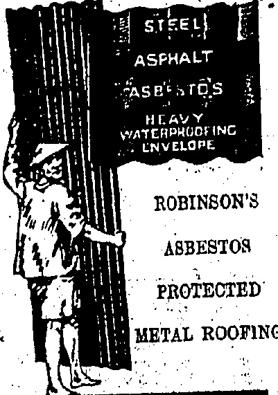
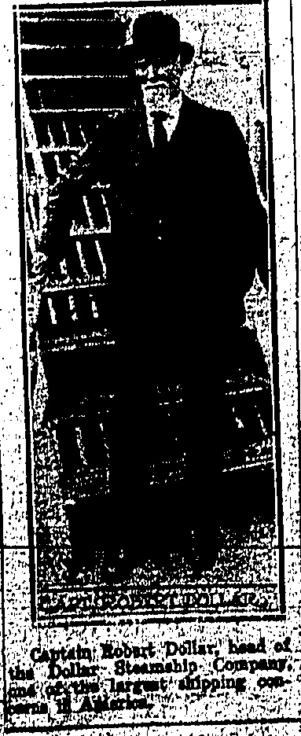
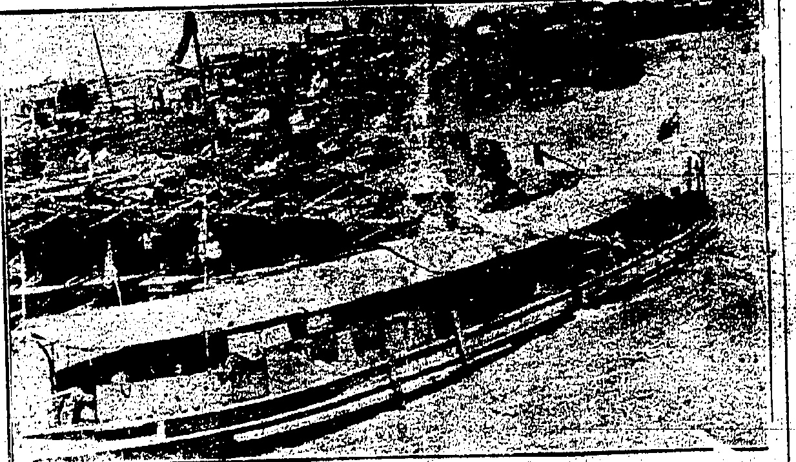
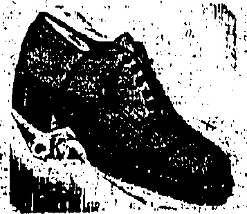
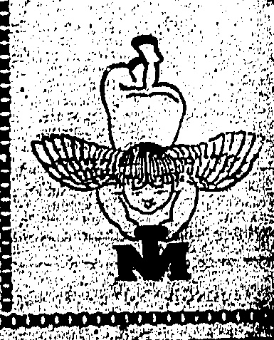

Made in many different types and admirably adapted to meet the varying designs and operating conditions of all motor cycles and motor cars:

r 1212 e 18 m/m for Motor Cycles $1.60

r 1616 e 1/2" for Ford..... $1.60

r 1616 e 7/8" for Motor Cars..... $1.60

r 2212 e 18 m/m for Motor Cars... $1.60

r 2218 e 18 m/m for Motor Cars... $1.60

THE DRAGON MOTOR CAR CO., LTD.

Telephone Central 246 or 1147.

33 Wong Noi Ohung Road, Happy Valley.

# China the Retail

Rainfall 2.34 in., Humidity 95

ESTABLISHED

1840

THE DOLLAR

To-day's closing rate 2/3 7/16

To-day's opening rate 2/3 7/16

ALEX. ROSS & CO. (CHINA), LTD.

☐☐☐☐☐☐☐☐☐☐☐☐☐☐☐☐☐☐☐

WHITEAWAY, LAIDLAW & CO., LTD.

HONGKONG.

FOR REAL FINE MAJONG SETS MADE OF IVORY AND BONE.

SOLD AT

Lowest Possible Prices

SUNG SAN CHAN.

140, Wellington Street.

Bank: SAN FALV.

Chong Ha Long.

Shanghai.

## NOTABLE

## VISITOR

ROMANTIC

Lumber-Jack

DOLLAR

Arriving in the Colony to day by the S.S. President McKinley is Captain Robert Dollar, the millionaire shipping, magnate, who rose to his present position from that of a lumber-jack and who has become a national hero through the writings of Peter Kyne in whose books he figures as "Cappy Ricks."

Captain Robert Dollar's ability in connection with the organisation of a vast shipping concern is not the only thing which has commended him to the American people and made him almost a national hero. He has interested himself in the maintenance of good relations between America and the nations of the world, particularly China, and he was one of the first prominent American citizens to be approached regarding recognition of the Chinese Republic in 1911.

His genial and forceful personality is better known to the general public, however, through the medium of the popular writer, Peter Kyne, who has made of him his hero "Cappy Ricks," figuring in a series of widely read stories dealing with life in the lumber fields. He was as a lumber jack that Captain Robert Dollar first commenced his struggle with life and although his clever dealings since his sudden rise to prosperity have stamped him as a man who was bound to rise very considerably from that estate it was a stroke of luck which first set his foot upon the ladder of success. As a stranded skipper in the Philippines he discovered copra, the industry in which has resulted in fabulous results.

Every reader of fiction knows "Cappy Ricks" and loves the character that has "put across" so many clever deals and who brings to bear an inexhaustible supply of humour of his numerous logging operations. The real Robert Dollar's achievements, however, by no means stop short at this. The value in which he was held as a diplomat is shown by the fact that after the Republic of China was established, happening to be in China at the time, he was the reincident of a cable from President Taft asking him to go to Peking for a conference with Mr. Calloun, American Minister, to discuss the situation and the desirability or otherwise of recognition.

Captain Dollar is still confident that his advice in favour of recognition of the Republic of China by America will be justified and thinks

Captain Dollar was interviewed whilst in Shanghai last week on the present situation there and stated that he was firmly of the belief that a foreign inspiration was really at the bottom of it. He had not had the opportunity to investigate the causes behind the present situation but from its outward manifestations it displayed Bolshevik tendencies which had been present in strikes in almost every country under the sun in recent years since leaders of the Soviet got control of Russia and started out to overturn the whole world to their way of thinking.

HONGKONG'S VISITOR

## Magnate

it is only a question of a short time before China will be become one of the great nations of the world. As proof of this he pointed to shipping figures at the ports and also to the growing tonnage of ships cleared at the Panama Canal, which he desurbed as proof of his contention that the era of the Pacific Ocean was now at hand.

Questioned in Shanghai as to the recent purchase of the U.S. Government passenger ships, previously operated by the Pacific Mail Company, Captain Dollar said that the prosperity of his Company was so inextricably bound up with that of the various countries about the Pacific Ocean that fears which had been expressed of an American shipping monopoly had no foundation in fact. If China, Japan, the Hawaii Islands and the Philippines were not prosperous how could his company be prosperous? he asked. It was only through co-operation that both interests could succeed.

## HEAVY RAINS

## Water Supply Benefits

1.

2.

3.

4.

5.

6.

7.

8.

9.

10.

RESERVOIRS OVERFLOW.

The amount of water that was received in the reservoirs during the twenty-four hours ending 6 o'clock this morning, also that which fell in the corresponding period yesterday, is as follows:

Considerably less rain fell during the twenty-four hours ending at 6 o'clock this morning than had fallen during the same period yesterday morning but the reservoirs have registered several inches increases. Pokfulam, Wongnejchong and Tytam Intermediate reservoirs from being in the neighbourhood of 25 feet below overflow (as they were on the 15th) have now reached overflow and others are approaching that way.

<table border=1 style='margin: auto; word-wrap: break-word;'><tr><td style='text-align: center; word-wrap: break-word;'>Kowloon</td><td style='text-align: center; word-wrap: break-word;'>2.76</td><td style='text-align: center; word-wrap: break-word;'>350</td></tr><tr><td style='text-align: center; word-wrap: break-word;'>Pokfulam</td><td style='text-align: center; word-wrap: break-word;'>7.20</td><td style='text-align: center; word-wrap: break-word;'>4.05</td></tr><tr><td style='text-align: center; word-wrap: break-word;'>Wongneichong</td><td style='text-align: center; word-wrap: break-word;'>15.50</td><td style='text-align: center; word-wrap: break-word;'>6.00</td></tr><tr><td style='text-align: center; word-wrap: break-word;'>Tytam</td><td style='text-align: center; word-wrap: break-word;'>13.84</td><td style='text-align: center; word-wrap: break-word;'>4.10</td></tr><tr><td style='text-align: center; word-wrap: break-word;'>Tytam Tuk</td><td style='text-align: center; word-wrap: break-word;'>12.22</td><td style='text-align: center; word-wrap: break-word;'>4.77</td></tr></table>

An idea of the great benefit the rains have been in respect of stored water may be obtained from the fact that on the 15th, the Kowloon reservoir was 24 ft. bin.

## TROOPS HERE

The Far Eastern offices of Thomas Cook and Sons were founded by Mr. Blanch and when headquarters were established in Hongkong in 1915 he remained in charge there until he left for Home in none too good health at the end of 1920.

Those who were personally acquainted with Mr. N. F. Blanch whilst he was in Hongkong and the Far East between 1906 and 1920, also many others who have reason to remember his kindly and courteous advice while he was Far Eastern General Manager of Thos. Cook and Son, Ltd., at his office in Pall Mall, will regret to hear of his untimely death. At the time of his death Mr. Blanch was slightly over 50 years of age.

Prior to coming out East Mr. Blanch (who was an old Eton boy) had been with Thomas Cook and Son in Egypt.

## STRIKE TROUBLE

Mr. Blanch leaves a widow.

### MR. THOMAS BLANCH

CANTON NOW QUIET.

## TO BE SENT TO THEIR HOMES

# QUESTIONS IN HOUSE OF COMMONS.

A WELL-KNOWN PERSONALITY.

## OBITUARY:

PROTECTING FOREIGNERS

About eight Yunnanese soldiers and camp-followers who made their way down to Hongkong when their side was defeated in Canton last week, have been taken into the care of the Yaumati Police. They will be repatriated at an early date. A large number of Yunnanese troops are stated to be still held as prisoners of war at Whampoa. Canton is reported quiet.

"Delicate Matter."

The safety of foreigners in China was the subject of questions in the House of Commons yesterday by a former Hongkong resident.

## THE CANTON FIGHTING—READY FOR ATTACK

1

In the foreground is one of the Kuomintang's armed launches which put out from Honam last Friday and successfully invaded Canton. The side is protected by iron plates over which are placed wet sacks to prevent the vessel catching fire. In the lower left hand corner is a machine gun on the bow of the launch. Behind are a fleet of naval craft, flying the "Fook" Army Hag, which assisted in transporting the Cantonese troops across the River. This photo was taken after the fleet had put out into the stream.

(Router's Service.)

In the House of Commons, re-plying to Mr. H. W. Looker, who asked for an assurance that His Majesty's ships are in a position to protect British subjects on the coast and waterways of China, Mr. A. M. Samuel, on behalf of the Foreign Office, said that the forces at the disposal of the Powers were believed to be sufficient to meet any contingency which could reasonably be foreseen.

Mr. Looker pointed out that from the list published in the Press, apparently no ships were at present stationed at the coast ports.

Mr. Samuel expressed the opinion that the list only referred to British ships, not to the ships of other Powers. He promised to bring the matter before the Admiralty at the earliest moment.

London, June 16.

below overflow, yesterday it was 19 ft. 5in. below and this morning 15 ft. 6 in. below. Like figures for the reservoirs in Hongkong (in feet and inches) are as follows:

<table border=1 style='margin: auto; word-wrap: break-word;'><tr><td style='text-align: center; word-wrap: break-word;'></td><td style='text-align: center; word-wrap: break-word;'>15th</td><td style='text-align: center; word-wrap: break-word;'>16th</td><td style='text-align: center; word-wrap: break-word;'>17th</td></tr><tr><td style='text-align: center; word-wrap: break-word;'>Pokfulam</td><td style='text-align: center; word-wrap: break-word;'>25.1</td><td style='text-align: center; word-wrap: break-word;'>5.3</td><td style='text-align: center; word-wrap: break-word;'>0.0</td></tr><tr><td style='text-align: center; word-wrap: break-word;'>Wongneichong</td><td style='text-align: center; word-wrap: break-word;'>28.4</td><td style='text-align: center; word-wrap: break-word;'>6.1</td><td style='text-align: center; word-wrap: break-word;'>0.0</td></tr><tr><td style='text-align: center; word-wrap: break-word;'>Tytam</td><td style='text-align: center; word-wrap: break-word;'>37.2</td><td style='text-align: center; word-wrap: break-word;'>12.5</td><td style='text-align: center; word-wrap: break-word;'>4.1</td></tr><tr><td style='text-align: center; word-wrap: break-word;'>Bye-Wash</td><td style='text-align: center; word-wrap: break-word;'>22.1</td><td style='text-align: center; word-wrap: break-word;'>12.4</td><td style='text-align: center; word-wrap: break-word;'>10.7</td></tr><tr><td style='text-align: center; word-wrap: break-word;'>Intermediate</td><td style='text-align: center; word-wrap: break-word;'>24.1</td><td style='text-align: center; word-wrap: break-word;'>4.4</td><td style='text-align: center; word-wrap: break-word;'>0.0</td></tr><tr><td style='text-align: center; word-wrap: break-word;'>Tytam_Tuk</td><td style='text-align: center; word-wrap: break-word;'>42.9</td><td style='text-align: center; word-wrap: break-word;'>32.7</td><td style='text-align: center; word-wrap: break-word;'>24.8</td></tr></table>

On the 15th the total storage in Hongkong was 832 58 million gallons; yesterday it had increased to 1,291.15 million gallons and this morning to 1,538 million gallons.

In Kowloon on the 15th the total storage was 146.36 million gallons, yesterday it had increased to 180.95 million gallons and today to 210.7 million gallons.

## see Deep Floods

Occupants of houses behind the Dragon Motor Garage at the Wongneichong end of Happy Valley spent another anxious night owing to the very heavy rainfall. With floods knee deep inade, many of them had to abandon their homes, but no further collapses or casualties appear to have occurred.

Water continued to pour down the slopes leading from Stubbs Road to this part of the Valley carrying with it more portions of the collapsed wall. The work of clearance has been greatly hampered by this and it has been found impossible to make any great inroad on the great masses of earth and debris. Although the Young Wo Nursing Home escaped the fall of the retaining wall which a few yards from its entrance battered two cars and a steam-roller to pieces and hurled one of them on to the rail course.

it has been inundated by the floods which have poured down the hill leaving behind them piles of slush and sand in the main hall.

Mr. Will Thorne asked whether the trouble was decreasing or increasing.

The above mentioned spot and outside the main entrance to the Jockey Club are the two most seriously affected, the latter presenting almost as great a scene of desolate waste and riot as the former. Fifty yards of the Christian Cemetery main wall has been carried on to the road and there is an ominous bulge about much else of it. Through the gap in the wall course streams which when the rain was at its height gave the appearance of a swollen river. The walls of the Jockey Club premises are awash and the water is eventually finding its way into the Race Course. A considerable section of the inner drain wall at the three-quarter mile post has given way and railings surrounding the track have also been carried away. The Race Course has been still further inundated. The force of the flow through the gap in the Cemetery wall may be gauged from the fact that telegraph poles have been twisted and bent.

In spite of more landslides the work of clearance on Stubba Road has been conducted with such energy that by the time offices close to-day the road will be open both to the Peak and also Repulse Bay. However drivers are requested to proceed very carefully. Owing to a very heavy fall between Stanley and Repulse Bay that sector of the road is closed to traffic at present.

The rear portion of two old buildings at Tokowan collapsed last night owing to the place falling. Good with water. The inmates fortunately escaped injury.

Mr. Samuel expressed the opinion that the loss said at present about this very delicate matter the better.

Though there was no incident overnight and the situation remained quiet throughout the day, the atmosphere is not yet clearing and it would appear that the present troubles will be rather protracted.

Of seven Bolshevik agitators arrested by the Chinese authorities one—Dr. Haiao Yin-yishih—was shot by them this morning.

The British Cigarette Company's workers resumed work this morning.

Foochow, June 17.

Students are urging the foreign-

employed Chinese to strike and-

appealing to the Merchants'

Guild to support the strikers.

The Military Governor has

posted guards in the foreign

quarter. All is quiet.

The Ministry for Communications, in a circular telegram, orders special protection to be given to all foreign employees and foreign travellers on the railways. It instructs the railway police chiefs to despatch efficient police for this special purpose.

try instructed foreign employers to remain at their posts and carry on their usual work.

Measures in Peking.

Peking, June 17:

It is understood that the foreign authorities have made representations to the Government adequately to protect foreigners.

At a meeting of the Cabinet Ministers, the Chief of Police and the Commander of the Precautionary Force discussed measures yesterday. As a result numbers of Feng Yuhsiang's troops are patrolling the city and special guards have been placed outside the principal foreign firms' offices and residences.

Chang Tso-lin has despatched troops to Peking to-day, and the first companies arrived this afternoon, occupying the Yellow Temple outside the North Gate. In some quarters doubt is expressed whether these forces can cooperate with those of Feng Yuhsiang.

## Suggested Conference

The Association of British Chambers of Commerce has forwarded the Premier a resolution urging the Government to arrange at the earliest possible moment with the other Powers interested a conference with representatives of the different provinces of China with a view to establishing a permanent satisfactory settlement in China.

## A SCHOOL'S TRIBUTE

An interesting ceremony took place this morning at Government House, when the Elders of the Pat Heung Valley, New Territories, forming the Committee of management of the Tung Yik Vernacular School, were received by Sir Edward Stubbs, and presented a framed complimentary address on silk, to His Excellency on the occasion of his departure. The school was opened by His Excellency in 1021, when it started with some 30 pupils. It now has 90 pupils and is in receipt of an annual Government grant—a proof of its usefulness. Four Elders presented the address in the presence of the Hon. the Secretary for Chinese Affairs, the Hon. Mr. Kotwell, the Hon. Mr. Chow Shouson, and the District Officer North. His excellence is simply expressed himself as being very pleased with the progress of the school and hoped that it would

## X00000000000000000000000

HOMES FOR YOUR FERT

You choose your home with great care. It must look well, be comfortable, and be well built. Choose your shoes with equal care. You will spend more time in them. Buy "K"s "K"s are made from the finest materials by men o.d. in their trad., and proud of their craftsmanship. Behind "K"s is stt/years' reputation for quality. They are built on inoles cut from choice hide—one secret of their lasting wear and never failing appearance. In "K"s your fee will be comfortable and even more so in those soled with crep� rubber; the soles which give such wonderful wear.

FOR EASE USE "K"s.

"K" agen:s for Hongkong.

### MACKINTOSH & CO.,LTD

Alexandra Building.

Des Vœux Road.

X(X)(X)(X)(X)(X)(X)(X)(X)(X)(X)

## ICE COLD DRINKS

## AND DELICIOUS

MORINAGA'S

SODA FOUNTAIN

TANG YIKI

