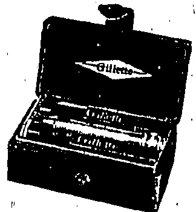
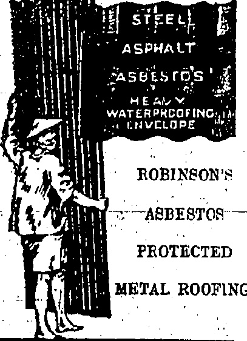
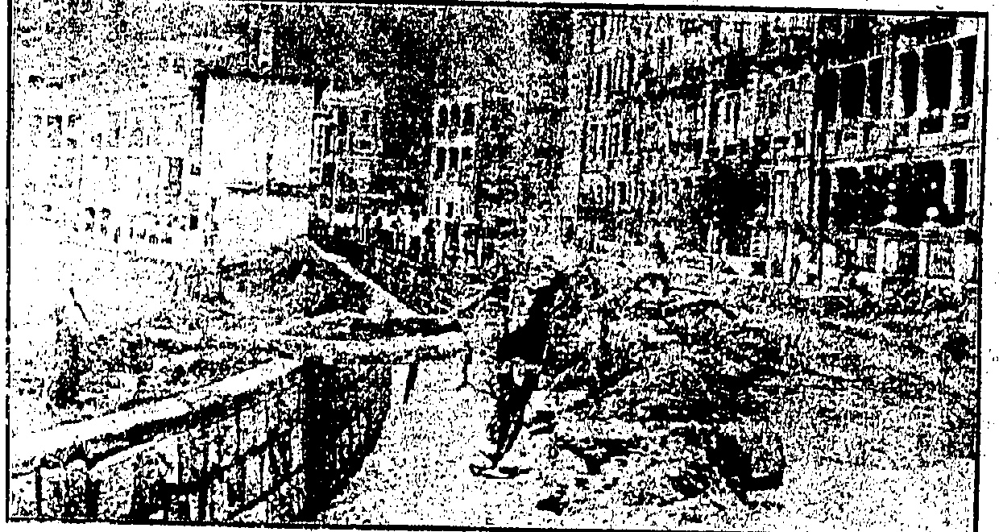

VICTOR CYLINDER HEAD GASKETS:

We carry an ample stock of these for Dodge Brothers, aklana, Oldsmobile, cripps-Booth, Maxwell, Ford, Chevrolet, Marmon, Hudson, Elgin, Grant Six, Hupmobile, Ssex, Briscoe, Cleveland, Jewett, Buick, handler, verland, and Paige Motor Cars.

THE DRAGON MOTOR CAR Co. Ltd.

# China the Initial

Temperature 80, Barometer 29.70

Rainfall 0.00 In., Humidity '85

ESTABLISHED

No. 19,526

恐

THE DOLLAR

To-day's closing rate 2/3 7/16

To-day's opening rate 2/3 7/16

PRICE, $3.00 Per Month.

Catalogues & specifications from

Solo Agents :

ALEX. ROSS & CO. (CHINA), LTD.

♡♦♦♦♦♦♦♦♦♦♦♦♦♦♦♦♦♦♦♦♦♦♦♦♦♦♦♦♦♦♦♦♦♦♦♦♦♦♦♦♦♦♦♦♦♦♦♦♦♦♦♦♦♦♦♦♦♦♦♦♦♦♦♦♦♦♦♦♦♦♦♦♦♦♦♦♦♦♦♦♦♦♦♦♦♦♦♦♦♦♦♦♦♦♦♦♦♦♦♦♦♦♦♦♦♦♦♦♦♦♦♦♦♦♦♦♦♦♦♦♦♦♦♦♦♦♦♦♦♦♦♦♦♦♦♦♦♦♦♦♦♦♦♦♦♦♦♦♦♦♦♦♦♦♦♦♦♦♦♦♦♦♦♦♦♦♦♦♦♦♦♦♦♦♦♦♦♦♦♦♦♦♦♦♦♦♦♦♦♦♦♦♦♦♦♦♦♦♦♦♦♦♦♦♦♦♦♦♦♦♦♦♦♦♦♦♦♦♦♦♦♦♦♦♦♦♦♦♦♦♦♦♦♦♦♦♦♦♦♦♦♦♦♦♦♦♦♦♦♦♦♦♦♦♦♦♦♦♦♦♦♦♦♦♦♦♦♦♦♦♦♦♦♦♦♦♦♦♦♦♦♦♦♦♦♦♦♦♦♦♦♦♦♦♦♦♦♦♦♦♦♦♦♦♦♦♦♦♦♦♦♦♦♦♦♦♦♦♦♦♦♦♦♦♦♦♦♦♦♦♦♦♦♦♦♦♦♦♦♦♦♦♦♦♦♦♦♦♦♦♦♦♦♦♦♦♦♦♦♦♦♦♦♦♦♦♦♦♦♦♦♦♦♦♦♦♦♦♦♦♦♦♦♦♦♦♦♦♦♦♦♦♦♦♦♦♦♦♦♦♦♦♦♦♦♦♦♦♦♦♦♦♦♦♦♦♦♦♦♦♦♦♦♦♦♦♦♦♦♦♦♦♦♦♦♦♦♦♦♦♦♦♦♦♦♦♦♦♦♦♦♦♦♦♦♦♦♦♦♦♦♦♦♦♦♦♦♦♦♦♦♦♦♦♦♦♦♦♦♦♦♦♦♦♦♦♦♦♦♦♦♦♦♦♦♦♦♦♦♦♦♦♦♦♦♦♦♦♦♦♦♦♦♦♦♦♦♦♦♦♦♦♦♦♦♦♦♦♦♦♦♦♦♦♦♦♦♦♦♦♦♦♦♦♦♦♦♦♦♦♦♦♦♦♦♦♦♦♦♦♦♦♦♦♦♦♦♦♦♦♦♦♦♦♦♦♦♦♦♦♦♦♦♦♦♦♦♦♦♦♦♦♦♦♦♦♦♦♦♦♦♦♦♦♦♦♦♦♦♦♦♦♦♦♦♦♦♦♦♦♦♦♦♦♦♦♦♦♦♦♦♦♦♦♦♦♦♦♦♦♦♦♦♦♦♦♦♦♦♦♦♦♦♦♦♦♦♦♦♦♦♦♦♦♦♦♦♦♦♦♦♦♦♦♦♦♦♦♦♦♦♦♦♦♦♦♦♦♦♦♦♦♦♦♦♦♦♦♦♦♦♦♦♦♦♦♦♦♦♦♦♦♦♦♦♦♦♦♦♦♦♦♦♦♦♦♦♦♦♦♦♦♦♦♦♦♦♦♦♦♦♦♦♦♦♦♦♦♦♦♦♦♦♦♦♦♦♦♦♦♦♦♦♦♦♦♦♦♦♦♦♦♦♦♦♦♦♦♦♦♦♦♦♦♦♦♦♦♦♦♦♦♦♦♦♦♦♦♦♦♦♦♦♦♦♦♦♦♦♦♦♦♦♦♦♦♦♦♦♦♦♦♦♦♦♦♦♦♦♦♦♦♦♦♦♦♦♦♦♦♦♦♦♦♦♦♦♦♦♦♦♦♦♦♦♦♦♦♦♦♦♦♦♦♦♦♦♦♦♦♦♦♦♦♦♦♦♦♦♦♦♦♦♦♦♦♦♦♦♦♦♦♦♦♦♦♦♦♦♦♦♦♦♦♦♦♦♦♦♦♦♦♦♦♦♦♦♦♦♦♦♦♦♦♦♦♦♦♦♦♦♦♦♦♦♦♦♦♦♦♦♦♦♦♦♦♦♦♦♦♦♦♦♦♦♦♦♦♦♦♦♦♦♦♦♦♦♦♦♦♦♦♦♦♦♦♦♦♦♦♦♦♦♦♦♦♦♦♦♦♦♦♦♦♦♦♦♦♦♦♦♦♦♦♦♦♦♦♦♦♦♦♦♦♦♦♦♦♦♦♦♦♦♦♦♦♦♦♦♦♦♦♦♦♦♦♦♦♦♦♦♦♦♦♦♦♦♦♦♦♦♦♦♦♦♦♦♦♦♦♦♦♦♦♦♦♦♦♦♦♦♦♦♦♦♦♦♦♦♦♦♦♦♦♦♦♦♦♦♦♦♦♦♦♦♦♦♦♦♦♦♦♦♦♦♦♦♦♦♦♦♦♦♦♦♦♦♦♦♦♦♦♦♦♦♦♦♦♦♦♦♦♦♦♦♦♦♦♦♦♦♦♦♦♦♦♦♦♦♦♦♦♦♦♦♦♦♦♦♦♦♦♦♦♦♦♦♦♦♦♦♦♦♦♦♦♦♦♦♦♦♦♦♦♦♦♦♦♦♦♦♦♦♦♦♦♦♦♦♦♦♦♦♦♦♦♦♦♦♦♦♦♦♦♦♦♦♦♦♦♦♦♦♦♦♦♦♦♦♦♦♦♦♦♦♦♦♦♦♦♦♦♦♦♦♦♦♦♦♦♦♦♦♦♦♦♦♦♦♦♦♦♦♦♦♦♦♦♦♦♦♦♦♦♦♦♦♦♦♦♦♦♦♦♦♦♦♦♦♦♦♦♦♦♦♦♦♦♦♦♦♦♦♦♦♦♦♦♦♦♦♦♦♦♦♦♦♦♦♦♦♦♦♦♦♦♦♦♦♦♦♦♦♦♦♦♦♦♦♦♦♦♦♦♦♦♦♦♦♦♦♦♦♦♦♦♦♦♦♦♦♦♦♦♦�

## WHITEAWAY'S

SPECIAL VALUES

OBTAINABLE

ONLY

FROM US

THE 'CHA LENGE"

SET

WHITEAWAY, LAIDLAW

& CO., LTD

HONGKONG.

DAVIE, BOAG & CO., LTD.

Bank of Canton Building.

Samples and particulars on application.

FOR REAL FINE MAJONG SETS

MADE OF IVORY AND BONE

BOD AT

Lowest Possible Prices

SUNG SAN CHAN,

140, Wellington Street

Aguas,

SAN PAI LAU,

Chong Ka Ilang,

Shanghai,

## SHANGHAI TROUBLE

## BACKING

STRIKE FUNDS LEVY.

Employees Who Must Give One Day's Pay a M

That the anti-foreign movement in China has the backing of the Peking Government is now established beyond doubt.

(Reuter's Service.)

It is authoritatively learned that the Ministry of Communications has issued an order to the telegraph, postal and railway services that each employee will have one day's pay deducted a month as a contribution to the strike funds.

## Friendly Offer

The commission composed of the diplomatic representatives of the interested Powers' met this morning and issued a communique stating that if the Chinese Government so desired they would request authorisation from respective governments to discuss in the friendliest spirit the propositions presented, by their delegation at Shanghai with regard to the organisation of the International Settlement and the administration of justice therein.

### Shanghai Discussions. Shanghai, June 19

A statement by the Commissioner of Foreign Affairs this evening on behalf of the Chinese delegation asserts that Chinese opinion thought it necessary to include in the conference fundamental issues, such as rendition of the Mixed Court, amelioration of labour conditions, participation of Chinese on the Municipality which would not conflict with treaties but were legitimate aspirations of the Shanghai Chinese.

The points were presented to the Commission who evinced a desire to shift the responsibility of the events leading to the shooting to the Chinese authorities. The Diplomatic Commission stated that it had no authority to discuss international questions and has gone to Peking to report to the Ministers. The Chinese delegation regretted that so far sincere efforts for a peaceful solution had failed.

## Students Take Hint

As a result of the Consular Body's meeting with Tupan Hsiao Yao-nan yesterday afternoon, the Tupan has given a most exquisite assurance of protection for foreign lives and property with his 3,000 troops, following which the number of volunteers and blue-jackets is being reduced.

The Peking student agitators have returned to Peking, it is reported, following a hint from Hsiao Yao-nan.

### First Needs. Peking, June 19

Following a meeting of the diplomatic representatives of the interested Powers this morning, a communique was issued stating: The delegation of interested diplomatic representatives went to Shanghai solely on a mission of investigation. Later it had its powers enlarged and was brought into negotiation's with the Chinese delegates. The last named having presented demands which exceeded the powers of the delegation, the latter took note of the fact and is returning to make a report. The interested diplomatic representatives have already made known to the Wachiaopu their desire to begin negotiations without delay. In their opinion, immediate settlement of the Shanghai incidents themselves on a basis of justice and equity must be the object of a first agreement. Likewise if the Chinese Government expresses a desire the interested diplomatic representatives are disposed to request their respective Governments for authorisation to discuss in the friendliest spirit the propositions presented to their delegation in Shanghai concerning both the organisation of the International Settlement and the administration of justice therein.

## Peking Quiet

Peking, June 19.

The situation is very quiet and there have been no large demonstrations.

The students' attempts to institute a boycott have no far, met with little success.

### PRIS.N FARE:

The street collections in aid of the Shanghai strikers have practically ceased.

"The Association of College Professors on Foreign Relations" advises the entire abandonment of collections, as they are liable to alienate the sympathy of the populace.

So far there is no definite indication of the effect of the rupture of negotiations.

Chinese officials express the view that no rupture has occurred. They say that the diplomatic commission has merely returned to Peking to report to the Legations, meanwhile the Chinese delegation is awaiting instructions from Peking.

The Chinese Chamber of Commerce held special meetings to-WHEN CHICKEN MAY BE OBTAINED.

REGULATION PROVISIONS

Bread and soup and suet pudding constituted the menu for European prisoners at the Victoria gaol ust Xmas day, this being the usual Thursday dietary. Regulations appearing in the current issue of the Government Gazette show little or no change in the bill of fare which is changed three times a week, the only other food it is permissible to give a Class 1 European prisoner being measured ounces of bread, potatoes, and cooked meat.

Curry stuff, fish and rice appears on the diet list of class 2 European prisoners whilst a special privilege of partaking of chicken is allowed First Class prisoners under the progressive stage system.

More in accordance with the national taste are the allowances of the Chinese and Indian prisoners whose measured ounces of rice, fish, chutney, etc. appear to

Student pickets at some points are preventing foodstuffs from entering the Settlement: elsewhere Merchant Volunteers are levying a toll of eighty cents a picul on vegetables.

The strike situation is unchanged.

Chang Hsueh-liang has ordered to Chapei the ex-Shantung infantry brigade of bandit suppression troops, which will be employed in maintaining order in the disturbed areas, adjoining the Settlement.

day and the members seem anxious to end the deadlock, but the student extremists are planning fresh activities.

## LOCAL STRIKE

## Chinese Banks to Open

At a meeting attended by 139 members of the Chinese Chamber of Commerce, this afternoon, a lengthy debate took place as to the date of re-opening the Chinese shops and banks.

A second meeting, this evening, decided in favour of reopening on Sunday, giving four clear days before the half-year settlement day.

## Appeal to China

Whatever may be said about factory conditions in Shanghai, I beg my fellow countrymen to remember that the mills owned by our fellow countrymen in Shanghai stand in the first flight—and what I say that I express facts moderately—and that those mills have adopted a resolution agreeing to regulations limiting the employ

Replying to the debate in the House of Commons Mr. Austen Chamberlain said, I need hardly say that I recognise the anxiety the House have in the discussion of this subject. I also desire to recognise the spirit of concord and general agreement which has prevailed during the discussion and the help which Mr. MacDonald and Mr. Lloyd George have given the Government.

I hope I may assume that they represent their followers. They generally do in this House and I should be the last to suggest that the Leader of the Opposition does not represent his followers.

## SEAMEN'S UNION'S DECISION

A tree uprooted by the torrential rain last Monday night and carried across the nullah separating the Race Course from the tram track round Happy Valley. The buildings in the background are those near the quarter-mile bend on the Race Course and the tram lines are covered with mud and water.

## Photo by Mee Fong

THE FURY OF MONDAY'S RAINSTORM. ORDERS FROM CANTON.

1.

Steamiers

Involved.

The Hongkong Seamen's Union has decided to take part in an anti-foreign strike “under orders from Canton.”

Out of a whole crop of rumours the most definite statement is that by Mr. Chan Kim-fook, secretary of the Hongkong Chinese Seamen's Union. He informed the "China Mail" that instructions were received from the parent labour union of China, at Canton, at nine o'clock this morning. The Hongkong Union was told to inform all Chinese seamen to cease work on foreign-owned steamers, river, coastal, or ocean-going. Chinese-owned shipping would be maintained to keep up communication. By this Mr. Chan meant that the boats owned by Chinese firms on the run between Hongkong and Canton would not be affected.

Broadly translated, Mr. Chan's reply to the "China Mail's" inquiry was: "In compliance with a general order from the General Labour Union of China, Canton,

be unaltered by the newly constituted regulations.

Another regulation no, doubt inserted for the convenience of warders is that no marks are allowed for mere good conduct except on Sunday.

## CONCERT CANCELLED

### MR. JOHNSON NOT TO SING HERE

Owing to unavoidable circumstances it has been necessary to postpone the concert advertised to be given on Monday next in the Theatre Royal by the famous Canadian tenor, Edward Johnson.

Mr. and Mrs. G. W. C. Burnett, accompanied by their son, sailed for Home this morning. Mr. and Mrs. Burnett expect to return to the Colony in December.

ment of child labour. I am confident that we can count upon the help of our fellow countrymen there to improve conditions of labour there.

One other thing I want to say—it is the echo of what fell from Mr. MacDonald and a commentary on what was said by Mr. Lloyd George—if the efforts of the Powers to help China are to have any success or fruition we need the help of China herself; and one of the greatest difficulties wherewith we are confronted is the disappearance of any authority which can really speak in the name of All China, or can secure the execution of its decrees or orders in China.

There is nothing that I should more desire than to find a person or group of persons, who can speak in the name of United China. When China co-operates with those, who wish to help her, by healing her own wounds by causing civil war and by constituting a firm Government, I am sure that the relations of China with the rest of the world will rapidly improve and that she will be in a fair way to realise her aspirations.

against British, Japanese American goods. Anti-foreign outbreaks are feared. The Shameen authorities have taken steps to cope with all possible emergencies.

It is plainly evident that the Steamboat Co. vessels avoided going to Canton because it was felt that the crews would leave, or be made to leave, their ships there. Accordingly it may have been preferred to keep the ships here.

to which our Union is affiliated, notices have been sent out this morning to all Chinese seamen on foreign-owned river shipping and all ocean-going shipping to suspend work."

## River Steamers

Last night the s.s. Fatshan, owned by the China Navigation Co. and operated in conjunction with the Steamboat Co., did not sail for Canton although the Chinese crew were ready to stand by. On the other hand, the Lungshan left Canton and arrived about midnight as usual. This is explained by the fact that the rumoured general strike in Canton and other parts of China was due to commence this morning. The Steamboat Co.'s Kinshan did not sail for Canton this morning and it is not likely that another vessel will go up to night. However, the steamers owned by Chinese and flying foreign flags are carrying on as usual and were taking cargo for Canton to night.

Asked what the object of the strike was, Mr. Chan emphasised that the order was not confined to their guild but to all labourers. This time, he explained, there was no question about seamen's wages and working conditions. He did not know what other unions were doing in the matter. As far as he knew, other guilds may have received similar orders. He thought that the strike was ordered as part of a national movement in sympathy with the movement at Shanghai and other treaty ports.

Mr. Chan explained that the Union were not doing anything beyond circularising their men who would be left free to act as they pleased. The Hongkong Union anticipated that some time may elapse before the circulars passed around but he could not say what effect was, likely.

The “China Mail’s” correspondent in Canton, writing yesterday afternoon, stated that propagandists and even intimidators were actively fomenting the anti-foreign strike, their activities being mostly on the river and at warehouses.

A Reuter cable received last night from Canton statesman, a mass meeting of students, workmen, and other citizens at Kwang-ping University decided to call a gradual strike. The meet.

This morning, it was given out that the crews of the Fatshan, Lungshan and Kinshan had left very suddenly. As they came in last night and yesterday, the crews were met by men on the water-front. In one quarter it was stated that some of the men were reluctant to strike but that they "yielded to persuasion," Intimidation does not seem to have been used so far.

On inquiry at the Harbour Office it was learned that no shipping had been affected beyond the Steamboat Co.'s Canton vessels. Permits were still being taken out for coastal and ocean shipping this morning and cargo was being worked in all parts of the harbour. However, different conditions may prevail when the effect of Scamed's action is felt. Outside of the seamen, no other branch of workmen in Hongkong seem to have taken any action at a late hour this morning.

## The House Boys

The rumours that the house-boys are to leave work to-day have not so far been justified, but an undercurrent of feeling of considerable intensity is reported from various sources which are likely to be the first affected, although in all such cases it is stated that ample provision has been made for any emergency.

Rumours that the Chinese at Kowloon Dock were “out” are without foundation, the “China Mail” was informed upon enquiry, work proceeding there as usual.

During the last two or three days there has been a pronounced exodus of Chinese from Hongkong, many being anxious to return home before and serious trouble breaks out. River steamers have had to turn away passengers at an hour long before the

Statements by the authorities have had a very good effect on the Chinese community in general. The majority are anxious to know what will happen by Monday but, on the surface, everybody is still carrying on.

Rumours concerning the Kong-moon steamer Tai Lee were shattered on the vessel's arrival last night and her sister-ship, the On Lee, had to delay her sailing, because the ship was too heavily loaded.

## Queen's College

With the University of Hong Kong on vacation Queen's College, as the principal Government educational institution, has been made the mark of irresponsible elements since the Shanghai disturbances began and letters abusive and threatening have been received by the senior students. Intimidation by means of threats unless the students abstained from attending College were made in some cases in the main streets by persons of workmanlike appearance.

There has been no excitement of any kind but 250 of the senior boys have absented themselves as from Thursday morning. The junior school remained at the time practically unaffected but there are more absences reported this morning. Close on 300 students all told are; however, carrying on their studies as usual.

It is reported that the dissatisfaction of Queen's College was to be the commencement of a general student strike in the Colony but all other school's appear to be carrying on as usual.

## X(X)(X)(X)(X)(X)(X)(X)(X)(X)

THOROUGHLY ABSORBENT

INDIA GAUZE VEST

STOCKED IN THRE

STYLES, ALL AT THE

ONE PRICE.

ATHLETIC SHAPE

—NO SLEEVES, NO.

BUTTONS

FRENCH NECK FROX

 $ -\frac{1}{4} $ SLEHES, NO BUTTONS

BUTTONED VESTS

 $ -\frac{1}{2} $ SLEHES, BUTTONS

6 FOR $10.50

## MACKINTOS

Men's Wear Specialists.

Alexandra Building,

Des Voeux Road

## KM(M)

## ICE COLD DRINKS

TANG TIKI D

I'm like a STY VEN

I'M TANG TIKI D