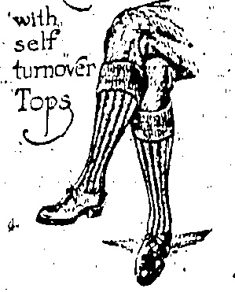
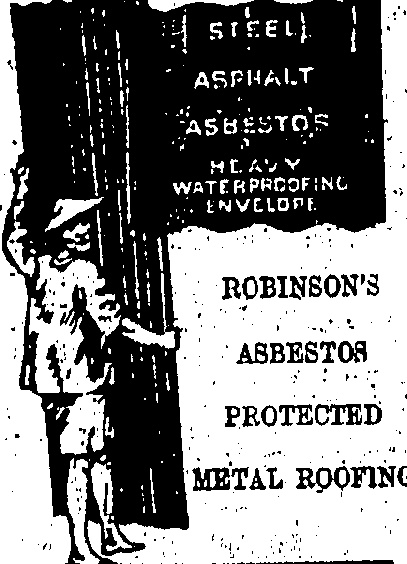

## VICTOR CYLINDER HEAD GASKETS

We carry an ample stock of these for Dodge Brothers, Oakland, Oldsmobile, Scripps-Booth, Maxwell, Ford, Chevrolet, Marmon, Hudson, Elgin, Grant Six, Hupmobile, Essex, Briscoe, Cleveland, Jewett, Buick, Chandler, Overland, and Paige Motor Cars.

THE DRAGON MOTOR CAR Co., Ltd.

# China

ESTABLISHED

Catalogues & specifications from

Sola Arenta:

ALEX. ROSS & CO. (CHINA), LTD.

No. 19,538

GET IT AT

## WHITEAWAY'S

Popular KHAKI RIBBED HOSE

MEN'S KHAKI HOSE

pecially Suitable for present wear

Standard Value $2.50 pair

BETTER QUALITIES

$5.50.

THE "CHISLEHURST"

A Special light weight Wool

Hose in Greys, Fawns, etc.

All Sizes

KHAKI SHIRTS

$5.50 each

BELTS AND PUTTEES

THE "MEN'S" HOUSE

HONGKONG.

DAVIE, BOAG & CO., LTD.

Bank of Canton Building.

FOR REAL FINE MAJONG BNTS

MADE OF TVORY AND BONE SOLD AT

Lowest Possible Prices

SUNG SAN GEN!

140 WOLLINGton Square

SAN BAY, AU

## STRIKE PAY

NEED FOR UNABILITY

ESSENTIAL.

Believing that unanimity is essential regarding the treatment of strikers when they return the Kowloon Residents Association passed the following resolutions at a special committee meeting held last night:

K. R. A. RESOLUTIONS.

"That this Committee being, of opinion that some guidance should be given to householders and others whose domestic servants have absented themselves without leave during the progress of the so-called'sympathetic strike' regarding the question of payment or non-payment of wages for the period, resolves as follows:"

(1).—That householders taking their servants back should refuse to pay any wages for the period during which their servants were on strike, but should pay wages for June according to the number of days worked, such payment to be spread over a probationary period of at least one week.

(2).—That copies of this resolution be sent to the English Press of Hongkong for favour of publication, together with an expression of opinion that all Kowloon residents whose servants went out on strike should treat their servants in the above-mentioned manner, as unanimity of action is obviously desirable.

(3).—That is copy of this resolution be sent to the Government and Peak' Residents' Assecitation for information.

## CHURCH'S PLEA

ST. ANDREWS AND THE STRIKE.

As the monthly organ of St. Andrew's Church, Kowloon, was in type before the strike began it makes its usual appearance to-day. A special notice calls upon the people to show a spirit of patience and quietness during this difficult time. "Let us each do our duty cheerfully, without grudging or criticism, serving each other and praying for peace with righteousness."

The magazine contains accounts of the activities of the Scout and Girl Guide troops attached to the Church.

From it too is to be learned that the Bishop, accompanied by Mrs. Duppuy, has left for a tour through the diocese and to take confirmations at Pakhoi, Limchow and Yunnanfu.

## FIRE SERVICE

## GUARDING AGAINST INTIMIDATION

In order that they will be able to more effectively to cope with intimidators who may attempt to influence them to leave their posts, the firemen on the main float at Hongkong have been sworn in as special constables and the "China Mail" understands that the opportunity will to day be given the main body of firemen to comply with a similar precautionary measure.

#### COAL INDUSTRY. (Reuter's Service.)

London, July 3.

The miners' delegate conference has decided to resist the coal owners' proposals of revision of wages and conditions and to urge districts not to depart from national settlement, to accept nothing, less than a wage to meet the increased cost of living; and also decided to reject any proposal of an eight-hour working day.

London, July 8.—Moscow and Warsaw give conflicting versions of a fight between Russian and Polish frontier guards on June 28, each occupying the other of invading their respective territories. Warway declares that thirty Russians were disarmed, and interned, and Moscow asserts that the Polish force burned down the Soviet frontier post.

London: June 8.

Hons. curisricles: mardlyz-ma

proved this morning good buying in France progressing to the French francc to 1028, the Belgian francc to 1035 and the Italian ties to 537

## STRIKE NEWS

TELEPHONE MECHANICS CEASE WORK.

SERVICE UNAFFECTED

Latest reports to hand regarding the local position are that the engineering trades have been further affected and that the linesmen of the Telephone Company are out to a man. It is not anticipated that the service will be interrupted, however.

The mechanics and office staff of the China and Japan Telephone and Electric Co., Ltd., have left work but a "China Mail" representative who made enquiries of Mr. H. S. Bennett, the Manager, was informed that the service was not likely to be affected.

Essential lines, said Mr. Bennett, would certainly not be affected and it was improbable that others would.

This morning European electricians were noticed examining outside lines for faults and repairing any such.

The call-girls are not affected.

Alleged Intimidators.

A street coolie was arrested by a Chinese detective yesterday for alleged intimidation of a gang of coolies working under police protection at West Point yesterday.

The accused was remanded when charged at the Central Magistracy this morning.

Another Chinese, a youth of seventeen, was also to appear before the Magistrate this morning on a charge of intimidating a servant at the Soldiers' Club to leave.

## STRIKE ITEMS

The Hongkong Hotel special 'bus service to Happy Valley and Causeway Bay ceased to operate as from this morning.

If permission is obtained from the Secretary for Chinese Affairs Chinese still at work are able to send more than five dollars out of the Colony in support of families in the country.

The cooks and coolies of "the Government Civil Hospital" have left work but their places are being taken by volunteers provided by the Labour Controller.

Motor boats are still to be hired at Blake Pier in spite of the fact that the operatives were among the first to join the ranks of the strikers. The charge made is $3.60 per hour.

The high price of firewood and the absence from work of the forestry men has led to much destruction at plantations in the district. Heavy fines have been inflicted on those who have been caught in the act and brought before the Hongkong and Kowloon Magistrates.

Three services are being maintained on: the tramway and these are in operation from 8 a.m. to 7.15 p.m. The ten minute services between Causeway Bay and Happy Valley are still in operation and a quarter of an hour service is also run between Causeway Bay and Quarry Bay.

Volunteers and civilians who have been on 24-hour duty shifts, but who anticipate having a little respite this week end, will welcome the announcement that Deep Water Bay Golf Course is to be open to-day and to-morrow. No meals are to be served, but drinks may be obtained at the Club house, where players will probably be called upon to give a hand.

In addition to the scavenging gang, consisting of 600 coolies, 300 others employed in varying capacities by the Sanitary Board have also absent themselves from work. The emergency services is operating as well as can be expected and street refuse is to be cleared twice a week. With regard to the disposal of night soil people will have to see to this according to the notice previously issued. The street manholes painted red can be opened and used.

The death of Mr. Archibald McIntyre, a former Chief Officer of the High Court, a Doughton, vassall playing between Hockington and Fool's city work places at Hockey Office, Kens, on June 28, 1847. Mr. McIntyre retired on afternoon fire on six years ago, having seen 48 years, service

## LOCAL SHARES

SETTLEMENT ARRANGEMENTS

The official suction of the postponement of the June Settlement from June 23 to July 14, is to be given at the Legislative Council on Thursday when the matter will come up in the form of an Ordinance.

The purpose of the Bill is to make valid, notwithstanding such post-ponement, every contract for the purchase of shares for the June settlement day and every contract for the carrying over of shares until the June settlement day.

During the period of postpomement payment of interest is provided for in the Bill at the rate of 8 per cent. per annum.

## ARMED ROBBERS

Two gangs of armed robbers were active yesterday afternoon. At No. 328, Queen's Road Central they secured about $200 in money and escaped.

The other robbery occurred in the Mongkok district where four men raided a hut and stole $114. One man was subsequently arrested by the police.

## TYPHOON WARNING

The following cablegrams have been received by the local American Consulate-General from the Manila Observatory:

9.15 a.m., July 4:—Typhoon in about Long. '141 E., Lat. 9 N., direction unknown.

11 a.m., July 4, Typhoon, in about Long. 139 E., Lat. 13 N., moving N.N.W.

## JAPAN POLITICS

REACTIONARY FOUND CHULTY

## PREMIER'S STATEMENT

### (Router's Service.)

This evening an official verdict published after the preliminary examination of Uchida Ryohei, the noted reactionary, and his accomplices, finding them guilty of plotting for the Premier's assassination and blowing up the Diet building as a protest against the Manhood Suffrage Bill.

Owing to financial depression causing increasing discontent against the Government the Premier made a statement this afternoon proving that the former Government's policy was responsible and that he intended continuing the present economic policy.

## GENERAL MILNE

## NEW CHIEF OF STAFF:

### (Rentor's Service.)

The War. Office announces that general Sir G. Milne will succeed Earl Chavan as Chief of the imperial General Staff as from February 19

QUAKE AGAIN.

CALIFORNIA'S HEAVY

SHOCK

(Reuter's American Service.)

San Francisco, July 8.

California has been revisited by an earthquakes. There was a very heavy shock at Santa Barbara.

One case of carebro-spanal fever, Chinese, was notified on Thursday.

Australia from Hongkong on June 12, arrived at Vancouver on June 30.

## HOME CRICKET

## MONDAY'S VARSITY MATCH

COUNTY RESULTS

On Monday the Oxford and Cambridge cricket match starts at Lord's. From what has been gleaned so far, Cambridge appear to be favourites.

Several fairly important

county cricket matches commence

to day.

Of the results which came through this morning, there were several surprises, namely, the victory of Northants over Kent; Warwickshire's revenge and the check to Middlesex who again give way to Surrey, the latter not being engaged.

## Dark Blues At Lord's

At Lord's Oxford University beat the M.C.C. by five wickets.

M.C.C. 274; C. H. Titmarsh scored 78, King 61, E. R. T. Holmes (Malvern) 4 wickets for 32 runs.

Oxford 3001 J. L. Guise made

50, G. B. Legge 83, Astill, W.E.

5 wickets for 97 runs.

M.C.C. 168, Hosie scored 63,

Oxford 146 for 5 wickets; G. W. F. Lyon (Brighton) contributed 52.

## Middlesex Behind

At Southampton, Hampshire led Middlesex on the first innings.

Hants 578; Brown, G., made 51, R. Aird 50, Captain T. O. Jameson 61, Bowell, A., 64, Hon. L. H. Tennyson 184.

Middlesex 456; Hearne, J. W., made 104, H. L. Dales 126, F. T. Mann 58, Brown took 7 wickets for 143 runs.

Hants 80 runs for no wicket.

At Worcester, Warwickshire beat Worcestershire by 359 runs. Scores:—

Warwick 341, Grobm, A. J., made 125, R. E. S. Wyatt 104.

made 67, Howell, H., took 6 wickets for 43 runs.

Warwick 307: for 9 wickets declared; Parsons, J. H., scored 84, Hon. F. S. G. Cathorpe 89.

[This is a return match; Norcester won the first away.]

## Kent Lose Again

At Northampton, Northamptonshire beat Kent by 44 runs. Scores:—

Northants 202; Woolley, C. N., made 54, V. W. C. Jupp 72 not out, Freeman, A. P., took 6 wickets for 46 runs, and Woolley, F. E., 4 for 20.

Kent 179; Ashdown, W., made 73, Clark, E. C., took 7 wickets for 54 runs.

Northants 114; Freeman took 5 wickets for 31 runs.

Kent 93; Clark took 4. wickets for 33 runs.

[The two Woolleys in the rival teams are brothers.]

[Kent led on the first innings in the first fixture.]

## Lancashire Succeed

At Cheltenham, Lancashire beat Gloucestershire by 180 runs. Scores:—

Lancs, 276; Hallows, C., made 56. J. R. Barnes 62.

Gloucester 246; Dipper, A. G., made 84.

Lancs. 334 for 8 wickets declared; Tyldesley, E., made 109.

Gloucester, 184, Hammond W. R., made 94, Parkin, C. wickets for 68 runs.

Cambridge and Kain

At Eastbourne, Mr. H. D. G.

Leveson-Gower's XI. drew with

Cambridge University. Scores;—

The XI. 488; J. L. Bryan made

182.

Cambridge 227; K. S. Duleep-

## AIR RACE

SIR E. GEDDES'S PLANE WINS.

FOUR COMPLETE COURSE.

(Reuter's Service.)

London, June 28.

Captain Barnard, flying a Siskin 5 entered by Sir Eric Geddes was the first to complete today's circuit of Britain, in the long Croydon, at seven o'clock. Flight Lieut. Jones, flying a Siskin 4, Major Hemming, on a D.H. 37 and Hinkler all arrived at Croydon at subsequent intervals in the order named.

Fog played havoc with the round-Britain air race, no "fewer than ten machines being forced to descend including Hinkler who landed at Worksop. Most resumed but in addition Major Bulman and Captain C. D. Barnard (in Donoghue's machine) after descending at Luton and restarting, came down at Doncaster through magneto trouble and Captains Courtney and Baggs crashed at Newcastle.

Presently there were only four in the running, namely Captain F. L. Barnard, Flight Lieut. Jones, Hinkler and Major Hemming.

EARLIER NEWS.

Fourteen aeroplanes left Croydon at 6 a.m. to day for a two-day race for the King's Cup, two circuits of the following course:—Harrogate, Newcastle, Renfrew, Blackpool, Bristol, and Croydon, a total distance of 1,600 miles.

A thick fog in places interfered with the early stages of the race. Three aeroplanes had to land, namely those of the Master of Sempill, Mr. Allan Cobham, and Mr. H. H. Perry, but they resumed the race later.

Major Bulman descended in a field at Luton with a damaged machine, and retired.

The competitors include Capt. C. D. Barnard, on a De Havilland machine; entered by Steve Donoghue, the jockey, which had “Come on, Steve” painted on the side in large white letters, and the Australian airman Berthinkler on an Avro.

## NANKING STRIKERS

### (Router's Service.)

Nanking, July 3.

Students yesterday held up...the Compradore of the International Export Company of Kiangsu because they understood that the Company's coolies, who were on strike, were willing to resume work unconditionally.

The Chinese Commissioner of Police took charge of the Comendore and detained him at Police Headquarters. Subsequently, six unarmed British members of the Company's staff went to the station with a view to securing his release.

While they were present a hundred coolies invaded the police compound and forcibly rescued the Compradore.

The Police Secretary and a dozen Chinese Merchant Volunteers were slightly injured.

The Chinese Cotton Exchange has "closed independently" pending the "settlement of the Shanghai affair.

sinjhi made 63.

Cambridge (followed-on). 184

for 2 wickets; Duleepsinhi made

72 and E.W. Dawson 69 not out.

Rain then fell.

Last day: Possible Points. The last day: The Points obtained were 70.

0...70...60...94.28

0...75...61...82.66

0...65...49...75.38

1...60...44...73.33

0...55...33...60.00

3...33...60.00

1...31...56.35

3...31...47.00

0...70...44.61

3...70...25...40.00

2...70...27...18.66

0...60...35.00

0...70...14.28

2...60...20.33

## X0000000000000000000000000

AERTEX

CELLULAR WEAR

EASIEST

## WASH

## COOLEST

TO

## WEAR

DRAWERS

COMBINATIONS

TENNIS SHIRTS

## MACKINTOSH

Men's Wear Specialits

HOT

NEED WEATHER

NOT WORRY

## WHEN YOU CAN

## ICE COLD DRINKS

## DELICIOUS

ICE CREAM