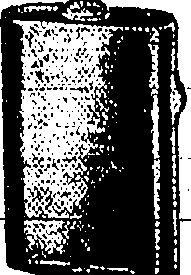

## ◇◇◇◇◇◇◇◇◇◇◇◇◇◇◇

VICTOR CYLINDER HEAD GASKETS

We carry an ample stock of these for Dodge Brothers, Oakland, Oldsmobile, Foripps-Booth Maxwell, Ford, Chevrolet, Marmon, Hudson, Elgin, Grant Six, Hupmobile, Fasse, Briscoe, Cleveland, Jewett, Buick, handler, Overland, and Paige Motor Cars.

THE DRAGON MOTOR CAR Co., Ltd.

# Umina

E S T A B H I S H E D

# Juli

Catalogues & specifications from

Bolo Agenda :

ALEX. ROSS & CO. (CHINA), LTD.

## ◇◇◇◇◇◇◇◇◇◇◇◇◇

BE PREPARED WITH A

## USALITE

## FLASHLIGHT

The latest Development in Flashlights The poses for a "Usalite" can feel certain of its dependability. All models are fitted with "flash" contact button and "permanent" contact switch

3 CELL SEARCHLIGHT

USALITE. SPOT-LIGHT illustrated by a remarkably veritable flashlight. Especially designed for long range work. Equipped with "concentrated" filament bulb. Plate glass bons. Will throw a clear, sharp beam of light several hundred feet. Focusing head operates simply — requiring only returning movement until exact distance or "spot" is covered. When not required for focusing may be used as a regular flashlight. By un-

crowding focusing I

we need ps a table i

An extra bulb i

except note built int

A highlight for

outdoor uses.

SPARE BATTERY $1.00

## USALITE

The 300 foot Focusing Type SPOR LIGHT complete with Battery and Mayda Lamp $6.50

### SPARE BATTERY $1.00

NI~KEL

VEST

POCKER

Boit m

Flashlight

complete

with

Battery

$2.50

SPARE BATTERY 75 cts. each

WHITEAWAY, LAIDLAW

& CO.; LTD

HONGKONG.

◇◇◇◇◇◇◇◇◇◇◇◇◇◇◇◇

## Sola Agenta:

DAVIE, BOAG & CO., LTD.

Bank of Canton Building.

Samples and particulars on application.

FOR REAL FINE MAJONG BETS MADE OF IVORY AND BONE

BOLD AT

Lowest Possible Prices

SUNG SAN SHAN,

140, Wellington Street

Agents

SAN PAILAND

Queenship

## ALL PREPARED

HONGKONG, SATURDAY, JULY 11, 1925.

KOWLOON'S ELECTRIC LIGHTS.

SERVICE TO CONTINUE.

The China Light and Power Company's station was partially affected yesterday by some of their workmen leaving. There was a further walk out this morning. Arrangements, however, are in hand for replacing the coolies and firemen, and it is not anticipated that the lighting service will be affected in any way.

On inquiry from the company's management the "China Mail" was informed that preparations had already been made and that the supply of current would be maintained.

The Hongkong Electric Company's installation at North Point also lost their workmen this morning.

The men who left were the greasers, oilers, coal coolies and unskilled hands.

## CHEUNG CHAU

## FERRY MEN GOING ON STRIKE

SERVANTS LEAVE.

The strike of workers on craft in the harbour received a further extension this morning when all the men on the Cheung Chau ferry boats stopped work on orders received from the Seamen's Union in Canton. The ferry service was at a standstill this morning, but arrangements had been made in advance for such a contingency, and the ser-the men on the Cheung Chau mediately. The inconvenience caused to residents on the island will be therefore only temporary.

The decision of the employees on the ferry boats has apparently influenced the servants at European residences at Cheung Chau. During the past two days the workers started to leave the houses, but on finding out that they were liable to be arrested as idlers, they started to come back. According to a telephone message received at police headquarters this morning, all the servants have left.

Other craft affected are the small ferries running to Tai O, Aberdeen, Shaukiwan and Kowloon City. These all stopped running this morning. No arrangements have so far been made for the resumption of these services.

## WORTHY EXPLOIT

MANNING THE GOOD SHIP TUNG ON

## A UNIQUE VOYAGE

Without a Chinese passenger on board, the 8.s. Tung On arrived at Hongkong from Canton yesterday afternoon, leaving been worked by European and Japanese passengers. Such was the determination and co-operation of the Volunteers that the boat beat her own record and arrived three hours ahead of time.

The duties were then apportioned out, Chief Engineer C. Pike taking charge of the stockhold. Second Engineer Mr. J. Lewis (assisted by the Third Engineer) that of the engine room. Capt. Muir and Chief Officer Fulan relieved each other at the wheel with Mr. A. Jenner, of Kowloon, lending a hand when clearing the shallows. Everyone else took spells of duty and lots were drawn for times. It so fell that one European and one Japanese were allocated a boiler each for spells of an hour.

The Chinese crew had deserted within a few hours of the boat's arrival in Canton from Hongkong and the Chinese passengers who boarded were given the option of giving a hand with the work or getting out. They chose the latter course.

Those who took part in the exploit were Messrs. M. A. Annett, H. T. Buxton, A. E. Quin, T. Dawson, Y. de Barros, A. Hoffmeister (Danish: Consul), J. Struthers, C. F. Crowles, J. H. Mitchell, C. Pokuda, Y. Bojiki, J. Orihashi, T. Kituda, and Dr. Miki all of the Shamden.

## SHAMEEN SERVICE

STEAMER TAKEN OVER.

GOVERNMENT'S ACTION

In order that communication with Shameen may be maintained regularly and that there may be additional means of food transport to the naval tugs which have been running from Hongkong the s.s. Tung On, brought down last night by European and Japanese passengers, left this morning manned by a crew from the naval boats in the harbour.

The Government have issued tickets (which are at an increased rate) and in spite of the fact that the number of Chinese leaving was not so large as usual a goodly sum was collected.

Revenue officers are acting as ticket collectors and they left with the boat this morning. It is understood that a regular service will be maintained.

## CENTRAL MARKET

The selling of meat at the Central Market was extended into the afternoon yesterday by some of the stalls doing business under police protection. There was a plentiful supply sufficient for all needs, and the extended hours to a certain extent prevent a rush on the stalls.

## LOCAL & GENERAL

The total amount of bank-notes in circulation on June 30, 1925, was $54,823,072.

Mr. M. H. Turner to be Adjutant of Special Police Reserve.

H.E. the Governor has appointed Mr. Edward Boys Reed to be a Second Lieutenant in the Hongkong—Volunteer Defence Corps, with effect from July 6, 1925.

His Honour the Chief Justice has ordered that no Criminal Session be held during the month of July, 1925.

Mr. W. J. Lockhart-Smith has been appointed a Police Magistrate.

It is notified in the "Gazette" that the Christian Chinese Cemetery, Kowloon City, will be closed from July 2, 1925. New Kowloon Cemetery No. 1 is announced.

H.M. the King has approved the appointment of Hon. Mr. C. G. Alabaster as Unofficial Member of the Legislative Council while the Hon. Sir Henry Pollock acts as Attorney-General.

His Excellency the Governor has approved the following appointment:

Mr. D. A. Goodwin, Mr. A. F. B. Silva-Netto, Mr. A. C. Botelho and Mr. F. C. Mow Fung to be Chief Inspectors.

Four men armed with a revolver and daggers gained admittance to the first floor of No. 164 Queen's Road East, shortly before noon yesterday. After binding and gagging the inmates the robbers escaped with a haul of over $3,500 in money, jewellery and clothing.

It is learned that with the permission of the Secretary of Chinese Affairs, a Hongkong Labour Maintenance Association has been formed with its temporary headquarters at the Wuh Keu (Overseas Chinese) Hotel, Connaught Road Central. The object of the Association is to help workmen who have gone on strike or who are forced to strike by intimidation to obtain work or to remain at their present posts.

### SERGT. NICOLL HURT

## NASTY MOTOR CYCLE ACCIDENT

PRICE, $3.00 Per Month.

The Police Force is to lose for a few weeks the services of a well-known and efficient member as a result of a collision in which a motor cycle and side car and a P.W.D. lorry were concerned.

Sergt. A. Nichelbest known to his friends as Lofty "owing, needless to say to his fine physique was returning at the time to the Police Headquarters yesterday morning along Lower Albert Road and the nature of the damage to his machine leaves no doubt as to the reason for the collision which is confirmed by eye-witnesses.

The P.W.D. lorry was being driven by an emergency driver, an Indian, who was proceeding in the opposite direction to Sergt. Nicoll and who, as he approached the nasty corner at the junction of the road with Ice House Street, (outside St. Paul's House and just past the Dairy Farm) either through inexperience or to ensure getting round easier took a wide sweep to the right.

The motor cycle and side car were jammed against the wall of St. Paul's house, and the door of the.lorry is thought to have caught Sergt. Nitoll's knee which was considerably lacerated, but not seriously the "China Mail" was informed on enquiry at the Government Civil Hospital. The forks of the cycle were bent and the state of the footboards speaks eloquently of the force of the collision. An Indian sergeant who was in the side car at the time was uninjured.

Sergt. Nicollusras, taken to Hospital at once. He is proceeding as well as can be expected and is likely to be out in three or four weeks' time.

## HOME COAL

MINERS CONFER WITH

MINISTERS.

MEETING "IMPOSSIBLE."

### (Reutur's Service.)

London, July 10.

The executive of the Miners' Federation conferred for an hour with Mr. W. C. Bridgeman, Sir Arthur Steel-Maitland and Mr. G. R. Lane-Fox to whom, it is understood, they made quite clear it was absolutely impossible for the miners' representatives to meet the coal-owners on the owners' present proposals.

. [Sir Arthur Steel-Maitland i Minister of Labour and Mr Bridgeman, First Lord of th Admiralty.]

## NEW YORK RUBBER

ASSOCIATION APPROVES ABOLITION

REDUCING TYRES.

(Reuter's Service.)

The officials explain the abolition is the result of heavier use of inventory stocks of crude rubber.

The Rubber Association has approved the abolition of the so-called spring dating purchase plan.

The Association also appointed a sub-committed to draft a programme for the conservation of crude rubber by reducing types and sizes of tyres.

3

## NO DEBATE

FRENCH SENATE AND TREATIES.

POLICY TO CHINA

The Senate Enlisted by a show of hands the Washington Treaties concerning China.

The Senate Service,

The Senate adopted without debate the two Nine Power Treaties with regard to China voted by the Chamber on July 7

SHANGHAI STRIK LEADERS SQUABBLING.

"PINCH" AND "PINCHINO."

(Router's Service.)

Shanghai, July 10.

There is believed to be a shortage of strike funds. The Union has approached the Chamber of Commerce and Banks for funds to carry on. It is understood to be ordering men to resume work for other British Japanese with a view to cutting down expenditure. Growing tension is reported among the strike leaders owing to alleged mis-

The day passed very quietly,

hough intomulation and kidnapping

ontinue. The tram situation has

improved.

The Fengtien commander of the Shanghai and Woosung Defence Force and the Chief of the Shanghai Woosung constabulary jointly issued a proclamation exhorting the strikers to resume peaceful auctions and a warning that lofers disturbing the peace under the good name of patriotism will be severely punished.

## FRANCE AND SIAM

MINISTER'S COMMENTS ON TREATIES.

"GOOD NEIGHBOURS."

(Havas Agency.)

M. Pila, the French Minister at Bangkok, commenting in the "Temps" on the Franco-Siamese Treaties, emphasizes the development of economical relations between France and Siam and the purely defensive aims of the Siamese Army.

He concludes the Franco-Siamese rapprochement is diplomatically evidenced by the treaties which French opinion and Parliament have to ratify. Our Colonies need good neighbours and Siam is a neighbour whose friendship is very useful and the easiest to gain.

### "IN AUDIENCE."

SINGAPORE'S GOVERNOR

HONOURED

SIR L GUILLEMARD

(Reuter's Service.)

His Majesty the King received in audience Sir Laurence Guillemard, also the Ruler of Negri Sembilan.

[Sir Laurence Nunns Guillemard, K.C.B., K.C.M.G., has been Governor of the Straits Settlements and High Commissioner for the Federated Malay States since 1919. His term was recently extended.]

## SUICIDE VERDICT

FATHER OF CAPTAIN IN PEKING.

BATHING DEATH SEQUEL.

(Reuter's Service.)

London, July 10.

A verdict of suicide while temporarily insane" was returned on the septuagenarian George Sydney Waterlow who shot himself in a hotel at Plymouth.

Evidence showed deceased was depressed because he had heard of the death of his son, Captain G. W. Waterlow, while bathing near Peking at the beginning of the week.

## ELCHO SHIELD

ENGLAND'S SUCCESS AT

BISLEY.

(Router's Service.)

At Bisley, the Elcho Shield was won by England with a score of 1,706.

London, July 10.—According to the newspapers, Rakovsky has brought back from Moscow trade orders for British firms amounting to £15,000,000, including £10,000,000 for factory equipment and agricultural machinery. —Reuter

## JAPAN'S DEMANDS

WHEN THE AMOUNT IS

ASCERTAINED.

DAMAGE IN RIOTS.

(Router's Service.)

Shanghai, July 10.

"Eastern New Agency" import a message from February 1987, the Japanese Lification has sent a Note to the Foreign Office, giving a detailed account of the damage done in various riots and arduous efforts.

## STRONG PROTEST

JAPAN AND RECENT EVENTS IN CHINA.

## 000000000000000000000000000

(Rcutor's Service.)

The Eastern News Agency of Peking states that the Japanese Minister has strongly protested to the Chinese Government in regard to the Hankow, Kukiang, Chinkiang, and Canton riots, reserving the right to demand compensation for the damage to Japanese lives and property when the facts have been fully investigated.

British Alliance Desired

The Yorozu considers that the recent interviews between Sir Charles Eliot, British Ambassador at Tokyo, and Baron Shidehara foreshadow an Anglo-Japanese understanding for co-operation for the maintenance of peace in the Far East, similar to the former alliance. It considers that Prince Chichibu's unexpected reference to the fine spirit animating the former alliance helps to confirm this belief.

Count Aisuke Kabayama has been elected to the Upper House, and Count Michimasa Soveshima has been-unseated-owing-to his outspokenness on the Far Eastern situation, against the Soviet.

This morning's papers refer guardedly to the alleged plot against the Throne last month, saying that the Supreme Court will shortly try the offence under Article 73 of the Criminal Law. It is alleged that four Koreans are implicated.

## Korean Plot?

## CORRESPONDENCE

LOYAL CHINESE.

(To the Editor of the China Mail).

Sir,—Assurances have been given regarding food-supplies for the European communities of the Colony. Little has been said about the provision of food for the loyal ones among the Chinese. To day profiteers are making hay while the sun shines, getting all they can out of the Chinese who are carrying-on, if not rendering public service.

In fairness to the latter I respectfully submit that an assurance be also given that the Chinese will not be wanting for food. Even if food is available steps should be taken to prevent prices being pushed up when the demand has decreased.

Abnormal circumstances require abnormal measures. Why not regulate food prices, control the supply of food for all, or better still let the authorities take over all stocks in the Colony and pay for same as decreed in the Government Gazette.

European residents have been much inconvenienced but their usual suppliers are not profiteers. Those who enter entirely for the Chinese are not conscientious. My contention is that they should be given no opportunity to exploit the Chinese community. But, first of all, it is necessary to know that the show is to be had in the Colony — hence the necessity for an assurance.

Enclosing my card.

Yours, etc.

See To Kwino-cho.

HongKong, July 10.

AERTEX

CELLULAR

WEAR

## COOLFST

## WEAR

COURINE

TENNIS SHIRTS

## MACKINTOSH

Men's Wear Specialists.

Des Voeux Road.

## N(X)(X)(

Summer Butterick Quarterly.

Animals of all Countries complete

Children's Encyclopedia (complete)

Houshold Encyclopedia (com

pleno)

World's Library of Best Book (new)

Romance of Famous Lives (new)

Homo Docto: (parts 1-15)

Wonders of the Past (24 parts)

## LEE YEE

SOUTHERNERMAN

FIN: JEWELLERY

Engguma: Keeper, & Wedding Kings

SPECIALTY: All of high event grade in the Colony.

WINDSOR BROS.

No. 66 Nathan Road, Kowloon.

Tel. K 800.

## 202307010200101020010102001010200101 

## LEE KEE

We have a large stock of White Gland Wall Tiles, Colour Gland Wall Tiles, Ceramic Meals Tiles, Geometrical Econلمie Floor Tiles, Tile Fire Grates.

Showroom: 21, Wellington St.

Tel. C. 1483

0

TANG YUK, Department,

the late SIEN TING,

14. D'Agullar Street.

TERMS VEX MODELATS

Observation Press