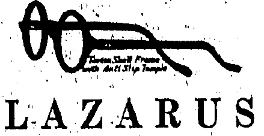
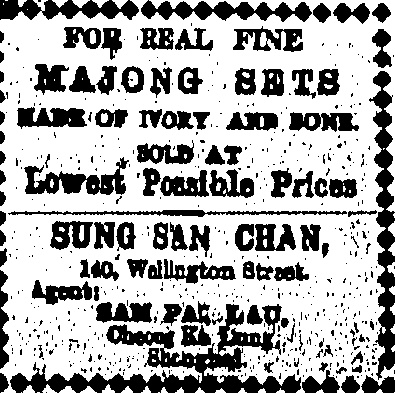

VICTOR CYLINDER HEAD GASKETS

We carry an ample stock of these for Dodge Brothers, Oakland, Oldsmobile, Scripps-Booth, Maxwell, Ford, Chevrolet, Marmon, Hudson, Elgin, Grant Six, Hupmobile, Essex, Briscoe, Cleveland, Jewett, Buck, Chandler, Overland, and Paige Motor Cars.

THE DRAGON MOTOR CAR Co., Ltd.

# China

(1)

# Jitail

ESTABLISHED

Qualified Eyesight Testing with Modern Equipment.

12, QUEEN'S ROAD CENTRAL.

No. 15,550

## ◇◇◇◇◇◇◇◇◇◇◇◇◇◇◇◇

## SPECIAL

SALE

MEN'S

## GOLF

## HOSE

In order to clear up our HOSIERY fixtures and make room for New Stock coming forward, we have decided to offer for a few days only our entire Stock of FANCY and PLAIN GOLF HOSE

## WHITEAWAY'S

## GREATLY REDUCED

## RATES

HONGKONG, SATURDAY, JULY 18, 1925.

OPPORTUNITY

WARDROBE WITH

GOLF HOSE

WHITEAWAY, LAIDLAW

& CO., LTD

HONGKONG.

◇◇◇◇◇◇◇◇◇◇◇◇

DAVIE, BOAG & CO., LTD.

Bank of Canton Building.

Samples and particulars on application.

## MOCK TRIAL

MANY CANTON STRIKERS INJURED.

Between forty and fifty Hong-

kong strikers have been injured,

some seriously, at a mock trial of

an alleged spy and "traitor" at

Tung Yuen, near the second bund,

Canton, writes the "China Mail"

correspondent.

BUILDING COLLAPSES.

A few days ago a Chinese who bore the appearance of the average workman was surrounded by a strike picket and accused of being a spy. It is believed that the unfortunate man is a striker himself but he had, apparently, incurred the enmity of a strike official. At any rate, he was roughly handled and subsequently marched off to the Strike Executive headquarters. A trial was ordered and was held, subsequently, close to a partly completed building which was propped up by beams.

Before the trial started, a large crowd of idlers had assembled to watch the fun. To obtain vantage points some of them entered the building in course of erection. Their weight was such that a collapse ensued, throwing the “court” into confusion.

Of those injured the majority were seamen. The "prisoner's trial has yet to come off.

## MORE RETURNS

EAMEN AMONG APPLICANTS FOR WORK.

A sign of the more hopeful outlook in the strike situation was the presence of a more varied class of workers at the Police Station this morning.

The Chief Detectiveive Inspector (Mr. Grant) supplied 1,000 cosies this morning against orders in hand from the various concerns requiring labour. All the orders were filled, and Mr. Grant was in a position to supply 500 more if necessary from the cooiles waiting on the compound for work.

A large number of seamen also applied for work. These included 60 sailors, a number of engineers, and coxswains. The engineers secured ready employment, as also some of the sailors and coxswains. Six coxswains, all holding certificates for steam launch work, attended this morning for work. They were being detained at the office pending the decision of the "Star" Ferry Company who had been communicated with as regards employment for these men.

## SEAMEN'S UNION

BRANCH OPENED IN TIENTSIN.

(Reuter's Service.)

Tientain, July 17

The Canton Seamen's Union has opened a branch in Tientsin city and, attempted to bring out the seamen on foreign boats.

They are distributing the usual propaganda but the seamen refused to strike.

It is understood the British Consult is protesting to the authorities against intimidation attempts.

## OFFICER'S INJURIES

Mr. Patrick, Chief Officer of the Hop Sang, which vessel was at the time at Kowloon Dockes, sustained injuries to his buck and wrist as a result of a fall into the hold yester-day.

Some of the staff of the Hongkong and Whampoa Dock were near at the time, and with their assistance Mr. Patrick was conveyed from the hold, and after temporary first aid had been rendered, the injured officer was taken by launch to the French Hospital at Causeway Bay.

The rainfall for the month of June at the Botanical Gardens was 24ins. 74 on 21 days, at the Matilda Hospital, Mount Kellett, was 21ins. 11 on 21 days, and at the Police Station, Taipo, it was 21ins. 17 on 18 days. The lowest barometer reading at sea level was 29ins. 582 at 18h on the 6th.

## RAINSTORM DEATHS

LATEST DETAILS OF HOUSE COLLAPSE.

34 DEAD.

Rescue work in connection with the disaster which attended the collapse of houses in the Western part of the City was continued during the whole of last night with over 100 workers.

Latest figures of casualties are: dead 34; injured and in hospital 18, of whom 4 have been discharged.

It is estimated that at least 50 persons are buried in the ruins on which work was still proceeding this morning. House No. 16, adjoining the scene of the disaster and part of which was involved has had to be propped up as it was giving signs of becoming dangerous to the rescue party.

The following are the names of the ascertained dead:—

1. Chau Siu-ki (63) died in hospital.

2. Chau Kit-nin (25), son Chau Siu-ki.

3. Chau Li Sze (83), mother of Chau Siu-ki.

and following female members c Chau's household:—

Chau's household:—

5. Chau Ko Sze (39).

6. Chau Chim Sze (38).

7. Chau Sung (24).

8. Chau Sui (24).

9. Chau Hoi Sze (32).

10. Chiu Sing (35).

## RESCUED BY RAFTS

KOWLOON TONG HOUSES

IMMERSED.

Floods which in some cases immersed all but the roofs of houses, and in others led to their entire collapse, occurred yesterday at Kowloon Tong, as a result of the heavy rains and the prevention of the escape of huge volumes of water from an overflowing pond by the barrier made by the proposed new road. Many of the inhabitants had to be rescued through the roofs by means of rafts and lifelines.

There were no casualties other than the effects of emersion on a woman and two children who were taken to the Kwong Wah Hospital and injury sustained to, his foot by a fireman as he swam from one house to another.

If it had not been for the good work of helpers on the spot (including Europeans), and the firemen, many would undoubtedly have been drowned. Hundreds were rendered homeless and were to be observed yesterday making their way. from the village to other parts with what they were able to rescue of their belongings. Large numbers of cattle and

The roads which have had to be closed, comprise Stubbs Road, Wongneichong Gap—Repulse Buy Road, Victoria Road, Sassoon Road (communicating from Pokfulam Road to Victoria Road) Kennedy Road, Hill Road, Belchers Street, Repulse Bay—Shuukiwan Road, Mount Davis Road and the Taipo Road from the 14th mile stone.

## COAL CRISIS

LABOUR TRIPLE ALLIANCE

PROPOSED MUTUAL AID:

. (Reuter's Service.)

## London, July 17

The Conference of Trade Unions in London has approved the constitution of the proposed alliance between the miners, railwaymen, engineers and transport men, representing over five million workers, for “mutual aid” and more particularly to support the miners in the present dispute. The matter has been referred

The matter has been referred to the various Unions to consult constituents and to report to a further conference.

The word "Earthquake," is printed in large letters in Oxford Street. It only calls attention to the announcement, underneath it, that to show sympathy with the sufferers in the earthquake in Tokyo one should buy Japanese pearls in a shop next door.

Moscow, July 16.—General Hsu has arrived here and is to stay ten days.—Reuter.

## EGG SUPPLIES

ARRANGEMENTS TO MEET SHORTAGE

GENERAL FOOD SITUATION.

As predicted in the "China Mail" a few days ago the shortage of eggs in the Colony has now become acute.

Upon enquiry at the office of the Food Controller, Mr. N. L. Smith, the “China Mail” was informed that the Dairy Farm had no eggs in cold storage. The shortage was due, said Mr. Smith, to the disturbed conditions in neighbouring parts of China, supplies in the ordinary way coming chiefly from Tientsin and Swatow.

Arrangements were being made to meet the shortage and he himself, said Mr. Smith, was in communication with Swatow and by an indirect means hoped to get supplies in the near future. He understood that the Dairy Farm were in communication with Manila.

If the arrangements made with Swatow were fulfilled, there might be little change in the price of eggs, said Mr. Smith, but possibly the Manila eggs would be more.

As regarded the general food situation, everything was functioning almost normally, but there was likely to be a falling off in the supply of live stock. Steps had already been taken to meet this but in order that there might be consistency in the supplies, less killing was to be carried out until stocks were replenished.

## RASH LETTER

A PARIS EDITOR'S SENTENCE.

"KILL HIM LIKE A DOG."

(Reuter's Service.)

Paris, July 17.

Charles Maurras, editor of the "Action Francaise," has been sentenced to two years' imprisonment or, in default, to be fined 1,000 francs, on a charge of publicating an open letter declaring if the Minister of the Interior Schrameck attempted to disarm members of the League Action Francaise without disarming the Communists, he will kill him "like a dog."

#### U. S. WILL CASE

PRESUMPTION OF UNDUE

INFLUENCE.

PROBATE REFUSED.

(Reuter's American Service.)

Basing the decision on a presumption of undue influence, the Probate Court refused to admit probate for McClintock's will by which the estate passes to Shepherd.

## SALVED SHIP

S.S. SINGAPORE MARU PROCEEDS.

(Reuter's Service.)

Perim, July 17.

After survey the's.a. Singa.

Maru was certified seaworthy.

Salved cargo was re-shipped

and the vessel proceeded..

## LOAN BALANCE

MORGAN'S ANNOUNCEMENT FOR MONDAY.

(Reuter's American Service.)

New York, July 17.

Messrs. Morgan's have announced offering on Monday the balance of the Commonwealth Loan.

In a film now being shown of the King and Queen's visit to Treasure Island, at Wembley, little Joan Molison, who was born in Yokohama and lost some of her relatives during the earthquake, is seen in the miniature railway car seated opposite his Majesty holding an animated conversation.

## COUNTY CRICKET

YORKSHIRE CHECKED BY

GENTLEMEN v. PLAYERS.

Another good show was put up by the younger set of amateurs in the Lord's cricket match with the professionals. Jack Hobbs has made another century and Percy Holmes of Yorkshire has been honoured by being picked for the big match. After his record score on the ground it was a foregone conclusion that he would be chosen. Incidentally several other Yorkshiremen did well.

In the county results it will be seen that Yorkshire—probably missing their stalwarts—dropped points for the second time this season, not being able to press home an advantage. Kent made a glorious struggle and won after following on. Glamorgan record their first win in the championship this year and both Worcester and Lancashire won away.

Results as cabled last night by Reuter and the county table to date follow:—

Stevens Does Well.

At Lord's the Gentlemen v. Players match was left drawn. Scores:—

Gentlemen 309 runs. G.T.S. Stephens (Middlesex) made 75 and A.W. Carr (Notts) 82.

Players 457 runs. Hobbs, J. B., (Surrey) made 140, Sutcliffe, H. (Yorkshire), 50, Holmes, P. (Yorkshire), 92 and Kilner, R. (Yorkshire), 59; G. T. S. Stephens took 4 wickets for 72 runs.

Gentlemen 315 runs for 8 wickets declared. Stephens.scored 129 runs and G. O. Allen (Middlesex) 52 not out.

Players 58 run's for 1 wicket.

Kent's Stranous Fight

At Maidstone, Kent beat Gloucestershire by 24 runs.

Scores:—

Gloucester 351 runs. Hammond, W. R., made 121, Bloodworth, B. S., 62.

Kent (followed-on) 389 runs.

C. P. Johnstone (Rugby, Cambridge 1919-20) made 102,

Ashdown, W., 83 and Hardinge, H. T. W., 99.

Gloucester 129 runs. Captain W. S. Cornwallis took 5 wickets for 47 runs.

At Sheffield, Yorkshire led Essex on the first innings. Scores:—

Essex 250 runs.

Yorkshire 303 runs. Leyland, M. made 70.

Essex 182 runs. Hipkin, A. B made 54; Waddington," A. tool 4 wickets for 34 runs.

Yorkshire 68 runs for 2 wickets.

Parkin In Form.

At Weston-super-Mare, Somerset lost to. Lancashire by ten wickets: Scores:—

Somerset 212 runs. J. C. White made 77 not out; Parkin, C., took 4 wickets for 39 runs and Sibbles 4 for 56.

Lancs. 361 runs. Makepeace, H., made 62, Hopwood, J. L., 70, J. Sharp 57; J. J. Bridges took 5 wickets for 111 runs and W. T. Greswell (home on leave from Ceylon) took 4 for 73.

Somerset 155 runs. Parkin took 4 wickets for 51.

[Lancs. won the first match between the two.]

At Cardiff Glamorgan beat Derbyshire by 200 runs, Scores:

Glamorgan 231 runs. N. V. H.

Riches made 74.

Derby 136 runs. Ryan, F., took 5 wickets for 19 runs.

Glamorgan 256 runs for 9 wickets declared. Abel, T., made 52.

Derby 151 runs. Ryan took 8 wickets for 41.

## MEDICOS MEET

REPRESENTED

BATH.

Played W

Yorkshire.....18...

Lancashire.....19...

Surroy.....15...

Middlesex.....12...

Notts.....15...

Kent.....15...

Essex.....17...

N'thamptonshire.14...

Gloucestershire.17...

Hampshire.....16...

Warwickshire.....17...

Sussex.....17...

Somerset.....14...

Leicestershire.....18...

Derbyshire.....15...

Worcestershire.....17...

Giamorgan.....14...

(Reuter's Service.)

The discovery of a new local anesthetic, possessing all the virtues of cocaine but none of its perils, was announced at the annual meeting of the British Medical Association at Bath at which the Dominions, India, Ceylon and Hongkong were represented.

The discovery was made by a Cambridge doctor named Copeland who was awarded the memorial scholarship to the value of £200.

## IN AGREEMENT

## BELGIUM GOVERNMENT DECIDES

(Router's Service.)

Paris, July 17.

A "Temps" message from Brussels states that the Belgian Government, in agreement with the British and French Governments, has decided that Duesseldorf, Duisburg and Ruhrort be evacuated in the near future.

## BERLIN BOURSE

## TO RESUME PRE-WAR LOAN QUOTATIONS

(Reuter's Service.)

Berlin, July 17.

The Bourse committee has decided to resume official quotation of the pre-war loans as from July 20.

## Heavy Scoring

At Southampton Hampshire le Notts on the first inning Scores:—

Notts 274 runs. Lilley, B. made 72.

Hants 348 runs. Mead, C. P. made 112, Bowell, A. 58.

Notts 400 runs for 6 wickets declared. Gunn, J. made 168, Walker, W. 83 not out, Whysall, W. W. 87.

Hants 277 runs for 8 wickets,

Newman, J. made 54, R. Aird 60

and A. L. Hosie 96.

[In the first match at Trent Bridge, Hampshire also gained first innings points.]

At Brighton Sussex lost to Worcestershire by 221 runs. Scores:---

Worcester. 270 runs. Tarbox, C. V., made 67, Root, F., 71.

Sussex 122 runs. Root took 6 wickets for 53 runs.

Worcester 282 runs. G. E. B.

Abell (Marlborough and Oxford

1924) made 124; Wensley, A. F.,

took 5 wickets for 106.

Sussex 209 runs. Naumann made 74; Wilson, C. J., took 4 wickets for 46 runs.

[In the first match Sussex won by a close margin away from home.]

Rival Centurions.

At Birmingham Warwickshire led Leicestershire on the first innings. Scores:—

Warwick 422 runs. Smith, E. J. made 149, Quaife, W. G. 66; Skelding, A., took 6 wickets for 107 runs.

Leicester 374 runs. Astill, W. E. made 109, Berry, L. G. 87.

Warwick 191 runs for 5 wickets declared. Bates, L. A. made 67 and Quaife 51 not out.

Leicester 30 runs for no wicket. [This is a return match; Warwick won the first away.]

### Wen on Lost on 1st inn, 1st inn. Tie

## 000000000000000000000000

AERTEX

CELLULAR

WEAR

## EASIEST

## WASH

CHIDTC

DRAWERS

COMBINATIONS

TENNIS SHIRTS

## MACKINTOSH

α CO., LTD.

Men's Wear Specialists.

Alexandra Building:

Des Vocus Road:

## (1) (2) (3) (4) (5) (6) (7) (8) (9) (10) (11) (12) (13) (14) (15) (16) (17) (18) (19) (20) (21) (22) (23) (24) (25) (26) (27) (28) (29) (30) (31) (32) (33) (34) (35) (36) (37) (38) (39) (40) (41) (42) (43) (44) (45) (46) (47) (48) (49) (50) (51) (52) (53) (54) (55) (56) (57) (58) (59) (60) (61) (62) (63) (64) (65) (66) (67) (68) (69) (70) (71) (72) (73) (74) (75) (76) (77) (78) (79) (80) (81) (82) (83) (84) (85) (86) (87) (88) (89) (90) (91) (92) (93) (94) (95) (96) (97) (98) (99) (100) (101) (102) (103) (104) (105) (106) (107) (108) (109) (110) (111) (112) (113) (114) (115) (116) (117) (118) (119) (120) (121) (122) (123) (124) (125) (126) (127) (128) (129) (130) (131) (132) (133) (134) (135) (136) (137) (138) (139) (140) (141) (142) (143) (144) (145) (146) (147) (148) (149) (150) (151) (152) (153) (154) (155) (156) (157) (158) (159) (160) (161) (162) (163) (164) (165) (166) (167) (168) (169) (170) (171) (172) (173) (174) (175) (176) (177) (178) (179) (180) (181) (182) (183) (184) (185) (186) (187) (188) (189) (190) (191) (192) (193) (194) (195) (196) (197) (198) (199) (200) (201) (202) (203) (204) (205) (206) (207) (208) (209) (210) (211) (212) (213) (214) (215) (216) (217) (218) (219) (220) (221) (222) (223) (224) (225) (226) (227) (228) (229) (230) (231) (232) (233) (234) (235) (236) (237) (238) (239) (240) (241) (242) (243) (244) (245) (246) (247) (248) (249) (250) (251) (252) (253) (254) (255) (256) (257) (258) (259) (260) (261) (262) (263) (264) (265) (266) (267) (268) (269) (270) (271) (272) (273) (274) (275) (276) (277) (278) (279) (280) (281) (282) (283) (284) (285) (286) (287) (288) (289) (290) (291) (292) (293) (294) (295) (296) (297) (298) (299) (300) (301) (302) (303) (304) (305) (306) (307) (308) (309) (310) (311) (312) (313) (314) (315) (316) (317) (318) (319) (320) (321) (322) (323) (324) (325) (326) (327) (328) (329) (330) (331) (332) (333) (334) (335) (336) (337) (338) (339) (340) (341) (342) (343) (344) (345) (346) (347) (348) (349) (350) (351) (352) (353) (354) (355) (356) (357) (358) (359) (360) (361) (362) (363) (364) (365) (366) (367) (368) (369) (370) (371) (372) (373) (374) (375) (376) (377) (378) (379) (380) (381) (382) (383) (384) (385) (386) (387) (388) (389) (390) (391) (392) (393) (394) (395) (396) (397) (398) (399) (400) (401) (402) (403) (404) (405) (406) (407) (408) (409) (410) (411) (412) (413) (414) (415) (416) (417) (418) (419) (420) (421) (422) (423) (424) (425) (426) (427) (428) (429) (430) (431) (432) (433) (434) (435) (436) (437) (438) (439) (440) (441) (442) (443) (444) (445) (446) (447) (448) (449) (450) (451) (452) (453) (454) (455) (456) (457) (458) (459) (460) (461) (462) (463) (464) (465) (466) (467) (468) (469) (470) (471) (472) (473) (474) (475) (476) (477) (478) (479) (480) (481) (482) (483) (484) (485) (486) (487) (488) (489) (490) (491) (492) (493) (494) (495) (496) (497) (498) (499) (500) (501) (502) (503) (504) (505) (506) (507) (508) (509) (510) (511) (512) (513) (514) (515) (516) (517) (518) (519) (520) (521) (522) (523) (524) (525) (526) (527) (528) (529) (530) (531) (532) (533) (534) (535) (536) (537) (538) (539) (540) (541) (542) (543) (544) (545) (546) (547) (548) (549) (550) (551) (552) (553) (554) (555) (556) (557) (558) (559) (560) (561) (562) (563) (564) (565) (566) (567) (568) (569) (570) (571) (572) (573) (574) (575) (576) (577) (578) (579) (580) (581) (582) (583) (584) (585) (586) (587) (588) (589) (590) (591) (592) (593) (594) (595) (596) (597) (598) (599) (600) (601) (602) (603) (604) (605) (606) (607) (608) (609) (610) (611) (612) (613) (614) (615) (616) (617) (618) (619) (620) (621) (622) (623) (624) (625) (626) (627) (628) (629) (630) (631) (632) (633) (634) (635) (636) (637) (638) (639) (640) (641) (642) (643) (644) (645) (646) (647) (648) (649) (650) (651) (652) (653) (654) (655) (656) (657) (658) (659) (660) (661) (662) (663) (664) (665) (666) (667) (668) (669) (670) (671) (672) (673) (674) (675) (676) (677) (678) (679) (680) (681) (682) (683) (684) (685) (686) (687) (688) (689) (690) (691) (692) (693) (694) (695) (696) (697) (698) (699) (700) (701) (702) (703) (704) (705) (706) (707) (708) (709) (710) (711) (712) (713) (714) (715) (716) (717) (718) (719) (720) (721) (722) (723) (724) (725) (726) (727) (728) (729) (730) (731) (732) (733) (734) (735) (736) (737) (738) (739) (740) (741) (742) (743) (744) (745) (746) (747) (748) (749) (750) (751) (752) (753) (754) (755) (756) (757) (758) (759) (760) (761) (762) (763) (764) (765) (766) (767) (768) (769) (770) (771) (772) (773) (774) (775) (776) (777) (778) (779) (780) (781) (782) (783) (784) (785) (786) (787) (788) (789) (790) (791) (792) (793) (794) (795) (796) (797) (798) (799) (800) (801) (802) (803) (804) (805) (806) (807) (808) (809) (810) (811) (812) (813) (814) (815) (816) (817) (818) (819) (820) (821) (822) (823) (824) (825) (826) (827) (828) (829) (830) (831) (832) (833) (834) (835) (836) (837) (838) (839) (840) (841

## とは

Summer Butterick Quarterly.

Animals of all Countries

Animals of all Countries (complete)

Children's Encyclopedia (complets)

Household Encyclopedia (com nleta)

World's Library of Best Books (now)

Romance of Famous Lives (new) Home Doctor (parts 1-15)

Countries of the World (new)

Business Encyclopedia (parts 1-8)

Business Encyclopedia (parts 1-8)

No. 12, D'Aquilar Street,

HONGKONG.

NEW YORK NEW YORK NEW YORK

## ◇◇◇◇◇◇◇◇◇◇◇◇

No. 66 Nathan Road, Kowloon

◇◇◇◇◇◇◇◇◇◇◇◇

## 000000000000000000000000000000

# LEE KEE

## gent for

## HENRY BICHARD TILE CO'S

We have a large stock of White Glazed Wall Tiles, Colour Glazed Wall Tiles, Ceramic Moonic Tiles, Geometrical Moantic Floor Tiles, Tile Fire Grates.

Inspection Invited.

Showroom: 21, Wellington St.

Tel C.1483.

JANG YUK, DSFTIR,

the Ista.SIEN TIG,

16. D'Agular Street.

PREMIE VKEY MODERNATE

Gorotization Free