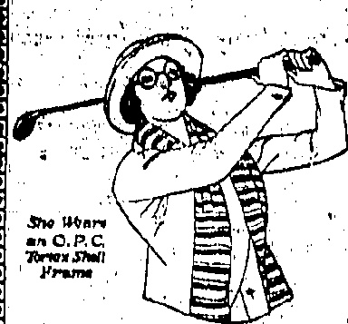

VICTOR CYLINDER HEAD GASKETS

We carry an ample stock of these for Dodge Brothers, Oakland, Oldsmobile, Boripps-Booth, Maxwell, Ford, Chevrolet, Marmon, Hudson, Elgin, Grant Six, Hupmobile, Essex, Briscoe, Cleveland, Jewett, Buick, Chandler, Overland and Paige Motor cars.

THE DRAGON MOTOR CAR Co., Ltd.

# China" Atil

ESTABLISHED

念二

No. 19,552

HONGKONG, TUESDAY, JULY 21, 1925.

PRICE, $3.00 Per Month.

Qualified

Sight Testing

With Modern

Equipment.

## SPECIAL

## WHITEAWAY'S

In order to clear up our HOSIERY fixtures and make room for New Stock coming forward, we have decided to offer for a few days only our entire Stock of FANCY and PLAIN GOLF HOSE

WHITEAWAY, LAIDLAW & CO., LTD.

HONGKONG

◇◇◇◇◇◇◇◇◇◇◇◇◇◇

STEEL

ASPHALT

ASBSTOS

HEAVY

WATERPUFCING

ENVELOPE

ROBINSON'S

ASBESTOS

PROTECTED

METAL ROOFING

Sole Agents:

DAVIE, BOAG & CO., LTD.

Bank of Canton Building.

FOR REAL FINE MAJONG SHTS

MANE OF IVORY ANN BONEL

BOLD AT

Lowest Possibly Prices

SUNG SUN CHAN,

140, Wallingford Street

Agony:

SAM FAR LEEY

Oberberg K's Long Shanghai

## LEFT IN THE COLD

## CANTON STRIKERS DEBACLE

MISCHIEVOUS POLITICIANS.

Guild Professionals Lay

Throwing considerable light on the present outlook in Canton is a communication by an occasional correspondent to the "China Mail," which arrived via Macao and is given for what it is worth.

In effect the correspondent writes:—

Down

It is now an open secret that both the Conservative and the "Leftist" parties in the Kuomintang are regretting having espoused the "professional" strike leaders' cause.

Shortly after the Yunnanese were expelled the "Leftists" began to assert their newly-found strength. The Left party, by the way, is that which is said to have Communistic tendencies. As was the case in the campaign with the mercenaries, labour assistance was very helpful. Accordingly, the Conservatives made it their policy to be friendly with the guild officials as well. In this way the labour "professionals" were given certain powers to organise the strike. Monetary help had also to be forthcoming and in this the politicians had to play a large, but now unwilling part.

During the last day or two, strikers have left Canton on a "pretence of wanting to go up country on some urgent private business. As they do not "declare" for Hongkong as their destination no poll-tax of $25 is collectable; to disencourage deserters a new rule has been put into effect, namely, that of obtaining a guarantee, by a well-established firm, of return within a certain period.

After three or four weeks the politicians have found the policy unremunerative both practically and theoretically. The Conservatives are too busy looking after their own affairs and the Leftists are hard put to in finding means to provide 50,000 idle men with food. While the opposing cliques have been thus engaged, the strike leaders have more or less taken the law into their own hands by sending out their own police in uniform, collecting levies and even administering the civil power in their own weal. Neither side wishes to antagonise the strikers but to a greater extent, nobody wishes to shoulder the burden of providing for them. To get rid of so many hungry mouths it will first be necessary to clip the wings of the leaders who are preventing the rank and file getting away so that present conditions will continue and their sources of revenue will be maintained which is also for their own benefit.

Even with pickets, levies and other impositions, strikers are running away from the fold, the majority being from the batches, which have been put through their paces in physical drill and military training on two scanty meals a day!

Were it not for the strict lookout in Hongkong and the rumours circulated in Canton of numerous deportations a debacle would have started already in Canton no matter what regulations had been imposed. If a free return to

## CHINA FLEET

ADMIRALTY KEPT FULLY INFORMED:

DIOMEDE AND CONCORD.

## London, July 20

(Reuter's Service.)

In the House of Commons Sir Cyril Cobb (Conservative) suggested, in view of the situation in China, the Government should order His Majesty's ships, the Diomede and Concord, to remain on the China Station for the better protection of British lives and property, instead of the latter relieving the former.

Mr. Davison, replying, pointed out that the Diomede had already been relieved by the Concord and was an route for Home.

been relieved by the Concord and was an route for Home.

The Admiralty was kept fully informed of the situation in China and was making such dispositions of forces as was necessary to meet the situation.

[The Diomede has just left Hongkong for Home, and the Concord for the North to join the Fleet.]

Hongkong were permitted the majority of the strikers would be back again in a week. The politicians certainly like to make a big army out of them. As neither side has the wherewithal to pay it is preferable that they be out of Canton to prevent all or a part of them falling into the hands of those who might conscript them into an army.

Malicious rumours as to what is happening in Hongkong are not now believed so readily as Hongkong Chinese papers have reached Canton by roundabout routes and even purchased by strikers at fancy prices.

Even in the Seamen's Union itself there is discord. One official orders one line to cease running and another cancels it immediately. It is impossible to prove "squeeze." But I (writes the correspondent) have known people pay "tea money" for the privilege of shipping away vegetables even though the strike leaders have placed their own embargo on export.

Requests it is stated, have been addressed by Canton to the boats now on the Macao-Hongkong run asking the men on the ships to make sure that strikers are not taken back to Hongkong. This request, needless to say, carries not the least weight.

Since Saturday there has been a persistent rumour that shipping communication between Canton and Hongkong will be re-established. Once this is a fact, it will be safe to assume that the rank and file will leave Canton in ship-loads.

[By a curious coincidence the vernacular papers—of—Hongkong this morning all refer to the possibility of the steamers being back on the run.—Ed. "China Mail."]

## REGISTRATION OF SERVANTS

## A PRIVATE BUREAU

—In view—of the increasing demand for a system of registration or control of servants, it may be of interest to residents to note that a private concern — the Domestic Servants' Employment and Registration, Bureau—has been opened at 15-17, Queen's Road Central.

This Bureau was established just prior to the strike, and naturally, with the servants flying to Canton, its activities were stopped. At the termination of the strike, however, it hopes to supply servants of all kinds for a nominal fee. The Bureau supplies a registration card for a dollar, giving name, photograph, and finger print of the servant.

In the absence of any official scheme of registration of servants—upon which a pronouncement is most desirable, by the way—there ought to be room for a private Bureau, which deserves every possible support from the many who have reason to be impatient with. "the vexed servant problem." If some of the larger employers of domestic servants, such as the Hongkong Hotels, were to support the Bureau, it would give the rest of the community a much desired lead.

The matter of registration of servants is also to be dealt with at a meeting this evening of the newly formed Mid-Levels Residents' Association.

Beyond expressing it as the opinion of the meeting that such a scheme is desirable, it is unlikely that any further action will be taken for the present (nearly all of the members are said to be in favour of such a scheme, however).

Co-operation with other associations will be sought and the desire has been expressed that the registration should be through official channels. Falling this it is probable that members will endeavour to formulate a scheme on their own account.

TO DAYS DOLLAR

The closing rate of the dollar on demand to day was 2/3.15/16

## CANTON HARD UP

RELIEF SHIP DOES NOT SAIL

STRIKE EXECUTIVE PEEVED.

From Our Own Correspondent.

## Căn tải

An indication of the stringency of money in Cautions is forthcoming from the proposed issue of bonds to the value of $180,000 for the Municipality. The issue is to be at $90, making the proceeds, if fully subscribed, $162,000: The odd $2,000 will be used, it is stated, for printing, and the remainder will provide the exact sum required to carry on.

From the "San Kwok Wa Po," one of the organs of the Kuomintang Party and the self-appointed mouthpiece of the strikers, I see that the compradore department of a ship which was to have brought back a cargo of rice for the hungry strikers, is accused of assaulting strike officials who went on board! Negotiations are pending. Meanwhile, the crew of the ship has struck, and the steamer has not sailed.

The Strike Executive has also run foul of the Police Department. Commissioner Techen Wu, chief of police, has, apparently, refused to hand over a number of men "arrested" by strike pickets as spies and the Executive is not in good humour. Then, again, the Police have issued an order forbidding strike pickets from searching business establishments for Hongkong notes, the Police maintaining that it is a duty for the law.

## SWATOW POSITION

AMPLE SUPPLIES FROM HONGKONG

RESIDENT ENTERVIEWED.

That the Hongkong Government is Keeping Swatow well supplied with food now, that Chinese shops in Swatow are no longer supplying Europeans, was the statement of a well-known Swatow resident who arrived in Hongkong yesterday and with whom a "China Mail" representative chatted shortly after his

The food is being taken up by Japanese (chiefly those of the O.S.K.) and has to be unloaded by the foreigners themselves. Because of this, plenty of supplies were in hand, said the China-Mail-informant, and so long as this source continued, the situation would give no cause for anxiety.

Following are interesting facts, also emanating from the same source:—

Anti-foreign feeling is limited to a small section of the Chinese community, and the proclamations of the Chinese military general's calling for moderation are believed in official circles to be genuine expressions of opinion and in fact, to represent the wishes of the greater number of Chinese residents.

The Swatow Chamber of Commerce is actively opposed to the boycott in operation against British and Japanese goods, and is doing its best to defeat it.

The restriction against foreigners is not supposed to apply in the case of Americans, but as Chinese find difficulty in differentiating between degrees of nationality, they are in many cases suffering the inconveniences of others, particularly in regard to street conveyance, richest pullers, refusing to take any foreigners for fear of incurring the displeasure of those who have engineered the present state of affairs.

Mission doctors are allowed to retain the services of one boy and a cook each, they and the Americans being the only ones so "privileged." That no great alarm is felt as to the situation is shown by the fact that no residents have left other than one or two of the ladies and a few children. "Unless there is trouble in Canton, we shall be all right," was how the "China Mail" informant put it.

## STEAMER MOVEMENTS

The P. & O. s.s. Macedonia left Singapore for this port on July 19, at 8 a.m. with the outward English malls, and its due herson only 23 at about 8 a.m.

The C.P.S. R.M.S., Empress of Asia from Hongkong on June 20, arrived at Vancouver on July 17. The C.P.S. R.M.S. Empress of Canada arrived at Yokohama on July 17, at a m. left Yokohama on July 18 at p.m. and at the Vaseouvar on July 27.

## OUR FLOGGING LAW

## THE QUESTION : RAISED AT HOME

HONGKONG'S NECESSITY.

As presumably it must, Hunkong has been, in the English gain at Home, and the measures taken by Sir R. E. Stoke have been endorsed.

In the House of Commons, replying to Mr. Robert Morrison, Labour member for Tottenham, N.) in regard to the Hongkong Ordinance authorising the flagging of intimidators, the Hon. Mr. W. G. Ormsby-Gore, (Under Secretary for the Colonies), said the Governor had reported by telegraph that no such punishment had had to be inflicted, the effect of such a penalty being sufficient deterrent.

Thing

### (Ruefer's Service.)

## SUFFICIENT DETERRENTE

There had been two murders prior to the issue of this regulation and cases of bomb-throwing.

## (1) 

## DISASTER VICTIMS

Other nine bodies of the victims of the Po Hing Fong disaster have been recovered from the ruins up to this morning, which brings the total number of dead to 58. Six of the bodies were those of women of advanced years.

NINE MORE BODIES TAKEN OUT.

PROCRBS OF CLEARING

Owing to the decomposed state of the bodies, identification has been difficult, and in three cases the victims have not been identified. Considerable progress has been made with the clearings work, although difficulty is being experienced in securing coolies for this work. The Engineers of the H.V.D.C. worked very hard yesterday and got away a large quantity of the heavy timber to the scrap heup, besides helping in getting away other material. Although there is an appreciable difference in the height of the mounds, there is still work for very many days, and more bodies should come to light.

The management of the three leading Chinese firms in the Colony —the Sincere Company, Sun Company, and the Wing On Company—have recognised the difficult nature of the work done by the coolies, and have each supplied for their use 2,000 cigarettes free of charge.

## INTIMIDATION

## NO FLOGGING FOR A WATCHMAN

A Chinese watchman employed at the Kowloon Docks, who was found guilty at the Kowloon Magistracy last week on a charge of intimidating a servant in the employment of Mr. "Kid" Marriott, was sentenced this morning by Mr. E. W. Hamilton to six months' hard labour.

In passing sentence, His Worship said that he would not impose flogging in addition, as he considered that the accused had been in the Colony for some time and was one of those people who came from Canton to make trouble.

Two Chinese houseboys in the employment of Mr. A. P. Glover, of the Tramway Company, and Mr. A. Kirk, of the P.W.D., were charged at the Kowloon Magistracy this morning with intimidating a 'bus inspector at Shamshuo.

## Boys Charged

The evidence of the inspector was to the effect that he was stopped at Shamshuipo and told by the first accused that he would be killed if he continued in his work.

Mr. Glover stated in evidence that the second accused applied at the tramway depôt for work as an emergency conductor; but there being no vacancy he was offered work as a houseboy, which he accepted. Later the first accused visited his house to see his servant, and was suspected of being an intimidator but on finding that he was also looking for work he was passed on to Mr. Kirk. The man's visit was skid to have upset Mr. Glover's amah almost to the point of leaving.

In England."

Both Chinese and Europeans approved of the Ordinance to deal with terrorism which was being organised from outside for purely political motives.

Mr. Morrison suggested the promulgation of the Ordinance would very seriously affect anti-British feeling in China. Mr. Ormsby-Gore replied that the Governor of Hongkong's first duty was to protect the lives of innocent people threatened by terrorism and bomb-throwing and if emergency threatened they must have emergency measures to prevent outrages on innocent people. He was sure the Governor had considered the matter from the viewpoint of its effect in China and he was supported by the Chinese members of the Legislative Council.

Mr. Will Thorne (Lab.) asked were there not other forms of penalty than flogging. The Hon. Mr. Ormsby-Gore pointed out that we did the same thing in England in cases of personal violence and he did not think it would be proper for the Colonial Secretary or the House of Commons to interfere with the discretion of a Colonial Governor and Colonial Legislature in the face of such an emergency.

## MOTOR SMASHES

TRAMCAR DAMAGED BY MOTOR LORRY.

A serious accident occurred at Praya East shortly after noon yesterday when a tramcar driven by a Japanese volunteer collided with a motor lorry belonging to the Sang, Lee Company. Fortunately no persons were injured, but the tramcar came in for the greater portion of the damage. The glass screens were shattered and the damage is estimated at $100.

The accident is attributed to the ignorance of the Chinese in control of the motor lorry, who held only a learner's licence and was not conversant with the gears. The man was moving his vehicle up and down in order to get it into the garage and fouled the tramway track as soon as the tramcar came quite close. Everything possible was done by the driver of the tramcar to prevent a collision by applying his brakes, but the man in the other vehicle started to fumble with his gears and could not get the lorry clear of the track.

A charge has been framed against the lorry man for driving without a proper licence, and he will appear at the Central Magistracy to-morrow.

### CAR V. RICBHA

At 12:30 p.m. yesterday, a motor car which was proceeding along Wanchai Road in a westerly direction came into collision with a private ricsha travelling in the opposite direction.

The ricsha puller was on the wrong side of the road and was knocked down in attempting to get to the other side right in front of the motor car. Both the shafts of the ricsha were broken, and the driver sustained slight injuries.

## THOSE DUTIES

Pressure of work combined with duties in connection with the Hongkong Volunteer Defence Corps which prevented the omission being brought to notice in time was one of the reasons filed on the affidavit in connection with a technical summons of the Australian Oriental Line, Ltd., at the Supreme Court this morning. The affidavit was that of Mr. Archibald Ritchie and concerned the failure to file in time the return of allotments of the Company. An extension until July 28 was granted on the application of Mr. F. C. Jankin. A similar extension was granted to the Hop Sing Tai firm, represented by Mr. T. Addis, ignorance of the provision being pleaded.

## 000000000000000000000000000000

AERTEX

CELLULAR WEAR

## EASIEST

) τυ

## COOLEST

VESTS

SHIRTS

DRAWERS

COMBINATIONS

TENNIS SHIRTS

## MACKINTOSH

(X)(Y)(Z)(M)(N)(O)(R)(I)(J)(K)(L)(M)(N)(O)(R)(I)

## A

Animals of all Countries (or plots)

Com丼 Encyclopaedia (o p'oto)

Household Encyclopedia (oom plate)

World's Library of Best Book (now)

Romance of Famous Lives (new)

Home Doctor (parts 1-15)

Countries of the World (new)

Business Encyclopedia (parts 1-8)

Wonders of the Past (24 parts)

### No. 12, D'Agullar Street,

WWW.WWW.WWW.COM

FINE JEWELLERY Engagement, Fever, & Wedding Blogs

A SPECIALTY. All of high grade in the Colony. WIN USOR BROS. No. 58 Nation Road, Keeloo. Tal. K 509.

## 2021 年1月1日星期日

## LEE KEE

We have a large sioak of White Glazed Wall Tiles, Colour Glazed Wall Tiles, Geramite Mosaic Tiles, Geometrical In耐色 Floor Tiles, Tile Fire Grates.

Inspection Invited

Showroom: 21, Wellington St.

Tel. C. 1433

TANG YUK, Derraz,

Sho laa Eatning,

14, D'galler Brook,

THORR EYE MODERATE

Towards Fey