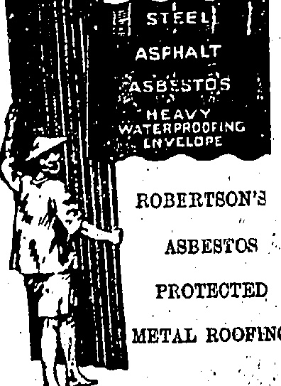

## ☐☐☐☐☐☐☐☐☐☐☐☐☐☐☐☐☐☐☐☐☐☐☐☐

THE DRAGON MOTOR CAR CO., LTD.

Telephone Central 1246 or 1247

33 Wong Nei Chung Road, Happy Valley.

A. J. Allison.....SERVICE Manager,

ESTABLISHED

## LAZARUS

# Juli

Qualified Eyeslight Testing with Modern Equipment.

12. QUEEN'S ROAD CENTRAL.

## 7845 

## ◇◇◇◇◇◇◇◇◇◇◇◇

JUST RECEIVED

## SPECIAL LINE

## MEN'S

## Summer Underwear

THE

This is of English Manufacture, open weave very similar to Aertex. Soft finish, good weaving, easy to wash, cool and comfortable.

## “TROPICMESH”

Vests with 1/4 or 1/2 Sleeves

ALL SIZES

## Knicker Drawers

$1.95 each

BOYS' SIZES

$1.75 each

## COMBINATION

ALL SIZES

$4.50 each

This is the finest value ever offered in Men's Summer Underwear.

CALL AND INSPECT

WHITEAWAY, LAIDLAW

& CO., LTD.

HONGKONG.

◇◇◇◇◇◇◇◇◇◇◇◇◇◇

Samples and particulars on application

DAVIE, BOAG & CO., LTD.

Bank of Canton Building.

Samples and particulars on application.

HONGKONG, SATURDAY, JULY 25, 1925.

FOR REAL FINE MAJONG SHIPS MADE OF IVORY AND BONE

BOLD AT

Lowest Possible Prices

SUNG SAN CHAN,

140, Wellington Street

Agent:

SAM FAI LAU,

Cheong Ka Lung,

Shanghai.

## CANTON'S BOSSES

TRUTH DAWNING ON STRIKERS.

NOT FRIENDS WITH POLICE.

(From Out Out (correspondent.)

A reliable estimate to-day gives the number of Hongkong strikers who are registered by the Strike Executive as 45,000. There are very few women, if any at all, who are in possession of "chow" tickets. The total of workers who have come up from Hongkong since the trouble began was at one time believed to be over 100,000 but this figure has now dwindled down to not more than 55,000. Of those who lost heart and sneaked out from Canton, the majority are those who did not report at the Strike dormitories but preferred to shift for themselves and incidentally to provide their own food.

Funds are at a very low ebb. The Government has cut down its first generosity, it is reported, and the Strike Executive, in its anxiety to procure funds have taken steps which have led to animosity, if not antagonism, with the Municipal authorities, particularly the Police, whose duties in many ways conflict with the Strike pickets.

I have already detailed the cash producing plans, such as half a month's rent contribution, a levy on workers departing from Canton, the projected theatrical and singing girl enterprises, the floating of a voluntary loan, etc.

There has also been talk about the division of private property which is specially favoured by the Communist element of the Kuomintang. Party as it is the main plank of their platform. In their extremity the Executive has turned to other means.

The first rent contribution was paid, in all probability, by tenants. Now the “professional labour bosses” are pointing out that house owners have profited by the recent influx and that landlords should pay another half month's rent toward strike funds. One leader has gone to the extent of suggesting that the embargo on produce be lifted but that a tax be levied.

In spite of the difficulty of financing the movement, the Strike Executive is determined not to let the rank and file slip away if possible. As long as the strike lasts, the “bosses” and the lesser officials, who invariably exhibit their budges, all stand to make something even if it is only the taking of money off workers leaving Canton. However, each steamer leaving Canton for Macao is carrying passengers to capacity.

Ordinary people, by whom are meant those who were not actual workers but who left Hongkong because of fear, are still being served with all kinds of wild stories, which are now considerably discounted by the appearances of the Tang On. Reliable news is also getting through; and the masses are beginning to realise the truth.

Through having to go by devious routes, it is costing each adult, on an average, as much as $30 if not more, to get from up-country to Hongkong.

With the exception of rice, food is comparatively cheap in the city. A food commission exists but has accomplished little. Many of those now going to Hongkong via Macao are from their native villages where they have given up trying to live in idleness with high prices.

Politically there is little to write. Neither of the opposing cliques in the Kuomintang feels strong enough to risk a struggle and politicians are now trying to win over all the adherents they can and convert the wavering ones to strengthen their respective causes.

## ROAD TO COMMEMORATE THE STRIKE?

The "China Mail" has it from an authoritative source that none of the deportees from Hongkong are being allowed to stop in Canton but are being made to return to their native villages the attitude of the Canton Government being that they should have left Hongkong earlier on.

## DESERTERS ILL-TREATED

Strikers from Hongkong at present in Canton and desirous of returning via Macao have been subjected to ill-treatment whenever caught being handcuffed and taken to prison.

The general body of strikers in Canton have petitioned the Kuomintang. Government that a new road should be constructed to commemorate the strike.

## BANDIT

MOVEMENTS OF CHAN'S

ARMY.

THREAT AGAINST CANTON?

To-day's "Wah Tsz Yat Po" reports that Xuen Hu-kuu, the former bandit who has refused to obey Canton's orders while at Sheklung, is still active in East River territory and that activities have been recorded at the inland town of Tsung Shing.

Yên was once a terror as an outlaw but was made a general by Chau Kwing-ming, subsequently going over General Hsu Shung-chi's army. It is probably due to his movements, in defiance of Canton's instructions, that a detachment of Whampou Cadets has been sent to restore order.

The vernacular paper also reports the fact that the three leading subordinates of Chun axe now congregating their troops in the hinterland of Swatow. A military council has been held but Chan Kwingming has not left his "retirement."

## BY MISTAKE

## WUCHOW FOREIGNERS RETURN

STORES TAKEN UP.

The stay of the residents of Wuchow in Hongkong was very short. Yesterday some thirty of them arrived by the s.s. Tung On, having, so they said, received a wireless message that all British there were to vacate.

When they arrived here it was found that a mistake had been made, no such order having been intended.

Yesterday evening the residents left by an A.P.C. oil lighter which was commissioned by the naval authorities and manned by naval ratings.

The food supplies had been running short in Wuchow, a boy-cott having been enforced by the Chinese in respect of all British, this referring also to H.M.S. Moorhen and U.S.S. Pampanga. The oil lighter accordingly took up a considerable amount of stores.

## BACK TO NORMAL

## UNLICENSED HAWKERS CHARGED:

With the opening of the market stalls, the police are now taking action against unlicensed hawkers who have been carrying on their work unmolested for nearly a month.

Before Mr. McElderry, at the Central Magistracy this morning, five men and two women were charged with hawking pork on the streets without licences. All pleaded guilty. His Worship discharged them with a warning, as they were the first to be brought up, but remarked that any more caught selling without licences will be fined.

## MORE IDLERS

Raids on idlers' dens were continued this morning when the inmates of a number of streets in Yaumati including Austin Road, Shanghai Street and Woosung Street, found their houses surrounded by troops from the Punjab Regiment. The police conducted a house to house search and arrested 40 persons, several daggers being also found in the course of their search.

The raid was carried out under the direction of Mr. P. P. J. Wodehouse, C.I.E. (Captain Superintendent of Police), Mr. L. H. V. Booth (Assistant Director of Criminal Intelligence) and Mr. W. R. Scott (Assistant Superintendent of Police for Kowloon).

## NEW WAITRESSES

## CHINESE TEA-HOUSE INNOVATION

Many Chinese tea-houses in the Colony have taken into their employ a number of Chinese girls as waitresses.

An attempt to introduce female labour into tea-houses was made some time ago at which time the Hongkong Government set its face against the practice on the grounds of undesirableity and it is unlikely that the practice will be allowed to continue when things return to normal.

## LATE FERRIES

## 10 -MINUTE SERVICE FOR RUSH HOURS

NIGHT EXTENSIONS

Another step in the process of reverting to normal conditions is marked by the increased "Star" Ferry service as from this morning.

Since the stoppage began, the company has maintained a 15-minute service till 8 p.m. each day. European coxswains have now brought the new men on to such a stage that extension has been warranted.

This morning during the "rush hours" (8.30 to 9.30) a ten-minute service was put on and this will be repeated from 12.30 p.m. to 2 p.m. Another boon is the restoration of night ferries. The last ferry will leave Kowloon to night at 11.45 p.m. and the last from Hongkong will be at 12 midnight. After 8 p.m. (Hongkong side) and 8.15 p.m. (Kowloon side) the ferries will leave at intervals of 30 minutes.

Permission is being sought from the Captain Superintendent of Police to remove the restriction on Chinese passengers, and it is hoped that there will be no necessity, shortly, for natives to apply at the City Hall for permission to travel on the "Star" Ferries.

## ABD EL KRIM

## ACTS LIKE CHINESE BANDIT

## TRYING TO GAIN TIME

(Reuter's Service.)

Paris, July 24.

The "Moroccan situation" is summed up by Abdel Krim losing ground both from the military and political standpoint.

The “Temps” says that the Riffian withdrawal to the North of Werghá indicates that Abd el Krim is anxious to avoid the battle rendered imminent by the arrival of French reinforcements. He knows the difficulties of French pursuit into the mountains and thus hopes to gain time to open negotiations.

## NAVAL TOURISTS

## AMERICAN FLEET IN AUSTRALIA

### (Reuter's Service.)

## Melbourne, July 24

The march past of the American naval force through enormous enthusiastic crowds was held up by a distressing accident. The verandah of a cinema in Bourke Street which was packed by spectators, collapsed. At first it was reported that fifteen were killed, but it was ascertained later that there were no fatalities, but 131 were injured, some seriously.

There are two divisions of the American Fleet, the battleship California flying the flag, of Admiral Robison heading thirteen ships at Sydney, and Admiral Coontz's squadron at Melbourne consisting of four battleships, five cruisers and twenty-eight destroyers.

### (Reuter's American Service.)

## Swampscott, July 24

President Coolidge is most pleased at the heartiness of the reception of the American fleet in Australia. He said that the welcome was most gratifying, and hoped that the visit of the Fleet to the far Pacific would assist in emphasising the cordial relations between the United States and other nations of the world.

The Labour Department at Police Headquarters, which has been responsible for the supply to employers of coolies and other workers at the most critical period of the strike, is to be closed as from Monday next. Another indication of the return to normal as regards labour conditions.

TODAY'S DOLLAR

The closing rate of the dollar, on demand, to day was 2/8 15/16.

## NOT A BOMB

## BIG EXPLOSION IN CANTON

BLAZE ON TOW-BOAT

Canton has been treated to what was at first thought to be a bomb · outrage in one of the busiest parts of the city.

The "Wah Tsz Yat Po," a local vernacular paper, states that a big explosion took place at the Western Creek, several large towboats caught fire, an immense conflagration on the River became imminent and a number of people were seriously injured by explosions.

At 9.30 on Wednesday night, a loud explosion was heard and traced to the Kowkong tow-boat which was lying alongside the Bund. It appears that a quantity of gunpowder and explosive, maintained on the junk for antipiracy defence, had become ignited and exploded. As the explosion was in the bowels of the vessel, the whole vessel was soon ablaze and the fire threatened to spread rapidly. Tied up close to the burning boat was a fleet of other tow-boats which could not get away as they had no power of their own. Hundreds of sampans and small craft were also in the vicinity. As all the boats are made of highly combustible material, it was feared that the outbreak might involve a large part of the River. However, the burning vessel was ultimately cut adrift and the others squeezed out of the danger zone, but not before one or more of the tow-boats had also been involved in the fire.

About ten persons were injured on the Kowkong boat and these were treated by Red Cross, men and sent to hospital. A rumour went abroad that pirates had caused the explosion as part of a scheme of blackmail to extort money but it became known that the ignition of the explosive was due to an accident.

## FUNDS WANTED

## PEKING URGED TO HELP STRIKERS

A REPLY IN DETAIL.

(Router's Service.)

Peking, July 24.

Delegates of the Workers' Students' and Merchants' Association interviewed Tuan Chi-jui (the Chief Executive) yesterday and urged the Government to remit funds to the strikers at Shanghai. Tuan replied that this might cause misunderstanding with the Powers but suggested that the Government telegraph to the Chamber of Commerce instructing them to devise means to support the needy.

The delegates urged, secondly, that the Government promulgate regulations dealing with the workers' associations. Tuan Chi-jui replied that these will-be submitted to the Cabinet shortly. Thirdly, the delegates urged the Government to negotiate on the basis of the thirteen demands. Tuan replied that the Government was doing its best as regards the negotiations.

The delegates then interviewed Shen Jui-lin who declared that discussions as regards negotiations were occurring daily and good progress was being made.

## NURSES' COUNCIL

## LADY IN CHINA AS PRESIDENT

### (Router's Service.)

Nurses' organisations of Poland, France, Ireland and Cuba have been admitted to the International Council of Nurses, the new president of which is Miss Nina Gage of China.

The next congress will be held at Peking.

A further return to normal on the part of the Café Wiseman management is their decision to remain open until 2 p.m. on Sunday, tiffins being served. This takes effect from tomorrow.

The total output of the Kailan Mining Administration's mines for the week ended July 11 amounted to 84,971 tons, and the sales during the period to 76,849 tons.

## COAL CRISIS

OWNERS AND MINERS MEET

LIVING WAGE WANTED.

### (Reuter's Service.)

London, July 24.

It is certainly announced that the coal owners and miners met jointly this afternoon and adjourned till July 29.

It is learned that the miners' representatives informed Mr. W. G. Bridgeman (First Lord of the Admiralty), that they wanted a peaceful settlement if it could be secured, but they meant to have a living wage. They also hoped that the owners' notices would be suspended.

The Chairman of the Trade Union Congress declared that the Congress would support the miners and textile workers.

The Miners' Executive has decided to meet Mr. Bridgeman to discuss the question of re-opening negotiations.

There were important developments in the coal dispute to-day. Representatives of the owners and miners separately met Mr. Bridgeman, at the Ministry of Labour, to discuss obstacles to the opening of negotiations for a new agreement.

Simultaneously a special conference of representatives of all Trade Unions affiliated to the Trade Union Congress was held at the Central Hall at Westminster to discuss unemployment and also the mining and textile disputes.

The Miners' Executive submitted a statement to the conference declaring that the miners desired a peaceful settlement and possibly the lockout notices might be postponed or withdrawn, but the mine owners were perhaps the most obstinate set of employers in the country and apparently resolved to force the lockout irrespective of the consequences. The statement concludes with an appeal to the whole Trade Union movement to support the miners.

## TEXTILE TRADE

## BRADFORD STRIKERS RUSH MILL GATES

## FRACAS WITH FOLICE

### (Reuter's Service.)

London," July 24.

Fifty thousand wool and textile workers struck at Bradford against the reduction of five percent, in wages.

Strikers ignored the leaders' instructions to allow firms, where wages were not reduced, to continue working, but they rushed the mill gates and forced operatives to cease work.

The Police frustrated several attempts. Stones were thrown windows were smashed and two police were slightly wounded.

## Earlier Cable

The strike of wool and textile operatives referred to in the House of Commons on July 22, has already begun. The operatives are resisting a five per cent. reduction in the cost of living bonus, which the employers declare is necessary in order to meet foreign competition.

## MELBOURNE CINEMA COLLAPSE

Melbourne, July 24.

Most of those injured in the verandah, call for new care were not seriously hurt.

Only seventeen were detained in hospital.

[As given in full in an earlier cable, the verandah of a Bourke Street cinema crashed during the march past of the U.S. Fleet.]

Melbourne, July 24.—Anxiety as to the effects of the shipping strike is deepening. "Unemployment is increasing," The Rt. Eon. 8. M. Bruce has urged both sides to strive for an early settlement as it is impossible for the Government to co-template such a state of things.—Renter.

## ( )

## BATHING

## COSTUMES

## HALF PRICE

THE WHOLE OF OUR

STOCK OF YOUTH'S AND

MEN'S BATHING C STUMES

IS BEING OFFERED AT

## HALF

PRICE

Cotton from $1.75

Wool from $4.25

Pure Silk at $15.00

SIZES 26 TO 42 INCHES

ONE PIECE STYLE WITH

SKIRT. VERY SMART

COLOURINGS

ONE WEEK ONLY

Open 8,30 to 5 : Saturdays 8.30 to 1

## MACKINTOSH

## Men's Wear Specialists

Alexandra Building

Des Voeur Road

## ☐☐☐☐☐☐☐☐☐☐☐☐☐☐☐☐☐☐☐☐☐

## △

Summer Butterick Quarterly.

Annuals of all Countries

Chil ren's Encyclopedia (com-

Household Encyclopedia (com-

plates)

World's Library of Best Books (now)

Romance of Famous Lives (now)

Home Doctor (parts 1-15)

Wonders of the Past (24 parts)

## LEE YEE

### No. 12, D'Agullar Street, HONGKONG

 $ \sqrt[3]{w^{3}}w^{3}w^{3}w^{3}w^{3} $

## +

Engagement. ~eeper, & Wedding Bings

A SPECIALTY.

All of high, at grade in the Colony.

WINDSOR BROS.

No 60 Nathan Road, Kowloon.

Tel. K 509.

♡♡♡♡♡♡♡♡♡♡♡♡♡♡♡♡♡♡♡♡♡♡♡♡♡♡♡♡♡♡♡♡♡♡♡♡♡♡♡♡♡♡♡♡♡♡♡♡♡♡♡♡♡♡♡♡♡♡♡♡♡♡♡♡♡♡♡♡♡♡♡♡♡♡♡♡♡♡♡♡♡♡♡♡♡♡♡♡♡♡♡♡♡♡♡♡♡♡♡♡♡♡♡♡♡♡♡♡♡♡♡♡♡♡♡♡♡♡♡♡♡♡♡♡♡♡♡♡♡♡♡♡♡♡♡♡♡♡♡♡♡♡♡♡♡♡♡♡♡♡♡♡♡♡♡♡♡♡♡♡♡♡♡♡♡♡♡♡♡♡♡♡♡♡♡♡♡♡♡♡♡♡♡♡♡♡♡♡♡♡♡♡♡♡♡♡♡♡♡♡♡♡♡♡♡♡♡♡♡♡♡♡♡♡♡♡♡♡♡♡♡♡♡♡♡♡♡♡♡♡♡♡♡♡♡♡♡♡♡♡♡♡♡♡♡♡♡♡♡♡♡♡♡♡♡♡♡♡♡♡♡♡♡♡♡♡♡♡♡♡♡♡♡♡♡♡♡♡♡♡♡♡♡♡♡♡♡♡♡♡♡♡♡♡♡♡♡♡♡♡♡♡♡♡♡♡♡♡♡♡♡♡♡♡♡♡♡♡♡♡♡♡♡♡♡♡♡♡♡♡♡♡♡♡♡♡♡♡♡♡♡♡♡♡♡♡♡♡♡♡♡♡♡♡♡♡♡♡♡♡♡♡♡♡♡♡♡♡♡♡♡♡♡♡♡♡♡♡♡♡♡♡♡♡♡♡♡♡♡♡♡♡♡♡♡♡♡♡♡♡♡♡♡♡♡♡♡♡♡♡♡♡♡♡♡♡♡♡♡♡♡♡♡♡♡♡♡♡♡♡♡♡♡♡♡♡♡♡♡♡♡♡♡♡♡♡♡♡♡♡♡♡♡♡♡♡♡♡♡♡♡♡♡♡♡♡♡♡♡♡♡♡♡♡♡♡♡♡♡♡♡♡♡♡♡♡♡♡♡♡♡♡♡♡♡♡♡♡♡♡♡♡♡♡♡♡♡♡♡♡♡♡♡♡♡♡♡♡♡♡♡♡♡♡♡♡♡♡♡♡♡♡♡♡♡♡♡♡♡♡♡♡♡♡♡♡♡♡♡♡♡♡♡♡♡♡♡♡♡♡♡♡♡♡♡♡♡♡♡♡♡♡♡♡♡♡♡♡♡♡♡♡♡♡♡♡♡♡♡♡♡♡♡♡♡♡♡♡♡♡♡♡♡♡♡♡♡♡♡♡♡♡♡♡♡♡♡♡♡♡♡♡♡♡♡♡♡♡♡♡♡♡♡♡♡♡♡♡♡♡♡♡♡♡♡♡♡♡♡♡♡♡♡♡♡♡♡♡♡♡♡♡♡♡♡♡♡♡♡♡♡♡♡♡♡♡♡♡♡♡♡♡♡♡♡♡♡♡♡♡♡♡♡♡♡♡♡♡♡♡♡♡♡♡♡♡♡♡♡♡♡♡♡♡♡♡♡♡♡♡♡♡♡♡♡♡♡♡♡♡♡♡♡♡♡♡♡♡♡♡♡♡♡♡♡♡♡♡♡♡♡♡♡♡♡♡♡♡♡♡♡♡♡♡♡♡♡♡♡♡♡♡♡♡♡♡♡♡♡♡♡♡♡♡♡♡♡♡♡♡♡♡♡♡♡♡♡♡♡♡♡♡♡♡♡♡♡♡♡♡♡♡♡♡♡♡♡♡♡♡♡♡♡♡♡♡♡♡♡♡♡♡♡♡♡♡♡♡♡♡♡♡♡♡♡♡♡♡♡♡♡♡♡♡♡♡♡♡♡♡♡♡♡♡♡♡♡♡♡♡♡♡♡♡♡♡♡♡♡♡♡♡♡♡♡♡♡♡♡♡♡♡♡♡♡♡♡♡♡♡♡♡♡♡♡♡♡♡♡♡♡♡♡♡♡♡♡♡♡♡♡♡♡♡♡♡♡♡♡♡♡♡♡♡♡♡♡♡♡♡♡♡♡♡♡♡♡♡♡♡♡♡♡♡♡♡♡♡♡♡♡♡♡♡♡♡♡♡♡♡♡♡♡♡♡♡♡♡♡♡♡♡♡♡♡♡♡♡♡♡♡♡♡♡♡♡♡♡♡♡♡♡♡♡♡♡♡♡♡♡♡♡♡♡♡♡♡♡♡♡♡♡♡♡♡♡♡♡♡♡♡♡♡♡♡♡♡♡♡♡♡♡♡♡♡♡♡♡♡♡♡♡♡♡♡♡♡♡♡♡♡♡♡♡♡♡♡♡♡♡♡♡♡♡♡♡♡♡♡♡♡♡♡♡♡♡♡♡♡♡♡♡♡♡♡♡♡♡♡♡♡♡♡♡♡♡♡♡♡♡♡♡♡♡♡♡♡♡♡♡♡♡♡♡♡♡♡♡♡♡♡♡♡♡♡♡♡♡♡♡♡♡♡♡♡♡♡♡♡♡♡♡♡♡♡♡♡♡♡♡♡♡♡♡♡♡♡♡♡♡♡♡♡♡♡♡♡♡♡♡♡♡♡♡♡♡♡♡♡♡♡♡♡♡♡♡♡♡♡♡♡♡♡♡♡♡♡♡♡♡♡♡♡♡♡♡♡♡♡♡♡♡♡♡♡♡♡♡♡♡♡♡♡♡♡♡♡♡♡♡♡♡♡♡♡♡♡♡♡♡♡♡♡♡♡♡♡♡♡♡♡♡♡♡♡♡♡♡♡♡♡♡♡♡♡♡♡♡♡♡♡♡♡♡♡♡♡♡♡♡♡♡♡♡♡♡♡♡♡♡♡♡♡♡♡♡♡♡♡♡♡♡♡♡♡♡♡♡♡♡♡♡♡♡♡♡♡♡♡♡♡♡♡♡♡♡♡♡♡♡♡♡♡♡♡♡♡♡♡♡♡♡♡♡♡♡♡♡♡♡♡♡♡♡♡�

## 2 

## HENRY RICHARD TILE CO'S

We have a large stock of

White Glazed Wall Tiles,

Colour Glazed Wall Tiles,

Ceramic Mosaic Tiles,

Geometrical Enantioc

Floor Tiles, Tile Fire

Grates.

Inspection Invited

Shenzhen: 21, Wellington St.

Tel: C.1483

TANG YUK, District,

the late SIEN TING,

J.K. Di Aguilar Street.

TERMS VERY MODEMATS

Consolidation Free