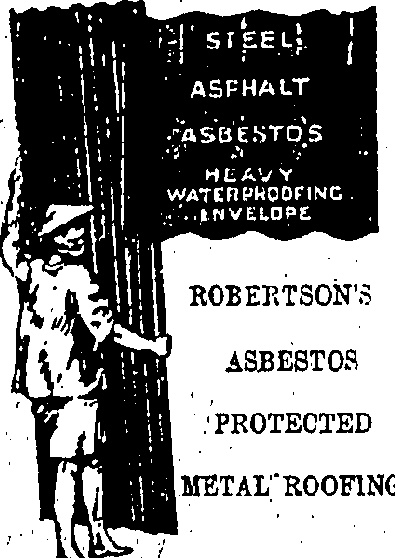

## X(X)X(X)X(X)X(X)

Telephone Central 1246 or 1247

33 Wong Nei Chung Road, Happy Valley.

A. J. Allison.....SERVICE Manager,

三

# China the Jilil

ESTABLISHED

…

She Wears an O.P.C. Tortex Shell Frame

No. 19,558

Hongkong's

only

European

Optician

HONGKONG, TUESDAY, JULY 28, 1925.

## ♣♦♦♦♦♦♦♦♦♦♦♦♦♦♦♦♦♦♦♦♦♦♦♦

## MEN'S

## "TROPICMESH"

This is of English Manufacture, open weave very similar to Aertex. Soft finish, good weving, easy to wash cool and comfortable.

Vests with 14 or 12 Sleeves

## COMBINATION

WHITEAWAY, LAIDLAW

& CO., LTD.

HONGKONG.

DAVIE, BOAG & CO., LTD.

Bank of Canton Building.

Samples and particulars on application

FOR REAL FINE MAJONG SETS

MARK OF IVORY AND BONE

SOLD AT

Lowest Possible Prices

SUNG SAN CHAN,

140, Wellington Street

SAM PAI LAU,

Cheong Ka Lang,

Shanghai

STRIKERS' PICKETS HOLD

UP GENERAL.

MAUSERS MOST EFFECTIVE.

How strikers' pickets in Canton are trying to lay down the law even to military officers and "caught a tartar" was recounted to a "China Mail" reporter by the man who took the leading part in administering the rebuff to the self-appointed policemen.

Having heard wild rumours as to conditions in Hongkong a General, who is chief of staff to the officer commanding one of the corps in the First Cantonese Army, arrived at Canton from the West River, on his way down to this Colony.

In Canton he shipped by the s.s. Shing Cheong for Macao. As he was going on board the vessel, a batch of strikers, some of whom were armed and in uniform, challenged him on the Bund and insisted on searching him. It being against his dignity to submit, the General demanded indignantly, as he said to the "Mail" man, to know the reason why. The picket told him that they were going to confiscate any correspondence for Hongkong and any Hongkong money, as a boycott had been declared against British coinage.

"I have $5,000 on me in Hongkong notes," declared the General when, as he admitted, he only had $30 or so, "and I defy anybody to take it from me as no notice has been posted up to warn the public." One man came forward and replied, "I will take it from you if you have $5,000" and promptly seized two letters which were protruding from the General's breast pockets.

Realising that the General was too much for them to tackle the men disappeared and the former went on board the ship where he dismissed his bodyguards. A few minutes later, a man who claimed to be chairman of the "supervisors of the China National (Labour) Strike delegates" demanded an apology from the General. Pointing to strikers who were searching passengers' baggage and confiscating foodstuffs, the General said "You put up no notices as to what may or may not be carried. You tell that poor woman there that because she has three water melons they must be confiscated, but that she could have gone if she only had two. That man over there you have assaulted because he had over five catties of lichees. What are your methods and what is your authority? You claim to be acting for a patriotic cause and yet you know nothing about regularity or order. Clear out before my bodyguards open fire!"

### PRICE, $3.00 Per Month

Holding the striker by the neck the General produced his badge, and the letters were returned; but the picket commander still insisted on going through his pockets and his effects.—Pointing to his dozen bodyguards behind him, the General replied "You see those men coming up from the rear? You can see that the Mausers they carry are brand new and serviceable. Now, go!"

The foregoing story only goes to indicate how far the strike leaders have usurped functions outside their scope and how their crumbling movement is being desperately maintained. As the General said, batches of them are canvas-sing the city with collection books, wailing like beggars and, in the same tone, threatening shops that will not pay as they like.

The General also stated that there was no truth in a story published in some vernacular papers that General Cheung Kai-shek, commanding the Whampoa Cadets, had been grievously wounded by a confere at a council. Nor was it true that General Hsu Shung-chi, commander-in-chief of the Cantonese (Kuomin-tang) Army, has espoused Communism. He concluded by saying that General Hsu would oppose Communism, or the four-four-two plain, as it is popularly known.

## SETTLEMENT

The monthly share settlement fixed for to-day was in the process of being put through as this edition went to press.

It is an open secret that defaulters were not unexpected but what the outcome of the whole business will be is a matter for conjecture. Brokers who were approached were non-committal as to the future.

## RIVER SHIPS

## MORE PASSENGERS FROM CANTON

FNDIRECT COMMUNICATION.

It was thought that Canton's stopping the river-steamer traffic between that port and Macao during the week-end would prevent any more strikers from returning to this Colony. The contrary has proved to be the case. Yesterday afternoon the s.s. Charles Hardouin was to have left Macao at 2 p.m. but actually sailed after 3 p.m. as she waited for the arrival of the tow-boat from Shekki. About 500 passengers were conveyed to Hongkong by the Charles Hardouin alone.

It appears that as soon as the Canton-Macao ships ceased running, strikers at once diverted by native river craft to Shekki and from that port to Macao, determined to get back to Hongkong.if they could.

Another means of communication, also indirect, has been established. The Foo Cheong is leaving Macao for Kongmoon to-night and it is expected that there will be an exodus from Canton to Kongmoon where passengers will ship for Hongkong, via Macao.

Abundant cargo is being carried between this Colony and Macao. Only the s.s. Sun Ning, which went into dock has dropped out of the service the boats remaining being as follow:—the Steamboat Co.'s Sui Tai which returned yesterday and sailed for Macao this morning; the s.s. Sai On (sister ship to the Tung On); the Charles Hardouin and Paul Beau; the Chuen Chow; and the Ko Chow.

## For Shanghai

The Chinese owned boat Hwa Tai, from Canton; was observed by Waglan to be in British waters on its way from Canton this weekend. As no form concerning it had been left with the Harbour Office the representatives of the owners here were communicated with and the regulation was complied with. According to the form the boat is on its way to Shanghai and will shortly return. It is expected that on its return it will carry food supplies to Canton.

## PRINTERY SEIZED

## ALLEGED SEDITIOUS LITERATURE

On June 22 the Wong Fat Press, 68 Hollywood Road, was found to have been engaged in the printing of seditious literature but as no power was then invested in the Police officials nothing was done immediately regarding the matter.

The Order in Council now having been passed, the business was confiscated this morning under the superintendence of Mr. R. A. D. Forrest, Police Magistrate.

During the week ended July 25 the following cases of notifiable disease were reported:—One of small-pox, American, imported, non-fatal; one of enteric fever, Chinese, fatal; one of paratyphoid fever, Indian, imported, non-fatal; one of cerebrospinal fever, Chinese, fatal. There was a clean sheet for yesterday.

The silk which left here by the P. & O. s.s. Malwa on June 27 was delivered in Marseilles on July 25, a transit of 28 days.

## A SOOTHING BALM

For soreness of the muscles after violent exercise and for rheumatic pains, much relief is afforded by massaging the affected parts thoroughly with Chamberlain's Pain Balm. Try it when you have need of such a preparation and see for yourself what an excellent limnant it is. Sold everywhere.

TO-DAY'S DOLLAR.

## BACK TO CIVVIES

## VOLUNTEERS PARTLY DEMOBILISED

DUTIES DISCONTINUED

Rumours of impending demobilisation of the Hongkong Volunteer Defence Corps have been in the air for some weeks but as time passed and nothing authentic could be gathered, the pessimists hazarders another two, three or even four weeks would probably pass before tunies, putties and equipment could be discarded in favour of civils. The general opinion seemed to be that the authorities would go to the other extreme rather than be obliged, like the authorities in Shanghai, to mobilise again after having been once disbanded.

To-day, however, partial demobilisation has begun, the Artillery Company and No. 6 platoon of the Scottish Company being the first. To-day's orders contain further instructions for demobilisation in respect of sixty officers and men of the Infantry Company.

In view of partial demobilisation the system of patrolling daily the East, West and Central districts of the City is discontinued as from yesterday evening. As the Dairy Farm and lower Peak Tram station guards had already been discontinued, that leaves the only extra duties from normal times to be performed as the Headquarters Guard and parades.

The special guard for night and day telephone duty has also been continued and this in future will be carried out by Headquarters Guard, the strength of which has been increased to 1 N.C.O. and 6 men. The stand by armoured crew has been discontinued.

## CONFIDENCE

BOYS' NO LONGER REQUIRE PROTECTION.

Apart from the partial demobilisation of the Hongkong Volunteer Defence Corps which naturally leads to the belief that greater confidence is felt by the authorities as to a peaceful outcome of the present state of affairs, there is little to report in regard to the strike position. Employees of firms and boys are returning in many cases and loyal Chinese no longer ask for extra protection in the way of hoardings or detention in the homes-in which they have been working. Boys may now be observed shopping at the several markets.

In spite of the apparent unanimity regarding treatment of returning employees, complaints have been made by more than one person to representatives of the "China Mail" that in certain households amahs particularly are being taken back at wages in advance of those they received before by housewives who are considering their immediate convenience rather than the principle involved. It is to be hoped that the enthusiastic acceptance of the policy indicated by the resolutions before the meeting yesterday will bring them to a realisation of the disloyalty of such actions.

SHIPPING POSITION.

There are signs of improvement regarding the movements of ocean-going steamers, four British steamers having arrived and one left in the course of the last 24 hours. The Jardine bbat Lai Sang, which arrived a few days ago from Shanghai, is to leave later in the day with a crew consisting of Chinese and Japanese. There are now 55 British steamers in the harbour.

## CHINA'S STATUS

## EXTRA-TERRITORIAL INQUIRY PROPOSAL

(Reuter's Service.)

The closing rate of the dollar, stage when he could p on demand, to day was 2/3 15/16, make a statement at present.

In the House of Commons, replying to the Rt. Hon. C. P. Trevelyan (Labour), Mr. Austen Chamberlain (Foreign Secretary) said that communications had passed between His Majesty's Government, the United States and other Governments with regard to the proposed appointment of a commission to inquire into the question of extraterritoriality in China but had not reached the stage when he could publicly

## FLOGGING LAW

ANOTHER QUERY IN THE COMMONS.

PERMANENT OR TEMPORARY?

(Reuter's Service.)

In the House of Commons, replying to Commander J. M. Kenworthy (Liberal), the Hon. W. G. Ormsby-Gore (Under Secretary for the Colonies) said that no Ordinance had been passed in Hongkong permitting the flogging of strikefs. He understood that flogging was only permitted under the recent Ordinance as a punishment for intimidation with violence and other grave criminal offences. He did not know whether the Ordinance was permanent or temporary; when it was received in England that aspect of the matter would be fully considered, but he was doubtful whether it was likely to receive the Ordinance before the Commons rose as it probably would not reach England until the end of the second week in August.

Reply to the Labourite, Mr. R. C. Morrison, Mr. Ormsby-Gore said that the Governor had informed him that nobody had been flogged, the object being to prevent an outrage rather than inflict punishment.

## VAIN BOAST

## SOVIET AND BRITISH EMPIRE

CAUSE TO COMPLAIN..

(Reuter's Service.)

In the House of Commons, replying to Labourites, Mr. Austen Chamberlain (Foreign Secretary) said that in his interview with M. Rakovsky, he drew the latter's attention to the character and the continuance of activities of which His Majesty's Government had reason to complain, namely, the general failure of the Soviet Government to comply with undertakings of the Trade Agreement that neither party use influence to provoke or encourage movement, hostile to the other elsewhere in the world.

Mr. Chamberlain did not consider any useful purpose would be served, or friendly relations promoted, by a constant stream of detailed complaints.

Mr. J. E. Davison declared that members of the Soviet Government openly boasted their success at under-mining the British Empire. Mr. Chamberlain replied that if so, he thought they had boasted prematurely.

## CURIOUS QUERY

##### INDIA'S C.I.C. AND CHINESE CRISIS

CONTRARY TO PUBLIC INTEREST.

### (Reuter's Service.)

In the House of Commons, Mr. S. Saklatvala (Communist) asked whether any instructions had been issued to the Commander-in-Chief in India in consequence of the Chinese crisis; if so, what were their nature.

Earl Winterton replied that it would be contrary to public interest to answer a question of this kind.

## AGAINST WAR

SEDITIONS COMMUNIST ARTICLE?

PARIS POLICE RAID.

(Reuter's Service.)

Following the publication in the Communist "Humanity" of an article by a Central Committee of action against the war in Morocco urging French troops to fraternise with the Riffs, the Police raided the promises of the Committee, which are diluted in the offices of the General Labour Union and seized a number of documents including a list of members.

The committee of the Hongkong Chinese General Chamber of Commerce is holding an important meeting at the Chamber at 2.80 p.m. to tomorrow.

## RUBBER BOOM

S U D D E N P A N T L Y

ARTIFICIAL RISE.

MR. AMERY'S SIDECH.

(Keuter's Service.)

London, July 27.

In the course of commons, an E. G. Penny (Con.) drew attention to the Malay States Government permitting the release of $6,000 tons of non-suppon rubber upon payment of an export duty of $42 cents per pound and asked whether the whole amount must be exported or any part thereof. He suggested that in future when any such action was contemplated, His Majesty's Government, in the interests of rubber producers and consumers, should make a declaration before hand in order to check speculation as far as possible.

The Hon. W. G. Ormisby (Gore Under-Secretary for the (Cajonies) said that the High Commissioner had informed him that acting on legal advice he had released some 5,000 tons of non-coupon rubber, consisting of stocks held by dealers before restriction. He understood the owners of it were free to export all or any part out rates of duty mentioned in the question and promised to bring Mr. Penny's suggestion to the notice of the acting High Commissioner.

Replying to Mr. Shaw (Con.), Mr. Ormsby-Gore said there had been representations that many industries in the country were already suffering from lack of raw material.

The sudden unexpected, partly artificial, rise in the price of rubber was being considered very seriously.

#### "Maintenance. Not Profit."

Mr. L. C. M. S. Amery (Colonial Secretary), in the course of a speech introducing the Colonial Office Estimates, after stating that he had not thought the Stevenson scheme responsible for the sharp rise in the price of rubber, said "Certainly! If close investigation of the problem in the x-1 few weeks should reveal a situation different from that which our investigations have hitherto shown, and there is a prospect of a grave situation even with existing rates of release, then, of course, we shall have very carefully to consider whether any change might have to be made in those matter is the maintenance, not the rate of undue profit, but the successful maintenance of a great industry which millions of British capital had been sunk, and, at the same time, the supply to Britain and also the world of raw material is reasonable price."

Mr. Amery also said that so far from its being our object to maintain unduly high prices of rubber, he believed a moderate, reasonable price would give British industry in Malaya and Ceylon the best opportunity of holding its own against the industry in other countries. We were well aware that the continued level of high prices would lead to extensive plantation elsewhere. He knew for certain that mannacuturers in Britain were considering closing down certain branches. This required a most searching scrutiny. A sudden change of policy could only be carried out with grave unfairness to those who had made contracts in the past fortnight or two months. Our aim was to maintain stability as far as possible. Mr. J. H. Thomas (Lab.) approved the Colonial Office handling the subject and hoped they would not lose their heads despite the clever propaganda going on and calculated to deceive people here.

## BOMBAY COTTON

OWNERS TO EDUCE WAGES.

(Reuter's Service.)

Bombay, July 27

The Mill Owners' Association has decided, owing to depression in the industry, to reduce the wages of coften operatives by 11½ per cent. beginning on September 1.

Paris, July 27.—The final results of the elections for Councils General, after the second ballot, show that the Cartel captured 133 seats from the Opposition, namely, Van from the Communists, fourteen from the Conservatives, sixty-one from the Republicans and forty-eight from the Left Republicans.

## （）（）（）（）（）（）（）（）（）（）（

BATHING

COSTUMES

## HALF PRICE

THE WHOLE OF OUR STOCK OF YOUTH'S AND MEN'S BATHING C STUMES IS BEING OFFERED AT

## HALF

Cotton from $1.75

Wool from $4.25

Pure Silk at $15.00

SIZES 26 TO 42 INCHES

ONE PIECE STYLE WITH

SKIRT. VERY SMART

COLOURINGS.

## ONE WEEK ONLY

JULY 27th to AUGUST 1st

Open 8.30 to 5:5 aturdays &.30 to 1

## MACKINTOSH

Men's Wear Specialista

Alexandra Building

Des Vosur Road

####################### L.E.E.E.E.E.E.E.E.E.E.E.E.E.E.E.E.E.E.E.E.E

Household. Encyclopedia (con

pieta)

World's Library of Best Books (new)

Romance of Famous Lives (new)

Some Doctor (parts 1-15)

Countries of the World (new)

Business Encyclopedia (parts 1-8)

Wonders of the Past (24 parts)

Na. 12. D'Agullar Street.

√

PINI JEWELLERY

Engagement: eeper, & Wedding Binge

A: PECIALTY.

All of highest grade in the Colony.

WITH DSOR BROS.

No. 66 Nathan Road, Kouloom.

Tel: K 509.

☀️🌥️🌞🌥️🌥️🌥️🌥️🌥️🌥️🌥️🌥️🌥️

## ☀️🌥️🌞🌞🌞🌞🌞🌞🌞🌞🌞🌞🌞🌞🌞🌞🌞🌞🌞🌞

## LEE KEE

## HENRY RICHARD TILE CO'S

We have a large stock of White Glazed Wall Tiles, Colour Glazed Wall Tiles, Ceramio Mosaio Tiles, Geometrical Enనుitio Floor Tiles, Tile Fire Grates.

Inspection Invited

Showroom: 21, Wellington St.

TANG YUK, Dartner, the late SIEN TING, 14, Dagular Street.

TERMS VERY MODERATE Consultation Free