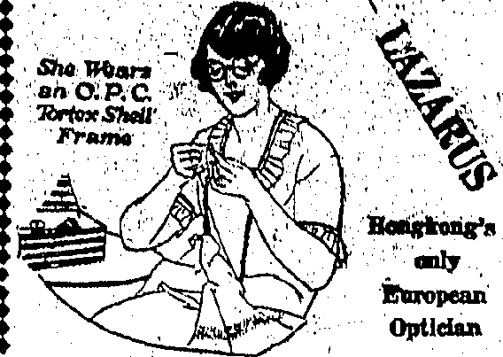
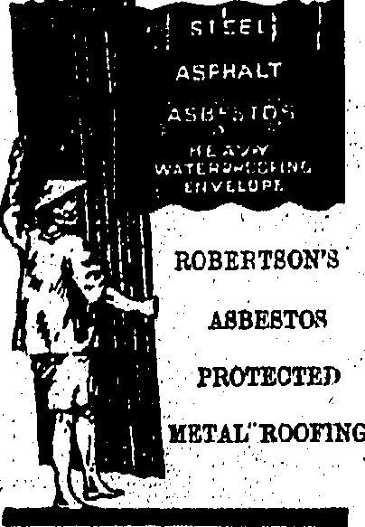

<table border=1 style='margin: auto; word-wrap: break-word;'><tr><td style='text-align: center; word-wrap: break-word;'>We Take The IOM Cut of SERVice I</td></tr><tr><td style='text-align: center; word-wrap: break-word;'>THE DRAGON MOTOR CAR CO., LTD. Telephone Central 1246 or 1247 33 Wong Ncl Chung Road, Happy Valley. A. J. Allison................. SERVICE Manager,</td></tr></table>

# China

# Jहाजil

ESTABLISHED

No. 19,560

HONGKONG, THURSDAY, JULY 30, 1925.

PRICE, $3.00 Per Month.

Will Commence

0

ENTIRE STOCK

VALUED OVER

### $400,000.00

GENEROUS

DAVIE, BOAG & CO., LTD.

Bank of Canton Building.

Samples and particulars on application

FOR REAL FINE MAJONG SETS HANK OF IVORY AND BONE.

BOLD AT

Lowest Possible Prices

SUNG SAN CHAN,

140, Wallington Street

Agent HANK PALLAO,

Chong Ka Long Shanghai

## UNMASKED

SOVIET REGIME FOR CANTON.

DECLARATION ON AUGUST

From a reliable source, the "China Mail" gathers that it is anticipated that a Soviet Government at Canton will be announced on August 1. Feeling against the Rolshevik element, which is curtailing their power, is on the increase among certain of the Chinese military leaders but it is not considered that it will come to a head yet.

Large numbers of Russians are known to have arrived at Canton from Vladivostock during the last week or so.

In view of the anticipation of the institution of a Soviet Government at Canton it is interesting to recall the statement made in Hongkong a month or so ago by Dr. C. C. Wu, now acting as Mayor of Canton, who said that it was idle to suggest that Communism would be established by the Canton Government which had its policy and principles separate from the Communist element in China.

## COOLIE THREATS

SIX MONTHS FOR INTIMIDATION.

WO MEN SENTENCED.

After considerable trouble had been entailed, the house cooie of Mr. A. P. Glover. Tramway Co., was sentenced to jail this morning.

Defendant came up before Mr. E. W. Hamilton at the Kowloon Magistracy on a charge of aiding and abetting a house-coolie, employed by Mr. A. Kirk, P.W.D., to intimidate.

His Worship passed sentence of one month's hard labour on this charge. Defendant had been remanded from yesterday in order to prove against him a previous conviction.

This morning, Sergeant Ritchie of the Criminal Intelligence Department, Records Office, said that he identified defendant's finger prints with those on record of a man convicted of receiving a stolen bicycle and bound over in a bond of $50. Sergeant Ritchie added that there was a distinguishing scar on the right hand of both sets of prints.

A further sentence of three months was imposed when His Worship found the old conviction proved, the bond being thereby discharged.

## Yesterday's Case

The house coolie referred to had been convicted yesterday of intimidating a 'bus inspector in the employ of the China Motor 'Bus Company.

The case had been heard a wee ago, judgment having bee reserved.

The evidence he convicted on, said Mr. E. W. Hamilton, the Magistrate, was the question of the defendant having attempted to extort money from the complainant by threats.

Sentence of six months' hard labour was passed on the defendant.

## OPTION OF FINE

GOOD RECORD SAVES MARKET MAN

Had it not been for previous good conduct on the part of a Yumati market stillholder, he would not have been given the option of a fine of $25 when sentenced by Mr. E. W. Hamilton at the Kowloon Magistracy this morning, to a month's hard labour for using threntening language to two police constables.

His Worship was informed that the officers had gone to the market arrested three gamblers and were escorting the latter along Shanghai Street when defendant called out "Tahl" (Strike them) and was subsequently taken into custody.

## MISSING STRIKERS

CANTON GOVERNMENT ALARMED

ALLOWANCE REDUCED.

## —

From the stringent restrictions which the Canton authorities have brought to bear on the movement of Hongkong strikers it is evident that a considerable number of absentees had been noted by the Guild officials who have to report daily as to the numbers remaining in the City. It is believed that 4,000 strikers who were in Canton at the height of the strike are not now to be accounted for. This, of course, is a small percentage when it is considered that 80,000 in all are thought to have made their way from Hongkong to Canton, but the Canton Government and the Guild officials evidently fear that it might be the beginning of a general return, for still another curtailment in respect of possible means by which the strikers may return to Hongkong is reported to-day.

Beyond Deep Bay and off Hau Hoi, in Chinese territory, is Nam Tau which, because of its remoteness from the scene of operations, has not hitherto come under the direct influence of the Canton Government. The daily service between Nam Tau and Hongkong has been maintained by four launches, and a quantity of fruit and vegetable has found its way into the Colony by this route. Nen Tau, it appears, has also proved a convenient centre for strikers returning from Canton who wish to evade the pickets at Samchun. Many have made their way there during the last week or so and have returned by way of the ferry, but news of this has reached the strikers' executive who have intimidated the con-swains, engineers and other hands manning the launches. In consequence, the launches cease running from to-day. Matters are believed to have been brought to a head by the return to Hongkong yesterday of 200 strikers by this means.

Reported Canton Shooting.

In the meantime little news filters through from Canton city itself, although from merchants and others who have been allowed to pay brief visits from Hongkong, it would appear that there is no shortage of food of any kind. Luxuries of any kind, of course, are impossible with the small amount that the strikers get from strike funds, and a returning merchant told a “China Mail” representative this morning that four days ago whilst he was in Canton several of them protested against a reduction in their allowance, from 20 cents a day to 10 cents. Failing to get satisfaction from the strike executive they decided to take the matter further and went to the house of a prominent Canton Government official. Receiving no satisfaction here either, the merchant told the “China Mail” representative, that the crowd of strikers adopted a very hostile attitude and stones were thrown. The bodyguard of the Government official, acting in accordance with instructions, fired and killed 11 of the strikers, besides wounding many more.

## Border Movements

After it had been reported that Chinese troops on their side of the New Territory border had erected a barrier at the end of the Lowu-Samchun (Railway) Bridge, news "came through that the obstruction had since come down but Chinese soldiers on guard, supposedly Whampoa Cadets, had been posted in fairly considerable numbers in the same position.

## HONGKONG'S VIEWS

The “China Mail” understands that the Navy League have called their support of the resolutions passed at Monday's Community meeting and have promised to lend their aid in bringing the views of the meeting before the Admiralty.

TODAY'S DOLLAR

The closing rate of the dollar on demand, to day was 2/8 18/16

## CANTON STRIKERS

KUOMINTANG NOT TOO PLEASED.

NOW THEY STAND.

(From Our Own Correspondent.)

Canton, July 26.

In spite of determination on the part of Communistie politicians and the professional labour bosses that the anti-foreign movement must continue and that the Hong-kong "strike" must be sustained, it is plainly evident that the tide is turning in more ways than one.

First of all, notification No. 2 of the Canton (Provincial) Government orders that murderous attacks and assaults of any kind on the part of strikers must cease. It points out that powers given to strikers are not for individuals to wage wars and exact revenge on others. Broadly translated, the notification reads "Because it is the Revolutionary Government's purpose to protect the rights of labourers, labour associations have been invested with certain privileges to strengthen their position and the position of labor has been clearly defined in the Kuomintang rules. But on one account must labourers disturb the peace and take life willously, etc.

I have been informed that strikers' pickets have gone to the length of using weapons and firearms whenever they pleased, and that a life to such men were not worth a moment's purchase. Most of those pickets comprise hirelings of the guild officials who would lose employment when there are no more officers to restrain, forcibly, in the field.

Published in the "San Kwok Wa Po" here is an account of a meeting in the City Hall at which it was proposed that peace overtures should be made to the Knomintang Government, this by a reporter who at a great risk-mod-special personal tour of investigation of Hongkong.

The price of rice in Canton has dropped a little recently as the harvest has been very satisfactory. However, plans are being considered to ship 20,000 bags of rice and taken rice from Swatow to Canton and to bring a shipment of food stuffs from Siam.

It is reported that a foreign firm with offices in Canton has had to apply for permission from the Strike Executive to slip away some merchandise, and ocean-going vessel.

In the discussions regarding turning some of the strikers on to building a road from Canton to Whampoa, friction has been reported. The quibble is over the alleged refusal of the authorities to provide tiffin for the road-builders and this has led to a resolution being passed by the Strike Executive.

That the authorities do not see eye to eye with the strikers also seems apparent from the discord resulting from the proposal to levy a tax on merchants in Canton to support the strike. It appears that the Strike Executive has written to the Finance Bureau for the directory of business establishments in the city, so that collection may start but, the Bureau has put the Executive off by insisting that the notice was too short. Still, it is felt that the levy will be made and the merchants will have to be paid up softer or later as certain politicians are still taking the strikers in hand and, at the same time, trying to enhance their own prestige by being able to point to such a large following.

## AMBULANCE TEST

At an examination held by Dr. G. H. Thomas, the following have passed as "Qualified to render First Aid to the Injured"

5th annual test.—Ho Chung-yee; 4th annual test.—Yeung Wan-bing, Chuk Tai-kwong; 3rd annual test.—Thomas Sue, Cheng Ching-Lam, Pan Shiu-kwal; 2nd annual test.—Ng Ho-lau; 1st annual test.—Wong Shu-wah, Lam Ke-yan, Lo Tung-fan, Ho Shion, Ho Sai-yan, Tam Min-u, Lau Ping-keo, Joseph Leung, Ng Hon-sang, Kwan-kin-wing, Wu Shiu-chee, Tong Fu-sum, Lo Ohee-chung, Leung Chik-wai, Cheng-Kam-hon, Cheng-Ho-chee, J. Gomes, and Pan Kwong-kuan. All the above rendered good service in connection with the Fo-Hing Fong disaster.

YOUTH SLANDS SPECIAL CONSTABLE

THE "FERRITO OF AMOOOS."

Because he said that a Chinese Special Constable was not fit "to approach" the three of hamboons" (the latter being the name of a Mah Long card), a Chinese youth was ordered to pay a fine of $25 at the Central Magistracy this morning.

bamboos" in Mah Jong is known as "monkey's-nose." Common usage has brought the term down to plain nose. Another term in the slung vocabulary, pertaining to anything repulsive is "Not fit to approach (or come near) the nose." A blending of the two would then for the ultra smart, be "Not fit to approach the 'thres of bamboos," which, broadly, would indicate anything foul, or a person whose actions put him outside the pale of human

This youth was alleged to have shouted out the epithet when the reservist was passing him in Wanelai. He was promptly arrested and charged with disorderly conduct. A man who worked with him went into the witness-box in Mr. S. B. B. McElderry's court this morning and testified that defendant had used the term to him because he (witness) had smoked a "bamboo water" smoking pipe instead of cigarette.

His Worship disbelieved the defence and remarked that he was satisfied that defendant had used the term complained of and that he had uttered it for the complainant to hear.

## MUST NOT DO IT

SEDEUTOUS LITRINTURE

CIA ARGE

I know he came into possession of solutions literature formed the subject of a charge which came up for adjourned hearing against a shoo maker at the Central Police Court this morning.

Mr. D. McCallum defended. In the box defendant said that the inflammatory circular was given to him in Macao and he unwittingly put in his pocket to be discovered by the Police when he arrived in Hongkong by the S.S. Charles Hardouin at 6.30 p.m. on July 27.

Yesterday he had told His Worship that he did not know how the slip of printed matter had got into his pocket.

However, His Worship accepted defendant's story that he had come by the paper in the manner he had described. A serious view of the case was not taken but, at the same time, remarked His Worship, people must not bring these things into the Colony.

A  $ h n_{v} $ of 25 was imposed.

## JUNE WAGES

WORDING OF K.R.A. RESOLUTION.

## !

The following is the wording of the resolution, relating to strikers' pay for June, passed by the Kowloon Residents' Association on Tuesday, and already reported:—

That in view of the unexpected prolongation of the "Strike" and because of the apparent necessity of instilling into the minds of the Chinese workers of this Colony, the fact that it must inevitably be to their detriment to go out on strike, this meeting of the Committee of the Kowloon Residents' Association hereby rescinds the resolution passed at its meeting held on July 3, in which a general recommendation was made to members for the payment of wages earned during June according to the number of days worked.

It is further resolved that this Committee recommends the general body of the Association to refrain from paying any June wages to those strikers who went out before July 3, and also to refrain from paying any wages to servants in excess of the wages before the strike. Further that copies of this resolution be sent to the local newspapers for favour of publication.

## HAWKERS' REWARD

LIGHTENING OF LICENCE RESTRICTIONS.

The "China Mail" understands that as a result of representations made by the two Chinese members of the Legislative Council, the Captain superintendent of Police has agreed for the time being, at any rate, to lighten the restrictions placed on hawkers.

It is felt that in view of market stall holders having left their posts and their functions being performed by these hawkers who in some cases ran a certain amount of risk and certainly helped in the maintenance of an essential service, there should be some return made to them in the way of privileges.

The regulations, the “China Mail” understands will be amended as follows:

The sale of fresh foodstuff of any kind is prohibited within market limits.

Outside market limits, itinerant hawkers, whether licensed or not, will not be interfered with in the meantime.

Fixed pitches which have come into existence since the beginning of the strike will not be allowed where they would interfere with vehicular traffic or cause obstruction to traffic.

## TO-DAYS FUNERAL

LAST RESPECTS TO THE LATE

MR. CHAU SIU-KI.

LENGTH PROCESSION.

The funeral of the late Mr. Chau Su-ki took place today, and was attended by representatives of the Government, official members of the Legislative Council, prominent Chinese merchants and many others.

The procession was to have left the Tung Wah Hospital at 1 p.m. but owing to its great length and the number of streets to be traversed it was decided to make an earlier start in order that the Kennedy Town farewell pavilion might be reached by 2.30.

Here it is anticipated that His Excellency the Governor, the Colonial Secretary, Commodore Stirling and members of the Legislative Council will pay their last respects to the deceased.

## OBITUARY:

"We regret to record the death, which took place at the Naval Hospital to-day of Mr. F. King, inspector of engines, of the Engineering Department of the Naval Yard.

Mr. King had been in the Colony for a little over a year. He leaves a wife and daughter who were with him at the last to mourn his loss.

Yesterday no notifiable disease was reported to the Sanitary authorities.

A woman coolie who was carrying firewood opposite to the Astor House Hotel ran in front of the car of Mr. G. H. Wilson (Messrs. Robertson, Wilson and Company); on Tuesday and received injuries to her leg which necessitated her removal to Hospital.

George Clayson, Eurasian, was sentenced to three weeks' imprisonment by Mr. R. A. D. Forrest, at the Central Magistracy, for the theft of seven gramophone records from Pathé Orient, No. 12, Queen's Road Central. At yesterday's hearing, Mr. M. Girardot, manager of the complaint firm, had pleaded for leniency as the gramophone records did not amount to any considerable sum and defendant had been taught a lesson. Defendant had stated that he was born in Shanghai. Efforts of the Police to communicate with his employers in Hongkong had not result in court this morning.

## 而其(1)(2)(3)(4)(5)(6)(7)(8)(9)(10)(11)(12)(13)(14)(15)(16)(17)(18)(19)(20)(21)(22)(23)(24)(25)(26)(27)(28)(29)(30)(31)(32)(33)(34)(35)(36)(37)(38)(39)(40)(41)(42)(43)(44)(45)(46)(47)(48)(49)(50)(51)(52)(53)(54)(55)(56)(57)(58)(59)(60)(61)(62)(63)(64)(65)(66)(67)(68)(69)(70)(71)(72)(73)(74)(75)(76)(77)(78)(79)(80)(81)(82)(83)(84)(85)(86)(87)(88)(89)(90)(91)(92)(93)(94)(95)(96)(97)(98)(99)(100)(101)(102)(103)(104)(105)(106)(107)(108)(109)(110)(111)(112)(113)(114)(115)(116)(117)(118)(119)(120)(121)(122)(123)(124)(125)(126)(127)(128)(129)(130)(131)(132)(133)(134)(135)(136)(137)(138)(139)(140)(141)(142)(143)(144)(145)(146)(147)(148)(149)(150)(151)(152)(153)(154)(155)(156)(157)(158)(159)(160)(161)(162)(163)(164)(165)(166)(167)(168)(169)(170)(171)(172)(173)(174)(175)(176)(177)(178)(179)(180)(181)(182)(183)(184)(185)(186)(187)(188)(189)(190)(191)(192)(193)(194)(195)(196)(197)(198)(199)(200)(201)(202)(203)(204)(205)(206)(207)(208)(209)(210)(211)(212)(213)(214)(215)(216)(217)(218)(219)(220)(221)(222)(223)(224)(225)(226)(227)(228)(229)(230)(231)(232)(233)(234)(235)(236)(237)(238)(239)(240)(241)(242)(243)(244)(245)(246)(247)(248)(249)(250)(251)(252)(253)(254)(255)(256)(257)(258)(259)(260)(261)(262)(263)(264)(265)(266)(267)(268)(269)(270)(271)(272)(273)(274)(275)(276)(277)(278)(279)(280)(281)(282)(283)(284)(285)(286)(287)(288)(289)(290)(291)(292)(293)(294)(295)(296)(297)(298)(299)(300)(301)(302)(303)(304)(305)(306)(307)(308)(309)(310)(311)(312)(313)(314)(315)(316)(317)(318)(319)(320)(321)(322)(323)(324)(325)(326)(327)(328)(329)(330)(331)(332)(333)(334)(335)(336)(337)(338)(339)(340)(341)(342)(343)(344)(345)(346)(347)(348)(349)(350)(351)(352)(353)(354)(355)(356)(357)(358)(359)(360)(361)(362)(363)(364)(365)(366)(367)(368)(369)(370)(371)(372)(373)(374)(375)(376)(377)(378)(379)(380)(381)(382)(383)(384)(385)(386)(387)(388)(389)(390)(391)(392)(393)(394)(395)(396)(397)(398)(399)(400)(401)(402)(403)(404)(405)(406)(407)(408)(409)(410)(411)(412)(413)(414)(415)(416)(417)(418)(419)(420)(421)(422)(423)(424)(425)(426)(427)(428)(429)(430)(431)(432)(433)(434)(435)(436)(437)(438)(439)(440)(441)(442)(443)(444)(445)(446)(447)(448)(449)(450)(451)(452)(453)(454)(455)(456)(457)(458)(459)(460)(461)(462)(463)(464)(465)(466)(467)(468)(469)(470)(471)(472)(473)(474)(475)(476)(477)(478)(479)(480)(481)(482)(483)(484)(485)(486)(487)(488)(489)(490)(491)(492)(493)(494)(495)(496)(497)(498)(499)(500)(501)(502)(503)(504)(505)(506)(507)(508)(509)(510)(511)(512)(513)(514)(515)(516)(517)(518)(519)(520)(521)(522)(523)(524)(525)(526)(527)(528)(529)(530)(531)(532)(533)(534)(535)(536)(537)(538)(539)(540)(541)(542)(543)(544)(545)(546)(547)(548)(549)(550)(551)(552)(553)(554)(555)(556)(557)(558)(559)(560)(561)(562)(563)(564)(565)(566)(567)(568)(569)(570)(571)(572)(573)(574)(575)(576)(577)(578)(579)(580)(581)(582)(583)(584)(585)(586)(587)(588)(589)(590)(591)(592)(593)(594)(595)(596)(597)(598)(599)(600)(601)(602)(603)(604)(605)(606)(607)(608)(609)(610)(611)(612)(613)(614)(615)(616)(617)(618)(619)(620)(621)(622)(623)(624)(625)(626)(627)(628)(629)(630)(631)(632)(633)(634)(635)(636)(637)(638)(639)(640)(641)(642)(643)(644)(645)(646)(647)(648)(649)(650)(651)(652)(653)(654)(655)(656)(657)(658)(659)(660)(661)(662)(663)(664)(665)(666)(667)(668)(669)(670)(671)(672)(673)(674)(675)(676)(677)(678)(679)(680)(681)(682)(683)(684)(685)(686)(687)(688)(689)(690)(691)(692)(693)(694)(695)(696)(697)(698)(699)(700)(701)(702)(703)(704)(705)(706)(707)(708)(710)(711)(712)(713)(714)(715)(716)(717)(718)(719)(720)(721)(722)(723)(724)(725)(726)(727)(728)(729)(730)(731)(732)(733)(734)(735)(736)(737)(738)(739)(740)(741)(742)(743)(744)(745)(746)(747)(748)(749)(750)(751)(752)(753)(754)(755)(756)(757)(758)(759)(760)(761)(762)(763)(764)(765)(766)(767)(768)(769)(770)(771)(772)(773)(774)(775)(776)(777)(778)(779)(780)(781)(782)(783)(784)(785)(786)(787)(788)(789)(790)(791)(792)(793)(794)(795)(796)(797)(798)(799)(800)(801)(802)(803)(804)(805)(806)(807)(808)(809)(810)(811)(812)(813)(814)(815)(816)(817)(818)(819)(820)(821)(822)(823)(824)(825)(826)(827)(828)(829)(830)(831)(832)(833)(834)(835)(836)(837)(838)(839)(840)(841)(842)(843)(844)(845)(846)(847)(848)(849)(850)(851)(852)(853)(854)(855)(856)(857)(858)(859)(860)(861)(862)(863)(864)(865)(866)(867)(868)(869)(870)(871)(872)(873)(874)(875)(876)(877)(878)(879)(880)(881)(882)(883)(884)(885)(886)(887)(888)(889)(890)(891)(892)(893)(894)(895)(896)(897)(898)(899)(900)(901)(902)(903)(904)(905)(906)(907)(908)(909)(910)(911)(912)(913)(914)(915)(916)(917)(918)(919)(920)(921)(922)(923)(924)(925)(926)(927)(928)(929)(930)(931)(932)(933)(934)(935)(936)(937)(938)(939)(940)(941)(942)(943)(944)(945)(946)(947)(948)(949)(950)(951)(952)(953)(954)(955)(956)(957)(958)(959)(960)(961)(962)(963)(964)(965)(966)(967)(968)(969)(970)(971)(972)(973)(974)(975)(976)(977)(978)(979)(980)(981)(982)(983)(984)(985)(986)(987)(988)(989)(990)(991)(992)(993)(994)(995)(996)(997)(998)(999)(1000)(1001)(1002)(1003)(1004)(1005)(1006)(1007)(1008)(1009)(1010)(1011)(1012)(1013)(1014)(1015)(1016)(1017)(1018)(1019)(1020)(1021)(1022)(1023)(1024)(1025)(1026)(1027)(1028)(1029)(1030)(1031)(1032)(1033)(1034)(1035)(1036)(1037)(1038)(1039)(1040)(1041

BATHING

COSTUMES

THE WHOLE OF OUR STOCK OF YOUTH'S AND MEN'S BATHING STUMES IS BEING OFFERED AT HALF PRICE

Cotton, from $1.75

Wool from $4.25

Pure Silk at $15.00

SIZES 26. TO 42 INCHES

ONE PIECE STYLE WITH

SKIRT. VRRY SMART

COLOURINGS.

JULY 27th to AUGUST 1st

Open 8:30 to 5: Saturdays 8:30 to

## MACKINTOSH

* CO LTD

N(X)X(Y)X(Z)X(W)X(X)X(Z)

## Hair Dressing Saloon

## open as usual

FINE JEWELLERY

Engagement, +ான, & Wedding Ring

A ECIALTY.

All of high grade in the Golony.

WIN/SOR BROS.

No 56 Nathan Road, Kowloon

## [N]

# LEE KEE

Agont lot

### HEVRY. RICHARD TILE CO'S

We have a large stock of White Glassed Wall Tiles, Colour Glazed Wall Tiles, Ceramic Meals Tiles, Geometrical Enacties Floor Tiles, Tiles Fire Graces.

Inspection: Invited.

Showroom: 21, Wellington St.

Tel. C. 1463

