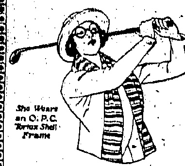
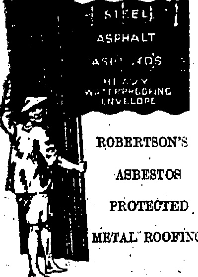

## 二 

THE DRAGON MOTOR CAR CO., LTD.

Telephone Central 1246 or 1247

33 Wong Nei Chung Road, Happy Valley.

A. J. Allison.....SERVICE Manager,

# China

# Jail

ICS T A B L I S H E D

No. 19,561

八

Qualified

Sight Testing

With Modern

Equipment.

## WHITEAWAY'S

## GREAT SUMMER

ENTIRE STOCK

VALUED OVER

### $400,000.00

INOLUDEI

In order to make final preparations for this Sale, our Store will be closed for business on SATURDAY, AUGUST 1st.

&CO.,LTD

☀️☀️☀️☀️

PRICE, $3.00 Per Month.

DAVIE, BOAG & CO., LTD

Bank of Canton Building.

Examples and particulars on application

FOR REAL FINE MAJONG SETS MADE OF IVORY AND BONE.

SOLD AT

Lowest Possible Prices

SUNG SAN CHAN,

160, Wellington Street

Agents:

SAN FAI LAU,

Okeong Ka Ling,

Shanghai

## FRÔNTIER FIRING

SHOTS AT POLICE AND VILLAGERS.

TWO UGLY INCIDENTS

Two incidents of actual firing by Chinese soldiers into British territory, without reason or provocation, occurred yesterday and this morning, but the unwarranted attack was not replied to by the men on the spot.

In addition to the firing Chinese soldiers crossed the frontier into the New Territories, where they attempted to interfere with the villagers, but retreated without accomplishing anything.

Just before darkness came on yesterday—about 6.45 p.m. is the time given officially—two Indian Police were fired at from over the border. A Chinese civilian was on his way to Samchun, in Chinese territory, with two tins of kerosene, which commodity comes under the export prohibition order. He was arrested by the officers who, after they had begun to escort the man back to Ta Kuling Police Station, which is close to the dividing line, were fired at. Only one round was discharged, and nobody was hit. Taking no further notice the constables reached the station with their captive, without further incident.

This morning the second instance took place and was certainly more aggravating. About 6.30 natives on the British side were taking some cattle out to the fields when two Chinese soldiers crossed the frontier from their side and fired three shots at the people. The intruders took possession of three bullocks, when the owner came on the scene. The latter remonstrated, pointing out that the animals were his, that he lived in the New Territory under British rule, and that the beasts had not been taken in from across the boundary line. Apparently satisfied that no attempt had been made to "smuggle" cattle into Hongkong, the soldiers gave up the bullocks and returned across the border to their own stations.

The “China Mail” is informed that there are no special military pickets doing duty at the part of the frontier indicated, where only the usual Police are stationed.

## SEDITIOUS POSTERS

CULPRIT SENT TO JAIL FOR 18 MONTHS.

No flogging was meted out to a convicted intimidator this morning because the Magistrate did not consider him to be the principal, but the accused was sentenced to a term of eighteen months' hard labour, which should serve as a useful deterrent.

CHINESE CONSTABLES

COMMENDED.

Accused was found guilty on a charge of possession of seditious literature in that he posted up intimidating circulars at Tin Lok Lane. The posters set out the objects of the strike and warned the new traffic employees of the Tramway Co. that if they did not withdraw, they would be suitably dealt with.

Two Chinese constables were commended by His Worship (Mr. S. B. B. McElderry) for their initiative in bringing the culprit to book. They had caught him acting, suspiciously and found paste in his possession.

Under the powers invested in him, His Worship imposed the term of imprisonment (18 months) by virtue of the new Ordinance, although the man had been charged under the old law. Divisional Inspector Ogg prosecuted.

Immediate cash payment will not, from tomorrow, be compulsory on customers obtaining refreshments at Café Wiseman, although it will still be required for the purchase across the counter of bread and cakes. Customers signing chits would oblige the management by signing legibly, preferably in block capitals.

## TO-DAYS DOLLAR

The closing rate of the dollar on demand, to-day was 2/8 13/16

## BLACK-SHIRTS

PROWLER CHASED ON THE POLO-GROUND.

HIDDEN CHOPPER.

Dressed like the black-shirted fraternity of Fascists led by Benito Mussolini, but in uniforms cut like those of Boy Scouts, two Chinese special district guards gave evidence at the Magistracy this morning as a sequel to an arrest by them.

Mr. R. A. D. Forrest had before him a Chinese who claimed to be a carpenter, but was prowling round the Polo Ground, Causeway Bay, about one o'clock yesterday morning.

Special Guards Nos. 9 and 10 of the Tai Hang district were out on patrol. Suspecting the defendant, they challenged him, caught up, made the latter put his hands up, and found on him a chopper hidden under his armpit and inside a jacket, and also a packet of ordinary powder.

After hearing evidence, His Worship convicted. Defendant was ordered to procure a personal security of $50 to be of good behaviour for twelve months, failing which he was to be imprisoned for a month.

Sub-Inspector Field had charge of the case for the Police.

## CANTON ITEMS

## SUN FO AND WU THOUGHT TO HAVE LEFT

RUSSIAN SHIPS ARRIVAL

Of reliable news from Canton there is as great a paucity as usual to-day, although the usual crop of rumours are abroad. The latest is that Mr. Sun Fo and Dr. C. C. Wu have left Canton, but whether their supposed departure is due to a rupture or to a "political mission" is not stated.

It has now been definitely established that the Russian ship which was observed outside British waters, making her way up to Canton, was the Simferopol, of the Russian Volunteer Fleet. Of her imminent arrival from Vladivostok the Hongkong authorities were apprised. It is understood that the ship carried arms and war material, and also Russian passengers.

The Simferopol was at one time engaged in the China trade. During the War she was commanded by the British Government, and under the British flag ran between Bombay and Basra. After the war she was handed back.

## Kerosene Shortage

The deck cargo of the Simferopol is understood to have been kerosene, which coming under the embargo from Hongkong, is apparently scarce in Canton, for another ship observed in British waters and ordered to report to the Harbour Master was the Tong Hsing with a Russian captain and which had aboard 24,000 cases of kerosene for Canton, also 1,290 tons of general cargo for the same sport. Everything being in order the ship was allowed to proceed. The ca. vin was a Russian, and the ship had come from Shanghai.

News has been received in the Colony by the local owners, of the Sui Yick (the Fook Hoi firm) that this bont has been commanded by the strikers at Shanmei (ostensibly by “the Government”). The firm has asked the reason why and has received no reply to its cable, but it is thought that the reason is that the ship was to bring livestock to Hongkong. The Tak Hing, a sister ship, is in Hongkong, and the owners have decided not to send her to Shanmei for the present.

The Hydrangea left for Swatow yesterday and is thought to be bringing back livestock. This ex-Chinese warship, now flying under the British flag, is a very fast boat and will probably be back by to-morrow morning.

The Empress of Australia arrived this morning from couver and the North, the journey being uneventful except for the death of a Chinese third c passenger from heart failure. The crew consists of Mr. E. S. S. Recruited from Kobe and Hama. Saying hundred tons of flourish carried along and set being the Empress to the port.

## CHASE ON RIVER

STRIKERS' RACE WITH STEAMER

"LIKE A PIRATE STORY."

(From Our Own Correspondent.)

Pakkni, Kongmoon, July 29. (Received via Macao.)

Startling developments are rumoured to have followed the arrival here of a good-sized river steamer from Macao and its subsequent clearance from this port.

On arrival the Foo Cheong landed her passengers and cargo and then began to take on board passengers for Macao, the majority of whom wished to re-ship for Hongkong. When many had embarked the local branch of the Canton Strike Executive boarded the vessel and ordered everybody ashore. However, it appears that between one and two hundred passengers ultimately sailed by the Foo Cheong having concealed themselves on board or got on somehow in their determination to reach Hongkong if humanly possible.

Shortly after the Foo Cheong's departure, eight long rowing boats, which can move very swiftly on the downstream current, made off with strikers' pickets, some of whom were armed. It is stated that the Foo Cheong was caught up, hailed to heave to, and the passengers, I am told, were put on the rowing boats and taken back to the port. My information is that the Foo Cheong had practically no cargo and not one passenger when she finally got under way again.

The chase is reminiscent of recent pirate episodes on this part of the river as some of the outlaw gangs own similar craft in which they hold up merchant vessels. The sight of the boats, with every paddle worked, must have impressed the passengers.

One of the Strike officials tells me that the Foo Cheong will be allowed to continue on the run but that passengers or cargo suspected of going on to Hongkong will be held back. This would almost mean an empty ship when on the trip down to Macao, but plenty of inducement when on the up voyage.

## To Caiton Again?

(An Occasional Correspondent.)

People from Canton are still arriving in large numbers via the Shekki or Sze Yap tow-boats and returning to Hongkong by steamer.

It has been stated that the s.s. Chung On is to take up the run between Macao and Canton. As far as is known, the strike leaders in Canton will permit steamers to go up from Macao provided they take away no passengers, food stuffs, or essentials from Canton. Should this be so, the Chung On would have to make passages and freight from one run to cover the return trip.

[The s.a. Chung On has been on the Hongkong-Wuchow and the Hongkong-Kongmoon service and is well known in Hongkong.]

rice to a freedom of export of a mo sports was announced at M esting yesterday of the Trade maintenance Bureau, consisting of Chinese merchants of Hong-

The lifting of the embargo had been granted by the Government through the representations of two Chinese members of the Council, the Chairman of the Information

The little cat the embargo would enable six million dollars worth of rice to be put on the market again and this would�dottedly ease the money market.

## BOMBS FOUND

EXPLOSION ABOARD S.S.

1 KO CHOW.

NO DAMAGE DONE.

From Captain Ebenezer Jones, the master, a “China Mail” representative learned this morning that whilst the s.s. Ko Chow (engaged in the Hongkong to Macao run) was lying alongside the wharf at Macao yesterday at about 1.45 p.m. a loud explosion in the for'ard t'ween decks was heard.

Smoke was observed issuing from a basket ostensibly containing bananas when the master and Chief Mate, Mr. J. Reynolds, arrived at the spot and there was a smell of gunpowder. Two tin canisters were found in the basket, the tops of which had been blown off. No damage was done and nothing inflammable was near, there being at the time little cargo in the 'tween decks.

Nothing has been ascertained as to the means by which the explosives were introduced on board.

##### H.M.S. CAIRO

ARRIVAL IN HONGKONG. THIS MORNING.

Shortly, after noon to-day, a light cruiser with yellow funnels was to be observed making its way into the harbour, and at 12.20 it had anchored in mid-stream off the Naval Yard and tied up to its buoy.

This was H.M.S. Cairo, the latest acquisition to the China Station with a complement of about 250 aboard. She has been transferred from the East Indies Station.

The salute fired by the Cairo was replied to on behalf of the Colony by H.M.S. Tamar.

## OUTPORT NEWS

AMOY STRIKE TO BE DECLARED.

News of a strike at Amoy, has been premature, according to the Naval Authorities, who are in constant wireless communication with the outports.

Enquiry this morning in official quarters elicited the information that the boycott generally was, if anything, intensified. A strike at Amoy had been declared to take effect from to-morrow.

## SPORT NEWS

GOLF CHAMPIONSHIP OF

Information has been received from the Shanghai Golf Club that the Amateur Championship of China will be held at Shanghai, on Saturday and Sunday, October 31 and November 1.

Entries are to reach the Secretary, Shanghai Golf Club, not later than noon on October 19, accompanied by entrance fee $5.00.

Entries may be cancelled up to noon, October 28, and entrance fees will be refunded, but after that time no entrance fee will be refunded.

Conditions, 72 Holés—Medal Play

## LEAGUE BASERALL

The league baseball match between the Hongkong Volunteer Defence Corps and the Indian Recreation Club will take place to-morrow afternoon at Happy Valley at 4:30 o'clock sharp. The South China Athletics will meet the Japanese Club on Monday, August 3, at 4:30 p.m.

## HOT WEATHER DISHABLES

Disorders of the bowels are not usually dangerous, particularly during the hot weather of the summer months and in order to protect proteins and healthy against a more serious disease.

Chaperdelate's Cole and Dierman-Ramay. It can be considered a

## STREET LECTURES

INTERESTING CHINESE PROSECUTION.

ALLEGED STONE THROWING.

Much interest was shown by the Chinese community in a prosecution at the Police Court this morning when two, respectably Chinese were brought up before Mr. R. A. D. Forrest and charged with stone throwing Mr. T. H. King, Director of Criminal Intelligence, prosecuted. Accused were Sam Choi, defended by Mr. C. A. S. Russ, and Wong Chuen, undefended.

It appears that a street lecturer was, under the auspices of the Labour Maintenance Association, haranguing a crowd in Hillier Street on Wednesday, his oration being decidedly against the strike. Stones were thrown at him, disorder ensued, and the trouble would have got out of hand had it not been for prompt action.

Allied to the Association was a squad of special district guards whose headquarters are at the Wa Kiu boarding house. The No. 1 is reputed to have had much experience in quelling disturbances. According to vernacular papers, he has served Wu Pei-fu and other leaders. At any rate, his men answered the call and restored order, taking into custody the two accused.

This morning the accused were brought up formally when Mr. King added a fresh charge of intimidation—this, in official wording, reading something like "attempt to cause him to omit to do an act which he had caused to do"—against Mr. Russ's client.

His Worship increased bail from $250—the sum in which the men had been released—to $500, and adjourned the case to Wednesday next.

### MORE “SQUEEZE.”

STRIKERS' AGENTS

More "squeeze" incidents conducted by strikers from Canton are reported.

Four hundred who arrived in Kongmoon collected sums ranging from $10 downward from all shopkeepers, according to the size of their businesses, and threatened a tenfold increase in the event of non-payment immediately.

Four hundred strikers from Canton have also arrived at Shek Ki, their orders being to prevent foodstuffs being exported to Hong Kong.

A demand of $5,000 each in respect of two junks running between Hongkong and Shek Ki has been made on the owners by the strikers for the privilege of carrying on business.

## LOCAL & GENERAL

The return of notifiable diseases for the 24 hours ended Thursday, shows one case of diphtheria (Chinese).

Mr. F. C. Barry, and Mr. J. D. Humphreys were passengers on the Empress of Australia which reached the Colony to-day.

Mrs. J. L. McPherson and the Misses McPherson, Mr. and Mrs. A. W. Edmunds and children, and Miss J. Owen Hughes, left the Colony by the Patroclus on Wednesday last.

The Public Works Department courteously informs the "China Mail" that steam launches will leave the usual piers for Stonecutier's public bathing beach at the usual hour's.

The interest that residents and patrons have evinced in the efforts of the Hongkong and Shanghai Hotels, Ltd., to meet the exigencies of the present situation; has led the Hotels' management to present to the public, items to information regarding the quantities of produce, etc., used in the preparation of 100,000 meals served from the date of the general exodus of Chinese servants to July 29. A list of the principal items of produce consumed and the amounts in tons—is given, also the number of taken in the through the

BATHING

## COSTUMES

## HALF PRICE

THE WHOLE OF OUR STOCK OF YOUTH'S AND MEN'S BATHING COSTUMES IS BEING OFFERED AT

Cotton from $1.75

Wool from $4.25

Pure Silk at $15.00

SKIRT. VERY SMART COLOURINGS.

## ONE WEEK ONLY

JULY 27th to AUGUST 1st

Open 8.30 to 5 : 5aturdays 8.30 to 1

## MACKINTOSH

Men's Wear Specialists

(×000000000000000000000

###### WWW.WWW.WWW.COM.CN

## Hair Dressing Saloon

and Bookstore

open as usual

12 D'Aguilar Street

## KINE JEWELLERY

Engagement, Keeper, & Wedding Rings

A SPECIALTY. All of highest grade in the Colony. WINDSOR BROS. No. 56 Nathan Road, Kowloon. Tel. K 509.

## LEE KEE

## HENRY RICHARD TILE CO'S

We have a large stock of White Glued Wall Ties, Colour Glued Wall Ties, Ceramic, Hossile, Ties, Geometrical Moisture Floor Ties, Ties, Fire Grains

Showroom: 21, Wellington St

Tel. C.1488

TANG YUN-Dong

she late NEW TTG

14. D'Agடiel

THRM VKKY MODMANES

Gohakala Pai