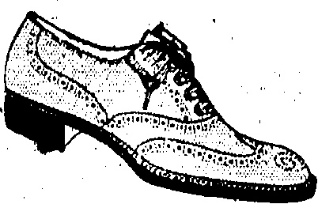
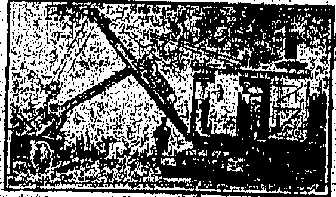
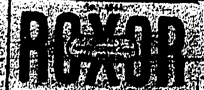

# WATSON'S PRICKLY HEAT

## L'OTION

An infallible remedy, affords immediate relief and effects a speedy cure.

Prices 50 cts. & $1.00 Per Bottle.

##### A. S. WATSON & CO., LTD

HONGKONG DISPENSARY.

ESTABLISHED 81 YEARS.

## ……

Powell Ltd.

Telephone 0. 3146.

Quality, Style

THREE WORDS THAT MAKE THE DIFFERENCE FULL BROGUE SHOE IN THE FINEST QUALITY BROWN WILLOW, SOLES WELTED ON THE HAND-SEWN PRINCIPAL, UPPERS WELL-CUT AND GIVING GOOD FIT AT ANKLE, IN HALF SIZES.

## Character

SOLE AGENTS FOR HONKONG.

PEDDER STREET

## DAIRY FARM NEWS

## SUNDAY HOURS

10 a.m. to 12.noon

Depot and Kowloon 7 a.m. to 9 a.m.

Peak -0 - - 8.30 a.m. to 10.30 a.m.

6 a m. to 8.30 a m.

2 p.m. to 3 p.m.

### THE DAIRY FARM, ICE & COLD STORAGE CO.; LTD

## AUTO-ICE

### The “Auto-Ice” Produces 2 to $2_{\frac{1}{2}}$ lbs. every 4 Minutes

Can be worked by your amah, coolie or child; simply turn the handle; will last a lifetime. ELECTRICALLY RUN IF REQUIRED. FOR HOUSES, Restaurants and small hotels and shops $350. LARGER machines, electrically run, for order supplied to large hotels, Restaurants, factories and Government Departments. Reserve now from next shipment (only a few coming) by telephone C. 4630 or write to address given. MACHINE may be seen now at

Montgomery, Ollerton & Co.

10, Des Vœux Road Central.

ONGKONG EXCAVATION PILE DRIVING & CONSTRUCTION CO., LTD., H.K.

EXCAVATION WORK

CUBIC YARDS OF EARTH MOVED PER DAY BY OUR STEAM SHOVEL EQUIPMENT

Tel. C 3749 2nd Floor, Powell's Building.

OKONG KOLATION FILM DRIVING & CONSTRUCTION CO., LTD., H.K.

#### PLAYERS. GRANDS. UPRIGHTS

It is always a source of satisfaction to have things about you that can be relied upon to function as they are supposed to do.

"MOUTRIE" owners have this satisfaction about their Planos.

Made for the climate — in the climate — by experienced workmen.

Easiest terms arranged.

S MOUTRIE & CO., LTD., Chatter Rd.

N. LAZARUS

Ophthalmic Optician

(Hongkong's only European Optician)

12, Queen's Rd. Central.

Manager:—R. A. COOPER

Qualified by Canadian Government Examination

Fellow of the American Optometric Association

## The China Mail

The China Trial

(Every evening except Sunday. Annual subscription, excluding postage abroad, HK $36, payable in advance. Local delivery free.)

Orrland China Mail

(The weekly edition of the “China Mail.” Annual subscription, excluding postage abroad, HK $12, payable in advance.)

The Newspaper Enterprise, Ltd.

Printers & Publishers

No. 5.WYNDHAM ST. BONGKONG

Telephones Central 22 & 4641.

Cable Address: Mall, Hongkong.

All communications should be addressed to the Newspaper Enterprise, Ltd., to whom all remittances should be made payable.

London Offices:—The Far Eastura Advertising Agency (London), Ltd. 24, Devonshire Street, Harmsbury, W.C.1.

## Hongkong, Monday, July 6, 1925

The extension of the cars to Whitty Street—right through the densely-packed Chinese quarter of the city—must be conceded an event—of no slight importance. The tram workers were the first to come out—without giving notice, it is again emphasised—paralysing in a second an arm of service much used by Chinese and foreigners. The limited service begun a week ago has had a moral effect amongst those living in the Wanchai district; and the same is likely to be the case with those living in the central and western district. Foreigners with spare time on their hands, might do worse than take a ride to Whitty Street and back to town. For one thing they will obtain a refreshing and cooling, ride; they will help to fill rather empty cars and encourage the Tramway Co., but above all they will show to those who raise wondering eyes to the sight of passing cars, or stand and smile in a knowing manner, that the foreigner is capable of taking his troubles—his unsought troubles—smilingly.

## CITY FIRE

MANIZALES REPORTED. DESTROYED.

(Reuter's American Service.)

New York, July 5.

It is reported that the city of

Manizales, Columbia, has been

destroyed by fire.

## RED PROTEST

## APPEAL TO REASON

## INCIDENT ON POLISH FRONTIER

LETTER TO CHINESE

RESIDENTS

## Moscow, July 5

(Reuter's Service.)

SOME PERTINENT FACTS

M. Chicherin has sent the Polish Minister a Note protesting against the incidents on the Polono-Soviet frontier, demanding immediate measures on the part of the Polish Government to secure real inviolability of the frontier and the formation of a mixed commission to investigate the incidents.

The Soviet reserves the right to claim indemnity for damage during the alleged attack.

The following: "Letter to the Chinese Residents of Hongkong" is sent by a reader who signs himself "An American Friend."

With reference to the above, Warsaw says a Soviet patrol kidnapped a Polish Lieutenant who was on a tour of inspection; two brother officers burned a Russian frontier post as a reprisal; both will be punished and as the Soviet protest—is—couched—in-moderate terms no serious consequences are expected.

A · London cable of July 3 stated:—

Reuter's correspondents from Moscow and Warsaw send conflicting versions regarding the fight on the Russo-Polish frontier between guards on June 28, each accused the other of invading their respective territories. Warsaw correspondent declares thirty Russians were disarmed and interned, whereas Moscow's asserts that the Polish force burned down the Soviet frontier post.

## TYPHOONS ABOUT

The telegrams quoted below have been received from the Manila Observatory by the American Consulate General, Hongkong:—

11 a.m., July 5:—Typhoon in about Long. 195 E., Lat. 17 N., moving N.W.

8 a.m. July 6: Cyclone or typhoon in Pacific Ocean, about half-way between the Mariana Island and Luzon, including Westward.

The time has arrived when clear thinking and courageous action on your part will determine whether the future holds happiness and peace for you and yours or whether ruin and chaos are in store for you. You alone must decide without delay whether you have the courage to throw your experience and mature judgment into the balance or whether your future is to be controlled by the indiscretions of a mob of thoughtless schoolboys and representatives of a country with no interest in you beyond a desire to drag you and your native land down to its miserable condition.

The typhoon is situated about 00 miles east of Luzon moving V.N.W.

WEATHER FORECAST.

The weather forecast for the 24 hours ending at noon tomorrow is:

Hongkong and South Coast of China between Lamocks and Hainan: South or variable winds moderate; fair.

Formosa Channel: South or variable winds, moderate.

Tokyo, July 8.—Owing to financial depression, causing increasing discount against the Government, the Peraler made a statement that after now proving that the former Government's policy was responsible and saying no intended continuing the pre-

I am an American of twelve years' residence in Hongkong and China, with great respect and admiration for the Chinese. I admire your character, your judgment, the sanctity of your pledged word, your love of bodily peace and tranquillity of mind. I have no ulterior motive in making this plea to you for I have not a single cent invested outside of my own country and the present state of affairs has not affected my mode of living in the slightest. I merely ask you to pause and compare your present security of mind, body and property with the possibilities in the future if Bolshevism gains control of China.

You are now living under the fairest government in the world. This is no ill-considered statement and if you have visited other countries and studied their government you must admit its truth. There is no place under the sun where anyone has as much personal liberty as here. You can carry on your life and trade with the minimum of governmental regulation and restriction. You are guaranteed and you receive absolute justice without a suspicion of discrimination on account of race, creed, colour, or condition of life. Your customs and religion are respected without interference of any nature. This colony is administered by a set of men who have made a life study of the science of government; without question they are men of education, probity and sound judgment. They and their predecessors have turned a barren rock into a beautiful healthy spot with a superb system of roadways, excellent sanitation, adequate schools and free hospitals. In all of this you share equally yet taxes are so low that they are comparatively negligible.

And yet you listen to cries of British Imperialism! Fraternalism if you will, paternalism if you must, but not Imperialism in an invidious sense. Do you think you might obtain equal benefits in republics such as France or the United States? Though a citizen of the latter country, I am regretfully forced to tell you that you would not; it is not that the American friendship for China is not sincere, or that you would be discriminated against, but not even its own people have the privileges you receive here. If this be true, what are you doing to assure a continuation of your unique condition? You are alive to the fact that this community cannot exist without trade, principally with South China, and if Bolshevism conquers in Canton, depression will follow here with destitution, misery and want in its wake. The burden will fall on you far more heavily than on the foreigner who can transfer his sphere of activity elsewhere.

There is not a single thing that the Hongkong Government or a member of this community can do to settle the Shanghai or Shameen incidents. The unprovoked walk-out cannot assist the settlement, cannot hasten or retard it. Except for a slight inconvenience to some foreigners, this strike appears to be principally directed against you; surely you must realize that in many ways you are the ultimate losers. The time has come for a show of sanity; a firm courageous word from you will stop this silly procedure at once. The Government has guaranteed you safety and you are convinced that you can trust its guarantee. You know or you can easily find out who these cowardly agitators are you alone can curb their activities; you can kill the silly canards passed among the ignorant here and widely quoted in China. Are you willing to protect your future? Your choice is clear—do you wish peace and prosperity or chaos and penury?

Do not listen to hard-brained missionaries; pay no attention to irresponsible, poorly posted politics in America and France.

## OBITUARY

It is with regret that the "China Mail" records the death of Inspector Peter Angus, an efficient and courteous officer, exceedingly popular with his fellow officers and men and well-known and respected by many other than police circles. The respect in which he was held was evidenced by the large attendance at the funeral yesterday afternoon. Death took place early in the morning.

Inspector Angus had been in Hospital for two months and underwent an operation two weeks ago for internal trouble. His condition had given cause for anxiety but the news of his death came as a great shock to many. His age was 51.

The greatest sympathy is felt for Mrs. Angus, daughter, and three sons, a factor which adds even greater poignancy to their bereavement being that arrangements had been made by which the family was to leave for Home very shortly. The deceased's pensionable service was complete a year ago.

The late Inspector Angus was a native of Edinburgh and at the age of 23 he left the Glasgow police for the Hongkong Force. At the time of his death he was Divisional Inspector of the Water Police Station, Tsimshatsui.

The Rev. G. R. Lindsay, of St. Andrew's Church, Kowloon, officiated at the funeral yesterday afternoon when the coffin, draped in the Union Jack, was drawn to the cemetery by a number of police sergeants and followed by large contingents of European, Indian, and Weihaiwei members of the Hongkong Police Force. At Happy Valley the procession was joined by other police officers and civilians.

Among those present were: George, Bertie and Frank (sons) as chief mourners, Mr. T. H. King (Acting Captain Superintendent of Police), Mr. D. Burlingham, (D.S.P.), Mr. J. Kerr (A.S.P.), Mr. W. R. Scott (A.S.P.), Mr. W. Kent (Chief Inspector), Mr. J. Grant (Chief Detective Inspector), Inspectors T. Murphy, J. Ogg, W. Blackman, W. Spear, C. Aris, T. Cashman, Mr. Shannon, Mr. and Mrs. J. McLeod, Mr. and Mrs. Everest, Mrs. and Miss Gerrard, Miss Garrod, Messrs. J. McCubbin, W. Lawson, J. M. Smyth, J. H. Kynoch, G. W. Kynoch, G. Bird, D. Harvey, J. P. Robinson, D. Hazel, A. J. C. Taylor, D. Davies, A. Grimmett, W. B. A. Moore, A. Carmichael, P. Knight, B. Knight, W. S. Glendinning, F. Brett, A. Reid, P. Lanigan, G. Saunders, R. Hall, W./F. Cuff, G. R. Halloway, G. Watt, C. A. S. Russ, W. Fincher, P. Condon and many others.

Floral tributes were laid on the grave from the following: Wife His Loving Sons, His Loving Sis, Clara, Catherine, Jean and Nancy, Marjorie and Mick, Harry, The Governor, Mr. and Mrs. T. H. King, Mr. and Mrs. D. Burlingham, Mr. J. Kerr and Arthur, Mr. L. V. H. Booth, Inspectors Moss and Wilson, P. Grant, Robert and Richard Lanigan, Mr. and Mrs. Ogg, Mr. and Mrs. A. R. Clark, Mr. and Mrs. Evans, Mr. and Mrs. G. T. Bird and Frank, Rev. and Mrs. G. R. Lindsay, S. I. and Mrs. H. Phillips, Mr. and Mrs. J. R. Clark, Inspector and Mrs. Cashman, P. T. and Miss Farrell, Mr. and Mrs. E. Cotton, Mr. and Mrs. P. Lanigan, Mrs. N. S. Moses, Inspector and Mrs. Pincott, Mr. and Mrs. A. W. E. Davidson and family, Mr. and Mrs. Barnett, R. C. and Mrs. Watt, Mr. and Mrs. G. Saunders, Mr. and Mrs. E. J. Field, Mr. and Mrs. H. E. Langley, Mr. and Mrs. W. Knight, Mr. and Mrs. D. Hazel, Inspector and Mrs. T. Murphy, Sergeant and Mrs. R. Swan and J. H. Oxberry, Mr. and Mrs. G. McLeod, Sub-Inspector and Mrs. McWalter, Mr. and Mrs. C. F. Alexander, Mr. and Mrs. Carey, Mr. and Mrs. L. P. Lane, Mr. and Mrs. W. F. Stone, Mr. and Mrs. Everest, and family, Mr. and Mrs. W. Kent, Mr. and Mrs. Mackintosh, Mr. and Mrs. Hynes, and family, Mr. and Mrs. W. Hill, Mrs. Woolley and family, Mr. and Mrs. W. C. Gerrard, and family, Mr. and Mrs. J. P. Robinson and Bonnie, Mr. and Mrs. G. A. Kynoch, and Edna, Mr. and Mrs. Lyon and family, Mr. and Mrs. A. J. C. Taylor and Mrs. Williamson, Mr. and Mrs. E. W. White and family, Mr. and Mrs. Atkinson, Mr. and Mrs. Dofling, Mr. and Mrs. G. A. Walker, Mr. and Mrs. R. Hillyer, Mr. and Mrs. D. Harvey, Mr. and Mrs. A. Grimmitt and family, Mr. and Mrs. W. H. Fincher and family, Mr. and Mrs. S. E. B. McElderry, Mr. and Mrs. Dorrington, Mr. and Mrs. E. Shannon, Mr. and Mrs. K. W. Andrew, Mr. and Mrs. E. Duncan, Edith and Barney Moss, Mrs. of the Water Police Station.

## GOLD MEDAL

HIGHEST REWARD FOR AMUNDSEN.

Amundsen and his companions have arrived by air from Horten. They were accorded a most enthusiastic welcome. The Polar fliers' aeroplane was escorted to Oslo by five Army and five Navy aeroplanes all of which descended into the harbour to the accompaniment of salutes of the fortress.

A Norwegian cruiser, vessels of the British Naval Squadron now visiting the port and steamers in harbour sirened the people aboard. Crowds ashore cheered, the streets of the city were gaily decorated.

Amundsen and his party received a cordial reception from President Storting, chairman of the Oslo Municipality.

The aviators subsequently drove to the Palace where the King presented Amundsen with a gold medal for a patriotic deed, the highest distinction only held by two living persons.

The other members of the party were decorated with the order of Stoslay.

## EARLY DEBATE

## FRANCE AND THE TREATIES

### (Havas Agency.) Paris, July 5

The “Temps” understands that Parliament will debate the ratification of the Washington Treaties in the early part of this week.

(Reuter's Service.)

It is understood that two of the Nine-Power Treaties relating to China would be submitted to the French Parliament for ratification early this week.

## CUT OFF

### (Reuter's Service.)

To-morrow the Council is cutting off the electricity supply of the cotton mills and factories, which at present form a severe drain on the power supply in view of the depleted staff. The foreign mills are closed.

## PLAIN TALK

### (Reuter's Service.)

Earl Crawford, the former Cabinet Minister, speaking at Gillingham, said the time had come for the British Government to give clear and unmistakable warning to Russia that continued organisation of anti-British attacks in China, India and elsewhere would result in the breaking of Anglo-Russian diplomatic relations.

Britain was. tiring of these underhand, underground attacks and was determined to end them.

## WORLD RECORD

(Reuter's American Service.)

F. H. Taylor of Illinois Athletic Club (Chicago) broke the world's record for 440 yards hurdle race.

His time was 53.4/5 seconds in the National American Athletic Union Senior Championship meeting.

Police Station, Chinese Detectives

Water Police Station, Members of

the Victoria Gaol Staff, Members

of the Laichikok Prison, No. 1

Launch, Junior Mess Yaumati

Police Station, C. M. Customs

Kowloon, Sergeant's Mess No. 7

Police Station, Brathren United

Service Lodge, The overseers,

architectural and Maintenance

Department of the P.W.D., Interpreters and constables of the Bay

View Police Station, Officers,

warrant Officers_N.C.O.'s and

Men of the fortiefh fortress company

Royal Engineers, Sergeants

Shaukiwan Police Station, Royal

Naval Yard Police, Kowloon

Bowling Green Club, Staff of the

Harbour Department, Senior

European Mess Yaumati, Sergeants

Mess Water Police Station, Sub Inspector, C.

Macnab Wilson Sergeant's Griffin

and Walsh Messrs S. G. Fallen,

J. Grant D. Davies, P. Condon,

E. T. Tresgus and A. Brown, J.

McLellan, J. Creix, Harrison,

R. Pritchard, L. L. Golden-

burgh, C. Earnshaw, R. P.

Winslow, C. Greenwood, E. E.

Daniels, L. A. E. Chuman,

Sergeants L. Chat and Chetting

Hot, Mr. N. Chong Wah Messrs

Kung Pak-yang Tse Todi and Wai

Tu, Krok Pooh and Mak Yan