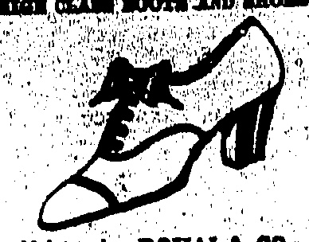
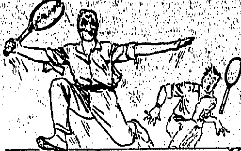

## FOR SALE

SAMLI (Shanghai Fish)

Frozen by A. J. A. Otteson's Improved Patented method which preserves its original flavour and qualities. Once tested always appreciated. Flesh firm as fresh

To be obtained only from

KWONG LOONG

Compradora,

66, Des Voex Road C. Tel. 0128

THE CHINA REFRIGERATING & INVESTMENT COMPANY, LTD. — and also —

THE DAIRY FARM ICR & COLD STORAGE CO., LTD.

## N

JUST ARRIVED

A Consignment of

REAL SWISS GRUYERE

CHEESE, CAMEMBERT

CHEESE, SAUCISSON DE

LYON, BONELESS

SARDINES IN OIL.

CYRANO...(Hors D'Oeuvre)

ANCHOVIES IN OIL.

SALTED HERRINGS AND BLACK OLIVES.

THE FRENCH BLOOM

No. 9, Besonafield Arcads

Tel. Central 794.

0

# Mother!

do you know that Glaxo is a perfectly balanced food, containing everything Baby needs for the development of strong bone & firm flesh; rich in vitamins; pure, clean, germ-free uncontaminated; easily prepared with hot, boiled water only.

Every tinful of Glaxo is a tinful of happiness:—for your baby, the happiness that comes of glorious health; for you, the happiness of the mother who sees her darling day by day growing stronger, sturdier and lovelier.

Glaxo has been used to lead the babies in six Royal Nurseries! Ask your Doctor!

“Builds Bonnie Babies”

Write for Free Sample and Descriptive Booklet to

BOLM AGENTS:

W. R. LOIXLEY & CO.

HONGKONG.

## ☐☐☐☐☐☐☐☐☐☐☐☐☐☐☐☐☐☐☐☐

# LEE KEE Agent for

HENRY RICHARD

TILE CO'S

We have a large stock of

White Glazed Wall Tiles,

Colour Glazed Wall Tiles,

Ceramic Mosaic Tiles,

Geometrical Enकoutio

Floor Tiles, Tile Fire

Grates.

Inspection Invited

Showroom : 21, Wallington St.

Tel. C. 1483

FOR REAL FINE MAJONG SETS MADE OF IVORY AND BONE. SOLD AT Lowest Possible Prices SUNG SAN CHAN, 140, Wellington Street, Agust 140, SAM PATAU, Oheong Ka Lang,

WANT ADVERTISEMENTS

25 WORDS 3 INNÉRITIONS.

Every additional word & Contents

for & Insertion.

## PRIVATE BOARD

PRIVATE BOARD RESIDENCE with quiet British family.

1. Victoria Gardens, Kowloon. 1 minute from ferry. Next floor new hotel. Terms very moderate.

## TO LET

TO LET.—Two Godowns, or shops, in DUDDELL STREET For Particulars apply to: —H. Ruttonjee & Son, 16, Queen's Road.

「O LET—1st July, THE BLARNEY STONE, Victoria Road. 7 small-roomed house, close to sea, garage, flush, telephone, electric and gas fittings. 20 minutes' walk from Kennedy Town tram terminus. Please apply Post Office Box 42.

TO LET:—2 newly-constructed 3-storoyed semi-detached; houses with garages attached si uated on Inland Lot 2365 Stubs Road, marked by sign-board of Shun Shing Contractor, just a little above Morrison Gap Road, Occupation about June 1st. Apply Sang Kee, New Bank Building.

## SHIPS FOR SALE

NEW AND SECOND HAND

Communicate Capt. J. R. PATRICK.

503, Hongkong Hotel.

## INTIMATIONS

## NOTICE

THE PUBLIC is hereby notified that on and after TUESDAY, June 2nd the following first trains on Sundays and Public Holidays will be discontinued.

8.35 a m. Kowloon to Shum Chun

5.20 p.m. Shum Chun to Kowloon

H.P. WINSLOW.

KOWLOON-CANTON RAILWAY.

Kowloon, 30th May, 1925.

PEAK TRAMWAYS CO., LTD.

NOTICE IS HEREBY GIVEN that the Annual Ordinary General Meeting of shareholders of the above Company will be held at the Hongkong Hotel, Hongkong, on MONDAY, 8th June, 1925, at 1L a.m. for the purpose of receiving the report of the Directors together with a Statement of Accounts for the year ended 30th April 1925.

The Transfer Books of the Company will be closed from WEDNESDAY, 3rd June to TUESDAY, 9th June 1925 both days inclusive.

JOHN D. HUMPHREYS & SON,

General Managers.

Hongkong, 29th May, 1925.

HONGKONG JOCKEY CLUB.

THE HALF YEARLY GENERAL MEETING of Members will be held on SATURDAY, 6th June, 1925, at 12:30 p.m. in the Jockey Club Room, Hongkong Club Annex.

Hongkong, 22nd May, 1925.

## FOR ANEURISM, CANCER ETC

A new medicine for the cure of Aneurium. Cancer and Carbuncle by Injection and Internal use.

Most physicians and surgeons have expressed the opinion that Aneurism, Cancer and Carbancils are incurable and many deaths have been caused by these dread diseases. Dr. T. Matsushita, M.B., Professor of the Japanese Imperial University has made a careful study of these diseases for several years and has at last discovered the use of "CABCINOLYSIN" for injection and internal use. Alarge number of Japanese patients have been cured by the use of this medicine and it is now becoming well known for its curative properties.

Foreigners have always died of these dis-

Of late Dr. Sua Yat Sen is suffering from cancer of the liver which is a phase of one of the above-mentioned diseases. Those suffering from this disease will gradually develop faster, nervous pains, urinary troubles, bad appetite, dysentery and vomiting.

Victims of this disease are advised to immediately procure "CAUBINOLYSIN" from bar agents and by taking this internally, or by injection, the progress of the disease will be stopped and results quickly obtained.

Made to order. ROYAL & CO.

No.1, T'Arular Street

## INTIMATIONS

## INSURANCE OFFICES

NOTICE.

WHIT MONDAY AND KING'S BIRTHDAY HOLIDAYS.

NOTICE IS HEREBY GIVEN that all FIRE and MARINE INSURANCE OFFICES will be CLOSED for the Transaction of Public Business on MONDAY, 1st, and WEDNESDAY, 3rd June, 1925.

LOWE, BINGHAM & MATTHEW3.

FIRE INSURANCE ASSOCIATION OF HONGKONG.

MARINE INSURANCE ASSOCIATION OF HONGKONG & CANTON.

## BANK HOLIDAY

IN Accordance with Ordinance No. 5 of 1912, the EXCHANGE BANKS will be closed for the transaction of PUBLIC BUSINESS on WEDNESDAY, the 3rd June.

Hongkong, 30th May, 1925.

##### H. V. D. CORPS

IST ANNUAL

ATHLETIC MEETING.

HK. Football Club Ground

(Happy Valley)

(WHIT MONDAY) at 2 p.m.

19 Events.

Including ONE MILE—OPEN (POST ENTRIES)

Admission to Stand.....50 cents

Teen Obtainable on Ground.

Teas Obtainable on Ground.

INDO-CHINA STEAM NAVIGATION COMPANY, LIMITED.

THE FORTY-FOURTH ORDINARY GENERAL MEETING of the Company will be held at the Office of the General Managers, Messrs. J. Jidine, Matheson & Co., Ltd., Pedder Street, Hongkong on WEDNESDAY, the 10th June, 1925, at 11 o'clock in the morning for the putrose of receiving the Report of the Directors, passing the Accounts, and electing Directors and Auditors.

THE TRANSFER BOOKS of the Company will be closed from the 3rd to 24th June. 1925, both days inclusive.

By Order of the Board,

JARDINE, MATHESON & CO., LTD.

General Managers.

## NOTICE

Mr. H. Percy Smith regrets that it has been impossible for him to personally say farewell to many of his friends and to thank them for all their kindness to him. He will be very glad at all times to hear from them.

Mr. H. Percy Smith leaves the Colony on the Blue Funnel "Rhexenor" on the list of June, for England, where he has taken a house known as 10 Marine Terrace. BARMOUTH, North Wales,

Letters to Constitutional Club, Northumberland Avenue, or to Thatched House Club, London, will be forwarded.

Hongkong, May 27. 1925.

## NOTICE

DURING the absence on leave of the undersigned notice is hereby given that MR. COLIN MALCOLM McDONALD will act as Managing Editor of the "China

G. W. C. BURNETT, Chairman of Directors, Newspaper Enterprise, Ltd. Hongkong, May 28.

Miss NAKAMURA

MASSAGE

1st Floor

No. 37, Queen's Road Central

HONGKONG

If you take two or three little tablets of Bisused. Magnesia immediately after eating. When you have pain in your stomach the trouble is due to excessive acid or food fermentation. Bisurated Magnesia Tablets neutralise the acid, stop the fermentation, and in five minutes your stomach is doing its work in a painless, normal manner. If you have dyspepsia, gastritis, indigestion, or just a plain every-day pain after eating, go to the nearest chemist and get some Bisurated Magnesia Tablets. A large flask costs very little and if you will take as directed you will find you can eat what you like without fear of any following discomfort. Further, it is usually found that the simple taking of Bisurated Magnesia adds strength and power to the vital organs: It is urged, however, that the "BISMAG" oral trade-mark sign be seen when purchasing.

The Sina of the Gaoline

## QUEEN'S THEATRE

LILLIAN GISH IN "THE WHITE SISTER."

"The White Sitter." in which Lillian Gish is now appearing at the Queen's Theatre, is a perfect visualization of F. Marion Crawford's widely read story, told in all its dramatic intensity and filmed in Italy against the beautiful backgrounds described in the original.

Miss Gish rises to supreme heights in the remarkable photo-drama. Her portrayal of Angela places her in a class by herself—the one, real thrilling genius of the screen.

The actual eruption of Mt. Vesuvius is shown. Molten lava, flowing down the side of the mountain is pictured with the mouth of the crater belching forth its deadly fumes and fire. On top of this comes a flood, with an entire town bling wiped out.

"Georgie, dear, if you marry me people will think you did it for my money." "What do I care what the people say?" "Yes, dear, but to keep you from getting a bad name, I have given all my fortune to the missionaries. Why, 'George, where are you going?'" "Oh, to be a missionary," was the sad reply.

# He Keeps Young.

中

# Kruschen Salts

He is 60 years old but he feels less than 20. Brinful of health and vitality and the sheer joy of being alive. That's the Kruschen feeling. You can get it too if you take your little dose of Kruschen's Salts every day. Put as much as will cover a ten cent piece in your morning cup of tea or coffee, and you cannot taste it. Kruschen contains just those six.

Start the Kruschen habit to-day, the habit of cheerfulness, happiness and bounding health and vitality.

salts of Nature which your body needs. It clears your blood, gives you a good appetite, takes away headaches, restores the liver and kidneys to healthy activity, and banishes the pains of Gout and Rheumatism.

# HONGKONG MARKET PRODUCE.

GOOD HEALTH FOR A CENT A DAY.

Mutton Chop—Young Pei Kwat.....Leg—Young Pei.....Shoulder—Young Kin.....Saddle—Young On Yuk.....Pig's Chillings—Chu Chong.....Brains—Chu No.....Feet—Chu Keuk.....Fry—Chu Chap.....Head—Chu Tau.....Ecart—Chu Sam.....Kidneys—Chu Yiu.....Liver—Chu Kon.....Pork. Chop—Chu Pai Kwat.....Leg—Chu Pei.....Loin—Chu Hau Tun.....Fat or Lard—Chu Yau.....Sheep's Head & Feet—Young Tau-Kouk.....Heart—Young Sam.....Kidneys—Young Yiu.....Liver—Young Kon.....Sucking Pigs, to order—Chu Tsai.....Suet, Beef—Shang Ngau Yau.....Mutton—Shang Yeung Yau.....Veal—Ngan Tsai Yuk.....Sangsuan-Ngan Tsai Cheung

## Butcher Meat

Hef Sirloin—Ngau Mei Pa 牛尾把

Prime Cut

Corned—Ham Ngau Yuk 成牛肉

Roast—Shiu Ngau Yuk 燒牛肉

Breast—Ngau Hung 牛腩

Soup—Tong Yuk 湯庆

Steak—Ngau Yuk Pa 牛肉扪

Steak Sirloin—Ngau Lau 牛腩

Sausages—Ngau Cheung 牛腩

allock's Brains—Ngau No 牛腩

Tongue, fresh—Ngau Li 牛腩

Tongue, corned—Ham Ngau Li 成牛肉

Head—Ngau Tau 牛腩

Heart—Ngau Sam 牛腩

Hump, Salt—Ngau Chun 牛腩

Feet—Ngau Keuk 成牛肉

Kidneys—Ngau Yin 成牛肉

Tall—Ngau Mei 牛腩

Liver—Ngau Kon 成牛肉

Trige (undissased)—Ngau To 成牛肉

ales' Head and Beet—Ngau-tsai-tau

Bramel—Ka Yu

Bream—Pin Yu

Canton Fresh Water Fish—Hoi Sin Yu

Carp—Li Yu

Catfish—Chik Yu

Codfish—Mnn Yu

Crabs—Hai

Cuttle Fish—Muk Yu

Dab—Sha Mang Yu

Daco—Wong Mei Lap

Dog Fish—Tit To Sha

Eels, Conger—Hoi Man

Fresh water—Tam Shui Yu

Yellow—Wong Sin

Frogs—Tin Kai

Garoupa—Shek Pan

Gudgeon—Pak Kap Yu

Herrings—Tso Pak

Halibut—Cheung Kwan Kap

Labrus—Wong Fa Yu

Loach—Wu Yu

Lobsters—Lung Ha

Mackerel—Chi Yu

Mook Fish—Mong Yu

Mullet—Tsai Yu

Oysters—Shang Ho

Parrot Fish—Kai Kung Yu

Parch—Tau Lo

Pika—Fa Pan Fong

Plaits—Pan Yu

Pomfret—Black—Hak Chong

Pomfret, White—Pak Chong

Prawns—Ming Ha

Ray—Pak Pa Sha

Rock Fish—Shek Kau Kung

Roach—Chun Tu

Salmon—Ma Yan

Shark—Sha Yu

Skate—Po Yu

Sharps—Ha

# APPROXIMATE RETAIL PRICES.

<table border=1 style='margin: auto; word-wrap: break-word;'><tr><td style='text-align: center; word-wrap: break-word;'></td><td style='text-align: center; word-wrap: break-word;'>May 27,</td><td style='text-align: center; word-wrap: break-word;'>June,</td><td style='text-align: center; word-wrap: break-word;'>June.</td></tr><tr><td style='text-align: center; word-wrap: break-word;'></td><td style='text-align: center; word-wrap: break-word;'>1925.</td><td style='text-align: center; word-wrap: break-word;'>1918.</td><td style='text-align: center; word-wrap: break-word;'>1914.</td></tr><tr><td style='text-align: center; word-wrap: break-word;'></td><td style='text-align: center; word-wrap: break-word;'>$ ^{{00}} $Cts.</td><td style='text-align: center; word-wrap: break-word;'>Cts.</td><td style='text-align: center; word-wrap: break-word;'>Cts.</td></tr><tr><td style='text-align: center; word-wrap: break-word;'>lb.</td><td style='text-align: center; word-wrap: break-word;'>80</td><td style='text-align: center; word-wrap: break-word;'>24</td><td style='text-align: center; word-wrap: break-word;'>12</td></tr><tr><td style='text-align: center; word-wrap: break-word;'>,,</td><td style='text-align: center; word-wrap: break-word;'>80</td><td style='text-align: center; word-wrap: break-word;'>24</td><td style='text-align: center; word-wrap: break-word;'>12</td></tr><tr><td style='text-align: center; word-wrap: break-word;'>,,</td><td style='text-align: center; word-wrap: break-word;'>84</td><td style='text-align: center; word-wrap: break-word;'>23</td><td style='text-align: center; word-wrap: break-word;'>20</td></tr><tr><td style='text-align: center; word-wrap: break-word;'>,,</td><td style='text-align: center; word-wrap: break-word;'>80</td><td style='text-align: center; word-wrap: break-word;'>24</td><td style='text-align: center; word-wrap: break-word;'>22</td></tr><tr><td style='text-align: center; word-wrap: break-word;'>,,</td><td style='text-align: center; word-wrap: break-word;'>24</td><td style='text-align: center; word-wrap: break-word;'>20</td><td style='text-align: center; word-wrap: break-word;'>18</td></tr><tr><td style='text-align: center; word-wrap: break-word;'>,,</td><td style='text-align: center; word-wrap: break-word;'>24</td><td style='text-align: center; word-wrap: break-word;'>20</td><td style='text-align: center; word-wrap: break-word;'>18</td></tr><tr><td style='text-align: center; word-wrap: break-word;'>,,</td><td style='text-align: center; word-wrap: break-word;'>29</td><td style='text-align: center; word-wrap: break-word;'>24</td><td style='text-align: center; word-wrap: break-word;'>22</td></tr><tr><td style='text-align: center; word-wrap: break-word;'>,,</td><td style='text-align: center; word-wrap: break-word;'>86</td><td style='text-align: center; word-wrap: break-word;'>30</td><td style='text-align: center; word-wrap: break-word;'>35</td></tr><tr><td style='text-align: center; word-wrap: break-word;'>,,</td><td style='text-align: center; word-wrap: break-word;'>20</td><td style='text-align: center; word-wrap: break-word;'>26</td><td style='text-align: center; word-wrap: break-word;'>20</td></tr><tr><td style='text-align: center; word-wrap: break-word;'>er set</td><td style='text-align: center; word-wrap: break-word;'>12</td><td style='text-align: center; word-wrap: break-word;'>10</td><td style='text-align: center; word-wrap: break-word;'>12</td></tr><tr><td style='text-align: center; word-wrap: break-word;'>each</td><td style='text-align: center; word-wrap: break-word;'>60</td><td style='text-align: center; word-wrap: break-word;'>50</td><td style='text-align: center; word-wrap: break-word;'>60</td></tr><tr><td style='text-align: center; word-wrap: break-word;'></td><td style='text-align: center; word-wrap: break-word;'>_</td><td style='text-align: center; word-wrap: break-word;'>60</td><td style='text-align: center; word-wrap: break-word;'>_</td></tr></table>

<table border=1 style='margin: auto; word-wrap: break-word;'><tr><td style='text-align: center; word-wrap: break-word;'>$1.00</td><td style='text-align: center; word-wrap: break-word;'>$1.00</td><td style='text-align: center; word-wrap: break-word;'>$1.20</td><td style='text-align: center; word-wrap: break-word;'></td></tr><tr><td style='text-align: center; word-wrap: break-word;'>lb.</td><td style='text-align: center; word-wrap: break-word;'>16</td><td style='text-align: center; word-wrap: break-word;'>13</td><td style='text-align: center; word-wrap: break-word;'>14</td></tr><tr><td style='text-align: center; word-wrap: break-word;'>24</td><td style='text-align: center; word-wrap: break-word;'>20</td><td style='text-align: center; word-wrap: break-word;'>18</td><td style='text-align: center; word-wrap: break-word;'></td></tr><tr><td style='text-align: center; word-wrap: break-word;'>12</td><td style='text-align: center; word-wrap: break-word;'>10</td><td style='text-align: center; word-wrap: break-word;'>12</td><td style='text-align: center; word-wrap: break-word;'></td></tr><tr><td style='text-align: center; word-wrap: break-word;'>12</td><td style='text-align: center; word-wrap: break-word;'>10</td><td style='text-align: center; word-wrap: break-word;'>12</td><td style='text-align: center; word-wrap: break-word;'></td></tr><tr><td style='text-align: center; word-wrap: break-word;'>22</td><td style='text-align: center; word-wrap: break-word;'>20</td><td style='text-align: center; word-wrap: break-word;'>22</td><td style='text-align: center; word-wrap: break-word;'></td></tr><tr><td style='text-align: center; word-wrap: break-word;'>16</td><td style='text-align: center; word-wrap: break-word;'>13</td><td style='text-align: center; word-wrap: break-word;'>14</td><td style='text-align: center; word-wrap: break-word;'></td></tr><tr><td style='text-align: center; word-wrap: break-word;'>6</td><td style='text-align: center; word-wrap: break-word;'>6</td><td style='text-align: center; word-wrap: break-word;'>7</td><td style='text-align: center; word-wrap: break-word;'></td></tr></table>

<table border=1 style='margin: auto; word-wrap: break-word;'><tr><td style='text-align: center; word-wrap: break-word;'>牛羊</td><td style='text-align: center; word-wrap: break-word;'>仔猪</td><td style='text-align: center; word-wrap: break-word;'>胥羊</td><td style='text-align: center; word-wrap: break-word;'>脚手肉</td><td style='text-align: center; word-wrap: break-word;'>肠脚</td><td style='text-align: center; word-wrap: break-word;'>什頭心</td><td style='text-align: center; word-wrap: break-word;'>腰肝骨</td><td style='text-align: center; word-wrap: break-word;'>脾圆</td><td style='text-align: center; word-wrap: break-word;'>肺</td><td style='text-align: center; word-wrap: break-word;'>脾</td></tr><tr><td style='text-align: center; word-wrap: break-word;'>羊羔</td><td style='text-align: center; word-wrap: break-word;'>羊羔</td><td style='text-align: center; word-wrap: break-word;'>羊羔</td><td style='text-align: center; word-wrap: break-word;'>猪</td><td style='text-align: center; word-wrap: break-word;'>猪</td><td style='text-align: center; word-wrap: break-word;'>猪</td><td style='text-align: center; word-wrap: break-word;'>猪</td><td style='text-align: center; word-wrap: break-word;'>猪</td><td style='text-align: center; word-wrap: break-word;'>猪</td><td style='text-align: center; word-wrap: break-word;'>猪</td></tr><tr><td style='text-align: center; word-wrap: break-word;'>猪</td><td style='text-align: center; word-wrap: break-word;'>猪</td><td style='text-align: center; word-wrap: break-word;'>猪</td><td style='text-align: center; word-wrap: break-word;'>猪</td><td style='text-align: center; word-wrap: break-word;'>猪</td><td style='text-align: center; word-wrap: break-word;'>猪</td><td style='text-align: center; word-wrap: break-word;'>猪</td><td style='text-align: center; word-wrap: break-word;'>猪</td><td style='text-align: center; word-wrap: break-word;'>猪</td><td style='text-align: center; word-wrap: break-word;'>猪</td></tr><tr><td style='text-align: center; word-wrap: break-word;'>猪</td><td style='text-align: center; word-wrap: break-word;'>猪</td><td style='text-align: center; word-wrap: break-word;'>猪</td><td style='text-align: center; word-wrap: break-word;'>猪</td><td style='text-align: center; word-wrap: break-word;'>猪</td><td style='text-align: center; word-wrap: break-word;'>猪</td><td style='text-align: center; word-wrap: break-word;'>猪</td><td style='text-align: center; word-wrap: break-word;'>猪</td><td style='text-align: center; word-wrap: break-word;'>猪</td><td style='text-align: center; word-wrap: break-word;'>猪</td></tr></table>

## Fish

Chicken—Kai..... Capons, Small—Sin Kai..... Capons, Large—Sin Kai..... Duck—Ap..... Doves—Pan Kau..... Eggs, Hen—Kai Tan (cooking)..... Eggs, Hen—Kai Tan (fresh)..... Fowls, Canton—Kai..... Fowls, Hainan—Hol Nam Kai..... Geese—Ngo..... Pigeons, Canton—Pak Kap..... "Hoihov—Hol Hau Pak Kap..... Turkeys, Cock—Fo Kai Kung..... Turkeys, Hen—Fo Kai Na..... Snipe—Sha Tsul..... Pheasant—Shan Kai..... Quail—Om Ghun..... Partridges—Ghs Ku.....

## Poultry

## Fruits

Almonds—Hang Yan

Apples (California), Kam Shan Ping Ko

Bananas (bride's); Macao—San Heung

Chiu

Carambola—Young To

Cocoanuts—Ye Tse

Lemons, China—Ning Mung

Lemons (America) Kam Shan Ning Mung

Lichees, Dried (small stone) Lai Chi Kon

Oranges (Canton), Sweet—Shan-sheng

Tim Chang

Oranges—Tim Chang

Pears (Canton), Cooking—Sha Li

Peanuts—Fa Shang

Persimmons, Large—Hung Tse

Plantain—Tai Chiu

Pumelo, Siam—Tsim Lo Yau

Walnuts—Hop To

Grapes—Po Tai Tze

梨生柿蕉柚柿子

沙花紅大還合苦

新會甜橙

## Vegetables, Cic

Beet Root—Hung.Tsoi.Tau.....紅苦滑紅芥椰廖大中細金塘辣紅青架青蒜子老(辣)栗嫩生貓林馬餌單

Cabbage, Chinese (common)—Kai Tsoi. (Shanghai)—Ye Tsoi.....

Cane Shoots, bunch—Kau.Shun.....

Cauliflower (Large)—Ye Tsoi Fa.....

Chillies, Dried—Lat.Chiu Kon.....

Red—Hung Fa.Chiu.....

Green—Ching Lat.Chiu.....

Curry Stuff, English—Ka.Li Chu Liu.....

Circumbers—Ching Kwa.....

Garlic—Sun Tau.....

Ginger, Young—Sun Tse Keung.....

Ginger, Old—Lo Keung.....

Horseradish, Shanghai—Lik Kan.....

Indian Corn—Shak Mai.....

Lettuce—Young Shang Tsoi.....

Water Chestnuts—Ma.Tai.....

Mandarin—Kwai Lam Ma Tai.....

Mushrooms, Fresh—Shang Tao Ku.....

Okroes.....

Onions, Bombay—Young Chung Tau.....

Onions, Green—Shang Chung.....

Onions, Shanghai—Shang-hol Chung.....

Panley—Kun Tsoi.....

Potato, Sweet—Fan Shu.....

Japanese—Yat Pan Shu Tsaai.....

American—Fa Xi Shu Tsaai.....

Pumpkin—Tung Kwa.....

Radish—Hung Lo Pak Tsaai.....

Kubay—(Fresh)—Tai Wong.....

Shado—Kong Chong Tau.....

Spence—Yat Tao.....

Toshi—Tai Mu.....