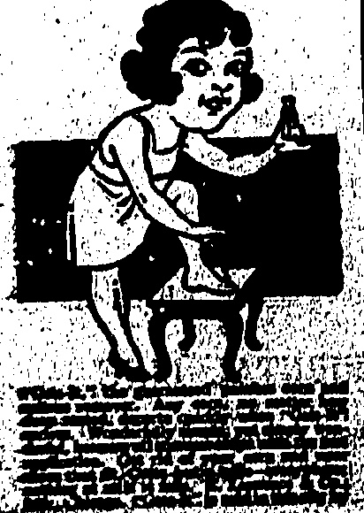
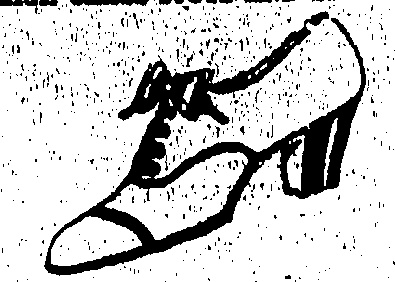

## ཡོད་པའི་ཡོད་པའི་ཡོད་པའི་ཡོད་པའི་ཡོད་པའི་ཡོད་པའི་ཡོད་པའི་ཡོད་པའི་ཡོད་པའི་ཡོད་པའི་ཡོད་པའི་ཡོད་པའི་ཡོད་པའི་ཡོད་པའི་ཡོད་པའི་ཡོད་པའི་ཡོད་པའི་ཡོད་པའི་ཡོད་པའི་ཡོད་པའི་ཡོད་པའི་ཡོད་པའི་ཡོད་པའི་ཡོད་པའི་ཡོད་པའི་ཡོད་པའི་ཡོད་པའི་ཡོད་པའི་ཡོད་པའི་ཡོད་པའི་ཡོད་པའི་ཡོད་པའི་ཡོད་པའི་ཡོད་པའི་ཡོད་པའི་ཡོད་པའི་ཡོད་པའི་ཡོད་པའི་ཡོད་པའི་ཡོད་པའི་ཡོད་པའི་ཡོད་པའི་ཡོད་པའི་ཡོད་པའི་ཡོད་པའི་ཡོད་པའི་ཡོད་པའི་ཡོད་པའི་ཡོད་པའི་ཡོད་པའི་ཡོད་པའི་ཡོད་པའི་ཡོད་པའི་ཡོད་པའི་ཡོད་པའི་ཡོད་པའི་ཡོད་པའི་ཡོད་པའི་ཡོད་པའི་ཡོད་པའི་ཡོད་པའི་ཡོད་པའི་ཡོད་པའི་ཡོད་པའི་ཡོད་པའི་ཡོད་པའི་ཡོད་པའི་ཡོད་པའི་ཡོད་པའི་ཡོད་པའི་ཡོད་པའི་ཡོད་པའི་ཡོད་པའི་ཡོད་པའི་ཡོད་པའི་ཡོད་པའི་ཡོད་པའི་ཡོད་པའི་ཡོད་པའི་ཡོད་པའི་ཡོད་པའི་ཡོད་པའི་ཡོད་པའི་ཡོད་པའི་ཡོད་པའི་ཡོད་པའི་ཡོད་པའི་ཡོད་པའི་ཡོད་པའི་ཡོད་པའི་ཡོད་པའི་ཡོད་པའི་ཡོད་པའི་ཡོད་པའི་ཡོད་པའི་ཡོད་པའི་ཡོད་པའི་ཡོད་པའི་ཡོད་པའི་ཡོད་པའི་ཡོད་པའི་ཡོད་པའི་ཡོད་པའི་ཡོད་པའི་ཡོད་པའི་ཡོད་པའི་ཡོད་པའི་ཡོད་པའི་ཡོད་པའི་ཡོད་པའི་ཡོད་པའི་ཡོད་པའི་ཡོད་པའི་ཡོད་པའི་ཡོད་པའི་ཡོད་པའི་ཡོད་པའི་ཡོད་པའི་ཡོད་པའི་ཡོད་པའི་ཡོད་པའི་ཡོད་པའི་ཡོད་པའི་ཡོད་པའི་ཡོད་པའི་ཡོད་པའི་ཡོད་པའི་ཡོད་པའི་ཡོད་པའི་ཡོད་པའི་ཡོད་པའི་ཡོད་པའི་ཡོད་པའི་ཡོད་པའི་ཡོད་པའི་ཡོད་པའི་ཡོད་པའི་ཡོད་པའི་ཡོད་པའི་ཡོད་པའི་ཡོད་པའི་ཡོད་པའི་ཡོད་པའི་ཡོད་པའི་ཡོད་པའི་ཡོད་པའི་ཡོད་པའི་ཡོད་པའི་ཡོད་པའི་ཡོད་པའི་ཡོད་པའི་ཡོད་པའི་ཡོད་པའི་ཡོད་པའི་ཡོད་པའི་ཡོད་པའི་ཡོད་པའི་ཡོད་པའི་ཡོད་པའི་ཡོད་པའི་ཡོད་པའི་ཡོད་པའི་ཡོད་པའི་ཡོད་པའི་ཡོད་པའི་ཡོད་པའི་ཡོད་པའི་ཡོད་པའི་ཡོད་པའི་ཡོད་པའི་ཡོད་པའི་ཡོད་པའི་ཡོད་པའི་ཡོད་པའི་ཡོད་པའི་ཡོད་པའི་ཡོད་པའི་ཡོད་པའི་ཡོད་པའི་ཡོད་པའི་ཡོད་པའི་ཡོད་པའི་ཡོད་པའི་ཡོད་པའི་ཡོད་པའི་ཡོད་པའི་ཡོད་པའི་ཡོད་པའི་ཡོད་པའི་ཡོད་པའི་ཡོད་པའི་ཡོད་པའི་ཡོད་པའི་ཡོད་པའི་ཡོད་པའི་ཡོད་པའི་ཡོད་པའི་ཡོད་པའི་ཡོད་པའི་ཡོད་པའི་ཡོད་པའི་ཡོད་པའི་ཡོད་པའི་ཡོད་པའི་ཡོད་པའི་ཡོད་པའི་ཡོད་པའི་ཡོད་པའི་ཡོད་པའི་ཡོད་པའི་ཡོད་པའི་ཡོད་པའི་ཡོད་པའི་ཡོད་པའི་ཡོད་པའི་ཡོད་པའི་ཡོད་པའི་ཡོད་པའི་ཡོད་པའི་ཡོད་པའི་ཡོད་པའི་ཡོད་པའི་ཡོད་པའི་ཡོད་པའི་ཡོད་པའི་ཡོད་པའི་ཡོད་པའི་ཡོད་པའི་ཡོད་པའི་ཡོད་པའི་ཡོད་པའི་ཡོད་པའི་ཡོད་པའི་ཡོད་པའི་ཡོད་པའི་ཡོད་པའི་ཡོད་པའི་ཡོད་པའི་ཡོད་པའི་ཡོད་པའི་ཡོད་པའི་ཡོད་པའི་ཡོད་པའི་ཡོད་པའི་ཡོད་པའི་ཡོད་པའི་ཡོད་པའི་ཡོད་པའི་ཡོད་པའི་ཡོད་པའི་ཡོད་པའི་ཡོད་པའི་ཡོད་པའི་ཡོད་པའི་ཡོད་པའི་ཡོད་པའི་ཡོད་པའི་ཡོད་པའི་ཡོད་པའི་ཡོད་པའི་ཡོད་པའི་ཡོད་པའི་ཡོད་པའི་ཡོད་པའི་ཡོད་པའི་ཡོད་པའི་ཡོད་པའི་ཡོད་པའི་ཡོད་པའི་ཡོད་པའི་ཡོད་པའི་ཡོད་པའི་ཡོད་པའི་ཡོད་པའི་ཡོད་པའི་ཡོད་པའི་ཡོད་པའི་ཡོད་པའི་ཡོད་པའི་ཡོད་པའི་ཡོད་པའི་ཡོད་པའི་ཡོད་པའི་ཡོད་པའི་ཡོད་པའི་ཡོད་པའི་ཡོད་པའི་ཡོད་པའི་ཡོད་པའི་ཡོད་པའི་ཡོད་པའི་ཡོད་པའི་ཡོད་པའི་ཡོད་པའི་ཡོད་པའི་ཡོད་པའི་ཡོད་པའི་ཡོད་པའི་ཡོད་པའི་ཡོད་པའི་ཡོད་པའི་ཡོད་པའི་ཡོད་པའི་ཡོད་པའི་ཡོད་པའི་ཡོད་པའི་ཡོད་པའི་ཡོད་པའི་ཡོད་པའི་ཡོད་པའི་ཡོད་པའི་ཡོད་པའི་ཡོད་པའི་ཡོད་པའི་ཡོད་པའི་ཡོད་པའི་ཡོད་པའི་ཡོད་པའི་ཡོད་པའི་ཡོད་པའི་ཡོད་པའི་ཡོད་པའི་ཡོད་པའི་ཡོད་པའི་ཡོད་པའི་ཡོད་པའི་ཡོད་པའི་ཡོད་པའི་ཡོད་པའི་ཡོད་པའི་ཡོད་པའི་ཡོད་པའི་ཡོད་པའི་ཡོད་པའི་ཡོད་པའི་ཡོད་པའི་ཡོད་པའི་ཡོད་པའི་ཡོད་པའི་ཡོད་པའི་ཡོད་པའི་ཡོད་པའི་ཡོད་པའི་ཡོད་པའི་ཡོད་པའི་ཡོད་པའི་ཡོད་པའི་ཡོད་པའི་ཡོད་པའི་ཡོད་པའི་ཡོད་པའི་ཡོད་པའི་ཡོད་པའི་ཡོད་པའི་ཡོད་པའི་ཡོད་པའི་ཡོད་པའི་ཡོད་པའི་ཡོད་པའི་ཡོད་པའི་ཡོད་པའི་ཡོད་པའི་ཡོད་པའི་ཡོད་པའི་ཡོད་པའི་ཡོད་པའི་ཡོད་པའི་ཡོད་པའི་ཡོད་པའི་ཡོད་པའི་ཡོད་པའི་ཡོད་པའི་ཡོད་པའི་ཡོད་པའི་ཡོད་པའི་ཡོད་པའི་ཡོད་པའི་ཡོད་པའི་ཡོད་པའི་ཡོད་པའི་ཡོད་པའི་ཡོད་པའི་ཡོད་པའི་ཡོད་པའི་ཡོད་པའི་ཡོད་པའི་ཡོད་པའི་ཡོད་པའི་ཡོད་པའི་ཡོད་པའི་ཡོད་པའི་ཡོད་པའི་ཡོད་པའི་ཡོད་པའི་ཡོད་པའི་ཡོད་པའི་ཡོད་པའི་ཡོད་པའི་ཡོད་པའི་ཡོད་པའི་ཡོད་པའི་ཡོད་པའི་ཡོད་པའི་ཡོད་པའི་ཡོད་པའི་ཡོད་པའི་ཡོད་པའི་ཡོད་པའི་ཡོད་པའི་ཡོད་པའི་ཡོད་པའི་ཡོད་པའི་ཡོད་པའི་ཡོད་པའི་ཡོད་པའི་ཡོད་པའི་ཡོད་པའི་ཡོད་པའི་ཡོད་པའི་ཡོད་པའི་ཡོད་པའི་ཡོད་པའི་ཡོད་པའི་ཡོད་པའི་ཡོད་པའི་ཡོད་པའི་ཡོད་པའི་ཡོད་པའི་ཡོད་པའི་ཡོད་པའི་ཡོད་པའི་ཡོད་པའི་ཡོད་པའི་ཡོད་པའི་ཡོད་པའི་ཡོད་པའི་ཡོད་པའི་ཡོད་པའི་ཡོད་པའི་ཡོད་པའི་ཡོད་པའི་ཡོད་པའི་ཡོད་པའི་ཡོད་པའི་ཡོད་པའི་ཡོད་པའི་ཡོད་པའི་ཡོད་པའི་ཡོད་པའི་ཡོད་པའི་ཡོད་པའི་ཡོད་པའི་ཡོད་པའི་ཡོད་པའི་ཡོད་པའི་ཡོད་པའི་ཡོད་པའི་ཡོད་པའི་ཡོད་པའི་ཡོད་པའི་ཡོད་པའི་ཡོད་པའི་ཡོད་པའི་ཡོད་པའི་ཡོད་པའི་ཡོད་པའི་ཡོད་པའི་ཡོད་པའི་ཡོད་པའི་ཡོད་པའི་ཡོད་པའི་ཡོད་པའི་ཡོད་པའི་ཡོད་པའི་ཡོད་པའི་ཡོད་པའི་ཡོད་པའི་ཡོད་པའི་ཡོད་པའི་ཡོད་པའི་ཡོད་པའི་ཡོད་པའི་ཡོད་པའི་ཡོད་པའི་ཡོད་པའི་ཡོད་པའི་ཡོད་པའི་ཡོད་པའི་ཡོད་པའི་ཡོད་པའི་ཡོད་པའི་ཡོད་པའི་ཡོད་པའི་ཡོད་པའི་ཡོད་པའི་ཡོད་པའི་ཡོད་པའི་ཡོད་པའི་ཡོད་པའི་ཡོད་པའི་ཡོད་པའི་ཡོད་པའི་ཡོད་པའི་ཡོད་པའི་ཡོད་པའི་ཡོད་པའི་ཡོད་པའི་ཡོད་པའི་ཡོད་པའི་ཡོད་པའི་ཡོད་པའི་ཡོད་པའི་ཡོད་པའི་ཡོད་པའི་ཡོད་པའི་ཡོད་པའི་ཡོད་པའི་ཡོད་པའི་ཡོད་པའི་ཡོད་པའི་ཡོད་པའི་ཡོད་པའི་ཡོད་པའི་ཡོད་པའི་ཡོད་པའི་ཡོད་པའི་ཡོད་པའི་ཡོད་པའི་ཡོད་པའི་ཡོད་པའི་ཡོད་པའི་ཡོད་པའི་ཡོད་པའི་ཡོད་པའི་ཡོད་པའི་ཡོད་པའི་ཡོད་པའི་ཡོད་པའི་ཡོད་པའི་ཡོད་པའི་ཡོད་པའི་ཡོད་པའི་ཡོད་པའི་ཡོད་པའི་ཡོད་པའི་ཡོད་པའི་ཡོད་པའི་ཡོད་པའི་ཡོད་པའི་ཡོད་པའི་ཡོད་པའི་ཡོད་པའི་ཡོད་པའི་ཡོད་པའི་ཡོད་པའི་ཡོད་པའི་ཡོད་པའི་ཡོད་པའི་ཡོད་པའི་ཡོད་པའི་ཡོད་པའི་ཡོད་པའི་ཡོད་པའི་ཡོད་པའི་ཡོད་པའི་ཡོད་པའི་ཡོད་པའི་ཡོད་པའི་ཡོད་པའི་ཡོད་པའི་ཡོད་པའི་ཡོད་པའི་ཡོད་པའི་ཡོད་པའི་ཡོད་པའི་ཡོད་པའི་ཡོད་པའི་ཡོད་པའི་ཡོད་པའི་ཡོད་པའི་ཡོད་པའི་ཡོད་པའི་ཡོད་པའི་ཡོད་པའི་ཡོད་པའི་�

Frozen by A J. A. Ottenau's Improved Patented με 'host which preserves its origin! flavour and qualities. Once tasted always appropriated. Flesh firm as fresh

To be obtained, only from KWONG LOONG

Uompradore.

65, Des Voaux Road O. Tel. -0.128.

Sole agent for Hongkong for

THE CHINA REFRIGERATING & INVESTMENT COMPANY, LTD.

and also —

from

THE DAIRY FARM ICE & COLD STORAGE CO., LTD.

## 1 

## JUST ARRIVED A Consignment of

CHEESE, CAMEMBERT CHEESE, SAUCISSON DE LYON, BONELESS SARDINES IN OIL.

CYRANO...(Hors D'Oeuvre)

ANCHOVIES IN OIL.

SALTED HERRINGS AND BLACK OLIVES.

No. 9, Beaconsfield Arcade.

Tel. Central 784.

＃＃＃

## INTIMATIONS

## INSURANCE OFFICES

WHIT MONDAY AND KING'S BIRTHDAY HOLIDAYS.

NOTICE IS HEREBY GIVEN that all FIRE and MARINE INSURANCE OFFICES will be CLOSED for the Transaction of Public Business on MONDAY, 1st, and WEDNESDAY, 3rd June, 1925.

LOWE, BINGHAM & MATTHEWS.

FILE INSURANCE ASSOCIATION OF HONOKONO.

MARINE INSURANCE ASSOCIATION OF HONOKONO & CANTON.

## BANK HOLIDAY

IN Accordance with Ordinance No.5 of 1912, the EXCHANGE BANKS will be closed for the transaction of PUBLIC BUSINESS on WEDNESDAY, the 3rd. June.

Hongkong, 30th May, 1925

## NOTICE

THE PUBLIC is hereby notified that on and after TUESDAY, June 2nd the following fast trains on Sundays and Public Holidays will be discontinued.

8.35 a.m. Kowloon to Shum Chun

5.20 p.m. Shum Chun to Kowloon

H. P. WINSLOW.

KOWLOON-CANTON RAILWAY.

Kowloon, 30th May, 1925.

## NOTICE

DURING the absence on leave of the undersigned notice is hereby given that Mr. ColIN MALCOLM MCDONALD will act as Managing Editor of the "China Mail."

G. W. C. BURNETT, Chairman of Directors, Newspaper Enterprise, Ltd. Hongkong, May 28.

# Easy! Quick! “Gets-It” for Corns

ADVERTISEMENTS

With it, it wasू the most important thing was to find the same way. Any way, we might have found some way to find the same way. We had to go to the same way. We had to go to

31. PREPAID

Every additional word & Com

for 8 insertions.

## PRIVATE BOARD:

PRIVATE BOARD RESIDENCE with quiet British family.

1. Victoria Gardens, Kowloon. 1 minute from ferry. Next door new hotel. Terms very moderate.

TO LET.—Two Godowns, or shops, in DUDDELL STREET For Particulars apply to:—H. Ruttonjee & Sou, 16, Queen's Road.

TO LET—1st July, THE BLARNEY STONE, Victoria Road, 7 small-roomed house, close to sea, garage, flush, telephone, electric and gas fittings, 20 minutes' walk from Kennedy Town tram. terminus. Please apply Post Office Box 42.

NEW AND SECOND HAND

Communicate Capt. J. R PATRICK.

## INTIMATIONS

NDO-CHINA STEAM NAVIGATION COMPANY LIMITED.

THE FORTY-FOURTH ORDINARY GENERAL MELTING of the Company will be held at the Office of the General Managers, Messrs. J. Jidine, Matheson & Co., Ltd., Pedder Street, Hongkong on WEDNESDAY, the 10th June, 1925, at 11 o'clock in the morning for the purpose of receiving the report of the Directors, passing the Accounts, and electing Directors and auditors.

THE TRANSFER BOOKS of the Company will be closed from the 3rd to 24th June, 1925, both days inclusive.

By Order of the Board,

JARDINE, MATEESON & CO., LTD.

General Manager

Hongkong,

Uenerai managero

19th May, 1925

### PEAK TRAMWAYS CO., LTD

NOTICE IS HEREBY GIVEN that the Annual Ordinary General Meeting of shareholders of the above Company will be held at the Hongkong Hotel, Hongkong, on MONDAY, 8th June, 1925, at 11 a.m. for the purpose of receiving the report of the Directors together with a Statement of Accounts for the year ended 30th April 1925.

The Transfer Books of the Company will be closed from WEDNESDAY, 3rd June to TUESDAY, 9th June 1925 both days inclusive.

JOHN D. HUMPHREYS & SON.

General Managers.

Hongkong, 29th May, 1925.

THE HALF YEARLY GENERAL MEETING of Members will be held on SATURDAY, 6th June, 1925, at 12.30 p.m. in the Jockey Club Room. Hongkong Club Annex.

Hongkong, 22nd May, 1925.

## FOR ANEURISM, CANCER ETC

A new medicine for the cure of anurism, Cancer and Carbuncle by injection and Internal use.

Most physicians and surgeons have expressed the opinion that Anaerism, Cancer and Carbancils are incurable and many deaths have been earned by these dredd disasters. Dr. T. Metschdita, M.E., Professor of the Japanese Imperial University has made a careful study of these diseases for several years and has at least discovered the use of "CARBOINOLYBIN" for injection and internal use. Alarge number of Japanese patients have been cured by the use of this medicine and it is now becoming well known for its curative properties.

Foreigners have always died of these dis-

Of late Dr. Sun Yat Sen is suffering from cancer of the liver which is a phase of one of the above-mentioned diseases. Those suffering from this disease will gradually develop from nervous pains, urinary troubles, bad appetite, dysentery and vomiting.

Vietnam of this disease are advised to immediately procure "OABGENOLKESUN" from our agents and by taking this internally, or by injection, the progress of the disease will be formed and results quickly obtained.

Glades will disappear and swollen

lions to mined to a minimum quickly and

only by the use of "CARCOINOLMIN"

These having hereditary disease are involved

to take "CARCOINOLTHIN" in order to seek

to provide

This medicine is the result of long experiment and has no significant effect on them taking it. Our Agenda see:

Mamara Wing Chong 79, Dan Yourr Road W,

Mamara, Dinal Cheong Dispensary.

Maxam MAXAMURA

MASSAGE

No. 51 Donner Road Central,

1000 HONGKONG

## HIGH CLANS BOOTS AND KHOS

### MR. GODFREY ISAACS

GREAT ORGANISER AND ADMINISTRATOR.

KILLED BY OVERWORK.

Mr. Godfrey Charles Isaacs, whose death, at the age of 59, is announced, was a brother of the Earl of Reading, Viceroy of India, and possessed the same remarkable energy and almost unlimited capacity for work. It was, indeed, his very energy that brought about his death at a comparatively early age, for he died a victim to overwork. The fourth son of Joseph M. Isaacs, the head of a London firm of fruit and ship brokers, he was educated at Eton and at Brussels and Hanover Universities, after which he joined his father's firm. His activities entailed a good deal of Continental travel and he acquired a wide knowledge of foreign affairs and languages, as well as of the intricacies of modern business methods.

After his retirement from the firm, Mr. Isaacs interested himself in business at home and abroad, and his remarkable powers of organisation and administration induced Mr. Marconi in 1910 to offer him the post of managing director of Marconi's Wireless Telephone Company, Limited.

Mr. Isaacs accepted, and under his energetic direction the company rapidly expanded into an organisation of world-wide importance. The signature of contracts with the British Government made it, indeed, in a sense a national institution.

## TIRELESS ENERGY

But the evolution and direction of a great commercial undertaking—which brought him many personal triumphs—imposed a strain that could not be borne indefinitely even by a man of his almost tireless energy. He had been in the habit of working 14 hours a day, and during the Great War an additional strain was imposed on him as the directing force of a system of communications of vital importance to Britain and to her Allies.

For years Mr. Isaacs had sacrificed his personal leisure, his recreation—he was a great lover of music—and his health to the keen sense of duty that kept him at his desk, and he confessed that for 43 years he had not taken a holiday.

"G. C. I. was a genius," is the opinion of one who was closely associated with him. But he possessed also that capacity for translating his genius into action which has marked so many of the world's successful men.

For some years his health had been causing anxiety to his friends, and in November last it gave way completely. He resigned the managing directorship of the company and was succeeded by Mr. F.G. Kellaway, a former Postmaster-General.

“I ought to have known what would be the inevitable result,” he said, recalling his strenuous years of work. “If I had allowed myself a proper amount of rest and recreation, and had taken my golf regularly, I believe I could have gone on for a long time. It is a mistake to pursue work to the exclusion of everything else. In all the years I have been in business I have never gone home without a great pile of correspondence to attend to, and even at home urgent telegrams and telephone calls follow me.”

He retired to the country to rest, play golf, and enjoy his favourite hobby, music.

"All I want for the moment is sleep, rest, and peace. I may not be away a year. With sunshine and sleep my restoration to health may be merely a matter of months."

But he had left his rest too late. Mr. Isaacs leaves two sons. Mrs. Isaacs, as Mme. Lea Perelli, was prominent some years ago as an operatic artist. Among other parts she sang Santuzza in "Cavalleria Rusticana" at the London Opera House.

TAKE THIS BEFORE GOING.

Do you want to be the author of the person whose coughing at church, comment, claims? to debate. Let's out the word we most want to keep. Change. Explain. Though Readily help these unbearred eyes quickly puts all you so enough to keep the thing out. For

# HONGKONG MARKET PRODUCE.

## Butcher Meat

## APPROXIMATE RETAIL PRICES

## Reef Sirloin—Ngau Moi Pa

Prime Cut

Corned—Ham Ngau Yuk

Roast—Shiu Ngau Yuk

Breast—Ngau Hung

Soup—Tong Yuk

Steak—Ngau Yuk Pa

Steak Stirloin—Ngau Lau

Sausages—Ngau Choung

Sullock's Brains—Ngau No

Tonguo, fresh—Ngau Li

Tons

Mutton Chop—Yeung Fei Kwat

Leg—Yeung Pei

Shoulder—Yeung Kin

Saddle—Yeung On Yuk

Pig's Chitlings—Chu Chong

Brains—Chu No

Feet—Chu Keuk

Fry—Chu Chap

Head—Chu Tau

Heart—Chu Sam

Kidneys—Chu Yiu

Liver—Chu Kon

Pork Chop—Chu Pai Kwat

Leg—Chu Pei

Loin—Chu Hau Tun

Fat or Lard—Chu Yau

Sheep's Head & Feet—Yeung Tau-Keuk

Heart—Yeung Sam

Kidneys—Yeung Yiu

Liver—Yeung Kon

Sucking Pigs, to order—Chu Tsai

Suet, Beef—Shang Ngau Yau

Mutton—Shang Yeung Yau

Veal—Ngau Tsai Yuk

Sausages—Ngau Tsai Cheung

Barbel—Ka Yu

Bream—Pin Yu

Canton Fresh Water Fish—Hoi Sin

Yu

Carp—Li Yu

Catfish—Chik Yu

Codfish—Mun Yu

Crab—Hai

Cuttle Fish—Muk Yu

Dab—Sha Mang Yu

Dace—Wong Mei Lan

Dog Fish—Tit To Sha

Eels, Conger—Hoi Man

Fresh water—Tam Shui Yu

Yellow—Wong Sin

Frogs—Tin Kai

Garoupa—Shek Pan

Gudgeon—Pak Kap Yu

Herrings—Tso Pak

Halibut—Cheung Kwan Kap

Labrus—Wong Fa Yu

Loach—Wu Yu

Lobsters—Lung Ha

Mackerel—Chi Yu

Monk Fish—Mong Yu

Mullet—Tsai Yu

Oysters—Shang Ho

Parrot Fish—Kai Kung Yu

Perch—Tau Lo

Pike—Fa Pau Fong

Plaice—Pan Yu

Pombret, Black—Hak Chong

Pomfrot, White—Pak Chong

Prawns—Ming Ha

Ray—Pai Pa Sha

Rock Fish—Shek Kau Kung

Roach—Chun Yu

Salmon—Ma Yau

Shark—Sha Yu

Skate—Po Yu

Shrimps—Ha

Snapper—Lap Yu

Soles—Tat Sha Yu

Tench—Wan Yu

Turbot—Tso Han Yu

Tutles, small, fresh water—Kouk Yu

<table border=1 style='margin: auto; word-wrap: break-word;'><tr><td style='text-align: center; word-wrap: break-word;'></td><td style='text-align: center; word-wrap: break-word;'>May 27, 1925</td><td style='text-align: center; word-wrap: break-word;'>June, 1918</td><td style='text-align: center; word-wrap: break-word;'>June, 1914</td></tr><tr><td style='text-align: center; word-wrap: break-word;'></td><td style='text-align: center; word-wrap: break-word;'>Cts.</td><td style='text-align: center; word-wrap: break-word;'>Cts.</td><td style='text-align: center; word-wrap: break-word;'>Cts.</td></tr><tr><td style='text-align: center; word-wrap: break-word;'>牛 尼 把</td><td style='text-align: center; word-wrap: break-word;'>lb. 30</td><td style='text-align: center; word-wrap: break-word;'>24</td><td style='text-align: center; word-wrap: break-word;'>12</td></tr><tr><td style='text-align: center; word-wrap: break-word;'></td><td style='text-align: center; word-wrap: break-word;'>30</td><td style='text-align: center; word-wrap: break-word;'>24</td><td style='text-align: center; word-wrap: break-word;'>12</td></tr><tr><td style='text-align: center; word-wrap: break-word;'>成 牛 肉</td><td style='text-align: center; word-wrap: break-word;'>,,</td><td style='text-align: center; word-wrap: break-word;'>28</td><td style='text-align: center; word-wrap: break-word;'>20</td></tr><tr><td style='text-align: center; word-wrap: break-word;'>烧 牛 肉</td><td style='text-align: center; word-wrap: break-word;'>,,</td><td style='text-align: center; word-wrap: break-word;'>24</td><td style='text-align: center; word-wrap: break-word;'>22</td></tr><tr><td style='text-align: center; word-wrap: break-word;'>牛 脯</td><td style='text-align: center; word-wrap: break-word;'>,,</td><td style='text-align: center; word-wrap: break-word;'>24</td><td style='text-align: center; word-wrap: break-word;'>18</td></tr><tr><td style='text-align: center; word-wrap: break-word;'>汤 肉</td><td style='text-align: center; word-wrap: break-word;'>,,</td><td style='text-align: center; word-wrap: break-word;'>24</td><td style='text-align: center; word-wrap: break-word;'>18</td></tr><tr><td style='text-align: center; word-wrap: break-word;'>牛 肉 排</td><td style='text-align: center; word-wrap: break-word;'>,,</td><td style='text-align: center; word-wrap: break-word;'>29</td><td style='text-align: center; word-wrap: break-word;'>22</td></tr><tr><td style='text-align: center; word-wrap: break-word;'>牛 肉 柳</td><td style='text-align: center; word-wrap: break-word;'>,,</td><td style='text-align: center; word-wrap: break-word;'>38</td><td style='text-align: center; word-wrap: break-word;'>35</td></tr><tr><td style='text-align: center; word-wrap: break-word;'>牛 牛 肠</td><td style='text-align: center; word-wrap: break-word;'>,,</td><td style='text-align: center; word-wrap: break-word;'>20</td><td style='text-align: center; word-wrap: break-word;'>20</td></tr><tr><td style='text-align: center; word-wrap: break-word;'>牛 牛 肠</td><td style='text-align: center; word-wrap: break-word;'>per,set</td><td style='text-align: center; word-wrap: break-word;'>12</td><td style='text-align: center; word-wrap: break-word;'>12</td></tr><tr><td style='text-align: center; word-wrap: break-word;'>牛 牛 肠 肝</td><td style='text-align: center; word-wrap: break-word;'>each</td><td style='text-align: center; word-wrap: break-word;'>60</td><td style='text-align: center; word-wrap: break-word;'>60</td></tr><tr><td style='text-align: center; word-wrap: break-word;'>牛 牛 肝 肝</td><td style='text-align: center; word-wrap: break-word;'>,,</td><td style='text-align: center; word-wrap: break-word;'>$1.00</td><td style='text-align: center; word-wrap: break-word;'>$1.20</td></tr><tr><td style='text-align: center; word-wrap: break-word;'>牛 牛 肝 肝 胆</td><td style='text-align: center; word-wrap: break-word;'>,,</td><td style='text-align: center; word-wrap: break-word;'>$1.00</td><td style='text-align: center; word-wrap: break-word;'>$1.20</td></tr><tr><td style='text-align: center; word-wrap: break-word;'>牛 牛 肝 胆 心 用 胆</td><td style='text-align: center; word-wrap: break-word;'>lb.</td><td style='text-align: center; word-wrap: break-word;'>16</td><td style='text-align: center; word-wrap: break-word;'>14</td></tr><tr><td style='text-align: center; word-wrap: break-word;'>牛 牛 肝 胆 胆 胆</td><td style='text-align: center; word-wrap: break-word;'>,,</td><td style='text-align: center; word-wrap: break-word;'>24</td><td style='text-align: center; word-wrap: break-word;'>18</td></tr><tr><td style='text-align: center; word-wrap: break-word;'>牛 牛 肝 胆 肝 肝</td><td style='text-align: center; word-wrap: break-word;'>each</td><td style='text-align: center; word-wrap: break-word;'>12</td><td style='text-align: center; word-wrap: break-word;'>12</td></tr><tr><td style='text-align: center; word-wrap: break-word;'>牛 牛 肝 肝 肝 肚</td><td style='text-align: center; word-wrap: break-word;'>,,</td><td style='text-align: center; word-wrap: break-word;'>12</td><td style='text-align: center; word-wrap: break-word;'>12</td></tr><tr><td style='text-align: center; word-wrap: break-word;'>牛 牛 肝 肚</td><td style='text-align: center; word-wrap: break-word;'>,,</td><td style='text-align: center; word-wrap: break-word;'>22</td><td style='text-align: center; word-wrap: break-word;'>22</td></tr><tr><td style='text-align: center; word-wrap: break-word;'>牛 牛 肝 肚</td><td style='text-align: center; word-wrap: break-word;'>lb.</td><td style='text-align: center; word-wrap: break-word;'>16</td><td style='text-align: center; word-wrap: break-word;'>14</td></tr><tr><td style='text-align: center; word-wrap: break-word;'>牛 牛 肝 肚</td><td style='text-align: center; word-wrap: break-word;'>,,</td><td style='text-align: center; word-wrap: break-word;'>6</td><td style='text-align: center; word-wrap: break-word;'>7</td></tr></table>

<table border=1 style='margin: auto; word-wrap: break-word;'><tr><td style='text-align: center; word-wrap: break-word;'>牛肝</td><td style='text-align: center; word-wrap: break-word;'>牛羊</td></tr></table>

Fish.

<table border=1 style='margin: auto; word-wrap: break-word;'><tr><td style='text-align: center; word-wrap: break-word;'>24</td><td style='text-align: center; word-wrap: break-word;'>16</td><td style='text-align: center; word-wrap: break-word;'>16</td><td style='text-align: center; word-wrap: break-word;'>27</td><td style='text-align: center; word-wrap: break-word;'>9</td><td style='text-align: center; word-wrap: break-word;'>25</td><td style='text-align: center; word-wrap: break-word;'>26</td><td style='text-align: center; word-wrap: break-word;'>2</td><td style='text-align: center; word-wrap: break-word;'>16</td><td style='text-align: center; word-wrap: break-word;'>9</td><td style='text-align: center; word-wrap: break-word;'>8</td><td style='text-align: center; word-wrap: break-word;'>18</td><td style='text-align: center; word-wrap: break-word;'>30</td><td style='text-align: center; word-wrap: break-word;'>25</td><td style='text-align: center; word-wrap: break-word;'>30</td><td style='text-align: center; word-wrap: break-word;'>15</td><td style='text-align: center; word-wrap: break-word;'>18</td><td style='text-align: center; word-wrap: break-word;'>23</td><td style='text-align: center; word-wrap: break-word;'>18</td><td style='text-align: center; word-wrap: break-word;'>24</td><td style='text-align: center; word-wrap: break-word;'>21</td><td style='text-align: center; word-wrap: break-word;'>26</td><td style='text-align: center; word-wrap: break-word;'>28</td><td style='text-align: center; word-wrap: break-word;'>2</td><td style='text-align: center; word-wrap: break-word;'>9</td><td style='text-align: center; word-wrap: break-word;'>15</td><td style='text-align: center; word-wrap: break-word;'>9</td><td style='text-align: center; word-wrap: break-word;'>14</td><td style='text-align: center; word-wrap: break-word;'>29</td><td style='text-align: center; word-wrap: break-word;'>30</td><td style='text-align: center; word-wrap: break-word;'>45</td><td style='text-align: center; word-wrap: break-word;'>14</td><td style='text-align: center; word-wrap: break-word;'>18</td><td style='text-align: center; word-wrap: break-word;'>16</td><td style='text-align: center; word-wrap: break-word;'>30</td><td style='text-align: center; word-wrap: break-word;'>10</td><td style='text-align: center; word-wrap: break-word;'>35</td><td style='text-align: center; word-wrap: break-word;'>30</td><td style='text-align: center; word-wrap: break-word;'>28</td><td style='text-align: center; word-wrap: break-word;'>18</td><td style='text-align: center; word-wrap: break-word;'>12</td><td style='text-align: center; word-wrap: break-word;'>-</td><td style='text-align: center; word-wrap: break-word;'></td><td style='text-align: center; word-wrap: break-word;'></td><td style='text-align: center; word-wrap: break-word;'></td></tr><tr><td style='text-align: center; word-wrap: break-word;'>19</td><td style='text-align: center; word-wrap: break-word;'>20</td><td style='text-align: center; word-wrap: break-word;'>18</td><td style='text-align: center; word-wrap: break-word;'>16</td><td style='text-align: center; word-wrap: break-word;'>12</td><td style='text-align: center; word-wrap: break-word;'>20</td><td style='text-align: center; word-wrap: break-word;'>23</td><td style='text-align: center; word-wrap: break-word;'>16</td><td style='text-align: center; word-wrap: break-word;'>23</td><td style='text-align: center; word-wrap: break-word;'>10</td><td style='text-align: center; word-wrap: break-word;'>16</td><td style='text-align: center; word-wrap: break-word;'>20</td><td style='text-align: center; word-wrap: break-word;'>26</td><td style='text-align: center; word-wrap: break-word;'>32</td><td style='text-align: center; word-wrap: break-word;'>40</td><td style='text-align: center; word-wrap: break-word;'>18</td><td style='text-align: center; word-wrap: break-word;'>22</td><td style='text-align: center; word-wrap: break-word;'>18</td><td style='text-align: center; word-wrap: break-word;'>22</td><td style='text-align: center; word-wrap: break-word;'>22</td><td style='text-align: center; word-wrap: break-word;'>32</td><td style='text-align: center; word-wrap: break-word;'>20</td><td style='text-align: center; word-wrap: break-word;'>32</td><td style='text-align: center; word-wrap: break-word;'>18</td><td style='text-align: center; word-wrap: break-word;'>16</td><td style='text-align: center; word-wrap: break-word;'>14</td><td style='text-align: center; word-wrap: break-word;'>20</td><td style='text-align: center; word-wrap: break-word;'>16</td><td style='text-align: center; word-wrap: break-word;'>28</td><td style='text-align: center; word-wrap: break-word;'>26</td><td style='text-align: center; word-wrap: break-word;'>36</td><td style='text-align: center; word-wrap: break-word;'>10</td><td style='text-align: center; word-wrap: break-word;'>18</td><td style='text-align: center; word-wrap: break-word;'>22</td><td style='text-align: center; word-wrap: break-word;'>36</td><td style='text-align: center; word-wrap: break-word;'>8</td><td style='text-align: center; word-wrap: break-word;'>10</td><td style='text-align: center; word-wrap: break-word;'>26</td><td style='text-align: center; word-wrap: break-word;'>32</td><td style='text-align: center; word-wrap: break-word;'>28</td><td style='text-align: center; word-wrap: break-word;'>22</td><td style='text-align: center; word-wrap: break-word;'>18</td><td style='text-align: center; word-wrap: break-word;'>40</td><td style='text-align: center; word-wrap: break-word;'></td><td style='text-align: center; word-wrap: break-word;'></td></tr><tr><td style='text-align: center; word-wrap: break-word;'>30</td><td style='text-align: center; word-wrap: break-word;'>26</td><td style='text-align: center; word-wrap: break-word;'>32</td><td style='text-align: center; word-wrap: break-word;'>42</td><td style='text-align: center; word-wrap: break-word;'>45</td><td style='text-align: center; word-wrap: break-word;'>32</td><td style='text-align: center; word-wrap: break-word;'>50</td><td style='text-align: center; word-wrap: break-word;'>23</td><td style='text-align: center; word-wrap: break-word;'>55</td><td style='text-align: center; word-wrap: break-word;'>20</td><td style='text-align: center; word-wrap: break-word;'>10</td><td style='text-align: center; word-wrap: break-word;'>35</td><td style='text-align: center; word-wrap: break-word;'>30</td><td style='text-align: center; word-wrap: break-word;'>45</td><td style='text-align: center; word-wrap: break-word;'>56</td><td style='text-align: center; word-wrap: break-word;'>72</td><td style='text-align: center; word-wrap: break-word;'>20</td><td style='text-align: center; word-wrap: break-word;'>26</td><td style='text-align: center; word-wrap: break-word;'>30</td><td style='text-align: center; word-wrap: break-word;'>36</td><td style='text-align: center; word-wrap: break-word;'>84</td><td style='text-align: center; word-wrap: break-word;'>60</td><td style='text-align: center; word-wrap: break-word;'>32</td><td style='text-align: center; word-wrap: break-word;'>46</td><td style='text-align: center; word-wrap: break-word;'>26</td><td style='text-align: center; word-wrap: break-word;'>30</td><td style='text-align: center; word-wrap: break-word;'>24</td><td style='text-align: center; word-wrap: break-word;'>26</td><td style='text-align: center; word-wrap: break-word;'>22</td><td style='text-align: center; word-wrap: break-word;'>40</td><td style='text-align: center; word-wrap: break-word;'>32</td><td style='text-align: center; word-wrap: break-word;'>86</td><td style='text-align: center; word-wrap: break-word;'>75</td><td style='text-align: center; word-wrap: break-word;'>10</td><td style='text-align: center; word-wrap: break-word;'>30</td><td style='text-align: center; word-wrap: break-word;'>40</td><td style='text-align: center; word-wrap: break-word;'>65</td><td style='text-align: center; word-wrap: break-word;'>12</td><td style='text-align: center; word-wrap: break-word;'>16</td><td style='text-align: center; word-wrap: break-word;'>50</td><td style='text-align: center; word-wrap: break-word;'>48</td><td style='text-align: center; word-wrap: break-word;'>36</td><td style='text-align: center; word-wrap: break-word;'>38</td><td style='text-align: center; word-wrap: break-word;'>32</td><td style='text-align: center; word-wrap: break-word;'></td></tr><tr><td style='text-align: center; word-wrap: break-word;'>1b</td><td style='text-align: center; word-wrap: break-word;'>&quot; &quot;</td><td style='text-align: center; word-wrap: break-word;'>&quot;</td><td style='text-align: center; word-wrap: break-word;'>&quot;</td><td style='text-align: center; word-wrap: break-word;'>&quot;</td><td style='text-align: center; word-wrap: break-word;'>&quot;</td><td style='text-align: center; word-wrap: break-word;'>&quot;</td><td style='text-align: center; word-wrap: break-word;'>&quot;</td><td style='text-align: center; word-wrap: break-word;'>&quot;</td><td style='text-align: center; word-wrap: break-word;'>&quot;</td><td style='text-align: center; word-wrap: break-word;'>&quot;</td><td style='text-align: center; word-wrap: break-word;'>&quot;</td><td style='text-align: center; word-wrap: break-word;'>&quot;</td><td style='text-align: center; word-wrap: break-word;'>&quot;</td><td style='text-align: center; word-wrap: break-word;'>&quot;</td><td style='text-align: center; word-wrap: break-word;'>&quot;</td><td style='text-align: center; word-wrap: break-word;'>&quot;</td><td style='text-align: center; word-wrap: break-word;'>&quot;</td><td style='text-align: center; word-wrap: break-word;'>&quot;</td><td style='text-align: center; word-wrap: break-word;'>&quot;</td><td style='text-align: center; word-wrap: break-word;'>&quot;</td><td style='text-align: center; word-wrap: break-word;'>&quot;</td><td style='text-align: center; word-wrap: break-word;'>&quot;</td><td style='text-align: center; word-wrap: break-word;'>&quot;</td><td style='text-align: center; word-wrap: break-word;'>&quot;</td><td style='text-align: center; word-wrap: break-word;'>&quot;</td><td style='text-align: center; word-wrap: break-word;'>&quot;</td><td style='text-align: center; word-wrap: break-word;'>&quot;</td><td style='text-align: center; word-wrap: break-word;'>&quot;</td><td style='text-align: center; word-wrap: break-word;'>&quot;</td><td style='text-align: center; word-wrap: break-word;'>&quot;</td><td style='text-align: center; word-wrap: break-word;'>&quot;</td><td style='text-align: center; word-wrap: break-word;'>&quot;</td><td style='text-align: center; word-wrap: break-word;'>&quot;</td><td style='text-align: center; word-wrap: break-word;'>&quot;</td><td style='text-align: center; word-wrap: break-word;'>&quot;</td><td style='text-align: center; word-wrap: break-word;'>&quot;</td><td style='text-align: center; word-wrap: break-word;'>&quot;</td><td style='text-align: center; word-wrap: break-word;'>&quot;</td><td style='text-align: center; word-wrap: break-word;'>&quot;</td><td style='text-align: center; word-wrap: break-word;'>&quot;</td><td style='text-align: center; word-wrap: break-word;'>&quot;</td><td style='text-align: center; word-wrap: break-word;'>&quot;</td><td style='text-align: center; word-wrap: break-word;'>&quot;</td><td style='text-align: center; word-wrap: break-word;'>$1.20</td></tr><tr><td colspan="45">淡水鮃</td></tr><tr><td style='text-align: center; word-wrap: break-word;'>魚魚城海魚魚魚魚</td><td style='text-align: center; word-wrap: break-word;'></td><td style='text-align: center; word-wrap: break-word;'></td><td style='text-align: center; word-wrap: break-word;'></td><td style='text-align: center; word-wrap: break-word;'></td><td style='text-align: center; word-wrap: break-word;'></td><td style='text-align: center; word-wrap: break-word;'></td><td style='text-align: center; word-wrap: break-word;'></td><td style='text-align: center; word-wrap: break-word;'></td><td style='text-align: center; word-wrap: break-word;'></td><td style='text-align: center; word-wrap: break-word;'></td><td style='text-align: center; word-wrap: break-word;'></td><td style='text-align: center; word-wrap: break-word;'></td><td style='text-align: center; word-wrap: break-word;'></td><td style='text-align: center; word-wrap: break-word;'></td><td style='text-align: center; word-wrap: break-word;'></td><td style='text-align: center; word-wrap: break-word;'></td><td style='text-align: center; word-wrap: break-word;'></td><td style='text-align: center; word-wrap: break-word;'></td><td style='text-align: center; word-wrap: break-word;'></td><td style='text-align: center; word-wrap: break-word;'></td><td style='text-align: center; word-wrap: break-word;'></td><td style='text-align: center; word-wrap: break-word;'></td><td style='text-align: center; word-wrap: break-word;'></td><td style='text-align: center; word-wrap: break-word;'></td><td style='text-align: center; word-wrap: break-word;'></td><td style='text-align: center; word-wrap: break-word;'></td><td style='text-align: center; word-wrap: break-word;'></td><td style='text-align: center; word-wrap: break-word;'></td><td style='text-align: center; word-wrap: break-word;'></td><td style='text-align: center; word-wrap: break-word;'></td><td style='text-align: center; word-wrap: break-word;'></td><td style='text-align: center; word-wrap: break-word;'></td><td style='text-align: center; word-wrap: break-word;'></td><td style='text-align: center; word-wrap: break-word;'></td><td style='text-align: center; word-wrap: break-word;'></td><td style='text-align: center; word-wrap: break-word;'></td><td style='text-align: center; word-wrap: break-word;'></td><td style='text-align: center; word-wrap: break-word;'></td><td style='text-align: center; word-wrap: break-word;'></td><td style='text-align: center; word-wrap: break-word;'></td><td style='text-align: center; word-wrap: break-word;'></td><td style='text-align: center; word-wrap: break-word;'></td><td style='text-align: center; word-wrap: break-word;'></td><td style='text-align: center; word-wrap: break-word;'></td></tr></table>

## TYPHOON SEASUN

## Poultry

Almonds-Hang Yan

Apples (California), Kam Shan Ping Ko

Banana (bride's), Macao-San Heng

Chicken—Kai

Capons, Small—Sin Kai

Capons, Large—Sin Kai

Duck—Ap

Doves—Pan Kau

Eggs, Hen—Kai Tan (cooking)

Eggs, Hen—Kai Tan (fresh)

Fowls, Canton—Kai

Fowls, Halman—Hoi Nam Kai

Goose—Ngo

Pigeons, Canton—Pak Kap, Holhow—Hol Sau Kap Kap

Turkeys, Cock—Fo Kai Kung

Turkeys, Hen—Fo Kai Na

Snipe—Sha Tsui

Pheasant—Shan Kai

Quail—Om Chun

Partridges—Che Ku

## Fruits

June 0800, 0600, 000, 2200, 1.00 in China dead time 11 a.m., 2 p.m., 6 p.m., 8 a.m. (following day).

The following is a copy of a circular letter which has been sent to masters of Shanghai vessels by The Rev. Father L. Proc. S.J., Director of Sicavwei Observatory

Chiu Carambola—Young To Cocoanuts—Ye Tso Lemons, China—Ning Mung Lemons (America) Kam Shan Ning Mung Lichees, Dried (small stone) Lai Chi Kon Oranges (Canton), Sweet—Shan-sheng

## ACTIVITY OF SICCAWEI OBSERVATORY

<table border=1 style='margin: auto; word-wrap: break-word;'><tr><td style='text-align: center; word-wrap: break-word;'></td><td style='text-align: center; word-wrap: break-word;'>May 27</td><td style='text-align: center; word-wrap: break-word;'>June</td><td style='text-align: center; word-wrap: break-word;'>June.</td></tr><tr><td style='text-align: center; word-wrap: break-word;'></td><td style='text-align: center; word-wrap: break-word;'>1925.</td><td style='text-align: center; word-wrap: break-word;'>1918.</td><td style='text-align: center; word-wrap: break-word;'>1914.</td></tr><tr><td style='text-align: center; word-wrap: break-word;'></td><td style='text-align: center; word-wrap: break-word;'>Cts.</td><td style='text-align: center; word-wrap: break-word;'>Cts.</td><td style='text-align: center; word-wrap: break-word;'>Cts.</td></tr><tr><td style='text-align: center; word-wrap: break-word;'>lb.</td><td style='text-align: center; word-wrap: break-word;'>50</td><td style='text-align: center; word-wrap: break-word;'>30</td><td style='text-align: center; word-wrap: break-word;'>31</td></tr><tr><td style='text-align: center; word-wrap: break-word;'></td><td style='text-align: center; word-wrap: break-word;'>45</td><td style='text-align: center; word-wrap: break-word;'>28</td><td style='text-align: center; word-wrap: break-word;'>30</td></tr><tr><td style='text-align: center; word-wrap: break-word;'></td><td style='text-align: center; word-wrap: break-word;'>50</td><td style='text-align: center; word-wrap: break-word;'>28</td><td style='text-align: center; word-wrap: break-word;'>30</td></tr><tr><td style='text-align: center; word-wrap: break-word;'></td><td style='text-align: center; word-wrap: break-word;'>35</td><td style='text-align: center; word-wrap: break-word;'>22</td><td style='text-align: center; word-wrap: break-word;'>21</td></tr><tr><td style='text-align: center; word-wrap: break-word;'>each</td><td style='text-align: center; word-wrap: break-word;'>—</td><td style='text-align: center; word-wrap: break-word;'>—</td><td style='text-align: center; word-wrap: break-word;'>—</td></tr><tr><td style='text-align: center; word-wrap: break-word;'>per doz.</td><td style='text-align: center; word-wrap: break-word;'>30</td><td style='text-align: center; word-wrap: break-word;'>18</td><td style='text-align: center; word-wrap: break-word;'>—</td></tr><tr><td style='text-align: center; word-wrap: break-word;'></td><td style='text-align: center; word-wrap: break-word;'>36</td><td style='text-align: center; word-wrap: break-word;'>25</td><td style='text-align: center; word-wrap: break-word;'>20</td></tr><tr><td style='text-align: center; word-wrap: break-word;'>lb.</td><td style='text-align: center; word-wrap: break-word;'>60</td><td style='text-align: center; word-wrap: break-word;'>36</td><td style='text-align: center; word-wrap: break-word;'>24</td></tr><tr><td style='text-align: center; word-wrap: break-word;'></td><td style='text-align: center; word-wrap: break-word;'>40</td><td style='text-align: center; word-wrap: break-word;'>28</td><td style='text-align: center; word-wrap: break-word;'>—</td></tr><tr><td style='text-align: center; word-wrap: break-word;'></td><td style='text-align: center; word-wrap: break-word;'>45</td><td style='text-align: center; word-wrap: break-word;'>24</td><td style='text-align: center; word-wrap: break-word;'>24</td></tr><tr><td style='text-align: center; word-wrap: break-word;'>each</td><td style='text-align: center; word-wrap: break-word;'>50</td><td style='text-align: center; word-wrap: break-word;'>30</td><td style='text-align: center; word-wrap: break-word;'>—</td></tr><tr><td style='text-align: center; word-wrap: break-word;'></td><td style='text-align: center; word-wrap: break-word;'>32</td><td style='text-align: center; word-wrap: break-word;'>23</td><td style='text-align: center; word-wrap: break-word;'>—</td></tr><tr><td style='text-align: center; word-wrap: break-word;'>lb.</td><td style='text-align: center; word-wrap: break-word;'>—</td><td style='text-align: center; word-wrap: break-word;'>—</td><td style='text-align: center; word-wrap: break-word;'>—</td></tr><tr><td style='text-align: center; word-wrap: break-word;'></td><td style='text-align: center; word-wrap: break-word;'>—</td><td style='text-align: center; word-wrap: break-word;'>51</td><td style='text-align: center; word-wrap: break-word;'>45</td></tr><tr><td style='text-align: center; word-wrap: break-word;'>each</td><td style='text-align: center; word-wrap: break-word;'>—</td><td style='text-align: center; word-wrap: break-word;'>22</td><td style='text-align: center; word-wrap: break-word;'>—</td></tr><tr><td style='text-align: center; word-wrap: break-word;'></td><td style='text-align: center; word-wrap: break-word;'>—</td><td style='text-align: center; word-wrap: break-word;'>—</td><td style='text-align: center; word-wrap: break-word;'>—</td></tr><tr><td style='text-align: center; word-wrap: break-word;'></td><td style='text-align: center; word-wrap: break-word;'>—</td><td style='text-align: center; word-wrap: break-word;'>—</td><td style='text-align: center; word-wrap: break-word;'>2</td></tr></table>

Tim Chang

Oranges—Tim Chang

Pears (Canton), Cooking—Sha Li

Peanuts—Fa Shang

Persimmons, Large—Hung Tse

Plantain—Tai Chiu

Pumelo, Siam—Tsim Lo Yau

Walnuts—Hop To

Grapes—Po Tai Tsz

## CIRCULAR TO MASTERS OF VESSELS

燕(山香蕉)

楊榔檸金荔

枕子

山檸檸干

枝

亞

梨生柿蕉柚枇子

甜

會

新

橙

羅提

沙花紅大運合菩

I had the honour to make an appeal, last year, asking the captains of steamers, provided with wireless telegraphic apparatus, to be good enough to send in their observations, chiefly during the dangerous typhoon season. Since then, in view of securing a much desired uniformity, some proposals put forward by the late Captain Wheeler have been discussed and

<table border=1 style='margin: auto; word-wrap: break-word;'><tr><td style='text-align: center; word-wrap: break-word;'>&quot;</td><td style='text-align: center; word-wrap: break-word;'>6</td><td style='text-align: center; word-wrap: break-word;'>4</td><td style='text-align: center; word-wrap: break-word;'>—</td></tr><tr><td style='text-align: center; word-wrap: break-word;'>&quot;</td><td style='text-align: center; word-wrap: break-word;'>—</td><td style='text-align: center; word-wrap: break-word;'>12</td><td style='text-align: center; word-wrap: break-word;'>—</td></tr><tr><td style='text-align: center; word-wrap: break-word;'>each</td><td style='text-align: center; word-wrap: break-word;'>12</td><td style='text-align: center; word-wrap: break-word;'>10</td><td style='text-align: center; word-wrap: break-word;'>10</td></tr><tr><td style='text-align: center; word-wrap: break-word;'>lb.</td><td style='text-align: center; word-wrap: break-word;'>10</td><td style='text-align: center; word-wrap: break-word;'>7</td><td style='text-align: center; word-wrap: break-word;'>—</td></tr><tr><td style='text-align: center; word-wrap: break-word;'>each</td><td style='text-align: center; word-wrap: break-word;'>8</td><td style='text-align: center; word-wrap: break-word;'>8</td><td style='text-align: center; word-wrap: break-word;'>—</td></tr><tr><td style='text-align: center; word-wrap: break-word;'>lb.</td><td style='text-align: center; word-wrap: break-word;'>25</td><td style='text-align: center; word-wrap: break-word;'>25</td><td style='text-align: center; word-wrap: break-word;'>30</td></tr><tr><td style='text-align: center; word-wrap: break-word;'>&quot;</td><td style='text-align: center; word-wrap: break-word;'>22</td><td style='text-align: center; word-wrap: break-word;'>—</td><td style='text-align: center; word-wrap: break-word;'>10</td></tr><tr><td style='text-align: center; word-wrap: break-word;'>&quot;</td><td style='text-align: center; word-wrap: break-word;'>28</td><td style='text-align: center; word-wrap: break-word;'>—</td><td style='text-align: center; word-wrap: break-word;'>—</td></tr><tr><td style='text-align: center; word-wrap: break-word;'>&quot;</td><td style='text-align: center; word-wrap: break-word;'>28</td><td style='text-align: center; word-wrap: break-word;'>—</td><td style='text-align: center; word-wrap: break-word;'>15</td></tr><tr><td style='text-align: center; word-wrap: break-word;'>&quot;</td><td style='text-align: center; word-wrap: break-word;'>14</td><td style='text-align: center; word-wrap: break-word;'>—</td><td style='text-align: center; word-wrap: break-word;'>—</td></tr><tr><td style='text-align: center; word-wrap: break-word;'>&quot;</td><td style='text-align: center; word-wrap: break-word;'>12</td><td style='text-align: center; word-wrap: break-word;'>10</td><td style='text-align: center; word-wrap: break-word;'>12</td></tr><tr><td style='text-align: center; word-wrap: break-word;'>&quot;</td><td style='text-align: center; word-wrap: break-word;'>—</td><td style='text-align: center; word-wrap: break-word;'>12</td><td style='text-align: center; word-wrap: break-word;'>—</td></tr><tr><td style='text-align: center; word-wrap: break-word;'>&quot;</td><td style='text-align: center; word-wrap: break-word;'>4</td><td style='text-align: center; word-wrap: break-word;'>8</td><td style='text-align: center; word-wrap: break-word;'>4</td></tr><tr><td style='text-align: center; word-wrap: break-word;'>each</td><td style='text-align: center; word-wrap: break-word;'>28</td><td style='text-align: center; word-wrap: break-word;'>12</td><td style='text-align: center; word-wrap: break-word;'>6</td></tr><tr><td style='text-align: center; word-wrap: break-word;'>lb.</td><td style='text-align: center; word-wrap: break-word;'>16</td><td style='text-align: center; word-wrap: break-word;'>—</td><td style='text-align: center; word-wrap: break-word;'>15</td></tr><tr><td style='text-align: center; word-wrap: break-word;'>&quot;</td><td style='text-align: center; word-wrap: break-word;'>—</td><td style='text-align: center; word-wrap: break-word;'>—</td><td style='text-align: center; word-wrap: break-word;'>—</td></tr></table>

## Vegetables, Cc

Tau

Paraley—Kun Tsol

Potato, Sweet—Fan Shu

Artichokes—Ah Chi Cheuk

Beans, Sprout—Nga Tao

Long—Tau Kok

Best Root—Hung Tao Tau

Bitter Squash—Fu Kwa

Brinjals, Green—Ching Yun Kwa

Red—Hung Kee

Cabbage, Chinese (common)—Kai Tao

Cane Shoots, bunch—Kau Shun

Cauliflower (Large)—Ye Tao Fa

(Medium)

Carrots—Kam Shun

Celery, Chinese—Tong Kan Tao

Chillies, Dried—Lat Chiu Kon

Red—Hung Fa Chiu

Green—Ching Lat. Chiu

Curry Stuff, English—Ka Li Chu Liu

Cucumbers—Ching Kwa

Garlic—Sun Tau

Ginger, Young—Sun Tse Keung

Ginger, Old—Lo Keung

Horse adish, Shanghai—Like Kam

Indian Corn—Shuk Mai

Lettuce—Young Shang Tao

Water Chestnuts—Ma Tai

Mandarin—Kwai Tam Ma Tai

Mushrooms, Fresh—Shang Tao

Okroos

Onions, Bombay—Young Chung Tau

Onions, Green—Shang Chung

Onions, Shanghai—Shoung-hol Chung

American—Fa Ki Shu Tsal

Pumpkin—Tung Kwa

Radish—Hung Lo Pak Tsai

Rhubarb (Fresh)—Tai Wong

Shallots—Kong Chong Tau

Spinach—Yin Tsai

Tomatoes—Fan Ke

Taro—Wn Tau

Turnips, Punti (Long)—Lo Pak

Vegetable Marrow—Tait Kwa

Water Cross—Sal Yeung Tsai

Lily Root—Lin Ngau

菊花花笋菜干椒椒料瓜頭葚

菜菜菜

樗檉

與椒花棗

瓜

大中細金塘撲紅青架青蒜子老

6. Barometer: uncorrected if the index error is known to the observatory; otherwise please correct for index error, and in the case of a mercurial barometer reduces to freezing point, sea level and standard gravity, adding the word "correct."

Please state in each case if the instrument is Merc. or Aner.

7: Wind direction

8. Wind force (Beaufort, seal 0-12).

9. State of the sea (calm, swell, rough, brigh, etc., etc).

10. Weather: briefly, in plain language; fine (clouds 0 to 8), fair (4 to 6), cloudy (7 to 8), overcast (0 to 10), rainy, squally, foggy, etc.

Observatory—N 3, calm, fine. In China, coast time, the date is 21st 6 a.m.

Example 1: Nautilus 20th 0800

27 18 124 32 29 85 (or 758,2)

aneroid.

Observatory—N. E. rough; overcast, rainy

corrected).

Example 1: Cyclops 20th 2200

17 00 118 36 80 03 (or 762.8) cor-

<table border=1 style='margin: auto; word-wrap: break-word;'><tr><td style='text-align: center; word-wrap: break-word;'>上海</td><td style='text-align: center; word-wrap: break-word;'>上海</td><td style='text-align: center; word-wrap: break-word;'>上海</td></tr></table>

The daily meteorological warnings are given by Koukaza F. F. Z. (750 metres wave length) at 11 a.m., 5 p.m. 10 p.m., and 2 a.m. of China coast time (120 deg. E. of Greenwich).

The following is a copy of the circular sent out last May, and which is referred to above:

In view of the approaching typhoon season, I beg to repeat once more the request made for the time when the Keukaza wireless station was established. Several commanding officers have already complied with it, and are glad here to tell them all our gratitude for the great assistance we have received thanks to their kindness. You are well aware of the fact that the stations erected along the paths of the typhoons when they are threatening our coasts are very few, and that are sending only two or three telegrams every day. Moreover the bad weather, frequent during that period, may out the communications or cause considerable delays to the message.

In the year of 1977, it would be therefore very precious and substantial assistance.

practically within a radius of about 300 miles around Shanghai. Such a report, useful in all cases, may be the means of saving human lives, and ships, when the observation is made at a critical moment of the advance of a typhoon, such as passage of the minimum, shifting of wind, etc.

The messages are short usually composed as follows:

1. Call of Koukaza, wireless station. (Initials F. F. Z.)

2 Name of the ship. Date and hour of the observation.

3 Approximate position by latitude and longitude.

4. Barometer (corrected if possible) in inches and hundreds of millimeters and tenths.