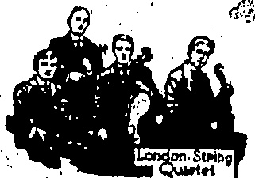
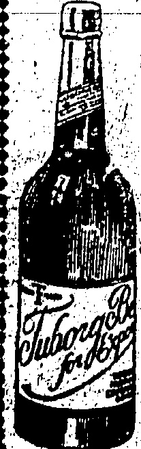

## STAR FERRY

## ONE BOAT AT PRESENT

SPEEDIER SERVICE LATER

Early this morning only one Star Ferry boat was running, but the time taken for crossing was not far below that of ordinary times.

The "Star" Ferry operatives did not put in an appearance this morning and the restricted service is due to their assurance (after their first announcement that they were going to cease work) that they would be back as usual after all.

Bugjackets, deckhands and artifiers from the navy are manning the boats and the result of the observations and tests they have been making in the event of an emergency such as has arisen is to be seen in the good runs they are making and the ease with when they bring the boats to the wharves. It is hoped to supplement the service during the course of the day.

Later, I two boats are maintaining a service not far de然而 normal.

No Chinese are being allowed on the serry unless they are season ticket holders or have attended at the City man or knowhood kanway. The station and convinced those in charge of the tiger necessity of the business necessitating their crossing.

The raunai and Mongkok ferries are running as usual, but some launches have been directed.

## NOT RIOTERS

WORKERS UNDER POLICE

## SUPPLY EXCEEDS DEMANI PROTECTION

In spite of the fact that the "Empress of Asia" has had to call upon the services of schoolboys and masters in their endeavour to get it out of the harbour and on the Vancouver run to-day, it would appear that there are many qualified Chinese who are willing to act as stokers, etc., if they are guaranteed protection.

This is apparent from the response to an appeal made through the police for stokers for launches which have been affected. Many more applications were received than there were places and those who were engaged have given complete satisfaction.

Dock hands to replace those out on strike have been provided in abundance (also through the agency of the police) and the services of other skilled men and coolies can be obtained by firms in need who make application.

This morning a crowd of Chinese coolies and other workmen was to be seen outside the C. I. D. Office and these, it appears, were Chinese who had volunteered for service in any capacity provided protection was given.

The crowds observed under the superintendence of police guards yesterday and this morning gave rise to alarmed queries as to whether they might pot be mobs arrested in the course of demonstrations but they are merely workers under the protection they have asked for.

The trip to Vancouver on the s.s. "Empress of Asia" will be a memorable one from the point of view of the passengers and many of the crew.

## LINER'S CREW

The schools or colleges in the Colony having been closed in view of recent developments in China, many of the masters volunteered for service on the Empress boat. They have signed on in some cases for the most menial tasks. A Hongkong University professor is said to be among the galley boys.

Schoolboys are discharging the less arduous tasks of stewards.

The Empress, it is hoped, will leave at noon to-day.

## London, June 26

A report from Bombay states that Japanese exporters are buying heavy stocks of cotton on the strength of Press reports that Japan is preparing for war against China and is ready to sacrifice her Chinese markets by amassing enough cotton to tide over the period of hostilities. It is also significant that there is a great demand from the Far East for a certain type of manganese used in the manufacture of munitions.

Eleven Chinese have been deported as sixteen others arrested on the Belgian frontier. — Reuter

## COUNTY CRICKET

London, June 26.— At Birmingham, Warwickshire lost to Surrey 376 (Shepherd 57, Hobbs 215 and Calthorpe 4 wickets for 68 runs). Warwick 193

Warwick (followed on) 407 (Parsons 127' Calthorpe 51).

Surrey 225 for 5 wickets (Sandham 102).

At Hull, Yorkshire beat Hants by an innings and 116 runs:... Scores: Hants 139 (Macaulay 4 wickets for 40' runs, Kilner 4 for 63).

Yorkshire 408 (Rhodes 91, Macaulay 63, Allen 95 not out).

Hants 153 (Brown 51, Macaulay 6 for 73).

At Northhampton, Northamptonshire lost to Notts by seven wickets. Scores: Northants 156 (Staples 7 for 67).

Norts 214 (Wright 6 for 65).

Northants 397 (Hawtin 51,

Wright 103).

Notes 340 for 3, wickets (Whysall 108, Walker 102 and Carr (0 not out).

At Colchester—Essex led Sussex on the first innings. Scores: Essex 224 (Hipkin 80).

Sussex 127. (Nicholls 4/for 47. Douglas 4 for 26).

Essex 180 for 7 declared (Eastman 48, Cox 4 for 31).

Sussex 32 for no wicket and then rain came on.

At Manchester, Lancashire beat Leicestershire by six wickets. Scores: Leicester 205 (Tyldesley 5 for 19).

Lanes. 226 (Astill 4 for 51).

Leicester 247 (Astill 93, and MacDonald 7 for 67).

Lanes. 227 for 4 wickets (Barnes

Lanes. 227 for 4 wickets (Barnes 78, Hopwood 51, both not out).

At Bristol, Gloucestershire defeated Oxford University by 7 wickets. Scores: Oxford 188.

Gloucester 277 (Dipper 73 and Smith 58).

Oxford 198. (Legge 53).

Gloucester 113 for 3 wickets (Dipper 51 not out).

At Bath, Somerset lost to Cambridge University by 112 runs.

Scores: Cambridge 437 for 8 wickets declared (Dawson 67, Lowe 83, Duleepsinjhi 130 and Enthoven 62 not out).

Somerset 203 (Johnson 70 not out, Meyer 5 for 61).

Cambridge 184 for 4 declared (Dawson 83):

Somerset 306 (MacBryan 129, Hunt 51). — Reuter.

## HOME SPORT

London, June 26.— At Wimbledon, in dull but cool weather, the prospect of two appearances of Mlle. Suzanne Lenglen drew another huge crowd. The centre court was showing signs of wear.

In the fourth round Borotra beat Gilbert 6-1, 7-5, 6-3. Hennessey beat Gordon Lowe 9-7,8-6, 3-4. In the third round the Belgian champion, Washer, beat the South African, Sherwell 6-0, 6-3, 6-1. Thus a British trio went down before the foreign onslaught.

Hennessey was most superior at the net. He played with great opportunism though he had to fight for every game. Lowe was sure, accurate but seldom went to the net; he lobbed effectively and found the American's weakness overhead. Borotra danced his way through; he was at the top of his form and brilliant in his work at the net. Both are now in the last eight.

Jacoste accompanied Borotra into the last eight, defeating one of the two remaining Americans in Casey by 8-6,6-4,6-1 and he meets the winner of the Jacob v. Washer match.

Suzanne Lenglen earned the right to meet Mrs. Beamish in the last eight, defeating Miss Goldsack in twenty minutes by 6-1, 6-0.

Casey used a big gun service very effectively against Lacoste but was beaten by the machine like accuracy of the Frenchman in the rallies. Lacoste placed superbly and rarely had to run. He was not extended except in the first set. The programme was curtailed owing to rain at seven o'clock.— Reuter.

London, June 26.— At Prestwick in cool, cloudy weather there was a huge attendance. The leaders at the end of the third round in the British Open Golf Championship were MacDonald Smith 221, Compston and Jim Barnes each with 226, Abe Mitchell and Ray each with 228 and Tom Fernie 229.

After the complete 72 holes, Jim Barnes, an English born American, won with an aggregate of 300.

Kay and Compston were each 301, MacDonald Smith 304, Abe Mitchell 305. Five, including Taylor, followed each with 310, then came the amateur champion, Harris, with 311. Other prominent players were Kirkwood 314, Havers 316, and Dufkin and Tolley each 320. Reuter

## ROWDIES STILL ACTIVE

Shanghai, June 26th. this afternoon

crowds of rowdies and strikers entered the Foreign settlement from Chapel and stoned and stopped trams.

In one instance they threw lime in the eyes of the tram-driver

The police hurried to the scene and dispersed the rioters.

Otherwise all is quiet. There is no change in the shipping situation.

"DAILY MAIL'S" DEMAND.

The Daily Mail in a lender pointing out the increasing serious illness of the situation in China as a result of Bolshevik efforts, complains that Soviet delegation is being permitted in London while the Moscow Government is spending large sums in inciting ignorant Chinese mobs to murder Britons.

The paper demands the clearing out of Bolsheviks from England.

##### MR. A. J. DENNYS DEAD

Hongkong will learn with regret that Mr. Allen Junius Dennis died at Amoy on June 25 from influenza, followed, it is believed by an attack of pneumonia.

Mr. Dennis was with the Hong Kong and Shanghai Bank. He joined the bank in 1904 and came East two years later. He has served the Corporation in Shanghai, Tientsin, Malacca and Amoy. He was about 41 years of age.

## FRENCH SAVINGS

Mr. Philip Snowden's Views.

“On July 1 next 3,200 million 6 per cent. bonds of the Credit National mature. These will become payable at the option of the holders. Another block of 8,236 million Treasury Bonds mature at the end of September, and a further ten milliards fall due the first week in December.

"If the situation in France is to be saved, and if resort to ruinous inflation is to be avoided, no time can be lost in dealing with the crisis. The Budget has not yet been voted, and credits are only available to the end of April. Enormous payments have to be made during the present year," writes Mr. Philip Snowden in the "World To-day."

A large amount of foreign debt will become due during this year, including 29,000,000 dollars due to America, and £11,727,000 to England. M. Herriot pointed out in his speech to the Senate that if, in the case of the internal debt which has to be renewed, two-thirds of the holders of short term bonds agree to renew their lendings the French Treasury will have to find the sum of 7,000,000,000 francs this year.

The renewal of these short term loans may well prove to be the final stage in the downward course of French finance, unless in the meantime something is done to restore public confidence. Already the flight of capital from France has become a serious matter. This has been confined hitherto, in the main, to be wealthier classes. The smaller holder is still the main holder of French Government stocks. If he becomes nervous then panic and chaos are unavoidable.

The French peasant has had an unfortunate experience with foreign investments. He has lost enormous sums by his Russian investments. It may be that he will rather take the risks of holdings in the bonds of his own Government than fly to investing in other lands.

"But all depends upon the confidence of the French peasant in Government bonds, and our hears that hoarding against the tax-gatherer and the risks of investment is increasing among the French peasantry. This is not to be wondered at when it is remembered that his capital investment in French Government bonds has depreciated by about two-thirds.

"There is a danger that under the new Government temporising tactics will be continued and no decisive action taken. In that case complete disaster cannot be avoided. In any case same measure of inflation is bound to happen."

"The financial crisis has probably postponed for a long time a settlement of the Inter-Allied Debt question. The French Government will make its financial position an excuse for a postponement. Great Britain is to continue to bear the burdens which the unwillingness of the French people to pay adequate taxation has imposed upon her."

To his trainer, Edward Douglas Wvily, Major Francis J. S. Murray, Hordford Street, W., the race-horse owner, has left £500 and half his horses.

## WOMEN'S DRESS

The Jewish Telegraphic Agency has received from Warsaw the text of an important manifesto on the subject of women's dress which has been issued by the Polish Rubbinate to the Jewish population of Poland:

The Jewish people is disturbed. Every upright neurt is filled with pain, because of the latest ugly modes which have invaded our Jewish homes. Our daughters, who always that enguished themselves by their modestly and their moral behaviour, are allowing themselves to do missed by the dictatorship of "Nars" and bow down to it like slaves, wearing immoral dresses which have the purpose only of exciting lust. With regret, we see that this minister mode is spreading further every day and breaking up the barrier when has for thousands of years separated us from immoral peoples and retained in our people one best and the hottest and most pure. Woe to the generation which has lived to see this. Woe to the eyes which look upon it!

We, the rabbis of the whole of Poland assembled, as the responsable leaders of the Jewish people, appeal to you, Jewish daughters, women and girls, with tears of blood in our eyes. Recall the dark days of the Great War, recall the sufferings and the miseries through which the Jewish people have passed, the number of Jewish daughters who were outraged. To-day, when God has mercy has come to our ad, so that we can breathe freely, you, by our disgracultant stannons, are trying, good forbid to bring new troubles upon our people. How can you take this grave responsibility upon yourselves? What will you answer to God, blessed be His name? Every upright person with any ethical feeling regards with disgust and with revulsion your present-day clothing. The best of the Gentiles look upon you with scorn. To us Jews it is one of the greatest of sins, and according to the holy Jewish law—a married woman wearing this broadest dress may be divorced.

In order to do away with this disgraceful mode in Jewish houses we, the assembled Rabbis of Poland, have found it necessary to issue this appeal to all our brothers and sisters in the whole of Poland, that they should form special committees in all their towns, the object of which should be to consider how, with all the means at their command, to wash off this shame from our people and to restore Jewish spotlessness and pride.

We remind you that according to Jewish law every husband and father who tolerates this inmodesty in his home ought to be expelled from every Jewish institution. No Jewish man may enter a place in which there are women or girls wearing these disgraceful clothes. The tailors and dressmakers who make such dresses bear the responsibility of their sin.

We hope that our Jewish daughters who have shown such readiness to sacrifice themselves for the Jewish people will this time, too, how to our passionate appeal and will see the justice of our earnest exhortation.

dowdy, and rather a plum, writes Meriel Buchanan in the London Evening News. She has no conception of the difficulties and temptations which pursue a pretty woman, and she can't even imagine them, because being a prude, she has no imagination, and would probably rather pride herself on not possessing it. My dear, imagination I Generally only indigestion, or nerves, and I despise people with nerves! So she dismisses the subject with a sniff, drawing down the corners of her thin, querulous mouth. But besides the poor, ugly prude who has never had a love-affair and never been tempted even the fraction of an inch from the straight and narrow path. There is the good-looking prude—the prude who, as a girl has been made love to, who has a husband and babies, who goes out in Society and yet remains cold and aloof and superior to all human follies, frailties, and imperfections. She seems to float through life wrapped in a continual atmosphere of disapproval and disdaun. She looks down on mankind from the far away frozen heights of her own integrity, and she also has no sympathy, no imagination, she also considers imagination rather improper, quite superfluous weakness. It's so much better not to think of these things," she says a little arrogantly when somebody tries to exonerate a mutual friend who is in some way getting herself talked about. I don't want to put myself into other people's minds, and I would very much rather not see things from their point of view. My own point of view and my own commendance are quite good enough, and they only show me that I has been more than foolish. I think I would prefer not to meet her again. I dare say she has done nothing wrong—yet. That is really not the question, but all the same I prefer not associating with people whose idols on morality are so very

## NOTICE

EMERGENCY DISPOSAL OF NIGHT SOIL.

In the event of a strike of night-soil-coolies the following information as to disposal of nightsoll when water closets are not available is issued to the Public.

(1) In private gardens night-soil can be disposed of by burying at a depth of two feet. Care should be taken to avoid polluting a catchment area and to avoid the lines of rainstorm scours.

(2) Sewer manholes at convenient positions throughout the Colony will be opened from 5-30 to 7-30 a.m. each day for the reception of night soil. Such manholes have been marked with red paint. No manholes will be opened on the Peak.

(3) Nightsoil may be dumped over sea walls except in Causeway Bay and the Harbour of Refuge.

(4) In Happy Valley, owing to the absence of suitable manholes, nightsoil should be buried. With regard to areas available for the purpose enquiry should be made at the Eastern District Sanitary Office, Wanchai, Telephone No. Central 3218.

Any person wishing for further information should apply to the nearest Sanitary Department Office.

## NOTICE

PENINSULAR, & ORIENTAL

STEAM NAVIGATION CO.

STEAMER FOR SINGAPORE

PENANG, COLOMBO AND

BOMBAY.

Through Bills of lading issued for Egypt, Mediterranean and Continental Ports and London. THE STEAMSHIP

## MIRZAPORE'

carrying His Majesty's Mails, will be dispatched from this port at Noon on THURSDAY, the 2nd July, 1925, taking cargo for the above ports.

Silk and Valuable Cargo for Italy, France and London (under arrangement) will be conveyed by this steamer proceeding to Bombay and there transhipped to the on-carrying steamer for Marseilles and London.

Parcels will be received at the Office until 5 p.m. on the day previous to sailing. The contents and value of all packages must be declared.

For further particulars Apply

Mackinnon, Mackenzie & Ca.

Hongkong, 25th June, 1925.

## NOTICE

Notice is hereby given that the Hongkong Stock Exchange is closed from this date and the June Settlement has been postponed until Tuesday, July 7th, 1925.

By Order of the Committee,

A. NISSIM,

Secretary,

Hongkong, June 22, 1925.

## NOTICE

HONGKONG STOCK EXCHANGE

By permission of His Excellency he Governor, the Hongkong Stock Exchange postponed their Settlement for June 23rd, to Tues day, July 7th, 1925.

Hongkong Stock Exchange,

H. BIRKETT

Hongkong, June 22, 1925.

## NOTICE

Subscribers of the China Mall not receiving their paper every evening owing to the uncertain delivery as the result of the strike are invited to notify this office if they would prefer to purchase their paper from the street news-boys direct and have the amount credited to their account.

A child of five had an adult brain, weighing 48½ ounces, it was stated, at a City inquest.

I never enter my tenants' rooms unless I am invited or want to borrow something. — Landlady at Maryebone County Court.

Colonel John F. Free, of Queen's Gate Terrace, W., has bequeathed £500 for the support of two old soldiers or their families in Walthamstow.

Directly the hot weather comes up goes the number of suicides. I have particularly noted that the number of these cases has increased in my district during the last two weeks, said Mr. Reginald Kemp, coroner for West Middlesex, at a Houslow inquest.

STRIKE NOTIC

Unlimited Quantité'es of

BREAD

Can be obtained at CAF E WISEMANS

THE PEAK

THE KOWLOON AGENCY

ON 1ER NATHAN ROAD

Also From 8 am to 1 p.m. at

BURROW ST. BAKERY

ONE LB. LOAVES 15 ONTS EACH

Customers are requested to bring their Pass Books-or pay cash

FULL STOCKS OF

AT PEAK STORE

LANE, CRAWFORD'S

HAWKER'S SLOE GIN "PEDLAR" BRAND

OALDBROK, MAGGREGOR

CO., LTD.

Tel. 75 Central

◇◇◇◇◇◇◇◇◇◇◇◇◇◇◇◇◇◇◇◇◇◇◇

## NEW ENGLISH RECORDS

O

LONDON STRING QUARTET

(HAYDN Q JARTET IN O MAJOR

SIX PARTS—TERRE RECORDS

L 1633 — 34 — 35

AỘT

ANDERSON'S

◇◇◇◇◇◇◇◇◇◇◇◇◇◇◇◇◇◇◇◇

#### G. FALCONER & CO. (HONGKONG) LTD

WATCHMAKERS & JEWELLERS

DIAMOND MERCHANTS

Union Building (Opposite G.P.O.)

Agents for: ADMIRALTY CHARTS

ROSS'S BINOCULARS and TELESCOPES,

KELVIN'S NAUTICAL INSTRUMENTS,

ENGLISH SILVERWARE, direct from Manufacturers,

High Class English Jewellery.

## ◇◇◇◇◇◇◇◇◇◇◇◇◇◇◇◇◇◇◇◇◇◇◇◇◇

## Cross Words Made Easy

By Drinking

Tuborg Bøer

The Orm and Only Danish Beer on the Market.

6.dox.pts.-@18 duty paid. (Hhburg

4.dox.ota.-@20

GANDE, PRICE & CO., LTD.