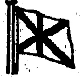

## DODWELL & COMPANY, LTD

## NEW YORK BHRTH

<table border=1 style='margin: auto; word-wrap: break-word;'><tr><td style='text-align: center; word-wrap: break-word;'>FOR NEW TORK AND BOSTON VIA SUEZ</td></tr></table>

S.S. "INGREMONT CASTLE" --- Sells 26th June

## LLOYD TRIESTINO

REGULAR MONTHLY PASSENGER AND FREIGHT SERVICE FOR BRINDISI, VENICE AND TRIESTE (FIUME). TAKING CARGO ON THROUGH BILLS OF LADING TO GENOA, ALL ITALIAN, ADRIATIC, LEVANT, BLACK SEA AND DANUBE PORTS.

REDUCED PASSAGE RATES TO BRINDISL, VENICH

## £66

## NEXT SAILINGS

## OUTWARD FOR SHANGHAI, YOKOHAMA, KOBE & MOJL

<table border=1 style='margin: auto; word-wrap: break-word;'><tr><td style='text-align: center; word-wrap: break-word;'>B.S. &quot;VENEZIA&quot;</td><td style='text-align: center; word-wrap: break-word;'>...</td><td style='text-align: center; word-wrap: break-word;'>...</td><td style='text-align: center; word-wrap: break-word;'>&lt;nl&gt;</td></tr></table>

<table border=1 style='margin: auto; word-wrap: break-word;'><tr><td style='text-align: center; word-wrap: break-word;'>HOMEWARD FOR BRINDISL, VENICE AND TRIESTE</td></tr></table>

<table border=1 style='margin: auto; word-wrap: break-word;'><tr><td style='text-align: center; word-wrap: break-word;'>8.8. “VENEZIA”</td><td style='text-align: center; word-wrap: break-word;'>...Sails 1st July.</td></tr><tr><td style='text-align: center; word-wrap: break-word;'>M.O.</td><td style='text-align: center; word-wrap: break-word;'>...Sails 1st July.</td></tr></table>

## NATAL LINE OF STEAMERS

## FROM CALCUTTA & COLOMBO TO SOUTH AFRICAN PORTS

Sails about 31st May

Regular Passenger and Cargo Service to South African Ports.

Through Bills of Lading issued from Hongkong

For Freight or Passage on any of the above Lines apply to:— Telephone Central 1030. DODWELL & CO., LTD., Agents:

#### O. S. K

## SAILINGS FROM HONGKONG SUBJECT TO ALTHRATION

CHICAGO MARU Wednesday, 24th June

HONOLULU MARU.....Thursday, 4th June

SEKKO MARU Saturay. 13th June

ALABAMA MARU (From Shanghai)... Monday, 1st June

## BAIPHONG via HOIHOW and PAICHOL

SEATTLE M RU.....Monday, 8th June BINGO MARU.....Tuesday, 23rd June KELUNG RSWATOW & AMOT......Friday, 26th June

##### f4. Central No 4088, 4089, 4 90. OB&KA SHOEN KAIKMA. M TAKEUEL Manager

## SHIP YOUR FREIGHT TO

## SOUTH AMERICA

#### S.S. "LING NAM"

## Calling at:—

Tarakan, Rabaul, Sydney, (Australia),

Wellington (New Zealand), Tahiti, Balboa

Panama, Calmo (Peru) and Iquique (Ohile).

MAGNIFICENT PASSENGER ACCOMMODATION.

## For Freight and Passenger rates apply to:

THE CHUNGWHA NAVIGATION CO., LTD.

Tel. 0.1587

Bank of China Building.

◇◇◇◇◇◇◇◇◇◇◇◇◇◇◇◇◇◇◇◇◇◇◇◇◇◇◇◇◇◇◇◇◇◇◇◇◇◇◇◇◇◇◇◇◇◇◇◇◇◇◇◇◇◇◇◇◇◇◇◇◇◇◇◇◇◇◇◇◇◇◇◇◇◇◇◇◇◇◇◇◇◇◇◇◇◇◇◇◇◇◇◇◇◇◇◇◇◇◇◇◇◇◇◇◇◇◇◇◇◇◇◇◇◇◇◇◇◇◇◇◇◇◇◇◇◇◇◇◇◇◇◇◇◇◇◇◇◇◇◇◇◇◇◇◇◇◇◇◇◇◇◇◇◇◇◇◇◇◇◇◇◇◇◇◇◇◇◇◇◇◇◇◇◇◇◇◇◇◇◇◇◇◇◇◇◇◇◇◇◇◇◇◇◇◇◇◇◇◇◇◇◇◇◇◇◇◇◇◇◇◇◇◇◇◇◇◇◇◇◇◇◇◇◇◇◇◇◇◇◇◇◇◇◇◇◇◇◇◇◇◇◇◇◇◇◇◇◇◇◇◇◇◇◇◇◇◇◇◇◇◇◇◇◇◇◇◇◇◇◇◇◇◇◇◇◇◇◇◇◇◇◇◇◇◇◇◇◇◇◇◇◇◇◇◇◇◇◇◇◇◇◇◇◇◇◇◇◇◇◇◇◇◇◇◇◇◇◇◇◇◇◇◇◇◇◇◇◇◇◇◇◇◇◇◇◇◇◇◇◇◇◇◇◇◇◇◇◇◇◇◇◇◇◇◇◇◇◇◇◇◇◇◇◇◇◇◇◇◇◇◇◇◇◇◇◇◇◇◇◇◇◇◇◇◇◇◇◇◇◇◇◇◇◇◇◇◇◇◇◇◇◇◇◇◇◇◇◇◇◇◇◇◇◇◇◇◇◇◇◇◇◇◇◇◇◇◇◇◇◇◇◇◇◇◇◇◇◇◇◇◇◇◇◇◇◇◇◇◇◇◇◇◇◇◇◇◇◇◇◇◇◇◇◇◇◇◇◇◇◇◇◇◇◇◇◇◇◇◇◇◇◇◇◇◇◇◇◇◇◇◇◇◇◇◇◇◇◇◇◇◇◇◇◇◇◇◇◇◇◇◇◇◇◇◇◇◇◇◇◇◇◇◇◇◇◇◇◇◇◇◇◇◇◇◇◇◇◇◇◇◇◇◇◇◇◇◇◇◇◇◇◇◇◇◇◇◇◇◇◇◇◇◇◇◇◇◇◇◇◇◇◇◇◇◇◇◇◇◇◇◇◇◇◇◇◇◇◇◇◇◇◇◇◇◇◇◇◇◇◇◇◇◇◇◇◇◇◇◇◇◇◇◇◇◇◇◇◇◇◇◇◇◇◇◇◇◇◇◇◇◇◇◇◇◇◇◇◇◇◇◇◇◇◇◇◇◇◇◇◇◇◇◇◇◇◇◇◇◇◇◇◇◇◇◇◇◇◇◇◇◇◇◇◇◇◇◇◇◇◇◇◇◇◇◇◇◇◇◇◇◇◇◇◇◇◇◇◇◇◇◇◇◇◇◇◇◇◇◇◇◇◇◇◇◇◇◇◇◇◇◇◇◇◇◇◇◇◇◇◇◇◇◇◇◇◇◇◇◇◇◇◇◇◇◇◇◇◇◇◇◇◇◇◇◇◇◇◇◇◇◇◇◇◇◇◇◇◇◇◇◇◇◇◇◇◇◇◇◇◇◇◇◇◇◇◇◇◇◇◇◇◇◇◇◇◇◇◇◇◇◇◇◇◇◇◇◇◇◇◇◇◇◇◇◇◇◇◇◇◇◇◇◇◇◇◇◇◇◇◇◇◇◇◇◇◇◇◇◇◇◇◇◇◇◇◇◇◇◇◇◇◇◇◇◇◇◇◇◇◇◇◇◇◇◇◇◇◇◇◇◇◇◇◇◇◇◇◇◇◇◇◇◇◇◇◇◇◇◇◇◇◇◇◇◇◇◇◇◇◇◇◇◇◇◇◇◇◇◇◇◇◇◇◇◇◇◇◇◇◇◇◇◇◇◇◇◇◇◇◇◇◇◇◇◇◇◇◇◇◇◇◇◇◇◇◇◇◇◇◇◇◇◇◇◇◇◇◇◇◇◇◇◇◇◇◇◇◇◇◇◇◇◇◇◇◇◇◇◇◇◇◇◇◇◇◇◇◇◇◇◇◇◇◇◇◇◇◇◇◇◇◇◇◇◇◇◇◇◇◇◇◇◇◇◇◇◇◇◇◇◇◇◇◇◇◇◇◇◇◇◇◇◇◇◇◇◇◇◇◇◇◇◇◇◇◇◇◇◇◇◇◇◇◇◇◇◇◇◇◇◇◇◇◇◇◇◇◇◇◇◇◇◇◇◇◇◇◇◇◇◇◇◇◇◇◇◇◇◇◇◇◇◇◇◇◇◇◇◇◇◇◇◇◇◇◇◇◇◇◇◇◇◇◇◇◇◇◇◇◇◇◇◇◇◇◇◇◇◇◇◇◇◇◇◇◇◇◇◇◇◇◇◇◇◇◇◇◇◇◇◇◇◇◇◇◇◇◇◇◇◇◇◇◇◇◇◇◇◇◇◇◇◇◇◇◇◇◇◇◇◇◇◇◇◇◇◇◇◇◇◇◇◇◇◇◇◇◇◇◇◇◇◇◇◇◇◇◇◇◇◇◇◇◇◇◇◇◇◇◇◇◇◇◇◇◇◇◇◇◇◇◇◇◇◇◇◇◇◇◇◇◇◇◇◇◇◇◇◇◇◇◇◇◇◇◇◇◇◇◇◇◇◇◇◇◇◇◇◇◇◇◇◇◇◇◇◇◇◇◇◇◇◇◇◇◇◇◇◇◇◇◇◇◇◇◇◇◇◇◇◇◇◇◇◇◇◇◇◇◇◇◇◇◇◇◇◇◇◇◇◇◇◇◇◇◇◇◇◇◇◇◇◇◇◇◇◇◇◇◇◇◇◇◇◇◇◇◇◇◇◇◇◇◇◇◇◇◇◇◇◇◇◇◇◇�

## TUNG ON STEAMSHIP CO

“TUNG ON” & “SAI ON”

ENGINEERS and SHIPBUILDERS, BOILER-MAKERS, BRASS and IRON FOUNDERS. All work does in this establishment in guaranteed. We have over thirty years' experience. We own two Slipways and sunness and any craft of 300 feet long.

Trevor O'Neal 64, Comcast & Food Central, Haarlem, Tel. Central No. 400

Slipways and Slipways are not a part of the ship's rafting.

## PROJECTED DEPARTURES

SWATON.

<table border=1 style='margin: auto; word-wrap: break-word;'><tr><td style='text-align: center; word-wrap: break-word;'>Ju 10</td><td style='text-align: center; word-wrap: break-word;'>3.-E.O.S.N.</td><td style='text-align: center; word-wrap: break-word;'>Roostihing.</td></tr><tr><td style='text-align: center; word-wrap: break-word;'></td><td style='text-align: center; word-wrap: break-word;'>4.-O. K.</td><td style='text-align: center; word-wrap: break-word;'>Tebantung.</td></tr><tr><td style='text-align: center; word-wrap: break-word;'></td><td style='text-align: center; word-wrap: break-word;'>4.-O.S.K.</td><td style='text-align: center; word-wrap: break-word;'>Koten Maru.</td></tr><tr><td style='text-align: center; word-wrap: break-word;'></td><td style='text-align: center; word-wrap: break-word;'>5.-D. L.</td><td style='text-align: center; word-wrap: break-word;'>Haining.</td></tr><tr><td style='text-align: center; word-wrap: break-word;'></td><td style='text-align: center; word-wrap: break-word;'>5.-I.O.S.N.</td><td style='text-align: center; word-wrap: break-word;'>Tungshing.</td></tr><tr><td style='text-align: center; word-wrap: break-word;'></td><td style='text-align: center; word-wrap: break-word;'>7.-O.S.K.</td><td style='text-align: center; word-wrap: break-word;'>Hozan Maru.</td></tr><tr><td style='text-align: center; word-wrap: break-word;'></td><td style='text-align: center; word-wrap: break-word;'>9.-D. L.</td><td style='text-align: center; word-wrap: break-word;'>Halbong.</td></tr><tr><td style='text-align: center; word-wrap: break-word;'></td><td style='text-align: center; word-wrap: break-word;'>9.-L.O.S.N.</td><td style='text-align: center; word-wrap: break-word;'>Waisibing.</td></tr><tr><td style='text-align: center; word-wrap: break-word;'></td><td style='text-align: center; word-wrap: break-word;'>9.-L.O.S.N.</td><td style='text-align: center; word-wrap: break-word;'>Kwaisang.</td></tr><tr><td style='text-align: center; word-wrap: break-word;'></td><td style='text-align: center; word-wrap: break-word;'>10.-N.K.K.</td><td style='text-align: center; word-wrap: break-word;'>Lushan Maru</td></tr><tr><td style='text-align: center; word-wrap: break-word;'></td><td style='text-align: center; word-wrap: break-word;'>20.-N.K.K.</td><td style='text-align: center; word-wrap: break-word;'>Sungshan Maru</td></tr></table>

<table border=1 style='margin: auto; word-wrap: break-word;'><tr><td style='text-align: center; word-wrap: break-word;'>June 2,</td><td style='text-align: center; word-wrap: break-word;'>-I.C.S.N.</td><td style='text-align: center; word-wrap: break-word;'>Kutsang.</td></tr><tr><td style='text-align: center; word-wrap: break-word;'></td><td style='text-align: center; word-wrap: break-word;'>4.-O.S.K.</td><td style='text-align: center; word-wrap: break-word;'>Kousu Mara.</td></tr><tr><td style='text-align: center; word-wrap: break-word;'></td><td style='text-align: center; word-wrap: break-word;'>5.-D. L.</td><td style='text-align: center; word-wrap: break-word;'>Haining.</td></tr><tr><td style='text-align: center; word-wrap: break-word;'></td><td style='text-align: center; word-wrap: break-word;'>7.-O.S.K.</td><td style='text-align: center; word-wrap: break-word;'>Hoxan Mira.</td></tr><tr><td style='text-align: center; word-wrap: break-word;'></td><td style='text-align: center; word-wrap: break-word;'>9.-D. L.</td><td style='text-align: center; word-wrap: break-word;'>Haibong.</td></tr></table>

<table border=1 style='margin: auto; word-wrap: break-word;'><tr><td style='text-align: center; word-wrap: break-word;'>Tuna</td><td style='text-align: center; word-wrap: break-word;'>5.—D.</td><td style='text-align: center; word-wrap: break-word;'>L.</td><td style='text-align: center; word-wrap: break-word;'>Haining.</td></tr><tr><td style='text-align: center; word-wrap: break-word;'></td><td style='text-align: center; word-wrap: break-word;'>9.—D.</td><td style='text-align: center; word-wrap: break-word;'>L.</td><td style='text-align: center; word-wrap: break-word;'>Haibong</td></tr></table>

SHANGHAI.

<table border=1 style='margin: auto; word-wrap: break-word;'><tr><td style='text-align: center; word-wrap: break-word;'>Name</td><td style='text-align: center; word-wrap: break-word;'>Linao</td><td style='text-align: center; word-wrap: break-word;'>Ju</td></tr><tr><td style='text-align: center; word-wrap: break-word;'>8.—O.N.</td><td style='text-align: center; word-wrap: break-word;'>Kutsang</td><td style='text-align: center; word-wrap: break-word;'></td></tr><tr><td style='text-align: center; word-wrap: break-word;'>4.—O.N.</td><td style='text-align: center; word-wrap: break-word;'>Shantung</td><td style='text-align: center; word-wrap: break-word;'></td></tr><tr><td style='text-align: center; word-wrap: break-word;'>5.—L.O.S.N.</td><td style='text-align: center; word-wrap: break-word;'>Tung-hing</td><td style='text-align: center; word-wrap: break-word;'></td></tr><tr><td style='text-align: center; word-wrap: break-word;'>5.—J.C.J.L.</td><td style='text-align: center; word-wrap: break-word;'>Tjileboot</td><td style='text-align: center; word-wrap: break-word;'></td></tr><tr><td style='text-align: center; word-wrap: break-word;'>8.—O.N.</td><td style='text-align: center; word-wrap: break-word;'>Yingchow.</td><td style='text-align: center; word-wrap: break-word;'></td></tr><tr><td style='text-align: center; word-wrap: break-word;'>7.—L.O.S.N.</td><td style='text-align: center; word-wrap: break-word;'>Waishing.</td><td style='text-align: center; word-wrap: break-word;'></td></tr><tr><td style='text-align: center; word-wrap: break-word;'>6.—P.M.</td><td style='text-align: center; word-wrap: break-word;'>Pres. Wilson</td><td style='text-align: center; word-wrap: break-word;'></td></tr><tr><td style='text-align: center; word-wrap: break-word;'>10.—L.T.</td><td style='text-align: center; word-wrap: break-word;'>Venezia</td><td style='text-align: center; word-wrap: break-word;'>Au</td></tr><tr><td style='text-align: center; word-wrap: break-word;'>12.—L.T.</td><td style='text-align: center; word-wrap: break-word;'>Triesie</td><td style='text-align: center; word-wrap: break-word;'></td></tr><tr><td style='text-align: center; word-wrap: break-word;'>12.—O.P.S.</td><td style='text-align: center; word-wrap: break-word;'>Empress of Alfa</td><td style='text-align: center; word-wrap: break-word;'></td></tr><tr><td style='text-align: center; word-wrap: break-word;'>12.—P. &amp; O.</td><td style='text-align: center; word-wrap: break-word;'>Kashmir.</td><td style='text-align: center; word-wrap: break-word;'></td></tr><tr><td style='text-align: center; word-wrap: break-word;'>12.—P. &amp; O.</td><td style='text-align: center; word-wrap: break-word;'>Delta.</td><td style='text-align: center; word-wrap: break-word;'>Eep</td></tr><tr><td style='text-align: center; word-wrap: break-word;'>12.—N.Y.K.</td><td style='text-align: center; word-wrap: break-word;'>Washington Maru</td><td style='text-align: center; word-wrap: break-word;'></td></tr><tr><td style='text-align: center; word-wrap: break-word;'>15.—N.Y.K.</td><td style='text-align: center; word-wrap: break-word;'>Hakata Maru</td><td style='text-align: center; word-wrap: break-word;'></td></tr><tr><td style='text-align: center; word-wrap: break-word;'>16.—T.K.K.</td><td style='text-align: center; word-wrap: break-word;'>Korea Maru.</td><td style='text-align: center; word-wrap: break-word;'>Oct</td></tr><tr><td style='text-align: center; word-wrap: break-word;'>17.—N.Y.K.</td><td style='text-align: center; word-wrap: break-word;'>Kitano Maru</td><td style='text-align: center; word-wrap: break-word;'></td></tr><tr><td style='text-align: center; word-wrap: break-word;'>17.—N.Y.K.</td><td style='text-align: center; word-wrap: break-word;'>Kamo Maru</td><td style='text-align: center; word-wrap: break-word;'>Nov</td></tr><tr><td style='text-align: center; word-wrap: break-word;'>18.—J.O.J.L.</td><td style='text-align: center; word-wrap: break-word;'>Tjikembang.</td><td style='text-align: center; word-wrap: break-word;'></td></tr><tr><td style='text-align: center; word-wrap: break-word;'>10.—N.Y.K.</td><td style='text-align: center; word-wrap: break-word;'>Tamba Maru</td><td style='text-align: center; word-wrap: break-word;'>Dec</td></tr><tr><td style='text-align: center; word-wrap: break-word;'>20.—D.S.L.</td><td style='text-align: center; word-wrap: break-word;'>Pres. Lincoln.</td><td style='text-align: center; word-wrap: break-word;'></td></tr><tr><td style='text-align: center; word-wrap: break-word;'>25.—B.B.</td><td style='text-align: center; word-wrap: break-word;'>Legaspi.</td><td style='text-align: center; word-wrap: break-word;'>Jun</td></tr><tr><td style='text-align: center; word-wrap: break-word;'>26.—P. &amp; O.</td><td style='text-align: center; word-wrap: break-word;'>Sardinia.</td><td style='text-align: center; word-wrap: break-word;'></td></tr><tr><td style='text-align: center; word-wrap: break-word;'>26.—P. &amp; O.</td><td style='text-align: center; word-wrap: break-word;'>Mantua.</td><td style='text-align: center; word-wrap: break-word;'>Jul</td></tr><tr><td style='text-align: center; word-wrap: break-word;'>30.—T.K.K.</td><td style='text-align: center; word-wrap: break-word;'>Shinyo Maru</td><td style='text-align: center; word-wrap: break-word;'></td></tr><tr><td style='text-align: center; word-wrap: break-word;'>July 10.—P. &amp; O.</td><td style='text-align: center; word-wrap: break-word;'>Soudan.</td><td style='text-align: center; word-wrap: break-word;'></td></tr><tr><td style='text-align: center; word-wrap: break-word;'>10.—L.T.</td><td style='text-align: center; word-wrap: break-word;'>Fsquilino</td><td style='text-align: center; word-wrap: break-word;'>Jun</td></tr><tr><td style='text-align: center; word-wrap: break-word;'>11.—R. &amp; A.</td><td style='text-align: center; word-wrap: break-word;'>St. Albans.</td><td style='text-align: center; word-wrap: break-word;'></td></tr><tr><td style='text-align: center; word-wrap: break-word;'>12.—L.T.</td><td style='text-align: center; word-wrap: break-word;'>Numidia.</td><td style='text-align: center; word-wrap: break-word;'></td></tr><tr><td style='text-align: center; word-wrap: break-word;'>14.—T.K.K.</td><td style='text-align: center; word-wrap: break-word;'>Siberis Maru.</td><td style='text-align: center; word-wrap: break-word;'></td></tr><tr><td style='text-align: center; word-wrap: break-word;'>17.—N.Y.K.</td><td style='text-align: center; word-wrap: break-word;'>Shldznoka Maru.</td><td style='text-align: center; word-wrap: break-word;'></td></tr><tr><td style='text-align: center; word-wrap: break-word;'>21.—P. &amp; O.</td><td style='text-align: center; word-wrap: break-word;'>Macedonia</td><td style='text-align: center; word-wrap: break-word;'></td></tr><tr><td style='text-align: center; word-wrap: break-word;'>27.—T.K.K.</td><td style='text-align: center; word-wrap: break-word;'>Taiyo Maru</td><td style='text-align: center; word-wrap: break-word;'></td></tr><tr><td style='text-align: center; word-wrap: break-word;'>Aug. 7.—P. &amp; O.</td><td style='text-align: center; word-wrap: break-word;'>Mantua.</td><td style='text-align: center; word-wrap: break-word;'>July</td></tr><tr><td style='text-align: center; word-wrap: break-word;'>7.—P. &amp; O.</td><td style='text-align: center; word-wrap: break-word;'>Khyber.</td><td style='text-align: center; word-wrap: break-word;'></td></tr><tr><td style='text-align: center; word-wrap: break-word;'>21.—P. &amp; O.</td><td style='text-align: center; word-wrap: break-word;'>Narkunda.</td><td style='text-align: center; word-wrap: break-word;'></td></tr><tr><td style='text-align: center; word-wrap: break-word;'>Sept. 4.—P. &amp; O.</td><td style='text-align: center; word-wrap: break-word;'>Dela</td><td style='text-align: center; word-wrap: break-word;'></td></tr><tr><td style='text-align: center; word-wrap: break-word;'>4.—P. &amp; O.</td><td style='text-align: center; word-wrap: break-word;'>Karomala</td><td style='text-align: center; word-wrap: break-word;'>Aug</td></tr><tr><td style='text-align: center; word-wrap: break-word;'>Oct. 1.</td><td style='text-align: center; word-wrap: break-word;'>Sondan.</td><td style='text-align: center; word-wrap: break-word;'></td></tr><tr><td style='text-align: center; word-wrap: break-word;'>2—Y. &amp; O.</td><td style='text-align: center; word-wrap: break-word;'>Khiva</td><td style='text-align: center; word-wrap: break-word;'>Sept</td></tr><tr><td style='text-align: center; word-wrap: break-word;'>Nov. 1.—P. &amp; O.</td><td style='text-align: center; word-wrap: break-word;'>Kalyan.</td><td style='text-align: center; word-wrap: break-word;'></td></tr><tr><td style='text-align: center; word-wrap: break-word;'>Oct. 10.—P. &amp; O.</td><td style='text-align: center; word-wrap: break-word;'>Karomala</td><td style='text-align: center; word-wrap: break-word;'></td></tr></table>

TAKIO.

<table border=1 style='margin: auto; word-wrap: break-word;'><tr><td style='text-align: center; word-wrap: break-word;'>June 4—0.8.K.</td><td style='text-align: center; word-wrap: break-word;'>Kotau Mart.</td></tr><tr><td style='text-align: center; word-wrap: break-word;'>25—0.8.K.</td><td style='text-align: center; word-wrap: break-word;'>Pouraba a Mart</td></tr></table>

<table border=1 style='margin: auto; word-wrap: break-word;'><tr><td style='text-align: center; word-wrap: break-word;'>25,—1,R,K</td><td style='text-align: center; word-wrap: break-word;'>Hozin Maru</td></tr><tr><td style='text-align: center; word-wrap: break-word;'>Aug 29-N,Y K</td><td style='text-align: center; word-wrap: break-word;'>Fourabaya Maru</td></tr><tr><td style='text-align: center; word-wrap: break-word;'>Sept. 16.-N.Y.K.</td><td style='text-align: center; word-wrap: break-word;'>Kaza Maru</td></tr><tr><td style='text-align: center; word-wrap: break-word;'>Oct. 9.-N.Y.K.</td><td style='text-align: center; word-wrap: break-word;'>Iyo Maru</td></tr><tr><td style='text-align: center; word-wrap: break-word;'></td><td style='text-align: center; word-wrap: break-word;'>Shidzuoka Maru</td></tr></table>

TSINGTAO.

<table border=1 style='margin: auto; word-wrap: break-word;'><tr><td style='text-align: center; word-wrap: break-word;'>June 8, 2009</td><td style='text-align: center; word-wrap: break-word;'>Linen, Foosbing, Yugobow.</td></tr><tr><td style='text-align: center; word-wrap: break-word;'>3 -1.0.S.N.</td><td style='text-align: center; word-wrap: break-word;'></td></tr><tr><td style='text-align: center; word-wrap: break-word;'>6. -0. N.</td><td style='text-align: center; word-wrap: break-word;'></td></tr></table>

<table border=1 style='margin: auto; word-wrap: break-word;'><tr><td style='text-align: center; word-wrap: break-word;'>8-C.N.</td><td style='text-align: center; word-wrap: break-word;'>Toan</td></tr><tr><td style='text-align: center; word-wrap: break-word;'>8-E. A.</td><td style='text-align: center; word-wrap: break-word;'>Banka.</td></tr><tr><td style='text-align: center; word-wrap: break-word;'>9-R. A.</td><td style='text-align: center; word-wrap: break-word;'>Bintang.</td></tr><tr><td style='text-align: center; word-wrap: break-word;'>9-I.O.S.N.</td><td style='text-align: center; word-wrap: break-word;'>Kwasang</td></tr><tr><td style='text-align: center; word-wrap: break-word;'>17-O.S.K.</td><td style='text-align: center; word-wrap: break-word;'>Kohso Maru</td></tr></table>

<table border=1 style='margin: auto; word-wrap: break-word;'><tr><td colspan="2">June 13, 2018,</td><td style='text-align: center; word-wrap: break-word;'>Rakko Maru</td></tr><tr><td style='text-align: center; word-wrap: break-word;'></td><td style='text-align: center; word-wrap: break-word;'></td><td style='text-align: center; word-wrap: break-word;'></td></tr></table>

<table border=1 style='margin: auto; word-wrap: break-word;'><tr><td style='text-align: center; word-wrap: break-word;'>June 7 - 1.0.8 N. Feesang. 12.-0. A. K. Tikkwa Maru.</td></tr></table>

<table border=1 style='margin: auto; word-wrap: break-word;'><tr><td style='text-align: center; word-wrap: break-word;'>June 8.-H.S.L.</td><td style='text-align: center; word-wrap: break-word;'>Adolf on Baeyer</td></tr><tr><td style='text-align: center; word-wrap: break-word;'>6.-U.S.S.B.</td><td style='text-align: center; word-wrap: break-word;'>Oakridge</td></tr><tr><td style='text-align: center; word-wrap: break-word;'>5.-U.O.L.</td><td style='text-align: center; word-wrap: break-word;'>Pres. Jackson</td></tr><tr><td style='text-align: center; word-wrap: break-word;'>10.-I.O.S.N.</td><td style='text-align: center; word-wrap: break-word;'>Yonning</td></tr><tr><td style='text-align: center; word-wrap: break-word;'>10.-H.A.L.</td><td style='text-align: center; word-wrap: break-word;'>Vogtland</td></tr><tr><td style='text-align: center; word-wrap: break-word;'>25.-II.S.S.B.</td><td style='text-align: center; word-wrap: break-word;'>West Jeesup</td></tr><tr><td style='text-align: center; word-wrap: break-word;'>28.-U.S.S.B.</td><td style='text-align: center; word-wrap: break-word;'>West Ivan</td></tr><tr><td style='text-align: center; word-wrap: break-word;'>July 14.-B.L.</td><td style='text-align: center; word-wrap: break-word;'>Tezazni</td></tr></table>

<table border=1 style='margin: auto; word-wrap: break-word;'><tr><td style='text-align: center; word-wrap: break-word;'>June 3.—E.A.L. 4.—O.Q.K. 6.—N.Y.K. 7.—O.B.K. 8.—B.I. 9.—P.A.O. 10.—P.D.O. 17.—P.A.O. 20.—N.Y.K. 24.—O.S.K. July 11.—P.A.O. 14.—B.R. 18.—N.Y.K. 22.—P.A.O. Aug. 1.—N.Y.K. 6.—P.A.O. 15.—N.Y.K. 20.—N.Y.K. Sept. 3.—P.A.O. 12.—N.Y.K. 26.—N.Y.K. Oct. 10.—N.Y.K. OEBU AND EMBOANG.</td><td style='text-align: center; word-wrap: break-word;'>dolf von Baeyer Honolulu Maru Bakozaki Maru Andes Maru Takada Kiddorpore Soda Maru Stella. Jeypora. Hakusan Maru Chicago Maru Delta Lagarpi Hurus Maru Mantua Kamo Maru Soulan Kitori Maru Atuta Maru Sidilla. Kishima Maru Hakono Maru Suwa Maru</td></tr></table>

<table border=1 style='margin: auto; word-wrap: break-word;'><tr><td colspan="2">JAPAN PORTS</td></tr><tr><td style='text-align: center; word-wrap: break-word;'>June 3.—0 N.</td><td style='text-align: center; word-wrap: break-word;'>Tsuikowasyl</td></tr><tr><td style='text-align: center; word-wrap: break-word;'>3.—1.0.8 N.</td><td style='text-align: center; word-wrap: break-word;'>Knisang</td></tr><tr><td style='text-align: center; word-wrap: break-word;'>5.—J.O.J.L.</td><td style='text-align: center; word-wrap: break-word;'>Tjileboot</td></tr><tr><td style='text-align: center; word-wrap: break-word;'>6.—P.M.</td><td style='text-align: center; word-wrap: break-word;'>Pres. Wilson.</td></tr><tr><td style='text-align: center; word-wrap: break-word;'>8.—0.8.K.</td><td style='text-align: center; word-wrap: break-word;'>Amazon Maru.</td></tr><tr><td style='text-align: center; word-wrap: break-word;'>10.—L.T.</td><td style='text-align: center; word-wrap: break-word;'>Venezia.</td></tr><tr><td style='text-align: center; word-wrap: break-word;'>12.—L.T.</td><td style='text-align: center; word-wrap: break-word;'>Trieste.</td></tr><tr><td style='text-align: center; word-wrap: break-word;'>12.—0.P.S.</td><td style='text-align: center; word-wrap: break-word;'>Empress of Alba</td></tr><tr><td style='text-align: center; word-wrap: break-word;'>12.—P. &amp; O.</td><td style='text-align: center; word-wrap: break-word;'>Rashmir.</td></tr><tr><td style='text-align: center; word-wrap: break-word;'>12.—P. &amp; O.</td><td style='text-align: center; word-wrap: break-word;'>Delta.</td></tr><tr><td style='text-align: center; word-wrap: break-word;'>12.—N.Y.K.</td><td style='text-align: center; word-wrap: break-word;'>Washington Maru</td></tr><tr><td style='text-align: center; word-wrap: break-word;'>12.—E. &amp; A.</td><td style='text-align: center; word-wrap: break-word;'>Arfuria</td></tr><tr><td style='text-align: center; word-wrap: break-word;'>15.—N.Y.K.</td><td style='text-align: center; word-wrap: break-word;'>Hakata Maru</td></tr><tr><td style='text-align: center; word-wrap: break-word;'>16.—T.K.K.</td><td style='text-align: center; word-wrap: break-word;'>Korea Maru.</td></tr><tr><td style='text-align: center; word-wrap: break-word;'>17.—N.Y.K.</td><td style='text-align: center; word-wrap: break-word;'>Hamo Maru</td></tr><tr><td style='text-align: center; word-wrap: break-word;'>17.—N.Y.K.</td><td style='text-align: center; word-wrap: break-word;'>Kitaro Maru</td></tr><tr><td style='text-align: center; word-wrap: break-word;'>18.—N.Y.K.</td><td style='text-align: center; word-wrap: break-word;'>Aki Maru</td></tr><tr><td style='text-align: center; word-wrap: break-word;'>19.—J.C.J.L.</td><td style='text-align: center; word-wrap: break-word;'>Tjirossa.</td></tr><tr><td style='text-align: center; word-wrap: break-word;'>20.—D.8.L.</td><td style='text-align: center; word-wrap: break-word;'>Pres. Lincoln.</td></tr><tr><td style='text-align: center; word-wrap: break-word;'>20.—N.Y.K.</td><td style='text-align: center; word-wrap: break-word;'>Tamba Maru</td></tr><tr><td style='text-align: center; word-wrap: break-word;'>21.—B.I.</td><td style='text-align: center; word-wrap: break-word;'>Tilawa.</td></tr><tr><td style='text-align: center; word-wrap: break-word;'>21.—Nanyo Y.K.</td><td style='text-align: center; word-wrap: break-word;'>Macamar Maru.</td></tr><tr><td style='text-align: center; word-wrap: break-word;'>22.—0.8.K.</td><td style='text-align: center; word-wrap: break-word;'>Sextile Maru.</td></tr><tr><td style='text-align: center; word-wrap: break-word;'>25.—R.B.</td><td style='text-align: center; word-wrap: break-word;'>Logazpi</td></tr><tr><td style='text-align: center; word-wrap: break-word;'>26.—U.S.S.B.</td><td style='text-align: center; word-wrap: break-word;'>Oskridges</td></tr><tr><td style='text-align: center; word-wrap: break-word;'>28.—P. &amp; O.</td><td style='text-align: center; word-wrap: break-word;'>Rardinia.</td></tr><tr><td style='text-align: center; word-wrap: break-word;'>29.—O.R.K.</td><td style='text-align: center; word-wrap: break-word;'>Ringh Maru.</td></tr><tr><td style='text-align: center; word-wrap: break-word;'>21.—N.Y.K.</td><td style='text-align: center; word-wrap: break-word;'>Iyo Maru</td></tr><tr><td style='text-align: center; word-wrap: break-word;'>22.—N.Y.K.</td><td style='text-align: center; word-wrap: break-word;'>Mantua.</td></tr><tr><td style='text-align: center; word-wrap: break-word;'>23.—P. &amp; O.</td><td style='text-align: center; word-wrap: break-word;'>Shinyo Maru.</td></tr><tr><td style='text-align: center; word-wrap: break-word;'>24.—T.K.K.</td><td style='text-align: center; word-wrap: break-word;'>Soudan</td></tr><tr><td style='text-align: center; word-wrap: break-word;'>25.—P. &amp; O.</td><td style='text-align: center; word-wrap: break-word;'>Eguiling</td></tr><tr><td style='text-align: center; word-wrap: break-word;'>26.—L.T.</td><td style='text-align: center; word-wrap: break-word;'>Numidia</td></tr><tr><td style='text-align: center; word-wrap: break-word;'>27.—T.K.K.</td><td style='text-align: center; word-wrap: break-word;'>St. Albaos</td></tr><tr><td style='text-align: center; word-wrap: break-word;'>28.—T.K.K.</td><td style='text-align: center; word-wrap: break-word;'>Siberja Maru.</td></tr><tr><td style='text-align: center; word-wrap: break-word;'>29.—P. &amp; O.</td><td style='text-align: center; word-wrap: break-word;'>Siffinzoka Maru</td></tr><tr><td style='text-align: center; word-wrap: break-word;'>30.—L.T.</td><td style='text-align: center; word-wrap: break-word;'>Macotonia</td></tr><tr><td style='text-align: center; word-wrap: break-word;'>31.—L.T.</td><td style='text-align: center; word-wrap: break-word;'>Tairo Maru.</td></tr><tr><td style='text-align: center; word-wrap: break-word;'>32.—B.I.</td><td style='text-align: center; word-wrap: break-word;'>Tande.</td></tr><tr><td style='text-align: center; word-wrap: break-word;'>33.—N.Y.K.</td><td style='text-align: center; word-wrap: break-word;'>Yokohama Maru</td></tr><tr><td style='text-align: center; word-wrap: break-word;'>34.—N.Y.K.</td><td style='text-align: center; word-wrap: break-word;'>Mantua.</td></tr><tr><td style='text-align: center; word-wrap: break-word;'>35.—P. &amp; O.</td><td style='text-align: center; word-wrap: break-word;'>Khyber</td></tr><tr><td style='text-align: center; word-wrap: break-word;'>36.—P. &amp; O.</td><td style='text-align: center; word-wrap: break-word;'>Delta.</td></tr><tr><td style='text-align: center; word-wrap: break-word;'>37.—P. &amp; O.</td><td style='text-align: center; word-wrap: break-word;'>Karmala</td></tr><tr><td style='text-align: center; word-wrap: break-word;'>38.—P. &amp; A.</td><td style='text-align: center; word-wrap: break-word;'>Arfuria.</td></tr><tr><td style='text-align: center; word-wrap: break-word;'>39.—P. &amp; O.</td><td style='text-align: center; word-wrap: break-word;'>Soudan</td></tr><tr><td style='text-align: center; word-wrap: break-word;'>40.—P. &amp; O.</td><td style='text-align: center; word-wrap: break-word;'>Khibra</td></tr><tr><td style='text-align: center; word-wrap: break-word;'>41.—P. &amp; O.</td><td style='text-align: center; word-wrap: break-word;'>Kalyan.</td></tr><tr><td style='text-align: center; word-wrap: break-word;'>42.—P. &amp; A.</td><td style='text-align: center; word-wrap: break-word;'>Tanda.</td></tr><tr><td style='text-align: center; word-wrap: break-word;'>43.—P. &amp; A.</td><td style='text-align: center; word-wrap: break-word;'>Arafura.</td></tr></table>

HONOLULU.

SAN FRANCISCO.

<table border=1 style='margin: auto; word-wrap: break-word;'><tr><td style='text-align: center; word-wrap: break-word;'>June 6.—P. M.</td><td style='text-align: center; word-wrap: break-word;'>Pres. Wilson.</td></tr><tr><td style='text-align: center; word-wrap: break-word;'>10.—D.S.L.</td><td style='text-align: center; word-wrap: break-word;'>Pres. Lincoln</td></tr><tr><td style='text-align: center; word-wrap: break-word;'>30.—T.K.K.</td><td style='text-align: center; word-wrap: break-word;'>Slinyo Maru</td></tr><tr><td style='text-align: center; word-wrap: break-word;'>14.—T.K.R.</td><td style='text-align: center; word-wrap: break-word;'>Ribaria Mass.</td></tr></table>

## VALPARAMO

<table border=1 style='margin: auto; word-wrap: break-word;'><tr><td style='text-align: center; word-wrap: break-word;'>June 3.-H.S.I.</td><td style='text-align: center; word-wrap: break-word;'>Adolf von Baeyer</td></tr><tr><td style='text-align: center; word-wrap: break-word;'>7-O.S.K.</td><td style='text-align: center; word-wrap: break-word;'>Andes Maru</td></tr><tr><td style='text-align: center; word-wrap: break-word;'>7.-B. F.</td><td style='text-align: center; word-wrap: break-word;'>Diomed.</td></tr><tr><td style='text-align: center; word-wrap: break-word;'>9.-D.S.L.</td><td style='text-align: center; word-wrap: break-word;'>Prss. Polk</td></tr><tr><td style='text-align: center; word-wrap: break-word;'>18.-P. L.</td><td style='text-align: center; word-wrap: break-word;'>Celtic Princes.</td></tr><tr><td style='text-align: center; word-wrap: break-word;'>19.-B. F.</td><td style='text-align: center; word-wrap: break-word;'>Keelung</td></tr><tr><td style='text-align: center; word-wrap: break-word;'>19.-B. F.</td><td style='text-align: center; word-wrap: break-word;'>Katuas</td></tr><tr><td style='text-align: center; word-wrap: break-word;'>24.-O.S.K.</td><td style='text-align: center; word-wrap: break-word;'>Chicago Maru</td></tr><tr><td style='text-align: center; word-wrap: break-word;'>28.-D. &amp; Co.</td><td style='text-align: center; word-wrap: break-word;'>Kegromont Castle.</td></tr></table>

## ANNOUN CING

## A Weekly Passenger and Freight Service

## HAYRE

<table border=1 style='margin: auto; word-wrap: break-word;'><tr><td style='text-align: center; word-wrap: break-word;'>June 19,—B.F.</td><td style='text-align: center; word-wrap: break-word;'>1xion</td></tr><tr><td style='text-align: center; word-wrap: break-word;'>19.—N.Y.K.</td><td style='text-align: center; word-wrap: break-word;'>Tajima Maru.</td></tr><tr><td style='text-align: center; word-wrap: break-word;'>15.—N.Y.K.</td><td style='text-align: center; word-wrap: break-word;'>Lyons Maru</td></tr><tr><td style='text-align: center; word-wrap: break-word;'>17.—B.F.</td><td style='text-align: center; word-wrap: break-word;'>Barpedon</td></tr><tr><td style='text-align: center; word-wrap: break-word;'>1.—B.F.</td><td style='text-align: center; word-wrap: break-word;'>Cyclops</td></tr><tr><td style='text-align: center; word-wrap: break-word;'>20.—B.W.</td><td style='text-align: center; word-wrap: break-word;'>A treu</td></tr></table>

<table border=1 style='margin: auto; word-wrap: break-word;'><tr><td style='text-align: center; word-wrap: break-word;'>June 0 - N.Y.K.</td><td style='text-align: center; word-wrap: break-word;'>Hakozaki Maru</td></tr><tr><td style='text-align: center; word-wrap: break-word;'>7.-M.M.</td><td style='text-align: center; word-wrap: break-word;'>Chantilly</td></tr><tr><td style='text-align: center; word-wrap: break-word;'>8.-J.O.J.L.</td><td style='text-align: center; word-wrap: break-word;'>Onderkerk</td></tr><tr><td style='text-align: center; word-wrap: break-word;'>11.-P. &amp; O.</td><td style='text-align: center; word-wrap: break-word;'>Kashmir.</td></tr><tr><td style='text-align: center; word-wrap: break-word;'>12.-P. &amp; O.</td><td style='text-align: center; word-wrap: break-word;'>Kelyan.</td></tr><tr><td style='text-align: center; word-wrap: break-word;'>16.-R. F.</td><td style='text-align: center; word-wrap: break-word;'>Sarpedon.</td></tr><tr><td style='text-align: center; word-wrap: break-word;'>20.-E. A.</td><td style='text-align: center; word-wrap: break-word;'>Afrika</td></tr><tr><td style='text-align: center; word-wrap: break-word;'>20.-N.Y.K.</td><td style='text-align: center; word-wrap: break-word;'>Hakuzan Maru</td></tr><tr><td style='text-align: center; word-wrap: break-word;'>21.-M.M.</td><td style='text-align: center; word-wrap: break-word;'>Porthos.</td></tr><tr><td style='text-align: center; word-wrap: break-word;'>25.-P. &amp; O.</td><td style='text-align: center; word-wrap: break-word;'>Mantua</td></tr><tr><td style='text-align: center; word-wrap: break-word;'>27.-P. &amp; O.</td><td style='text-align: center; word-wrap: break-word;'>Malwa.</td></tr><tr><td style='text-align: center; word-wrap: break-word;'>20.-B. F.</td><td style='text-align: center; word-wrap: break-word;'>Taresias</td></tr><tr><td style='text-align: center; word-wrap: break-word;'>July 5.-M.M.</td><td style='text-align: center; word-wrap: break-word;'>Sngkor.</td></tr><tr><td style='text-align: center; word-wrap: break-word;'>14.-B. F.</td><td style='text-align: center; word-wrap: break-word;'>Trollus</td></tr><tr><td style='text-align: center; word-wrap: break-word;'>15.-E. A.</td><td style='text-align: center; word-wrap: break-word;'>Peru.</td></tr><tr><td style='text-align: center; word-wrap: break-word;'>19.-M.M.</td><td style='text-align: center; word-wrap: break-word;'>Compiegne</td></tr><tr><td style='text-align: center; word-wrap: break-word;'>28.-B. F.</td><td style='text-align: center; word-wrap: break-word;'>Patroclus</td></tr><tr><td style='text-align: center; word-wrap: break-word;'>Aug. 8.-P. &amp; O.</td><td style='text-align: center; word-wrap: break-word;'>Kashgar.</td></tr><tr><td style='text-align: center; word-wrap: break-word;'>10.-E. A.</td><td style='text-align: center; word-wrap: break-word;'>Malaya</td></tr><tr><td style='text-align: center; word-wrap: break-word;'>22.-P. &amp; O.</td><td style='text-align: center; word-wrap: break-word;'>Macdonia</td></tr><tr><td style='text-align: center; word-wrap: break-word;'>25.-B. F.</td><td style='text-align: center; word-wrap: break-word;'>Aubenor.</td></tr><tr><td style='text-align: center; word-wrap: break-word;'>Sept. 5.-P. &amp; O.</td><td style='text-align: center; word-wrap: break-word;'>Narkunda</td></tr><tr><td style='text-align: center; word-wrap: break-word;'>19.-P. &amp; O.</td><td style='text-align: center; word-wrap: break-word;'>Khyber</td></tr><tr><td style='text-align: center; word-wrap: break-word;'>Oct. 3.-P. &amp; O.</td><td style='text-align: center; word-wrap: break-word;'>Karmala</td></tr><tr><td style='text-align: center; word-wrap: break-word;'>17.-P. &amp; O.</td><td style='text-align: center; word-wrap: break-word;'>Malwa.</td></tr><tr><td style='text-align: center; word-wrap: break-word;'>20.-B. F.</td><td style='text-align: center; word-wrap: break-word;'>Feotor</td></tr><tr><td style='text-align: center; word-wrap: break-word;'>21.-P. &amp; O.</td><td style='text-align: center; word-wrap: break-word;'>Khirna.</td></tr><tr><td style='text-align: center; word-wrap: break-word;'>Nov. 14.-P. &amp; O.</td><td style='text-align: center; word-wrap: break-word;'>Mantua.</td></tr><tr><td style='text-align: center; word-wrap: break-word;'>17.-B. F.</td><td style='text-align: center; word-wrap: break-word;'>Sarpedon</td></tr><tr><td style='text-align: center; word-wrap: break-word;'>28.-P. &amp; O.</td><td style='text-align: center; word-wrap: break-word;'>Kelyan</td></tr><tr><td style='text-align: center; word-wrap: break-word;'>MARS&#x27; LLES</td><td style='text-align: center; word-wrap: break-word;'>LIVERPOOL</td></tr></table>

## Fortnightly Passenger and Freight Service

From SAN FRANCISDO to the ORIENT

## AMSTERDAM

From the ORIENT to SAN FRANCISCO

<table border=1 style='margin: auto; word-wrap: break-word;'><tr><td style='text-align: center; word-wrap: break-word;'>11.-P. &amp; O.</td><td style='text-align: center; word-wrap: break-word;'>Onderkerk</td></tr><tr><td style='text-align: center; word-wrap: break-word;'>13.-P. &amp; O.</td><td style='text-align: center; word-wrap: break-word;'>Kashmir.</td></tr><tr><td style='text-align: center; word-wrap: break-word;'>20.-E. A.</td><td style='text-align: center; word-wrap: break-word;'>Kalvan.</td></tr><tr><td style='text-align: center; word-wrap: break-word;'>25.-P. &amp; O.</td><td style='text-align: center; word-wrap: break-word;'>Afrika</td></tr><tr><td style='text-align: center; word-wrap: break-word;'>27.-P. &amp; O.</td><td style='text-align: center; word-wrap: break-word;'>Mantua.</td></tr><tr><td style='text-align: center; word-wrap: break-word;'>July 15.-E. A.</td><td style='text-align: center; word-wrap: break-word;'>Malwa.</td></tr><tr><td style='text-align: center; word-wrap: break-word;'>Aug. 10.-E. A.</td><td style='text-align: center; word-wrap: break-word;'>Peru.</td></tr><tr><td style='text-align: center; word-wrap: break-word;'></td><td style='text-align: center; word-wrap: break-word;'>Malsyn</td></tr></table>

## First Sailing from SAN FRANCISCO

S.S. PRESIDENT LINCOLN, May 16

To SAN FRANCISCO from HONGKONG

#### S.S. PRESIDENT LINCOLN, June 20

## This Service is Inaugurated

BY OUR NEWLY ACQUIRED PRESIDENT LINERS;

## President WILSON President LINCOLN

President OLIVEIAND

## President PIERON

## DOLLAR

## CANADIAN

F

### TIA CHAOSMAJ. KORI YOKORAIA, VANCOUVA, MONTREAL & QUERIL

<table border=1 style='margin: auto; word-wrap: break-word;'><tr><td style='text-align: center; word-wrap: break-word;'>E/Australia</td><td style='text-align: center; word-wrap: break-word;'>June 12</td><td style='text-align: center; word-wrap: break-word;'>July 1</td><td style='text-align: center; word-wrap: break-word;'>E/Scotland</td><td style='text-align: center; word-wrap: break-word;'>July 8</td><td style='text-align: center; word-wrap: break-word;'>July 15</td></tr><tr><td style='text-align: center; word-wrap: break-word;'>E/Asia</td><td style='text-align: center; word-wrap: break-word;'>June 16</td><td style='text-align: center; word-wrap: break-word;'>July 13</td><td style='text-align: center; word-wrap: break-word;'>E/France</td><td style='text-align: center; word-wrap: break-word;'>July 22</td><td style='text-align: center; word-wrap: break-word;'>July 23</td></tr><tr><td style='text-align: center; word-wrap: break-word;'>E/Canada</td><td style='text-align: center; word-wrap: break-word;'>July 10</td><td style='text-align: center; word-wrap: break-word;'>July 27</td><td style='text-align: center; word-wrap: break-word;'>E/Scotland</td><td style='text-align: center; word-wrap: break-word;'>Aug. 5</td><td style='text-align: center; word-wrap: break-word;'>Aug. 12</td></tr><tr><td style='text-align: center; word-wrap: break-word;'>Other</td><td style='text-align: center; word-wrap: break-word;'>Atlanta</td><td style='text-align: center; word-wrap: break-word;'>S.Illinois</td><td style='text-align: center; word-wrap: break-word;'></td><td style='text-align: center; word-wrap: break-word;'></td><td style='text-align: center; word-wrap: break-word;'></td></tr></table>

Glasgow, Belfast, Antwerp, Charbonne and Hampton.

Early reservation necessary.

Canadian Pacific Hotels at Victoria, Vancouver, in the Bookles, Calgary, Winnipeg. Montreal and Omahe

<table border=1 style='margin: auto; word-wrap: break-word;'><tr><td style='text-align: center; word-wrap: break-word;'>Hongkong</td><td style='text-align: center; word-wrap: break-word;'>Manila</td><td style='text-align: center; word-wrap: break-word;'>From</td><td style='text-align: center; word-wrap: break-word;'>Duo</td></tr><tr><td style='text-align: center; word-wrap: break-word;'>June 17</td><td style='text-align: center; word-wrap: break-word;'>June 19</td><td style='text-align: center; word-wrap: break-word;'>Manila</td><td style='text-align: center; word-wrap: break-word;'>Hongkong</td></tr><tr><td style='text-align: center; word-wrap: break-word;'>July 1</td><td style='text-align: center; word-wrap: break-word;'>July 2</td><td style='text-align: center; word-wrap: break-word;'>Empress/Asla</td><td style='text-align: center; word-wrap: break-word;'>June 10</td></tr><tr><td style='text-align: center; word-wrap: break-word;'></td><td style='text-align: center; word-wrap: break-word;'></td><td style='text-align: center; word-wrap: break-word;'>Empress/Uansda</td><td style='text-align: center; word-wrap: break-word;'>July 4</td></tr><tr><td style='text-align: center; word-wrap: break-word;'></td><td style='text-align: center; word-wrap: break-word;'></td><td style='text-align: center; word-wrap: break-word;'></td><td style='text-align: center; word-wrap: break-word;'>July 6</td></tr></table>

Passenger Department

Freight and Express

Telephone C. 758

Telephone C. 43

Oabies GAUANPAO,

Oables NAUTILUS.

### DOUGLAS STEAMSHIP CO., LTD

HONGKONG & SOUTH CHINA COAST PORT SERVICE

REGULAR SERVICE of Fast, High Class Coast Steamers having good Accommodation for First Class Passengers, Electric Light and Fans in Staffroom and Saloons. Excellent Cuisine.

SWATOW. AMOY & FOOCHOW

## AND RETURN

(Occupying 9 to 10 Days.) Captain.

## Leaving

HAICHING... | Capt. W. S. Turnbull... | TUESDAY, 2nd June at 1 p.m.

HAINING... | Capt. A. H. Stewart... | FRIDAY 5th June at 4 p.m.

HAIHUNG... | Capt. Kills Walker... | TUESDAY 9th June at 1 p.m.

Arrivals and Departures from the Company's Wharf (near Blake Pier.)

"Round Trip Tickets will be issued from Hongkong to Foochow (Pagoda and "Haching" at the Reduced Rate of $80.00 including Meals while the steamer is in Port."

DOUGLAS LAPRAIK & CO.

###### NANYO YUSEN KAISHA, (The South Sea Mail) S.S. Co., Ltd.)

## TO JAVA

## via Batavia, Samarang and Bourabaya

BANDONG MARU "12th June,

## TO JAPAN

### via Moji, Kobe, Osaka. Nagoya and Yokohama

"MACASSAR, MARU" 21st June

Cargo taken at through rates to all ports in Netherland-India.

Sailings subject to alteration.

For further particulars please apply to:—

Tel. Central No. 2206. NANYO YUSEN KAISHA

2nd floor, Prince's Building.

## COMPANIA TRANSATLANTICA DE BARCELONA

BARCELONA & other SPANISH PORTS. SUEZ, PORT SAID.

fitted with every modern convenience for the comfort and safety of the

passengers. Stewardess and Doctor carried.

O.D. BARRETTO, Ltd., 88 Central Avenue, P.O. Box 100000

## BOTELHO BROB

## AMERICAN ORIENTAL MAIL LINE

PRESIDENT MADISON (For Seattle)

PRESIDENT JACKSON

PRESIDENT MOKINLEY

June 1st at 5 P.M.

June 10th at 5 P.M.

June 14th at 5 P.M.

## KANILA SERVICE

For passage and freshly boiled. Juno 6th at 5 p.m.

AMERICAN OKIENTAL MAIL LIN. Operated for United States Shipper Road

Telephone 2477, 2478 & 785

H.S. & Shanghai Bank Building

## AMERICAN PIONEER LINE

## position, New York, Baltimore & Philadelphia via Bunn