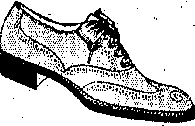
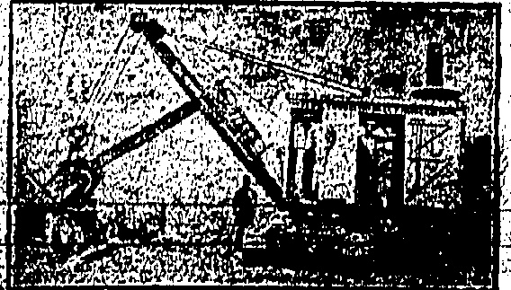

# WATSON'S PRICKLY HEAT

LOTION

An infallible remedy, affords immediate relief and effects a speedy cure.

Prices 50 cts. & $1.00 Per Bottle.

A. S. WATSON & CO., LTD.

HONGKONG DISPENSARY.

ESTABLISHED 81 YEARS.

Powell Ltd

Telephone C. 3146.

Quality, Style

## Character

THREE WORDS THAT MAKE THE DIFFERENCE FULL BROGUE SHOE IN THE FINEST QUALITY BROWN WILLOW, SOLES WELTED ON THE HAND-SEWN PRINCIPAL, UPPERS WELL CUT AND GIVING GOOD FIT AT ANKLE, IN HALF SIZES.

SOLE AGENTS FOR HONKONG.

PEDDER STREET

## DAIRY FARM NEWS HALF-HOLIDAY

Our customers are hereby notified that from TO-MORROW the 8th Inst., and until further notice WEDNESDAY will be recognised as a HALF-HOLIDAY by our BUTCHERY DEPARTMENTS—the closing hour being 12 NOON. OUR DAIRY DEPARTMENTS will observe the usual morning and forenoon hours but will be open for ONE HOUR ONLY on WEDNESDAY afternoons i.e. from 2 to 3 p.m.

THE DAIRY FARM, ICE & COLD STORAGE CO., LTD.

## AUTO-ICE

Can be worked by your amah, coolie or child; simply turn the handle; will last a lifetime. ELECTRICALLY RUN IF REQUIRED. FOR HOUSES, Restaurants and small hotels and shops $350. LARGER machines, electrically run, for order supplied to large hotels, Restaurants, factories and Government Departments. Reserve now from next shipment (only a few coming) by telephone C: 4630 or write to address given. MACHINE may be seen now at

### The “Auto-Ice” Produces 2 to 2₂ lbs. every 4 Minutes

Montgomery, Ollerton & Co.

10, Des Vœux Road Central.

ONGKONG EXCAVATION PILE DRIVING & CONSTRUCTION CO., LTD., H.K.

EXCAVATION WORK

CUBIC YARDS OF EARTH MOVED PER DAY BY OUR STRAUM SHOVEL EQUIPMENT

THỊ

# MOUTRIE PIANOS.

PLAYERS.

It is always a source of satisfaction to have things about you that can be relied upon to function as they are supposed to do.

“MOUTRIE” owners have this satisfaction about their Pianos.

Made for the climate — in the climate — by experienced workmen.

Easiest terms arranged.

S MOUTRIE & CO., LTD., Chatter Rd.

## QUALIFIED OPTICAL SERVICE

N. LAZARUS

Ophthalmic Optician

(Hongkong's only European Optician)

12, Queen's Rd. Central.

Manager:—R. A. OOPER

Qualified by Canadian Government Examination

Fellow of the American Optometric Association

◇◇◇◇◇◇◇◇◇◇◇◇◇◇◇◇◇◇◇◇◇◇◇◇◇◇◇◇◇◇◇◇◇◇◇◇◇◇◇◇◇◇◇◇◇◇◇◇◇◇◇◇◇◇◇◇◇◇◇◇◇◇◇◇◇◇◇◇◇◇◇◇◇◇◇◇◇◇◇◇◇◇◇◇◇◇◇◇◇◇◇◇◇◇◇◇◇◇◇◇◇◇◇◇◇◇◇◇◇◇◇◇◇◇◇◇◇◇◇◇◇◇◇◇◇◇◇◇◇◇◇◇◇◇◇◇◇◇◇◇◇◇◇◇◇◇◇◇◇◇◇◇◇◇◇◇◇◇◇◇◇◇◇◇◇◇◇◇◇◇◇◇◇◇◇◇◇◇◇◇◇◇◇◇◇◇◇◇◇◇◇◇◇◇◇◇◇◇◇◇◇◇◇◇◇◇◇◇◇◇◇◇◇◇◇◇◇◇◇◇◇◇◇◇◇◇◇◇◇◇◇◇◇◇◇◇◇◇◇◇◇◇◇◇◇◇◇◇◇◇◇◇◇◇◇◇◇◇◇◇◇◇◇◇◇◇◇◇◇◇◇◇◇◇◇◇◇◇◇◇◇◇◇◇◇◇◇◇◇◇◇◇◇◇◇◇◇◇◇◇◇◇◇◇◇◇◇◇◇◇◇◇◇◇◇◇◇◇◇◇◇◇◇◇◇◇◇◇◇◇◇◇◇◇◇◇◇◇◇◇◇◇◇◇◇◇◇◇◇◇◇◇◇◇◇◇◇◇◇◇◇◇◇◇◇◇◇◇◇◇◇◇◇◇◇◇◇◇◇◇◇◇◇◇◇◇◇◇◇◇◇◇◇◇◇◇◇◇◇◇◇◇◇◇◇◇◇◇◇◇◇◇◇◇◇◇◇◇◇◇◇◇◇◇◇◇◇◇◇◇◇◇◇◇◇◇◇◇◇◇◇◇◇◇◇◇◇◇◇◇◇◇◇◇◇◇◇◇◇◇◇◇◇◇◇◇◇◇◇◇◇◇◇◇◇◇◇◇◇◇◇◇◇◇◇◇◇◇◇◇◇◇◇◇◇◇◇◇◇◇◇◇◇◇◇◇◇◇◇◇◇◇◇◇◇◇◇◇◇◇◇◇◇◇◇◇◇◇◇◇◇◇◇◇◇◇◇◇◇◇◇◇◇◇◇◇◇◇◇◇◇◇◇◇◇◇◇◇◇◇◇◇◇◇◇◇◇◇◇◇◇◇◇◇◇◇◇◇◇◇◇◇◇◇◇◇◇◇◇◇◇◇◇◇◇◇◇◇◇◇◇◇◇◇◇◇◇◇◇◇◇◇◇◇◇◇◇◇◇◇◇◇◇◇◇◇◇◇◇◇◇◇◇◇◇◇◇◇◇◇◇◇◇◇◇◇◇◇◇◇◇◇◇◇◇◇◇◇◇◇◇◇◇◇◇◇◇◇◇◇◇◇◇◇◇◇◇◇◇◇◇◇◇◇◇◇◇◇◇◇◇◇◇◇◇◇◇◇◇◇◇◇◇◇◇◇◇◇◇◇◇◇◇◇◇◇◇◇◇◇◇◇◇◇◇◇◇◇◇◇◇◇◇◇◇◇◇◇◇◇◇◇◇◇◇◇◇◇◇◇◇◇◇◇◇◇◇◇◇◇◇◇◇◇◇◇◇◇◇◇◇◇◇◇◇◇◇◇◇◇◇◇◇◇◇◇◇◇◇◇◇◇◇◇◇◇◇◇◇◇◇◇◇◇◇◇◇◇◇◇◇◇◇◇◇◇◇◇◇◇◇◇◇◇◇◇◇◇◇◇◇◇◇◇◇◇◇◇◇◇◇◇◇◇◇◇◇◇◇◇◇◇◇◇◇◇◇◇◇◇◇◇◇◇◇◇◇◇◇◇◇◇◇◇◇◇◇◇◇◇◇◇◇◇◇◇◇◇◇◇◇◇◇◇◇◇◇◇◇◇◇◇◇◇◇◇◇◇◇◇◇◇◇◇◇◇◇◇◇◇◇◇◇◇◇◇◇◇◇◇◇◇◇◇◇◇◇◇◇◇◇◇◇◇◇◇◇◇◇◇◇◇◇◇◇◇◇◇◇◇◇◇◇◇◇◇◇◇◇◇◇◇◇◇◇◇◇◇◇◇◇◇◇◇◇◇◇◇◇◇◇◇◇◇◇◇◇◇◇◇◇◇◇◇◇◇◇◇◇◇◇◇◇◇◇◇◇◇◇◇◇◇◇◇◇◇◇◇◇◇◇◇◇◇◇◇◇◇◇◇◇◇◇◇◇◇◇◇◇◇◇◇◇◇◇◇◇◇◇◇◇◇◇◇◇◇◇◇◇◇◇◇◇◇◇◇◇◇◇◇◇◇◇◇◇◇◇◇◇◇◇◇◇◇◇◇◇◇◇◇◇◇◇◇◇◇◇◇◇◇◇◇◇◇◇◇◇◇◇◇◇◇◇◇◇◇◇◇◇◇◇◇◇◇◇◇◇◇◇◇◇◇◇◇◇◇◇◇◇◇◇◇◇◇◇◇◇◇◇◇◇◇◇◇◇◇◇◇◇◇◇◇◇◇◇◇◇◇◇◇◇◇◇◇◇◇◇◇◇◇◇◇◇◇◇◇◇◇◇◇◇◇◇◇◇◇◇◇◇◇◇◇◇◇◇◇◇◇◇◇◇◇◇◇◇◇◇◇◇◇◇◇◇◇◇◇◇◇◇◇◇◇◇◇◇◇◇◇◇◇◇◇◇◇◇◇◇◇◇◇◇◇◇◇◇◇◇◇◇◇◇◇◇◇◇◇◇◇◇◇◇◇◇◇◇◇◇◇◇◇◇◇◇◇◇◇◇◇◇◇◇◇◇◇◇◇◇◇◇◇◇◇◇◇◇◇◇◇◇◇◇◇◇◇◇◇◇◇◇◇◇◇◇◇◇◇◇◇◇◇◇◇◇◇◇◇◇◇◇◇◇◇◇◇◇◇◇◇◇◇◇◇◇◇◇�

## The China Mail

(Every evening except Sunday. Annual subscription, excluding postage abroad, H.K. $36, payable in advance. Local delivery free.)

©erland China Mail

(The weekly edition of the "China Mail." Annual subscription, excluding postage abroad, H.K. $12, payable in advance.)

The Newspaper Enterprise, Ltd.

No. 5.WYNDHEAM'ST.UONGKCNG

Telephones Central 22 & 4641. Cable Address:—Mail. Hongkong.

All communications should be addressed to the Newspaper Enterprises, Ltd., to whom all remittances should be made payable.

London Offices - The Far Eastern Advertising Agency (London), Ltd., 24, Devonshire Street, Bloomberg, W.C.1.

## Hongkong, Tuesday, July 7, 1925

## MOST ESSENTIAL

There are services and services that must be maintained during the strike. Some are of lesser importance than others. One of the most essential is undoubtedly the sanitary service. At all costs that must be kept going to the utmost capacity. At all costs—let that be repeated! There must be no possible risk of an epidemic of disease following the epidemic of idleness. In normal times the Sanitary Department is badly understaffed. One inspector for an area the size of a fairly large village at Home cannot be said to be enough for local conditions. It is streets—if not miles—off the ideal. What can be said of that staff during a period of emergency such as the Colony is passing through at present? And there is the army of sanitary coolies. They stood by the Department during the 1922 strike. On the present occasion intimidators have got to work—and the rest has been easy. Still, not all the Sanitary coolies are out and it is essential that these should be paid a wage commensurate with the vital importance of their work—the most necessary of any work in the Colony. It is believed that there is a sufficiency of coolie labour at the prevailing market price. That is an important factor in relation to the health of the Colony. But it is as well to publish the assurance for the benefit of the public in general—non-Chinese and Chinese.

God bless Esperantists! They at any rate are trying to subdue the spoken word of all nations to one uniform level, so that man

may understand man. Perhaps the greatest disaster that ever befell sinful man was that unhappy incident of the Tower of Babel, when tongues— at one time of equal sense—became confused. From that time dates conflicts, strifes, misunderstandings and all the rest of human waywardness. Is not a universal language the panacea for most of the ills of life? True, people of the same tongue quarrel, and, misunderstand, but the means are quickly at hand to readjust and make plain. Not so with those who speak in divers tongues. The civilised mind cannot, for instance, quite grasp the fact that those of the same race fight each other to the death. This civil strife in China—to the foreigner at any rate—is inexplicable. He asks questions and is given the reason. China is a land of many languages and dialects. One district cannot understand another. To those of one Province, the members of another are foreigners, if necessary to be treated in the most arbitrary fashion. This explains why Yunnanese are prepared to fight Cantonese, and contrariwise. Each to the other is a foreigner—an enemy, a suspect. And so it goes on. From which it would appear that nothing permanent in the peace line will occur until the babel of tongues in China is brought down to one common factor. It is a big job—but no bigger than following a campaign of slaughter. And the results will unquestionably be more lasting.

## AN APPEAL

## CORRESPONDENCE

## STRIKE PAY

(To the Editor of the China Mail).

Sir,—When I read in your columns that part of the resolution passed by the Kowloon Residents' Association in regard to payment of wages for the days in June during which the servants had worked, I rubbed my eyes and read it again to make sure that my eyes had not played me false. Yes, there, it was as plain as can be "such payment to be spread over a probationary period of at least one week." Ye gods! We know well that the boys are not justly entitled to any wages at all—having broken their contract—and we sternly say "No Boy!! I cannot pay you your wages to day, you have forfeited them by striking, but I will pay you in seven days' time."

PRAYER FOR THOSE IN CHINA.

The K.R.A., I presume, are acting upon the Hongkong Chamber of Commerce's recent recommendation. It might be as well therefore if they were to get in touch with that body when they would, I think, be informed that the probationary period the Chamber had in mind was from six to eight months! So that the final payment might fall somewhere about China New Year. What on earth is the use of one week? You might just as well pay the boys on the day of their return for all the told over than that such a course would give you.

"YOURS are"

"TIME OF CRISIS."

(Reuter's Service.)

London, July 6.

## NEW COMMANDER

The Archbishop of Canterbury and York have issued an appeal for prayer in churches and homes on behalf of Christians engaged in missionary work, especially educational work in China, also any Britons who may be endangered and statesmen of different nationalities on whom rests the responsibility at a time of crisis. "For them we ask wisdom, power and vision which shall lead to firm, considerate and generous handling of a situation that is extraordinary and difficult."

(Reuter's Service.)

General Naulin, commander of the thirtieth Corps, has been appointed Commander-in-Chief in Morocco.

#### U. S. AND CHINA

London, July 6.

(Reuter's Service.)

The United States' "well-meaning suggestion" to reform immediately extra-territorial rights in China is the theme of a long leader in the Daily Telegraph which declares that by doing so at the present hazardous moment the United States would be assuredly regarded by Japan as having at last thrown down the gauntlet.

The paper points out that of all the Foreign residents with interests in China the Japanese would not only suffer most by a modification of extra-territorial rights but in the present—mood—of—the Chinese, the Japanese would be so patently menaced that, pacific as its present intentions are, Tokyo would be persuaded by the mere instinct of self-preservation to take immediate action.

The editorial adds that side by side with the anti-foreign movement, the next few months will see the development in Manchuria of a fierce triangular struggle between Chang Tso-lin, Japan, and Red Russia. Unless Chang, with or without outside assistance, is able to enforce a definite limit to the continual penetration of Russia "the Island Kingdom must intervene."

The paper ends by slying that if to this necessity is added an attempt by the United States to weaken the guarantees which Japan now enjoys in China, there can be only one end to the affair.

## MILL FRACAS

Shanghai, July 6.

On Saturday night, a Municipal constable arrested a Chinese who had been firing crackers in the street. He detained the prisoner in a cotton-mill compound pending the arrival of the police car.

### (Reuter's Service.)

Hundreds of Chinese gathered in front of the mill, where they were addressed by two agitators, who urged them to attack the mill. The constable arrested one of the agitators, who struggled and attempted to seize the constable's revolver.

Other Chinese rushed up, while the cotton mill employees went to the constable's assistance.

An American seaman, named Dizik, belonging to the U.S.S. McLeish came on the scene and, seeing that the situation was critical, fired, shooting through the head of a Chinese who was about to jump upon the constable from behind. The crowd then dispersed.

The two agitators were arrested and will appear in the Mixed Court to-day.

The wounded Chinese died last night. Two foreign onlookers from the mill state that the American's action averted a serious situation.

London, July 4.—At Hurlingham to-day the Inter-University: Polo Match was contested, Cambridge beating Oxford by 8 goals to 2.—

Router

Paris, July 4.—Steve Donoghue has left the nursing home and has proceeded to England.—Router

EVERY USER IS A FRIEND.

The personal recommendations of people who have been cured by Chlamydiae's though family have done more than all else will increase the sale and use of this preparation until there are now more bodies or is sold each

## DANCERS KILLED

(Reuter's American Service.)

Boston, July 5.

While a hundred persons, were participating in the Fourth of July celebrations at the Pickwick Club early in the morning and an orchestra was playing dance music, a wall of a five-storey building, weakened by adjacent excavations, crashed down on the dance floor, entrapping the dancers between the floor and the fallen metal ceiling work.

Rescue was most difficult, necessitating the removal of the front wall which threatened to collapse in addition to the debris. Hitherto twelve dead were brought out after a night and daylong search. Voices, chiefly of women, were heard calling for help from the debris early in the morning but became silent later.

## FALSE REPORTS

(Router's Service.)

Hankow, July 5

The American Chamber of Commerce has written to the Chinese Chamber of Commerce to endeavour to make known to the Chinese the true facts of the Hankow affair.

After warning the Chinese Chamber of the danger of allowing false reports—the American note says that there is nothing to add to the despatches from the Consuls to the Chinese authorities on June 15, which contained a complete and irrefutable statement on the Hankow incident, and encloses copies.

Attention is drawn to efforts being made to throw the full responsibility for the incident on the British authorities and the note says: it so happened that a point in the British Concession was attacked, but as the British Naval officer in charge of that post acted for the International community of Hankow, we, as part of the combined defence force which included French, Italians, Japanese and Americans, as well as British, must therefore accept our share of the responsibility of their action.

"We stand by them wholeheartedly, and urge you in fairness to co-operate in making this fact clear to the Chinese people."

## HENLEY REGATTA

### (Reuter's Service.)

Dull weather prevailed at Henley to-day, but a large 'crowd witnessed the finals in the various events. In the final for the Visitors' Cup, Third Trinity College (Cambridge) beat Brasenose (Oxford) by two lengths in 7 minutes 45 seconds. In the Grand Challenge Cup, Leander beat the Thames Rowing Club by three quarters of a length in 6 minutes 53 seconds, which is a record for the course.

In the Diamond Sculls, Beresford beat Gollan easily in 8 minutes 28 seconds.

Beresford interviewed after the racing said that he had relinquished the Philadelphia Gold Cup which he had handed back to the American oarsman Hoover.

His ground for doing this was that the English Amateur Rowing Association insisted that the Diamond Sculls constituted the World's Amateur Championship, and not the Philadelphia Cup as claimed by the Americans.

In the Stewards' Cup, Third Trinity (Cambridge) beat Leander by 2 lengths in 7 minutes 27 seconds.

In the Ladies' Lady Margaret, (Cambridge), beat Radley College by 2 lengths in 7 minutes; 7 seconds.

In the Wyfold Cup, the Thames Rowing Club beat Selwyn College (Cambridge) by $1\frac{1}{4}$ lengths in 7 minutes 35 seconds.

In the Thames Cup, First Trinity (Cambridge) beat the Henley Rowing Club by 1 length in 7 minutes 16 seconds, and in the Silver Goblets, Third Trinity (Cambridge) beat Leander by 4 lengths in 8 minutes 17 seconds.

Shanghai, July 5.—His Royal Highness Prince George arrived yesterday, and attended an Independence Day Reception at the American Club.

Tokyo, July 5.—Earthquake shocks of some strength were experienced at Tottori yesterday. It is reported that a few buildings were shaken down, but there were no casualties.

London, July 5.—The French reply to the British Note of July 2 has been received in London. It promises sympathetic consideration. The replies of the other five nations, to which the circular Note was sent, have not yet been received. It is possible that the discussion of the British and French Treasuries will be returned, but a general debt is

## RIFFI ATTACKS

FRENCH' REPULSE NIGHT OFFENSIVE

SHARP ENGAGEMENT.

(Router's Service.)

Paria, July 6.

A message from Fez states that violent Riff attacks were made on the night of July 5 on a group of French positions at Upper Leben, near Ainnatouf, and were repulsed with heavy losses. The French advanced north-west of Kiffane after a sharp engagement in which arms and munitions were captured. In view of the recent enemy infiltrations, women and children have, as a precaution, left Taza.

## DOSSER'S TRIAL

The evidence in the Dosser case was continued this morning. Two Russians, Detective Bebenim and Constable Kedrolizansky, who accompanied a British detective to arrest the accused couple, described the finding of incriminating documents, with especial regard "to a certificate from the Soviet Agitation Department.

Cross-examined, Bebenim admitted that he once worked for the Bolsheviks at Vladivostock, but denied that when sent on a Soviet mission from Vladivostock, he embezzled Soviet funds. He, however, admitted being sent on such a mission.

Kedrolizansky admitted that before joining the Municipal Police in Shanghai he was an officer in the White Russian Army at Vladivostok, also that he was formerly a political enemy of the Bolsheviks, who imprisoned him at Vladivostok. He was only released when the Japanese took over the port.

The case was adjourned until to-morrow.

## EUROPEAN CHARGED

ALLEGED BREACH OF TRUST.

In the District Court at Singapore a European, named Mr. W. W. Matthews, was charged with criminal breach of trust in respect of $2,000 worth of watches belonging to Messrs. V. R. Vick and Co. Chief Court Inspector Meredith asked for a postponement for further investigations, as the accused was only just arrested.

The accused, who pleaded, not guilty, objected to a postponement, stating that if there was a case against him it was a civil case. He added that he was not an agent, but a partner with Mr. Vick, and that about $4,000 must be due to him from Mr. Vick.

Mr. Franklyn Robinson adjourned the case for a week, fixing bail at $2,000.

Shanghai, July 5.—Mr. MacMurray, the newly-appointed U.S. Minister to China, left Shanghai this afternoon on an American gunboat. He is expected to arrive in Tientain to-morrow afternoon. Reuter.

Washington. July 6.—Reports hitherto received by the War Department indicate that the test muster for defence forces yesterday was only two thirds as great as in September. Nevertheless the results are considered satisfactory.—Reuter's American Service.

Paris, July 8.—That protracted Franco-German commercial negotiations have broken down is attributed to the fact that both countries are about to introduce new Protectionist tariffs and that it is impossible to conclude a permanent convention until these are passed by Parliament.—Reuter.

## EXCHANGK

HongKong, 7th July 1988.

On London—

Bank, Wire... --- 3/2-1

On demand --- 7/8 9/16

30 day's sight... ---

4 months' sight --- 23-3

Ordinates 4 months' sight --- 1/4-2

Documentary, 4 months sight 3/4-3

On Paris---

On demand --- 1170

Ordinates, 4 months' sight --- 1270

On Berlin---

On New York—

On demand ___ $7½

Credits: 60 days' sight ___ $7½

On Bombay—

On demand ___ ___ ___ 18