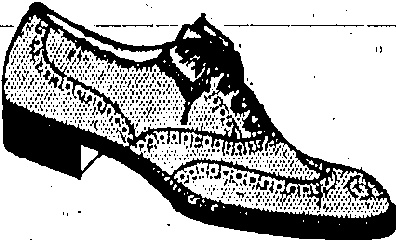
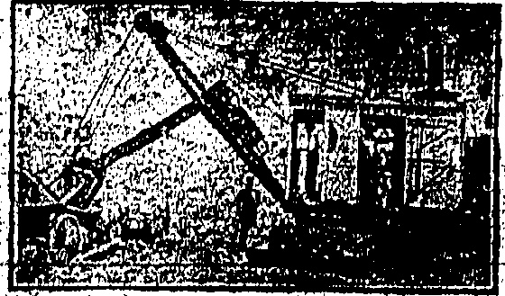

# WATSON'S PRICKLY HEAT LOTION

An infallible remedy, affords immediate relief and effects a speedy cure.

Prices 50 cts. & $1.00 Per Bottle.

A. S. WATSON & CO., LTD.

HONGKONG DISPENSARY.

ESTABLISHED 81 YEARS.

Powell Wm. Telenphone 0. 3146.

## Quality, Style

Style 3850 Price 22.50

THREE WORDS THAT MAKE THE DIFFERENCE FULL BROGUE SHOE IN THE FINEST QUALITY BROWN WILLOW, SOLES WELTED ON THE HAND-SEWN PRINCIPAL, UPPERS WELL CUT AND GIVING GOOD FIT AT ANKLE, IN HALF SIZES.

Character

PEDDER STREET

☐☐☐☐☐☐☐☐☐☐☐☐☐☐☐☐☐☐☐☐☐☐☐☐☐

## FRESH

The undernoted are being supplied with FRESH DAIRY FARM MILK twice daily and we recommend those of our customers who find it inconvenient to send to our Depot for supplies to obtain same from either:—

H. M. HAJEE ESMAIL

2 TIN LOK LANE

MORRISON HILL

THE INDIAN STORES

46 QUEEN'S ROAD, EAST

WANCHAI

THE DAIRY FARM, ICE & COLD STORAGE CO., LTD.

## CHOCOLATE & COCOA SUPPLIES:

## Telephone C: 4630

Just arriving a small shipment of the celebrated SICKESZ HOLLAND CHOCOLATE and COCOA as supplied locally to His Majesty's Government, Mac's Cafeteria and most local stores. For this shipment we are making special arrangements, for the present only to distribute direct to local residents, hotels and restaurants in case or part case lots.

COCOA: Guaranteed to contain 26% cocoa butter packed 72 half pound tropical double-lidded tins to each case.

CHOCOLATE: Packed in double-lidded tins containing 12 bars each one ounce weight; 72 tins to each case. Bulk Cocoa and Block Chocolate for cooking purposes also for temporary period at

## WHOLESALE PRICES

Telephone your orders to C. 4680 or write to Montgomery, Ollerton & Co., 10., Des Vœux Road, Bank of East Asia Bldg.

☐☐☐☐☐☐☐☐☐☐☐☐☐☐☐☐☐☐☐☐☐☐☐☐☐☐☐☐☐☐☐☐☐☐☐☐☐☐☐☐☐☐☐☐☐☐☐☐☐☐☐☐☐☐☐☐☐☐☐☐☐☐☐☐☐☐☐☐☐☐☐☐☐☐☐☐☐☐☐☐☐☐☐☐☐☐☐☐☐☐☐☐☐☐☐☐☐☐☐☐☐☐☐☐☐☐☐☐☐☐☐☐☐☐☐☐☐☐☐☐☐☐☐☐☐☐☐☐☐☐☐☐☐☐☐☐☐☐☐☐☐☐☐☐☐☐☐☐☐☐☐☐☐☐☐☐☐☐☐☐☐☐☐☐☐☐☐☐☐☐☐☐☐☐☐☐☐☐☐☐☐☐☐☐☐☐☐☐☐☐☐☐☐☐☐☐☐☐☐☐☐☐☐☐☐☐☐☐☐☐☐☐☐☐☐☐☐☐☐☐☐☐☐☐☐☐☐☐☐☐☐☐☐☐☐☐☐☐☐☐☐☐☐☐☐☐☐☐☐☐☐☐☐☐☐☐☐☐☐☐☐☐☐☐☐☐☐☐☐☐☐☐☐☐☐☐☐☐☐☐☐☐☐☐☐☐☐☐☐☐☐☐☐☐☐☐☐☐☐☐☐☐☐☐☐☐☐☐☐☐☐☐☐☐☐☐☐☐☐☐☐☐☐☐☐☐☐☐☐☐☐☐☐☐☐☐☐☐☐☐☐☐☐☐☐☐☐☐☐☐☐☐☐☐☐☐☐☐☐☐☐☐☐☐☐☐☐☐☐☐☐☐☐☐☐☐☐☐☐☐☐☐☐☐☐☐☐☐☐☐☐☐☐☐☐☐☐☐☐☐☐☐☐☐☐☐☐☐☐☐☐☐☐☐☐☐☐☐☐☐☐☐☐☐☐☐☐☐☐☐☐☐☐☐☐☐☐☐☐☐☐☐☐☐☐☐☐☐☐☐☐☐☐☐☐☐☐☐☐☐☐☐☐☐☐☐☐☐☐☐☐☐☐☐☐☐☐☐☐☐☐☐☐☐☐☐☐☐☐☐☐☐☐☐☐☐☐☐☐☐☐☐☐☐☐☐☐☐☐☐☐☐☐☐☐☐☐☐☐☐☐☐☐☐☐☐☐☐☐☐☐☐☐☐☐☐☐☐☐☐☐☐☐☐☐☐☐☐☐☐☐☐☐☐☐☐☐☐☐☐☐☐☐☐☐☐☐☐☐☐☐☐☐☐☐☐☐☐☐☐☐☐☐☐☐☐☐☐☐☐☐☐☐☐☐☐☐☐☐☐☐☐☐☐☐☐☐☐☐☐☐☐☐☐☐☐☐☐☐☐☐☐☐☐☐☐☐☐☐☐☐☐☐☐☐☐☐☐☐☐☐☐☐☐☐☐☐☐☐☐☐☐☐☐☐☐☐☐☐☐☐☐☐☐☐☐☐☐☐☐☐☐☐☐☐☐☐☐☐☐☐☐☐☐☐☐☐☐☐☐☐☐☐☐☐☐☐☐☐☐☐☐☐☐☐☐☐☐☐☐☐☐☐☐☐☐☐☐☐☐☐☐☐☐☐☐☐☐☐☐☐☐☐☐☐☐☐☐☐☐☐☐☐☐☐☐☐☐☐☐☐☐☐☐☐☐☐☐☐☐☐☐☐☐☐☐☐☐☐☐☐☐☐☐☐☐☐☐☐☐☐☐☐☐☐☐☐☐☐☐☐☐☐☐☐☐☐☐☐☐☐☐☐☐☐☐☐☐☐☐☐☐☐☐☐☐☐☐☐☐☐☐☐☐☐☐☐☐☐☐☐☐☐☐☐☐☐☐☐☐☐☐☐☐☐☐☐☐☐☐☐☐☐☐☐☐☐☐☐☐☐☐☐☐☐☐☐☐☐☐☐☐☐☐☐☐☐☐☐☐☐☐☐☐☐☐☐☐☐☐☐☐☐☐☐☐☐☐☐☐☐☐☐☐☐☐☐☐☐☐☐☐☐☐☐☐☐☐☐☐☐☐☐☐☐☐☐☐☐☐☐☐☐☐☐☐☐☐☐☐☐☐☐☐☐☐☐☐☐☐☐☐☐☐☐☐☐☐☐☐☐☐☐☐☐☐☐☐☐☐☐☐☐☐☐☐☐☐☐☐☐☐☐☐☐☐☐☐☐☐☐☐☐☐☐☐☐☐☐☐☐☐☐☐☐☐☐☐☐☐☐☐☐☐☐☐☐☐☐☐☐☐☐☐☐☐☐☐☐☐☐☐☐☐☐☐☐☐☐☐☐☐☐☐☐☐☐☐☐☐☐☐☐☐☐☐☐☐☐☐☐☐☐☐☐☐☐☐☐☐☐☐☐☐☐☐☐☐☐☐☐☐☐☐☐☐☐☐☐☐☐☐☐☐☐☐☐☐☐☐☐☐☐☐☐☐☐☐☐☐☐☐☐☐☐☐☐☐☐☐☐☐☐☐☐☐☐☐☐☐☐☐☐☐☐☐☐☐☐☐☐☐☐☐☐☐☐☐☐☐☐☐☐☐☐☐☐☐☐☐☐☐☐☐☐☐☐☐☐☐☐☐☐☐☐☐☐☐☐☐☐☐☐☐☐☐☐☐☐☐☐☐☐☐☐☐☐☐☐☐☐☐☐☐☐☐☐☐☐☐☐☐☐☐☐☐☐☐☐☐☐☐☐☐☐☐☐☐☐☐☐☐☐☐☐☐☐☐☐☐☐☐☐☐☐☐☐☐☐☐☐☐☐☐☐☐☐☐☐☐☐☐☐☐☐☐☐☐☐☐☐☐☐☐☐☐☐☐☐☐☐☐☐☐☐☐☐☐☐☐☐☐☐☐☐☐☐☐☐☐☐☐☐☐☐☐☐☐☐☐☐☐☐☐☐☐☐☐☐☐☐☐☐☐☐☐☐☐☐☐☐☐☐☐☐☐☐☐☐☐☐☐☐☐☐☐☐☐☐☐☐☐☐☐☐☐☐☐☐☐☐☐☐☐☐�

EXCAVATION WORK

## 650 

CURIC YARD5 OF EARTH MOVED PER DAY BY OUR STRAM SHOVEL EQUIPMENT

NEW

# VICTOR RECORDS

Just Arrived

INCLUDING

"THE FLAPPER WIFE"

S MOUTRIE & CO., LTD., Chatter Rd.

HERE'S an ICE OREAM SODA

that more than SATISFIES.

# - IT DELIGHTS -

TRY ONE AT MORINAGA'S

ASIATIC BUILDING

TỪ. C. 4702

## QUALIFIED OPTICAL SERVICE

N. LAZARUS

Ophthalmic Optician

◇◇◇◇◇◇◇◇◇◇◇◇◇◇◇◇◇◇◇◇◇◇◇◇◇◇◇◇◇◇◇◇◇◇◇◇◇◇◇◇◇◇◇◇◇◇◇◇◇◇◇◇◇◇◇◇◇◇◇◇◇◇◇◇◇◇◇◇◇◇◇◇◇◇◇◇◇◇◇◇◇◇◇◇◇◇◇◇◇◇◇◇◇◇◇◇◇◇◇◇◇◇◇◇◇◇◇◇◇◇◇◇◇◇◇◇◇◇◇◇◇◇◇◇◇◇◇◇◇◇◇◇◇◇◇◇◇◇◇◇◇◇◇◇◇◇◇◇◇◇◇◇◇◇◇◇◇◇◇◇◇◇◇◇◇◇◇◇◇◇◇◇◇◇◇◇◇◇◇◇◇◇◇◇◇◇◇◇◇◇◇◇◇◇◇◇◇◇◇◇◇◇◇◇◇◇◇◇◇◇◇◇◇◇◇◇◇◇◇◇◇◇◇◇◇◇◇◇◇◇◇◇◇◇◇◇◇◇◇◇◇◇◇◇◇◇◇◇◇◇◇◇◇◇◇◇◇◇◇◇◇◇◇◇◇◇◇◇◇◇◇◇◇◇◇◇◇◇◇◇◇◇◇◇◇◇◇◇◇◇◇◇◇◇◇◇◇◇◇◇◇◇◇◇◇◇◇◇◇◇◇◇◇◇◇◇◇◇◇◇◇◇◇◇◇◇◇◇◇◇◇◇◇◇◇◇◇◇◇◇◇◇◇◇◇◇◇◇◇◇◇◇◇◇◇◇◇◇◇◇◇◇◇◇◇◇◇◇◇◇◇◇◇◇◇◇◇◇◇◇◇◇◇◇◇◇◇◇◇◇◇◇◇◇◇◇◇◇◇◇◇◇◇◇◇◇◇◇◇◇◇◇◇◇◇◇◇◇◇◇◇◇◇◇◇◇◇◇◇◇◇◇◇◇◇◇◇◇◇◇◇◇◇◇◇◇◇◇◇◇◇◇◇◇◇◇◇◇◇◇◇◇◇◇◇◇◇◇◇◇◇◇◇◇◇◇◇◇◇◇◇◇◇◇◇◇◇◇◇◇◇◇◇◇◇◇◇◇◇◇◇◇◇◇◇◇◇◇◇◇◇◇◇◇◇◇◇◇◇◇◇◇◇◇◇◇◇◇◇◇◇◇◇◇◇◇◇◇◇◇◇◇◇◇◇◇◇◇◇◇◇◇◇◇◇◇◇◇◇◇◇◇◇◇◇◇◇◇◇◇◇◇◇◇◇◇◇◇◇◇◇◇◇◇◇◇◇◇◇◇◇◇◇◇◇◇◇◇◇◇◇◇◇◇◇◇◇◇◇◇◇◇◇◇◇◇◇◇◇◇◇◇◇◇◇◇◇◇◇◇◇◇◇◇◇◇◇◇◇◇◇◇◇◇◇◇◇◇◇◇◇◇◇◇◇◇◇◇◇◇◇◇◇◇◇◇◇◇◇◇◇◇◇◇◇◇◇◇◇◇◇◇◇◇◇◇◇◇◇◇◇◇◇◇◇◇◇◇◇◇◇◇◇◇◇◇◇◇◇◇◇◇◇◇◇◇◇◇◇◇◇◇◇◇◇◇◇◇◇◇◇◇◇◇◇◇◇◇◇◇◇◇◇◇◇◇◇◇◇◇◇◇◇◇◇◇◇◇◇◇◇◇◇◇◇◇◇◇◇◇◇◇◇◇◇◇◇◇◇◇◇◇◇◇◇◇◇◇◇◇◇◇◇◇◇◇◇◇◇◇◇◇◇◇◇◇◇◇◇◇◇◇◇◇◇◇◇◇◇◇◇◇◇◇◇◇◇◇◇◇◇◇◇◇◇◇◇◇◇◇◇◇◇◇◇◇◇◇◇◇◇◇◇◇◇◇◇◇◇◇◇◇◇◇◇◇◇◇◇◇◇◇◇◇◇◇◇◇◇◇◇◇◇◇◇◇◇◇◇◇◇◇◇◇◇◇◇◇◇◇◇◇◇◇◇◇◇◇◇◇◇◇◇◇◇◇◇◇◇◇◇◇◇◇◇◇◇◇◇◇◇◇◇◇◇◇◇◇◇◇◇◇◇◇◇◇◇◇◇◇◇◇◇◇◇◇◇◇◇◇◇◇◇◇◇◇◇◇◇◇◇◇◇◇◇◇◇◇◇◇◇◇◇◇◇◇◇◇◇◇◇◇◇◇◇◇◇◇◇◇◇◇◇◇◇◇◇◇◇◇◇◇◇◇◇◇◇◇◇◇◇◇◇◇◇◇◇◇◇◇◇◇◇◇◇◇◇◇◇◇◇◇◇◇◇◇◇◇◇◇◇◇◇◇◇◇◇◇◇◇◇◇◇◇◇◇◇◇◇◇◇◇◇◇◇◇◇◇◇◇◇◇◇◇◇◇◇◇◇◇◇◇◇◇◇◇◇◇◇◇◇◇◇◇◇◇◇◇◇◇◇◇◇◇◇◇◇◇◇◇◇◇◇◇◇◇◇◇◇◇◇◇◇◇◇◇◇◇◇◇◇◇◇◇◇◇◇◇◇◇◇◇◇◇◇◇◇◇◇◇◇◇◇◇◇◇◇◇◇◇◇◇◇◇◇◇◇◇◇◇◇◇◇◇◇◇◇◇◇◇◇◇◇◇◇◇◇◇◇◇◇◇◇◇◇◇◇◇◇◇◇◇◇◇◇◇◇◇◇◇◇◇◇◇◇◇◇◇◇◇◇◇◇◇◇◇◇◇◇◇◇◇◇◇◇◇◇◇◇◇◇◇◇◇◇◇◇◇◇◇◇◇◇◇◇◇◇◇◇◇◇◇◇◇◇◇◇◇◇◇◇◇◇◇◇◇◇◇◇◇◇◇◇◇◇◇◇◇◇◇◇◇◇◇◇◇◇◇◇◇◇◇◇◇◇◇◇◇◇◇◇◇◇◇◇◇◇◇◇◇◇◇◇◇◇◇◇◇◇◇◇◇◇◇◇◇◇◇◇◇◇◇◇◇◇◇◇◇◇◇◇◇◇◇◇�

## The China Mail

(Every evening except Sunday. Annual subscription, excluding postage abroad, H.K. $30, payable in advance. Local delivery free.)

Oerland China Oil

(The weekly edition of the “China Mail.” Annual subscription, exobd-ing postage abroad, H.K. $12, payable in advance.)

The Newspaper Enterprise, Ltd.

Printers & Publishers

No. 5.WINDHAM ST. HONGKONG

Telephones Central 22 & 4641. Cable Address:—Mail, Hongkong.

All communications should be addressed to the Newspaper Enterprise, Ltd., to whom all remittances should be made payable.

London Offices:—The Far Easturo Advertising Agency (London); Ltd., 24, Devonshire Street, Bloomsbury, W.C.1.

## ACKNOWLEDGMENT

Mrs. Angus and family wish to thank all their friends for their kind sympathy, floral-tributes and the many letters of condolence received in their recent sad bereavement.

Hongkong, Thursday, July 9, 1925.

1

TIGHTENING UP.

As day succeeds day and the strike shows no sign of a sudden collapse, it is evident that the authorities are grimly determined to tighten up the precautions relevant and necessary to the position. There are, it is true, critics who aver that the Government might have done this and done that at the very commencement of what may be described as "the operations." Be that as it may, the non-Chinese community are beginning to realise with every fresh proclamation that the authorities mean to gain the upper hand of the elements who know not law and order.

Before the end of the strike the Government will be in a position at least to know who are friends and who are enemies—who are merely scared mortals and who are secret emissaries of the force behind the whole strike-movement. With those who have felt obliged, through sheer physical fear, to obey the injunction to quit their service there may be a certain amount of sympathy, although that may well be kept in reserve until the strike is over. The business at the moment is to carry on the life of the individual and of the community without any semblance of sentiment, however humanitarian some would like to be toward those who have innocently been parties to the general dislocation. Nothing must be permitted to interfere with that business, not even a “wait and see” policy in respect of developments in Canton, which can be left to take care of themselves. Dislocation inevitably implies monetary loss of some kind, direct or indirect. The measure of that loss must be reduced to the absolute minimum.

## More Man-Power

Is the man-power of the Colony being used to the best possible advantage in the present emergency? That is not an idle question. There have been hundreds of volunteers who have come forward to give of their services freely for the common good. Others have taken the very sensible course of joining the Volunteer Defence Corps; and still others may be classified as performing very necessary duty to the community by remaining in their present billets. Still, if a long view is to be taken of the strike and of the aftermath of the strike, it must be obvious to the most casual observer that there is a host of people content to go on from day to day as they did before the strike—without the slightest suggestion of help to the community in general. They are shirkers and nothing less than shirkers! In any comparative "roll of honour" compiled with a history of the strike the names of these shirkers, and malingerers will be found missing. It is to be hoped that a hint will be sufficient at the present juncture in the interests of the entire Colony that volunteer workers are still in demand in the vital business of "carrying on."

## More Useful

Those who arranged the volunteer route marches are probably prepared to justify them and argue that they have served a useful purpose. We sincerely hope so. But it can also be argued that Volunteer work might be more usefully employed. Routine patrols have a deadening and destroying influence when unrelieved by interest. Patrols we are sure would be glad to have work of what may be termed a more productive character. Why not let them be put on to search the many empty houses — foreign and Chinese—where it is stated are to be found nests of striking boys, coolies and amahs. The sight at the Post Office each day does not suggest a sense of order or decency. A few volunteers could certainly keep the large number of Chinese in line who crowd round a little door which seems to admit entrance to letter boxes. There are other avenues of "productive" work that would make volunteering less the holiday work it is. We need to infuse sincerity in all that is being done and to maintain it right to the bitter end.

## TYPHOON NEWS

## LOCAL SIGNAL LOWERED

The telegram quoted below was received from the Manila Observatory by the American Consulate General, Hongkong:—

9.05 a.m., July 9:—Cyclone or typhoon near or over southern Formosa, moving N.W.

## Signal Down

At 9 this morning, the “local” typhoon signal was lowered at the Royal Observatory.

## SINGAPORE BASE

PROGRESS AT THE NEW DOCKYARD

(Reuter's Service.)

London, July 8.

In the House of Commons, replying to Commander J. Kenworthy, Mr. W. S. Bridgeman described the progress of the work at the new dockyard in Singapore in preparation for the dredging work for a berth for the floating dock on the arrival of the dredging fleet in November.

## SAAR BASIN

AN AMERICAN LOAN.

(Reuter's American Service.)

New York, July 8.

The complete success is announced of the four million dollars loan for the Saar Basin at seven per cent., which is offered here and in Chicago at $97.

#### F. A. TOUR

ENGLISH TEAM STILL WINNING

(Reuter's Service.)

Newcastle (N.S.W.), July 8. The association football (sent out by the English F.A.) beat

Tokyo, July 8.—An earthquake yesterday morning shook Nagoya and a wide area of country around it. There were a few casualties, including one person killed. Some walls and chimneys collapsed, and ground fissures were caused. — Reuter's Service.

## HARD UP:

"STRIKE EXECUTIVE'S" PLIGHT.

ACK QF FUNDS.

Canton's "Strike Executive" is hard up! In yesterday's issue of the "San Kwok Wah Po" (a prominent Kuomintang organ) a copy of which was smuggled into Hongkong and has been passed on to the "China Mail" is a notice by the "General Strike Executive for Canton and Hongkong, of the China National Labour Union." After mentioning the appointment of So Shiu-ching (also spelt So_Siu-tsing) — who formerly achieved notoriety as one of the Seamen's Union Hongkong leaders— as chairman and chairman of the finance sub-committee, the notice issues an appeal to all sections. Loans, says the notice, will be officially acknowledged—whatever that may mean—and it is hinted that money is urgently needed to support the strikers in Canton.

In the same issue it is admitted that strikers' returning from Canton have been victimised by "fellow-patriots" who, under pretence of welcoming the heroes, walk off with their luggage! Some of the strikers have also been embroiled in street fights regarding which serious complaints have been made.

### "CABLE ROMANCE."

EASTERN TELEGRAPH CO'S FILM.

AFTER-LUNCHEON SHOW.

(Router's Service.)

London, July 8.

"Romance of the Submarine Cable"—a film illustrating the fascinating story of the manufacture, laying, repairing and everyday work of the cable—was exhibited by the Eastern Associated Telegraph Companies after luncheon at the Savoy Hotel, presided over by the Vice-Chairman, Mr. J. C. Denison Pender.

The film gives many instances of everyday life of the Eastern Company's staff ashore and afloat. The complicated machinery employed in covering the core cable was shown in all its progresses.

## HEAT WAVE

NINE DEATHS IN

EAST U.S.A.

105 DEGREES F.

(Reuter's American Service.)

The East of the United States has been gripped in a heat wave from which there are at least nine deaths.

For two days violent thunderstorms only temporarily relieved the sweltering millions.

The temperature at Washington yesterday was 105 degrees Fahrenheit.

## MOROCCO

## THE ENEMY'S LATEST OFFENSIVE

(Reuter's Service.)

It is reported from Fez that the French north of Wezzan have evacuated two advanced posts after the removal of the stores and the destruction of the defences.

A later despatch reports that the Riffs have mustered ten thousand rifles in the Wergha region, where they are endeavouring to win over the tribes. The enemy is apparently aiming at a new and intensified offensive against Fez from the north to the south.

## POLICE MOBBED

### (Reuter's Service.)

A French firm, having a consignment of tobacco aboard Messrs. Butterfield and Swire's s.s. Shuntien alongside the French Bund, attempted to remove the cargo this morning, using their own Chinese labour, Messrs. Butterfield and Swire arranging for guards.

As soon as the work commenced, well-dressed Chinese, with a mob of striking wharccoolies attempted to prevent the work. The French police manned the gangways, but were forced back on to the ship.

Seeing that the situation was serious the captain of the Shuntien sounded his syren for help, and a party of British blue jackets from H.M.S. Hawkins went to the rescue and easily dispersed the crowd.

One coolie was seriously hurt, and an Annamite policeman deprived of his rise during the struggle.

## VARSITY MATCH

OXFORD AND CAMBRIDGE

DRAW.

The annual Oxford v. Cambridge University match at Lord's ended in a draw, the batsmen getting the better of the bowlers.

Cambridge Batsman's Feat.

(Reuter's Service.)

London, July 8.

Scores were as follow:—

OXFORD

1st innings 350 runs. P. H. Stewart-Brown (Harrow and Magdalen) scored 56; J. L. Guise (Winchester and Brasenose) scored 58.

[Stewart-Brown was a Freshman last year, but not a Blue. Guise is captain this year, played last year and in 1923 he won his Blue as a Freshman but an injury at Eastbourne prevented him from playing in the big match.]

## CAMBRIDGE

1st innings 409 runs. K. S. Duleepsinhji (a Freshman from Cheltenham) contributed 75; H. J. Enthoven (Harrow and Pembroke) compiled 129. The latter scored 104 last year and thus equalled William Yardley's inter-Varsity record of two centuries in 1870 and 1872 (Yardley made 100 in 1870 and 130 in 1872 for Cambridge). L. G. Crawley (Harrow and Pembroke) scored 98.

[Enthoven is hon. secretary this year; as a Freshman he won his Blue in 1923 and he played, as stated, last year. Crawley is hon. assistant treasurer this year; he also won his Blue as a Freshman in 1923 and played last year. Duleepsinhji is a nephew of K. S. Ranjitsinhji who is better known as "Ranji."]

2nd innings 214 runs for 6 wickets, P. H. Stewart-Brown scored 69 and E. R. T. Holmes (a Freshman from Malvern) made 68.

Including this match the total played to date is 87. Cambridge have won 41, Oxford 36 and 10 have been left drawn.

## -

Reuter does not mention rain. Accordingly, it may be presumed that there was little or no interruption on the three days but that the batting—possibly on a hard, dry wicket—was so slow that a draw was inevitable on the third day (yesterday). At any rate Oxford were only 156 runs on when stumps were drawn so that there was little chance of declar-

## WORLD RECORDS

## FOKKER ABROPLANE'S LOADED SPEEDS

## /Portowa Sanوئا"

## Amsterdam, July 8

M. Grase, chief of the scientific section of the Fokker aeroplane works, flew a standard Fokker DX3 machine (of 450 horse power with a Napier-Lion engine) a hundred kilometres at an average speed of 266 kilometres; and two hundred kilometres at an average speed of 265 kilometres, with a load of five hundred kilos. These are believed to be world's records.

Warsaw, July 8.—Further incidentals have occurred on the Polish-Russian frontier. Twenty Russian soldiers crossed the frontier and fired on the Polish frontier guards, who drove back the Russians of whom one was mortally wounded. Political police recently arrested two hundred Soviet emissaries on the Eastern border.—Reuter's Service.

## EXCHANGE

Hongkong, 9th July 1923. On London—

Bank, Viro... 2/3-5

On demand 3/3 11/16

30 day's sight... 8/3 x

Credits 4 months' rights 3/4-9 Documentary, 4 months rights 2/4-8 On Paris

Credita, 4 month's gbb, 1920

On Berlin

On demand

On New York

Credits, 60 days' right... $79

On Bombay--

On demand ___ 158) On Jaloutia—

On demand → = = = = B3