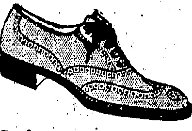

# WATSON'S PRICKLY HEAT

An infallible remedy, affords immediate relief and effects a speedy cure.

LOTION

A. S. WATSON & CO., LTD.

HONGKONG DISPENSARY.

ESTABLISHED 81 YEARS.

Prices 50 cts: & $1.00 Per Bottle.

THREE WORDS THAT MAKE THE DIFFERENCE FULL BROGUE SHOE IN THE FINEST QUALITY BROWN.WILLOW, SOLES WELTED ON THE HAND-SBWN PRINCIPAL, UPPERS WELL CUT AND GIVING GOOD FIT AT ANKLE, IN HALF SIZES.

SOLE AGENTS FOR HONKONG.

PEDDER STREET

## FRESH

The undernoted are being supplied with FRESH DAIRY FARM MLK twice daily and we recommend those of our customers who find it inconvenient to send to our Depot for supplies to obtain same from either:—

H. M. HAJEE ESMAIL

2 TIN LOK LANE

MORRISON HILL

THE DAIRY FARM, ICE & GOLD STORAGE CO., LTD.

## CHOCOLATE & COCOA SUPPLIES

Just arriving a small shipment of the celebrated SICKESZ HOLLAND CHOCOLATE and COCOA as'supplied locally to His Majesty's Government, Mac's Cafeteria and most local stores. For this shipment we are making special arrangements, for the present only to distribute direct to local residents, hotels and restaurants in case or part case lots.

COCOA: Guaranteed to contain 26% cocoa butter packed 72 half pound tropical double-lidded tins to each case.

CHOCOLATE: Packed in double-lidded tins containing 12 bars each one ounce weight; 72 tins to each case. Bulk Cocoa and Block Chocolate for cooking purposes also for temporary period at

WHOLESALE PRICES

Telephone your orders to C. 4680 or write to Montgomery, Ellerton & Co., 10., Des Vœux Road, Bank of East Asia Bldg.

◇◇◇◇◇◇◇◇◇◇◇◇◇◇◇◇◇◇◇◇◇◇◇◇

CUHIC YARDS OF EARTH MOVED PER DAY BY OUR STEAM SHOVEL EQUIPMENT

THE

FORGLOOING EXCETATION, FILM INDUSTRY & GENERATION CO., LTD.

Tel: 3740.

2nd Floor, Powell's Building,

INGELORO REOATION FULL INDUSTRY & GENERATION CO., LTD.

NEW

INCLUDING

"THE FLAPPER WIEE"

S MOUTRIE & CO., LTD., Chatter Rd.

that more than SATISFIES.

## HERE'S an IOE ORHAM SODA

ASIATIC BUILDING

Qualified by Canadian Government Examination Fellow of the American Optometric Association

◇◇◇◇◇◇◇◇◇◇◇◇◇◇◇◇◇◇◇◇◇◇◇

## The China Mail

(Every evening except Sunday. Annual subscription, excluding postage abroad, H.K. $30, payable in advance. Local delivery free.)

Orrland China Mail

(The weekly edition of the “China Mail.” Annual subscription, excluding postage abroad, H.K. $12, payable in advance.)

Telephones Central 22 & 4641. Cable Address:—Mail, Hongkong.

London Offices:—Tby Far Eastura

Advertising Agency (London), Ltd., 24, Devonshire Street, Bloomsbury, W.C.1.

All communications should be addressed to the Newspaper Enterprise, Ltd., to whom all remittances should be made payable.

## ACKNOWLEDGMENT

Eduardo Leitão wishes to thank all his friends for their kind sympathy, floral tributes and the many letters of condolence received in his recent sad bereavement.

THE TRUE PERSPECTIVE.

It was remarkable that the original plea of'sympathy with Shanghai' has been dropped, which was all for the best and cleared the air. Moreover, His Excellency pointed out that the Colony was selected for, attack because of our smallness and powerlessness, but more particularly because of our propinquity to a district which, owing to a long period of war and misgovernment, was a fertile soil for the cultivation of the worst growths of Bolshevism, anarchy, and Communism.

To use a trite phrase, as he termed it, the Governor-stated that the “situation was well in hand”; that the Government had introduced “drastic measures; and that it was prepared to introduce still more drastic measures. In proof of this determination a fresh regulation had been gazetted that afternoon for the punishment of intimidators by means of the “cat.” A polite hint was thrown out to the critics of the Government by His Excellency stating in effect that it was not sufficient to say that the Government was doing nothing because it did not show all its hand. To reveal all that it was doing was merely to stultify the ultimate success of its action.

Then reference was made to rumour, on which comment was made in the “China Mail” a few days ago. His advice was not to listen to rumour and not to pass on rumour, even if such rumour was believed. That advice is misled, palitable and timely, and it is to be hoped that the veracities

this part of His Excellency's remarks in full, as well as the connecting portion in which he showed the public the best way to deal with intimidators. If common sense is to prevail over cowardice and fear, as the Governor and all of us hope that it will, then there must be a short shrift made with intimidators—that is, to intimidate them in turn even with a good hard bludgeon if necessary. If this course is pursued with thoroughness by that section of the populace that is most easily susceptible to threats of violence, an end will have been made of intimidators and the motto: "Business as usual" will be adopted more universally than it is today.

The community will also be grateful to His Excellency for the assurance which it is to be hoped the loyal section of the Chinese will use to the best possible advantage—that the Government is determined to see this business through and, moreover, that the food supplies of the Colony are ample for all requirements and that, if there should be a prospect of reduced supplies, consumption will be lessened by deporting what he delightfully described as the “unproductive consumers.” In short, the effect of His Excellency's remarks is: “Come what may, we are prepared for any emergency; all's well.” Nothing better than that is required to inspire further confidence into the whole Colony and to imbuc all with a like determination to weather the storm, remembering, as His Excellency also did well to emphasise, that the inconveniences are not all on one side.

## $3 a Day

The statements made in "the course of the prosecution of a Kowloon house coolie yesterday do not give rise to satisfactory thoughts. General conversation has been devoted to the action of servants generally and the treatment to be meted when they returned. Yesterday's case proved that the servants of a prominent Kowloon resident lost no time in leaving his employment and later that he found the lowliest of them in other employment at $3'a day. Such a condition of things seems hopeless, suggests selfishness, and must tend to sour those who are seeking the good of the community by a uniform standard of settlement. Mr. Wylie has done good in taking the trouble to appear in court. It reveals the attitude of certain members of the community who have "money to burn" and also the fact that intimidation does not seem to count where emergency wages can be obtained by a coolie at the princely rate of $3 a day. Something drastic should be devised to meet such a state of affairs.

## LOCAL & GENERAL

The Portuguese Government has resolved to import matches from Belgium, and the company which formerly held the match monopoly will, in consequence, be obliged to close down its factories.

Oker Hill, near Matlock, rising to 800ft. above sea level, is moving, and houses round it are in danger. So serious is the sliding of the land that a Government inquiry has been held. It was stated that the walls of the houses were being disturbed and were cracking. On the top of the hill are the remains of an an-

Bunyan's "Pilgrim's Progress" has been translated into 116 languages and dialects, the latest additions being Mombasa, Swahili, Bulgarian and Persian. This statement was made at a meeting of the Religious Tract Society by the Rev. F. T. Thornburgh, the secretary. He added that a request had come from Africa to have the illustrations in African and not European characters.

When a young Chinese woman named Wong was charged at the Thames Police Court on May 23 with being drunk and disorderly, a policeman said the man was dancing in the street, and wanted everybody to dance with him. When I came up he wanted me to dance added the constable. The Magistrate (Mr. Cairns): Then the real charge is a superabundance of good nature. After all, this is a little Chapter of brighter London. Let him pay 100 costs.

TOO LATE THEN TO HUNT

I am that I think you do not be able to find the other subject raised with a question like if he had to go to the park and he was not in the park. I think he had to go to the park and he had to go to the park.

# SHREDS AND PATCHES.

gaged in "painting portraits," as Rodin once described the occupation of persons depicting absent ones in no amiable fashion. One of these "artists," referring to a certain acquaintance, and laying on the colour with a clothes brush, loudly explains, to the merriment of the other passengers in a "bus: "It is not her hair that ought to have been bobbed, but her wicked tongue, for she does say the most dreadful things about her dearest friends!"

Evening News" which gets a whole novel into the smallest compass

Jean.—Where are you? Write. Love ever.—Noel. Noel—Sorry to digge

Noel.—Sorry to disappoint; married.—Jean.

married.—Jean.

There could be no “come back” on that. But it is not always so. A Scottish journal recently published on successive days the following announcements:—

L. J. H., of 294,—street, will not be responsible for my wife's debts on and after this date.

1, Mrs. E. H., of 194,—street never contracted any debts and don't intend to.

There is a still better example of getting the last word. A husband having advertised in the sense of the first—of the announcements quoted above, his spouse retorted, at the usual rates:—

I have contracted no debts, and my only regret is that I contracted so unfortunate a marriage.

The lady seems well qualified for appointment as perpetual president of the Last Word Society.

British undertakers in a Bill drafted to protect their interests, comes from the United States. There the American mortician makes flowery appeals to prospective customers to come into his “undertaking parlour,” or, at any rate, to bring their friends. One of them, self-styled “New York’s Super-Mortician,” frequently has big display advertisements in the papers. More brutal are the methods of a Chicago mortician, whose hearses bear the following inscription in big letters:—

YOU MAY LINGER, BUT I'LL

Given to a Diocesan In-ANSWERS, spector of Schools:—Q.: What had

A.: He burnt insects in the Temple.

Q.: For what did Esau sell his birthright?

The significance of this achievement cannot be over-estimated. In China the intelligentsia possess a status higher than accorded to them in Western nations. Many, perhaps most, of the great reform movements in China's history have been instigated by the student classes. The most recent example of this is found in the student uprising against Japan in 1919 which resulted in a nation-wide boycott of Japanese goods in protest against the award to Japan of rights in Shantung Province. The Soviets, having won the friendship of certain elements among the students, have allied with themselves one of the most powerful groups in the country.

Having thus satisfied large numbers of these students that their purposes were honest, the Soviets proceeded to demonstrate the dishonesty of the Powers in their dealings with China. The hostility that resulted from this effort was apparent before the recent outbreak developed. This hostility took the form of an active anti-Christian movement. The headquarters of this movement were in Shanghai. The ones were established through

As proof of this latter point the Soviets relinquished extra-territorial rights in China and made other promises—most of which have not fully been carried out. The relinquisition of extra-territoriality, however, proved to be a potent argument with the young Chinese and the Soviet representatives soon made a large place for themselves in certain of the intellectual circles of China.

A.: A place where they make pots.

A.: For a mess of red Gentiles.

Q.: What do you mean by pottage?

A parishioner being asked one morning by the parson after the health of her husband, who was suffering from rheumatism, replied: "Mighty bad, sir; I've been rubbing him down all night with imprecations."

From an Intermediate Examination (Ireland):—

With uniform alacrity, press accounts of the serious anti-foreign movement in Shanghai and other Chinese cities have laid the blame at the gate of the Kremlin, says a "Christian Science Monitor" writer. In the news stories of a single day, in fact, one finds the "Rods" held responsible for French difficulties in North Africa; British difficulties in Afghanistan; and this Chinese outbreak in Shanghai. Unquestionably the potency of Moscow's influence has been widely-overestimated; and Communian, too often has been advanced to explain situations for which no other explanation could be found or for which a more accurate explanation was not held to be altogether desirable.

# BEHIND THE SCENES IN SHANGHAI.

But with all due allowance for the exaggerated menace of Soviet propaganda—activities,—it—still remains most likely that Russian influence in China is the immediate cause of the present difficulty. When Karakhan, the present Soviet Ambassador, came to Peking he brought with him a staff, the size of which was more than passingly significant. The Ambassador, himself, did nothing to conceal his determination to reveal to the Chinese, on the one hand, "the treachery" of the powers in China, and, on the other hand, "the honesty" of the purposes of the Soviets.

A madrigal is a species of writing greatly used during the Middle Ages by itinerant musicians. The plan is that the Bass takes up what the Treble has in a former Bar.

outside of them. In Foochow, in Fukien Province, for example, the Anglo-Chinese college was practically forced to close its doors recently because of the reign of terror inaugurated against Christians by a guerrilla student organization known as the "Blood and Iron Band."

It is this developing hostility that has now centered in Shanghai. The exact occasion for the trouble leaves something to be desired, from the point of view of the foreigners in the city. Industrial conditions in the foreign-owned mills of Shanghai are notoriously bad. A strike occurred recently in one of these mills, owned by a Japanese concern. The strikers were arrested, just why has not appeared. They were brought before the Mixed Court—a tribunal composed of a Chinese and a foreign justice to deal with cases affecting the interests of both Chinese and foreigners. The court jailed the strikers—This action—an action which sorely needs explanation—fanned the smouldering fires of re-sentment against foreigners. Students rushed in to infuiliate the labourers. Industry has practically closed down and a virtual state of war exists in the city.

## * * * *

Wheeler or not the Mixed Court was justified in sentencing the Chinese strikers - particularly in the face of the growing hostility to foreigners - is a question that has not been answered. That the Soviets, through their hold on student groups, are utilizing the situation to their own ends is undeniable. Communism thrives where there is trouble. Peace is contrary to the Soviet programme. Every incipient outbreak is hailed in Moscow with great glee, as hemiding the progress of world revolution.

Progress and justice, save in terms of violence and destruction, is invariably regarded with scorn by Moscow's trouble-brewers. That China has not always fared well at the hands of foreigners is undeniable. That progress toward better treatment is being made is equally undeniable. It is unquestionably the Soviet fear that this progress threatens their own programme taint had led them to foster, on whatever pretext presents itself, this anti-foreign uprising in China.

A further fact needs to be kept in mind in regard to this difficulty. Neither all—or a majority—of the intelligent Chinese leaders or students are in sympathy with the Communist Party. There may be some basis for dissatisfaction with the decision of the Mixed Court. But reports coming from mission schools in China indicate that a vast number of the students have been awayed by Soviet propaganda and desire nothing more than peace for their country. Let like manner, the roll orders of Chinese life a great many of whom have studied in America and England will not be easily swung from a belief in orderly progress in violence.