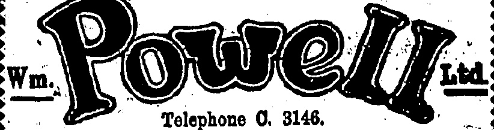
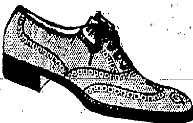
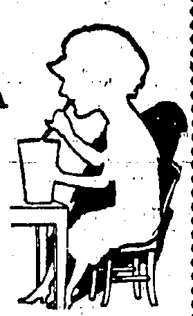

# WATSON'S PULVOSMIDROSIS.

AN IDEAL DUSTING POWDER.

Keeps the feet and armpits cool and sweet in the warmest weather and removes any unpleasant odour.

Cures sore and blistered toes.

In Tins 50 cts. Each.

PREPARED ONLY BY

A. S. WATSON & CO., LTD.

HONGKONG DISPENSARY.

Telephone No. C.18.

Telephone 0. 3146.

Quality, Style

THREE WORDS THAT MAKE THE DIFFERENCE FULL BROGUE SHOE IN THE FINEST QUALITY BROWN WILLOW, SOLES WELTED ON THE HAND-SEWN PRINCIPAL, UPPERS WELL CUT AND GIVING GOOD FIT AT ANKLE, IN HALF SIZES.

SOLE AGENTS FOR HONKONG.

PEDDER STREET.

◇◇◇◇◇◇◇◇◇◇◇◇◇◇◇◇◇◇◇◇◇◇◇◇◇◇◇◇◇◇◇◇◇◇◇◇◇◇◇◇◇◇◇◇◇◇◇◇◇◇◇◇◇◇◇◇◇◇◇◇◇◇◇◇◇◇◇◇◇◇◇◇◇◇◇◇◇◇◇◇◇◇◇◇◇◇◇◇◇◇◇◇◇◇◇◇◇◇◇◇◇◇◇◇◇◇◇◇◇◇◇◇◇◇◇◇◇◇◇◇◇◇◇◇◇◇◇◇◇◇◇◇◇◇◇◇◇◇◇◇◇◇◇◇◇◇◇◇◇◇◇◇◇◇◇◇◇◇◇◇◇◇◇◇◇◇◇◇◇◇◇◇◇◇◇◇◇◇◇◇◇◇◇◇◇◇◇◇◇◇◇◇◇◇◇◇◇◇◇◇◇◇◇◇◇◇◇◇◇◇◇◇◇◇◇◇◇◇◇◇◇◇◇◇◇◇◇◇◇◇◇◇◇◇◇◇◇◇◇◇◇◇◇◇◇◇◇◇◇◇◇◇◇◇◇◇◇◇◇◇◇◇◇◇◇◇◇◇◇◇◇◇◇◇◇◇◇◇◇◇◇◇◇◇◇◇◇◇◇◇◇◇◇◇◇◇◇◇◇◇◇◇◇◇◇◇◇◇◇◇◇◇◇◇◇◇◇◇◇◇◇◇◇◇◇◇◇◇◇◇◇◇◇◇◇◇◇◇◇◇◇◇◇◇◇◇◇◇◇◇◇◇◇◇◇◇◇◇◇◇◇◇◇◇◇◇◇◇◇◇◇◇◇◇◇◇◇◇◇◇◇◇◇◇◇◇◇◇◇◇◇◇◇◇◇◇◇◇◇◇◇◇◇◇◇◇◇◇◇◇◇◇◇◇◇◇◇◇◇◇◇◇◇◇◇◇◇◇◇◇◇◇◇◇◇◇◇◇◇◇◇◇◇◇◇◇◇◇◇◇◇◇◇◇◇◇◇◇◇◇◇◇◇◇◇◇◇◇◇◇◇◇◇◇◇◇◇◇◇◇◇◇◇◇◇◇◇◇◇◇◇◇◇◇◇◇◇◇◇◇◇◇◇◇◇◇◇◇◇◇◇◇◇◇◇◇◇◇◇◇◇◇◇◇◇◇◇◇◇◇◇◇◇◇◇◇◇◇◇◇◇◇◇◇◇◇◇◇◇◇◇◇◇◇◇◇◇◇◇◇◇◇◇◇◇◇◇◇◇◇◇◇◇◇◇◇◇◇◇◇◇◇◇◇◇◇◇◇◇◇◇◇◇◇◇◇◇◇◇◇◇◇◇◇◇◇◇◇◇◇◇◇◇◇◇◇◇◇◇◇◇◇◇◇◇◇◇◇◇◇◇◇◇◇◇◇◇◇◇◇◇◇◇◇◇◇◇◇◇◇◇◇◇◇◇◇◇◇◇◇◇◇◇◇◇◇◇◇◇◇◇◇◇◇◇◇◇◇◇◇◇◇◇◇◇◇◇◇◇◇◇◇◇◇◇◇◇◇◇◇◇◇◇◇◇◇◇◇◇◇◇◇◇◇◇◇◇◇◇◇◇◇◇◇◇◇◇◇◇◇◇◇◇◇◇◇◇◇◇◇◇◇◇◇◇◇◇◇◇◇◇◇◇◇◇◇◇◇◇◇◇◇◇◇◇◇◇◇◇◇◇◇◇◇◇◇◇◇◇◇◇◇◇◇◇◇◇◇◇◇◇◇◇◇◇◇◇◇◇◇◇◇◇◇◇◇◇◇◇◇◇◇◇◇◇◇◇◇◇◇◇◇◇◇◇◇◇◇◇◇◇◇◇◇◇◇◇◇◇◇◇◇◇◇◇◇◇◇◇◇◇◇◇◇◇◇◇◇◇◇◇◇◇◇◇◇◇◇◇◇◇◇◇◇◇◇◇◇◇◇◇◇◇◇◇◇◇◇◇◇◇◇◇◇◇◇◇◇◇◇◇◇◇◇◇◇◇◇◇◇◇◇◇◇◇◇◇◇◇◇◇◇◇◇◇◇◇◇◇◇◇◇◇◇◇◇◇◇◇◇◇◇◇◇◇◇◇◇◇◇◇◇◇◇◇◇◇◇◇◇◇◇◇◇◇◇◇◇◇◇◇◇◇◇◇◇◇◇◇◇◇◇◇◇◇◇◇◇◇◇◇◇◇◇◇◇◇◇◇◇◇◇◇◇◇◇◇◇◇◇◇◇◇◇◇◇◇◇◇◇◇◇◇◇◇◇◇◇◇◇◇◇◇◇◇◇◇◇◇◇◇◇◇◇◇◇◇◇◇◇◇◇◇◇◇◇◇◇◇◇◇◇◇◇◇◇◇◇◇◇◇◇◇◇◇◇◇◇◇◇◇◇◇◇◇◇◇◇◇◇◇◇◇◇◇◇◇◇◇◇◇◇◇◇◇◇◇◇◇◇◇◇◇◇◇◇◇◇◇◇◇◇◇◇◇◇◇◇◇◇◇◇◇◇◇◇◇◇◇◇◇◇◇◇◇◇◇◇◇◇◇◇◇◇◇◇◇◇◇◇◇◇◇◇◇◇◇◇◇◇◇◇◇◇◇◇◇◇◇◇◇◇◇◇◇◇◇◇◇◇◇◇◇◇◇◇◇◇◇◇◇◇◇◇◇◇◇◇◇◇◇◇◇◇◇◇◇◇◇◇◇◇◇◇◇◇◇◇◇◇◇◇◇◇◇◇◇◇◇◇◇◇◇◇◇◇◇◇◇◇◇◇◇◇◇◇◇◇◇◇◇◇◇◇◇◇◇◇◇◇◇◇◇◇◇◇◇◇◇◇◇◇◇◇◇◇◇◇◇◇◇◇◇◇◇◇◇◇◇◇◇◇◇◇◇◇◇◇◇◇◇◇◇◇◇◇◇◇◇◇◇◇◇◇◇◇◇◇◇◇◇◇◇◇◇◇◇◇◇◇◇◇◇◇◇◇◇◇◇◇◇◇◇◇◇◇◇◇◇◇◇◇◇◇◇�

## DAIRY FARM NEWS

Butchery Departments, Depot, Kowloon and Peak will close at 12 noon. The Dairy Departments will however, be open in the afternoon from 2 to 3 p.m.

Weekly Half Holiday

WEDNESDAY, 15th JULY.

THE DAIRY FARM, ICE & COLD STORAGE CO., LTD.

## CHOCOLATE & COCOA SUPPLIES

Just arriving a small shipment of the celebrated SICKESZ HOLLAND CHOCOLATE and COCOA as supplied locally to His Majesty's Government, Mac's Cafeteria, and most local stores. For this shipment we are making special arrangements, for the present only to distribute direct to local residents, hotels and restaurants in case or part case lots.

### Telephone C. 4630

COCOA: Guaranteed to contain 26% cocoa butter packed 72 half pound tropical double-lidded tins to each case.

CHOCOLATE: Packed in double-lidded tins containing 12 bars each one ounce weight; 72 tins to each case. Bulk Cocoa and Block Chocolate for cooking purposes also for temporary period at

WHOLESALE PRICES.

Telephone your orders to C. 4680 or write to Montgomery, Ollerton & Co., 10., Des Vaux Road, Bank of East Asia Bldg.

☀️🌥️🌥️🌥️🌥️🌥️🌥️🌥️🌥️🌥️🌥️🌥️🌥️🌥️🌥️🌥️🌥️🌥️🌥️🌥️🌥️🌥️🌥️🌥️🌥️🌥️🌥️🌥️🌥️🌥️🌥️🌥️🌥️🌥️🌥️🌥️🌥️🌥️🌥️🌥️🌥️🌥️🌥️🌥️🌥️🌥️🌥️🌥️🌥️🌥️🌥️🌥️🌥️🌥️🌥️🌥️🌥️🌥️🌥️🌥️🌥️🌥️🌥️🌥️🌥️🌥️🌥️🌥️🌥️🌥️🌥️🌥️🌥️🌥️🌥️🌥️🌥️🌥️🌥️🌥️🌥️🌥️🌥️🌥️🌥️🌥️🌥️🌥️🌥️🌥️🌥️🌥️🌥️🌥️🌥️🌥️🌥️🌥️🌥️🌥️🌥️🌥️🌥️🌥️🌥️🌥️🌥️🌥️🌥️🌥️🌥️🌥️🌥️🌥️🌥️🌥️🌥️🌥️🌥️🌥️🌥️🌥️🌥️🌥️🌥️🌥️🌥️🌥️🌥️🌥️🌥️🌥️🌥️🌥️🌥️🌥️🌥️🌥️🌥️🌥️🌥️🌥️🌥️🌥️🌥️🌥️🌥️🌥️🌥️🌥️🌥️🌥️🌥️🌥️🌥️🌥️🌥️🌥️🌥️🌥️🌥️🌥️🌥️🌥️🌥️🌥️🌥️🌥️🌥️🌥️🌥️🌥️🌥️🌥️🌥️🌥️🌥️🌥️🌥️🌥️🌥️🌥️🌥️🌥️🌥️🌥️🌥️🌥️🌥️🌥️🌥️🌥️🌥️🌥️🌥️🌥️🌥️🌥️🌥️🌥️🌥️🌥️🌥️🌥️🌥️🌥️🌥️🌥️🌥️🌥️🌥️🌥️🌥️🌥️🌥️🌥️🌥️🌥️🌥️🌥️🌥️🌥️🌥️🌥️🌥️🌥️🌥️🌥️🌥️🌥️🌥️🌥️🌥️🌥️🌥️🌥️🌥️🌥️🌥️🌥️🌥️🌥️🌥️🌥️🌥️🌥️🌥️🌥️🌥️🌥️🌥️🌥️🌥️🌥️🌥️🌥️🌥️🌥️🌥️🌥️🌥️🌥️🌥️🌥️🌥️🌥️🌥️🌥️🌥️🌥️🌥️🌥️🌥️🌥️🌥️🌥️🌥️🌥️🌥️🌥️🌥️🌥️🌥️🌥️🌥️🌥️🌥️🌥️🌥️🌥️🌥️🌥️🌥️🌥️🌥️🌥️🌥️🌥️🌥️🌥️🌥️🌥️🌥️🌥️🌥️🌥️🌥️🌥️🌥️🌥️🌥️🌥️🌥️🌥️🌥️🌥️🌥️🌥️🌥️🌥️🌥️🌥️🌥️🌥️🌥️🌥️🌥️🌥️🌥️🌥️🌥️🌥️🌥️🌥️🌥️🌥️🌥️🌥️🌥️🌥️🌥️🌥️🌥️🌥️🌥️🌥️🌥️🌥️🌥️🌥️🌥️🌥️🌥️🌥️🌥️🌥️🌥️🌥️🌥️🌥️🌥️🌥️🌥️🌥️🌥️🌥️🌥️🌥️🌥️🌥️🌥️🌥️🌥️🌥️🌥️🌥️🌥️🌥️🌥️🌥️🌥️🌥️🌥️🌥️🌥️🌥️🌥️🌥️🌥️🌥️🌥️🌥️🌥️🌥️🌥️🌥️🌥️🌥️🌥️🌥️🌥️🌥️🌥️🌥️🌥️🌥️🌥️🌥️🌥️🌥️🌥️🌥️🌥️🌥️🌥️🌥️🌥️🌥️🌥️🌥️🌥️🌥️🌥️🌥️🌥️🌥️🌥️🌥️🌥️🌥️🌥️🌥️🌥️🌥️🌥️🌥️🌥️🌥️🌥️🌥️🌥️🌥️🌥️🌥️🌥️🌥️🌥️🌥️🌥️🌥️🌥️🌥️🌥️🌥️🌥️🌥️🌥️🌥️🌥️🌥️🌥️🌥️🌥️🌥️🌥️🌥️🌥️🌥️🌥️🌥️🌥️🌥️🌥️🌥️🌥️🌥️🌥️🌥️🌥️🌥️🌥️🌥️🌥️🌥️🌥️🌥️🌥️🌥️🌥️🌥️🌥️🌥️🌥️🌥️🌥️🌥️🌥️🌥️🌥️🌥️🌥️🌥️🌥️🌥️🌥️🌥️🌥️🌥️🌥️🌥️🌥️🌥️🌥️🌥️🌥️🌥️🌥️🌥️🌥️🌥️🌥️🌥️🌥️🌥️🌥️🌥️🌥️🌥️🌥️🌥️🌥️🌥️🌥️🌥️🌥️🌥️🌥️🌥️🌥️🌥️🌥️🌥️🌥️🌥️🌥️🌥️🌥️🌥️🌥️🌥️🌥️🌥️🌥️🌥️🌥️🌥️🌥️🌥️🌥️🌥️🌥️🌥️🌥️🌥️🌥️🌥️🌥️🌥️🌥️🌥️🌥️🌥️🌥️🌥️🌥️🌥️🌥️🌥️🌥️🌥️🌥️🌥️🌥️🌥️🌥️🌥️🌥️🌥️🌥️🌥️🌥️🌥️🌥️🌥️🌥️🌥️🌥️🌥️🌥️🌥️🌥️🌥️🌥️🌥️🌥️🌥️🌥️🌥️🌥️🌥️🌥️🌥️🌥️🌥️🌥️🌥️🌥️🌥️🌥️🌥️🌥️🌥️🌥️🌥️🌥️🌥️🌥️🌥️🌥️🌥️🌥️🌥️🌥️🌥️🌥️🌥️🌥️🌥️🌥️🌥️🌥️🌥️🌥️🌥️🌥️🌥️🌥️🌥️🌥️🌥️🌥️🌥️🌥️🌥️🌥️🌥️🌥️🌥️🌥️🌥️🌥️🌥️🌥️🌥️🌥️🌥️🌥️🌥️🌥️🌥️🌥️🌥️🌥️🌥️🌥️🌥️🌥️🌥️🌥️🌥️🌥️🌥️🌥️🌥️🌥️🌥️🌥️🌥️🌥️🌥️🌥️🌥️🌥️🌥️🌥️🌥️🌥️🌥️🌥️🌥️🌥️🌥️🌥️🌥️🌥️🌥️🌥️🌥️🌥️🌥️🌥️🌥️🌥️🌥️🌥️🌥️🌥️🌥️🌥️🌥️🌥️🌥️🌥️🌥️🌥️🌥️🌥️🌥️🌥️🌥️🌥️🌥️🌥️🌥️🌥️🌥️🌥️🌥️🌥️🌥️🌥️🌥️🌥️🌥️🌥️🌥️🌥️🌥️🌥️🌥️🌥️🌥️🌥️🌥️🌥️🌥️🌥️🌥️🌥️🌥️🌥️🌥️🌥️🌥️🌥️🌥️🌥️🌥️🌥️🌥️🌥️🌥️🌥️🌥️🌥️🌥️🌥️🌥️🌥️🌥️🌥️🌥️🌥️🌥️🌥️🌥️🌥️🌥️🌥️🌥️🌥️🌥️🌥️🌥️🌥️🌥️🌥️🌥️🌥️🌥️🌥️🌥️🌥️🌥️🌥️🌥️🌥️🌥️🌥️🌥️🌥️🌥️🌥️🌥️🌥️🌥️🌥️🌥️🌥️��

## REX CONCRETE MIXERS

EASILY HANDLED

EVENLY MIXED

QUICKLY AND

ECONOMICALLY

WORKED.

NEW

# VICTOR RECORDS

Just Arrived

INCLUDING

## “THE FLAPPER WIFE”

S MOUTRIE & CO., LTD., Chater Rd.

HERE'S an IOE OREAM SODA

that more than SATISF.ES.

# - IT DELIGHTS -

TRY ONE AT MORINAGA'S

ASIATIC BUILDING

T.C. 4702

(Hongkong's only European Optician)

12, Queen's Rd. Central.

Manager: R. A. OOPER

Qualified by Canadian Government Examination

Fellow of the American Optometric Association

## The China Mail

(Every evening except Sunday. Annual subscription, excluding postage abroad, H.K. $36, payable in advance. Local delivery free.)

(The weekly edition of the "China Mail." Annual subscription, excluding postage abroad, H.K. $12, payable in advance.)

The Newspaper Enterprise, Ltd.

Printers & Publishers

No.5.WYNDEAM ST., HONGKONG

Telephones Central 22 & 4641. Cable Address:—Mail, Hongkong.

All communications should be addressed to the Newspaper Enterprise, Ltd., to whom all remittances should be made payable.

London Offices:—The Far Eastern Advertising Agency (London), Ltd., 24, Deuenshire Street, Bloomsbury, W.C.1.

## Hongkong, Tuesday, July 14, 1925

A GIANT TO TACKLE.

Every little helps during a time of emergency, particularly when that little is propaganda of the right sort—propaganda that may force the agitators to consider whether their game is worth the candle and that may compel even the untutored (were it possible for the latter to come to hear the truth) to think whither they are drifting on the Bolshevik tide.

An instance of the good—that may be done even in a quiet way was forthcoming on Sunday when the evils of Bolshevikism were dealt with from the pulpit of St. John's Cathedral by the Rev. R. J.

Northcott. Such homilies as he delivered may be liable to be passed over in normal times, but they deserve all the prominence possible when the agitators are let loose and timid strikers are between two fires. The rev. gentleman uttered a strong condemnation of Bolshevism, the tenor of which, of course, is not in any way strange to those who have the following the teachings of Trotsky since the earliest days of the Soviet regime. But a good story lacks nothing in the telling again and again, especially if in the reiteration there be the remotest chance to make the enemy pause and to inspire pluck into the intimidated Great Britain is their ciner enemy it is a compliment to every Briton. More, it is a challenge that will not go unheeded so long as it continues to be the menace it is to all the traditions of the British Empire and so long as it threatens to disintegrate what it has taken centuries of British pluck, endurance, and enterprise to build up within the confines of our rightful and legitimate domain.

It is well that the Chinese as a whole should learn the truth about Bolshevism, which, as the Rev. R. J. Northcott pointed out, has caricatured the great Christian watchwords of liberty, equality, and fraternity. There is no liberty in modern Russia for anything or anybody, which is a striking contrast to the conditions of freedom obtaining under the Union Jack. Equality is unknown in Russia, for the Reds have shown themselves more despotic and tyrannical than any kings or Tsars. Instead of fraternity there exist bitterness, hatred, starvation and terrorism—an unevitable exchange even for the conditions obtainable in China itself during normal times and still more wretched exchange for the conditions prevailing wherever the British flag is flown. It is well for the pulpit no less than the Press to emphasize that if the Bolshevists consider that

Even if the strike lasts but another fortnight the lessons unfolded by Empire teachers and preachers during the present state of emergency will never fall on barren soil or be considered a mere beating of the air.

A Municipal Council.

The Government as a result of its strike experiences will surely legislate for a Municipal Board or Council. Had there been no Kowloon and Peak Residents Association, the present position would not have been met so spontaneously. There is now to be a mid-level Residents Association, so that the only part of the Colony to be unrepresented or without any voice will be the centre and extreme ends of the town containing probably the largest class of residents—and the people who, by being scattered, suffer most whenever there is an upheaval as at present. The Government, as at present constituted, attempts too much and consequently either does not do all it sets out to do, or does a lot of it inefficiently. It has created a Sanitary Board and also an Education Board with limited powers;—and—only—a-churl would argue that these Boards have not proved their worth. They have thrown light on two most important branches of local endeavour and the members of them have taken their duties and tackled them in a serious manner in spite of the fact that their wings are clipped to the most extreme degree. A number of other Boards are highly desirable. The P.W.D., for instance, would function more easily if it had a Board of an advisory capacity working with it. When there is a strike upheaval it is a question of "Tommy here and Tommy there" (if we may so call the Hongkong resident)—but when trouble ends, "Tommy" recedes into the background until the next call comes. We need not labour the point. The Colony possesses organisers of a high order—not necessarily Peak residents or taipans. Soak them out and let them not stagnate in a sea of indifference.

## LOCAL & GENERAL

A clean bill of health was returned for the 48 hours ended July 12, there being no case of notifiable disease.

The Sanitary Board will meet at 4.15 p.m. to day to discuss several matters of considerable interest and importance.

The reason given by a Kowloon 'bus driver for the overturning of his vehicle on Thursday night is, in the opinion of the Police, incorrect. He had stated that armed men had threatened him outside the Mongkok Fire Station and that as a result of this his nerves had suffered.

Having produced a chart proving that his ship's head was north and the cable in question well away on his port bow. Capt. A. Pompey was acquitted of the charge preferred against him at the Marine Court yesterday of anchoring his ship in the Tai Kok Tsui Cable Reserve. The charge was the sequel to complaints of the military authorities of an interference with the Stonecutters-Tai Kok Tsui cable.

Burning rubblish which had got out of hand was the cause of two calls being received yesterday by the Kowloon Fire Station and one by Central. No. 48 Nathan Road and an unoccupied house in Austin Road were the sources of call at Kowloon, firemen extinguishing the flames in the former instance with buckets and restricting damage to the scorching of woodwork on the first floor verandah. Their services were not required in the latter instance owing to the action of occupants and neighbours. The vicinity of the Gas Works, West Point, was the scene of the blaze on the Honglong side and here again the services of the firemen were not required as a hydrant had done the necessary before their arrival.

But we are the best disease. Disorders of the bowels are extremely dangerous, particularly during the hot weather of the summer months and in order to protect yourself and family against a golden attack, get a bottle of Chamberlain Gold and Diarrhoea Remedy. It can be depended upon. For all everywhere.

## CHEFOO NOTES

(From Our Own Correspondent.)

On Juno 3, His Majesty's Birthday, the British Consul held an official reception at the Consulate, where there was a large gathering of Britishers and their Friends, including a big representation from the American Fleet (including the flagship Huron) to do honour to King George on his 60th Birthday.

Chefoo is to have a new Chinese Post Office costing some $80,000.00, the construction of which is soon to commence, the Post Office having already moved to temporary quarters. The new Office is to be fitted with steam heat and modern fitings, and should be an ornament to our "Main Street."

The Chefoo Race Club held their Spring Gymkhana on June 6 and 8, when there were some very interesting and close finishes. On the first afternoon Mrs. Railton won the 1st race, the half mile scurry, on Nigger Snipe, with Mr. Smart second on Rodeo. Miss Eleanor Sugden won the 2nd race, the 4 mile, Heavy Weights, on Bumps, with Mr. Swaney second on Survivor. The Half Mile Time Limit went to Mr. Edkins on The Slug, while in the next race, One Mile, Opon, Miss Sugden again won on Bumps. The 1½ mile Paperhunters' Cup was the closest race of the day when Mr. Swaney on Survivor just won from Mrs. Railton on Sandsnipe. "Tilting the Ring" closed the first day's programme, in which Mr. Railton excelled over all the other competitors, Mr. Hogg securing second place. A larger number of spectators were present for the second day's racing, and thoroughly enjoyed the closely contested events. The first Race, one mile, was won by Mr. Swaney on Survivor, while in the second, the "Beef Stake Cup," Sandsnipe, with Mr. Railton up came in a good first. In the 4 mile, "Chefoo Plate," Mrs. Railton won on Nigger Snipe, and Twenty-Two-Kurat, Mr. Swaney up, surprised everybody by winning the 4 mile Consolation Stakes. The half mile Hurdles was won by Mr. Smart on Prince, with Mr. Hogg on Social Glow second. The 1½ mile Championship Stakes was a fine race, Sandsnipe with Mr. Railton up running neck and neck with Bumps, one of the favourites, with Miss Sugden riding, but eventually the latter won, Sandsnipe being second, and Survivor, the other favourite, third. Incidentally Mr. A. Sugden, the owner of Bumps, drew the winning ticket in a the Non-Selling Champion Sweep.

The China Inland Mission Schools celebrated the 29th anniversary of the laying of the Foundation Stone of the Boys' School, on June 15 and 16. The Bout Races took place on June 15 in fine weather, and some interesting races ensued. In the first race between Paton and Livingstone's Houses, the former won by several lengths. Stanley Conway stroked the Paton boat, and Huston Edgar the Livingstone. The second race was the Girls' School Race, and was won by the crew-stroked-by-Maud-Hutson-over that stroked by Mary Preedy. In the third and best race, the Inter-House Final, the winners of which secure the Rowing Cup for the coming year, Carey House, stroked by Conyers Hewett secured a win by half a length over Morrison House, stroked by Colin Ford.

The next day, Foundation Day itself, began with the usual Cricket Match between The School and The Visitors. This, in spite of the limited time at the players' disposal, proved an interesting and exciting game, with a very close finish, the Boys winning by 95 runs to 89. The Service at 11 a.m. was conducted by Rev. T. F. McCren, who spoke on the Threefold Side of Life, the Physical, Intellectual and Spiritual. Tea "under the trees" was served at 3.30 p.m. when many gathered for a pleasant social half hour, and the Tennis Tournaments commenced as soon after four as possible. In the first game, the final of the Mixed Doubles Tournament, Kathleen Hookman and Stanley Conway won rather easily from Ruth Dilley and Dick Sternberg. The next two sets were Exhibition Games, which while interesting were not over exciting. In the fourth match between the Present Girls, represented by Kathleen Davies and May Harding, against the "Old Girls," represented by Mrs. George F. Andrew and Miss E. M. Broomhall, the former won by 50 points to 33. In the last match, the Present Boys, Andrew Hazeland and Stanley Conway, beat the "Old Boys," Messrs. James McMullan and Ray Eckford, by 50 points to 33. This game commenced very evenly, the score at one time being 21-19, but the Present Boys gradually warmed up to the game and then quite easily drew away from their opponents. An enjoyable programme was rendered at the Concert in the evening, when a large crowd were present.

Since I last wrote there have been several fixtures between the Chefoo Cricket Club and the School, all of which have been well worth watching, and in some cases there have been very close results.

On June 18, setting to several of the School eleven being unable to play a number of men assisted the boys; the men batted first and made a score of 140, Mr. Graham making 55 retired, and Mr. Smart 62 retired. The other side made 105, Huston Edgur, one of the boys, making 40 not out.

The game on June 20 resulted in a fine win for the Cricket Club, after a closely contested game. The Boys' side butted first and secured the fine score of 144 for 0 wickets, when they retired; Ford made 42, Conway-20, and Best 21, while Mr. Graham secured 6 wickets for 42 runs. As the boys had been in so long, extra time was allowed and within a few minutes of time the Club passed the Boys' total and carried their score to 156 for nine wickets. Mr. Grubb made 24, Mr. Smart 66, and Mr. Graham 88 retired; Hazeland bowled well for the School, securing 4 wickets for 27 runs.

On June 27 the School completely reversed the previous Saturday's result, and won quite easily. The Club batted first being all out for 110, Mr. Graham making 56. The School, when stumps were drawn, had made 120 for the loss of only three wickets, Mr. Duncan 13, Dr. Gibson 20, and Mr. Brian McCarthy 48, Ford was 28 not out, and Hazeland 10 not out.

## The Shipping Strike

### (From Our Own Correspondent.)

Like everywhere else we have been subjected to plenty of student agitation, more especially against the British and Japanese, and several times there have been threats of a general strike of servants, but so far, to a large extent thanks to our enterprising Tao-Yin, nothing has occurred in that way.

The shipping strike has, of course, upset things here to some extent as we are more or less dependent on the steamers owing to having no railway connection nearer than Wei-Hsien, which can only be reached by motor car service. Summer visitors have been considerably hindered in arriving here, more especially from the South, but during the last few days several parties have turned up, some by China Merchants' steamers and others by rather roundabout routes.

There seems to be quite a boycott of British and Japanese goods by the merchants, although this, too, is probably more talk than actual, quite a number of dealers having bought in considerable stocks from the foreign firms before the boycott was supposed to commence.

On the whole, however, we have probably been more fortunate than most other ports, partly because of the presence of the U.S.S. Huron and several destroyers, and partly because of firm action taken by the foreign Consuls and the responsible Chinese authorities—the Tao-Yin and the Chinese General.

I heard to-day that insurance policies are being withdrawn from the British firms, but this also is probably only a temporary measure on the part of merchants to appease the student agitators.

## FUNERAL

A number of deceased's colleagues and a detachment of Indian warders were present at the funeral yesterday afternoon at Happy Valley of Mr. William Pritchard whose death occurred at the Laichhikok prison officers' quarters on Sunday. The service was conducted by the Rev. T. B. Powell.

Among those present were: Capt. H. Bloxham, Superintendent of Prisons) Messrs. West and McLeod, (Chief Warders), Principal Warders Hill, Daniels, Thomas and Robertson, and Mr. M. MacReynolds, representing the Ex-Active Servicemen's Association.

Wrenthes were sent by the following: Charlie, Jack and Biff, Stan and Bert, Captain H. Bloxham, Chief Warder Passmore, Messrs. Daniels, A. Price, Neal F. Cornwell, Grant C. W. F. Fom and W. N. Norman, C. H. Dodson, O. Donovan, A. Mason, Billy Webber and Billy Iles, W. H. Lloyd and T. N. Davis, J. R. Whant, S. Randle, J. Sheriff, Mr. and Mrs. J. M. McLeod, Chief Warder and Mrs. West, Mr. and Mrs. Franks, Mr. and Mrs. Robertson, Mr. and Mrs. Thomas, Mr. and Mrs. Didsbury, Mr. and Mrs. A Calvert, Mr. and Mrs. Shannon, Mr. and Mrs. Wilshire and family, Mrs. F. M. Forster, Members of the Lnichikok Prison, European staff Victoria Goal, Members of Officers Mess. Victoria Goal, the Clerical staff Prison Department, the Indian staff (Sikhs) Prison Department, Ex-Active Servicemon's Association (1914-1018), Naval and Military R. A. Chapter No. 802, S.C. the Lodge of the Naval and Military No. 848, S.C., R. W. M. Officers and Brethren Lodge St. John 618, South China.

FEW CHILDREN ESCAPE IT.

Spongish school, so inseparable from the years of childhood can become serious bowel disorder if not promptly quieted. Chamberlain's Colic and Diarrhoea Remedy is safe and depalable for both children and grown people. It immediately relieves severe intestinal pain and tops weakening diarrhoea. For sale everywhere.