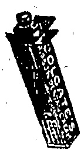
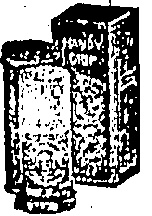
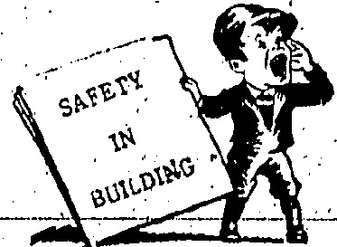

# WATSON'S PULVOSMIDROSIS

AN IDEAL DUSTING POWDER.

Keeps the feet and armpits cool and sweet in the warmest weathe: and removes any unpleasant odour.

Cure : sore an 1 blistered toes.

In Tiss 50 cts. E.Acn.

PREPARED ONLY BY

A. S. WATSON & CO., LTD.

HONGKONG DISPENSARY.

Telephone No. O.18.

Telephone 0. 3146.

THE NETD FOR

## LIGHTER UNDERWEAR - SATISFIED-INEXPENSIVELY

NEW STOCK JUST RECEIVED

OF "AERTEX" "INDIA GAUZE"

"B.Y.D." "CELLASTIC" "MERIDIAN".

IN VESTS AND DRAWERS AND COMBINATION

Good Value in every Department

Every Day of the Week.

PEDDER STREET.

The undernoted are being supplied with FR33H DAIRY FAX M(LK) twice daily and we recommend those of our customers who find it inconvenient to send to our Depot for supplies to obtain same from either:—

H. M. HAJEE ESMAIL

2 TIN LOK LANE

MORRISON HILL

— or —

THE INDIAN STORES

46 QUEEN'S ROAD, EAST

WANCHAI

THE DAIRY FARM, ICE & COLD STORAGE CO., LTD.

## REGISTRATION

We have pleasure in notifying the Public that arrangements have now been completed by this Bureau for carrying out the Registration of Servants. A fee of $1.00 per head will be charged, for which a certificate will be issued giving name, photograph and thumbprint. At the termination of the present situation we hope to be able to supply servants of all descriptions for a nominal fee.

DOMESTIC SERVANTS EMPLOYMENT & REGISTRATION BUREAU.

Address: 15-17. Queen's Road C

Use COLGATE'S Ribbon Dental Cream and Handy Grip Shaving Sticks.

SOLE AGENTS:

The Hongkong Trading Co. Ltd.

HONGKONG.

RAYMOND CONCRETE PILES

THE HONGKONG EXCAVATION, PILE DRIVING & CONSTRUCTION CO., LTD.

Tel. C. 8749: 2nd Floor, Powell's Building.

# Make Friends with The Victrola

Once in your home, the Victrola becomes the musical member of your family.

Judged by the most exacting standards, it successfully fulfils its mission by bringing to you the world's best music exactly as interpreted by the world's greatest artists.

Musicians recognize the Victrola's pre-eminence and give it the final stamp of their approval. No substitute can ever equal the Victrola and Victor Records.

S. MOUTRIE & CO., LTD.

Chater Road.

HERE'S an ICE OREAM SODA

that more than SA'SFS.

# - IT DELIGHTS -

TRY ONE AT MORINAGAS

ASIATIC BUILDING.

To. C. 4702

## The China Mail

(Every evening except Sunday Annual subscription, excluding postage abroad, H.K. $36, payable in advance. Local delivery free.)

Orrland China Mail

(The weekly edition of the "China Mail," Annual subscription, exalting postage abroad, 11.K $12, payable in advance.)

The Newspaper Enterprise, Ltd.

Printers & Publishers

No. 5.WYNDHAMST., UONGKONG

Telephones Central 22 & 4641.

Cable Address: — Mail, Hongkong.

All communications should be addressed to the New Paper Enterprise, Ltd., to whom all remittances should be made payable.

London Citylees:—Tha Far Eastern Advertising Agency (London), Ltd., 24, Devonshire Street, Hornbury, W.C.1.

## Hongkong, Wednesday, July 22, 1925

## CANTON'S WAIL

There is only one thing at stake in the position in China and that is the truth. This the Canton Nationalist Government claims to have found, and as usual with anybody who has made a startling discovery it almost trips over itself in its anxiety to publish it to the world. The sole problems which are causing all the agitation in China, says the Canton Government, are those "inequal treaties," the alleged "inhuman exploitation" of Chinese labour in foreign Concessions, and the temerity of the Powers in seeking to maintain their economic and political domination of China.

The poor old Labour Party has fallen into the 'trmp. That can't about "inhuman exploitation" of Chinese labour has done the trick. The rest of the wait matters not a jot. Their poor Chinese brethren are being downtrodden by foreigners in the Concessions—so they choose to believe—and hence they in their turn must rush into print with the cablegram from Canton.

Cares to believe this twaddle from Canton nobody else, in Britain will. It should be treated with the silent contempt that it deserves. Let the Labour Party come to China itself and tour through the Chinese cities and towns where the Power's have not been one inch of power or jurisdiction, and they will weep with sympathy for the Chinese workers who are being ground to death by their Chinese taskmasters. The conditions in the foreign Concessions and in China's own sphere are as different as chalk is from cheese. They will admit, if they are honest men and not mere pains in the political chessboard, that the conditions obtaining in the foreign Concessions are worlds superior to those for which the Chinese authorities are responsible for day after day and year after year, without the shadow of a hope for reform for the labourer.

Canton's outburst will fall on deaf ears. It is an attempt to gain friends in a quarter where there ought be open enmity, or at least complete alienation—if the Labour Party only knew the actual conditions of Chinese labour outside the foreign Concessions. Even so, were the position of the poor Chinese workers in the Concessions not as good as it is in comparison with the rest of China, what does the Canton Government hope to gain from fomenting and encouraging agitation that leads to rioting and striking and attacking the British Concession of Shameen? If they hope to explain that, away to the world through the British Labour Party, then they are indeed simple.

## Harbour Registration

There is an aspect of the question which should not be lost sight of in the schemes for registration which are being discussed at the present time, and that is the need for some such organisation in connection with the coxswains and engineers of harbour launches. At present the only document which slipping firms and other employers are legally entitled to look for is the certificate issued by the Harbour Office at the time that the

standard tests are passed. For further details of past record and capacity private enquiry has to be depended on and for details of the applicant's past as regards the civil authorities there is practically no recourse whatever. The position of responsibility held by such men is argument enough in favour of some more extensive record being kept, for any hapse on their part might easily involve very considerable loss. The organisation involved in such a scheme should not be great considering that the record of the issue of licences is in existence at the Harbour Office. In fact, the only extension necessary to the present system would be a record of the employment in which the coxswain or engineer was engaged at the moment and the attaching of a photograph to his licence. In the event of his leaving his employment the certificate could be endorsed and the employer and the necessary furnish particulars as to his capacity. If an employer wished for another man or vice versa, application could be made at the Harbour Office, which would act largely as a hirean for such labour and in return for services rendered a small fee would have to be paid by employers and employees. Such a system has been found practicable in the case of drivers of public vehicles and ricsha coolies, and as coxswains and engineers are now reported to be endenvouring to return to their former employment, the present is surely an opportune time for an extension of the scheme to this vitally important service.

## Jay Walkers

Attempts have been made to get Hongkong pedestrians to walk in the way they should go. They continue to walk in the way they think they should go and the result is an absence of traffic sense commonly attributed to Chinese only. For the centre of the town at any rate, a German iden might very well be tried. In Berlin, pedestrians who cross the streets anywhere except at officially marked points are liable to a fine of 150 marks. Apply this method to Des Vœux Road and Queen's Road in their most central parts: make these official crossings ricsha stoppings as well, and a step forward will have been gained in making pedestrianism more attractive than it is.

## LOCAL & GENERAL

During the week ended July 18 the only case of notifiable disease was that of enteric fever (British) non-fatal. One case of small-pox. American (imported) was notified during the 24 hours ended on July 20.

The following members of the Kewloon Division of the St. John Ambulance Brigade have been examined by Dr. Gavler, M.C. and Dr. Millward, and have passed the efficiency test in first aid to the wounded.—F. D. Angus, A. C. Greaves, J. J. Hirst, D. A. Hynes, A. G. de Jesus, E. A. Lee, N. A. E. Mackay, J. H. Maycock, E. Moses, E. E. Remedios, C. F. da Roza, T. S. D. Whitley and R. G. Witchell. They all did good service in connection with the Po Hing Fong catastrophe.

## CANTON'S LATEST

## STRIKERS AT FOREIGN CEMETERY

THE UNOFFENDING DEAD.

The Consul-General at Canton, Sir J. W. Jamieson, has addressed the following letter to the Canton Government:—

H.B.M. Consulate, Canton, July 20, 1925.

To Fu Ping-ch'ang Esq., Commissioner for Foreign Affairs, Canton:—

Sir,—I have the honour to bring to your notice the latest instance "bf "frightfulness" committed under the legis of the Nationalist Government.

As you are aware there is on Honam island a cemetery for foreigners of all nationalities, where incidentally the late German Consul General was buried, which is in charge of a Chinese sexton and his family.

This morning a gang of intimidators approached the latter and stated that, unless he took his immediate departure, the graves would be dug up. Comment on such threatened action, more especially from a Chinese point of view, is superfluous.

The sexton has been allowed to go, and I would ask you to be so good as to see that the unoffending dead remain undisturbed.—I have the honour to be, Sir, Your Obedient Servant,

(Sd.) J. W. JAMIESON,

## WATCH CHINA

NEED FOR FIRMNESS BY THE POWERS.

BOLSHEVIK CUNNING. ___

Well may attention, be called to the fact that in China serious events are browing. In the Ehr East we

the fact that in China serious events are browing. In the Fur East we are accustomed to minor, disturbances, but the events of the past month give serious cause for un-eignness, fomented as they are by secret societies bearing a markedly anti-foreign character. Further, the rioters and strikers (sic!) are openly countennanced by the provisional authorities, who in their turn seem to rely on the protection of the highest powers in Peking, Britons and others have been assaulted and even murdered without it being possible to obtain the punishment of the evil-doers.

North and South are alike affected. The foreign possessions, in which the art of Government is practised according to European bureaucratic routines, have in their turn become centres of anti-foreign feeling. The growing dissatisfaction turned at first against the weak and rotten Government and there were wars between the rival Chinese factions. Nobody interfered and not the slightest real protection was given to those men who opposed that which the foreigners themselves had preached to China—enlightenment and reform. Unconcerned, the representatives of all the civilised Powers prided themselves on their diplomatically correct attitude of non-interference in internal Chinese questions. Having once taken the retrograde road China is now both to stop. With Bolshevik aid and teachings she has cleverly succeeded in leading general discontent away from how Government, and, it would seem from events that have transpired, is directing it against the foreigners. Seemingly she has given the anti-foreign party to understand that it may count on her support!

- Let us take by a couple of-

incidents of recent date. The wun-

ton unprovoked attack on Shameen

on June 23 Was engineered under

the guise of a peaceful sympathetic

(sic!) demonstration parade headed

by students and other peaceful-

looking subjects. What of the

core? A diabolical dustardly plot

of an organised attack on the

British Concession hatched by

Bolsheviks and carried out by them

as leaders, in The hope that the

Concession would be taken by sur-

priest. Then we have the murder

of Mr. Mackenzie at Shanghai

and the wounding of his lady com-

pension.

The Chinese Press go so far as to say that the first incident was the slaughtering of unarmed Chinese students by Imperialists and the second, the destruction of Mr. Mackenzie (who was ill) by his Doctor so that no blame could be laid at the door of the Chinese. The Chinese Press is certainly pleaving up to the susceptibility of its nationals and directing its forces against Britain. There are many who may take exception to the last statement, but can the fact be gainsaid that other nationals have received protection in the present crisis's, whereas it has refused, or totally ignored when sought by British and Japanese subjects.

We must now face the situation boldly, and not show the slightest weakness or inconsistency in our dealings. Steps taken can never be retraced, therefore watchfulness and anticipation of all eventualities are now a matter of self preservation. If the present situation is allowed to pass without a check, there may be a catastrophe, in China, such as has never been seen there before. Then indeed would commerce and all enterprises in China be interrunted for years, and we should be driven into complications, expenses, and sacrifices, the end of which cannot be foreseen. It is as well to remember that events of far lesser import than those of the last few weeks caused nation to rise against nation, and the great world conflict of 1914-1918. Let us by prompt and firm action convince not only China but others that it still is "England what" thou wert, thou art.

"Warsaw. July 21.—M. Chicherin has notified the Polish Minister at Moscow that the Soviet has agreed to the Polish proposal for a mixed commission to investigate the recent incidents on the Russo-Polish frontier. Five Soviet delegates form the commission which has already been appointed.—Reuter."

London, July 21.—In the Chancery Division Mr. Justice Russell dismissed an application by the Government of Kelantan that the arbitrator in their case with the Duff Development Company should have been ordered to state a case for the opinion of the Court on questions of law. His Lordship held that the arbitrator was eminently qualified to handle the matter on legal and other points.—Reuter.

## CABINET SPLIT?

## OUR CRUISER BUILDING PROGRAMME

(Reute’s Service.)

"London, July 21.

Disagreement which has arisen in the Cabinet over the naval constructional programme appears to have become acute.

The Admiralty firstly insisted on the construction of five cruisers. Mr. Winston Churchill (Chancellor of the Exchequer) opposed this on the grounds of economy.

It is understood that a compromise has been suggested, whereby two cruisers will be laid down in 1925 with the possibility of an “emergency” vessel later but the Admiralty is to reply asking for three ships in 1925 and four more in 1926.

Mr. Stanley Baldwin (the Premier) is trying to find a middle way between the demands of Mr. W. C. Bridgeman (First Lord of the Admiralty) and Mr. Churchill, with the resignations of the former and the Sea Lords and perhaps Mr. L. C. M. S. Amery (Colonial and Dominion Minister) as a disturbing possibility on the one hand and the threatened resignation of those professing economy on the other.

### CORRESPONDENCE. BOY SCOUTS

(To the Editor of the China Mail).

Sir, — May I, through the columns of your journal, request that any organisations, firms, or persons wishing to make some remuneration for Scout Service rendered to them during the strike should do so by sending their contributions either to the Hon. Treasurer of the Hongkong Boy Scouts Association, Mr. C. H. Blason, c/o Messrs. Butterfield and Swire, or to me at the Seamen's Institute, when the Association will see that the right people benefit.

This naturally applies to service given by Scouts working as such and sent out in applications made to me or to their respective Scoutmasters, and not to the services of those boys; who though perhaps Scouts secured employment independently of the Organisation.

Yours, etc.,

G. T. WALDEGRAVE,

Commissioner,

H.K.B.S.A.

To the Editor of the China Mail).

Sir,—The Tramway Co. will do well, to take to heart the words published in your issue of yesterday. Public utility concerns need to be enterprising enough to risk a little, so as to find out if the demand is there. How does the Company know that there is not enough traffic to justify a quicker service and trams at night? Because the trams are so far between each other, receipts must hitherto have been affected. It is not everybody who, like your correspondent, can afford to wait for a car. If after a trial of a week, and there is no requirement for more trams in the day and trams at night, then the company will have genuine cause for saying us may.

#### 1ours, etc., S00KUMP00. Hongkong, July 22

## DON'T FETCH THEM BACK

(To the Editor of the China Mail.)

Sir, — Many Chinese today have been suggesting that it would be advisable for the Government to put more steamers running to Canton at usual fares so that strikers can have better facilities to return to Hongkong. May I point out that in this my countrymen who have made the suggestions are wrong. If we sent ships up to bring back the erring wanderers they will still not be convinced that it is foolish to do the bidding of those they cannot see nor hear.

No other policy than that of proving that the loyal ones can carry on will pay in the long run. We are determined to show that those who cannot fend for themselves are a burden on the community. We do not want to welcome them back by sending up steamers for them. If they realise that they have erred, unintentionally I admit, then it is up to them to tell us by deeds that they want to and are now thinking for themselves. To do so they must bring themselves back, by their own means, as was the case when they left so hurriedly and so ignominiously.

Yours, etc.

SZE-TO KWING-CHO. Hongkong, July 21.