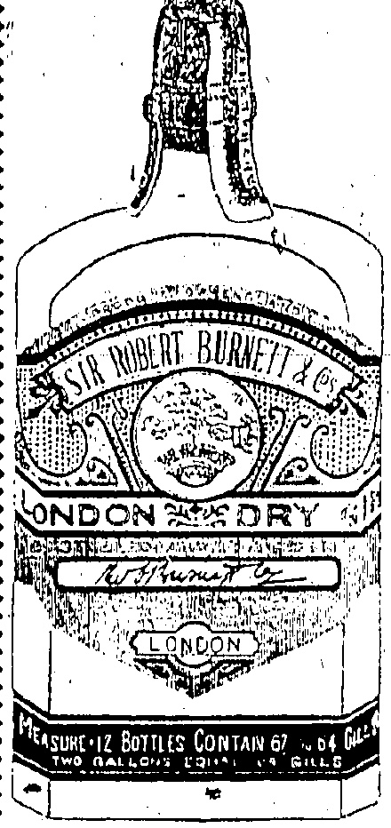
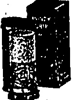
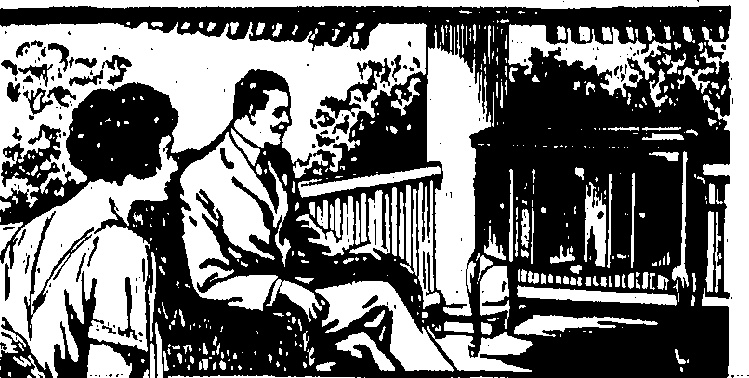
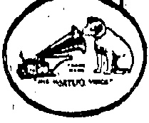
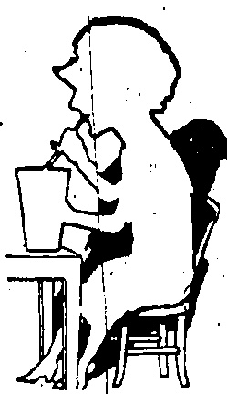
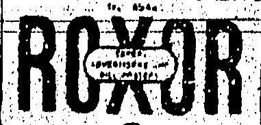

BURNETTS

FAMOUS

LONDON

DRY GIN

Givas that Distinctive Excellence to a Cocktail.

A. S. WATSON & Co., Ltd.

Telephone G. 3146.

## SATISFIED-INEXPENSIVFLY

NEW STOCK JUST RECEIVED OF "AERTEN" "INDIA GAUZE" "BYD." "CELLASTIC" "MERIDIAN". IN 'VESTS AND DRAWERS AND COMBINATIONS Good Value in every Department Every Day of the Week.

PEDDER STREET

## FRESH MILK

The undernoted are being supplied with FRESH DAIRY FARM MILK twice daily and we recommend those of our customers who find it inconvenient to send to our Depot for supplies to obtain same from either:—

H. M. HAJEE ESMAIL

2 TIN LOK LANE

MORRISON HILL

THE INDIAN STORES

46 QUEEN'S ROAD, EAST

WANCHAI

THE DAIRY FARM, ICE & COLD STORAGE CO., LTD.

REGISTRATION

We have pleasure in notifying the Public that arrangements have now been completed by this Bureau for carrying out the Registration of Servants. A fee of $1.00 per head will be charged, for which a certificate will be issued giving name, photograph and thumbprint. At the termination of the present situation we hope to be able to supply servants of all descriptions for a nominal fee.

EMPLOYMENT & REGISTRATION BUREAU.

Use COLGATE'S Ribbon Dental Cream and Handy Grip Shaving Sticks.

SOLE AGENTS:

The Hongkong Trading Co. Ltd

HONGKONG.

ORNAMENTAL PLASTER WORK

OF EVERY DESCRIPTION

BEAUTY

CARRIED OUT

ECONOMY

BY THE

SIMPLX PLASTR COY., LTD.

TEL. C: 3749.

2nd FLOOR, POWELL'S BUILDING.

## Just the Place For a Victrola!

Music quiets the spirit at the end of the working day. A Victrola, a soft tone Tungs-tone Needle, a pleasing melody on a Victor Record—these things in the grateful shade of the porch make life more worth the living!

S. MOUTRIE & CO., LTD.

Chatter Road.

HERE'S an ICE CREAM SODA

that more than SATISFES.

# - IT DELIGHTS

ASIATIC BUILDING

To. C 4702

(Every evening except Sunday, Annual subscription, excluding postage abroad, H.K. $36, payable in advance. Local delivery free.)

©orland China Mail

(The weekly edition of the "China Mail." Annual subscription, excluding postage abroad, U.K. $12, payable in advance.)

The Newspaper Enterprise, Ltd.

Printers & Publishers

Telephones Central 22 & 4641. Cable Address: Ma, Hongkong.

All communications should be addressed to the Newspaper Enterprises, Ltd., to whom all remittances should be made payable.

London Officers — The Far Eastern Advertising Agency (London)

1986-24, Devonshire Street

Knowledge, W.C.

## Hongkong, Tuesday, July 28, 1925

## A UNITED STAND

This is not an idle eulogy of ourselves. It is not a sop to the organisers of yesterday's public meeting. "Facts are chiefs that winna ding," and no process of self-examination is intended to

Small communities in the outposts of the Empire are not always united. They are like the proverbial village in which factions and cliques vie for supremacy the while the "parish pump" is being pumped with more or less inertia. Hongkong does not deserve a place among the "villages." It may be small, in the sole matter of British population. In its contribution to British and world trade it is a city, if not a metropolis with a seaport. In its power to express its opinion on local and Imperial and international questions of moment it is a giant among the pligmies of oversens Possessions. In its ability to handle grave matters of life and trade it is a peer among commoners.

eliminate virtue at the expense of vice. A united sand was eminently desirable if the vital problems that confront the Colony at the moment. The united stand was presented not only with unanimity but with acclamation, as the Chairma, the Hon. Mr. P. H. Holyoak, devisedly pointed out during the proceedings. No more diplomatisation of "the" case for Hongkong" has ever been submitted in the history of public meetings here. Candour was interwoven with fact. If now and again proximity was liable to far its head it was warranted by the honest fervour of the speaker and endorsed by the vast gatheng. If there was reiteration in the stead of condensation, it is condoned on the principle that good point loses nothing in the re-telling. Conversely, if "enough is as good as a feast," then the audience dispersed feeling fully satisfied with the bill of fe. They were in the mood for a simple and plain diet, and they received without any fancy or superfluous "fillings."

What matter most was the “atmosphere of the gathering that filled the Theatre Royal to overflowing the atmosphere of sincerity, the atmosphere of unanimity, the atmosphere of determinati that Hongkong should rece a fair hearing in the court of public opinion in certain circles at Home, including the Foreign Office and the Colonial Off. In giving expression to the sentiments actuating the whole gathering there was no extremism, to exaggeration, no pin-pricking If a truth had to be uttered was spoken for the sake of true alone. If a criticism had be made it was advanced in reasonable manner with the object in view of attaining objects for which the meeting was convened. If praise watched for it was bestowed with a manner at once gracious sincere. In short,

it would be difficult to imagine any other great gathering here or elsewhere in which the spirit of "sweet reasonableness" permeated both speakers and listeners to the complete exclusion of everything else. Therein lay the immense success of the meeting. Therein, it is to be hoped, will be found the reciprocal reception of the various resolutions at the hands of the local and Home Governments and of certain sections of the public at Home whose knowledge of the Colony is bounded only by a hypothetical pin-point on the map of "China."

MERCHANDISE MOVEMENT.

The speech made by Mr. Ho In at Saturday's meeting of the Trade Maintenance Bureau deserves the widest publicity and the points he made, the earliest consideration. It is the most optimistic utterance which has so far been made in the strange and eventful conditions the Colony has been called upon to suffer. Servants may return to waiting households; technicians and unskilled workers to factory and workshop; but all this will be of no avail unless the "life blood" again circulates. For the "life blood," it is a hackneyism to say, is the shipping which has made the harbour of Hongkong second only to the Port of London. Mr. Ho Iu's" suggestion is that new crews should be engaged for the steamers ready to receive them, which, he maintains, would bring the Port back to normal conditions and thus help to a free movement of merchandise. It is this free movement of which the Colony so much stands in need. It is this lack which is drying up the founts of credit; creating stagnation and a spirit of pessimism, and helping so much to cripple foreign and Chinese trade. A free movement of merchandise, with steamers calling at Hongkong, discharging and loading, seems to be the key to the whole situation. New crews, free from the influence of the worst type of labour union that has disgraced the noble word of labour, would mean naturally a revival in shipping—or a help in that direction. It would mean the probability of Hongkong shipments being taken up as per contract, thus helping in a revival of local trade so much needed. Not only that. A free movement of ships and a similar condition of things relating to merchandise, would undoubtedly have a wholesome effect on conditions operating at Canton and Shanghai, and bring glimmers of reason to peculiarly deadening minds blinded to matters of fact and the force of trade in the prosperity of any country. The Trade Maintenance Bureau has done well to make known the work it has been able to do in the cause of industrial peace and the furtherance of the idea contained in its name; whilst its profession of goodwill towards the British Government should not be lost sight of. The members of the Bureau have not merely expressed acquiescence in the remarks made by Mr. Ho Iu by, presumably, a shake of the head, but by the actual work they have accomplished in getting certain classes of waterfront labourers to resume work. In the free movement of merchandise lies the Colony's salvation. It is an agreeable fact that Chinese merchants of standing are working to that end.

## DISASTER INQUIRY

JURY AGAIN VISIT THE SCENE

Excavation work at Po Hing Fong continued yesterday. 'The jury, which is assisting Mr. S. B. B. McElderry in the inquest visited the scene yesterday afternoon.

At yesterday's resumed hearing the' witnesses included Wong Puksun, who lived at No. 15; Mr. G. W. Coysh who had 14 years' experience of the place as sanitary inspector; Mr. G. W. Jeffries, Director of the Observatory, who supplied hourly rainfall figures; other inmates; a contractor; and a contractor's foreman.

Members of the Fire Brigade who have suffered through continual work at the scene of collapse have been given leave to stand off.

“Predestination” will be the subject of this week's Public Lecture of the Hongkong Lodge The Theosophical Society, 18, Queen's Road Central, on Wednes. day, July 29, at 5.45 p.m. The Public are cordially invited.

## CORRESPONDENCE

SERVANT REGISTRATION.

(To the Editor of the China Mail).

Sir, — Having opened a Domestic Servants' Employment, and Registration Bureau (as per copy of letter attached herewith) I am desirous of improving the organisation as it stands at present.

Before proceeding any further, I may say that a copy of the letter attached was handed to the Hon. Mr. P. H. Holyoke prior to the meeting, but it was apparently overlooked during the discussion on the subject.

The man, and apparently the only, objection in the minds of the speakers at yesterday's meeting was that a private bureau would make possible the exploitation of servants through the administration of that bureau arranging for or conniving at frequent changes of employment by those servants, thereby bringing in, to the bureau increased fees. It should be fairly obvious that this is a weak suggestion, as there is no doubt it all keeping in view the fact that such a bureau, to be successful, must enjoy a full measure of confidence both from employer and employee, that such a policy would be absolutely suicidal so far as the continued existence of the bureau was concerned.

Thanking you for the privilege of

inserting this.

Yours, etc.,

P. H. Shaw,

Domestic Servants Employment

and Registration Bureau.

Hongkong, July 28.

(COPA)

Sir,—Having opened a Domestic Servants' Employment and Registration on Bureau some short time before, the present strike began, I am jostfully interested in the question of "servants' registration and should like to hay before this meeting a few of my views on this matter. I may say that the organisation is only in an embryo stage, and, although it is in working order, modifications may be necessary from time to time. Registration cards are already available, these being made to contain photo, thumbprint, signature, etc., of the servant. I shall endeavour to be as brief as possible in my remarks.

His Excellency the Governor has pointed out the difficulties likely to be experienced by an attempt to enforce. Compulsory Registration; and it must be apparent to all that the danger of any measures taken in this direction becoming "insupplicable" would be very great. But, whilst anything of a compulsory nature might be impracticable, I am of opinion that a system of voluntary registration would ultimately be of much value. The idea of registration of servants generally has recently been strongly opposed in the Press, some of the arguments against it being that photographs are unreliable and that thumbprints are associated solely with the province of crime. As regards photographs, it is common knowledge that most passports in use rely to a great extent on them, which should be sufficient argument in their favour. If, ferring to thumbprints, I believe it is not unknown that in dealing with natives of the East, to accept thumbprints in lieu of signatures (or in addition to them): e.g., in the case of native pay-rolls in establishments in the Army of India. In addition, I believe many important mercantile firms here us them in connection with pay-rolls, "etc. Surely" such recognised use of thumb-prints ought to be sufficient to dispel their association with crimes. It seems to me that the two objections mentioned cannot be considered to be of a very grave nature.

On the other hand, T' think voluntary registration would be productive of a much higher standard of efficiency amongst servants. My reasons are:

(1) One would stand a much better chance of knowing exactly who one's servants were. "Record cards would be difficult to "fake." Photographs, of course, might be changed, but the same would hardly apply to thumb-prints.

(2) Record cards would encourage servants to do better' work, as these certificates, if satisfactory, would provide them with a greater guarantee of future employment and enhanced wages.

(3) Were a servant, as has been suggested recently as a possibility, to receive an undeservedly adverse conduct mark by an unreasonable employer, he could destroy his card and thus place himself in a position of not having registered at all; though in a case of this kind, the Registration Bureau would take reasonable measures for the reinstatement of apparently wrongfully discharged servants.

Thus, it seems to Voluntary schemes of me, that a Registration

Disorders of the bowels are extremely dangerous, particularly during the hot weather of the summer months and in order to protect yourself and family against a sudden attack, get a bottle of Chamberlain's Colic and Diarrhoea Remedy. It can be depended upon. For sale everywhere.

## HOT WEATHER DISEASES

## COAL DISPUTE

S T A T E M E N T F R O M

DOWNING STREET.

### (Rentor's Service.)

Mr. Stanley Baldwin (the Premier) this morning for the first time intervened personally in the end-dispute-and-conferred at No. 10, Downing Street for three quarters of an hour with a committee of the Trade Union Congress, which was empowered to act for the miners. It is understood that as the result of the interview the Premier has undertaken to handle the coal crisis himself.

Mr. Baldwin was accompanied by Mr. W. C. Bridgeman, Sir Arthur Steel-Maitland and Mr. G. R. Lane-fox.

An official statement says that the Trade Union deputation urged the Premier to make an early announcement requesting the owners to postpone their notices and withdraw the proposals allow the men to work on, the terms of the present agreement pending negotiations. The Premier told the deputation that he hoped to confer with the owners to tomorrow. It is understood from an authoritative source that the deputation suggested that some form of outside assistance for the coal mining industry was necessary if further serious difficulties were to be avoided.

## SILK DUTIES

## DUMP BEFORE COLLECTION BEGINS?

CUSTOMS' BUSY SUNDAY.

### (Reuter's Service.)

The new silk duties are responsible for a remarkable situation at Folkestone, Dover and Newhaven.

Thousands of packages have been imported and are waiting clearance. Customs officials were busy all Sunday, which is exceptional, dealing with the congestion which is attributed to the fact that British retailers have not acquainted foreign manufacturers properly with the new regulations. Customers have personally to ascertain whether goods are properly declared in view of the fact that silk linings and silk trimings of hats, the silk ribbons round boxes of chocolate and scores of other articles are now dutiable.

## STINNES ESTATE

## HAMBURG SHIPPING INTERESTS

#### PRUSSLAN STATE A BUYER. (Reuter's Service.)

Berlin.

Despite a cable of June 6, it is no longer a question of reorganising the Stinnes concern but of disposing of some of its most important possessions in order to fulfil its obligations to Banks.

The Stinnes shipping interests at Hamburg have been realised and the London banking firm of Henry Schreeder have purchased for $3,000,000 shares in the Deutsche Taxemburg Mining Co. of a nominal value of 21,000,000 marks, comprising roughly a quarter of the Mining Co.'s share capital.

The Prussian State acquired the Rhenish Westphalinn Electric works, the majority of whose shares were in the hands of Stinnes.

## is highly likely to avoid both evils of :

(1) The possibility of becoming imperative and.

(2) the possibility of a servants career being blighted by any injustice on the part of an employer, whilst the full benefits of increasing the status and efficiency of those servants who came within its scope would be maintained and multiplied

I may say that I have written to the Government Department concerned and have asked that the Government should supervise the Bureau. As yet, no reply has been received by me. Should the Government agree to supervise it, well, and good. On the other hand, should it refuse, each of the various Residents' Associations might be willing to elect a representative to form a subsidiary Committee.

I should like to have the idea of this meeting on the matter, with a view to improving the organization of the Bureau as it stands at

Domestic Servants

and Registration

Hongkong, July 27