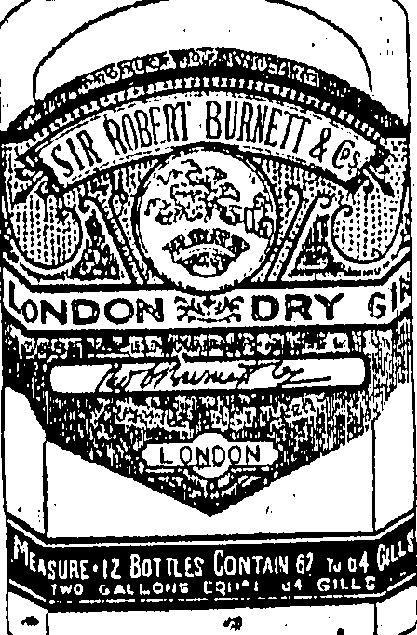
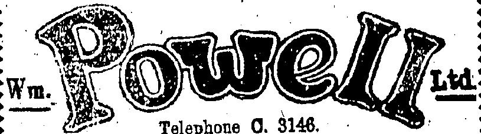
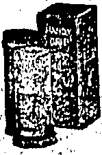
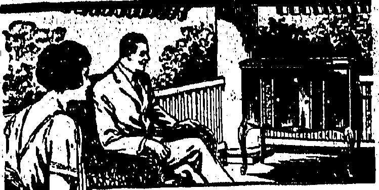
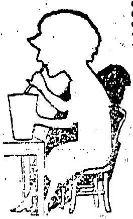
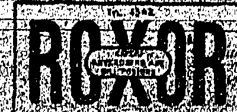

# LONDON DRY GIN

Gives that Distinctive

Excellence to a

Cocktail.

Solo Agents:

A. S. WATSON & Co., Ltd.

Telephone O. 3146.

NEW STOCK JUST RECEIVED

"AERTEX" "INDIA GAUZE

"B.V.D." "CELLASTIC" "MERIDIAN

IN VESTS AND DRAWERS AND COMBINATIONS

Good Value in every Department

## FRESH MILK

The undernoted are being supplied with FRESH DAIRY FARM MILK twice daily and we recommend those of our customers who find it inconvenient to send to our Depot for supplies to obtain same from either:—

H. M. HAJEE ESMAIL

2 TIN LOK LANE

MORRISON "HILL

THE INDIAN STORES

WANCHAI

### THE DAIRY FARM, ICE & COLD STORAGE CO., LTD

## REGISTRATION

We have pleasure in notifying the Public that arrangements have now been completed by this Bureau for carrying out the Registration of Servants. A fee of $1.00 per head will be charged, for which a certificate will be issued giving name, photograph and thumbprint. At the termination of the present situation we hope to be able to supply servants of all descriptions for a nominal fee.

EMPLOYMENT & REGISTRATION BUREAU.

Tel. C1896 Address: 15-17, Queen's Road C.

Use COLGATE'S Ribbon Dental Cream and Handy Grip Shaving Sticks.

SOLB AGENTS:

The Hongkong Trading Co. Ltd.

HONGKONG

## ORNAME TAL PLASTER WORK

# Just the Place For a Victrola!

Music quiets the spirit at the end of the working day. A Victrola, a soft tone Tungs-tone Needle, a pleasing melody on a Victor Record—these things in the grateful shade of the porch make life more worth the living!

Get it on our

Deferred Payment Plan

S. MOUTRIE & CO., LTD.

Chatter Road

that more than SATISF.S.

## ◇◇◇◇◇◇◇◇◇◇◇◇◇◇◇◇◇◇◇◇◇

## HERE'S an IOE OREAM SODA

TẠY ONE AT MORINAGA'S

# - IT DELIGHTS -

ASIATIC BUILDING.

To. C 4702

The China Mail

(Every evening except Sunday, Annual subscription, excluding postage abroad, H.K. $30, payable in advance. Local delivery free.)

Orrland China Mail

(The weekly edition of the "China Mail," Annual subscription, expanding postage abroad, H.K. $12, payable in advance.)

No.5.WYNDHAM ST., UONGKONG

Telephones Central 22 & 4641.

Cable Address: Mail, Hongkong.

All communications should be addressed to the Newspaper Enterprises Ltd. to whom all remittances shall be made payable.

London. Offices.—Thr. FAr Eastern Advertising Agency (London), Ltd., 14, Devonshire Street, Bloomberg, W.C.

## ANNOUNCEMENT

## FUNERAL

The funeral of Mr. Chau Siu-ki will take place to-morrow. The 'procession will leave the Tung Wah Hospital at 1 p.m. sharp and is timed to arrive at the Yat Pit Ting (Kennedy Town) at about 2.30 p.m. It is understood that H.E. the Governor and other officials will attend.

## Hongkong, Wednesday, July 29, 1925

## THOSE: GUILDS

If one were dealing with people of balanced mentality it might be said that the logical reasoning of a striker who followed the advice of his Guild and left Hongkong for Canton should be that, once having experienced the folly of putting his trust in Guild officials, he would see to if that in future his monthly contributions should go to some more worthy and personally profitable object. But people who leave situations worth $30-$50 a month—and in some cases considerably more—for the chemical stories of Canton which they

shared with thousands of others, can hardly lay claim to be favoured with that particular class of mentality. It is, doubtful if their faith will be smoker even by a reduction in wages and, in some cases, the entire loss of their employment which has followed the action they were persuaded into taking. The power of the Guilds, then, is not likely to suffer more than a temporary set back and are long the Hongkong Government will be called upon to face again the problem of whether something cannot be done to curb activities which in the present strike have been exercised for evil to the fullest extent.

The present Ordinance allows of interference on the part of the Hongkong Government only when the Guilds are detected in unlawful practices. If the Home Government, with similar powers, cannot place into that category, the action of trade union officials in bringing public services to a standstill, it is doubtful whether the Hongkong Government can act differently in respect of the Chinese Guild officials under their jurisdiction. There appears to be no real reason, however, why the Ordinances should not be amended in order to give the Hongkong Government more control over these pernicious bodies. The trade unionists at Home would kick, of course, and talk glibly about the sacred liberty of the subject—probably it is this more than anything else which has restrained the Government from taking up to the present a step which it certainly is called upon to do in the interests of the foreigner in Hongkong. Were a concensus of opinion possible, it would be found to be in the interests of and in accord with the desire of the greater number of the Guild members themselves. But, after all, why should much notice be taken of a section of the community the ignorance of whom in regard to things Har Eastern the present would maximize least served to throw into minority.

Although the matter was not one of those brothed at Monday night's meeting, if the Government decided to take action, it would undoubtedly have the support of the entire community, for all know that the Guilds are pernicious, and that it is high time that their benevolent activities were effectively curbed.

## Thế First 100,000

One of the most popular New York City's "The First Hundred Thousand," which graphically dealt with the first big armies raised for the Front at a time when the irksome conditions of war time were novel as well as incommoding. It requires no great strain of the imagination to draw on analogy between that "First Hundred Thousand" and the first hundred thousand meals served during the local strike by the Hongkong Hotels, Limited. The conditions since June 19 have been akin to a state of war in more respects than one; they have to many been irksome, but they have also been novel and likewise incommoding. Looking to the unique circumstances under which the hotels, in common with businesses and households, were left without sufficient labour to "carry on," it must generously be conceded that the supplying of an average of 2,500 meals a day establishes a record of which the whole community must be proud. Whilst the forces behind the strike movement sought—and are seeking—to create an economic blockade of the Colony, they have been dealt a vital blow in regard to the morale of the strikers by witnessing the Hongkong Hotels not only "making good," but even exceeding pre-strike records to the extent of serving a hundred thousand meals, thus incidentally enabling hundreds of residents and visitors to eat as well as to work. The position of the usual state of war has been reversed. An army can only march on its stomach, as some great General once observed in effect. In the case of Hongkong the army of strikers has little or nothing to march on, whilst the peaceful residents have had not the slightest need to worry about the needs of "the interior," so well have those been catered for by Mr. Taggart and his battalion of volunteer workers. Many compliments have already been showered on the Hotels since the strike began, but they have signalised the best compliment to their own services in the feat of serving a hundred thousand meals.

'Nowhere in this world of ours is there any sanctuary now; neither in the air above, nor the waters beneath; nor on the surface of the solid land; the science of slaughter is over them all, and has brought women and children into the battlezone. Death and destruction will know no master, and armed force may be our only hope. Therefor this toast becomes almost a prayer.'

## THEY SAY THAT—

—SHT FRANK DICKHEE,

President of the Royal Academy,

when promoting the toast of

'I plead that Age have greater faith in Youth; that Age bear well in mind that often Age itself is merely Youth grown tired of having faith in Age.

"And one more plea I make that those who live in high estate have better faith in Man, and forget not that in the Yesterday they were themselves no greater than the rest, and in the Morrow will be no more than the measure of what their value was to mankind."

The P. & O. sa. Malwa from Hongkong arrived Marseilles on July 25 at 7 a.m.

—D. Algan Banry.

The P.L. s.s. Slavic Prince from New York sailed from Karatsu, Japan on July 25, and is expected to arrive here today.

## STEAMER MOVEMENTS

The C.P.S. K.M.S. Empress of Australia is due here to-morrow at G p.m. and will berth at Pier 5, Kowloon Wharf, on arrival at Hongkong.

The P.L. s.s. Eastern Prince from New York sailed from Karatsu, Japan on July 28, and is expected to arrive here on August 2.

The C.P.S. R.M.S. Empress of Asia left Vancouver for Hong-kong, via Japan ports and Shanghai on July 28, and is due here on August 10.

## HOME CRICKET

A "HAT TRICK": 17 WICKETS.

Very little can prevent Yorkshire from winning the county cricket championship for the fourth year in succession. At this stage of the season they hold a commanding lead over Surrey their nearest rivals, even though they have dropped two points in each of three recent matches. Of their remaining fixtures the champions have to play Lancashire at Sheffield, Warwick and Sussex at home, and the following away: —Leicester. Essex, Hants. Sussex and Surrey (at the Oval). The only matches to cause them unrest may be the tussle with the Red Rose and the visit to the Oval. Even if Yorkshire lost both these encounters the probability is that they would finish up on top.

Surrey's percentage does not change as will be seen from the results detailed below and the championship table to date. It is interesting to note, as pointed out in the "China Mail" about a week or so ago, that Reuter has cabled the fact of Surrey's crowd eagerly waiting for their idol to make a century and thus tie the record of Dr. Grace.

"Tipped" by "Plum" Warner as likely champions, Lancashire has disappointed and are now third. They and Surrey are the only ones left in the running as Middlesex is virtually out of the race.

If interest is to be sustained to the last, it will be necessary for some of the so-called weaker counties to spring a surprise on Yorkshire.

In the results it will also be seen that V. W. C. Jupp, the former Sussex amateur and now the Norphans secretary, has performed the "hat trick" and Parker, the Gloucester professional has brought off another astonishing bowling feat. Herbert Sutcliffe, the Yorkshire opening batman who won the admiration of the Australians by his batting in the last series of Test Matches, has struck form again.

## Hobbs Makes 22

### (Reuter's Service.)

At the Oval, the Surrey v. Kent match was left drawn, without even a decision on the first innings. Scores:—

Kent (1st innings) 367 runs for 7 wickets declared. Harding made 97, Woolley (F.E.) 74 and Hubble 50.

Surrey (1st innings) 200 runs for 3 wickets. Sandham made 102 not out.

J. B. Hobbs, whose next century will make his aggregate equal Dr. W. G. Grace's record of 126 centuries in first-class cricket, was eagerly awaited by the crowd but was dismissed after scoring 22 runs.

[Less than a fortnight ago, Surrey easily defeated Kent at Blackheath.]

Sutcliffe's Big Score.

At Leeds Yorkshire led Middle-sex on the first innings. Scores:—

Yorkshire (1st) 528 runs for 6 wickets declared. Leyland made 110, Holmes 50 and Sutcliffe (the Test Match hero) scored 235. Middlesex (1st) 184 runs.

Middlesex (followed-on) 149 runs for 4 wickets..G.T.S. Stevens (the former Oxford captain) made 66 not out.

[This is also a return match, Yorkshire having won the first at Lord's.]

Lanes'. Bowling Collared.

drew with Lancashire. Scores:—

Warwick (1st) 414 rung for 6 wickets declared. The Hon. F. S. G. Calthorpe made 174 and Quade 88.

Lancs. (1st) 124 runs for 2 wickets.

[Earlier in the season, Lancashire took first innings points in the first match.]

Jnpp's "Hat Trick." At Swansea Glamorgan lost to

## GOODWOOD CUP

## OUTSIDERS FIRST AND SECOND

## A CLOSE FINISH

The Goodwood, Stewards Cup (six furlongs) run at Goodwood to-day, resulted:—

<table border=1 style='margin: auto; word-wrap: break-word;'><tr><td style='text-align: center; word-wrap: break-word;'>Defiance</td><td style='text-align: center; word-wrap: break-word;'>1.</td></tr><tr><td style='text-align: center; word-wrap: break-word;'>Sunstone</td><td style='text-align: center; word-wrap: break-word;'>2.</td></tr><tr><td style='text-align: center; word-wrap: break-word;'>Purple Shade</td><td style='text-align: center; word-wrap: break-word;'>8.</td></tr></table>

There were 24 starters. Won by three quarters of a length; half a length between second and third.

Starting prices:—20/1 against Defiance; 20/1 Sunstone; 100/9 Purple Shade.

New York, July 28.—Despite his wounds Battling Siki, who was stabbed seriously, escaped from hospital clad in pyjamas, and disappeared in a taxi cab.—Reuter's American Service.

Northamptonshire by 106 runs.

Scores:—

Northants (1st) 124 runs. W. W. Timms made 51; Mercer took 5 wickets for 31 runs and Ryan 6 for 54.

Glamorgan (1st) 108 runs.

V. W. C. Jupp took 7 wickets for 84 runs, including the "hat trick."

Northants (2nd) · 154 runs. Spencer took 7 wickets for 83 runs.

Glamorgan (2nd) 64 runs. Jupp took 8 wickets for 18 runs, making his analysis for the match 15 wickets for 52 runs!

[Northants also won the first match between them.]

Hard Lines, Hampshire!

At Bournemouth Hampshire led Worcestershire on the first innings. Scores:—

Worcester (1st) 277 runs.

Hampton made 55.

Hants (1st) 447 runs. Mead made 213 not out, C. P. Brutton 88; Root took S' wickets for 165 runs.

Worcester (2nd) 197 runs for 9 wickets. M. K. Foster made 95.

### Somerset v. Sussex

At Bath Somerset lost first innings points to Sussex. Scores:

made 55 and Cox 64; J. J. Bridges took 5. wickets for 89 runs.

Somerset (1st) 158 runs.

J. C. W. MacBryan made 80; Tate took 7 wickets for 75 runs.

Sussex (2nd) 107 runs for 8 wickets declared. J. C. White took 6 wickets for 43 runs.

Somerset (2nd) 67 runs for 3

Somerset (2nd) 67 runs for 3 wickets.

[In the opening fixture Sussex lost playing at home.]

## Irresistible Bowling

At Gloucester, Gloucestershire beat Essex by an innings and 109 runs. Scores:—

Essex (1st) 115 runs. Parker took 9 wickets for 44 runs.

Gloucester (1st) 287 runs for 6 wickets declared. Dipper made 107.

Essex (2nd) 68 runs. Parker took 8 wickets for 12 runs.

Parker's analysis, therefore, would be 17 wickets for 56 runs. The taking of 17 wickets in a match goes into Wisden's records. The last pre-war bowler to accomplish the feat was Barnes. Since the War Freeman (A.P.) and Matthews (F.C.) have added their names to this very brief list and Parker is the third. C. W. L. Parker's name is already in the list of those who have taken all 10 wickets in an innings, having done so at Bristol in 1921. He was "capped" against Australia, at Manchester, also in 1921.

[Earlier in the season, Essex won on their ground.] “Rain Then Fell”

At Ilkeston Derbyshire and

Nolts drew: Scores:—

Notts (1st) 886 runs for 5 wickets declared. Whysall made 140, Gunn (G.) 84 and Walker 81—not out.

Derby (1st) 45 runs for 2

Derby (1st) 46 runs for 2 wickets.

Won on Lost on Possible Points Per Played Won Lost 1st Inn 1st Jim. Tie Points obtained percentage,

Yorkshire.....21... 17... 0...3... 1... 0...105...95... 90.47

Surrey.....17... 12... 2...3... 0... 0... 85...69... 81.17

Lancashire.....21... 14... 3...4... 0... 0...105...82... 78.09

Middlesex.....14...9... 2...1... 2... 0... 70...50... 71.42

Notts.....16...9... 2...0... 5... 0... 80...50... 62.50

Essex.....20...9... 5...2... 4... 0...100...55... 55.00

Kent.....17...8... 7...1... 1... 0... 85...44... 51.76

Nthamptonshire...16...8... 7...0... 1... 0... 80...41... 51.25

Gloucestershire...19...9... 9...0... 2... 0... 95...47... 40.47

Hampshire.....18...4... 9...5... 0... 0... 90...35... 38.88

Sussex.....20...6... 10...1... 3... 0...100...36... 36.00

Warwickshire...18...5... 10...2... 1... 0... 90...33... 35.55

Derbyshire.....17...4... 10... 2... 0... 85...25... 29.44

Somerset.....17...3... 10...3... 1... 0... 85...25... 20.41

Lancashire...18...4... 11...1... 2... 0...100...25... 27.77

Worcestershire...20...4... 12... 2... 0...100...21...18...23.00

[Notts won the first match at Trent Bridge.]