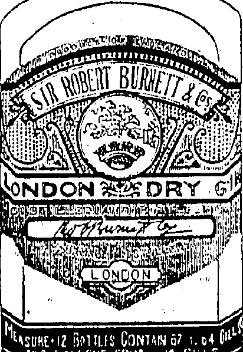
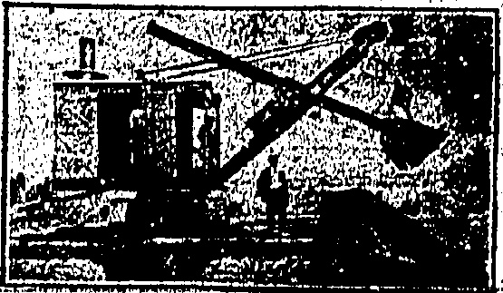
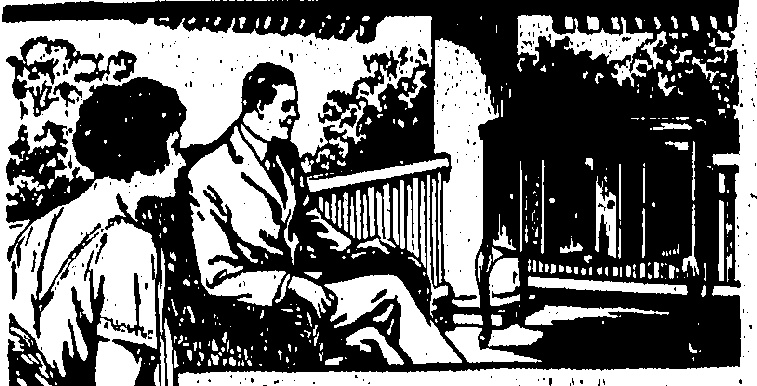

BURNETT'S

FAMOUS

LONDON

DRY GIN

Givas that Distinctive Excellence to a Cocktail.

Sole agents

A. S WATSON & Co., Ltd

WNJ AND SPIRIT

MERCHANTS.

Telephone : 3146.

BY LIMITING YOUR CHOICE TO UP-TO-DATE GOODS ONLY. JUST RECEIVED

SUMMER WEIGHT PYJAMAS, BATH GOWNS, UNDERWEAR, SILK AND LISLE SOCKS, ARTIFICIAL SILK AND COTTON, SMART DESIGNS. GENTLEMEN'S OUTFITTERS

PEDDER STREET.

## NOTICE

Peak Residents (Pokfoolum Section) are hereby informed that, commencing 1st August, their supply of Milk will be delivered as formerly morning and afternoon.

THE DAIRY FARM, ICE & COLD STORAGE CO., LTD.

REGISTRATION.

We have pleasure in notifying the Public that arrangements have now been completed by this Bureau for carrying out the Registration of Servants. A fee of $1.00 per head will be charged, for which a certificate will be issued giving name, photograph and thumbprint. At the termination of the present situation we hope to be able to supply servants of all descriptions for a nominal fee.

EMPLOYMENT & REGISTRATION BUREAU.

Tel. C1896 Address: 15-17, Queen's Road C.

PIANOS for SALE or Hire

TSANG FOOK PIANO CO.,

Tel. C. 4848 No. 8, Des Vooux Road Central,

(entrance Iso House Street)

## EXCAVATION WORK

WITH STEAM SHOVEL EQUIPMENT

HONGKONG EXCAVATION, PILE DRIVING AND CONSTRUCTION COMPANY, LIMITED Telephone Central 3740 and Floor, Powell's Building

# 'Just the Place For a Victrola!

Music quiets the spirit at the end of the working day. A Victrola, a soft tone Tungs-tone Needle, a pleasing melody on a Victor Record—these things in the grateful shade of the porch make life more worth the living!

Get it on our

Deferred Payment Plan

S. MOUTRIE & CO., LTD.

Chater Road.

REFRESHING WITH A SPARKLE

THAT SAYS HAVE ANOTHER

AT

## MORINAGAS

Tel. 0, 4702.

◇◇◇◇◇◇◇◇◇◇◇◇◇◇◇◇◇◇◇◇◇◇◇◇◇◇◇◇◇◇◇◇◇◇◇◇◇◇◇◇◇◇◇◇◇◇◇◇◇◇◇◇◇◇◇◇◇◇◇◇◇◇◇◇◇◇◇◇◇◇◇◇◇◇◇◇◇◇◇◇◇◇◇◇◇◇◇◇◇◇◇◇◇◇◇◇◇◇◇◇◇◇◇◇◇◇◇◇◇◇◇◇◇◇◇◇◇◇◇◇◇◇◇◇◇◇◇◇◇◇◇◇◇◇◇◇◇◇◇◇◇◇◇◇◇◇◇◇◇◇◇◇◇◇◇◇◇◇◇◇◇◇◇◇◇◇◇◇◇◇◇◇◇◇◇◇◇◇◇◇◇◇◇◇◇◇◇◇◇◇◇◇◇◇◇◇◇◇◇◇◇◇◇◇◇◇◇◇◇◇◇◇◇◇◇◇◇◇◇◇◇◇◇◇◇◇◇◇◇◇◇◇◇◇◇◇◇◇◇◇◇◇◇◇◇◇◇◇◇◇◇◇◇◇◇◇◇◇◇◇◇◇◇◇◇◇◇◇◇◇◇◇◇◇◇◇◇◇◇◇◇◇◇◇◇◇◇◇◇◇◇◇◇◇◇◇◇◇◇◇◇◇◇◇◇◇◇◇◇◇◇◇◇◇◇◇◇◇◇◇◇◇◇◇◇◇◇◇◇◇◇◇◇◇◇◇◇◇◇◇◇◇◇◇◇◇◇◇◇◇◇◇◇◇◇◇◇◇◇◇◇◇◇◇◇◇◇◇◇◇◇◇◇◇◇◇◇◇◇◇◇◇◇◇◇◇◇◇◇◇◇◇◇◇◇◇◇◇◇◇◇◇◇◇◇◇◇◇◇◇◇◇◇◇◇◇◇◇◇◇◇◇◇◇◇◇◇◇◇◇◇◇◇◇◇◇◇◇◇◇◇◇◇◇◇◇◇◇◇◇◇◇◇◇◇◇◇◇◇◇◇◇◇◇◇◇◇◇◇◇◇◇◇◇◇◇◇◇◇◇◇◇◇◇◇◇◇◇◇◇◇◇◇◇◇◇◇◇◇◇◇◇◇◇◇◇◇◇◇◇◇◇◇◇◇◇◇◇◇◇◇◇◇◇◇◇◇◇◇◇◇◇◇◇◇◇◇◇◇◇◇◇◇◇◇◇◇◇◇◇◇◇◇◇◇◇◇◇◇◇◇◇◇◇◇◇◇◇◇◇◇◇◇◇◇◇◇◇◇◇◇◇◇◇◇◇◇◇◇◇◇◇◇◇◇◇◇◇◇◇◇◇◇◇◇◇◇◇◇◇◇◇◇◇◇◇◇◇◇◇◇◇◇◇◇◇◇◇◇◇◇◇◇◇◇◇◇◇◇◇◇◇◇◇◇◇◇◇◇◇◇◇◇◇◇◇◇◇◇◇◇◇◇◇◇◇◇◇◇◇◇◇◇◇◇◇◇◇◇◇◇◇◇◇◇◇◇◇◇◇◇◇◇◇◇◇◇◇◇◇◇◇◇◇◇◇◇◇◇◇◇◇◇◇◇◇◇◇◇◇◇◇◇◇◇◇◇◇◇◇◇◇◇◇◇◇◇◇◇◇◇◇◇◇◇◇◇◇◇◇◇◇◇◇◇◇◇◇◇◇◇◇◇◇◇◇◇◇◇◇◇◇◇◇◇◇◇◇◇◇◇◇◇◇◇◇◇◇◇◇◇◇◇◇◇◇◇◇◇◇◇◇◇◇◇◇◇◇◇◇◇◇◇◇◇◇◇◇◇◇◇◇◇◇◇◇◇◇◇◇◇◇◇◇◇◇◇◇◇◇◇◇◇◇◇◇◇◇◇◇◇◇◇◇◇◇◇◇◇◇◇◇◇◇◇◇◇◇◇◇◇◇◇◇◇◇◇◇◇◇◇◇◇◇◇◇◇◇◇◇◇◇◇◇◇◇◇◇◇◇◇◇◇◇◇◇◇◇◇◇◇◇◇◇◇◇◇◇◇◇◇◇◇◇◇◇◇◇◇◇◇◇◇◇◇◇◇◇◇◇◇◇◇◇◇◇◇◇◇◇◇◇◇◇◇◇◇◇◇◇◇◇◇◇◇◇◇◇◇◇◇◇◇◇◇◇◇◇◇◇◇◇◇◇◇◇◇◇◇◇◇◇◇◇◇◇◇◇◇◇◇◇◇◇◇◇◇◇◇◇◇◇◇◇◇◇◇◇◇◇◇◇◇◇◇◇◇◇◇◇◇◇◇◇◇◇◇◇◇◇◇◇◇◇◇◇◇◇◇◇◇◇◇◇◇◇◇◇◇◇◇◇◇◇◇◇◇◇◇◇◇◇◇◇◇◇◇◇◇◇◇◇◇◇◇◇◇◇◇◇◇◇◇◇◇◇◇◇◇◇◇◇◇◇◇◇◇◇◇◇◇◇◇◇◇◇◇◇◇◇◇◇◇◇◇◇◇◇◇◇◇◇◇◇◇◇◇◇◇◇◇◇◇◇◇◇◇◇◇◇◇◇◇◇◇◇◇◇◇◇◇◇◇◇◇◇◇◇◇◇◇◇◇◇◇◇◇◇◇◇◇◇◇◇◇◇◇◇◇◇◇◇◇◇◇◇◇◇◇◇◇◇◇◇◇◇◇◇◇◇◇◇◇◇◇◇◇◇◇◇◇◇◇◇◇◇◇◇◇◇◇◇◇◇◇◇◇◇◇◇◇◇◇◇◇◇◇◇◇◇◇◇◇◇◇◇◇◇◇◇◇◇◇◇◇◇◇◇◇◇◇◇◇◇◇◇◇◇◇◇◇◇◇◇◇◇◇◇◇◇◇◇◇◇◇◇◇◇◇◇◇◇◇◇◇◇◇◇◇◇◇◇◇◇◇◇◇◇◇◇◇◇◇◇◇◇◇◇◇◇◇◇◇◇◇◇◇◇◇◇◇◇◇◇◇◇◇◇◇◇◇◇◇◇◇◇◇◇◇◇◇◇◇◇◇�

## The China Mail

(Every eventing except Sunday. Annual subscription, excluding postage abroad, H.K. $26, payable in advance. Local delivery free.)

(The weekly edition of the "China Mail." Annual subscription, excluding postage abroad, HK $12, payable in advance.)

The Newspaper Enterprise, Ltd.

Printers & Publishers

No. 5, WYNDHAM ST., HONGKONG

London Offices:—The Far Easturo

Advertising Agency (London),

Ltd. 24, Devonshire, Street,

Bloomsbury, W.C.1.

All communications should be addressed to the Newspaper Enterprise, Ltd., to whom all remittances should be made payable.

## Hongkong, Friday, July 31, 1925

## PROPAGANDA

We can only ascribe the absence of a serious system of propaganda in the present condition of affairs, to an innate sense of modesty on the part of the British executive, or those who might well consider the matter of effective propaganda. In ordinary circumstances it can only be the small-minded who can find satisfaction in lauding its own virtues and chronicling its own achievements. The British characteristic of coldness and aloofness excludes all idea of "the puff direct." Hongkong might well have dinned—and continual dinning of facts is the success of all propaganda as it is the success of advertising—into the obstute minds of those who are willfully blind and refuse to think of its virtues of administration; its educational facilities; its laws which do not differentiate between rich and poor—the lowly ricksha-puller and the lordly merchant; its gifts to famine

nfested districts; and its humane conditions of factory employment. The list is admittedly brief as it is meant to be. That has not banged the big drum of self-advertisement is as it should be and as British people would have it. But there comes a time, as in the present distress, when the question of propaganda takes foremost place: when the question of counteracting untruth—to mention only one of the great evils—should become very vital. Its vitality at the moment does not seem very evident. The Colony has suffered to a considerable extent by reason of the fact that the uncontradicted untruth has had free play, even though evidence of the eyes should have convicted lying statements of their falseness. The people of this Colony have not starved; the harbour has not been blockaded; and there have been no signs of terrorism. It may be that the intelligence of the coolie, labouring, and amah class, has been under-rated; but it is surely evident that if peace is to be our portion in the future, the aim must be to free these people from a bondage of fear, and a belief in what may be described as "fairy tales," that, as we have seen, has hitherto reacted so disastrously on our fortunes. There has been no harsh criticism of the Government's handling of a somewhat complex matter. It has had good will and hearty co-operation of an unstinted kind. But we may be permitted a word to suggest that whilst it lost no time in appointing officials to control food supplies and labour, it should have lost no time in appointing a Director of Publicity or Propaganda, to feed the foreign and Chinese Press—with information—to placard the Colony with refutations of silly rumours; to present the facts of any case that may be, in no uncertain light of language; to "feed" outlying places with information; and

amongst the many things such a Director or a Bureau under his charge could do, would be to make use of such natural avenues of publicity as the tried, tested, and most effective method of the cinematograph. It is not too late to introduce such a necessary system as we have here indicated. The "China Mail" are this has suggested that there should be a Publicity Bureau as part of the Government's organisation. The present need merely proves that the suggestion was not an idle one.

## The Penalty of Personality

Mr. Lloyd George when he became Chancellor did not abandon the expression of his views about dukes, and on these views the flames of party feeling/fed. On the other hand, from the moment Mr. Churchill went to the Treasury he seemed to put out of his mind his authorship of the famous taunt: "Is Labour fit to govern?" and that he had ever delighted a bored House with his brilliant interventions in debate at the expense of Labour or Russia, or whatever happened to be in his path at the moment. It is well known that he was profoundly grateful to Mr. Baldwin for the demonstration of confidence which his appointment to the Treasury carried with it, and he has obviously aimed at being the most "urbane of Ministers. But just as one does not forget the Lloyd George of 1905 and 1909, so it is evident that a section of Labour in particular cannot forget the Churchill of more recent years. Thus we had back bench Opposition murmuring during the Budget speech Mr. Churchill ignored them, though irritated, and did no more than turn on one of his own supporters who interrupted him. Then when the Chancellor had listened to three days' criticisms of his proposals and sought to reply, he was shouted down by the same back bench element and had to abandon his speech. Unless he has indeed been transformed, a Churchill does not tolerate very much treatment of this nature, and if a dead-set is to be made against the Chancellor, the old fighting spirit will inevitably come out. Conservatives will back him to a man, and the new Parliament may easily be split from top to bottom by controversy at a time when the leaders of all parties desire an earnest and co-operative handling of current problems. It is in this last fact that the best hope of avoiding undue controversy lies.

It is brought home to me with every day that I pass at my work that Europe is moving uneasily, slowly, it may be, but certainly to a new catastrophe.—Mr. Austen Chamberlain.

## THEY SAY THAT

Now I can do what I like:—M. Herriot (after resigning).

I have no doubt, taking force of character and intellectual power combined, that Gladstone was the greatest man in whose presence I have ever been.—Lord Grey.

If the French, who have a high death-rate, would give up making 75mm. guns and buy drain pipes from Paisley they would be a much more formidable nation than they were at present.—Capt. Elliot, M.P.

When the Gospel is faithfully preached, the preacher may count on receiving more kicks than half-pence.—Dean Inge.

There is something wrong with a man if he does not want to break the Ten Commandments.—Mr. G. K. Chesterton.

"Intelligence" is an extraordinarily subtle and varied collection of qualities, and the present methods are far too crude to measure it.—Mr. J. W. N. Sullivan.

I have seen a complete change in affairs—educational, political? social, and religious—during my long life, and I am glad to testify that on the whole the changes have been for the better.—Mrs. Haldane.

I hate plays that I can understand, because they are not like life, which nobody understands.—Mr. Bernard Shaw.

No Empire has ever perasted when the people at its centre forget how to till the land.—Mr Lansbury.

"You should never point, Johnnie," said Mrs. Brown, as they left the shop. "It is very rude."

"But what are you to do, may when you don't know the name of the thing?"

"Why," she returned, "let the assistant show you everything in the shop until he comes to the right one."

## COAL CRISIS

STRIKE COMMENCES TO-DAY.

PREMIER'S GREAT EFFORTS.

### (Reuter's Service.)

London, July 30.

The coal situation is regarded in Ministerial circles this afternoon as of the gravest, but not as hopeless. Mr. Baldwin is doing his utmost to make the parties confer, impressing upon them that a strike must be averted.

Mr. Baldwin' conferred first with the coal owners and secondly with the miners, after which representatives of both sides made statements to the Press indicating that neither side had made a concession.

The Miners' representatives, after seeing Mr. Baldwin, conferred with a special committee of the Trade Union Congress. Afterwards these conferees joined a conference of all the Trade Union executives.

## Trade Unions Decision

At a meeting of the Executives of all the Trade Unions at Westminster it was unanimously and whole-heartedly decided to assist the miners, including financial help in the form of a levy from each district.

## Handling To Cease

A special committee of the Trade Union Congress and Railwayways' Transport Workers' Union executives, ordered the handling of coal to cease at midnight on Friday (to-day).

All coal then railed is to be placed in the nearest siding which may exclusively be used for coal-ing engines, but not passed to other depots. No imports may be handled.

## Premier's Statement

Mr. Baldwin, in the course of a statement to the Miners' Federation, summarising the negotiations during the present position, specifies the Owners' concessions as the principle of a minimum wage and the inclusion of August profits in wages; and the suggestion of the relaxation of the Seven Hours' Act to enable an offer of better wage terms.

The Premier also sets out the Federation's refusal to accept wage reductions or relaxation of hours, and points out that the Federation offered not the slightest contribution to the concessions.

He emphasises that the Government is not prepared to subsidise the industry.

The foregoing was issued shortly prior to the intimation that Mr. Baldwin would not make a speech in the House of Commons to-night, which had been announced. The postponement is due to his meeting both the parties to-night.

Earlier in the evening the situation was discussed at a special Cabinet meeting.

## German Crisis

The glut in coal is causing a crisis in German industry. Ten million tons lying in the Ruhr must be sold at any price to save the industry from ruin. The only method of disposing of it is by export. This explains the refusal of the German delegates to the International Miners' Federation in Paris to join the British miners in their strike or even to support the transporters who are preventing export. The coal situation is such that Ruhr owners are resorting to wholesale dismissals. Negotiations, in which the chancellor is participating, are proceeding in Berlin to solve the problem.

## OFFICIAL STATEMENT

## London, later

A statement issued by the Ministry of Labour after midnight says that following a meeting of the Cabinet yesterday, evening, at which full consideration was given to the whole circumstances of the coal dispute, the Prime Minister had a further conversation with the representatives of the miners and the owners.

The miners told the Prime Minister that they desired to co-operate in the proposed enquiry with a view to a full investigation of the methods of improving the productive efficiency of the industry for the purpose of increasing its competitive power in winning markets. They intimated that it was not fair to require a reduction in wages with the present cost of living before an attempt, by means of an enquiry, to secure a contribution

## PEKING LEGATION

## ADEQUATE SAFETY ASSUMED

(Router's Service.)

## London, July 30

In the House of Commons, replying to Mr. H. W. Looker (formerly of Hongkong) Mr. Ronald McNeill (Under Secretary for Foreign Affairs), said that he had not received the official report of the Soviet envoy at Peking.

There was a loopholed wall at the Legution, and it could safely be assumed that the British Charge d'Affaires had taken all possible steps to ensure the safety of the British Legation.

## DUTCH POLITICS

### M. COLIJN TO FORM A CABINET

(Reuter's Service.)

The Hague, July 30

M. Colijn, Minister of Finance,

ans accepted the task of forming a

Cabinet.

## EXCLUSIVE SOCIETY

BARRIERS PROOF AGAINST THE NEW-RICH.

There is a saying that all good Americans go to Paris when they die. That may be; but it is certainly true that all rich Americans aspire to come to London long before then. And there are others too, who aspire to play the "social" game. These include the new rich, the socially outré, but ambitious, the outsiders who never cease trying to break down those queer, invisible barriers with their golden clubs.

This year, as never before, London is inundated with social aspirants. Their efforts to obtain entrance are amusing to watch, but have their pathetic side.

It is easy to be a hostess in London at the height of the season—but not so easy to be a guest at the “right houses.”

But the social climbers who storm exclusive London Society at this time of the year are not all from the other side of the Atlantic. It is usually the women-folk who develop this passion for exclusiveness when father has established his bank account. Father usually prefers his old cronies, his pipe and his talk of shop. But he is usually prevailed upon to leave his comfortable if obscure home and launch out for the season. As in the other case all turns to bitterness and disappointment. London merely smiles a superior smile. It is ready to take the money of these people. But as for “accepting” them that cannot be done.

"John Marrows," said the farmer's wife, coming out to the back porch, where her husband eats, tilted back in his chair, his feet on a railing, "didn't I hear you tell the parson when he was here that you had strong views on the temperance movement?"

“Yes,” Mr. Marrows replied, rather stiffly. “I said so, and you know that I have.”

"Well," said Mrs. Marrows, "suppose you go and express a few of them on the pump-handle. I want a pail of water."

toward meeting the difficult situation with which the industry is confronted.

The Prime Minister consequently announced that the Government was prepared to assist the industry until next Spring, when the enquiry will be completed.

The Prime Minister requested the owners to suspend the notices for a fortnight in order that the necessary discussions might proceed concerning the way in which temporary assistance could be afforded.

A statement issued by Mr. Cook on behalf of the miners, says that a settlement has not yet been reached.

A further meeting with the Prime Minister was arranged for noon to-day after Mr. Baldwin met the owners.

The mine workers will receive their instructions immediately after to-day's meetings.

TROUBLE SPREADING.

Paris, July 30.

The bank strike is spreading. The employees of the Credit Lyonsnais have followed the lead of the Banque Nationale de Credit in demanding 100 francs monthly increase against an offer of 45 francs. They went in procession twice to the bank buildings, but were dispersed by the police. Two other banks employees have come out and those of the Gomptoir Desompte strike to manage