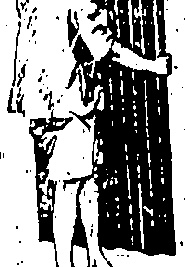
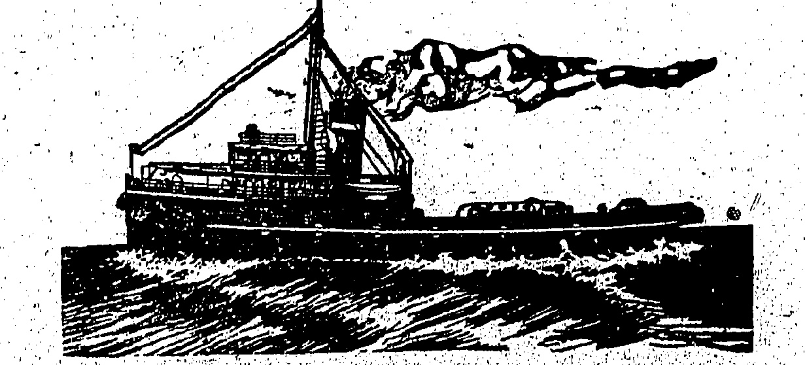

(COMPANIES incorporated in ENGLAND).

## MAIL AND PASSENGER SERVICES

JAITS, JAVA, BURMA, CEYLON, INDIA, PERSIAN GULF, WEST INDIES, MAURITIUS, EAST AND SOUTH AFRICA, AUSTRALASIA, INCLUDING NEW ZEALAND AND QUEENSLAND PORTS, AND RED SEA, EGYPT, EUROPE, &

##### PENINSULAR & ORIENTAL FORTNIGHTLY DIRECT ROYAL MAIL STEAMERS. Under Contract with H.M. Government

<table border=1 style='margin: auto; word-wrap: break-word;'><tr><td style='text-align: center; word-wrap: break-word;'>S. S.</td><td style='text-align: center; word-wrap: break-word;'>Toys</td><td style='text-align: center; word-wrap: break-word;'>FROM HONGKONG (ABOUT)</td><td style='text-align: center; word-wrap: break-word;'>DESTINATION</td></tr><tr><td style='text-align: center; word-wrap: break-word;'></td><td style='text-align: center; word-wrap: break-word;'></td><td style='text-align: center; word-wrap: break-word;'></td><td style='text-align: center; word-wrap: break-word;'></td></tr></table>

Milles, L'don, A'werp, H'burg & Hull

<table border=1 style='margin: auto; word-wrap: break-word;'><tr><td style='text-align: center; word-wrap: break-word;'>&quot;NAGOYA&quot;</td><td style='text-align: center; word-wrap: break-word;'>8,884</td><td style='text-align: center; word-wrap: break-word;'>Red Juno</td><td style='text-align: center; word-wrap: break-word;'>Miles, London, A werp, a burg &amp; Hull</td></tr><tr><td style='text-align: center; word-wrap: break-word;'></td><td style='text-align: center; word-wrap: break-word;'></td><td style='text-align: center; word-wrap: break-word;'>at Noon.</td><td style='text-align: center; word-wrap: break-word;'></td></tr><tr><td style='text-align: center; word-wrap: break-word;'>&quot;SICILIA&quot;</td><td style='text-align: center; word-wrap: break-word;'>6,813</td><td style='text-align: center; word-wrap: break-word;'>1 $ ^{{st}} $th June</td><td style='text-align: center; word-wrap: break-word;'>B&#x27;spore, Penang, Col&#x27;b o &amp; B&#x27;bay</td></tr><tr><td style='text-align: center; word-wrap: break-word;'>&quot;KALYAN&quot;</td><td style='text-align: center; word-wrap: break-word;'>9,113</td><td style='text-align: center; word-wrap: break-word;'>13th June</td><td style='text-align: center; word-wrap: break-word;'>Marseilles, London, Antwerp &amp; Hull</td></tr><tr><td style='text-align: center; word-wrap: break-word;'>&quot;JEYPORE&quot;</td><td style='text-align: center; word-wrap: break-word;'>5,319</td><td style='text-align: center; word-wrap: break-word;'>17th June</td><td style='text-align: center; word-wrap: break-word;'>Singapore and Bombay</td></tr><tr><td style='text-align: center; word-wrap: break-word;'>&quot;MIRZAPORE&quot;</td><td style='text-align: center; word-wrap: break-word;'>9,715</td><td style='text-align: center; word-wrap: break-word;'>23th June</td><td style='text-align: center; word-wrap: break-word;'>Singapore, Penang, Colombo</td></tr><tr><td style='text-align: center; word-wrap: break-word;'>&quot;MALWA&quot;</td><td style='text-align: center; word-wrap: break-word;'>10,941</td><td style='text-align: center; word-wrap: break-word;'>27th June</td><td style='text-align: center; word-wrap: break-word;'>Marseilles and London</td></tr><tr><td style='text-align: center; word-wrap: break-word;'>&quot;DELTA&quot;</td><td style='text-align: center; word-wrap: break-word;'>8,097</td><td style='text-align: center; word-wrap: break-word;'>11th July</td><td style='text-align: center; word-wrap: break-word;'>S&#x27;pore, Penang, Col&#x27;b o &amp; B&#x27;bay</td></tr><tr><td style='text-align: center; word-wrap: break-word;'>&quot;KASHMIR&quot;</td><td style='text-align: center; word-wrap: break-word;'>8,985</td><td style='text-align: center; word-wrap: break-word;'>11th July</td><td style='text-align: center; word-wrap: break-word;'>Marseilles, London &amp; Antwerp</td></tr><tr><td style='text-align: center; word-wrap: break-word;'>&quot;MANTOA&quot;</td><td style='text-align: center; word-wrap: break-word;'>10,902</td><td style='text-align: center; word-wrap: break-word;'>25th July</td><td style='text-align: center; word-wrap: break-word;'>Marseilles &amp; London</td></tr><tr><td style='text-align: center; word-wrap: break-word;'>&quot;BOUDAN&quot;</td><td style='text-align: center; word-wrap: break-word;'>6,888</td><td style='text-align: center; word-wrap: break-word;'>8th Aug.</td><td style='text-align: center; word-wrap: break-word;'>S&#x27;pore, Penang, Col&#x27;b o &amp; Bombay</td></tr><tr><td style='text-align: center; word-wrap: break-word;'>&quot;KASHGAR&quot;</td><td style='text-align: center; word-wrap: break-word;'>9,005</td><td style='text-align: center; word-wrap: break-word;'>8th Aug.</td><td style='text-align: center; word-wrap: break-word;'>Marseilles, London, Antwerp</td></tr><tr><td style='text-align: center; word-wrap: break-word;'>&quot;MACEDONIA&quot;</td><td style='text-align: center; word-wrap: break-word;'>11,089</td><td style='text-align: center; word-wrap: break-word;'>22nd Aug.</td><td style='text-align: center; word-wrap: break-word;'>Marseilles and London</td></tr><tr><td style='text-align: center; word-wrap: break-word;'>&quot;BIOILIA&quot;</td><td style='text-align: center; word-wrap: break-word;'>6,813</td><td style='text-align: center; word-wrap: break-word;'>3rd Sept.</td><td style='text-align: center; word-wrap: break-word;'>S&#x27;spore, Penang, Col&#x27;b o &amp; B&#x27;bay</td></tr><tr><td style='text-align: center; word-wrap: break-word;'>&quot;NARKUNDA&quot;</td><td style='text-align: center; word-wrap: break-word;'>6,227</td><td style='text-align: center; word-wrap: break-word;'>5th Sept.</td><td style='text-align: center; word-wrap: break-word;'>Marseilles and London</td></tr><tr><td style='text-align: center; word-wrap: break-word;'>&quot;KHYBER&quot;</td><td style='text-align: center; word-wrap: break-word;'>9,114</td><td style='text-align: center; word-wrap: break-word;'>19th Sept.</td><td style='text-align: center; word-wrap: break-word;'>Marseilles, London and Antwerp</td></tr><tr><td style='text-align: center; word-wrap: break-word;'>&quot;KAKMALA&quot;</td><td style='text-align: center; word-wrap: break-word;'>9,123</td><td style='text-align: center; word-wrap: break-word;'>3rd Oct.</td><td style='text-align: center; word-wrap: break-word;'>Marseilles, London &amp; Antwerp</td></tr><tr><td style='text-align: center; word-wrap: break-word;'>&quot;MALWA&quot;</td><td style='text-align: center; word-wrap: break-word;'>10,941</td><td style='text-align: center; word-wrap: break-word;'>17th Oct.</td><td style='text-align: center; word-wrap: break-word;'>Marseilles &amp; London</td></tr><tr><td style='text-align: center; word-wrap: break-word;'>&quot;KEHVA&quot;</td><td style='text-align: center; word-wrap: break-word;'>9,135</td><td style='text-align: center; word-wrap: break-word;'>31st Oct.</td><td style='text-align: center; word-wrap: break-word;'>Marseilles, London, and Antwerp</td></tr><tr><td style='text-align: center; word-wrap: break-word;'>&quot;MANTUA&quot;</td><td style='text-align: center; word-wrap: break-word;'>10,902</td><td style='text-align: center; word-wrap: break-word;'>14th Nov.</td><td style='text-align: center; word-wrap: break-word;'>Marseilles and London</td></tr><tr><td style='text-align: center; word-wrap: break-word;'>&quot;KALYAN&quot;</td><td style='text-align: center; word-wrap: break-word;'>9,444</td><td style='text-align: center; word-wrap: break-word;'>28th Nov.</td><td style='text-align: center; word-wrap: break-word;'>Marseilles, London and Antwerp</td></tr><tr><td style='text-align: center; word-wrap: break-word;'>&quot;MOREA&quot;</td><td style='text-align: center; word-wrap: break-word;'>10,911</td><td style='text-align: center; word-wrap: break-word;'>12th Dec.</td><td style='text-align: center; word-wrap: break-word;'>Marseilles and London</td></tr></table>

<table border=1 style='margin: auto; word-wrap: break-word;'><tr><td colspan="4">ASTERN &amp; AUSTRALIAN SAILINGS (South)</td></tr><tr><td style='text-align: center; word-wrap: break-word;'>TANDA</td><td style='text-align: center; word-wrap: break-word;'>6,958</td><td style='text-align: center; word-wrap: break-word;'>3rd June at Noon.</td><td style='text-align: center; word-wrap: break-word;'>Manila, Kolamburgue, Sandakan, Thursday, Island, Townsville, Brisbane, Sydney and Melbourne.</td></tr><tr><td style='text-align: center; word-wrap: break-word;'>ABAFURA</td><td style='text-align: center; word-wrap: break-word;'>6,000</td><td style='text-align: center; word-wrap: break-word;'>8th July</td><td style='text-align: center; word-wrap: break-word;'>do.</td></tr><tr><td style='text-align: center; word-wrap: break-word;'>ST. ALBANS</td><td style='text-align: center; word-wrap: break-word;'>4,500</td><td style='text-align: center; word-wrap: break-word;'>5th Aug.</td><td style='text-align: center; word-wrap: break-word;'>do.</td></tr><tr><td style='text-align: center; word-wrap: break-word;'>TANDA</td><td style='text-align: center; word-wrap: break-word;'>6,958</td><td style='text-align: center; word-wrap: break-word;'>2nd Sept.</td><td style='text-align: center; word-wrap: break-word;'>do.</td></tr><tr><td style='text-align: center; word-wrap: break-word;'>ARAFURA</td><td style='text-align: center; word-wrap: break-word;'>6,000</td><td style='text-align: center; word-wrap: break-word;'>7th Oct.</td><td style='text-align: center; word-wrap: break-word;'>do.</td></tr><tr><td style='text-align: center; word-wrap: break-word;'>ST. ALBANE</td><td style='text-align: center; word-wrap: break-word;'>4,500</td><td style='text-align: center; word-wrap: break-word;'>4th Nov.</td><td style='text-align: center; word-wrap: break-word;'>do.</td></tr></table>

The E. & A. 8.8. Co., Ltd. steamers will also call at Shanghai, Iloilo, Oluu, Klambugen, Tawao, Timor, Darwin, or other ports on route as independent offers. Frequent connections from Australia with the following:—

The Union 8.8. Company's steamers to the Unit of Kingdom via New Zealand

<table border=1 style='margin: auto; word-wrap: break-word;'><tr><td style='text-align: center; word-wrap: break-word;'>KASHMIR</td><td style='text-align: center; word-wrap: break-word;'>8,985</td><td style='text-align: center; word-wrap: break-word;'>12th June</td><td style='text-align: center; word-wrap: break-word;'>Shanghai, Moji and Kobe.</td></tr><tr><td style='text-align: center; word-wrap: break-word;'>DELTA</td><td style='text-align: center; word-wrap: break-word;'>8,097</td><td style='text-align: center; word-wrap: break-word;'>12th June</td><td style='text-align: center; word-wrap: break-word;'>Shanghai and Kobe</td></tr><tr><td style='text-align: center; word-wrap: break-word;'>ARAFURA</td><td style='text-align: center; word-wrap: break-word;'>6,000</td><td style='text-align: center; word-wrap: break-word;'>13th June</td><td style='text-align: center; word-wrap: break-word;'>Moji, Kobe and Yokohama.</td></tr><tr><td style='text-align: center; word-wrap: break-word;'>TILAWA</td><td style='text-align: center; word-wrap: break-word;'>10,008</td><td style='text-align: center; word-wrap: break-word;'>21st June</td><td style='text-align: center; word-wrap: break-word;'>Kobe</td></tr><tr><td style='text-align: center; word-wrap: break-word;'>TALAMBA</td><td style='text-align: center; word-wrap: break-word;'>8,018</td><td style='text-align: center; word-wrap: break-word;'>24th June</td><td style='text-align: center; word-wrap: break-word;'>Kobe</td></tr><tr><td style='text-align: center; word-wrap: break-word;'>MANTOA</td><td style='text-align: center; word-wrap: break-word;'>10,908</td><td style='text-align: center; word-wrap: break-word;'>25th June</td><td style='text-align: center; word-wrap: break-word;'>Shanghai, Moji &amp; Kobe</td></tr><tr><td style='text-align: center; word-wrap: break-word;'>TAKLIWA</td><td style='text-align: center; word-wrap: break-word;'>7,986</td><td style='text-align: center; word-wrap: break-word;'>6th July</td><td style='text-align: center; word-wrap: break-word;'>Kobe</td></tr><tr><td style='text-align: center; word-wrap: break-word;'>KASHGAR</td><td style='text-align: center; word-wrap: break-word;'>9,005</td><td style='text-align: center; word-wrap: break-word;'>10th July</td><td style='text-align: center; word-wrap: break-word;'>Shanghai, Moji and Kobe</td></tr><tr><td style='text-align: center; word-wrap: break-word;'>BOUDAN</td><td style='text-align: center; word-wrap: break-word;'>6,896</td><td style='text-align: center; word-wrap: break-word;'>10th July</td><td style='text-align: center; word-wrap: break-word;'>Shanghai and Kobe.</td></tr><tr><td style='text-align: center; word-wrap: break-word;'>BT. ALBANS</td><td style='text-align: center; word-wrap: break-word;'>4,500</td><td style='text-align: center; word-wrap: break-word;'>11th July</td><td style='text-align: center; word-wrap: break-word;'>Shanghai, Moji, Kobe &amp; Yokohama</td></tr><tr><td style='text-align: center; word-wrap: break-word;'>MACEDONIA</td><td style='text-align: center; word-wrap: break-word;'>11,089</td><td style='text-align: center; word-wrap: break-word;'>24th July</td><td style='text-align: center; word-wrap: break-word;'>Shanghai, Moji and Kobe</td></tr><tr><td style='text-align: center; word-wrap: break-word;'>KHYBER</td><td style='text-align: center; word-wrap: break-word;'>9,144</td><td style='text-align: center; word-wrap: break-word;'>7th Aug.</td><td style='text-align: center; word-wrap: break-word;'>Shanghai, Moji and Kobe</td></tr><tr><td style='text-align: center; word-wrap: break-word;'>BIOILIA</td><td style='text-align: center; word-wrap: break-word;'>6,813</td><td style='text-align: center; word-wrap: break-word;'>7th Aug.</td><td style='text-align: center; word-wrap: break-word;'>Shanghai and Kobe.</td></tr><tr><td style='text-align: center; word-wrap: break-word;'>TANDA</td><td style='text-align: center; word-wrap: break-word;'>6,958</td><td style='text-align: center; word-wrap: break-word;'>8th Aug.</td><td style='text-align: center; word-wrap: break-word;'>Moji, Kobe &amp; Yokohama</td></tr><tr><td style='text-align: center; word-wrap: break-word;'>MARKUND</td><td style='text-align: center; word-wrap: break-word;'>16,227</td><td style='text-align: center; word-wrap: break-word;'>9th Aug.</td><td style='text-align: center; word-wrap: break-word;'>Shanghai</td></tr><tr><td style='text-align: center; word-wrap: break-word;'>KARMALA</td><td style='text-align: center; word-wrap: break-word;'>9,128</td><td style='text-align: center; word-wrap: break-word;'>4th Sept.</td><td style='text-align: center; word-wrap: break-word;'>Shanghai, Moji &amp; Kobe.</td></tr><tr><td style='text-align: center; word-wrap: break-word;'>DELTA</td><td style='text-align: center; word-wrap: break-word;'>8,097</td><td style='text-align: center; word-wrap: break-word;'>4th Sept.</td><td style='text-align: center; word-wrap: break-word;'>Moji, Kobe and Yokohama</td></tr><tr><td style='text-align: center; word-wrap: break-word;'>ARAFURA</td><td style='text-align: center; word-wrap: break-word;'>6,000</td><td style='text-align: center; word-wrap: break-word;'>12th Sept.</td><td style='text-align: center; word-wrap: break-word;'>Shanghai and Kobe</td></tr><tr><td style='text-align: center; word-wrap: break-word;'>MALWA</td><td style='text-align: center; word-wrap: break-word;'>10,941</td><td style='text-align: center; word-wrap: break-word;'>18th Sept.</td><td style='text-align: center; word-wrap: break-word;'>Shanghai, Moji and Kobe</td></tr><tr><td style='text-align: center; word-wrap: break-word;'>KHIVA</td><td style='text-align: center; word-wrap: break-word;'>9,135</td><td style='text-align: center; word-wrap: break-word;'>2nd Oct.</td><td style='text-align: center; word-wrap: break-word;'>Shanghai, Moji and Kobe.</td></tr><tr><td style='text-align: center; word-wrap: break-word;'>SOUDAN</td><td style='text-align: center; word-wrap: break-word;'>6,896</td><td style='text-align: center; word-wrap: break-word;'>2nd Oct.</td><td style='text-align: center; word-wrap: break-word;'>Shanghai, Moji and Kobe.</td></tr><tr><td style='text-align: center; word-wrap: break-word;'>ST. ALBANS</td><td style='text-align: center; word-wrap: break-word;'>4,500</td><td style='text-align: center; word-wrap: break-word;'>10th Oct.</td><td style='text-align: center; word-wrap: break-word;'>Moji, Kobe and Yokohama</td></tr><tr><td style='text-align: center; word-wrap: break-word;'>MANTUA</td><td style='text-align: center; word-wrap: break-word;'>10,002</td><td style='text-align: center; word-wrap: break-word;'>17th Oct.</td><td style='text-align: center; word-wrap: break-word;'>Shanghai, Moji and Kobe.</td></tr><tr><td style='text-align: center; word-wrap: break-word;'>KALYAN</td><td style='text-align: center; word-wrap: break-word;'>9,144</td><td style='text-align: center; word-wrap: break-word;'>1st Nov.</td><td style='text-align: center; word-wrap: break-word;'>Shanghai, Moji and Kobe.</td></tr><tr><td style='text-align: center; word-wrap: break-word;'>TANDA</td><td style='text-align: center; word-wrap: break-word;'>6,958</td><td style='text-align: center; word-wrap: break-word;'>7th Nov.</td><td style='text-align: center; word-wrap: break-word;'>Moji, Kobe and Yokohama.</td></tr><tr><td style='text-align: center; word-wrap: break-word;'>MOBEA</td><td style='text-align: center; word-wrap: break-word;'>13,911</td><td style='text-align: center; word-wrap: break-word;'>14th Nov.</td><td style='text-align: center; word-wrap: break-word;'>Shanghai, Moji and Kobe.</td></tr><tr><td style='text-align: center; word-wrap: break-word;'>&amp; Steamer</td><td style='text-align: center; word-wrap: break-word;'>-</td><td style='text-align: center; word-wrap: break-word;'>28th Nov.</td><td style='text-align: center; word-wrap: break-word;'>Shanghai, Moji and Kobe.</td></tr><tr><td style='text-align: center; word-wrap: break-word;'>MAOEDONIA</td><td style='text-align: center; word-wrap: break-word;'>11,069</td><td style='text-align: center; word-wrap: break-word;'>12th Dec.</td><td style='text-align: center; word-wrap: break-word;'>Shanghai, Moji and Kobe.</td></tr><tr><td style='text-align: center; word-wrap: break-word;'>ARAFURA</td><td style='text-align: center; word-wrap: break-word;'>6,000</td><td style='text-align: center; word-wrap: break-word;'>12th Dec.</td><td style='text-align: center; word-wrap: break-word;'>Moji, Kobe &amp; Yokohama.</td></tr></table>

Passengers for Rangoon must delay their own hotel expenses at Singapore while waiting for the on carrying steamer.

karoos Measuring not more than $11.x $16.x1 will be received at the

Company's Offices up to noon on the day previous to selling

## OREGON ORIENTAL LINE

6. Des Vœux Road Central Telephone Centra 497L

# INDO-CHINA STEAM NAVIGATION 00 LTD

## SAILINGS SUBJECT TO ALTERATION

BANQKOX via SWATOY HANGSANG Tues, 2nd June, Noon.

KORNVIA ANOY, SHANOKAI & MORI KUTSANG Wed, 3rd June, 7 a.m.

TAMOKAYA VIA SWATOY & SHANGHAI FOOSEING Wed, 8rd June, 10 a.m.

STRAITS and CALCUTTA KUMSANG Thurs, 4th June, 3 p.m.

SHAUGKAI VIA SWATOY TUNGSHING Fri, 5th June, 10 a.m.

HAIPHOKO VIA MOIHOW LEESANG Sun, 7th June, 8 a.m.

SHAUGKAI VIA SWATOY WAISHING Sun, 7th June, 10 a.m.

BAQKOK VIA SWATOY KWAISANG Tues, 9th June, Noon.

STRAITS & CALCUTTA NAMANG Wed, 10th June, 3 p.m.

MAHILA YUENSANG Fri, 10th June, 3 p.m.

SAUDAKAY MAUSANG Tues, 16th June, Noon.

#### JARDINE. MATHESON & CO., LTD

## HAUNTED HOUSES

## ENCOUNTERS WITH GHOSTS

Mr. Elliot O'Donnell, who has spent twenty-five years investigating the existence of ghosts, and frequently visits houses reputed to be haunted, interviewed recently by the "Morning Post," on Dr. Bernard Hollander's theory of ghosts, strongly disagreed with his suggestions.

"If," he said, "ghosts are merely energy created at the time of death, how does Dr. Hollander explain "prophetic" ghosts which warn people of approaching death, and sometimes appear when the person they represent is still alive? Further, ghosts will use violence and throw furniture about the room, something they could not do if they did not possess a personality of their own."

To the question, "Have you seen a ghost?" Mr. O'Donnell said definitely. "Yes." He seldom missed an opportunity of spending days and nights in haunted houses, and had seen and felt ghosts. They had tugged at him and pinched him, and a Banshee had been in his family for generations.

## GHOSTS YOUNG AND OLD

He did not believe that they possessed one idea, which might keep them bound to one place. In any case, such a statement could not be proved. He knew of instances in which the ghost of a person had come back to some beloved place. He had known young ghosts and old ghosts, the ghosts of people of blameless character, and of others vulgarly termed wicked. They possessed a personality, either conscious or unconscious, outside that of human beings. Nor was it true in his opinion that people in an indifferent nervous state necessarily responded more easily to impressions. For his part he saw ghosts better when in good health.

"But," continued Mr. O'Donnell, "I do not believe in the ghosts created by mediums and seen at seances, I stand half-way between those who ascribe them to the operation of natural laws and those who put them in the world of spirits. That they appear to some people and not others I ascribe to the ghosts' own will in the matter. And that they appear dressed in clothes which we recognise is. I believe due to their desire to assist such recognition. It is their means of identity. On the other hand, I have seen a ghost half-human and half-animal, which I may mention was afterwards seen by a doctor who had no knowledge of my experience. That it should take this awful form I believe to be due to something

## STRANGE PROBLEM

EXPRESS TRAIN MURDER

The prosecution rejects his story of an attack agd points out that the wounds to his head were no doubt sustained by his fall from the train, but the troubling fact remains that the third passenger in the fatal compartment had disappeared and has never revealed himself, while there is no trace of the identity papers which the victim certainly had. In his possession when he boarded the train at Marailles. Nearly a year of police investigation has failed to throw any further light on the affair, so that the answer to the riddle, if it be found at all, must be furnished by the jury.

The Vauclure Assize Court is called upon to solve a murder problem so difficult that it might have been invented by the most ingenious writer of detective stories. On May 12, 1914, Craisat, an engineer officer in the Greek mercantile marine, took a first-class ticket at Marseilles for Nice, but through misreading the platform signs he got into the wrong train and found himself speeding towards Paris in a compartment in which were two other passengers. He told the conductor of the train of his mistake and asked where he would be able to alight. The express had passed Avignon and was approaching the next station when a man was seen to jump out and run into a neighbouring field. It was Craisat, who was found badly wounded about the head. Meanwhile the conductor of the train, visiting the compartment in which Craisat had been travelling, found it occupied only by the dead body of one of his twofellow passengers, M. Bord, whose pocketbook and private papers had disappeared. Who killed him? Suspicion immediately fastened upon Craisat, and was strengthened when Bord's pocketbook was found in his possession. But Bord's identity papers were missing, and the third occupant of the compartment had also disappeared. Craisat declares that while he was sleeping he was awakened by violent blows on the head, and with his face covered with blood he rushed from the compartment and jumped out of the train to escape his assailant. He explains his possession of the pocketbook by saying that the man who attacked him and had murdered Bord must have placed it in his pocket so as to put the police on a false scent.

animal in the person when living. Perhaps the whole subject is but part of the theory of reincarnation.

## FURNITURE AUCTIONS

a>0<0<0<0<0<0<0<0<0<0<0<0

## CONSIGNEES

THE BEN LINE STEAMERS, LTD.

## 1 "BENALDER"

Consignees of Cargo are hereby informed that all Goods are being landed at their risk into the hazardous and/or extra hazardous Godowns of the Hongkong and Kowloon Wharf and Godown Co., Ltd., whence, and/or from the wharves, delivery may be obtained.

No claims will be admitted after the goods have left the Godowina, and all Goods remaining undelivered after the 4th June, will be subject to rent.

All claims against the steamer must be presented to the Undersigned on or before 11th June, or they will not be recognized.

All broken, chafed, and damaged goods are to be left in the Godown, where they will be examined on the 4th June, at 10 a.m.

No Fire Insurance has been effected.

Bills of Lading will be counter- signed by

GIBB, LIVINGSTON & CO., LTD.

Hongkong, 27th May, 1925.

METAL ROOFING

## Sole Agents:

Samples and particulars on application.

## CHAMBERLAIN'S COLIC AND DIARRHOEA REMEDY

Chamberlain's Colic and Diarrhoea Remedy possesses one unique characteristic among medicines. It is made solely and only for the one purpose of immediately relieving severe pain in the stomach and bowels, for intestinal cramps (whatever the cause) colic and diarrhoea. Every family should keep it handy. For sale everywhere.

# THE HONGKONG & WHAMPOA DOCK CO.,LTD.

Codes Used: A1, A.B.C. Fifth Edition; Engineering: First and Second Edition Western Union and Watkins.

DOCK OWNERS, SHIP BUILDERS, MARINE AND LAND ENGINEERS, BOILER MAKERS, IRON AND BRASS FOUNDERS, FORGE MASTERS, ELECTRICIANS.

## “HENRY KESWICK”

Please address enquiries to the Chief Manager:

E. M. DYER, BSc., MINA., Kowloon Dock, Hongkong.

HAKOZAKI MARU..... Saturday, 6th June, at 11 a.m.

HAKUSAN MARU..... Saturday, 20th June, at 11 a.m.

MATSUYE MARU.....Monday;8th June. MATSUMOTO MARU.....Friday;10th July.

TAJIMA MARU Friday, 12th June.

LYONS MARU Wednesday, 15th July.

TANGO MARU Wednesday, 24th June, at 11 a.m. AKI MARU Wednesday, 22nd July, at 11 a.m.

NEW YORK and/or BUSTUN via PANAMA.

TAKAOKA MARU Saturday, 6th June.

SADO MARU Tuesday, 9th June. CALCUTTA via Sincanare Penang & Rensonan

AKITA MARU (omit Calcutta)... Wednesday, 8rd June.

NAGASAKI, KOBE & YOKOHAMA.

AKI-MARU..... Thursday, 18th June. SHANGHAI KORE & YOKOHAMA

MURORAN MARU (Moji direct)..... Tuesday, 2nd June.

KITANO MARU..... Wednesday, 17th June.

TAMBA MARU..... Saturday, 20th June.

Forfurther information apply to— NIPPON YUSEN KAISHA

1st. Central Nos. 292 & 293 & 2422. S. KINUSHIYA, Manager.

## HAMBURG - AMERICA LINIE

PASSENGER AND FREIGHT

88 "PILEISKRN"..... 10th June

HOMEWARD: For Genoa, Vivaldo, Antwerp, Edmond Hamburg via Madila & Singapore

M.V. "VOPILAND"

ARNHOLD & CO., LTD.

7. Queen's Head: Phone 0.88

## BOSTON, NEW YORK & BALTIMORE

(OCEAN S.S. CO., LTD. & CHINA MUTUAL S.N. CO., LTD.) AND

8.S. "DIMED" via Suez Canal.....7th June

4. "RATUNA" via Suez Canal.....19th June

8.S TITAN.....via S772.....28th June

*8 S QIFY OF OORIN.....via Suez Canal..... 4th July

*Ostrava New York West

Beamers proceed via Suey Canal or Panama. Canal at Owners' Option. Subject to change without notice.

BUTTERFIELD & SWIRE or THE BANK LINE, LD., Hongkong.

Hongkong & Canton: JARDINE, MATHESON & CO., LTD., Canton.

## THE BANK LINE LTD

## NEW YORK, BOSTON & BALTIMORE

(ELLERMAN & BUCKNALL S.S. CO., LTD.)

## BOSTON & NEW YORK

AMERICAN & ORIENTAL LINE.

## UNITED KINGDOM & CONTINENT

88. SUTTON HALL 11th June

For Havro, London, Rotterdam and Hamburg

MODERATE RATES TO MARSEILLES AND LONDON.

# MAURITIUS & SOUTH AFRICA ORIENTAL-AFRICAN LINE.

Through Bills of Lading issued to Beira, Quillinaue, Ibo, Port Amelia, Mozambique, Chinde, Inhambane, Zanzibar, Mombasa, Killindini, Port Nolioth, Luderitz Bay, Walvis Bay and Madagascar.

Sallings from Singapore on 6th of every month by "CITEX OR PALERMO" or "MALATIAN" to Java, Fremantle, Adelaide Melbourne and Sydney, and Vice Verra

Through freight and passenger bookings from Hongkong in our junction with "Ellerman" Line or other services.

FOR FREIGET OR PASSAGE ON ANY OF THE ABOVE LINES APPLY TO:

Tel. Cent. 4791. THE BANK LINE, LTD.