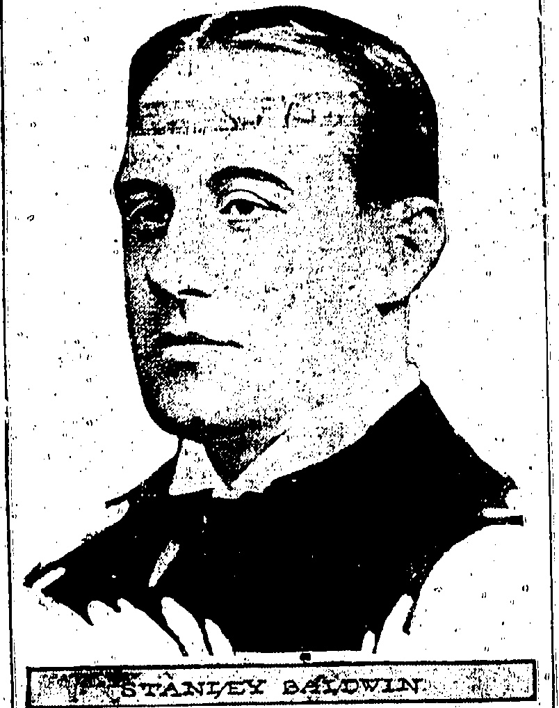
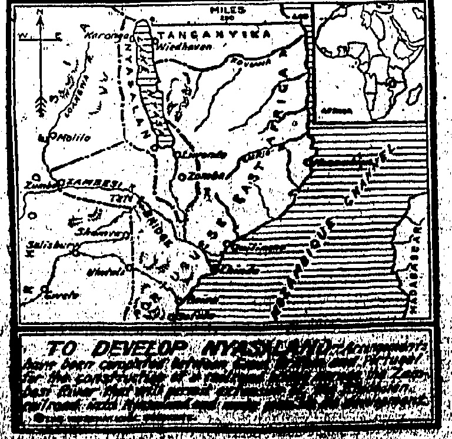
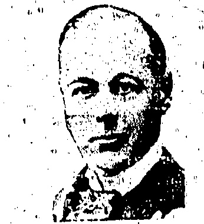
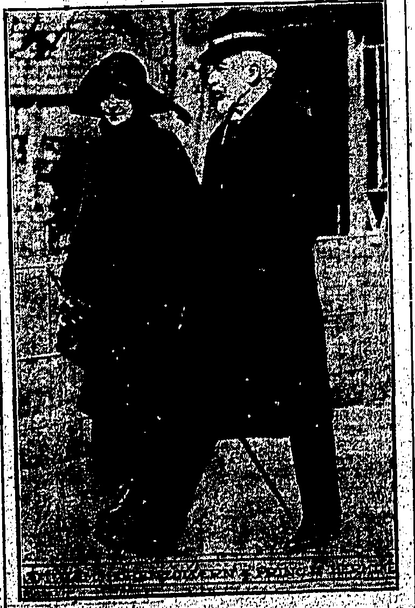
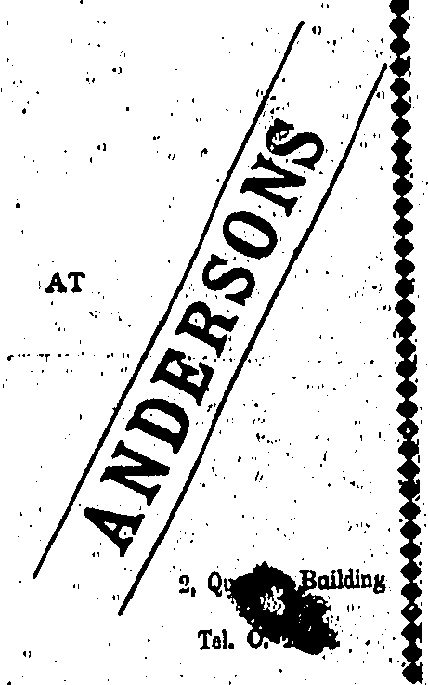

## FACING FACTS

The Premier is urging employers to take their employees more

and more into consultation regarding routine and management.

(Reuter's Service.)

London, Juhe

Before an audience of 50,000 people, a speech was made by Mr. Stanley Baldwin at a victory rally at Welbeck Abbey, in which the Premier appealed for an all-round increase of ten per cent. in industry.

Mr. Baldwin pointed out with pleasure that his appeals for an industrial truce had resulted in the men of both sides sitting down together and facing realities as never before.

He concluded by inviting the employers to scrap their old methods and seek a novel and more intimate relationship with the workers and seek brains and

BRITAIN'S MAN OF VISION.

trial efficiency, and announced his intention to appoint, a permanent food council to carry out the recommendations of the recent commission.

He expressed indifference to the Conservative critics who complained that he had not sufficiently denounced his opponents and declared he did not intend to waste time in denouncing movements like socialism but was going to attack the evils which produce them.

## FATAL OPIUM CLASH

(Reuter's Service.)

Press reports state that General Li Kwei-yuen, Chief of Staff of the First Mukden Army, was killed and Cheng Quo-jui, Commandant of the twenty-eighth Brigade and Yuen Shi-fu, Chief of the Martial Court, were seriously injured yesterday afternoon, following a disagreement during a conference in an upper story of the Mukden Headquarters in Chapel suburb, Shanghai.

## SHANGHAI, June 1

It appears that General Chang Tsung-chang, Tupan of Shantung, sent Cheng Que-jui to Shanghai to investigate the local traffic in opium. A disagreement arose between Yuen Shi-fu and Li Kwei-yuen, whereupon the latter's body-guard fired, wounding Yuen, whose bodyguard returned the fire wounding Cheng. Li Kwei-yuen jumped out of a window and broke his neck.

According to anti-opium circles, a large quantity of opium reached Mukden headquarters on Friday evening.

new ideas wherever they exist and

ake the employees more and more

nto consultation regarding

routine and management.

## AIRSHIP FLIGHT

(Reuter's Service.)

## ARMED RAIDS

The Italian airship Esperia wirelessed that she left the Ciampino aerodrome near here at 8.45 yesterday evening and joined the airship from the Pontedera aerodrome near Corsica at midnight. They arrived at Barcelona at eight in the morning and made a good landing. They were received by the civil authorities and naval and military officers. The crew were received by the King.

Admiral Demagazvice·president of the Directory also gave a reception to the officers.

The airships left for Toulon in the afternoon where they landed at 7 p.m. and will return to Italy on Tuesday.

Strasburg, June 1.-M. Doumergue has arrived to attend the annual gathering of the Federation of French Sports Associations. He was received enthusiastically. Speaking at a banquet he said that the maintenance of peace called for sustained vigilance until France was quite certain that those who began the war no longer harboured thoughts of revenge, until there was no longer any fear that treaties were being regarded as mere scraps of paper. Until France obtained guarantees of safety she could not justly be reproached for showing great prudence.—Havas.

HOW

A BANK WAS

ROBBED.

(Reuter's American Service.)

Chicago, June 1.

Five armed desperados entered a bank in the Chicago suburb of Cicero, herded the thirteen employees into a back room, scooped up $10,000 and escaped in a motor car.

Later in the day a party of men, possibly the same gang, entered a large jeweller's store in the business part of the town and by similar tactics secured loot valued at $20,000.

## A LOSS TO ART

(Reuter's Service.)

# DEATH OF LUCIEN GUITRY.

PARIS. Jume 1

The death is announced Lucien Guitry.

Lucien Guityr is father of Sacha Guityr. The Guityrs—Father, son, and wife of Sacha—recently gave successful recitals of plays in London from the pens of Lucien and Sacha. They was of immense interest—played entirely in French—and stamped the Guityrs as supreme in a line of Dramatic art which they had made their own.

### THOMAS R. MARSHALL

VICE - PRESIDENT DEAD.

(Reuter's American Service.)

NEW YORK, May 25,

The death is announced of Mr. Thomas Riley Marshall, Vice President of the United States from 1913 to 1921.

[Mr. Marshall, who was widely known as an after dinner speaker, had been America's twenty-eighth Vice-President, serving with the late Woodrow Wilson.]

## BACK TO GOLD

### (Reuter's American Service.)

WASHINGTON, June 1.

The Federal Reserve Board has published the details of a plan whereby American financial interests support Britain's in the maintenance of the gold standard in Britain. While there were actually two distinct transactions, one being the establishment of a direct credit of $100,000,000 to the British Government by Messrs. Morgan and Company, the statement deals with the arrangement between the Bank of England and the New York Federal Reserve Bank prior to the reestablishment of the gold standard and the abolition of the ban on gold exports from Britain.

Other Federal. Reserve Banks are also participating in the creation of a credit of $200,000,000 for the Bank of England upon which it can draw if conditions require.

The Reserve Bank undertakes to sell gold on credit to the Bank of England during the next two years, but the sum if not exceeding $200,000,000 shall be outstanding at any time. The credit, as far as used, shall bear interest at one per cent, above the Reserve Bank's discount rate with a minimum of four and a maximum of six per cent., or, if the Federal Reserve discount rate exceeds six, then at the rediscount rate of the bank. Interest payable by the British Government on credit established is determinable in a similar

When the Bank of England purchases gold equivalent to its deposit in pounds sterling, which shall be recorded to be credit of the reserve banks, it may be used in the purchase of eligible commercial bills which the Bank of England shall guarantee, and the discount earned on such bills shall be applied to the payment of interest.

Simla, June 1.—The Persian and Baluchistan border has been in a disturbed condition for some time. The latest reports show that the Persian garrison at Khwash is besieged by Persian and Baluchistan tribes and has already suffered heavy casualties.—Router.

## “RED” MAGIC

Now York, June 1-11, 1918 valedictory leader in the "Washington Post" Mr. Harvey suggests the holding of a conference in London on the French debt to Britain and America. The "New York World's Washington correspondents" hunts that President Calvin Colldige insisted. He leader — Router's American Service. FOREIGN DELEGATES.

Home

In spite of the Home Office edict that foreign delegates should not be allowed to attend the Glasgow Red conference there were present a German, and a French Communist.

## SPIRITED AWAY

(Router's Service:)

London, June 1.

There was an enthusiastic and dramatic scene at the Communist conference at Glasgow when it was announced that in spite of the Home Office ban on foreign Reds, Dr. Stocker, the fraternal German delegate, was present.

Dr. Stocker went on the platform amidst tremendous enthusiasm and the singing of the "Internationale."

He declared it was childish and absurd of Sir William Joynson Hicks (the Home Secretary) to think he could stop the British revolution by endeavouring to prevent the Communists of different countries from meeting.

## TSINGTAO TROUBLE

(Reuter's Service.)

Defied.

This afternoon, the Tokyo Labour Union representatives visited the Foreign Office and presented a copy of a resolution which had been passed at a mass meeting in support of the Tsingtao strikers and demanding the "suspension of armed intervention, refraction from threatening the Chinese Government, and the punishment of the blindly selfish Japanese capitalists."

TOKYO, June 1.

The Government, replying, emphasised that the warship was not sent for the purpose of strike suppression, but for protecting the Japanese residents from probable riots owing to the Chinese inability to do so.

## OBITUARY

(Courtesy of the Daily Bulletin.)

### MR. JAMES JONES

The death is announced of Mr. James Jones, senior partner in the firm of Jones and Clarke.

Peking, June 1.—It is now thought that Chang Tso-lin's visit to Peking will be deferred until after the holding of an important conference of the Fengtien leaders at Tientsin. General Chang Tsung-chang left Tsinan for Tientsin yesterday, and Marshal Lu Yung-hsiang, Military Governor of Klangsu, and Cheng Chien, Civil Governor of Klangsu, and General Chiang Teng-hsuan, Commander of Bandit Suppression on the Shantung-Anhui-Kiangsu border, are expected to arrive in a few days. Admiral Wen Shou-teh, who is acting as Governor of Tingtuo, is reported to be negotiating for the transfer to Fengtien of the Chihii Gulf Squadron.

The Chairman, Mr. Pollitt then introduced the second foreign delegate, the French Communist Mdle, Laval, who like Dr. Stocker, was spirited away after delivering an address.

## THE MAN THEY DEFED

Sir William Joynson Hicks, the Home Secretary, whose ban was described by the Reds as childish and absurd.

Half an hour elapsed. before the Pressmen were allowed to leave the Hall.

The Communist leader Mr. McManus apologised for detaining the Pressmen but declared the Government was responsible.

In the House of Commons last week in reply to questions, Sir William Joynson-Hicks, the Home Secretary, "intimated that permission had been refused to various foreign Communists to attend the Communist conference at Glasgow on May 30. Any of them landing without permission would be deported."

Mr. George Lansbury and Mr. J. R. Clynes asked the definition of "subversive propaganda" and whether the Government had decided that Communist propaganda was illegal.

Sir William Joynson-Hicks replied that certain things were permitted to British nationals but the Government could not permit foreigners to come here and do them (Ministerial cheers.)

Mr. Lansbury asked if this was the result of communications with other governments with a view of preventing Britons participating in international conferences abroad.

Sir William Joynson-Hicks replied that there had been no international arrangements and that this action had been taken without reference to any other Governments.

Teheran, June 1.—The Mejlissh has passed a law granting a sole Government monopoly for the export, import, purchase, sale and warehousing of tea and sugar. The Government will levy a duty of two "krans" on sugar and six "krans" on tea respectively.—Reuter.

## FORMER KAISER COMES OUT OF HIS EXILE

## ☐☐☐☐☐☐☐☐☐☐☐☐☐☐☐☐☐☐☐

JAQUE'S COMPLETE SETS

EXCELITE BALLS

from $40.00

SPARE MALLETS

$20.00 set:

Best Quality Water Polo Balls

BATHING PICNICS

$ 9.50 enob

Ayvad's Water Wings

LANE, CRAWFORD, LTD.

COMPLETE SPORTS OUTFITTERS

◇◇◇◇◇◇◇◇◇◇◇◇◇◇◇◇◇◇◇◇

SPECIALITIES

HARVEY'S BRISTOL MILK

OLD GOLDEN SHERRY

HARVEY'S BRISTOL CREAM

FULL PALE SHEBRY

CALDEEOK, MACGREGOR & CO., LTD.

15, Queen's Road Central. Tel. 75 Cent

◇◇◇◇◇◇◇◇◇◇◇◇◇◇◇◇◇◇◇◇◇◇◇

## PIANOS

COLLARD.

## ENGLISH

BROADWOOD

ALLISON

KIRKMAN, CROWLEY.

#### G. FALCONER & CO. (HONGKONG) LTD

WATCHMAKERS & JEWELLERS

DIAMOND MERCHANTS

Union Building (Opposite G.P.O.)

Agents for: ADMIRALTY CHARTS.

ROSS'S BINOCULARS and TELESCOPES,

KELVIN'S NAUTICAL INSTRUMENTS,

ENGLISH SILVERWARE, direct from Manufacturers,

High Class English Jewellery.

By Drinking

Tuborg

Beer

Purveyors To

The Royal Danish Court

the One and Only Danish Heer

on the Market

6.dox.pts.—$18 duty paid.

4.dox.qtn.—$20

4.uburn

