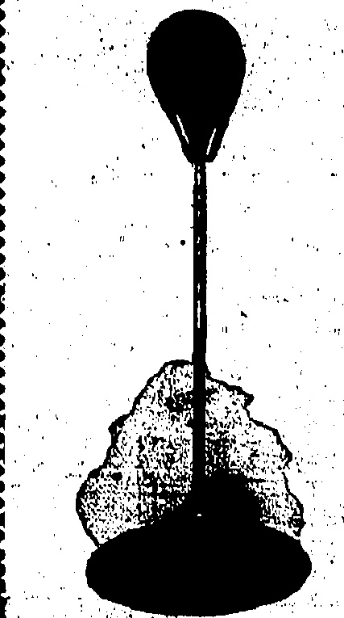
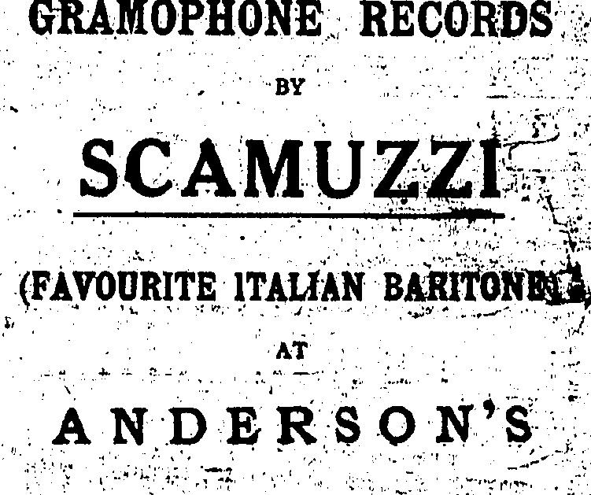

DERBY WINNER'S NEW PURCHASE

MARE'S RECORD PRICE.

### (Reuter's Service.)

A record price of 17,000 guineas for a brood mare was paid on behalf of H. H. the Aga Khan for Straitlace, the winner of last year's Oaks, at the sale of the late Sir Edward Hulton's horses.

The second highest price on the first day was 12,500 guineas, paid by Mr. H. E. Morriss of Shanghai, for Soubriquet.

Mr. Solly Joel paid 13,500 guineas for Oojah which was struck out from the Derby owing to the owner's death.

The total of the first two days sale exceeded 242,000 guineas.

It transpires that Mr. Esmond, not the Aga Khan, was the purchaser of Straitlace which goes to France where Mr. Esmond will train and breed extensively.

[Mr. H. E. Morriss of Shanghai won the 2,000 Guineas and the Derby with Manna and he also has a two-year-old.]

## PANCHO- VILLA

## FILIPINO MARVEL DEAD

AFTER AN OPERATION.

### (Router's Service.)

San Francisco: July 14.

Pancho, Villa, the fly-weight boxing champion of the world, has died in hospital following an operation on the jaw.

[While passing through Hongkong en route to the U.S.A., Villa sparred with C.P.O. Jim Cartlidge (local lightweight champion) at the "Star," Kowloon. Cartlidge's former opponent, Andre Dupre, should be in San Francisco now.]

## DAVIS CUP

### FRANCE v. BRITAIN MATCH

(Reuter's Service.)

At Eastbourne, in the Davis Cup, France ultimately beat Britain by four matches to one.

Rene Lacoste (France) beat G. R. Crole Rees (Britain) 6-2; 6-4, 6-3. O. G. N. Turnbull received a walk-over from Jean Borotra (France) who scratched.

[France meets Holland in the European zone final and should win.]

## MAILS TO CHINA

"VIA SIBERIA" TRANSIT

QUERY:

NOT TAMPERED WITH.

London, July 14.

In the House of Commons, replying to Colonel A. England; Viscount Wolmer said he had not received any report indicating that mails to China, via Siberia, had been tampered with in transit.

## KOLAPORE CUP

MOTHER COUNTRY CLOSE SECOND.

(Reuter's Service.)

At Bisley, the Kolapore Cup was won by Canada with a score of 1,099.

The Mother Country scored 1,097; Rhodesia 1,089; and India 1,066.

## MALAYA MOVES

ADMITTED TO LAWN TENNIS COUNCIL.

(Reuter's Service.)

## Tond

By special invitation Mr. Justice McCabe Reay (Singapore) attended a meeting of the Lawn Tennis Association Council at which Malaya was admitted to member-ship.

# NEW CHAMPION.

SUCCESSOR TO BENNY LEONARD

(Reuter's American Service.)

The final of the competition to determine who shall be the successor to Benny Leonard, who has retired from the world's lightweight boxing championship, was decided last night, when Jimmy Goodrich, an American boxer, best Stanislas Lacyza, of Chile, on a "technical knockout" in the ninth round of a fifteen-round bout. The Chilean was handicapped by an ankle fracture in the first round, but fought on pluckly

## COUNTY

SURREY'S REVENGE AT THE OVAL.

LATEST RESULTS

Of the latest county cricket results to hand the most interesting is the defeat of Laicashire by Surrey, the Oval team taking ample revenge for humiliation earlier in the season.

Yorkshire continue their all-conquering career, their latest victims being Kent.

There were no abnormal scores but Howell, the former Test Match fast bowler who was one of the M.C.C. team in Australia last close season but not picked for any of the Tests, took nine wickets in one innings. He has a still better feat to his credit as in 1923 he took all ten of Yorkshire's wickets at Edgbaston.

## Red Rose Collapse

### (Reuter's Service.)

London, July 14.

Lancs. 189 runs. Hallows, C made 64; Shepherd, T. took wickets for 37 runs.

Surrey 194 runs. Shepherd made 51; Tyldesley, R. took 4 wickets for 39 runs.

Lancas. 88 runs. Hallows strained a thigh and was unable to bat; P. G. H. Fender took "3 wickets for 24 runs.

[This is a return match. In the first, Lances, won by an innings.]

A Maidstone Kent lost to Yorkshire by 110 runs. Scores:—

Yorkshire 196 runs. Wright, C. took 6 wickets for 52 runs.

Kent 259 runs. Wooney, F. E. made '81, Hubble, J. C. 66; Waddington, A. took 6 wickets for 90 runs.

Yorkshire 333 runs. Sutcliffe, H. made 72, Oldroyd, E: 62 and Leyland, M. 61.

Kent 160 runs. Woolley made 52; Collins, G. C. and Freeman, A. P. did not bat as they were injured.

[The first match between these two counties was abandoned.]

At Birmingham, Warwickshire beat Hampshire by 189 runs. Scores:—

Warwick 325 runs. Smith E. J. made 80.

Hants 144 runs. Howell H took 9 wickets for 32 runs.

Warwick 316 runs for 3 wickets declared. Parsons, J.H. made 67, Hon. F.S.G. Calthorpe 72, Quaife, W.G. 60 not out and Bates, L.A. 67 not out.

Hants 328 runs. Bowell, A. made 61 and Hon. L. H. Tennyson 139.

[Warwick have reversed the result of the first match when Hants, at home, obtained full points.]

At Kidderminster, Worcestershire lost to Northamptonshire by one wicket. Scores:—

Northants 170 runs. Root, F. took 6 wickets for 50 runs.

Worcester 321 runs. M. K. Foster made 150; Clark, E. C., a fast left-hand bowler, took 6 wickets for 77 runs.

Northants 302 for 9 wickets,

W. W. Timms made 114 and J.

Timms 72.

A. W. Carr In Form.

At Brighton Sussex lost to Notts by 192 runs. Scores:—

. Notts 355 runs. Whysall, W. W., made 102, A. W. Carr 52, Lilley, B., 56.

Sussex 278 runs. Tate, M. W., made 114.

Notte 322 runs for 5 wickets declared. A. W. Carr made 124. Sussex 207 runs.

[Notts also won the first match at Trent Bridge.]

At Swansea Glamorgan lost to Essex by 88 runs...Scores:—

Essex 352 runs. Russell, A.C., made 132 and J. W. H. T. Douglas 50.

Glamorgan 280 runs. Mercer, J., made 57.

(Continued at foot of next Column.)

# THE TYPHOON

The typhoon was first indicated on the weather map on the afternoon of July 9, when it was situated between Yap and Guam. It moved on a W.N.W. course and crossed or passed N. Luzon in the immediate vicinity of Aparri in the early hours of July 13.

It then pursued a N.N.W. track until the morning of the 14th, when observations received indicated that it was situated to the north of the Pescadores. There were several apparent discrepancies in the observations from Formosa and as by the afternoon of the 14th the centre appeared to be near Swatow, it was concluded that the position given in the morning was in error.

The typhoon actually passed north of the Pescadores however and then maintained a W.S.W. track entering the coast near Swatow. It is now situated to the north of Canton in the form of a depression, filling up.

The track of the typhoon was unusual; but similar instances are on record. The actual movement of the barometer on account of the typhoon was masked to a considerable degree by extensive superposed fluctuations caused by the thunderstorms of yesterday afternoon.

## LUCKY ESCAPE

## —

ALARMING STUBBS ROAD ACCIDENT.

CAR STRIKES PARAPET.

Mr. H. S. Bennett, manager of the Hongkong Telephone Co., and two friends had a lucky escape from serious injury on Monday afternoon. They were proceeding to the Peak by Stubbs Road when their car met with a nasty mishap. They were approaching the second bend after the hairpin bend when a tyre burst and the car ran into the granite wall at the cliff side. Mr. Bennett was flung violently against the wind-screen but luckily escaped with nothing more serious than a few scratches and bruises. His two friends were thrown from the car by the force of the impact, also fortunately without serious injury. That all three escaped so lightly, when they might easily have been involved in the gravest consequences, was largely due to the fact that the car was travelling at not more than 15 miles an hour.

## EIGHT-HOUR DAY

STANDARD OIL COMPANY

CONCESSION.

WAGES COMPENSATED.

(Reuter's American Service.)

New York, July 14.

The Standard Oil Company of New Jersey has announced the adoption of an eight-hour day in its mid-continental oilfields, also a new wages scale which will partly compensate workers for the resultant loss in wages.

The announcement is regarded as a great boon by the workers as a twelve-hour day has been in force since digging the first well in 1859.

Essex 126 runs. Ryan, F., took 7 wickets for 53 runs.

Glamorgan 160 runs. J. R. Tait made 51.

Leicester Trounce Derby.

At Leicester, Leicestershire beat Derbyshire by 248 runs. Scores:—

Leicester 327 runs. Coulson, S. S., made 80, Geary, G., 60, Shipman, A., 52 and Berry, L. G., 59.

Derby 150 runs. Astill, W. E., took 3 wickets for 9 runs.

Leicester 138 runs for 8 wickets declared.

Derby 67 runs. Astill took 5 wickets for 19 runs and Skelding, A., 5 for 40.

[In the opening fixture Derby led, on the first innings.]

## RUBBER

RISE MERELY TEMPORARY.

### (Router's Service.)

London, July 14.

The rubber restriction policy was again the subject of questions in the House of Commons when the Hon. W. G. Ormsby-Gore, replying, said that according to the best estimates of the situation and prospects of the plantation rubber industry, he could only regard the extent of the present rise as a temporary movement. There appeared no ground at present for special enquiry or for proposing that the Ceylon and Malaya Governments should repeal their existing legislative measures. If there was a prospect that there would be a real shortage in the course of next few months, it would be possible to release the maximum production. There was no reason why growers should not increase production in anticipation of a shortage. He was aware that, since the introduction of the restriction scheme, Dutch plantation rubber had increased by from 15 to 37 per cent. and that bulk rubber, in which the middlemen were gambling at four shillings per lb., was sold by the producer between 1/5. and 1/10 per lb.

Mr. Waddington asked if the Government was aware that producers were accumulating stocks with a view to the termination of the Stevenson export restrictions in February, and asked if it was not in the trade interests to permit more exports now to prevent a slump in February?

Mr. Ormsby-Gore considered this too long as a supplementary question. He added that he made a slip in reply yesterday. The whole matter was being watched with the advice of an expert committee, and while they agreed that the price was likely to fall considerably, they did not think that the abolition or modification of the Stevenson scheme would materially assist either now or in a few months.

Replying to a suggestion from Mr. Thomas, Mr. Ormsby-Gore said that he would consider the advisability of an immediate statement with regard to the future.

## SHIP ASHORE

WARSHIP ASSIST.

### (Router's Service.)

A message from Port Sudan says that from a telegram from Massowah, it appears that the Italian-motor-vessel-Esquilino, from Trieste to Shanghai, is ashore on a reef.

An Italian warship and eighteen dhows (small junks) have left Massowah to assist.

[The Esquilino was out on her first trip to the Far East. Messrs. Dodwell & Co., Ltd., the local agents, informed the “China Mail” that the vessel was due here; in ordinary events, in August. There may have been a few Italian passengers for Hongkong, but particulars are not available.]

Melbourne, July 13.—Lord Strudbroke, on behalf of Victoria, has sent a wireless message to Admiral Coontz, saying "Heartiest welcome to the officers and men of the great American Fleet now approaching our shores." The Parliament of Victoria will adjourn during the visit of the U.S. fleet.—Reuter,

## OBITUARY:

The deaths of two members of the Portuguese community took place at Kowloon yesterday.

Mr. Hernnegildo Maria Basto passed away at his residence No. 94, Nathan Road at 6.15 p.m., at the age of 73. The deceased gentleman was a share and estate broker, and, besides other relatives who will be known as Mr. J. M. C. Basto (brother) and Messrs. C. H. and A. H. Basto (nephews). The funeral will pass the Monument at 5.15 p.m. to-day.

Mr. Charles Osmund passed away at a ripe old age at his residence, No. 1, Liberty Avenue, at 12.45 a.m. The funeral will pass the Monument at 4.30 p.m. to-day.

The return of the Maharashtra and the young Maharashtra of Gwalior and suite to India is not yet fixed, but it is stated that it will be fixed as soon as possible. They are at present staying in a hotel at Neuilly, where the Maharashtra died. The ashes of the Maharashtra will be left at the cemetery of Pere La Chaise until the departure of the party to India.

## TO-DAY'S ADVERTISEMENTS

THE HONGKONG LAND INVESTMENT & AGENCY

COMPANY, LIMITED.

AN INTERIM DIVIDEND of TWO DOLLARS per share for the six months ending 30th June, 1925, will be payable on THURS DAY, August 6th, on which date Dividend Warrants may be obtained on application at the Company's Office, 11, Queen's Road Central.

THE TRANSFER BOOKS of the Company will be CLOSED from THURSDAY, the 23rd JULY to WEDNESDAY, the 5th AUGUST (both days inclusive), during which period no transfer of shares can be registered.

By Order of the Board of Directors.

L. S. GREENHILL.

NOTICE TO CONSIGNEE'S

PENINSULAR & ORIENTA

STEAM NAVIGATION CO.

KASHGAR

from London, and Ports arrived Hongkong 9th July, 1925.

Consignees of Cargo per s.s. "KASHGAR" are hereby informed that owing to the strike part of the cargo for Hongkong has been overcarried to Kobe. When conditions permit this cargo will be brought back to Hongkong free of freight but all expenses in connection with landing, storing and reshipping at Kobe will be for Consignees' account.

No insurance whatever has been or will be effected by the Steamship Company.

Hongkong, 15th July, 1925.

## NOTICE

A number of skilled workmen, suitable for work such as driving Tram Cars, operating lifts, etc., have reported themselves to this office for work.

Those desirous of securing such services are requested to communicate with the undersigned, stating particulars of the nature of duties. Wages etc.

ASSISTANT Controller of Labour.

Hongkong, July 15.

# RELINQUISHING BUSINESS

# MADAME LILY

Commencing on 15th July, we have a special

HARGAIN SALE of TISSUES in all bodies and designs, and

## Everything For

## Tennis

Football

Swimming

Bute Ball

Boxing

Fishing

LIQUEURS.

Softness and Mellowness are their distinctive properties.

CALDEHUK, MACGREGOR & CO., LTD.

11. Queen's Road Central.

Telephone 75 Central.

## GRAMOPHONE RECORDS

WATCHMAKERS & JEWELLERS

DIAMOND MERCHANTS

Union Building (Opposite G.P.O.)

Agents for:—ADMIRALTY CHARTS

ROSS'S BINOCULARS and TELESCOPES,

KELVIN'S NAUTICAL INSTRUMENTS,

ENGLISH SILVERWARE, direct from Manufacturing

High Class English Jewellery.

NEW

NOW IN STOCK

STORH

Cross Words Made Easy

By Drinking

Tuborg Beer

Purveyors To

The Royal Danish Court

The One and Only Danish Beer on the Market

6 don. p.x. - $18 duty paid.

4 don. qm. - $20