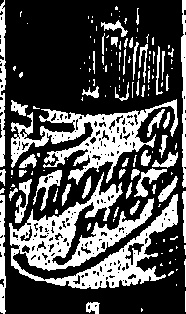

## POISON GAS

RUSSIAN EXPERTS.

### (Router's Service.)

In the House of Commons, replying to Mr. W. Foot Mitchell, Sir L. Worthington-Evans (Secretary for War) said that he had information that Chinese militants had introduced to China German chemists for the purpose of manufacturing poison gas, and employing Russian experts to assist their military plans.

Mr. W. Mackinder (Labour) asked whether some of the Russians were members of Koltchak's army, but, the Secretary for War said that he was not aware of that.

## NAVAL PARTIES

INSTRUCTIONS WHEN TO LAND.

BRITISH LIVES IN CHINA.

## London, July 15

In the House of Commons, in reply to questions, Mr. W. C. Bridgeman (First Lord of the Admiralty) said that general instructions had been given to British naval men only to land an armed force when lives and property of British subjects were actually endangered from violence which cannot otherwise be controlled.

He added that as regards China these instructions were supplemented to effect a landing only carried out at the request of a Consular officer at a port.

## OUR NAVY

ORDERS IN THE EVENT OF HOSTILITIES:

UKDERHAND MANIFESTO?

### (Reuter's Service.)

London, July 15.

In the House of Commons, replying to Sir Robert Gower (Conservative), Mr. W. C. Bridgeman (First Lord of the Admiralty) said that the Admiralty had received no official report of the alleged circulation, among British sailors and marines now visiting Oslo, of a manifesto urging them to refuse to obey the orders of officers in the event of conflict between Britain and China.

## RIOT SEQUEL

## QUESTIONS IN HOUSE OF COMMONS

LABOURITES' TRANSLATION.

(Reuter's Service.)

Replying to questions by Labourites, Mr. Austen Chamberlain (Foreign Secretary) said that he had not yet received a full report of the evidence before the Mixed Court at Shanghai in regard to the shootings, nor a report of the Commission of Inquiry.

Mr. W. M. Adamson (Labour) said that Chinese newspapers had arrived in England and a translation showed that an inspector had admitted in evidence that he did not know a warning must be given before shooting.

Mr. Chamberlain was of the opinion that the report to which Mr. Adamson had referred was the report of the commencement of the Enquiry on people who were killed. The mail which brought the commencement of the report had not brought the end of it.

He was of the opinion that he ought to see the whole of the evidence before he expressed an opinion.

Replying to Mr. J. Beckett (Labour), Mr. Chamberlain said that he did not know the exact nature of the divergence in views in the recent discussions between the Diplomatic representatives at Peking in connection with which the French Minister withdrew.

Meibourne, July 15.—Major di Pinedo took off on his flight to Japan but was compelled to re-land owing to a leakage. He will re-start at eight on the morning of July 16.—Reuter.

Paris, July 15.—The National Fête was celebrated brilliantly all over France. Paris witnessed an imposing ceremony at the Unknown Soldier's tomb and the finish of a relay race from Verdun whence runners bearing the symbolic torch came by way of the battlefields to lay the symbol on the grave. In the Moroccan towns impressive military parades took place attended by huge crowds of natives and at Habat by the Sultan with his Viziers Hayes.

## CHINESE CUSTOMS

MR. CHAMBERLAIN'S STATEMENT IN PARLIAMENT.

PUBLICATION OF REPORT.

(Router's Service.)

In the House of Commons, replying to Mr. H. Day (Labour), Mr. Austen Chamberlain (Foreign Secretary) said that the British representatives to the Chinese Customs Conference had not yet been appointed. He was unable yet to say when the Conference was likely to be held, but he pointed out that the Washington Treaty provided that it should meet China within three months of the ratification at a date and place to be designated by the Chinese Government.

Asked whether he was aware that the American Government had already appointed commissioners to the Customs Conference, Mr. Chamberlain said that that did not arise from the question.

Replying to questions Mr. Chamberlain said that the action to be taken on the report of the commission of investigation of disorders at Shanghai was being considered. He was not prepared to publish the terms of the report at present.

Asked whether it was not thought desirable that the report should be published as soon as possible in view of Press reports of its contents, Mr. Chamberlain said that there were limits to the extent to which Governments could be called upon to produce information because journalists surmised what the information would be.

Asked whether it was not possible for other Governments to publish the report Mr. Chamberlain said that he hoped that publication, if it occurred, would be simultaneous in all countries.

# “OTHER” "POWERS.

SUGGESTIONS FOR POLICY IN CHINA.

GOVERNMENT CONSULTING.

(Reuter's Service.)

London, July 15.

In the House of Commons, replying to Mr. W. Forrest (Labour), Mr. Austen Chamberlain reiterated—that the Government was consulting the other Governments concerned in regard to the International Conference concerning China. In the course of the consultations, suggestions in regard to the policy to be adopted had been received from the United States and other Governments and were now being considered.

OCCUPATION OF THE UNIVERSITY.

O'REIGN SECRETARY'S REPLY

(Reuter's Service.)

London, July 15.

In the House of Commons, Mr. J. Beckett (Lab.) asked, in regard to the "statement" that Colonel Gordon ordered the Shanghai Municipal Police to occupy Shanghai University, whether it was competent for a military officer on his own authority to occupy private buildings without a mandate from the civil authorities.

Mr. Austen Chamberlain (Foreign Secretary) replied that the question was based on an assumption of fact which he neither confirmed nor denied at present.

Replying to Mr. W. Mackinder (Lab.), Mr. Chamberlain said he certainly desired to give the House full information on this subjection but he hoped members would not ask him to answer questions when he had not yet possessed information, or express an opinion on matters on which he was not fully informed. He pointed out that this was not a matter arising in a British Colony but in an International Settlement, and it was important that he should act in agreement with the other Powers.

## DOSSER TRIAL

JUDGMENT EXPECTED ON FRIDAY

DATE FOR OTHER CASE:

(Reuter's Service)

## RETURN TO WORK

SHANGHAI STRIKERS V AGITATORS.

(Reuter's Service.)

Shanghai, July 15.

In the last two or three days there have been many reports of conflicts between agitators and strikers due to decreasing funds and the consequent desire of the latter to resume work, as of intimidation, kidnapping, etc.

This is generally regarded as a

This is generally regarded as a hopeful sign.

An opinion is expressed that it will not be long before there is a general return to work, including the resumption of coastal and foreign shipping which at present is the worst feature.

Though the Seamen's Union has its headquarters in Canton, sailors here are largely Northerners, who are unlikely to be influenced by the South.

### “NOT UNDERSTOOD.”

FRANCE AND RIGHTS REVISION.

WASHINGTON POINTER.

(Reuter's American Service.)

Apropos the reports from Paris that France considers the time not propitious to seek a revision of extra-territorial rights in China until the latter restores order and shows that she can maintain it, the Associated Press Washington correspondent says that the objection is not understood there as President Coolidge's proposals are clearly within the provisions of the fifth resolution of the Washington Agreement and merely provide that a preliminary study by an international commission be initiated without delay.

## SINGAPORE BASE

ANOTHER QUESTION IN PARLIAMENT.

ESTIMATED EXPENDITURE.

(Reuter's Service.)

In the House of Commons, replying to Mr. P. A. Harris (Lib.) Mr. W. C. Bridgeman (First Lord of the Admiralty) said the estimated expenditure on works hitherto sanctioned at the Singapore Base was £204,000 and £300,000 respectively, for the financial years 1925/26 and 1926/27, not including the cost of the supervising staff.

London, July 15.

## LABOUR WINS

BY-ELECTION AT FOREST OF DEAN.

(Reuter's Service.)

The by-election at Forest "of Dean, in consequence of the death of Mr. J. Wignall (Lab.) resulted:

Purcell (I, labour) 11,629.

Benumont (Conservative) 8,607.

West (Liberal) 8,774.

## AT WEMBLEY

HONGKONG HONOURED BY ROYALTY.

## WORKERS' FASCINATION

London, July 15.

The Duke and Duchess of York visited Wembley where the Duchess opened the International Conference of Women in Science, Industry and Commerce.

Both made a tour of inspection, including the Hongkong section where the Hon. Mr. E. R. Hallifax and Sir James Lockhart received them. Both the Duke and Duchess were fascinated by the Chinese workers, especially the ivory carvers and the doll-makers.

[The Hon. Mr. E. R. Hallfax, C.B.E., C.M.G., is Secretary for Chinese Affairs in Hongkong and the Commissioner for the Hongkong section at the Wembley Exhibition. Sir James Stewart Lockhart, K.C.M.G., has been Commissioner at Weihaiwei and is an L.L.D. of Hongkong. In 1887 he was Registrar-General of Hongkong, the office now known as the S.C.A.I.

## DUTCH POLITICS

EX-MINISTER TO FORM CABINET

(Router's Service)

The Queen has called the

former Finance Minister, Myri.

Collip leader of the Anti-Rvolutionary Party to form a new

MINERS WILLING TO MEET OWNERS.

COURT UNACCEPTABLE.

## (Router's:Berm火灾)

London, July 15.

The Miners' Delegate Conference at Scarborough unanimously passed the Executive's recommendation cabled earlier.

Later:

The official report of the Miners' Conference states that a resolution was passed unanimously in favour of informing the Government that the Miners' Federation could not accept another Court of Inquiry with the object of ascertaining whether miners' wages could be reduced or their hours extended, but the Federation was willing to meet the owners in an open conference as soon as the owners had withdrawn their proposals.

## Earlier Cables

London, July 15.

Parliamentary Labourites have espoused the miners' cause and appointed a committee consisting of the ex-Ministers, Messrs. Ramsay MacDonald, J. R. Clynes and A. Henderson, also Mr. Maxton to confer with the miners' executive with a view to placing "the full help and influence of the Party at the miners' disposal.

The Miners' Executive has recommended that the delegate Conference at Scarborough shall have nothing to do with the Government or the Court of Enquiry and shall not negotiate with the owners until they have withdrawn their proposals.

New York, July 15. — The Federal Court judge, Judge Mack, has refused to grant an injunction to restrain British ships from bringing into American waters sealed liquor for use on the return voyage to Europe. He said that the Federal Courts were powerless to enforce the penal laws of injunction applied for by the Neptune Association, an organisation of deck officers of American ships, who claimed that passengers preferred wet British ships to dry American ones, and so damaged their business.— Reuter's American Service.

#### COULD NOT TURN IN BED WITHOUT HELP So Painful Was Her Rheumatism. Dr. WILLIAMS' PINK PILLS Made Her Well

Many rheumatic people suffer pains that could be avoided by building up the blood. Rheumatism comes with thin impure blood, and can only be driven out of the system by enriching and purifying the blood. It is because the disease and strengthens the blood and rapidly makes new, rich, red blood, that Dr. Williams' Pink Pills are world famous as a remedy for the pain. I crippling disease: Among the thousands of sufferers cured in this way is Mrs. A. Bryson, living at Arthur, Ontario, Canada, who says:

"I was so used up with rheumatism in my shoulder's and neck that I could not turn in bed without help, and the pain at time was almost unbearable. I took doctors' medicine when I did me little or no good. Then I began taking Dr. Williams' Pink Pills and have since been free from rheumatism. I can also recommend the pills to young mothers, as in my own case I found they are un-excellent. I may also add that I recommend Dr. Williams' Pink Pills to a neighbour who took fainting spells at the change of life, and who could not walk any distance." She took the pills for nearly three months and they made her a strong, well woman.

You even get Dr. Williams' Pink-Pills from any dealer in medicine or by mail $1.00 per bottle, $8 for 8 bottles from the D.: Williams' Medicine Co., 6) Klangse Ead, changha,

## RUSSIA

POWRR OF PROPAGANDA

Whatever happens to the immediate situation in Shanghai, the wider development of which it is a symptom ought not to be lost sight of, remarks the 'Daily Chronicles.' One might perhaps sum it by saying that Western Europe is losing hold on the moving and controlling forces in the Chinese population, and the influence of Bolshevik Russia has supplanted our own.

The irony of it is that no nation really has a more disinterested concern in China than we. We have no common frontiers, no territorial ambitions. Our aims are purely commercial, and since the richer and happier China becomes, the better customer she must be, our advantage is bound up with her prosperity. Nor has any other nation furnished so many loyal and incorruptible workers for the service of the Chinese people. The name of Sir Robert Hart may stand for the type, but it is a type which has had, and still has, many able and devoted representatives.

The Russian record towards the Chinese is very different; political or territorial aggression is written on every page of it. The present page is no exception. If the Bolsheviks are active in China, it is because they hope to make her their political catapult. Ishmnelites self-barnished from the comity of civilised nations, they see in the disorder of Chinese affairs a ground from which they may hit back at Europe. Their weapon being destructive propaganda, where could destruction find more opportunity?

Of course, we could not propagandise exactly on Bolshevik lines. It is not for us, as for them, to exploit destructive tendencies; nor to indulge, as they do irresponsibly; in the money corruption, to which the gross personal venality of nearly all-Chinese politicians and soldiers so readily lends itself. But there are plenty of other openings, which we could utilise if we tried. No nation has better vantage-points in Chinese life, or a larger store of living experience to draw on there. Only our attitude remains too much that of a very old business firm; which is so conscious of selling the best article in the market that it thinks it be-neath its dignity to advertise. We all know what happens to such firms under modern conditions. It is what must happen... (with momentous consequences) to British influence in China, unless we endeavour more systematically, there to meet propaganda with propaganda.

They have succeeded because, however uphill the effort, a nation which propagandises will nearly always succeed in such a case against one which does not. It is not true, unfortunately, that deeds speak louder than words, or that Truth will always prevail, if she is left hidden at the bottom of her well. The Bolsheviks, to do them justice, have grasped one very sound principle: which is that mankind, East and West alike, are moved through their minds, and in the long run mental influence outweighs physical. The great fault of English statemanship in Asia—the fault which has gone so far towards losing us India—has been to ignore persistently the need for winning the mental approval of Eastern peoples.

Chicago, July 15. Mr. Shepherd has begun a legal battle for the million dollar estate left by his ward, McClintock. The granting of probate is opposed by his cousin and the flances of the unfortunate young millionaire. There were lively scenes in court when Mr. Shepherd and his former chauffeur came to blows over certain payments which the latter said were due to him. Reuter's American Service.

# RELINQUISHING BUSINESS

# MADAME LILY

begs to announce to the ladies of Hongkong and Outports the

closing her business.

She will therefore dispose of the whole of her valuable

One Week Only

Commencing on 15th July, we have a special

BARGAIN SALE of TISSUES in all shades and designs, an

## Everything For

Tennis

Football

LANE, CRAWFORD LTD.

Base Ball

Swimming

Boxing

Fishing

Cricket

Billiards

## BOLS

LIQUEURS.

Softness and Mellowness are their distinctive properties. OALDBHOK, MACGREGOR & GO., LTD. 15, Queen's Road Central. Telephone 75 Central.

## GRAMOPHONE RECORDS

BY

(FAVOURITE ITALIAN BARITONE)

2

1

1

#### G. FALCONER & CO. (HONGKONG) LTD

WATCHMAKERS & JEWELLERS

DIAMOND MERCHANTS

Agents for: - ADMIRALTY CHARTS

ENGLISH SILVERWARE, direct from Manufacturers.

HIGH CLASS ENGINE JEWELLERY.

NUT STIMMER SILKS

NOW IN STOCK

STORH

## Cross Words Made Easy

By Drinking

Tuborg Beer

Purveyors To

The Royal Danish Court

The One and Only Danish Boer on the Market

6 don. pta. — $1B duty paid.

4 don. qua. — $30