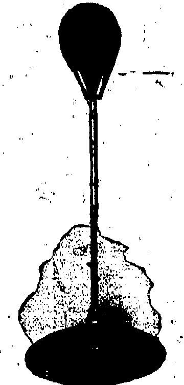

## CANTON POSITION

## PROSPECTS OF WARFARE

General Li Fook-lam, the "governor" of Honum which is on the opposite side of the River to Canton, has, it is stated, forbidden strikers to land in his territory for fear that they may be agents of the Reds, or the so-called Leftists of the Kuomintang party.

Martial law has been declared and is strictly enforced, says the "China Mail" Canton correspondent. To the eye it does not appear as if the Leftists will take up arms against the anti-nationalisation of property clique of whom General Li is said to be a leader with General Hsu Shung-chi, commander-in-chief.

No matter what way the trend of politics may be following, General Li has tried to keep the strikers from Hongkong and Shameen at arm's length.

Hongkong verinacular papers report that General Cheung Kai-sleak, now one of the most powerful of the Leftists and the commander of the "Whampoa Cadets" is organising his forces so as to make a clean sweep for Communism. An offensive from Whampoa to Honam is stated to have been planned.

Taking the various reports con-

junctively it seems that although

the politicians have patched

matters up, the militarists are

not content to leave important

questions in suspense.

Some of the local vernacular papers have also published reports of the alleged taking over of the Kung Yee (Hospital) in Canton by the administration. The Kung Yee is reported to have large sources of revenue and the stated reason for Government control is that the Kwangtung University is to be run in conjunction with the hospital. In one source it is mentioned that the hospital properties are worth about a million dollars. Added significance is given by the return to Hongkong of Dr. S. F. Lee, former superintendent of the hospital.

## IN EARNEST

## WHAT STRIKERS ARE LEARNING

NAVAL YARD EXAMPLE

That employers were in earnest when they warned employees of the dire results to themselves which would follow absorption from work is proved by the fact that they have adhered steadily to that policy and that strikers who have returned or attempted to return have been informed that they must commence again as beginners in their particular class of work.

That many of them were unacquainted with British methods, and imagined that the warning was just bluff, is also proved by the astonishment with which they have received the news of the employers' adherence to their previously announced policy. This has been so in the case of the Hotels Company and the Naval Yard, and doubtless it will be the case when Harbour office employees, coxswains, etc., present themselves for re-employment and this in spite of the clearness with which the Harbour Master made the position clear to them. The Star Ferry workers will also have to start on the lowest scale of wages, and doubtless the same astonishment will be manifested by them.

Of the 200 workers who have returned to the Naval Yard all but a dozen or so have reconciled themselves to the inevitable and have remained in the knowledge that half a loaf is better than no bread. Not all of them, however, will be able to find reemployment just yet even at the lowest scale. In normal times about 2,000 are employed, but the largest number, which can be usefully employed at the moment is 500. Those returning at the Yard appear to be coming in batches of grades, the first being the engine fitters and the next the carpenters, this pointing to some arrangement by which a consensus of opinion of these different branches is taken.

Peking, July 16.—The vernacular papers report that the Waichiaopu has protested to the Diplomatic body recently regarding the Shanghai Council cutting off electric light. Sig. Cerruti is reported to have replied but the nature of the reply is not announced.—Reuter.

## A SOOTHING BALM

For soreness of the muscles after violent exercise and for rheumatic pains, much relief is afforded by massaging the affected parts thoroughly with Chamberlain's Pain Balm. Try it when you have need of such a preparation and see for yourself what an excellent liniment it is. Sold everywhere.

## GETTING OUT

STRIKERS EVADE CANTON

TICKETS.

ROUNDABOUT ROUTES.

In spite of the activity of pickots in Canton, individual workmen are escaping from the fold and even getting down to Hongkong by circuitous routes, writes the "China Mail" correspondent.

Practically everybody with the appearance of a striker who passes along the Canton Bund is closely examined by pickets in uniform and the first question is "Are you trying to get to Hongkong? If so the person, man or woman, is taken to Strike Headquarters on the second band for "trial."

Although river steamer traffic between Hongkong and Canton has raised up with the exception of the Hong Kong there are still means of travelling. It is reported that pickets are also on duty at Taishatan, the terminal of the Canton-Kowloon Railway, to prevent the rank and file deserting by that route. To circumvent the agitators, smokers have first left Canton by tow-boats which ply to all points in the delta. After reaching an intermediary point "defaults" go on by another towboat to Macao where steamers convey them to Hongkong. The s.s. Anjo and No Chow have been running between Hongkong and Macao this week. It is the same with the railway. Strikers leave by tow-boat for a point near the Boea Tigris Forts, tranship inland and board a train in Chinese territory for Samchun.

There is undoubtedly evidence, adds the correspondent, that unrest is spreading, particularly with the cargo coolies who have complained of bad guild management on their own pipt and preferential treatment to flavoured guilds by the

It appears that when the coolies struck sympathetically with the scamer in the last exodus from Hongkong, the same thing happened. At that time seamen were enjoying themselves in flower-boats and having picnies on the river while the coolies had to live in temporary shacks by the side of the Bund. This time, the seamen are alleged to be receiving both meals and "tea-money" while the outsiders' grumble at inferior quarters and irregular food.

## STRIKE NEWS

## CHINESE ASPECT IMPROVES

During the last two days, the number of tea-houses, restaurants and eating houses which have resumed business, has been constantly increasing. Some of the establishments have only a very limited menu, "devoid of variety owing to the absence of cooks who are away, and who find difficulty in getting back.

The majority of native barber hops have also re-opened their oors.

Every day the vernacular press announces new bodies of special guards organised by Chinese communities to assist in preserving the peace. A suggestion has now been made that the district special guards also supervise that part of sanitation relating to the disposal of nightsoil as the poorer classes are not aware of the arrangements made.

Nightsoil coolies are also returning to their jobs especially in the central district and in Yaumati.

Yesterday the Chinese Trade Maintenance Association elected Mr. Ho Kwong as chairman, with headquarters on the first floor of the City Hall. Chinese merchants who experience difficulty in connection with merchandise, transport, etc. are asked to report to the Association, at City Hall, at 11 a.m. each day, and they will be assisted as far as possible.

Brokenhill, N. Rhodesia, July 16.—The Prince of Wales who leaves Capetown on July 29 for South America has completed his programme in North Rhodesia, the main feature of which was the meeting of the native chiefs in all parts of the territory whom the Prince lengthily and impressively addressed. Thereafter the Prince opened the hydro-electric scheme at Mulungushi whereby a narrow river in the heart of Central Africa will be converted into a mighty lake, usable for generating power. The Prince congratulated all concerned in the affair and also acknowledged the courtesy of the Belgian Government in sending the Governor of Katanga to greet him.—Reuter.

t = \ln x \cos y(t) + \cos(2\pi x) \exp\left(\frac{1}{2}t\ln x + \sin(2\pi x)\cos(t)\right) + \ln(2\pi x) \sin(t) + \sin(2\pi x)\cos(t) + \sin(2\pi x) \sin(t)

## CHINESE AFFAIRS

CONSULAR AND NAVAL PROTECTION.

### (Router's Service.)

London, July 16.

In the House of Commons, the Rt. Hon. Ronald McNeill, replying to an enquiry regarding the recent Shanghai disturbances, said Mr. Austen Chamberlain hoped the House would permit him to defer further statements on Chinese affairs until communications between the interested Powers had reached a point when a full statement can be made with due regard to public interest and international comity.

Replying to Colonel Grant Morden (Con.) with regard to the protection of British missionaries in China, Mr. McNeill stated the Chinese authorities had been reminded of their responsibilities as regards the safety of Britishers in China, and Consular Officers and Naval forces in China will afford British subjects all possible protection.

Presumably in connection with the discussion of the Chinese situation, the American, French and Japanese Ambassadors jointly conferred with Mr. Chamberlin at the Foreign Office today.

##### U.S.A. IN ACCORD

### (Reuter's Service.)

London, July 16.

Reuter learns that the latest indications from America show the United States is entirely in accord with Britain in regard to China.

The general line of policy of both is to push on as rapidly as possible the Washington Conference programme when conditions in China are favourable for such a step.

It seems obvious the tariffs Conference will necessarily precede any conference on extra-territoriality and it seems likely that the body which will ultimately deal with the latter will be a committee of preliminary investigation into the circus riots.

## RIFF WAR

MARSHAL PETAIN FOR MOROCCO.

(Reuter's Service.)

Marshal Petain has departed for Morocco to confer with Marshall Lyautey regarding the measures to be taken against the Riffs.

[Marshal Petain won fame in the Great War as one of the most brilliant of French generals.]

.Reinforcements continue to be sent to Morocco.

Earlier messages stated:—

Paris, July 16. — Newspapers announce that a party of American airmen (twelve, according to the Hayas Agency) have offered their services to France against the Riffs. M. Painleve accepted a squadron which proceeds to Fez within a fortnight. According to messages from Fez the reinforcements expected in Morocco amount to an army corps. Abdel Krim has refused to accept the armistice communiqué and says that pressure continues in the centre where the French detachments are unceasingly under fire. Enemy infiltrations continue preparatory to an expected offensive.

## LEAGUE ASSEMBLY

## BRITAINS REPRESENTATIVE AT GENEVA

(Router's Service.)

London, July 16.

In the House of Commons, replying to Mr. Ramsay MacDonald (Lub.), the Premier, Mr. Stanley Baldwin said Mr. Austen Chamberlain, Lord Cecil, the Duchess of Atholl, Sir George Graham, Sir Cecil Hurst and Mr. A. M. Samuel will represent Britain at the League Assembly in Geneva in September.

Singapore, July 16.—Reports from Perim state that the s.s. Singapore Maru has been towed off and has arrived this evening with no apparent damage.—Reuter.

THE S.S. "TILAWA."

The B.I. s.s. "Tilawa" left Kobe for this port on July 10, at p.m., and is due here on July 17, about daylight.

EVERY USER IS A FRIEND.

The personal recommendations of people who have been cured by Chamberlain's Cough Remedy, have done more than all else to increase the sale and use of this preparation, until there are now more bottles of it sold each year than of any other cough medicine. It is for sale everywhere.

## RAINFALL

From midnight to 11.30 a.m., 10.10 inches of rain have fallen as below—

The record daily rainfall is 20.495 inches on May 30, 1889. The record daily rainfall for July is 13.480 inches on July 15, 1886. Hourly record is 3.480 inches on July 15, 1886.

## CORRESPONDENCE

JUNE SETTLEMENT

(To the Editor of the China Mail).

Sir, it seems quite certain that it will be impossible to carry through this settlement on July 21 as now proposed by the Government as no money is available for that purpose and the banks are not giving any financial facilities, and a great many Chinese clients are away, or cannot be found at present. The Government, as already pointed out in your columns, would seem to be acting only in the interests of a small minority (10 per cent) who have made money by selling forward, and quite ignore the interests of the remaining 90 per cent., who (both brokers and clients) would be saddled with enormous liabilities, which they will never be able to pay.

The more one considers the question the plainer it seems that the only proper solution is to cancel all contracts for July/September, as by doing so no one would really be money out of pocket.

The small minority would only lose the profits they expected to make (partly by questionable means), but on the other hand the majority would be saved from enormous obligation which they could never pay off, and general bankruptcy, among both-dealers and brokers, would result.

Facts must be looked in the face and as it is clearly impossible that any settlement can take place in the present state of the Colony, cancellation is the only thing possible, and is, I think, a

Hongkong, July 17.

## TO-DAY'S ADVERTISEMENTS

## LOST

L OS T.— Thursday evening, Lady's Gold Wrist Watch on black Ribbon, between Star Ferry Pier and Helena May Institute. Reward offered. Apply Murdoch, c/o Jardine, Matheson & Co., Ltd.

## PEAK RESIDENTS' ASSOCIATION

Ladies are.ordinally invited to attend.

W. C. SHINER, Acting Hon. Secretary. July 17th. 1925.

Hongkong, July 17th, 1925.

HOT WEATHER DISEASES.

Disorders of the bowels are extremely dangerous, particularly during the hot weather of the summer months and in order to protect yourself and family against a sudden attack, get a bottle of Chamberlain's Colic and Diarrhoea Remedy. It can be depended upon. For sale everywhere.

## TO-DAYS ADVERTISEMENTS

THE Goodwill of the business of BREWER & COMPANY, BOOKSELLERS, 10 Pedder Street, together with the rights and interests of Mr. N. I. BREWER has been acquired as from 8th July, 1925, by the undersigned, who will conduct the said business under the same style and at the same address.

(Signed.) B. PASCO.

Hongkong, 17th July, 1926.

## THE HONGKONG LAND INVESTMENT & AGENCY COMPANY, LIMITED

At the request of the Hongkong Stock Exchange and the Hongkong Sharebrokers' Association, the closing of the Register of Shares of this Company has been postponed.

AN INTERIM DIVIDEND of TWO DOLLARS per share for the six months ending 30th June, will be payable on THURSDAY, August 13th, on which date Dividend Warrants may be obtained on application at the Company's Office, 11, Queen's Road Central.

THE TRANSFER BOOKS of the Company will be CLOSED from THURSDAY, the 30th JULY to WEDNESDAY, the 12th AUGUST, 1925 (both days inclusive), during which period no transfer of shares can be registered.

By Order of the Board Directors

L. S. GREENHILL,

Secretary.

Hongkong, 17th July, 1925.

## MESSAGERIES MARITIMES

## ◇◇◇◇◇◇◇◇◇◇◇◇◇◇◇◇◇◇◇◇◇◇

The Steamship

"LIEUT ST. LOUBERT BIE"

No insurance whatever has been or will be effected by the Steamship Company.

CONSIGNEES of cargo for Hongkong ex above steamer are hereby-informed—that—owing to strike the s.s. "LIEUT ST. LOUBERT BIE" is proceeding from Saigon to Shanghai direct, Hongkong cargo has been landed at Saigon where the goods will remain in storage at consignee's risk.

Left SAIGON 16th July, 1925.

MESSAGERIES MARITIMES

Hongkong, 17th July, 1925.

## SHOULD CHILDREN EAT BANANAS?

Almost all children are fond (if fruit and especially (if bananas). But bananas are not suitable diet for children of less than six years of age, and at no time should a child be permitted to eat them unless they are ripe and sound. Fruit of any kind (which) is green, damaged or overrip is dangerous, deranging the digest on and eveing such serious troubles as diarrhea, colic and cholera infants.

begs to announce to the ladies of Hongkong and Outports that owing to ill health, she is closing her business.

When a child has eaten fruit that has upset him Baby's Own Tablets are the ideal remedy, for they are laxative in action, quickly yet gently cleansing the stomach and bowels. The Tablets are, moreover, are ife for "infantile in digestion, constipation, colic, diarrhoea, or group, cold, simple fever and teething pains. They expel worms.

# RELINQUISHING BUSINESS

# MADAME LILY

Your chemist can supply Baby's Own Tablets, or post fee, 60 cents per vial, from the Dr. Willams' Medicine Co., 6) Klang Road, Bhaghai.

She will therefore dispose of the whole of her valuable stock in all departments at enormous reductions.

Week Only

Commencing on 15th July, we have a special BARGAIN SALE of TISSUES in all shades and designs, and

Nets in all colours.

RIBBONS of all descriptions.

GOLD&SILVER FLOWERS and HAIR ORNAMENTS.

## EXERCISE AND KEEP

## Everything For

Football

Swimming

Base Ball

Golf

Fishing

Cricket

Billiards

## LANE, CRAWFORD LTD

## BOLS

LIQUEURS.

Softness and Mellowness are their distinctive properties.

CALDBECK, MACGREGOR & CO., LTD.

15, Queen's Road Central. Telephone 75 Central

NOTICE.

### THE ANDERSON MUSIC CO., LTD

As we are unable to collect our accounts during these times, we should esteem it a favour if Customers would please send their Cheques, or call and pay at the Office.

### THE ANDERSON MUSIC CO., LTD

2, Queen's Buildings, Ice House Street.

Hongkong, 16th July, 1925.

☐☐☐☐☐☐☐☐☐☐☐☐☐☐☐☐☐☐☐☐☐☐☐☐☐

#### G. FALCONER & CO. (HONGKONG) LTD

ALCONER & CO. (HONGKONG) LTD.

WATCHMAKERS & JEWELLERS

DIAMOND MERCHANTS

Union Building (Opposite G.P.O.)

Agents for: ADMIRALTY CHARTS

ROSS'S BINOCULARS and TELESCOPES,

KELVIN'S NAUTICAL INSTRUMENTS,

ENGLISH SILVERWARE, direct from Manufacture

High Class English Jewellery.

NEW SUMMER SILKS

NOW IN STOCK

SIND SILK STORE

(1)

## Cross Words Made Easy

By Drinking

Beer

Purveyors To

The Royal Danish Court

The One and Only Danish Beer on the Market.

6 dos pts.—$18 duty paid.

6 dos qtx.—$20

OLM AGENTB

Tel.C.18.

Tuba

GANDE PRICE & CO.,LTD.