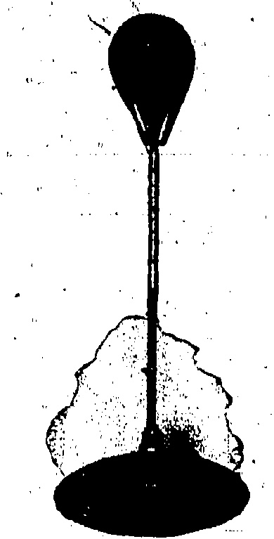
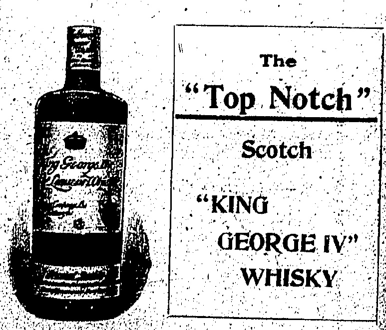

# UNANIMOUS DECISIONS.

# YESTERDAY'S STRIKE MEETING PACKED

The City Hall was filled to over-

flowing yesterday before the

hour at which the Community

Meeting was due to com-

mence and a move was therefore

made to the Theatre Royal where

here, again, the capacity was

taxed to its utmost. The meeting

was characterised by absolute

unanimity.

Governor

The Hon. Mr. P. H. Holyoak, Chairman, was greeted with loud cheers on rising to address the meeting.

Endorsed.

He referred to the fact that this was the second time in less than three years that the (Colony had been called upon to face a strike which was bound to have disastrous economic effects on the Chinese and on ourselves. The workers did not want to strike. The memories and discomforts of the last strike and the non-fulfilment of false promises by the labour unions were too fresh in the memories of most of them to do so. Yet, at the bidding of alien agitatoffs from Cantori and as the result of intimidation they fled in terror and for five weeks we have been dealing with the consequences. The resolutions were proposed not in any spirit of antagonism to our ancient Chinese friends, but with the sincere belief that by the eradication of the Bolsheviks from their midst lies not only the hope of international salvation in all dealings with China but the preservation of her own rights and country from utter destruction. (Applause).

"1. It is recommended that no wages be paid for June to returning strikers and that careful revision of terms and conditions be made upon their re-employment."

No Weakness.

In support of this resolution I may state that in the first place the law says it is unnecessary to pay any wages for June, and that you can even recover damages from the servant who has left without warning. In the second place I know—and I think I may fairly say that I am authorised to state—that the principle of the Government institutions throughout the Colony, be it the Civil Government, the Army or Navy, is that no returning striker will be employed unless he is absolutely essential, and that in that case he will only be employed on a lower grade than that at which he left. (Applause.) Far be it from me to advocate a policy of retaliation, but as I have said before, this is the second strike within three years. The settlement of the last strike was responsible for very many servants and employees going out. In the usual British way we were a little soft and a little over-just and generous in the settlement which was made on that occasion, and we hoped it might never occur again. It has occurred again, and without any desire to be vindictive, I think that the Colony ought to see that these strikes cannot recur without the consequences being placed upon those who provoke them. (Applause). I have already stated, and I believe to be a fact, that those who left our employment, were the dupes of a spirit of intrigue which brought them out, and might possibly have brought them out in spite of anything and everything we could have done in this Colony to prevent it. Nevertheless, ladies and gentlemen, I think it is desirable that we should register our feeling upon that point with the spirit certainly of justice and possibly of mercy, but with a little less mercy than we registered last time, because it was abused (Applause).

Mr. W. S. Bailey said: Mr. Chairman, Ladies and Gentlemen, I have much pleasure in seconding this resolution. These strikers have done their utmost to paralyze our trade. No business or Colony can exist indefinitely without adequate income. The economic losses of both European and Chinese businesses are alike very heavy and must seriously react on staffs employed and on wages paid for some time to come.

There appears no just cause for this strike, the employees having absolutely nothing of which to complain. British firms, especially British shipping firms, the most liberal and generous of employers, distributing yearly thousands of dollars gratuity to employees, together with other benefits—these firms have been discriminated against and all their vessels abandoned while rival vessels under the Chinese flag and paying lower wages have been allowed to run.

Businesses in the Colony, both Chinese and European, have lost money right through this stricken land.

and have paid salaries and wages not from profit but from capital, thereby reducing the earnings of these businesses and preventing them, however-willing-they-maybe, from giving employees in future the same liberal terms and gratuities as formerly.

An attempt has been made to starve us out financially by cutting off our sources of income. That attempt has only failed of complete success by the splendid unselfish work of our own people, our own residents of all races, and by the loyal service of the many Chinese workers who have stood so faithfully by us. With such complete unity and cheerful determination as has been shown we could never be beaten, but surely our first duty is to reward those who have so worked for us and not the strikers whose action has so deeply injured both us and them. (Applause).

There may be some who would formerly have dealt even more lawlessly with strikers, but later developments have certainly warranted their adoption of a stronger attitude in this respect. By leaving without notice strikers have dismissed themselves and are liable to forfeiture of a month's pay in lieu of notice and to prosecution, and it would be due to us and due to our loyal employees that returning strikers be dealt with thus strictly according to British law, otherwise there could be no security for future traders or workers of any nationality in the Colony. But justice should be tempered with mercy and we ask only the cancellation of the striker's wages for June, although we cannot forget that the mercy shown by us after the strike of 1922 was apparently mistaken for weakness on our part.

Let us be merciful as expressed by the resolution, but strong and ust. just to ourselves, to our lives and families and to our loyal workers who have so suffered and ill suffer by this strike.

I know ask you, ladies and gentlemen, to support our laws and Government and support the interest of our own people and our loyal helpers by voting unanimously for the resolution. (Applause).

The resolution was carried with enthusiastic unanimity.

## Registration

The following resolution was then before the meeting for consideration:—

"2. This meeting requests the Hongkong Government to cooperate in the establishment of a voluntary system of registration of office employees and domestic servants."

The Chairman briefly stated that he believed in a voluntary system of registration, not a compulsory one which would involve penalties on both sides in certain eventualities.

The Hon. Mr. H. W. Bird said: Mr. Chairman, Ladies and Gentlemen, in rising to second the resolution now before the meeting, I do not for one moment suggest that if the registration of domestic servants becomes an accomplished fact, it will prove to be a panacea for all our troubles, but it is my honest belief that it would be to the general benefit of the community if registration were undertaken on the right lines. We should think of those who are coming after us and endeavour to make this type of so-called strike, where the actual strikers had no grievance, more difficult. Although I do not suggest that such registration would stop strikes, it is my opinion that it would be a partial safeguard. It would be a form of combination on the part of employers to counter the combination of employees, and that is recognized all the world over as equitable. (Applause).

The objections to registration which I have heard expressed, and read of in the papers, do not strike me as very serious. I cannot see why it should cause discontent. All of us have been accustomed ever since the war began, to obtain passports with our photographs in duplicate. We submit without a murmur to the indignity of stating our ages, our physical disabilities, our distinguishing marks (Laughter)—why should Chinese domestics take these matters more to heart than we do? (Applause).

There is in force at the moment compulsory registration for Europeans, by the police authorities, in connection with essential services. All-domestics—at—home have a form of registration under the National Insurance Act. Moreover it is the custom here with a number of the large business concerns to register all their Chinese staff who are in permanent

employ. Furthermore, all indentured labour is registered through the S.C.A., and I am told there is never a murmur against it.

As regards finger prints I do not consider that is absolutely necessary. The photograph in duplicate, one on the card to be filed at the Bureau, and the other on the card held by the domestic, is all that would be necessary, and it could be made an offence punishable by a fine for any one to tamper with a registration card.

Because the law has been in-

operativa in Ceylon, as we are

told, only seems to me to show

that it is no longer necessary

there, and should such registration

become law in this Colony it

will probably die a natural death

if it is found there is no longer

any call for it.

To my mind it is necessary that this registration if carried out should be done by the Government. There is no reason for it to be a financial drag on the Colony, for the fees for registration should far more than pay for the personnel of the office. A registry office run as a private concern does not appeal to me. I have had some experience of such offices, and from the attitude of some of them it would seem that it is to their interest for one to change one's servants as often as possible. (Laughter.)

As regards an employer giving a servant a bad character without due cause, I think it will be found that people are too afraid of the law of libel to make that objection a serious one.

As regards written characters these are useless unless accompanied by a photograph, as one never knows whether the character produced was ever written for the individual who presents it. The ones use dare generally written by a resident who has long since left the Colony, so that there is no means of verifying same.

Ladies and Gentlemen, I am still to be convinced that there is any valid objection to the official registration of servants save the trouble entailed and if it is to the interest of the community that it should be undertaken, then that objection should be over-ruled. With these remarks, Sir, I have much pleasure in seconding the resolution now before the meeting. (Applause).

Mr. J. Russell (Taikoo) and Mr. L. M. Whyte contributed to the discussion, the former suggesting that registration should be arranged by the Residents' Associations. The Chairman said that he did not think there was the slightest hope of legislation being introduced at the present time but if it was proved that there was sufficient interest in voluntary registration the Government might be encouraged to go further with it.

The resolution was then put to the meeting and carried unanimously:

## China Business

Following was the next resolution to be considered:—

That in view of the extremely heavy losses being suffered by all British traders here and in China, present negotiations should be accelerated as much as possible, consistently with retaining all treaty rights, but it is the unanimous opinion of this meeting that no discussion concerning revised customs tariff or extraterritoriality should be begun whilst anti-foreign disturbances or boycotts continue in any part of China or Hongkong.

The Chairman briefly referred to the seriousness of the situation for merchants throughout China, and Mr. J. Owen Hughes, in seconding, attributed the present trouble to forces outside the Colony. Residents of long standing knew full well the worth of the Chinese merchants, and in this trouble it could not be made too clear that we had no quarrel whatsoever with the Chinese.

The resolution was carried unanimously.

The fourth resolution read as follows:—

4. That having regard to the recent criticisms in the House of Commons concerning emergency regulations enacted by the Governor in Council to deal with abnormal and threatening conditions, this meeting desires to express the approval of the entire foreign community and all right thinking Chinese, of such regulations as being absolutely necessary under the circumstances, and the entire confidence of the community in the actions of the Governor throughout this crisis, and is of opinion that his firm attitude and strong measures have thus far prevented a serious outbreak of violence.

The Chairman referred to the attacks made by the Labour party at Home on the Emergency Regulations passed by the Hongkong Government, the sacrificing of his home leave by His Excellency the Governor and the measures taken by the Governor-in-Council to deal with the situation.

Bolsheviks Elements.

The Hon Mr C G Alabaster, in seconding the resolution said that it was only right that because

His Excellency at the beginning of the strike informed the community of Hongkong that he and his Government were ready to stand shoulder to shoulder with the law-abiding elements in this Colony, that the law-abiding elements in this Colony should now tell the House of Commons that we stand shoulder to shoulder with him and his Government. (Applause):

Mr. Alabaster referred to the attempts that had been made by an external Government for the utilisation of every anti-foreign element and every Bolshevistic element that could be laid hands on to destroy the very foundations of life and business in the Colony. It was necessary for the Government to counter these measures and the distribution to loyal employees of threatening leaflets, and it was hardly to be wondered at that paid intimidators who had been foiled by the mere introduction of the emergency regulation relating to the imposition of the cat, should telegraph to the Labour Party in London to protest against the cruelty of the Hongkong Government.

Mr. W. H. Bell supported the resolution and it also was carried unanimously.

Following is the fifth resolution then before the Council:—

5. That this meeting desires to point out to the Home Government that the Shameen-Canton question will probably require to be dealt with, separately and in consultation with the Hongkong Government, whose interests are equally vital with those of the Foreign Office in all South China questions, especially as the present Canton Government will probably refuse to recognise any agreement reached with the Central Government in Peking. The situation in Hongkong and South China has been entirely provoked by Bolshevik influence and intrigue and is aggressively Communistic and violently anti-British. This meeting therefore urges His Majesty's Government to take strong and immediate action to protect British lives, property and trade in Hongkong and China by at once increasing the strength of the China Squadron in river gunboats and aircraft-carriers, and that, additionally, a battalion of British troops, should be transferred to Hongkong at the earliest possible moment for use here or in any part of China as emergency requires. Finally, it respectfully urges that His Majesty's Government should immediately inform the de facto Government in Canton that unless it withdraws its support, of the attack upon British interests, that they will be regarded as having entered into a state of hostility with the British Government.

In bringing this resolution forward the Chairman said that the Home Government must recognise that the problems of Canton and Hongkong could not be divorced, and if the Canton problem was referred to Peking without consulting Hongkong, it would be ludicrous. and farcical. (Applause.) The people at Home must realise that though the Shanghai dispute might be settled, the Bolshevik Government of Canton would probable refuse to recognise anything done in Peking. In the settlement Hongkong could not be left out. (Cheers.)

### Sir H. Pollock's Views

Sir Henry Pollock, in second, spoke of the operation in the Colony and in China of the hidden hand of Bolshevism and asked if we were going to allow the interests which had been built up here to be destroyed at the bidding of the Bolshevists. Giving reasons why the Chinese community had confidence in the fairness and protection of the Hongkong Government, the speaker said that the Chinese, from the highest to the lowest, from the richest merchant to the humblest coolie, have a special office, the Secretariat for Chinese Affairs, to which they can send in requests for the removal of any supposed grievances or injustice. Those requests, if in the Chinese language, are translated into English, and in many cases finally reach the Governor in Council; and I can testify personally, as a Member of that Council, of many years standing that the most careful and impartial attention is paid to the representations of all Chinese, however humble their station. Furthermore the Hongkong Government is in constant consultation with the Chinese members of the Legislative Council, who take great pains to ascertain the general feeling of the Chinese Community in this Colony.

The periodical large influxes of Chinese with their families into Hongkong in times of disturbance in the neighbouring Republic of China afford yet further proof, if any such be required, of the confidence of the Chinese people in the fairness of protection of our Government.

In short, Hongkong is a splendid and wonderful example of the

operation, and of the harmonious working together of the British and Chinese residents under the reign of law and order, which has been maintained here during the past 85 years by civil Servants of the highest integrity and impartiality. Are we going to allow this splendid British Colony which has been built up with such patience and labour and our commerce and credit not only here but all over China to be destroyed at the bidding of Bolsheviks? Are we going, at Bolshevik dictation, to give up the results of the strenuous labour of three generations of our countrymen in this Colony and in Shanghai and other parts of China, the labourers of our Civil Servants, Municipal Councillors, Ministers, Consuls, Commissioners of Customs, merchants and others?

In conclusion, Sir Henry said that it seemed clear that, in default of joint action by the other Powers concerned, the duty rests upon Great Britain, in the interests of civilization and of the national reconstruction of China upon correct lines to take action by herself, if necessity arises.

On the proposition of Mr. Blaker it was decided to insert the following at the beginning of the resolution: "That this meeting, whilst having the greatest confidence in Sir James Jamieson to deal with the situation, decides, etc." and it was also decided on the proposition of Mr. Hogg to send a letter to Sir James expressing the appreciation of the meeting of the manner in which he had dealt with a difficult situation.

The last resolution was carried unanimously and dealt with misrepresentation at Home of the present trouble. It is to be cabled to the Home Press and reads as follows:—

"It is further resolved that the following telegram be sent from this meeting to the press in London:

"That this meeting of European residents in Hongkong protests strongly against mis-representation in many Home papers, that troubles here and in China are due to bad labour conditions in the Far East for which it is alleged the British are responsible and which are admittedly far better than those obtained in other factories. This Colony has already undergone a general strike of five weeks' duration and the workers had no grievance."

They left, most of them very unwillingly, because they were intimidated and terrorised by threats of murder by Communist agitators. Some, having since been undeceived have voluntarily returned to their duties, and there is no doubt many more would do so unless forcibly restrained. The whole of the unrest in China is directly traceable to Bolshevik influence which is especially directed against British interests, and the misplaced sympathy of a section of the Home public is encouraging the leaders of the aggressive movement out here and placing lives of British subjects in isolated districts in China in jeopardy. Agitators in China misrepresent such sympathy to the ignorant masses, who are being led to believe that they can commit outrages with impunity owing to the unwillingness of the Powers to forcibly intervene. It urges strong and prompt action by the Home Government on behalf of British communities throughout China are the situation becomes hopelessly out of control.

Mr. Russell said amid applause that the only way to meet propaganda was by propaganda.

Mr. Dowley said that he wished he had the means to cable Home verbatim the speeches made at the meeting.

the meeting.

The Hon. Mr. P. H. Holyoak informs the “China Mail” that the resolution passed at yesterday's meeting regarding the confidence and admiration felt by the meeting in Sir James Jamiezon's conspicuous ability has been forwarded to the latter. Sir James has been informed that the meeting was attended by about 800 people.

For the 48 hours ended in July 26, the only case of notifiable disease was that of a Chinese patient suffering from cerebrospinal fever.

A league baseball match will be played on Wednesday evening, July 29 between the Hongkong Baseball Club and the Filipino Club at Happy Valley, at 5 p.m. sharp.

FEW CHILDREN ESCAPE IT.

Stomach aches so inseparable from the years of childhood, can become serious bowel disorder if not promptly quiled. Chamberlain's Colic and Diarrhea Remedy is safe and dependable for both children and grown people. It immediately relioves severe intestina pain and stops weakening diarrhoea. For sale everywhere.

## EXERCISE

## Everything For

Fishing

Cricket

Billiards

# LANE, CRAWFORD LTD

## BOLS

LIQUEURS.

Softness and Mellowness are their distinctive properties.

CALDBEOK, MACGREGOR & CO., LTD.

18, Queen's Road Central. Telephone 75 Central.

## NEW

G. FALCONER & CO. (HONGKONG) LTD

WATCHMAKERS & JEWELLERS

DIAMOND MERCHANTS

Union Building (Opposite G.P.O.)

Agents for:— ADMIRALTY CHARTS

ROSS'S BINOCULARS and TELESCOPES,

KELVIN'S NAUTICAL INSTRUMENTS,

ENGLISH SILVERWARE, direct from Manufacturers,

High Class English Jewellery.

Pint flasks suitable for picnics, &c., now obtainable at $2 per flask duty paid.

GANDE, PRICE & CO., LTD.

St. George's Building, Ice House Street, Tel. No. Control 145