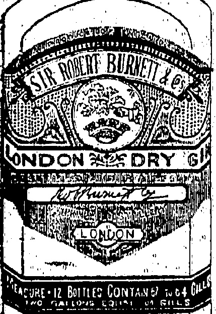
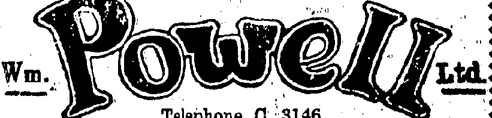
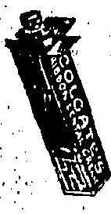
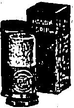
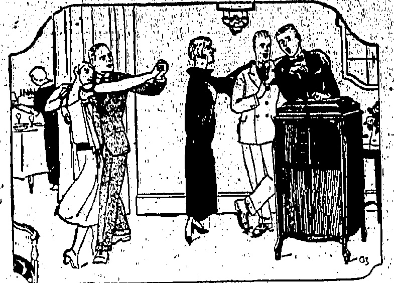
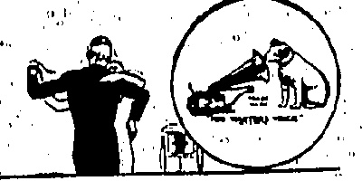
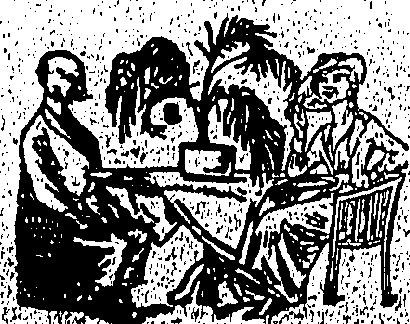

LONDON

DRY GIN

Gives that Distinctive Excellence to a Cocktail.

& Co., Ltd.

WINE AND SPIRIT

MERCHANTS.

Telephone C: 3146

# A BIG DISPLAY

Straw Hats... $ 4.50

Sun Helmets... 10.50

Linen Hats... 1.50

Panamas... 10.50

Felt Hats... 10.50

Soft Collars... 4.50 doz.

Cambric Handk's 4.50 doz.

Cellastic Vests... $ 2.00

Aertex Vests... 3.75

Cellastic Drawers 2.00

Aertex Drawers... 3.75

Combinations... 6.75

Lisle Socks... 75 cents

6 for $4.00

AND GUARANTEED QUALITY

PEDDER STREET BRANCH

◇◇◇◇◇◇◇◇◇◇◇◇◇◇◇◇◇◇◇◇◇◇◇◇◇◇◇◇◇◇◇◇◇◇◇◇◇◇◇◇◇◇◇◇◇◇◇◇◇◇◇◇◇◇◇◇◇◇◇◇◇◇◇◇◇◇◇◇◇◇◇◇◇◇◇◇◇◇◇◇◇◇◇◇◇◇◇◇◇◇◇◇◇◇◇◇◇◇◇◇◇◇◇◇◇◇◇◇◇◇◇◇◇◇◇◇◇◇◇◇◇◇◇◇◇◇◇◇◇◇◇◇◇◇◇◇◇◇◇◇◇◇◇◇◇◇◇◇◇◇◇◇◇◇◇◇◇◇◇◇◇◇◇◇◇◇◇◇◇◇◇◇◇◇◇◇◇◇◇◇◇◇◇◇◇◇◇◇◇◇◇◇◇◇◇◇◇◇◇◇◇◇◇◇◇◇◇◇◇◇◇◇◇◇◇◇◇◇◇◇◇◇◇◇◇◇◇◇◇◇◇◇◇◇◇◇◇◇◇◇◇◇◇◇◇◇◇◇◇◇◇◇◇◇◇◇◇◇◇◇◇◇◇◇◇◇◇◇◇◇◇◇◇◇◇◇◇◇◇◇◇◇◇◇◇◇◇◇◇◇◇◇◇◇◇◇◇◇◇◇◇◇◇◇◇◇◇◇◇◇◇◇◇◇◇◇◇◇◇◇◇◇◇◇◇◇◇◇◇◇◇◇◇◇◇◇◇◇◇◇◇◇◇◇◇◇◇◇◇◇◇◇◇◇◇◇◇◇◇◇◇◇◇◇◇◇◇◇◇◇◇◇◇◇◇◇◇◇◇◇◇◇◇◇◇◇◇◇◇◇◇◇◇◇◇◇◇◇◇◇◇◇◇◇◇◇◇◇◇◇◇◇◇◇◇◇◇◇◇◇◇◇◇◇◇◇◇◇◇◇◇◇◇◇◇◇◇◇◇◇◇◇◇◇◇◇◇◇◇◇◇◇◇◇◇◇◇◇◇◇◇◇◇◇◇◇◇◇◇◇◇◇◇◇◇◇◇◇◇◇◇◇◇◇◇◇◇◇◇◇◇◇◇◇◇◇◇◇◇◇◇◇◇◇◇◇◇◇◇◇◇◇◇◇◇◇◇◇◇◇◇◇◇◇◇◇◇◇◇◇◇◇◇◇◇◇◇◇◇◇◇◇◇◇◇◇◇◇◇◇◇◇◇◇◇◇◇◇◇◇◇◇◇◇◇◇◇◇◇◇◇◇◇◇◇◇◇◇◇◇◇◇◇◇◇◇◇◇◇◇◇◇◇◇◇◇◇◇◇◇◇◇◇◇◇◇◇◇◇◇◇◇◇◇◇◇◇◇◇◇◇◇◇◇◇◇◇◇◇◇◇◇◇◇◇◇◇◇◇◇◇◇◇◇◇◇◇◇◇◇◇◇◇◇◇◇◇◇◇◇◇◇◇◇◇◇◇◇◇◇◇◇◇◇◇◇◇◇◇◇◇◇◇◇◇◇◇◇◇◇◇◇◇◇◇◇◇◇◇◇◇◇◇◇◇◇◇◇◇◇◇◇◇◇◇◇◇◇◇◇◇◇◇◇◇◇◇◇◇◇◇◇◇◇◇◇◇◇◇◇◇◇◇◇◇◇◇◇◇◇◇◇◇◇◇◇◇◇◇◇◇◇◇◇◇◇◇◇◇◇◇◇◇◇◇◇◇◇◇◇◇◇◇◇◇◇◇◇◇◇◇◇◇◇◇◇◇◇◇◇◇◇◇◇◇◇◇◇◇◇◇◇◇◇◇◇◇◇◇◇◇◇◇◇◇◇◇◇◇◇◇◇◇◇◇◇◇◇◇◇◇◇◇◇◇◇◇◇◇◇◇◇◇◇◇◇◇◇◇◇◇◇◇◇◇◇◇◇◇◇◇◇◇◇◇◇◇◇◇◇◇◇◇◇◇◇◇◇◇◇◇◇◇◇◇◇◇◇◇◇◇◇◇◇◇◇◇◇◇◇◇◇◇◇◇◇◇◇◇◇◇◇◇◇◇◇◇◇◇◇◇◇◇◇◇◇◇◇◇◇◇◇◇◇◇◇◇◇◇◇◇◇◇◇◇◇◇◇◇◇◇◇◇◇◇◇◇◇◇◇◇◇◇◇◇◇◇◇◇◇◇◇◇◇◇◇◇◇◇◇◇◇◇◇◇◇◇◇◇◇◇◇◇◇◇◇◇◇◇◇◇◇◇◇◇◇◇◇◇◇◇◇◇◇◇◇◇◇◇◇◇◇◇◇◇◇◇◇◇◇◇◇◇◇◇◇◇◇◇◇◇◇◇◇◇◇◇◇◇◇◇◇◇◇◇◇◇◇◇◇◇◇◇◇◇◇◇◇◇◇◇◇◇◇◇◇◇◇◇◇◇◇◇◇◇◇◇◇◇◇◇◇◇◇◇◇◇◇◇◇◇◇◇◇◇◇◇◇◇◇◇◇◇◇◇◇◇◇◇◇◇◇◇◇◇◇◇◇◇◇◇◇◇◇◇◇◇◇◇◇◇◇◇◇◇◇◇◇◇◇◇◇◇◇◇◇◇◇◇◇◇◇◇◇◇◇◇◇◇◇◇◇◇◇◇◇◇◇◇◇◇◇◇◇◇◇◇◇◇◇◇◇◇◇◇◇◇◇◇◇◇◇◇◇◇◇◇◇◇◇◇◇◇◇◇◇◇◇◇◇◇◇◇◇◇◇◇◇◇◇◇◇◇◇◇◇◇◇◇◇◇◇◇◇◇◇◇◇◇◇◇◇◇◇◇◇◇◇◇◇◇◇◇◇◇◇◇◇◇◇◇◇◇◇◇◇◇◇◇◇◇◇◇◇◇◇◇◇◇◇◇◇◇◇◇◇◇◇◇◇◇◇◇◇◇◇◇◇◇◇◇◇◇◇◇◇◇◇◇◇◇◇◇◇◇◇◇◇◇◇◇◇◇◇◇◇◇◇◇◇◇◇◇◇◇◇◇◇◇◇◇◇◇◇◇�

## ◇◇◇◇◇◇◇◇◇◇◇◇◇◇◇◇◇◇◇◇

WHY GO BLIND?

Take no chances. If your eyes trouble you consult.

◇◇◇◇◇◇◇◇◇◇◇◇◇◇◇◇◇◇◇◇◇◇◇

Use COLGATE'S, Kibbon Dental

Cream and Handy Grip Shaving Sticks

SOLE AGENTS:

The Hongkong Trading Co. Ltd

HONGKONG.

THE MOST FOR YOUR MONEY.

BUYS A

# DOLLAR DIRECTORY

NOR

1925

IT CONTAINS A MASS OF INVALUABLE INFORMATION WHICH EVERY RESIDENT SHOULD HAVE

WHO'S WHO?

YOU CAN FIND ALL THIS AND MUCH MORE IN

THE DOLLAR DIRECTORY

TO ME HAD FROM:

THE PUBLISHERS

(China Mail Building)

5, Wyndham St.

# Take VICTÓLA Out of this Picture— and what have you?

Anne is out in the dining room getting the "refreshments." Jack and Mary are showing Paul Whiteman what good dance music will do to young folks' feet! Myrtle, George and Charlie are giving an irritation of singing. What's causing all the fun? Why—Victoria, of course!

S. MUTRIE & CO., LTD

Victor Distributors

Qualified by Canadian Government Examination

Fellow of the American Optometric Association.

(Every evening except Sunday, Annual subscription, excluding postage abroad, HK $36, payable in advance. Local delivery free.)

Overland China Mail

## The China Mail

(The weekly edition of the "China Mail." Annual subscription, excluding postage abroad, U.K. $12, payable in advance.)

The Newspaper Enterprise, Ltd.

Printers & Publishers

No. 5.WYNDHAM ST. HONGKONG

Telephones Central 22 & 4641. Cable Address:—Mail, Hongkong.

All communications should be addressed to the Newspaper Enterprise, Ltd., to whom all remittances should be made payable.

London Offices:—This Far Eastmu Advertising Agency (London), Ltd., 24, Devonshire Street, Bloomsbury, W.C.1.

## SILVER WEDDING

GREEN—BANKER.—On June 1, 1900, at the Consulate for the United States of America, Shanghai, before Mr. John Goodnow; Consul General, by the Rev. J. R. Hykes, Elizabeth Banker, daughter of the late William Swallow Banker, pilot Newchwang, to Samuel Ebenezer Green, son of the late John Harwood Green of the Chinese Imperial Maritime Customs, Swatow and of Shrapstone, Northampton, England.

## DEATH

MEEK (Thomas).—At the Peak Hospital, on the 31st May, Late of the Meter Department, China Light & Power Co., (1918), Ltd. Funeral passes the Monument at 5.30 p.m. this evening.

## Hongkong, Monday, June 1, 1925

To-day is Whitmonday and a holiday. Why? According to that greatest of all reference books, the Encyclopaedia Britannica, Whitsunday, "one of the principal feasts of the Christian Church," is celebrated on the fiftieth day after Easter to commemorate the descent of the Holy Spirit on the Disciple. The day became one of the three haptismal seasons, and the name Whitsunday is now generally attributed to the white garments, formerly worn by the candidate.

for baptism on this feast. The festival is the third in importance of the great feasts of the Church and the last of the annual cycle commemorating the Lord. It is connected with the Jewish Pentecost, not only in the historical date of its origin but in idea, the Jewish festival being one of thanks for the first-fruits of the earth, the Christian for the first-fruits of the Spirit. In the middle ages the Whitsun services were marked by many curious customs. Among these were the letting down of a dove from the roof into the church, the dropping of balls of fire, rose-leaves and the like. Whitsun is one of the Scottish quarter days, and though the Church festival is movable, the legal date was fixed for the 15th day of May by an act of 1693. Whitmonday, which, with the Sunday itself, was the occasion of the greatest of all the medieval church ales, was made an English Bank Holiday by an act passed on the 25th of May, 1871.

So that is why we enjoy a holiday in Hongkong today.

## Child Labour

It would be interesting to know what has been the moral effect upon the Chinese in introducing ameliorative measures of reform connected with the labour of children in factories in the Colony. The report for 1924 of the Secretariat for Chinese Affairs in this respect, makes pleasant reading. There was some protest when legislation was urged. It would upset the Chinese; it would interfere with production, wages, household affairs, etc., etc. The result has been nothing of the sort. Three hundred children in factories work in safe and pleasant surroundings, in reasonable hours. The great fact is that a considerable number are prevented from doing so until a reasonable year of discretion has been reached. Incidentally this particular report is an interesting evidence of Chinese industrialism in the Colony. There are 28 factories in Hongkong and Kowloon—a fairly large number of seems—given over to the production of such things as knitting, glass, and fireworks. These factories, but illustrate once again the versatility and ability of the Chinese. Those in charge of them are to be congratulated on an evident willingness to promote the construction affecting work in

One result of the Great War has been the abolition of fixed alliances. These, at one time were a common feature of European and international politics. France and Britain allied; Italy and Germany also; then Japan and Britain. The expiry of the latter treaty and its non-renewal seem definitely to have set the seal on alliances generally. This is all to the good. An alliance of two great powers tended to create suspicion and misunderstanding—and worst of all, jealousy. If anything the League of Nations would have an influence contrary to the creation of alliances. In that body could be discussed questions likely to lead to disruption and war and to find a way to lasting peace. The work of the League can be and is being supplemented, by treaties of a peaceful nature. Thus the latest memorandum of the British Government to France dwells on the necessity of suitable arbitration treaties supplementing the Rhine security pact with a view to guaranteeing the peace of other parts of Europe. Here is further evidence of the "come, let us reason together" policy. At this rate we shall soon be realising that the pen and tongue are mightier than the sword.

## Deport Them

Portugal has set an example in the matter of dealing with bomb throwers and insurrectionaries generally. A number of these misguided people have been placed on board a cruiser and are now on their way to Portuguese Guineu—“far, far away.” Hongkong's idea of deportation consists in sending undesirables—principally beggars—to Canton which is not “far, far away.” With steamer fares at cut-throat, competitive prices, a return to the happy hunting ground of the beggar is simplicity itself. Why not fix on some other place to which to send these people? A dumping process of such a nature, faithfully and ceaselessly carried out, would have its own moral effect. Swatow, Amoy, Foochow, might be tried as experiments. Caution the next batch of beggars that a reappearance means exile to other and more distant places than Canton, and some good is likely to accrue. Whilst the nuisance is said to be abating as a result of the efforts recently initiated and maintained, there is a suspicion that when the official back is turned, the beggar, in all his dirt and deformity will be back again.

the world is dreadful to listen to.

—Mr. Maurice Lane-Norcott.

The people of to-day must be considered as much as our links with the people of the past.—Lord Ashfield.

## THEY SAY THAT—

Some of the very best music in the world is dreadful to listen to. —Mr. Maurice Lane-Norcott.

Sin is real, sin is earnest; and they who ignore sin in their writing must lead sinful lives. Miss Katherine Leaf.

Toryism shackled to its brewers, landlords, and tariff profiteers, is powerless to tackle social problems. —Mr. Vivian Phillipp.

If anyone says he does not know the difference between contracting in and contracting out he has never lent a man £5 and tried to get it back.—Mr. Macquisten, M.P.

The romance of original documents is endless, if a man have imagination to seize it.—The Hon. John Fortescue.

None of us is normal.—The Bishop of Liverpool.

It is unwise to treat political institutions as logical.—Mr. Austen Chamberlain.

I profoundly distrust logic when applied to politics.—Mr. A. Chamberlain, M.P.

Psycho-analysis, after all, is an attempt to make people's lives better. —Lady Betty Balfour.

Life is very difficult; in a small flat it can easily become nearly impossible.—Mr. Pett Ridge.

There is no analogy between an ordinary licensed house and a political club;—Sir Herbert Nield.

## TODAY'S SMILE

# SHREDS AND PATCHES.

The Whitsun Whitsun Mysteries were Monday. acted at Chester, seven or eight on each day during the Monday, Tuesday and Wednesday in Whitsun week. The drapers, for instance, exhibited the "Creation," the tanners took the "Fall of Lucifer;" the water-carriers of the Dee reproduced the "Deluge;" the cooks had the "Harrowing of Hell." The performers were carried from one station to another by means of a movable scaffold, a huge and ponderous machine mounted on wheels, gaily decorated with flags, and divided into two compartments, the upper of which formed the stage, and the lower, defended from vulgar curiosity by coarse canvas draperies, answered the purposes of the green-room. The performers began at the Abbey gates, where they were witnessed by the high dignitaries of the Church; they then proceeded to the High Cross, where the Mayor and the civic magnates were assembled; and so on, through the city, until their motley history of God and His dealings with man had been played out. The production of these pageants was costly; each mystery has been set down at fifteen or twenty pounds, present money. The dresses were obtained from the churches, until this practice being denounced as scandalous, the guilds had then to provide the costume and other properties.

### A FALLACY. That Moths Eat Clothes

This fallacy is somewhat akin to the one that a thaw bursis the water-pipes, for when a thaw comes, then also comes the inconvenience of burst water-pipes. Similarly, when the clothes are taken out and found moth-eaten, and moths fly from them, the too-ready conclusion is that the moths have eaten them. What occurs is this: The clothes' moths lay eggs on suitable materials, these eggs develop into larvae or grubs, which eat the clothes. The larvae then change into pupae, each forming a tiny cocoon (similar to that of a silkworm) for itself, and after some time the cycle of changes is completed by moths emerging from these cocoons, which may be found among clothes that have been badly moth-eaten. So we see that the moths which fly out on the clothes being disturbed are quite innocent of the harm that has been done up to that time; but if left, they will of course lay eggs, and the resulting larvae will start operations at once.

An entomological friend told us a very amusing experience of his illustrating this fallacy. He gets

his friends to collect moths and butterflies for him, and on calling one day at the house of a fair collector, she showed him a very fine living specimen of the Emperor-moth (Saturala pavonia minor), which she had caught for him. Not knowing how to kill it, she had kept it alive for several days, and, moreover, out of the kindness of her gentle heart, she had fed it. On being asked what she had fed it on, she replied ingeniously, "Oh, I gave it a bit of old rag to eat!"

Some moths do not eat anything, as they have a sufficient store of nutrient to enable them to fulfil their mission in life, after which they die young. Others sip the nectar from flowers, and it is the flowers which open at night that are most strongly scented for the purpose of attracting the moths by their sense of smell, that of sight being useless in the dark.

ancients dedicated it to Virgo—the Virgin, As a colour—if such it may be called—it belongs to those born under that sign, but many silvery shades that may practically be described as white, are fortunate to Gemini people, and also to those of Pisces. Also white belongs to the moon in particular and thus is exceptionally fortunate to “moon folk,” another instance of the early worship of Isis, and how her influence has come down to us through so many other faiths. Rather curiously, white animals are considered unlucky. In many parts of England a white cat is called the sign of ill fortune, while in the Midlands they say you must be sure to spit if you meet a white horse face to face, spitting being a powerful spell to avert evil. And in Northamptonshire the unexpected sight of a white mouse is the sure foreruner of a death in the family.

### WHITSUN ALE. prevalent a drink amongst

us in old times, as to become a part of the name of various festal meetings, as Leet-ale, Lamb-ale, Bride-ale (bridal), and, as we see, Whitsun-ale. It was the custom of our ancestors to have parochial meetings every Whitsuntide, usually in some barn near the church, consisting of a kind of picnic, as each parishioner brought what victuals he could spare. The ale, which had been brewed pretty strong for the occasion was sold by the churchwardens, and from its profits a fund arose for the repair of the church.

# PLAIN ENGLISH.

At one of the London police-

courts the other day a gentleman

was charged with drunkenness.

What entitles his case to honour-

able mention is his defence. A

doctor went into the box and

swore that "his condition was due

to spastic paraplegia." Yet the

magistrate was not satisfied. He

replied, all too curtily, "What is

that?" Possibly he thought

there was some confusion: that

spastic paraplegia was a phrase

devised to test the power of

speech of one suspected of

inebriety, for which purpose,

indeed, it seems worthy of the

attention of the medical profession.

Possibly he suspected a

misunderstanding — for to the

mere layman it would seem that

spastic paraplegia ought to mean

some sort of drawn or contracted

paralysis. But it is ever rash to

assume that men of science use

their technical terms to mean

what the words ought to mean.

According to the testifying

doctor, spastic paraplegia really

means "acute nervous exhaustion." Then, said the disgusted

cadi, "Why not use plain English?" When the doctor explained

that it was "not the custom," the cadi exhorted him to change

that custom, complaining that "the medical profession has received sufficient hints from the

legal profession as to what is the proper thing to do and they will

not take notice." There speaks the bitterness of the man who has had to wrestle with experts in the witness-box. But we depreciate any attempt to make one profession the censor of another. With all respect to the magistrate, we must point out that the doctor's might turn upon him. There is a legal jargon as well as a medical jargon, and the physician may protest that his Greek-like quite as good as the tarrist's Latin. In fact, when some of us did not

some of them reasonably formed, some of them superfluous, perverted, obscure. "Such esoteric vocabularies are always being built up among people who have intercourse and interests a little apart from the rest of the world. Many families have their private slang. Each generation of undergraduates invents some of its own. Any popular game acquires, decade after decade, a mass of peculiar phrases devised by the players of the period. "W. G." knew not the googly, nor Arthur Shrewsbury the cow-shot. Some of these terms are needed to express new things, many of them are mere decorations of language. Even the most learned of the professions and the most austere of the sciences are not exempt from the common human instinct to be decorative in speech. It does not please the expert to call a common phenomenon by a name which common men never heard of. When he has discovered a new fact or invented a new theory he loves to give it a name worthy of his own ingenuity. In general he feels that his dignity is enhanced by talking in a jargon which nobody else uses, as the Meteorological Office derives an exquisite satisfaction from reporting the weather in terms of millibars. Let us not blame him. We encourage him continually. We like our experts to be incomprehensible. When we consult our specialist, we want him to talk in words we never heard before. If he used plain English he would be as disappointing as if he said there was nothing the matter with us. We know at the back of our minds that neither the cause nor the cure of anything is revealed by giving it a name derived more or less estimates from the Greek language. But the penury of phrase exillarates us. And the real compound