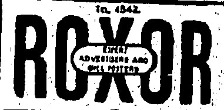
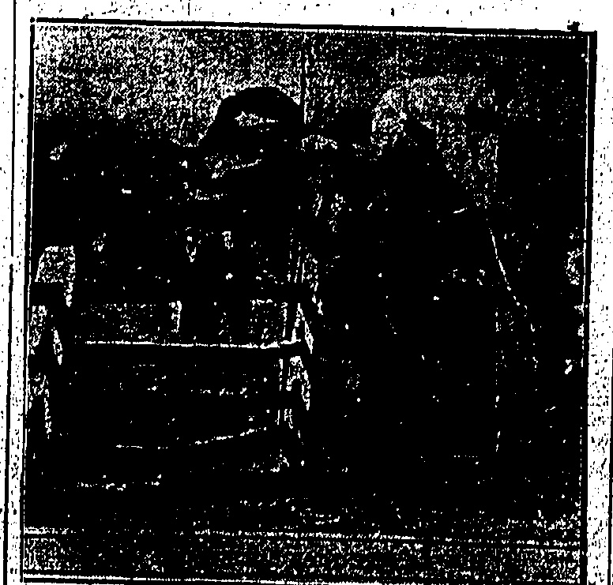

# “CHINA MAIL” SPORTS PAGE.

## VOLUNTEER

FIRST MEETING A SUCCESS.

Among those present were His Excellency Sir Edward Stubbs, who was accompanied by Capt. R. Neville (A.D.C.) and Mr. T. J. Gaisford-St. Lawrence (Private Secretary), His Excellency Major General C. C. Luard, and Commodore A. J. B. Stirling, R.N.

The Hongkong Volunteer Defence Corps held their first annual athletic sports meeting on the ground of the Hongkong Football Club at Happy Valley yesterday afternoon, the events being watched with much interest by a large gathering of spectators in the stand despite the counter attraction on the race course. The initial meeting was in every way a success, both in number of entries and in the performances of the competitors.

A. Mair, of the Scottish Company, was the outstanding competitor in the long distance races, winning the half mile, one mile and three mile races, and also making a very strenuous effort in the relay race in which he was the last runner twice round the track. D. D. Urquhart, the first runner for the Infantry Company, gave a good lead to his side, and Howell coming in last got home with Mair following behind after he had made up the greater part of the deficit.

Points were awarded for first, second and third places in the competition for the inter-unit Challenge Cup presented by L.L. Col. L. G. Bird, D.S.O., the Corps Commandant. The units taking part were the Artillery Company, Engineer Company, Mounted Infantry, Armoured Cars, Machine Gun Platoon, Infantry Company, Scottish Company, and Reserves. The Infantry Company won the Cup with 39 points, the Scottish Company being second with 29 points, and the Engineer Company being third with 15 points.

G. P. Lammert amassed points for the Infantry Company by winning the 100, 220 and 440 yards races and securing a third place in the long jump.

J. Watson of the Engineers and A. K. Mackenzie of the Scottish did well for their respective units.

Two teams from the Hongkong Police tried conclusions with the H.M.S. Durban and the R.G.A. in exhibition tugs-of-war. In the first encounter the heavy Police team easily pulled over the sailors in two straight pulls. The R.G.A. had a hard fight, securing only one pull in three.

Races for bandsmen and the coolie workmen had special interest to those lining the ropes.

The band of the 5/2nd Punjabi Regiment, under the baton of Mr. L. Larter, gave selections.

His Excellency the Governor gave away the prizes and was given three cheers on the call of the Corps Commandment.

## PRIZE-WINNEWS

The full list of results and prize-winners follow:—

A. C. I. Bowker; 2. E. F. Stewart. 98 yds.

High Jump: 1, A, K. Mackenzie; 2, G. S. Kennedy Skipton 4 ft. 10 in.

100 yards Flat Rae.—1', G, P; Lummerb: 2,+1). D, Urquhart.

220 yards Flat Race.—1, G. P. Lammert; 2, H. G. Burns. 23.3/5 secs.

440 yards Flat Race.—1, G. P. Tammert; 2, R. R. Wood. 55.2/5

Three-legged Racco—1, J. Watson and R. R. Wood; 2, H. R. Wheeler and E. E. Mimmack

860 yards Flat Race.—1; A.

Mair; 2, L. P. Ralph. 2 min 21 secs.

120 yards Hurdle Race.—1, A. K.

Mackenzie; 2, L. M. S. Lloyd. 19

secs.

One mile Race (Open).—1; Bdem Hannan; 2, Pte. Quelch; 3, Woo (University).

Putting the Shot. — R. Moncrieff, 31 ft. 10 in.

2, L. P. Ralph; 3, R. R. Wood. Obstacle Race.—1, R. Bell; 2,

One mile Raco.—1, A. Mair; 2, L.P. Ralph. 5 min. 34 secs.

Inter-unit Relay Race.—Infantry Company.

Tug-of-war Final (Inter-unit).—Engineer Company beat the Scottish Company in two pulls to one. Inter-unit Football (six-a-side).—Winners, Infantry Company. Inter-unit Challenge Cup.—Winners, Infantry Company with 89 points; ruhners-up, Scottish Company with 29 points. Exhibition Tug-of-war.—Police beat H.M.S. Durban by two straight pulls; Police beat R.G.A. by two pulls to one.

### UPSETS."

## SURPRISING RACE RESULTS

HOLIDAY SPORT

NOT ONE FAVOURITE WINS IN SEVEN

Not one favourite turned up in the seven events on the card yesterday for the second day's racing of the Whitsuntide meeting at Happy Valley.

Accordingly, pari-mutuel dividends were on the large side, ranging from the smallest of $18 in the selling race to $76.50 in the spring. "Place money was also above the average.

With a summer sun overhead, tempered by a faint breeze, conditions were different from Saturday. Still, it is necessary to go further for the sequence of upsets. Followers of form will have to work out their own solutions as more than one "expert" explanations were forthcoming.

As will be seen in the cash sweep figures, there was no falling-off in attendance.

Everything went off expeditiously, the starts being carried out to perfection by that "veteran," Mr. P. M. Hodgson, assisted by Mr. C. L. Oliphant.

H.E. the Governor (Sir R. E. Stubbs) arrived in time to see his pony Gaudie take second place in the third race.

King Emperor—winner of the selling race—changed hands at $300, the entered price, and passes into Mr. Bagram's stable.

Below will be found the cash sweep results:—

149; 241, 528, 90, 479, 39.

1.—PARK PLATE: FIVE. FUR-

LONGS.—For China ponies

that have started in Hongkong

at least twice since January 1,

1925. Winners of a race this

year of five furlongs or under

other than a race confined to

subscription griffins barred. 1st

prize: $300. 2nd prize: 150.

3rd prize: $100.

Messrs. Dyer and Beith's

(Li.-Comdr. Thompson) 1

Mr. Bagram's Dictator Dahlia (Mr. Harriman) 2

Messrs. Dunbar and Stanton's Chicago.....(Mr. Brodie) 3

Also ran: Alcantra (Mr. G. U. da Roza), Rothesay (Mr. Pollock), Hailsham (Mr. Baker), Joe (Capt. Hall), The Wasp (Mr. T. W. Doyle), and Rayfield (Mr. Gibson).

Two lengths; half a length. Time: 1 min. 15 secs. Pari-mutuel.

2. —WESTENHANGER STAKES: FROM TWO MILE POST ONCE ROUND AND IN: (ABOUT ONE MILE 165 ROUNDS). — For China ponies that have run in Hongkong since January 1, 1925, and previous to this meeting. 1st prize: $400. 2nd prize: $150. 3rd prize: $100.

Sir Paul's Beauty Dahlia (Mr. Davies) 1

Mr. Relyon's Uncle Alf (Mr. Harriman) 2

Mr. W. T. Stanton's Quab (Mr. Brodie) 3

Also ran: Mr. J. H. Taggart's Demon Boy (Lt. Comdr. Thompson), Two Pairs (Mr. Potts), A.B. (Mr. da Roza), and Teashop (Mr. Gibson).

Three lengths; a neck.

## BIG BOXERS

HEAVYWEIGHTS' FULL DISTANCE

DUTCHMAN WINS.

(Router's Service.)

In a 15-round boxing match, Van der Veer, the Dutch heavyweight, beat Persson of Sweden on points.

## Parl-mutuel:—

3.—MAIDSTONE PLATE: ONE MILE.—For China ponies that have started in Hongkong since January 1, 1925, and previous to this meeting and have not won a race since January 1, 1925. 1st prize: 400. 2nd prize: $150. 3rd prize: 100. Mr. B. Gram's Gymp. (Mr. Harriman). 1 H.E. Sif. Edward Stubbs's Gaudie (Mr. Doyle) 2 Mr. A. A. Alves's Auchenreoch (Mr. da Roza) 3 Also ran: Saracen (Mr. Buck), Langsat (Mr. Pollock), Uncle Tam (Mr. Bartholomew) and New York (Mr. Brodie). A length; a length and half.

<table border=1 style='margin: auto; word-wrap: break-word;'><tr><td style='text-align: center; word-wrap: break-word;'>Winner</td><td style='text-align: center; word-wrap: break-word;'>$20.40</td></tr><tr><td style='text-align: center; word-wrap: break-word;'>1st Place</td><td style='text-align: center; word-wrap: break-word;'>7.30</td></tr><tr><td style='text-align: center; word-wrap: break-word;'>2nd</td><td style='text-align: center; word-wrap: break-word;'>5.90</td></tr><tr><td style='text-align: center; word-wrap: break-word;'>3rd</td><td style='text-align: center; word-wrap: break-word;'>12.00</td></tr></table>

4.—JUNE HANDICAP: "A" CLASS: ONE AND A.QUARTER MILES.—For China ponies. 1st prize: $450. 2nd prize: $200. 3rd prize: $100. Mr. A. A. Alves' Golden Chrysanthemum (Mr. Doyle) 1 Messrs. Hall and Shenton's Saligia.... (Mr. Pollock) 2 Mr. A. H. Carroll's Poppy Leaf..... (Mr. Harriman) 3 Also ran: Gypsy Love (Mr. Buck) and Curiosity Shop (Mr. Gibson).

1½ lengths; three lengths.

Time: 2 mins. 40.2/5 secs.

Pari-mutuel:—

— W A L M E R SELLING PLATE: ONCE ROUND.—For all China ponies. If entered to be sold for $500, 5 lbs. penalty; if to be sold for $400 W. I., if to be sold for $300 allowed, 5 lbs., if to be sold for $200 allowed 10 lbs. 1st prize: $400. 2nd prize: $150. 3rd prize: $100.

(Lt.-Comdr. Thompson) 3

Also ran: Magnificent Dahlia

(Mr. Harriman), Capt. G. E.

Oxspring's May May Leaf (Capt.

Oxspring), Toomai (Mr. da

Roza), Tadworth (Mr. Buck),

and Baby Eyes (Mr. Brodie).

Time: 1 min. 57.1/5 secs.

Pari-mutuel:—

6.—JUNE HANDICAP: "B" CLASS: ONE AND A QUARTER MILES.—For China ponies. 1st prize: $450. 2nd prize: $200. 3rd prize: $100. Mr. J. H. Taggart's Demon Bcy (Lt.-Comdr. Thompson) 1 Lady Severn's Jambu

<table border=1 style='margin: auto; word-wrap: break-word;'><tr><td style='text-align: center; word-wrap: break-word;'>1st Place</td><td style='text-align: center; word-wrap: break-word;'>$46.10</td></tr><tr><td style='text-align: center; word-wrap: break-word;'>2nd</td><td style='text-align: center; word-wrap: break-word;'>18.20</td></tr><tr><td style='text-align: center; word-wrap: break-word;'>3rd</td><td style='text-align: center; word-wrap: break-word;'>10.80</td></tr><tr><td style='text-align: center; word-wrap: break-word;'></td><td style='text-align: center; word-wrap: break-word;'>11.50</td></tr></table>

7. — FOLKESTONE STAKES: ONE MILE.—For all China ponies that have started at this meeting and not won. 1st prize: $400. 2nd prize: $150. 3rd prize: $100.

Messera, Dyer and Beith's Loch

Rannoch

(Lt.-Comdr. Thompson) 1

Mr. Bagram's Dictator Dahlia

Seattle..... (Mr. Brodie) 8 Also ran: The Wasp (Mr. Doyle).

Winner $26.10

1st Place 10.10

2nd $6.10

(From Our Own Correspondent.)

Singapore fired-off in the inter-port shoot but protesting on account of faulty ammunition.

Hongkong fired off in the inter-port rifle contest between Shanghai, Singapore, Penang and this port, some days ago, the score being 875.

It was understood that each port, was to fire off at its own range between May 15 and May 31. However, on communication with Mr. C. H. Summers, honorary secretary, the "China Mail" was informed that no score had been received.

##### S.C.A.A

## PROGRESS DESPITE HANDICAP:

LATEST CAMPAIGN.

The annual membership campaign of the South China Athletic Association ended recently gives a return of $26,401.50 for fees and subscriptions, and about 1,900 members.

Although these figures show a slight increase over last year's of $24,732 and 1,897 members, many members who took part in the campaign are not quite satisfied with them, because when the campaign was started with a record number of 16 teams, something like $30,000 and 2,200 members, respectively, were expected. The causes must be attributed to the existing bad trade in the Colony and the fact that the Association has been deprived of the few tennis and basketball grounds which it possessed on the west of Jardine's Garden, the former bearing effect on the amount of subscriptions and the latter on the number of playing members.

The champion team of the campaign is Mr. Tsol Kin-yung's, with a total of $3,655. Mr. Lam Cho-im's team comes second with $3,646, Mr. Lam Pui-sang's third $2,700, Mr. Leung Cho-u's fourth $2,200, and Mr. Chung Sik-fan's fifth $2,170.

Individually, Mr. Tsoi Kinyung secured $2,650. Mr. Lam Cho-im $2,050. Mr. Lam Pui-sang $1,605. Mr. Ip Kwai-chung $1,320 and Mr. Wong Ka-chun $1,180.

## RETURN: BOUT

## MATTERS COMING TO A HEAD

Mr. J. Brook, manager of the Boxing Association, has courteously informed the “China Mall” that it is hoped to bring Andre Dupre (ex-featherweight champion of France) and G.P.O. Jim Cartlidge (undefeated Imperial Services champion and lightweight belt-holder of the Colony) together in a return bout after the draw they fought some time ago over 15 two-minute rounds. Arrangements are now being made for the bout to take place, if possible, on June 18 (Saturday week).

Mr. T. G. Bennett, the honorary secretary and treasurer, told the "China Mail" that he had just returned from Canton and that he would be discussing matters with Dupre and Cartlidge at 2 p.m. to-day.

According to Dupre, "he still wants $1,500 win, lose or draw, in preference to the local man's suggestion of "winner take the lot" purse.

## BASEBALL

## PRACTICE GAME TO-MORROW

The Hongkong Baseball Club has arranged a practice game to be played on the Happy Valley Diamond at 4 p.m. to-morrow, with the team of the U.S.S. Sacramento now in port.

The U.S.S. Sacramento is reported to have good material this season, but have been handicapped by lack of opportunity for practice.

A close game should result and, as this practice game will indicate the possibilities of the local Club, it is hoped that a good crowd will turn out to support the boys.

Thursday evenings have been allotted to the nine of the H.K.V.D.C. for practice regularly.

The Hongkong Baseball Club has also scheduled a practice game with the strong team of the U.S.S. Helena to be played at 4 p.m., Saturday, June 6.

## SHADOWS BEFORE

Coming Events Advertised

In The Mail.

ENTERTAINMENTS

June 2 — Coronet Theatre, "Dorothy" Vernon of Haddon Hall.

June 2.—World Theatre, “The Triflers.”

June 2. Star Theatre, "Vanity Fair"

June 2.—Games McGrath, Ltd., presents “Our Cabaret,” at the Theatre Royal/9.30 p.m.

June 6 and 20. — Fortnightly dances at the Peak Club, 9.15 p.m.

June 4 & 5.—Theatre Royal; A. Strok presents Mabel Garrison (Coloratura soprano), 9.15 p.m.

June 5.—Lammert Bros., at Durbar House, 11, Cameron Road, Kowloon, household furniture, 2.45 p.m.

June 9.—Valuable property at Yaumati, by Mr. E. V. M. R. Souza, at China Auction Rooms, 3 p.m.

June 6.—Half-yearly meeting f members of the Hongkong ockey Club, H.K. Club Annex, 2.30 p.m.

June 10.—Forty-fourth meeting of the Indo-China Navigation Co., Ltd., at Messrs. Jardine's Offices, 11 a.m.

## CHOPPER ATTACK

A Chinese living at 99 Battery Street, Yaumati, assaulted two women inmates with a chopper and inflicted serious injuries early yesterday morning. After the assault the man jumped from the second floor to the street and was picked up in an unconscious condition. All three were taken to hospital. It is believed that the man had become mentally deranged.

This photo was taken just before one of the jockeys in the Point to Point Hunt Club rate at Placks Farm, Harford County, Md., ended up in a bad spill. The Point to Point race, an annual affair, was witnessed by several thousand of Maryland's society folk as well as hundreds of prominent people from out of town.

FROTEST BY SIR HALL CAINE.

Sir Hall Caine writes to the "Sunday Times" as follows: Sir, —May I claim a little of your space to call the attention of the public to the evil effects of a pernicious practice which is becoming lamentably common in our Courts of Law—I mean the practice of introducing, to the injury of justice and the public conscience, matters that are utterly irrelevant to the issues being tried?

A particularly flagrant example of this legal libertinism has just been reported from a London Coroner's Court, and while fully aware of the limitations of my knowledge as a layman, I cannot resist the desire to give expression to my indignation of what I consider a shameful and cruel scene.

girl, a child of sixteen years of age, was murdered late at night in the streets of London. A day or two later a most unhappy boy of nineteen years of age gave himself up to the police, confessing that out of a vague impulse of jealousy he had committed the crime. At the first hearing of the Coroner's inquest, the sister of the murdered girl identified her as Grace Blackaller and said she had been the youngest daughter of their father, John Blackaller, who was dead. At the same hearing the mother of the girl stated that, although living with her at the time of her death, the girl had been brought up by another person, whom her husband, on his deathbed, had asked to underlake the guardianship of her child.

This last statement appears to have been inspired by some bemuddled hope on the mother's part of liberating herself from a certain responsibility for allowing so young a girl to be out in the streets of London alone at a late hour of night; but, in any case, it was totally irrelevant to the issue which the Coroner and the Coroner's jury had to try, which was, as I understand it, neither more nor less than this: (1) How had the girl come by her death? (2) If she had been murdered by the boy who had confessed to the crime, had it been by his willful and deliberate act or had there been conduct on her part, or extenuating circumstances on his part, which lessened the gravity of his offence? Nothing else, as far as I can see, came within the range of the Coroner's inquiry; no fact not bearing on these points could have had the smallest effect on the verdict of the Coroner's jury, and with that issue the function of the Coroner's inquest began and

## THE CORONER'S ACTION

But the irrelevant statement of the mother that her husband, on his deathbed, had asked another person to undertake the guardianship of the child, was found to be untrue, and at the second hearing of the Coroner's inquest this matter, which had nothing to do with the murder, took precedence of all others. First, the sister was recalled to withdraw her statement that the murdered girl had been the youngest daughter of their father, and to say that she had been, in fact, the illegitimate child of their mother, born several years after their father's death. Then the mother was recalled to say that it was not true, as she had said at the previous hearing, that her husband, on his deathbed, had asked another man to take care of the child, inasmuch as he was dead before the child was born. Then a third woman, acting under some obscure and apparently unnatural impulse, was called to say that she was the widow of an entirely independent person, also dead, and that he, not John Blackaller, had been the father of the murdered girl. Then the Coroner himself told the mother of the grave consequences that might have befallen her if, before taking the verdict of the jury, he had not adopted the lenient course of allowing her to correct a false statement she had made on oath concerning the parentage of her child.

And finally, moved by a sense of duty which is quite inconprehensible to me, the Coroner, in his summing up, read aloud a letter which he had received from some unnamed and unknown correspondent, condemning the parental neglect and lack of discipline which, in the view of the sapient and ingruitious writer, had been largely responsible for many recent tragedies, in which young girls, who had been supposed to be respectable, had proved on inquiry, to be "forward minxes who stayed out late at night, made advances to young men, frequented cinemas and dance

First in the summer vacation kit put a bottle of Chamberlain's Colic and Diarrhoes Remedy. Invaluable for audition and severe pains in the stomach and bowels, cramps and diarrhoea. A great emergency medicine Costa but little but when needed, worth fifty times it's not for a single dose. Sold everywhere.

## OBITUARY

### MR. THOMAS MEEK

The funeral of Mr. Thomas Meek, whose death took place at the Peak Hospital on Sunday passed the Monument at 5.30 p.m. yesterday, a number of friends being present. Mr. Meek had been with the Hongkong Amusements Ltd. as manager of the Star Theatre and in other capacities and more recently with the China Light and Power Co. meter department. He first came to the Colony in the capacity of bandsman.

Among those present at the funeral were the Works Manager and Assistant Works Manager of the China Light and Power Co., Messrs. J. H. Donnithorne and C. Strafford, Mr. F. C. Purslow, Engineer's Department, Mr. and Mrs. Tollan, Mr. and Mrs. F. Clemo, Mr. and Mrs. Shaw, Messrs. J. E. Barrow, A. Sperry, R. E. Nicholls, H. S. Prowse, A. Soutar, W. Price, A. B. Clemo, A. Samy, L. Hamblin, A. Stewart,—Bund Sergt Earle, and Wong Min.

Among the large numbers of wreaths sent were ones from departments of the China "Light and Power Co.; The European Staff; Chinese Mains Department; Chinese Office Staff; Chinese Generating Station; Ah Li and Chinese Section; (China Light and Power); International Foundry Company; Yee Kee Hong Co., Kowloon Football Club; Dave and Cubby; Fred and Betty; Mr. and Mrs. J. H. Donnithorne, Mr. and Mrs. F. Soutar; Mr. and Mrs. Nicholls and family; Mr. and Mrs. J. Shaw; Mr. and Mrs. Hamblin and family; Mr. and Mrs. A. W. E. Davidson and family; Mr. and Mrs. Tollan and family and Mrs. C. Stafford; Mr. and Mrs. W. Armstrong; Meers. W. S. V. Curtis, C. V. Curtis, H. S. Plowse, F. Wheeler, J. C. Barrow, A. R. M. Simy; F. C. Purslow; W. Armstrong, W. Taylor; D. S. Hill; H. W. Ray; B. Clemo; Rattan Singh; Loong Koon-tai, Wong Min, K. Y. Leung, Ah Cheung, Ah Kien, Ah Fong and Ah Shaw.

places" (conduct attributed to the dead girl in the boy's confession), and thus led on to their own destruction.

## INHUMAN, STUPID, USELESS

I confess that my heart tingles with shame to its utmost depths at the thought of this juhuman, stupid, and useless scene in a British Court of Law. I think first of that most miserable mother, against whose character nothing else, so far as I know, has been said, having the dark secret of her lapse of sixteen years before, which she had made a vain and futile and mistaken but pardonable effort to conceal, dragged out of her own mouth in open court, in the tragic hour of her agony, after the shocking murder of her child; and I see her, in her confusion and degradation, stammering out her conflicting replies to relentless questions which served no purpose of justice that the present jury had, for so much as a moment, to take into account. I think next of the dead girl, who may never have known of the shadow over her birth, having it exposed to public view on the first day after her dishonoured death. I think of the Coroner, the representative, for the moment, of the public conscience, warning the tortured mother of the possible penalty of an offence, that of perjury, which, serious as it is, no Public Prosecutor with a sense of legal necessity, and no Home Secretary with a particle of humanity, would have attempted to punish, where it had done nothing to disturb justice and need never have become known. And last, but by no means least I think not only of the cruelty but also of the palpable injustice of the reading in Court of that egregious and mendicious letter which, by manifest implication, cast a slur on the character of the murdered child, and contributed to create an atmosphere favourable to her possible murderer.

## A PERNICIOUS PRACTICE

Is it not time that this pernicious practice of introducing at trial matters that are totally irrelevant to the issues being tried, should be most rigorously suppressed? It is not in Coroners' Courts only that the practice prevails. Some recent cases in the High Courts appear to laymen, like myself, to have offered shameful examples of the lengths to which it can go in wrecking personal reputations and corrupting the public mind, without promoting the cause of justice. We have heard a great deal lately, from prominent lawyers, about the duty of putting an end to blackmail by the bravs course of challenging it in the public courts, but persons not wanting in moral courage will rightly reply that before such advice can be of much avail the prosecutor must have some assurance that he will be strucually protected by the judges from the legal muck-taking which too often is late his disbonoured the proceedings it our Courts of law.