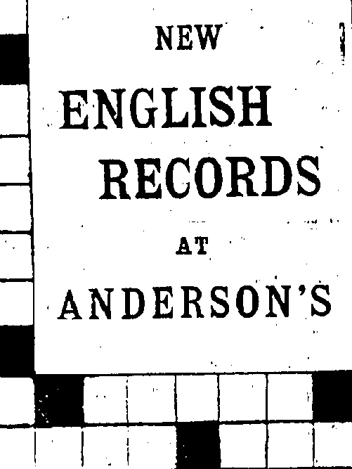
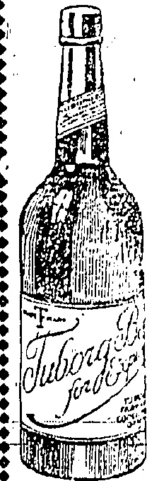
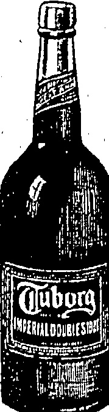

## TO-DAY'S MEETING

## →

RESOLUTIONS SUBMITTED TO THE COMMUNITY.

WIDE AREA COVERED.

## வேலைத்திட்டம்

Resolutions covering a very wide area are to be submitted to a meeting at the City Hall to-day which it is hoped will be representative of the Hongkong community.

The first two will test the feeling of the meeting as to its attitude with regard to registration and the presenting of a united front on this matter, also the question of registration of servants.

The third appeals to the Home Government not to begin discussion concerning revised Customs Tariffs or extra-territoriality whilst strikes or boycotts continue in any part of China or Hongkong.

Other resolutions express approval of emergency regulations enacted by the Governor-in-Council, call for increased army and navy protection, protest to the London press in respect of misleading statements that have appeared and regarding Canton and Shameen the resolutions call for a separate consideration from the general question and sterner measures in opposition to Bolshevik attacks on British interests there.

The resolutions in full are as follows:—

“1. It is recommended that no wages be paid for June to returning strikers and that careful revision of terms and conditions be made upon their re-employment.”

"2. This meeting requests the Hongkong Government to cooperate in the establishment of a voluntary system of registration of office employees and domestic servants."

The following resolutions for the Home Government.

“That the Hongkong Government be asked to submit the following resolutions by cable to the Prime Minister.”

“3. That in view of the extremely heavy losses being suffered by all British traders there and in China, present negotiations should be accelerated as much as possible, consistently with retaining all treaty rights, but it is the unanimous opinion of this meeting that no discussion concerning revised customs tariff or extraterritoriality should be begun while strikes or boycotts continue in any part of China or Hongkong.

4. That having regard to the recent criticisms in the House of Commons concerning emergency regulations enacted by the Governor in Council to deal with abnormal and threatening conditions, this meeting desires to express the approval of the entire foreign community and all right thinking Chinese, of such regulations as being absolutely necessary under the circumstances, and the entire confidence of the community in the actions of the Governor throughout this crisis, and is of opinion that his firm attitude and strong measures have thus far prevented a serious outbreak of violence.

5. That this meeting desires to point out to the Home Government that the Shameen-Canton question will probably require to be dealt with separately and in consultation with the Hongkong Government, whose interests are equally vital with those of the Foreign Office in all South China questions, especially as the present Canton Government will probably refuse to recognise any agreement reached with the Central Government in Peking. The situation in Hongkong and South China has been entirely provoked by Polish-Vik influence and intrigine and is aggressively communistic and violently anti-British. This meeting therefore ages His Majesty's Government to take strong and immediate action to protect British lives, property and trade in Hongkong and China by at once increasing the strength of the China-Squadron on river gunboats and aircraft-carriers, and that additionally a battalion of British troops should be transferred to Hongkong at the earliest possible moment for use here or in any part of China as emergency requires. Finally, it respectfully urges that His Majesty's Government should immediately inform the de facto Government in Canton that imbes it withdraws its support of the attack upon British interests, that they will be regarded as having entered into a state of hostility with the British Government.

"It is further resolved that the

Following telegram be sent from this meeting to the press in London.

That this meeting of European residents in Hongkong proposals strongly against mis-representation in many Home papers that troubles here and in China are due to bad labour conditions in the Far East for which it is altered the British are responsi-

## GOOD FEELING

MERCHANTS'

WITH, BRITAIN

CHINESE

RELATIONS

STRIKE NOT WANTED.

At an extraordinary meeting of the Trade Maintenance Bureau presided over by Mr. Ho Kwong on Saturday, Mr. Ho Iu said that ever since the establishment of the Trade Maintenance Bureau, all merchants alike were deeply appreciative of the services rendered by this organization to relieve the situation, brought about by the strikes in Hongkong. The Bureau had succeeded in getting the Nam Pak Hong tallymen and the cargo coolies ashore and afloat to resume work, namely, to discharge and loaded cargo, etc.

As the foreign firms in the Colony are the principal ship owners, and there is no denying the fact that the shipping of the Port is entirely in their hands, representation, he thought should be made by this Bureau to the British Chamber of Commerce regarding taking on new crews for steamers lying idle in the Harbour so as to facilitate the speedier sailing of steamers. This being done, the shipping of the Port would be brought back to its normal conditions, so that a free movement of merchandise would ensue.

Dwelling further, upon the strike, Mr. Ho Iu said that ever since the similar trouble broke out in the Northern Settlement, the feeling of foreigners towards the Chinese was none too friendly. Hongkong being a British Colony with a cosmopolitan population, wherein foreigners and Chinese have much to do with each other in their trade intercourse, Mr. Ho Iu was anxious that no misunderstanding should arise between them. As the meeting of this Bureau was largely represented by the commercial community, he would suggest that a general meeting of the Twenty-Four Trade Merchants Guilds, as well as a meeting of the General Chinese Chamber of Commerce, should be convened to enable the Chinese in this Colony to give expression to their opinions regarding the strike. Mention should be made that the strike was initiated entirely at the instigation of the communistic intimidators outside, quite beyond the control and jurisdiction of the Hongkong Government. Their sole object was to deal a deadly blow to the finance and commerce of the Colony. The merchants were heart and soul against it and he, the speaker, considered that the Hongkong Government should be approached with a view to requesting it to convey by telegram to the Home Government the cordial feeling of the Chinese merchants towards the British Government and people in general. Mr. Ho Kwong thought that this was an excellent idea and said he would lose no time in conferring with Mr. Li Yau-chuen, chairman of the General Chinese Chamber of Commerce, so that a meeting might be called at once.

An interesting exhibit at the Hongkong Section of Wembley is to be an exact reproduction in miniature of the works the Green Island Cement Co. propose to erect at Gin Drinkers' Bay. The model made principally of zinc and sheet brass and enclosed in a thandesome hand-carved stand, is the work of the Hongkong and Whampoa Dock Co. The buildings office, the factory, seeker store and Chinese staff quarters-as well as the 100ft pier and the limestone conveyor, 1,600 ft. in length, are depicted to scale, and give a good idea of the magnitude of the undertaking. The model is being sent to London by the first available boat.

Ole. This Colony has already undergone a general strike of five weeks' duration and the workers had no grievance.

"They left, most of them very unwillingly, because they were intimidated and terrified by threats of murder by Communist agitators. The whole of the unrest in China is directly traceable to Bolshevik influence which is especially directed against British interests, and the misplaced sympathy of a section of the Home public is encouraging the leaders of the aggressive movement out here and placing lives of British subjects in isolated districts in China in jeopardy. Agitators in China misrepresent such sympathy to the ignorant masses, who are being led to believe that they can commit outrages with impunity owing to the unwillingness of the Towers to forcibly intervene. It urges strong and prompt action by the Home Government on behalf of British communities throughout China are the situation becomes hopelessly out of control."

Hope is expressed that as many as possible will attend the meeting and thus give force and effect to the resolutions.

## HARBOUR CHASE

CHARGE AGAINST A BOATMAN.

EUROPEAN'S COMPLAINT.

A Chinese boatman was charged before Mr. S. B. B. McElderry at the Central Magistracy this morning with using obscene language.

The complainant, Mr. E. L. Stainfield, stated in evidence that he was travelling by the "Star" ferry from Kowloon to Hongkong on Saturday afternoon and in the middle of the harbour the accused used an indecent expression after posting himself at the rear of a passing junk. Witness later engaged a motor bout and in company with his wife and Mr. W. Anderson of the Naval Hospital overhauled the junk near Arsenal Street. Witness stated that the accused jumped into the harbour as soon as he boarded the junk and repeated the expression used.

Accused denied that he used the alleged expression, and explained his fall into the sea by stating that he was assaulted by the complainant and pushed overboard.

The case was adjourned until to-morrow for the examination of other witnesses.

## TO-DAY'S WEDDING

## BURLING—HILL

St. John's Cathedral was the scene of a pretty wedding this afternoon, the parties being Miss Gwendoline Hill, daughter of Mr. and Mrs. G. S. Hill, and Mr. W. J. Burling, son of the late Mr. and Mrs. Burling.

The Rev. G. T. Waldegrave

officiated.

The bride was given away by her father and looked charming in a dress of white satin and ivory silk lace, tulle veil and "orange blossoms. She carried a bouquet of roses.

Her attendants were Miss Gladys Brock and Miss Doreen Spanton, bridesmaids, who were attired in mauve morocain dresses with hats to match and whose bouquets were also of roses.

The bride's mother wore a dress of nigger brown Paris crepe with silk lace to match and brown hat.

The best man was Mr. A. Mandell.

After a reception at the Hong-

kong Hotel the happy couple are

to leave for Repulse Bay where

the honeymoon is being spent.

The bride's travelling dress is of

saxe blue Paris crepe with hat to

match.

The presents received were numerous and valuable.

## LOCAL WEDDING

## DYER—BOTT

A pretty wedding took place at Union Church, Kennedy Road, on Saturday afternoon, the bride and bridegroom being Miss Grace Bott, daughter of Mr. and Mrs. W. Bott, Guildborough, Northampton, and Sergt. W. A. Dyer of the Central Police Headquarters, son of Mr. and Mrs. William White Dyer, Northwood, England.

The bride arrived in Hongkong on Thursday by the s.s. Macedonia.

The officiating clergyman was the Rev. J. H. Johnstone.

The bride was given away by Principal Warder W. Y. Robertson, and was, charmingly attired in a primrose and heliotrope georgette dress with hat to match. The pearl necklace she wore was the gift of the bridegroom.

The attendant of the bride was Mrs. W. Robertson, who was dressed in manure cigarette.

Sergt. C. J. Kingdon, of the Hongkong Police Force was best man.

The wedding ceremony was followed by a reception held at the home of Mrs. W. Y. Robertson after which the bride and bridegroom left for Repulse Bay where the honeymoon is being spent. The brides going away dress was of blue Shantung and crepe de chine.

Many presents were received.

## STEAMER MOVEMENTS

The C.P.S. R.M.S. Empress of australian arrived at Kobe on July 1, at 9 a.m. left Kobe on July 25, at 1 a.m. and was due at Shanghai to day at 2 p.m.

The P.L.C. Slavic Prince from New York sailed from Karatsu, Japan on July 25, and is expected to arrive here on July 29.

A.C. A. M. Powell, after a visit to China and Japan this spring, writes to "The Times" blaming the cinematograph as the main cause of the present interest. He says: "The worst and cheapest sort of American films were everywhere shown, and the Chinese were taking to it like ducks to water, the result being (very natural) contempt for Europe and America in general.

### “HELL'S KITCHEN.”

BATTLING SIKI STABBED

IN NEW YORK.

CONDITION SERIOUS.

(Reuter's American Service.)

New York, July 26.

The Senegalese pugilist Batling Siki has been found unconscious.

He was stabbed in the neck in a street in the "Hell's Kitchen" quarter. He is in hospital in a serious condition.

[Siki leapt into fame by a dramatic, though questioned, defeat of Georges Carpentier, one time idol of France.]

## “BIG” LEAGUES

LATEST BASEBAL

RESULTS

(Reutor's Service.)

New York, July 25.

The results of matches played in the National and American Leagues best week are as follow.

asb week are us follow.—

Placeed on Saturday

NATIONAL LEAGUE.

Cincinnati 3 New York 0, St Louis & Brooklyn 1; Chicago 7 Philadelphia 6, Pittsburgh 9; Boston 8; Pittsburgh 1; Boston 2.

AMERICAN LEAGUE.

Cincinnati 6 New York, St. Louis 2 Brooklyn 0.

Detroit 18 New York 12, Philadelphia 12 Sts, Louis 8, Washington 4 Cleveland 2.

delayed on Monday.

New York 6, Cincinnati 5, Brooklyn 1 St. Louis 3, Boston 6 Chicago 1, Philadelphia 6 Pittsburgh 3.

AMERICAN LEAGUE

Detroit 9 New York 5, Chicago 3

Boston 1, Chicago 7 Boston 10,

Washington 9 Cleveland 1, Phil-

Played on Tuesday.

Philadelphia 4 Pittsburgh 2, Chicago 15 Boston 3.

New York 5 Detroit 1, Boston 6 Chicago 3, Boston 3 Chicago 8, St. Louis 6 Philadelphia 5.

There were no games played on Wednesday.

Tayed on the university.

NATIONAL LEAGUE.

Boston G New York 3, Boston 3

New York 5, Pittsburgh 3 St. Louis

New York, 11. Washington 7, Philadelphia 5. Boston 1. Chicago 8. Detroit, Cleveland 10 St. Louis 1. Ploviput on Friday.

Boston 3 New York 1, Pittsburgh 5 St. Louis 3, Cincinnati 3 Chicago

AMERICAN LEAGUE.

Philadelphia, G Boston 0, Detroit

Chicago 4.

## WEEK-END SPORT

(Reiter's Service.)

Melbourne, July 25.

The “soccer” team sent out by he English F.A. defeated Australia by 2 goals to nile

Brighton, July 25.

In an international athletic match France beat Britain by 59 points to 53.

Muifield, July 25.

In the final of the Scottish Amateur Golf Championship, T. Dobson (Dirleton Castle) beat Willis Mackenzie (holder) by 3 up and 2 to play.

(Ronger's America Service)

New York, July 25.

In a two-day tournament for the Prince of Wales Cup, the Oxford and Cambridge University lawn tennis team, on the first day, won five out of six singles matches against the Rockaway Hunt Club.

Newport, July 26, Hade Island cases's outstanding social event occurred yesterday afternoon when Ali - Madel Vanderbilt married Ms. Fredere Church. The case, in no way is very simple. The suffragist Bishop of New York oriented. Hester's American Service.

Cape Town, July 26, Parliament has passed the South West Africa Constitution Bill, as the result of which South West Africa will have an Executive Committee, Advisory Council and a Legislative Assembly Reinter.

## LOCAL BASEBALL

TWO VERY ONE SIDED GAMES.

CLUB AND JAPANESE WIN.

Progress in the Hongkong Baseball League was resumed on Saturday afternoon, after a brief interval caused both by the strike and by the inclement weather.

As events turned out each of the two games were very one-sided.

In the first match the Hongkong Volunteers were opposed by the Japanese, the latter having an easy win by 16-1.

The second game proved almost a repetition of the first so far as the debacle of one of the opposing teams was concerned, the Hongkong Baseball Club accounting for the defeat of the Indian Recreation Club by a formidable total of 19-5.

The scores in each instance, it will be admitted, speak for themselves, and it would be superfluous to describe either match in detail.

The baseballers, however, are to be complimented on setting the lead in the matter of resumption of Saturday afternoon sport in spite of the strike, and now that they have shown the way there is no doubt that other forms of sport will be revived. It is admitted that many of our sportsmen are having rather strenuous times during the week, but that is only an additional reason for the opportunity being afford-ed them of having some form of healthy relaxation on Saturday afternoons.

## TENNIS

GARRISON LEAGUE.

The following matches will be dayed this week:—

Monday.—BB Co., East Surrey

Regiment v. "D" Co., East Surrey

Regiment

Thesday.—R.A.M.C. v. H.Q.

Wing, East Surrey Regiment.

Wednesday.—D Co.; East

Surrey Regiment v. R.E. "A."

Thursday.—R.A.O.C. v. R.E.

"B."

Friday. — H.O.e. Wing, East Surrey Regiment v. "D" Co., East Surrey Regiment.

I play to commence each day at 1 p.m.

## OBITUARY

WELK KNOWN CANADIAN

PERSONALITY

Canada has lost one of its most widely known men in the person of Mr. G. M. Desworth who died in London yesterday.

Cable advice of his death was received by the local office of the Canadian Pacific Steampips Ltd. of which large concern he was the Chairman.

At the time of his death the late Mr. Bosworth was on one of his trips in connection with the Company's interests. His age was 67.

The late Mr. Bosworth entered transportation service in 1875, joining the Canadian Pacific Railway Company in 1882. After holding a number of important traffic positions on the Rad Lines, he was, in 1901, appointed Fourth Vice-President, the Charge of Rad Traffic; in 1910, he was appointed Vice-President. In Charge of Traffic, Rad and Steelmships. In 1916, owing to the growth of the Canadian Pacific Steelmship interests on the Pacific and Atlantic, Mr. Bosworth was appointed Chairman, Canadian Pacific Ocean Services, Ltd. now Canadian Pacific Steamships Ltd., which position he held up to the time of his death.

Mr. Busserthrelleaves a window and two children and a son and a daughter.

## TO-DAY'S ADVERTISEMENTS

THE BEN LINE STEAMERS, LIMITED.

 $ ^{*} $ KENVORLICH

FROM LEITH. MIDDLESBRO,

ANTWERP & LONDON.

## —

Consignees of cargo per the above-mentioned stemmer are hereby notified that owing to the existing strike conditions cargo

for Hongkong is being discharged at Singapore where it will be at the risk and expense of the Owners of the goods.

Consignes are accordingly recommended to make the necessary arrangements as regards Insurance, etc.

GIBB, LIVINGSTON & CO., LTD.

Agents.

Hồngkong, July 27, 1925.

## EXERCISE

## AND KEEP FIT

## Everything For

Tennis

Football

Swimming

Base Ball

Boxing

Punch Ball

Golf

Fishing

Cricket

## LANE, CRAWFORD LTD

Billiards

## BOLS

Softness and Mellowness are their distinctive properties.

## LIQUEURS

CALDBEOK, MAUGREGOR & CO., LTD.

15, Queen's Road Central. Telephone 75 Central.

Telephone 75 Central

ENGLISH

RECORDS

## NEW

AT

ANDERSON'S

G. FALCONER & CO. (HONGKONG) LTD.

WATCHMAKERS & JEWELLERS

DIAMOND MERCHANTS

ENGLISH SILVERWARE, direct from Manufacturers, High Class English Jewellery.

ཞིང་།་།ཀན་ལེགས།་།ཀྱི་སྐབས་ཀྱི་སྐབས་ཀྱི་སྐབས་ཀྱི་སྐབས་ཀྱི་སྐབས་ཀྱི་སྐབས་ཀྱི་སྐབས་ཀྱི་སྐབས་ཀྱི་སྐབས་ཀྱི་སྐབས་ཀྱི་སྐབས་ཀྱི་སྐབས་ཀྱི་སྐབས་ཀྱི་སྐབས་ཀྱི་སྐབས་ཀྱི་སྐབས་ཀྱི་སྐབས་ཀྱི་སྐབས་ཀྱི་སྐབས་ཀྱི་སྐབས་ཀྱི་སྐབས་ཀྱི་སྐབས་ཀྱི་སྐབས་ཀྱི་སྐབས་ཀྱི་སྐབས་ཀྱི་སྐབས་ཀྱི་སྐབས་ཀྱི་སྐབས་ཀྱི་སྐབས་ཀྱི་སྐབས་ཀྱི་སྐབས་ཀྱི་སྐབས་ཀྱི་སྐབས་ཀྱི་སྐབས་ཀྱི་སྐབས་ཀྱི་སྐབས་ཀྱི་སྐབས་ཀྱི་སྐབས་ཀྱི་སྐབས་ཀྱི་སྐབས་ཀྱི་སྐབས་ཀྱི་སྐབས་ཀྱི་སྐབས་ཀྱི་སྐབས་ཀྱི་སྐབས་ཀྱི་སྐབས་ཀྱི་སྐབས་ཀྱི་སྐབས་ཀྱི་སྐབས་ཀྱི་སྐབས་ཀྱི་སྐབས་ཀྱི་སྐབས་ཀྱི་སྐབས་ཀྱི་སྐབས་ཀྱི་སྐབས་ཀྱི་སྐབས་ཀྱི་སྐབས་ཀྱི་སྐབས་ཀྱི་སྐབས་ཀྱི་སྐབས་ཀྱི་སྐབས་ཀྱི་སྐབས་ཀྱི་སྐབས་ཀྱི་སྐབས་ཀྱི་སྐབས་ཀྱི་སྐབས་ཀྱི་སྐབས་ཀྱི་སྐབས་ཀྱི་སྐབས་ཀྱི་སྐབས་ཀྱི་སྐབས་ཀྱི་སྐབས་ཀྱི་སྐབས་ཀྱི་སྐབས་ཀྱི་སྐབས་ཀྱི་སྐབས་ཀྱི་སྐབས་ཀྱི་སྐབས་ཀྱི་སྐབས་ཀྱི་སྐབས་ཀྱི་སྐབས་ཀྱི་སྐབས་ཀྱི་སྐབས་ཀྱི་སྐབས་ཀྱི་སྐབས་ཀྱི་སྐབས་ཀྱི་སྐབས་ཀྱི་སྐབས་ཀྱི་སྐབས་ཀྱི་སྐབས་ཀྱི་སྐབས་ཀྱི་སྐབས་ཀྱི་སྐབས་ཀྱི་སྐབས་ཀྱི་སྐབས་ཀྱི་སྐབས་ཀྱི་སྐབས་ཀྱི་སྐབས་ཀྱི་སྐབས་ཀྱི་སྐབས་ཀྱི་སྐབས་ཀྱི་སྐབས་ཀྱི་སྐབས་ཀྱི་སྐབས་ཀྱི་སྐབས་ཀྱི་སྐབས་ཀྱི་སྐབས་ཀྱི་སྐབས་ཀྱི་སྐབས་ཀྱི་སྐབས་ཀྱི་སྐབས་ཀྱི་སྐབས་ཀྱི་སྐབས་ཀྱི་སྐབས་ཀྱི་སྐབས་ཀྱི་སྐབས་ཀྱི་སྐབས་ཀྱི་སྐབས་ཀྱི་སྐབས་ཀྱི་སྐབས་ཀྱི་སྐབས་ཀྱི་སྐབས་ཀྱི་སྐབས་ཀྱི་སྐབས་ཀྱི་སྐབས་ཀྱི་སྐབས་ཀྱི་སྐབས་ཀྱི་སྐབས་ཀྱི་སྐབས་ཀྱི་སྐབས་ཀྱི་སྐབས་ཀྱི་སྐབས་ཀྱི་སྐབས་ཀྱི་སྐབས་ཀྱི་སྐབས་ཀྱི་སྐབས་ཀྱི་སྐབས་ཀྱི་སྐབས་ཀྱི་སྐབས་ཀྱི་སྐབས་ཀྱི་སྐབས་ཀྱི་སྐབས་ཀྱི་སྐབས་ཀྱི་སྐབས་ཀྱི་སྐབས་ཀྱི་སྐབས་ཀྱི་སྐབས་ཀྱི་སྐབས་ཀྱི་སྐབས་ཀྱི་སྐབས་ཀྱི་སྐབས་ཀྱི་སྐབས་ཀྱི་སྐབས་ཀྱི་སྐབས་ཀྱི་སྐབས་ཀྱི་སྐབས་ཀྱི་སྐབས་ཀྱི་སྐབས་ཀྱི་སྐབས་ཀྱི་སྐབས་ཀྱི་སྐབས་ཀྱི་སྐབས་ཀྱི་སྐབས་ཀྱི་སྐབས་ཀྱི་སྐབས་ཀྱི་སྐབས་ཀྱི་སྐབས་ཀྱི་སྐབས་ཀྱི་སྐབས་ཀྱི་སྐབས་ཀྱི་སྐབས་ཀྱི་སྐབས་ཀྱི་སྐབས་ཀྱི་སྐབས་ཀྱི་སྐབས་ཀྱི་སྐབས་ཀྱི་སྐབས་ཀྱི་སྐབས་ཀྱི་སྐབས་ཀྱི་སྐབས་ཀྱི་སྐབས་ཀྱི་སྐབས་ཀྱི་སྐབས་ཀྱི་སྐབས་ཀྱི་སྐབས་ཀྱི་སྐབས་ཀྱི་སྐབས་ཀྱི་སྐབས་ཀྱི་སྐབས་ཀྱི་སྐབས་ཀྱི་སྐབས་ཀྱི་སྐབས་ཀྱི་སྐབས་ཀྱི་སྐབས་ཀྱི་སྐབས་ཀྱི་སྐབས་ཀྱི་སྐབས་ཀྱི་སྐབས་ཀྱི་སྐབས་ཀྱི་སྐབས་ཀྱི་སྐབས་ཀྱི་སྐབས་ཀྱི་སྐབས་ཀྱི་སྐབས་ཀྱི་སྐབས་ཀྱི་སྐབས་ཀྱི་སྐབས་ཀྱི་སྐབས་ཀྱི་སྐབས་ཀྱི་སྐབས་ཀྱི་སྐབས་ཀྱི་སྐབས་ཀྱི་སྐབས་ཀྱི་སྐབས་ཀྱི་སྐབས་ཀྱི་སྐབས་ཀྱི་སྐབས་ཀྱི་སྐབས་ཀྱི་སྐབས་ཀྱི་སྐབས་ཀྱི་སྐབས་ཀྱི་སྐབས་ཀྱི་སྐབས་ཀྱི་སྐབས་ཀྱི་སྐབས་ཀྱི་སྐབས་ཀྱི་སྐབས་ཀྱི་སྐབས་ཀྱི་སྐབས་ཀྱི་སྐབས་ཀྱི་སྐབས་ཀྱི་སྐབས་ཀྱི་སྐབས་ཀྱི་སྐབས་ཀྱི་སྐབས་ཀྱི་སྐབས་ཀྱི་སྐབས་ཀྱི་སྐབས་ཀྱི་སྐབས་ཀྱི་སྐབས་ཀྱི་སྐབས་ཀྱི་སྐབས་ཀྱི་སྐབས་ཀྱི་སྐབས་ཀྱི་སྐབས་ཀྱི་སྐབས་ཀྱི་སྐབས་ཀྱི་སྐབས་ཀྱི་སྐབས་ཀྱི་སྐབས་ཀྱི་སྐབས་ཀྱི་སྐབས་ཀྱི་སྐབས་ཀྱི་སྐབས་ཀྱི་སྐབས་ཀྱི་སྐབས་ཀྱི་སྐབས་ཀྱི་སྐབས་ཀྱི་སྐབས་ཀྱི་སྐབས་ཀྱི་སྐབས་ཀྱི་སྐབས་ཀྱི་སྐབས་ཀྱི་སྐབས་ཀྱི་སྐབས་ཀྱི་སྐབས་ཀྱི་སྐབས་ཀྱི་སྐབས་ཀྱི་སྐབས་ཀྱི་སྐབས་ཀྱི་སྐབས་ཀྱི་སྐབས་ཀྱི་སྐབས་ཀྱི་སྐབས་ཀྱི་སྐབས་ཀྱི་སྐབས་ཀྱི་སྐབས་ཀྱི་སྐབས་ཀྱི་སྐབས་ཀྱི་སྐབས་ཀྱི་སྐབས་ཀྱི་སྐབས་ཀྱི་སྐབས་ཀྱི་སྐབས་ཀྱི་སྐབས་ཀྱི་སྐབས་ཀྱི་སྐབས་ཀྱི་སྐབས་ཀྱི་སྐབས་ཀྱི་སྐབས་ཀྱི་སྐབས་ཀྱི་སྐབས་ཀྱི་སྐབས་ཀྱི་སྐབས་ཀྱི་སྐབས་ཀྱི་སྐབས་ཀྱི་སྐབས་ཀྱི་སྐབས་ཀྱི་སྐབས་ཀྱི་སྐབས་ཀྱི་སྐབས་ཀྱི་སྐབས་ཀྱི་སྐབས་ཀྱི་སྐབས་ཀྱི་སྐབས་ཀྱི་སྐབས་ཀྱི་སྐབས་ཀྱི་སྐབས་ཀྱི་སྐབས་ཀྱི་སྐབས་ཀྱི་སྐབས་ཀྱི་སྐབས་ཀྱི་སྐབས་ཀྱི་སྐབས་ཀྱི་སྐབས་ཀྱི་སྐབས་ཀྱི་སྐབས་ཀྱི་སྐབས་ཀྱི་སྐབས་ཀྱི་སྐབས་ཀྱི་སྐབས་ཀྱི་སྐབས་ཀྱི་སྐབས་ཀྱི་སྐབས་ཀྱི་སྐབས་ཀྱི་སྐབས་ཀྱི་སྐབས་ཀྱི་སྐབས་ཀྱི་སྐབས་ཀྱི་སྐབས་ཀྱི་སྐབས་ཀྱི་སྐབས་ཀྱི་སྐབས་ཀྱི་སྐབས་ཀྱི་སྐབས་ཀྱི་སྐབས་ཀྱི་སྐབས་ཀྱི་སྐབས་ཀྱི་སྐབས་ཀྱི་སྐབས་ཀྱི་སྐབས་ཀྱི་སྐབས་ཀྱི་སྐབས་ཀྱི་སྐབས་ཀྱི་སྐབས་ཀྱི་སྐབས་ཀྱི་སྐབས་ཀྱི་སྐབས་ཀྱི་སྐབས་ཀྱི་སྐབས་ཀྱི་སྐབས་ཀྱི་སྐབས་ཀྱི་སྐབས་ཀྱི་སྐབས་ཀྱི་སྐབས་ཀྱི་སྐབས་ཀྱི་སྐབས་ཀྱི་སྐབས་ཀྱི་སྐབས་ཀྱི་སྐབས་ཀྱི་སྐབས་ཀྱི་སྐབས་ཀྱི་སྐབས་ཀྱི་སྐབས་ཀྱི་སྐབས་ཀྱི་སྐབས་ཀྱི་སྐབས་ཀྱི་སྐབས་ཀྱི་སྐབས་ཀྱི་སྐབས་ཀྱི་ས�

NEW SUMMER SILKS

NOW IN STOCK

Queen's Road Control.

## Cross Words Made Easy

By Drinking

Tuborg Beer

Purveyors To

The Royal Danish Court.

The One and Only Danish Beer

on the Market

8 doz. pts. — $18 duty paid.

4 doz. pts. — $20

>CLM AGENTH:—

GANDE, PRICE & CO., LTD.

Tel. C. 115.

WINE MERCHANTS

Hongkong