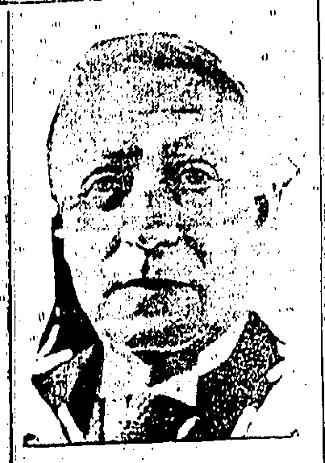
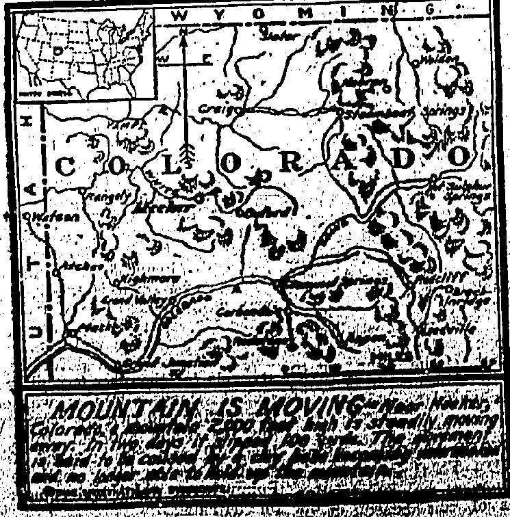
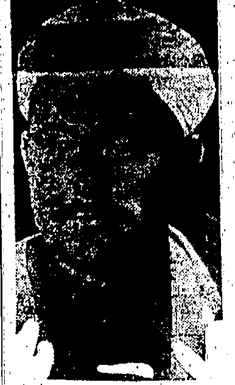
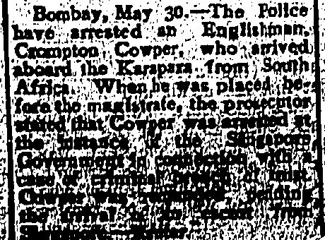
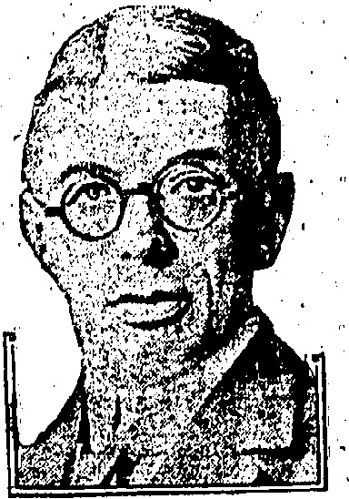
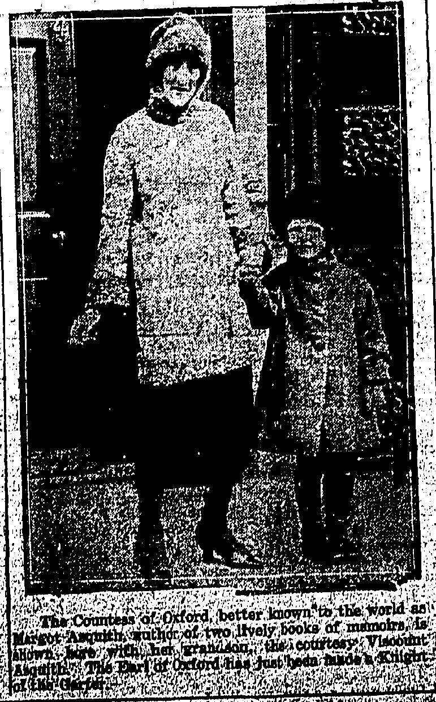
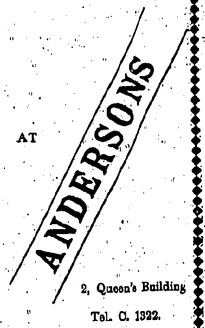
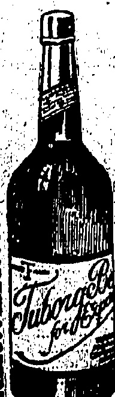

## ANOTHER HONOUR

## Founding

Better known to the world under the name of Asquith, the Earl of Oxford has received another honour from the King.

## Notable

London, May 30.

The Earl of Oxford and Asquith has been appointed a Knight of the Garter.

The most noble Order of the Garter was instituted by Edward III. about 1384, the tradition connecting its origin with a Countess of Salisbury being now discredited. The Order consists of the Sovereign, the Prince of Wales and twenty-five knight companions. The officers are the prelate, chancellor, registrar, king-of-arms, and the usher of the black rod.

The Earl of Oxford.

Mr. Asquith's decision a few months ago to accept a peerage as a result of the Liberal debacle removed one of the best known figures from the House of Commons. Known at the time of the Liberal Ministry of Sir Henry Campbell Bannerman as the "sledge hammer," the Liberal leader, in the opinion of many, has not lived up to that early promise of vision and promptness. It is generally conceded that it was his calmness and cautiousness which in the early days of the Great War prevented the united front of the nation from being broken but the case against his mentality has been put by the Earl of Birkenhead as follows:—"It will not allow of his seeing the War as anything other than a storm in the night which having passed away leaves an electoral to-morrow exactly like the political yesterday."

Mr. Asquith is a Yorkshireman. After a brilliant career at Oxford and the making of an enviable reputation at the Bar, Mr. Asquith entered Parliament in 1886 and relinquished a good practice when he was appointed Home Secretary in 1892. Afterwards he returned to the Bar. Entering politics again he was Chancellor of the Exchequer from 1905 to 1908, introducing Old Age Pensions and

Sofia, May 30.—The authorities, learning that three Agrarian Communist exiles entered Bulgaria from Yugo Slavia and were hiding in the village of Vrabnitza, sent a lieutenant and a number of police to arrest them. The exiles, when discovered, fired, killing the lieutenant, and escaped.—Reuter.

New York, May 29.—Judge McComack's decision was given in a civil suit as regards the actual legality of the Elk Hills leases contracts. The criminal indictment are still pending.—Reuter's American Service.

the Licensing Bill. Another achievement attained in spite of very strenuous opposition was his forcing through both Houses the Bill which abolished the veto of the House of Lords and his introduction of the Home Rule Bill. After a period of office as Secretary of War he was called to form a Coalition Government for the purpose of carrying on more unitedly Britain's part in the Great War. When that Government resigned in 1916 Mr Asquith refused an honour offered him by the King. Prior to his accepting a peerage last year as the Earl of Oxford he was twice defeated at the poll.

Mr. Asquith had the reputation of being a remarkable Parliamentary debater and he could certainly produce without notes or preparation sentences in almost endless succession of such perfect construction as to recall the classical period of Parliamentary oratory. Differing so greatly as he did from his policy the Earl of Birkenhead was forced to admit that "He never lacked the just word; he never failed to improvise the subtle cadence of the sentence which is pure gold to him who has studied the qualities of broken rhetoric. The form indeed was muteless. If at times the spirit was less mighty than the expression it may be replied that it is not given to every age to reproduce an orator armed with every gift."

## EUROPEAN SECURITY

### (Reuter's Service.)

## LONDON May 36

According to authoritative statements in London and Paris yesterday, the clarification of the security situation has so progressed that complete agreement may shortly be expected. Neither in London nor Paris is it stated wherein the outstanding difference consists, but comments in Paris and Berlin newspapers today indicate that Britain insists upon limitation of the security pact to Germany's western frontiers as Germany proposed. Yesterday's London statement said the expectation of agreement was based upon the hope and belief that France will adopt suggestions representing the unanimous view of the British Government. This is interpreted by the Berlin "Boersen Courier" as something like an ultimatum. The French writer "Pertinax" says that Britain repeats her splendid isolation formula, which is an encouragement to German revenge in East Europe. He adds that Belgium approves the British viewpoint.

Paris, Mny 31.

Havas's diplomatic correspondent confirms the report that Britain and France have virtually agreed to the principal points of a Note to Germany in reply to the German proposals for a security pact. It is thought that the remaining details will be settled in time to enable the Note to be sent to Berlin within a fortnight.

Britain declares her readiness to use all her strength to guarantee the integrity of the Rhine frontier. She refuses to pledge herself to military intervention in the event of Germany violating the eastern frontiers, but repeats her desire faithfully to fulfil her engagements under the peace treaties. Consequently in event of conflict she probably would be brought to support diplomatically the claims of the State attacked.

Britain also admits that France shall retain complete liberty of action as conferred on her by the League convenient, in coming to the defence of the integrity of the eastern frontiers. The military, forces of France in this case will have to receive free passage through Germany.

FOREIGNERS EMPLOYED.

BUYING ARMS FROM

(Router's Service.)

Messages from Fez report that Abdel Krim has European, Egyptian, Indian and Tunisian army instructors. It is also reported that Germans are in his immediate entourage.

## Abdel Krtm

The Riffs are said to have gone to Hamburg to buy arms.

German field dressings and medical supplies were picked up in the course of recent fighting.

Abdel Krim is reported to have recruited a number of German doctors.

Numbers of German tourists whose destination is not known have arrived at Ceuta and Tetuan.

## FINE FEAT

## AVIATOR REACHES AUSTRALIA

TOKYO HIS GOAL.

### (Router's Service.)

MELBOURNE, May 30

The Italian aviator de Pinedohas landed at Broome on the North-West Coast of Australia.

Apart from some bad moments in bumping, de Pinedo up to the present has done better than was anticipated.

He now proceeds by stages to Melbourne and has a 3-weeks' overhaul there.

He departs for Tokyo via Thursday Island, Amboyna, Macassar, Manados, Mapila, and Formosa. He stays a month in Tokyo.

## AMERICA'S MURDERS

### (Reuter's Service.)

Statistics showing eight times as many murders in America in proportion to population as in Britain and that other crimes are also more numerous, have provided Mr. Coolidge with material for a Memorial Day plan for better enforcement of law and order and universal observance of the constitution by Americans.

The President ascribed the unfavourable comparison to the fact that crimes rarely remained un-punished in Britain, while the reverse was true in America. He expressed the opinion that the apparent lawlessness of Americans was due rather to carelessness than to moral laxity.

Paris, May 31.—The Senate by a vote of 289 to 1 passed the budget which shows an excess revenue over expenditure of 28,000,000 francs. M. Callaux stated that he desired to apply the revenues from the Dawes plan to other purposes than budgetary needs.—Reuter

## GIRLS IN RIOTS

## SHANGHAI

THIRTY ARRESTS

## DISTURBANCES

The serious trouble which broke out in Shanghai owing to anti-Japanese feeling now appears to be well in hand.

Rain is keeping the streets empty, but the suppressed excitement of the students necessitates a continuance of the precautions.

Over thirty arrests have been made, not including girls, a few of whom were mixed up in the riots.

The opinion is generally expressed that the police action was the only way of preventing the students from forcibly entering the police station and securing the arms which would have led to very serious results.

The Chinese press report the affair dispassionately, adding that the Chinese and foreign authorities have the matter in hand and expect an amicable settlement without further trouble.

## EARLIER CABLES

### Shanghai, May 30. anti-Japanese feeling

The "anti-Japanese" feeling, which has been bitter since the cotton mill strike, had a climax this afternoon, when three hundred young Chinese of the student class marched in procession along Shanghai's main street, distributing anti-foreign and mainly anti-Japanese literature.

Refusing to disperse, sixty were arrested and taken to a police station, where the ring-leaders were picked out. The remainder were released, but refused to depart. Largely reinforced, they severely handled a constable and made a general attack upon the police station. The police ineffectually fired over their heads, and eventually fired point blank, severely wounding ten, of whom six succumbed. Subsequently, thirty were arrested, including two girls.

Disorders also occurred in Chapei suburb. There is much Chinese excitement, but the situation is well in hand.

The Police report states that the anti-Japanese riots were inspired by the killing of a Chinese workman by a Japanese foreman during the recent cotton mill strikes.

Seven of the rioters have died.

The crowd knocked down Constable Cole and Steven and attempted to wrest their arms away, shouting: "Kill the foreigners." The shot men were undoubtedly students. Pamphlets distributed denounced Imperialism, England, America, France and Japan and refer to the Maritime Customs, which the Powers are alleged to have used to make China poorer and rob her of much money. They also refer to the action of the Shanghai Municipal Council in making roads outside the Settlement limits, and alleged transgression of China's sovereign rights. They conclude by urging "Death is better than Imperialism, so make war on the Imperialists."

INQUEST TO BE HELD.

Shanghai, May 31.

Rain is keeping the streets empty, but the suppressed student excitement necessitates continued precautions. Inquests upon those killed will take place to-morrow and the trial of upwards of thirty of those arrested on Tuesday.

It appears that though a few girls were mixed up in the riots, none was actually arrested.

The general opinion is that the police took the only, though regrettable, course in preventing the students from securing the police arms, which would have led to most serious results.

The Chinese Press report that in the riots the police took action dispassionately, adding that the Chinese and foreign authorities have the matter in hand and expect the affair to be settled amicably. They do not expect any further trouble.

## EDITOR RESIGNS

WASHINGTON, May 31.

Colonel Harvey, former Ambassador to Britain has resigned the

editorship of the "Washington Post." — Reuter's American Service.

## CHINA'S CHAOS

(Reuter's Service.)

London, May.30.

The necessity for doing something about China is insisted upon by "The Times" in a leader, which says it is simply absurd to entertain the idea that great civilising Powers can afford interminably to remain the passive and depressed spectators of what is called the "Chinese chaos."

"The Times" dwells upon the existence of vitality in China and the rich potentialities for development, and submits that Great Britain should take the lead in devising a plan for delivering China from the incubus of Civil War. The subject should be taken up at the overdue Conference to consider the question of increasing the Customs duties, provided for by the Washington Convention. The Conference might consult not only the Peking Government but all active leaders of Chinese opinion.

## CROQUET

COMPLETE SETS

from $40.00

EXCELITE BALLS $20.00 set.

SPARE MALLETS $ 9.50 euch

BATHING PICNICS

Best Quality Water Polo Balls

Ayvad's Water Wings

$1.10 ench

LANE, CRAWFORD, LTD.

◇◇◇◇◇◇◇◇◇◇◇◇◇◇◇◇◇◇◇◇◇◇◇◇◇◇◇◇◇◇◇◇◇◇◇◇◇◇◇◇◇◇◇◇◇◇◇◇◇◇◇◇◇◇◇◇◇◇◇◇◇◇◇◇◇◇◇◇◇◇◇◇◇◇◇◇◇◇◇◇◇◇◇◇◇◇◇◇◇◇◇◇◇◇◇◇◇◇◇◇◇◇◇◇◇◇◇◇◇◇◇◇◇◇◇◇◇◇◇◇◇◇◇◇◇◇◇◇◇◇◇◇◇◇◇◇◇◇◇◇◇◇◇◇◇◇◇◇◇◇◇◇◇◇◇◇◇◇◇◇◇◇◇◇◇◇◇◇◇◇◇◇◇◇◇◇◇◇◇◇◇◇◇◇◇◇◇◇◇◇◇◇◇◇◇◇◇◇◇◇◇◇◇◇◇◇◇◇◇◇◇◇◇◇◇◇◇◇◇◇◇◇◇◇◇◇◇◇◇◇◇◇◇◇◇◇◇◇◇◇◇◇◇◇◇◇◇◇◇◇◇◇◇◇◇◇◇◇◇◇◇◇◇◇◇◇◇◇◇◇◇◇◇◇◇◇◇◇◇◇◇◇◇◇◇◇◇◇◇◇◇◇◇◇◇◇◇◇◇◇◇◇◇◇◇◇◇◇◇◇◇◇◇◇◇◇◇◇◇◇◇◇◇◇◇◇◇◇◇◇◇◇◇◇◇◇◇◇◇◇◇◇◇◇◇◇◇◇◇◇◇◇◇◇◇◇◇◇◇◇◇◇◇◇◇◇◇◇◇◇◇◇◇◇◇◇◇◇◇◇◇◇◇◇◇◇◇◇◇◇◇◇◇◇◇◇◇◇◇◇◇◇◇◇◇◇◇◇◇◇◇◇◇◇◇◇◇◇◇◇◇◇◇◇◇◇◇◇◇◇◇◇◇◇◇◇◇◇◇◇◇◇◇◇◇◇◇◇◇◇◇◇◇◇◇◇◇◇◇◇◇◇◇◇◇◇◇◇◇◇◇◇◇◇◇◇◇◇◇◇◇◇◇◇◇◇◇◇◇◇◇◇◇◇◇◇◇◇◇◇◇◇◇◇◇◇◇◇◇◇◇◇◇◇◇◇◇◇◇◇◇◇◇◇◇◇◇◇◇◇◇◇◇◇◇◇◇◇◇◇◇◇◇◇◇◇◇◇◇◇◇◇◇◇◇◇◇◇◇◇◇◇◇◇◇◇◇◇◇◇◇◇◇◇◇◇◇◇◇◇◇◇◇◇◇◇◇◇◇◇◇◇◇◇◇◇◇◇◇◇◇◇◇◇◇◇◇◇◇◇◇◇◇◇◇◇◇◇◇◇◇◇◇◇◇◇◇◇◇◇◇◇◇◇◇◇◇◇◇◇◇◇◇◇◇◇◇◇◇◇◇◇◇◇◇◇◇◇◇◇◇◇◇◇◇◇◇◇◇◇◇◇◇◇◇◇◇◇◇◇◇◇◇◇◇◇◇◇◇◇◇◇◇◇◇◇◇◇◇◇◇◇◇◇◇◇◇◇◇◇◇◇◇◇◇◇◇◇◇◇◇◇◇◇◇◇◇◇◇◇◇◇◇◇◇◇◇◇◇◇◇◇◇◇◇◇◇◇◇◇◇◇◇◇◇◇◇◇◇◇◇◇◇◇◇◇◇◇◇◇◇◇◇◇◇◇◇◇◇◇◇◇◇◇◇◇◇◇◇◇◇◇◇◇◇◇◇◇◇◇◇◇◇◇◇◇◇◇◇◇◇◇◇◇◇◇◇◇◇◇◇◇◇◇◇◇◇◇◇◇◇◇◇◇◇◇◇◇◇◇◇◇◇◇◇◇◇◇◇◇◇◇◇◇◇◇◇◇◇◇◇◇◇◇◇◇◇◇◇◇◇◇◇◇◇◇◇◇◇◇◇◇◇◇◇◇◇◇◇◇◇◇◇◇◇◇◇◇◇◇◇◇◇◇◇◇◇◇◇◇◇◇◇◇◇◇◇◇◇◇◇◇◇◇◇◇◇◇◇◇◇◇◇◇◇◇◇◇◇◇◇◇◇◇◇◇◇◇◇◇◇◇◇◇◇◇◇◇◇◇◇◇◇◇◇◇◇◇◇◇◇◇◇◇◇◇◇◇◇◇◇◇◇◇◇◇◇◇◇◇◇◇◇◇◇◇◇◇◇◇◇◇◇◇◇◇◇◇◇◇◇◇◇◇◇◇◇◇◇◇◇◇◇◇◇◇◇◇◇◇◇◇◇◇◇◇◇◇◇◇◇◇◇◇◇◇◇◇◇◇◇◇◇◇◇◇◇◇◇◇◇◇◇◇◇◇◇◇◇◇◇◇◇◇◇◇◇◇◇◇◇◇◇◇◇◇◇◇◇◇◇◇◇◇◇◇◇◇◇◇◇◇◇◇◇◇◇◇◇◇◇◇◇◇◇◇◇◇◇◇◇◇◇◇◇◇◇◇◇◇◇◇◇◇◇◇◇◇◇◇◇◇◇◇◇◇◇◇◇◇◇◇◇◇◇◇◇◇◇◇◇◇◇◇◇◇◇◇◇◇◇◇◇◇◇◇◇◇◇◇◇◇◇◇◇◇◇◇◇◇◇◇◇◇◇◇◇◇◇◇◇◇◇◇◇◇◇◇◇◇◇◇◇◇◇◇◇◇◇◇◇◇◇◇◇◇◇◇◇◇◇◇◇◇◇◇◇◇◇◇◇◇◇◇◇◇◇◇◇◇◇◇◇◇◇◇◇◇◇◇◇◇◇◇◇◇◇◇◇◇◇◇◇◇◇◇◇◇◇◇◇◇◇◇◇◇◇◇◇◇◇◇◇◇◇◇◇◇◇◇◇◇◇◇◇◇◇◇◇◇◇◇◇◇◇◇◇◇◇◇◇◇◇◇◇◇◇◇◇◇◇◇◇◇◇◇◇◇◇◇◇◇◇◇◇◇◇◇◇◇◇◇◇◇◇◇◇◇◇◇◇◇◇◇◇�

SPECIALITIES

HARVEY'S BRISTOL MILK

OLD GOLDEN SHEBRY

HARVEY'SBRISTOL CREAM

FULL PALE SHERRY

CALDEECK, MACGREGOR & CO., LTD.

15, Queen's Road Central.

Tel. 75 Central.

## ENGLISH

PIANOS

COLLARD, BROADWOOD, ALLISON, KIRKMAN, CROWLEY.

## （原图为图示内容，实际内容为“图示内容”或“图示内容”等，但为示例内容，整体呈现为“图示内容”）

G. FALCONER & CO. (HONGKONG) LTD.

WATCHMAKERS & JEWELLERS

DIAMOND MERCHANTS

Union Building ((Opposite G.P.O.))

Agents for: ADMIRALTY CHARTS.

ROSS'S BINOCULARS and TELESCOPES,

KELVIN'S NAUTICAL INSTRUMENTS,

ENGLISH SILVERWARE, direct from Manufacturers,

High Class English Jewellery.

THE BEST HOLIDAY PARTY IS THE BEST HOLIDAY PARTY

## ←中央处理器中央处理器中央

## Cross Words Made Easy

By Drinking

Tuborg Beer

Purveyors To

The Royal Danish Court

The One and Only Danish Book on the Market.