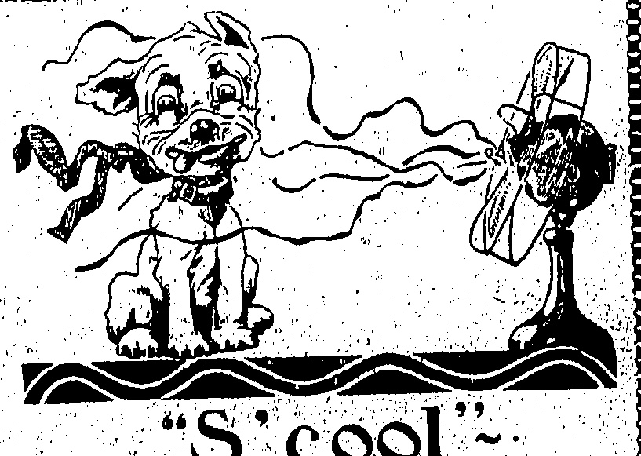

# TUESDAY, JUNE 2, 1925.

#### J. S. SARGENT

MEMORIES OF A GREAT ARTIST.

## COURAGE AND HUMOUR

There are many who have written of Mr. Surgent as an artist—many who will continue to write of him in time to come. But of his personality, at once so genial and so dominant, so humorous and so austria, who can write as he printed—with such careful mystery, with an economy of statement, that fastened, in a flash of deliberation, with swift certainty, upon the essential characteristics (exclaim) a Friend in a Home paper. How can any hold fast an impression that must fade; or retain the memory of linements, stamped with his individual temperament, but which were, at the same time, so extraordinary and impenetrable in disguise!

The simplicity of his address, the complete absence of afflictations of any description, the graciousness of his manner could not bind the derivative to the distinction that was his, almost in spite of himself. He waited none of it. Not for a moment did he wish for on 'exact from his Friends anything, but the spontaneous cordialities and kindness-so ordinary intercourse. Retent himself, he cordially detested every form of publicity. Nothing irritated him more than any exaggeration of deference of respect. Flattery he cut short with impubience, with inward-sometimes with audible-groans. Even appreciation he faced "as one meets a cooling breeze," enjoyed but not detained. It is questionable even whether he enjoyed it; for he exercised his critical faculties upon his own works, and, keeping his indulgence for others, never learnt how to spare himself. He knew none better, just when and where he had succeeded in capturing the fleeting grace, the imperceptibly delicate transition, the vital quality he sought for. He knew, also, beyond argument, where he had failed; and this certainty of judgment made him almost terrifyingly independent of comment, appreciate or the reverse.

## "DEEP-PONED" GAIERY

Intellectual independence was perhaps the keynote of this mental attitude: he made his own discovery, accepting nothing at second hand. That independence

was the background for his reserve, a reserve inviolable to the most intimate of his friends. The most unqualified admiration, the deepest affection, which he so frequently inspired, was never without a compelling restraint, even a secret clastening sense of awe from which there was no escape.

On the last night of his life, an old friend, upon leaving after dinner, said, half-laughingly to his sister, referring to her long acquaintance with the family: "Do you know, I am still a little terrified of your brother! This is not a case of 'perfect love' casting out fear."

Yet how, tinged with a kind of deep-toned gaiety was his ordinary conversation! Mrs. Meynell once wrote of "the deep-toned gaiety" of his Spanish paintings, and the phrase is singularly descriptive, at once pictureque and just.

This habitual good temper—not free from flashes of impatience or nervous irritability in moments of strain or fatigue—was a kind of spiritual courage, the courage of the explorer, the mental adventurer, interested in every variety of the human problem. His keen enjoyment of a fine gesture was a characteristic as his zest for the bizarre, the original; anything odd, funny or ridiculous in the spoken or written word. Humour played over his whole conception of life, in Carlyle's definition, "like sunlight on the deep sea."

## HOLIDAY AUSTERTIES

His independence was not only mental. His enjoyment of life required so few of the ordinary creature comforts. The simplicity of his habits and of his tastes, at once fastidious and austere, remained singularly free from any inclination towards luxury or magnificence, which he nevertheless painted with such delight, whether expressed in splendid architecture, or in interiors where fine proportions were� accentanted by the surface beauty of lovely material, over which his brush lingered. During one holiday before the war, while painting at the Carrara marble quarries, he slept for weeks in a hut so completely devoid of all ordinary comfort that his companions, far younger men, fled after a few days, unable to stand the spartan rigours tolerated by their senior with such serene indifference.

All his life he remained the student, absorbed in this work, sleeping himself in it, atta mpting always some new development, some fresh experiment. During the last few months he had found extraordinary pleasure in sculpture and small sculptured groups remain to show this fireless exploration of another field. One of the best was an attempt to render in this mass the subject of his decoration for the Harvard war memorial: A dying soldier with Love wroga Vickory from D

To his indefatigable energy, a holiday means simply a change from the work of the moment to work of another description. The brilliant sparkle of his water-colours conveys perfectly the relaxed tension of his holiday mood; yet even, in these guy records how disciplined was the eye that chose a subject how controlled the hand that held the dripping brush, dipped it seemed, in dazzling light!

## A HARD WORKER

In former years, at the height of his popularity as a portrait-painter, it was not unusual for him to undertake three sittings a day. He was a spendthrift of his physical strength, which seemed inexhaustible—yet like many busy men, found time for omnivorous reading. In the voluntarily, he measured the capacity for work of any student or fellow-artist by the amplitude of his own insatiable appetite for it. He could never get enough.

If you one occasion discussion was going on in his presence about a painter who had failed to fulfil the extraordinary promise of his youth. Mr. Sargent was appealed to in the end for some explanation of that disappointing lapse in continuity. "Perhaps," he replied, after a moment's hesitation, he finds his happiness in too many other things.

The absurdity that he ever delivered at the bought for and, accounted the less pleasing qualities in his sitters could be refuted by innumerable envisions. Take just one instance, the very beautiful, and dignified portrait of the late Mrs. Witheviner, whose family, it was reported were started to discover the exquisite quality this intimate condition so clearly revealed. Mr. Sargent himself dismissed this silliest of legends with dry unconcern. "If chronicle," he once declared, "I do not judge."

## TALE OF KINNES

Like many men of generous physical proportions, Mr. Sargent was instinctively kind. This kindness was so natural to him that he gave almost without consideration of the cost to himself; no only in money, but in those may sacrifices of his time, this strength, his thought, his energy.

The late Charles Furse loved to relate how, when engaged on one of his decorations, at a distance of several hours from London, he wrote to his friend begging for a few times of advice, confessing that he was "stack," and enclosing, with a small diagram of the space to be covered, a careful analysis of his difficulties. On the following morning before an answer could be expected, he was at the scaffolding, working hard, when a head appeared at the top of the ladder. Without an instant's hesitation, cancelling all his other engagements, Mr Sargent had taken an early train from London, so that there might be, for Charles Furse, to whom he was warmly attached, the smallest loss of time.

When Robert. Brough was mortally injured in the terrible accident to the Scogh express the news reached London late in the evening. A few friends met at a studio, in the early hours of the morning after, to discuss what could he done for him, whether one of their number should not go at once to Shemield to stand by him, and to do what was possible. It was decided to consult John Sargent, and a deputation went at once to rouse him, even though it was only a little after seven o'clock in the morning. At the door in Tite Street they were met by his servant leaving the house with a sheaf of telegrams. "Mr. Sargent heard of Mr. Brough's accident late last night," he said, "and took the six o'clock train for Sheffield this morning." The sight of his great friend was "Robert Brough's last personal triumph, for he sank within an hour into the unconsciousness that prefaced the end.

Too much stress is laid upon Mr. Sargent's shyness, his capacity for silence. He was the most amusing of companions, the most entertaining of hosts. When he was interested in a subject under discussion he spoke freely, vehemently even, with great felicity of phrase, often with a witty and clear decisiveness. At this moment it is difficult to remember the world's loss in the overwhelming personal loss. His whole life, as well as his work, bore silent testimony to the faith that was in him. He loved Plato's definition of Beauty as "the Splendour of the True." To that splendour he contributed, with the scrupulous yet generous spontaneity of his work, with the broad-mindeness, the indulgence, the toleration, and the sincerity of his character. He leaves, as an inheritance for the artists of all time, the unstained record of a noble and laborious life.

Little daughter was sitting on her father's knee. She had a new little brother whom she regarded with wonder.

Today," said her father, "a man offered to give me a whole lot of money for little brother. Shall

## LUNATIC BOARDERS

SCOTLAND'S ECONOMICAL SYSTEM

Evidence concerning the treatment of insanity in Scotland was given before the Royal Commission on Lungacy Reform and Mental Disorder at Old Palaceyard, Westminster, S.W.

Sir Arthur Rose, chairman of the Scottish Board of Control, and Dr. H. C. Marr, one of the medical commissioners for Scotland, stated that every patient in Scotland's mental institutions was seen by commissioners at least twice a year—not as a formal matter, but as a serious duty. Every patient had an opportunity of making complaints and suggestions. Frequently quite intelligent suggestions for improvements were made, and these were investigated and often adopted.

One woman objected to being bathed in a common room and suggested that curtains should be put up to ensure privacy. This was afterwards done in every asylum in Scotland.

Dr. Marr said that one of his patients, a single woman, who always asked for a private interview, had the delusion that she was married to a university professor. He was told that she always felt better after interviewing him in private. (Laughter.)

Sir Arthur Rose said there were 18,266 registered lunatics in Scotland and of these 9,112 were males and 9,154 females.

The Chairman (Mr. H. P. MacMillan, K.C.): That is a fifty-fifty division and is rather remarkable.

even than in England.

Sir Arthur added that many persons of unsound mind lived with relatives, and these figures were not exhaustive of the insane population in Scotland.

Funeral Entertainment. Dr. Marr further stated that a system of boarding out chronic harmless cases of insane persons in private dwellings, and especially in farmhouses, was prevalent in Scotland. One in ten of the lunatics over the Border lived in private houses, and it was one of the conditions under which they were boarded out that they should be treated as one of the family.

It was a very fine tradition in some families in Scotland to take in these cases. Apart from the fact that this system was more economical than treatment in asylums, it restored the lunatic to society and gave him greater freedom than was possible in an asylum. One man he knew of took advantage of his freedom to such an extent as to attend all the funerals in his locality.

Dr. Marr added that the guardians received payment from the authorities for taking the patient, and also had the advantage of the patient's work.

The Chairman: That seems a very typical form of entertainment in Scotland.

Lord Russell observed that it was a considerable inducement to the guardian to take patients, for he got the advantage of a servant for whom he received payment instead of having to pay.

## ONE-MAN PLANE

DETACHABLE WING AND TAIL.

Placed at the disposal of any pilot who cares to fly it in order to demonstrate the ease with which it can be handled, a light aeroplane, built at the Pander Aeroplane Works at The Hogue, was tested at the Croydon Aerodrome by two experienced airmen. Under weather conditions which were far from good, visibility and wind making flying difficult, the machine favourably impressed the airmen, Mr. M. Piercey, the English pilot, and M. Rabellier, a Belgian aeronaut, as well as Sir William Sefton Brancker, who was among the onlookers.

The machine, which the makers suggest is suitable for any light aeroplane club, has a 25 h.p. Anzani three-cylinder radial engine, and is easily handled on the ground by one man. For both landing and taking off it requires a minimum of space, any average field providing more than sufficient room. Costing about £400, it weighs 420lb, takes one and a half gallons of petrol and two and a half pints of oil an hour, and has a maximum speed of about seventy-five miles an hour. The single wing, built on the cantilever principle, can be removed from the body, as can also the whole of the tail, in a few minutes, and the entire machine can be packed in a shed 16ft. 6in. long. Her wing span is 26ft. 9in. and her height 5ft. 5in. The has been designed by two young Dutchmen, and in her present form is intended for the pilot only, but other models are being produced to accommodate one passenger. The present machine has been down from Amsterdam to Paris and from Paris to England, and the end of the week will be from back to Amsterdam.

## VISITORS AT HOTELS

Mr H. A. Andalek Caj

Mr O. I. Andren P

Mr M. Arelwood Mr

Mr F. W. Bernes Mr

Mr N. Belo I

Mrs. E. R. Bellos Mr

Mr and Mrs v. E M

Empediet Mr

Mr. V. Benjamin Mr

Copt Bentley Mr

Mr D. Z. V. Boothon Mr

Mr H A B gelow Mr

Mr R. J. Birbeck Mr

Mr and Mrs t. E. Mr

Bradley Miss

Mr. W. Bra h Mr

Mr F. O. Burgoa Mr

Mr S. T. Kuten Mr

Mrs Bute Mr

Mr. D. Cappleman Mr

Mr J. H. O. ok Mr

Mr J. J. Oorolly Mr

L.t. and Mrs D. M Mr

D. Hoss I

Mrs. G. I. Davis Os

Mr. D. Dokle Mr

Mr Max Der ourt Mr

Mr R. Dol Mr

Mr. Q. W. O. Van O

Dorsae t

Miss U. E. les Mr

Mr F. J. W. Focken Mr

Mr and Mrs A. A. Mr

Fong Mr

Mr. S Frank Mr

Mr and Miss P. D. G. Mr

Gain Mr

Mr. U. yton Gellop Mr

Dr. D. R. Glawler Mr

Mr M. Guess C

Mr D. the Groot Mr

Mr. & Mrs. J. Gould Miss A. I. Griffin Mr

Mr & Mrs. Guth Dr

ard family Mr

Mr H. J. Guther Mr

Capt. T. P. Hall Mr

dr and Miss W. A. M

Hannibal Mr

Mr. M. orion'sndry M

Mr. A. F. Henry M

Mr S. Benco M

Misses A. & F. Hamilton M

Mr. G. A. Harilman M

Mrs. d Mr. A. W. M

Hogo

## REPULSE BAY HOTEL

## HONGKONG HOTEL

## Máy 28

### M.y 23

y 33.

Capt. E.R. M. Kirk patel

Mr. H. O. Kuoco

Mr. & Mrs. G. Lauritsen

Mrs. Legrand

Mrs. B. Lillie

Mr. G. N. de Man

Mr. and Mrs. O. Manoni

Mr. and Mrs. F. O. methia on and i. children

Mr. E. Menasche

Miss L. Violet Moore

Mr. W. Bruce Merrie

Mr and Mrs. G. Morrison & family

Mr. J. S. Nool on

Mr. T. S. Niel on

Mr. N. Nitz

Mr. E. H. O'Farrell

Mr and Mrs. R. J. Parore

Ospt. A. G. Patrick

Mr B. H. Pope

Mr I. aso Poppo

Mr B. H. Puerner

an Omdr & Mrs. Ro. berts

Mrs. F. Rob rtson

en Mr. Alex Roe

A. Mr. A. H. Rowe

Mr. Joseph A. Satool

Mrs. Mr. W. Schofield

G. Mr. A. P. Sontt

Mr. Robert Shaw

Mr. & Mrs. A. D. Sllas & Infant

Capt. L. Hiquland

Mr. R. W. E.

old Snugg

Mrs. F. M. Snuggs

th. Dr. H. F. Sommers

Mrs. E. perka

Mr. I. St ahn

Mr. H. P. Sarley

Mr. A. H. Tis

Mr. James Thorn

dry Mr. J. P. Thorlton

Mr. F. M. Titus

Mr. and Mr. L. A. F. Tobias

Mr. T. O. old

Mr. & Mrs. Walker

W. Mr. H. W. Li

Mrs. L. Watson

Mrs. J. Wills

Mrs. William

toze Mr. Samuel Wong

Mrs. and Mrs G

Wesener & child

Ardel & child Herilschield schld

Dr W. F. Antenbury & Mrs A. Hic

Mrs d Mrs B. N Mr m d Mrs B J.

Mr E. W. Lott

Mr & Dr K Land

Mrs W W. M.

Mrs Murray

## PEAK HOTEL

## May 29

Mr J. W. Anderson Mrs Q. Ken

Mr E. A. Arthur Mrs L. E. et al.

Mr R. Anstin Mr and Mrs E. I

Mise E. R. Bally Kill

Dr H. Balan Mr and Mrs S. R

Mr J. A. Barton Langston

Mr and Mrs T. G. Mr E. Leisen

Bennett Mr and Mrs G. D

Mr and Mrs P. W. Leys

Blackwell Miss Leys

Mr W. H. Bourne Major A; B, Little

dr M. J. Broen Johns

Miss P. W. Brown Mr L. M. S. Lloyd

Mr and Mrs R. L. Mr J. D Lloyd

Bridget Mr and Mrs W

Mr S. D. Carothera Logan

Japt. & Mrs J. O. Mrs J. McAnsh

Carpenter Mr R. Mellar

Mr R. G. Clark Mr H. A. Mills

Mr E. H. Oeland Mr E. E. Mimmack

Mrs M. Ooper Mr and Mrs J

Mrs I. H. Cormack Krogh-Moo

Mr and Mrs W. A. Capt. & Mrs R A.F.

Cornall Montanaro

Mr and Mrs J. D. Mrs O. L. Morse

Danby Mr and Mrs W. N.

J. Col. R. A. Dob H. Murdock

bln Miss E. Murdock

Mrs N. O. Donald Miss M. W. News

Mr and Mrs E. R. bolma

Edward Mr W. A. Mr A. H. Penn

Kurtage Mr A. Prismall

Mr B. E. Farrell Mr B. R. Remington

Col. F. G. Filz Mr A. Ritcho

Gerald Mr & Mrs L. G. Scott

Mr D. FitzGerald Mr W. R. Seiffert

Mr A. Forbes Mr R. H. Skilton

Miss M. F. rben Miss & Miss U R

Mr R. J. W Poster Stobbings

Mr and Mrs F. P. Mr and Miss R. F. L

Franklin Stardes

L. E. C. Frederick Mr G. P. Stardee

Mr and Mrs H. R. Mr G. J. Tarrant

Glen Mrs J. S. Thomas

Mr W. D. Goodfellow Mr and Mrs O

Mr B. A. Hale Thales

Miss M. B. Hall Mr A. W. Tickle

Mr J. B. Fawker L. Col. and Mrs H

Mr W. J. Hawkman Trevalan

Mr G. M. Homs Mr L. D. Turner

worth Capt and Mrs d

A. Comdr. G. F. Walker

Hole Mr H. R. Weller

Mr H. Howall L. A. J. L. Whyte

Mr T. L. Jenkins Miss O. Willsmith

Mrs O. J. Jenkins Mr and Mrs F. J

Mr F. A. Johnson Wood

Mr G. S. High Jones Mr L. H. F. Yonn

Mr and Mrs A. D.

Caller: So this is the old secret you told me you had picked up at such a bargain. My dear it's a perfect treasure. It looks as if there might be some real old legend connected with it. Hostess: Well, there was, but at the price I offered the dealer said he would have to keep the legend and connect it with an antique bedstead that he had.

THE NEED IS VERY JIGENT.

An attack of dysentery often results from indigestible food, polluted drinking water, or solder changes in weather or climate. Chamberlain Colic and Diarrhoea Remedy should be in every home, every traveller's bag, every vacation kit. A valuable medicine, dependable in emergency at home or when travelling. For sale every which

## NOTICE TO SHIPPERS AND PASSENGERS

i usian Maru

Washingt. Maru

Hakate Maru

Tjimanook.

Kamo Maru.

Bungshan Maru

Pn Maru

ALCUTTA.

#### u q19.—B1. FROM JAPAN

Express of A'Hia

Wennington Maru

Bakata Maru

Kano Matu

Aki Maru

## FROM SINOAPOKE

## FROM MANILA

June 3, -O.P.S.

4.-P. M. Pres. Wilson

6.-E. A. A.

13.-A.U.L. Pres. Jackson

25.-A.O.L. Pres. McKinley

27.-U.S.S.B. Pres. (v.v.)

July 7.-A.O.L. Pres. Jefferson.

9.-A.O.L. Pres. Grant

And. 7.-R. I. fanda

Sept. 4.-B. & 1.

Jana 14 - 1 (C).1.

17.- J CJ.J.

vo - L.O.P.

## FROM SAN FRANCISCO

Jane T.T.K.K.

8.-D.S.L.

9.-D.9.L.

16.-T.K.K.

21.-T.K.K.

14.-T.K.K.

27.-T.K.K.

Korea Maru

Pres. Polk

Pres. Lincoln.

Korea Maru

Shinyo Maru

Siberia Maru

Taiyo Maru.

1u'y 7.—74 V K q r a o l i M r a n.

FROM NEW YORK

Tula K.—NY.K. Tnacka N.

FROM HAN PRINCIECO & LOS

June 6.—U.R.N.H.

FROM EUROPEAN PORTS.

June 5—N.V.K. Hakozaki Maru

8—N.Y.K. Matsuyo Maru

19.—N.Y.K. Hakuzani Maru

23.—J.O.J.L. Olderkerk

3.—N.Y.K. Nitido Maru

10.—N.Y.K. Matsumoto Maru

Ang 0.—N.Y.K. Hak no Maru.

14.—N.V.K. Suwa Maru

Sept 7. N.Y.K. Fushimi Maru

21. N.Y.K. H.kczaki Maru

Oct 5.—N.Y.K. Hakisan Maru

19.—N.Y.K. K1370 Maru

FROM MARSHILLER

June 8.—M.M. Aakor.

14. N.Y.K. Haknaim Varn

23.—M.M. Completee

July 7—M.M. Anvers.

FROM LIVERPOOL

June 6—H.F. Memnon

10.—E.F. Bellerophon

11.—H.F. Troilus

11.—N.Y.K. Tajima Maru

20.—B.V. Merionei

22.—B.V. Patrocin

July 14—N.Y.K. Lyons Maru

FROM DUNKIRK

June 20.—S.E.A.Co. Formosa

FROM LONDON.

June 11.—P. & O. K.shmir

12.—H.A.L. Prenssen.

14.—G.L. Glentars.

16.—N.Y.K. Eamo Maru

19.—N.Y.K. Hakasan Maru

21.—N.L. Anhalt

23.—P. & O. Mantua.

26.—G.L. Glenshiel

July 9.—D. & O. Kavgar

19.—G.L. Glencox

19.—N.L. Fulda.

23.—G.L. Pembtekeshira.

23.—P. & O. Macedonia

Aug 8.—P. & O. Kbyber

6—7.L. Gleniffer.

16.—N.L. Trler

20.—P. & O. Narkund

Sept. 13.—N.L. Saarbruscken

Oct. 10.—N.L. Dassau

Nov. 7.—N.L. Coblenz.

FROM HAMBURG.

June 1—N.L. Ash Jr.

July 19.—N.L. Fulda

Aug 16.—N.L. Trler.

June 18.—N.L. Haarbrucken.

BEST PORTLAND CEMENT

SHEWAN, TOMES & CO.,

General Manager

HONGKONG.

メメメメメメメメメメメメメメメメメメメメメメメメメメ

CHINA PROVIDENT LOAN & MORTGAGE COMPANY, LTD.

Advances made on Landed Property,

Uoods, etc.

Trustees

of Estates, Executors of

Wills, etc.

Warehousing of goods of all

" St. George's" Building

Telegraphic address "RELYAT."

(

Telegraphic Address

" LIGHTERAGE "

C.781.

HONGKONG TUG & LIGHTER CO., LTD

Stevedorage and Lighterage Work undertaken

Tugs and Lighters available at all hours.

Apply at the Hand-Office,

"St. George's' Building.

Telephone No.

Chinese Branches C. 4885

K. 622

## HONGKONG & TERRITORIAL ESTATES, LTD

(Property Owners, Estate Agents,

Land Valuers, etc.)

WILL UNDERTAKE THE

Development and Improvement of Landed Property and attend to all Branches of Real Estate Business.

For terms and particulars

Apply at the Head Office,

Tel. C. 781.

"St. George's" Building

Teleraphic address "ESTATES"

*****

## ☐

# "S'cool"

BE "dog days" are coming.

Many generations ago our ancestors held the concurrent rising and setting of the dog-star with the sun to be responsible for the prevalence of hot weather for a period of forty days, twenty before and twenty after that event — a delightful climatic eractness which the oldest man living in our village cannot recollect.

REMEMBER! A Fan in May keeps the doctor away, as it does also at any other time between the vernal and aburnmal squinxes.

BE SURE your Electric Fan is ready for immediate use as

BE SURE your Electric Van is ready for immediate use as soon as the money demands it.

62 NATHAN ROAD, KOWLOON