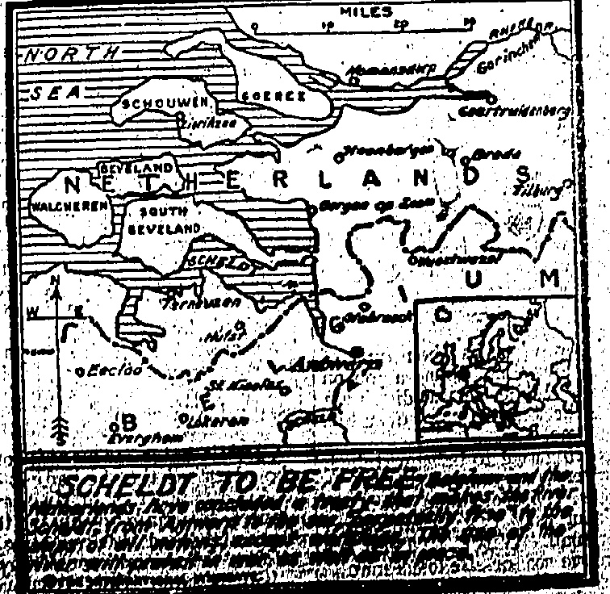
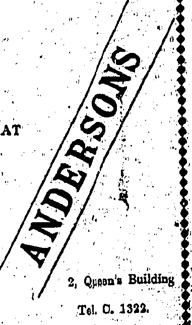

## BIRTHDAY HONOURS

## THIS YEAR'S UNUSUALLY LONG LIST

## NUMEROUS KNIGHTHOODS

## Whole Pages of Orders of the British Empire

Although only one Hongkong resident has been singled out, this year's Birthday Honours list is "unusually long." Malaya seems to have been well-favoured.

## NO NEW PEERS

### (Reuter's Service.)

An unusually long Birthday Honours List does not contain any new peers though it promotes Baron Beursted to a Viscount Sir William Tyrrell steps up to the Grand Cross of the Most Distinguished Order of St. Michael and St. George. Sir William Pakenham gets a Grand Cross of the Most Honourable Order of the Bath (G.C.B.)

Eight baronetcies include Sir John Bland Sutton.

The long list of knighthoods for varied public services include the artist Bernard Partridge and Mr. Philip Smith, Grand Secretary of the United Grand Lodge of Freemasons.

A notable feature is several pages of Orders of the British Empire (G.B.E., K.B.E., D.B.E., C.B.E., O.B.E., and M.B.E.) including six dames.

## Baron Beurstec

Baron Bearsted, who has been made a viscount, is well-known in the metropolis, having held the post of Lord Mayor, Alderman and Sheriff. He has travelled extensively in Japan and the Far East and was the first to introduce the transport of petrol in bulk through the Suez Canal. He has developed large oil fields in the Far East and received an official vote of thanks from the Lord. Commissioner of the Admiralty during the war for "services of the utmost importance to the fighting forces.

## Sir William Tyrrell

Sir William Tyrell's connection with the Foreign Office dates back nearly forty years. He is the son of the late Judge of the High Court of Judicature, N.W. Provinces of India. Since 1919 he has carried out the duties of Assistant Under-Secretary of State at the Foreign Office. He has also acted as Private Secretary to Lord Saunderson and the Right Hon Sir Edward Grey and 2nd Secretary at the Embassy at Rome. Sir William has received a G.C.M.G.

## Sir William Pakenham

Admiral Sir William Pakenham, given the Grand Cross of the Order of the Bath, comes of an old family with seafaring traditions. His father was Rear-Admiral the Hon. Thomas Pakenham and at an early age the son saw service in Japan and China as a naval attache. During the war he rose from Captain to Vice-Admiral and Lord Commissioner of the Admiralty. As a Rear-Admiral he commanded the Battle Cruiser Fleet.

## Sir John Bland Sutton

Sir John Bland Sutton is one of the leading surgeons of the day and in connection with the R.A.M.C. in the War rendered services of great national importance. He has since been elected to the "Presidency of the Royal College of Surgeons. He is said to have made large gifts to needy hospitals. Sir John Sutton was trained at Middlesex Hospital at which he was afterwards surgeon.

“More telling than a political discourse” is a remark almost forced from one at the sight of the work of Mr. Bernard Partridge who as “Punch’s” leading cartoonist is known by name to millions of admirers. He is the son of a famous surgeon and first devoted himself to stained glass designing. Not proving so successful in this as he had hoped he turned his at-

### Mr. Bernard Partridge

attention to the stage and acted under the name of Bernard Gould. He joined the staff of "Punch" in 1891.

A HOST OF THE KING'S.

'Grand' Crosses of the Royal Victorian Order (G.C.V.O.) are awarded to the Earl of Lonsdale and Desborough.

Sir John Baird receives the Grand Cross of St. Michael and St. George (G.C.M.G.)

The Earl of Lonsdale.

The Earl of Lonsdale is Lord Lieut. of Cumberland and his magnificent country seat at Lowther Castle is a very popular summer resort for Royalty. Lord Lonsdale has been an ardent sportsman all his life, taking a particular interest in the turf, hunting and boxing. His name is most prominently connected in public memory with the Lonsdale belt he founded. He served in the Imperial Yeomanry during the Boer War. For two years he was Mayor of Whitehaven.

## Lớnd Desborough

As Chairman of the Primrose League, and Thames Conservancy Board, also as a member of the Tariff Commission and Royal Exhibitions Commission, Lord Desborough has done work of great national importance but his name is more popularly connected with the British Olympic Association in which he has been a presiding genius. As Mr. W. H. Grenfell he had once a wonderful athletic record at cricket, rowing, running, climbing, swimming and horsemanship.

Born in 1874. He was a secretary in the Diplomatic Service in Cairo, Paris, and Buenos Aires from 1898 to 1908; Attached at Vienna in 1896; Acting Agent and Consul-General in Abyssinia; and Political Officer attached to the Abyssinian Field Forces in 1903. From 1911 until 1916 he was Parliamentary private secretary to Mr. Bonar Law; from December, 1916, until January, 1919, was Under-Secretary of State for the Air Ministry, and from July, 1919, Under-Secretary for the Home Office. He has represented the Rugby Division since 1910.

### Sir John L. Baird

## MALAYA'S SHARE

The Birthday Honours included:—

Commanders of St. Michael and St. George.—Mr. Frank Baddelley, former Under Secretary of the Straits Settlements; and Mr. Oswald Storer, of Selangor.

Honorary Commander of St. Michael and St. George.—Raja Abdullah, of Perak.

Commander of the British Empire.—Mr. John Humphreys, Adviser to Trengganu, Malay States.

Honorary Commanders of the British Empire, Haji Nik Ismail, of Kelantan; and Haji Ngah Yusuf, of Trengganu.

Honorary Member of the British Empire.—Mr. Ho Siak-kuan, Chinese Secretary of the Straits Settlements.

Member of the British Empire.—Mr. Frank Sands, Boy Scouts' Commissioner, of Malaya.

Companion of the Imperial Service Order. — Mr. Bertram Tanner, Headmaster of Queen's College, Hongkong.

Rome, June 2.-The airships Esperia and NI returned safely to their bases at Ciampino and Pontedera, this morning.-Reuter.

## DASH TO THE POLE

## PLANES TO TAKE PART

AMUNDSEN RETURNING AFOOT?

### (Router's Service.)

Oslo, June 2.

The Government has decided to send two naval aeroplanes by steamer to Spitzbergen to assist in the search for Amundsen.

The aeroplanes will reach Spitzbergen at the end of next week.

The opinion is generally expressed that Amundsen has been unable to return by air and is making for Cape Columbia or Spitzbergen on foot.

## LATEST NOTE

## EFFORT TO CONCILIATE GERMANY

DISARMAMENT QUESTION.

(Reuter's Service.)

The Allied Note to Germany with regard to dis-armament, which will be presented to Berlin on June 4, consists of five pages and two annexes.

The first sets out what has been done and what has not been done in the execution of the Versailles Treaty and lays down a list of what remains to be carried out.

The second gives the text of the Reparations' Commissions note to the Conference of Ambassadors, declaring that Germany is in order as regards the execution of the Dawes plan.

The Note, which is conciliatory, informs Germany that the Cologne zone cannot be evacuated until the disarmament conditions have been fulfilled.

## NINE MEN

## SIRDAR'S MURDER: GANG

## WHO THEY ARE

### (Reuter's Service.)

The nine men accused of the Sirdar's murder are the two student brothers. Enaiat, two railway shop workers, a carpenter, an engineer, a taxi driver and a lawyer, the former Zaglulist deputy Shafik Mansur and the official Mahmoud Ismail.

CAIRO, June 2.

[An earlier cable stated that all of the nine persons accused of the murder of the Sirdar have been found guilty. The court will pronounce sentence on the 7th.]

## ITALIAN FINANCE

## THE STABILISING OF THE LIRA

(Reuter's Service.)

ROME, Jude 2.

The Issue Banks have jointly opened a contingent credit with J.P. Morgan & Co., New York for fifty million dollars with the object of stabilising the lira.

[The lira of 100 centessimi is nominally worth 25.22½ to the pound sterling. According to the law of August 10, 1893, there are only three banks of issue, namely, the Banco d'Italia, the Banco di Napoli, and the Banco di Sicilia]

## $45,000,000 LOAN

HE ARGENTINE'S CREDIT

:

(Reuter's American Service.)

The Argentine refunding loan of $45,000,000 with interest at six per cent., offered by Messrs. Morgan's this morning, was over-subscribed in an hour.

Strasburg, June 2.—M. Painleve speaking at a banquet said that the Government will spare no endeavour in order to guarantee financial stability, of which the first condition is security. It Alsace-Lorraine were against threatened, France would engage her existence to defend them. That does not imply a sentiment of militariam, for while unanimously decided to defend her achievements in Morocco, France wishes only to be a good workman, and have a just peace without oppressor or oppressed. But the French people are not blind and must keep their eyes open for certain dreams of domination, and not submit to defeat. M. Painleve concluded hoping the genios of Alsace Toraine would help in arriving at a mutual understanding between France and Germany.

## 30 ,000 OUT

## SHANGHAI

## STRIKE ONLY

## LATEST ESTIMATE

Although Shanghai's troubles do not yet appear to be over it seems that so far the "general" strike is only partial, chiefly affecting the Japanese cotton mills.

MINOR ASSAULTS.

(Router's Service.)

The strike, which is generally only partial, chiefly affects the

ally partial, chiefly affects the Japanese cotton mills, though some of the tramway, electrical and other municipal employees have one out.

It was estimated this evening that 30,000 people are striking. The police have since released the 900 arrested.

Many minor assaults, chiefly against Japanese, are reported to-night.

Further meetings have been arranged for today, at which it is expected resolutions will be passed demanding the restoration of foreign concessions, abolition of extraterritoriality and the Mixed Court at Shanghai, and also of foreign police stations at Shanghai, and the punishment of the police who shot the students — Reuter.

Peking, June 2.—The student meetings held yesterday were only informal as the authorities have forbidden formal public meetings for students since the attack on Chang Shih-chao's residence during humiliation, day

TOKYO WATCHFUL.

The Foreign Office is adopting a watchful and waiting attitude in regard to the Shanghai strike, anticipating combined action with the Powerกอะกอะกกอะก

The cabinet to-day decided to instruct the Walchiaopu to draw up a note of protest to the Diplomatic Corps against the action of the police at Shanghai. It also decided to appoint two high commissioners to proceed to Shanghai to investigate the matter. It is believed they will be selected this afternoon.

## SOVIET PROTEST

## UNFRIENDLY ACTIONS?

## CHINESE EASTERN RAILWAY

Soviet Government circles are reported to be very perturbed at the Chinese continued disregard of the Soviet demand for the dismissal of non-Soviet officials of the Chinese Eastern Railway.

(Heuter's Service.)

The Soviet Press reports that the Chinese military authorities have requisitioned 400 waggons for the transport of war material to the Soviet frontier at Pogranitshnaja.

They also accuse China of exerting anti-Soviet influence, for example in negotiating a lozen with Japan for the purpose of constructing a line from Taoman to Tsitsihar, which is inimical to the interests of the Chinese Eastern Railway.

## HEAT WAVE

RIGA, JUNE 2.

## AMERICA'S SWELTERING ORDEAL

FATAL RESULTS.

(Reuter's American Service.)

There have been six deaths in Chicago, three in Cleveland and three in New York.

A heat wave has swept the country from the East to the Middle West.

Nine people were drowned at Milwakee when seeking relief from the heat.

Two men in Missouri were flung out of a motor car by the force of a storm and killed.

## IN GERMANY

## BERLIN, Jude

Chiefly

National interest is being displayed in the flying week for light aeroplanes, on which Germany is concentrating owing to the pence treaty restrictions. The contests are divided into three classes: in which the maximum power of engines is respectively 40, 80 and 120 horsepower. Twenty thousand pounds sterling are offered in prices; fifty one started. Immune crowds assembled at the Temptel of aerodrome to witness the first of the five separate circuits, the initial one of which is 695 miles, which thirty five contestants completed. The fastest time was done by an Albatross, monoplane 102 horsepower in 541 minutes. The first back of the maximum 40 horsepower class was a Daimler Mercedes 10 horsepower engine. The air-and-circuits will cover 702

RATEPAYERS' MEETING.

Shanghai, June 2.—There was again no quorum at the special meeting of the ratepayers called by the municipal council to vote on the resolutions relative to child labour and the printed matter by-law, the licensing of stock exchanges and the increasing of wharfage dues. The number present was two hundred short of the quorum. The chairman thanked those present for their attendance, adding that he felt sure it was the expression of their confidence in the council in the present difficult situation.

AMERICAN TROOPER SHOT.

Shanghai, June 2.—Quiet prevailed until 6:30 this evening when shots were fired on a mounted American Volunteer patrol from the "New World," a Chinese variety theatre in Nanking Road. Trooper T. G. MacMarten was wounded in the thigh and his horse was killed. The patrol's, Lewis gun replied, and the American troop later entered the building on one side while Light Horsemen entered on the other. They rounded up three hundred Chinese, who were taken to Louza Police Station and locked up. One Chinese was severely injured and several others slightly injured.

Another disturbance is reported to have occurred in the vicinity of the waterworks. There are no details.

The strike is spreading: The Council has appointed food trans-port controllers.

Fifty Italian Marines were landed from the San Giorgio, also Americans from the destroyers, as an advance guard for two thousand sailors and marines who are coming to Shanghai in accordance with instructions from the Legations at Peking.

The demands of the Peking Government and Shanghai Foreign Commissioner have had the inevitable effect of stiffening the rioters, and the position is steadily getting worse.

London, June 2—The "Daily News" on the Shanghai riots say that whatever else may be said about the fundamental cause it is too late now to leave China to work out her own salvation alone in view of the country's importance to the rest of the world. The paper endorses the "Times" suggestion for a discussion at the Customs conference.

When the rioters threw the Japanese constable into the creek which was shallow, they continued to attack him apparently intending to drown him, but he drew his revolver and killed one and seriously wounded two, whereupon the attack ceased.

## SCRAP OF PAPER?

LEAGUE AND ARMS EVIL.

CAUSTIC COMMENT.

(Reuter's Seroloo.)

The action of the arms conference in exempting Estonia, Finland, Latvia, Poland and Romania from the obligation to supply periodical returns of imports of munitions pending Russia's adhesion to the convention drew caustic references from Mr. Burton (United States) who asked whether the League protection was a mere scasp of paper since the nations were afraid to trust therein.

Lord Onslow (Britain) agreed with Mr Burton's remarks and said Britain desired a workable convention.

### SOUND ADVICE. (Roster's Service)

ANNAPOLIS, June 2.

President Coolidge representing diplomas to the graduates of the naval academy said that he felt that the occasion would seldom arise and knew it did not exist now, when those connected with our navy were justified, directly or by inference, in asserting that any other powers were arming against us, and by arousing national suspicion and hatred were attempting to cause us to arm against them.

He added that Americans would not like to have their honourable motives and peaceful intentions questioned, and others could not relish it either.

Although there was undoubtedly evil enough to the world, still one of the strongest attributes of all peoples was a desire to do Right and the young naval officers would do well to lay their costant in

from $40.00

EXCELITE BALLS $20.00 set.

SPARE MALLETS

$ 9.50 each

BATHING PICNICS

Best Qualify Water Polo Balls

$14.00.

Ayva's Woter Wings

$1.10 each

NAOUN LONION

LANE, CRAWFORD, LTD.

COMPLETE SPORTS OUTFITTERS

◇◇◇◇◇◇◇◇◇◇◇◇◇◇◇◇◇◇◇◇

SPECIALITIES

HARVEY'S BRISTOL MILK

OLD GOLDEN SHERRY

HARVEY'S BRISTOL CREAM

FULL PALE SHERRY

Sole Agents

CALDBHOK, MACGREGOR & CO., LTD.

15, Queen's Road Central.

Tel. 75 Central.

## ◇◇◇◇◇◇◇◇◇◇◇◇◇◇◇◇◇

## ENGLISH

PIANOS

by

COLLARD,

BROADWOOD,

ALLISON,

KIRKMAN,

CROWLEY.

◇◇◇◇◇◇◇◇◇◇◇◇◇◇◇◇◇◇◇

#### G. FALCONER & CO. (HONGKONG) LTD

WATCHMAKERS & JEWELLERS

DIAMOND MERCHANTS

Agents for: ADMIRALTY CHARTS

ROSS'S BINOCULARS and TELESCOPES,

KELVIN'S NAUTICAL INSTRUMENTS,

ENGLISH SILVERWARE, direct from Manufacturers,

## ★可变灯组控制中设置有效电流★

## Cross Words Made Easy

By Drinking

Tuborg Beer

Purveyors To

The Royal Danish Court

The One and Only Danish Beer on the Market.

BOLIN AUXTRE

GANDERPRICE & CO., LTD.