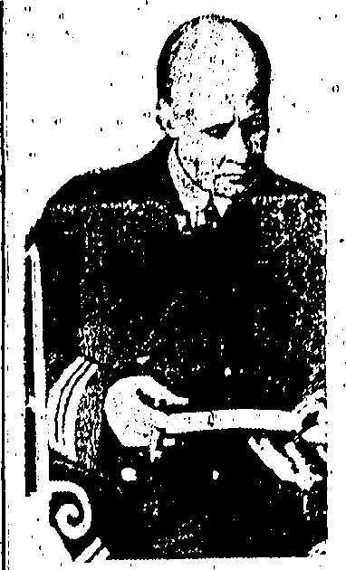
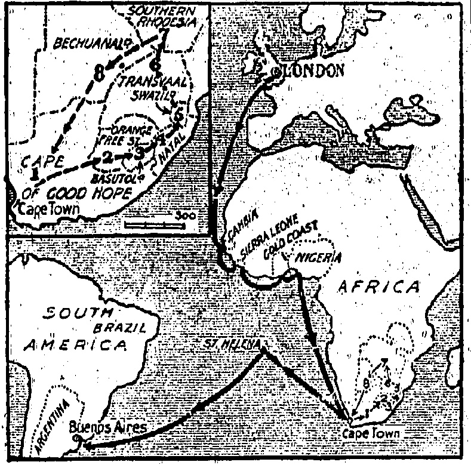
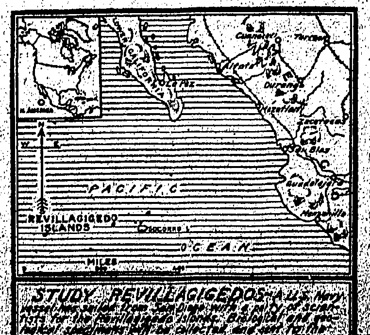
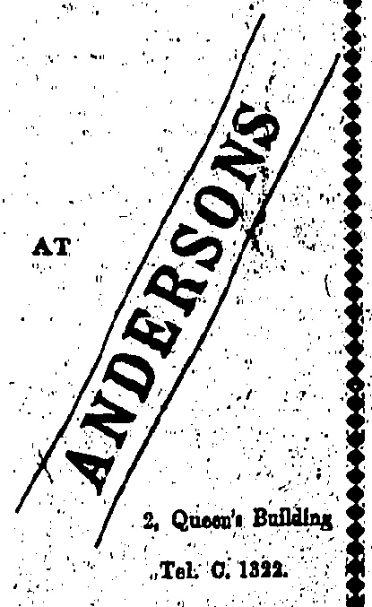

# INTO THE NORTH.

FEARS FOR A SON.

## Death of Magnate

Where is Amundsen? The answer to this question still remains a secret of the icy North and steps are being taken to find the missing explorer.

ORGANIZED SEARCH

Systematic plans have been drawn up for search for Amundsen.

Two Norwegian naval aeroplanes, which are being equipped with wireless, will operate from Spitzbergen towards East Greenland.

The French explorer Chareot will probably be requested to search the East Coast of Greenland. The MacMillan expedition will work from Cape Columbia.

"Captain D. MacMillan.

The American could magnate Mr. Ellsworth, who financed the Amundsen flight, has died at Florence.

Home, June 3

DEATIFL FROM ANX IETY...

It is believed his death was largely due to anxiety over the disappearance of his son who is accompanying Amundsen.

Amundsen before he left said it was extremely improbable that flying would become impossible owing to the total breakdown of both machines. However, we have taken such eventuality into account and are prepared for the worst—namely, that we might have to return all the way from the Pole on foot. We are therefore taking a complete Polar outfit of clothes, footgear, ski-sledges, boats, sleeping bags, rifles, shotguns, ammunition, cooking utensils, etc. As re

## DEBTS AND DINNERS

### (Reuter's Service.)

## London, June 3

The "Daily Telegraph" Geneva correspondent says that a good deal of adverse comment has been aroused by the fact that despite China's inability to pay its annual subscription to the League or the coupons on the bonds, it entertained lavishly four hundred guests at one of the most fashionable hotels at a function that must have cost £1,000. It is recalled that public subscriptions had to be made for the starving people of China.

## LOANS COUPONS MET

The “Times” City correspondent notes that the coupons due yesterday in two out of three Chinese loans were met, and an announcement with regard to the third is expected. He says it is to China's credit that despite political disorders, the service of foreign debt is maintained undisturbedly, except in a minor degree, and interest is at present being met on all secured Chinese loans issued in Britain with the exception noted.

London, June 3.—The assertion in Glasgow that Herr Stocker, a member of the Reichstag, did not attend the communist congress but was impersonated by a German resident, is confirmed at Cologne where authoritative Communist circles declare that neither Herr Stocker nor any other German Communist went to Glasgow in consequence of the British official embargo.—Reuter.

Sofia, June 3.—The Government has ordered the demobilisation of the ten thousand extra men which the Ambassadors' Conference permitted to be called to the Colours to deal with the Communist menace. The conference previously rejected the application for suspension of demobilisation. — Reuter.

gards provisions we are taking thirty kilograms per head, chiefly consisting of pemmican, chocolate, desiccated milk, and biscuits—the same rations that we took with us on the Antarctic expedition. The distance from the Pole to the depot already established on Cape Columbia is about 437 miles. With provisions sufficient for six weeks, and taking twelve miles as the average day's march, we should be well on the safe side.

## WHO OWNS THE POLE?

Official circles are perplexed at the report from Ottawa that Mr. Stewart, the Canadian Minister of the Interior told the Dominion House of Commons that Canada expects to claim any lands discovered north of Canada as far as the Pole. The forthcoming Macmillan expedition which will receive aid from the navy is intended to raise the Americann flag on any new land discovered which probably will be comparatively valueless except possibly as a future aviation base, but it is not thought that any serious American Canadian controversy will arise on the matter.

# ENVOYITO JAPAN.

SIR CHARLES ELIOT'S SUCCESSOR.

(Reuter's Service.)

LONDON, June 3

Sir John Tilley, Ambassador at Rio de Janeiro, has been appointed Ambassador to Toklo.

[Sir John Tilley has seen diplomatic service in Brazic, and has served the Foreign Office in different capacities.

## NEW SILK PLAN A RAW MATERIAL CONCESSION

### (Reuter's Service.)

Methods for collecting the new silk taxes and payment of drawbacks on exported articles containing silk and artificial silk were discussed at a conference at the Treasury presided over by the Chancellor of the Exchequer, Mr. Winston Churchill, and attended by trade representatives and Government officials.

Mr. Churchill submitted a plan whereby duties will not be levied on raw material whether Home produced or imported which are intended to be utilised solely in the manufacture of export articles. Consequently no claim for a rebate will have to be established. The trade representatives will consider this scheme before communicating their views. Further discussions will be held on other points.

## RAILWAY SALVAGE

### (Reuter's American Service.)

## New York; June 3

The Kuhn-Loeb Company announce a plan for the reorganisation of the Chicago Milwaukee and St. Paul Railroad, which provides for the exchange of over four hundred and sixty-four million dollars of securities and also the liquidation or funding of all short term debts and the assessment of $28 share preferred stock as $32 share common stock.

The plan also provides for a big reduction of the fixed interest bearing debt, the creation of a new share preference mortgage which will provide future capital expenditure and the creation of two additional mortgages.

The assessment plan will provide over seventy million dollars in cash, for which new five per cent. mortgage bonds will be issued. Allowing for the value of the bonds, a net assessment on stock of about nine dollars per share is indicated.

Ottawa, June 8.— Mr Mackenzie King announced in the House of Commons that the Government expected shortly to appoint a Canadian representative at Washington but difficulty was experienced in obtaining anyone willing to accept an account of the personal financial entity involved. The House of Commons there upon yield $60,000 to cover the salary and expenses of the post. Rober's American Service.

## SHANGHAI RIOTS

When the Volunteers rushed into the building, they rounded up several hundreds of men, who were escorted to the police-station and searched. No arms were found. The police have released the arrested men.

It is believed that armed rioters escaped through a tunnel under the street to the old "New World" building.

## Plans Agley

The rioters who fired on the Volunteers yesterday had taken up strategic positions, intending to fire on ratepayers motoring homeward in large numbers from the special meeting. The early termination of this upset their programme.

The failure to secure a quorum was due to the absence of the Japanese.

The strike situation in the international Settlement is slightly more tense. The fresh food markets and Chinese, shops are closed. The rioters are assaulting and otherwise terrorizing all Chinese remaining in the employment of foreigners; but the French Concession is so far unaffected.

The students again held no public meeting yesterday, but the vernacular papers report various meetings in the colleges at which they made extravagant demands such as the withdrawal and punishment of the British Consultant General at Shanghai, the police who killed the students to be sentenced to death; an indemnity paid to the dead rioters' relatives; the British Government to be made to apologise to the Chinese people, in addition to demands for the return of concessions, etc.

It understood that the National University, which usually leads student agitators has decided to strike from today as a protest, and is calling all students to gather there to day for a demonstration against “British Imperialism,” also urging that all economic relations be severed with Great Britain and Japan, and that (Chinese) deposits be withdrawn from (British and Japanese) banks, the banknotes of the two countries not to be accepted and no provisions to be sold to their nationals, Chinese employees to be induced to leave British and Japanese employers and students to leave their schools.

## Reaching A Settlement

In connection with the efforts of the Chinese merchants to devise some form of compromise, which will end the present disorders and save the faces of the Municipal Council and students, the “North-China Daily News,” editorially believes that the idea is that the students should withdraw the pickets and declare peace. The matter can be referred to Peking for adjustment. The paper says, however, that any interference by the Waichiaopu should be directed towards the students after the fashion of the order recently issued in Peking, ordering the students back to their classrooms.

“We appreciate the efforts of the Chinese merchants to restore order, but as these efforts are being directed at present, we tell them frankly that they are wasting their time. There is only one way in which peace can be brought back; that is by the unconditional surrender of the students and other agitators”

## Peking To Investigate

The Government has appointed Mr. Tsai Ting-ken and Mr. Tseng Tsung-Chien (Vice-Minister for Foreign Affairs) as High Commissioner to investigate the Shanghai affair. They are expected to leave for there tomorrow.

The Waichiaopu sent a Note this afternoon to the Italian Minister in his capacity as Senior Minister of the interested Powers, relative to the Shanghai situation. The Note protests against the shooting of the students and requests him to bring the Note to the knowledge of the interested Powers.

The Foreign Office's protest reserves "the right to formulate claims which may result from this deplorable incident, for which the authorities of the International Concession are entirely responsible." The Note requests the Ministers to give "urgent necessary instruction to the Consular Authorities in Shanghai to set at liberty those arrested."

## Peking Position

The students of practically all the Universities and Colleges in Peking are striking to-day, as a protest against the Shanghai affair. They are holding a monster demonstration and parade this afternoon.

The Legation guards are confined to barracks and strong pickets are posted at all entrances to the Legation Quarter. Further Clashes.

Many of the foreigners attacked have been rescued in onlying districts by active patents. Further clashes have taken place in the central districts, in which rooms have been killed or injured, it is known that the casualties up to

CROWDS ON ROOFS.

Having completed his triumphal tour of the Orange Free State, the Prince of Wales is now receiving a wonderful welcome in Natal.

A SUA OF FACHS.

The Prince of Wales received a very enthusiastic reception at Durban City, which was elaborately and charmingly decorated. Scores of thousands of yelling and

Scores of thousands of yelling and cheering spectators crowded the roads, windows balconies and roofs.

the present among the strikers are 21 killed and 65 wounded. The defenders have had one man seriously wounded and several slightly.

A foreign woman has died as the result of a blow on the head from a brick thrown when rioters attacked a tram.

The smaller map shows the progress of the Prince's tour of South Africa. From Capetown (1) he went to the Orange Free State (2) and then to Basutoland (3). He is now in Natal (4).

The ceremony of welcoming the Prince, held in the square in front of the town hall, was marked by almost continuous cheering and the singing of 'For He's a Jolly Good Fellow.'

Armoured cars were rushed this evening into the Western District, where the rioters are concentrating from Chapel suburb, the Chinese control of which gives the strikers a useful base of operations against the Settlement.

and other fisheries. The town exports tea, sugar, coffee, maize, wool hides, skins, Angora hair, etc. There are good public buildings and a wireless station. The place is fortified. The population is 69,000 (92,000 whites and many Indians).

The march past of the battalions of the active citizen force and the naval battalion was a sight.

Durban, formerly Port Natal, is the chief seaport and largest town in Natal. The harbour with the projecting "Bluff," was improved in 1904. Durban is a beautifully laid-out city, with a fine town hall, parks, gardens, Victoria's Embankment, and ocean beach. Berea is the handsome suburb. Much of the Transvaal and Orange Free State trade passes through the town, which is noted for its shipping, coaling port, preserves, whole.

TEMPEST OF DRUMS.

## Press Hopeful

Mr. G. Ward Price, a Special Correspondent in H.M.S. Repulse, writing from Accra (Gold Coast),

## shanghai, June 3

The Evening News, the only evening paper published to-day, considers the situation is not so grave. No doubt the Chinese are feeling the cutting off of food supplies much more acutely than the foreigners, the latter possessing large reserves of imported foods, while the arrival of troops relleves the Volunteers and Police of the heavy strain of continuous duty. But there does not yet appear any common ground for a compromise. The foreigners are determined to suppress the riots, while the China said of the 'Prince's visit to that place: One of the most romantic scenes I have ever witnessed was a gathering at the old white battlemented Christianborg Castle, the Governor's residence. Black chiefs with golden crowns and powerful gleaming, naked shoulders mingled with the Prince of Wales and his staff, Lady Guggisberg, the wife of the Governor, in a long-trained green Ashanti gown, and British officials.

The castle itself was the most picturesque setting imaginable for this exotic assembly. The silvery sea, gleaming under the misty tropical moon, washed the foot of the pale bastions, which still mount 18th-century cannonades.

that Hamlet's father's ghost would appear at this ancient fortress that was built long ago by the Danes.

At dawn the air began to throb with a tempest of drums as the southern chiefs assembled for review by the Prince. It was to just such a menacing clangour that 30 years ago the British garrisons used to listen as the invading Ashanti army approached the coast.

All the splendour of the palaver at Kumasi, the Ashanti capital, was reproduced, with the strange additions of devil-dancers with crocodile-head masks. Not only the richness of their fantastic accoutrements but also the personal dignity of these inky dignitaries make average British mayors and aldermen seem by comparison awkward; tawdry, and uncouth.

In an accident on the s.s. Kueng Chow, a Chinese was killed yesterday by three bags of rice falling on him.

ese are too excited to listen to calm

counsels. Again, the arrival of

fresh batches of frenzied students

reinforces the waverers.

A steady rain to-night is again

emptying the streets.

## CROQUET

EXCELITE BALLS

SPARE MALLETS

COMPLETE SETS

BATHING PICNICS

Best Qual'y Water Polo Balls

Ayvad's Water Wings

$1.10 each

IADILS. INCIDENT

LANE, CRAWFORD, LTD.

COMPLETE SPORTS OUTFITTERS

SPECIALITIES

HARVEY'S BRISTOL MILK

OLD GOLDEN SHERRY

HARVEY'S BRISTOL CREAM

FULL PALE SHERRY

Sole Agents

OALDBEOK, MACGREGOR & CO., LTD,

15 Queen's Road Central.

Tel. 75 Central.

☀️🌥️🌥️🌥️🌥️🌥️🌥️🌥️🌥️🌥️🌥️🌥️🌥️🌥️🌥️🌥️🌥️🌥️🌥️🌥️🌥️🌥️🌥️🌥️🌥️🌥️🌥️🌥️🌥️🌥️🌥️🌥️🌥️🌥️🌥️🌥️🌥️🌥️🌥️🌥️🌥️🌥️🌥️🌥️🌥️🌥️🌥️🌥️🌥️🌥️🌥️🌥️🌥️🌥️🌥️🌥️🌥️🌥️🌥️🌥️🌥️🌥️🌥️🌥️🌥️🌥️🌥️🌥️🌥️🌥️🌥️🌥️🌥️🌥️🌥️🌥️🌥️🌥️🌥️🌥️🌥️🌥️🌥️🌥️🌥️🌥️🌥️🌥️🌥️🌥️🌥️🌥️🌥️🌥️🌥️🌥️🌥️🌥️🌥️🌥️🌥️🌥️🌥️🌥️🌥️🌥️🌥️🌥️🌥️🌥️🌥️🌥️🌥️🌥️🌥️🌥️🌥️🌥️🌥️🌥️🌥️🌥️🌥️🌥️🌥️🌥️🌥️🌥️🌥️🌥️🌥️🌥️🌥️🌥️🌥️🌥️🌥️🌥️🌥️🌥️🌥️🌥️🌥️🌥️🌥️🌥️🌥️🌥️🌥️🌥️🌥️🌥️🌥️🌥️🌥️🌥️🌥️🌥️🌥️🌥️🌥️🌥️🌥️🌥️🌥️🌥️🌥️🌥️🌥️🌥️🌥️🌥️🌥️🌥️🌥️🌥️🌥️🌥️🌥️🌥️🌥️🌥️🌥️🌥️🌥️🌥️🌥️🌥️🌥️🌥️🌥️🌥️🌥️🌥️🌥️🌥️🌥️🌥️🌥️🌥️🌥️🌥️🌥️🌥️🌥️🌥️🌥️🌥️🌥️🌥️🌥️🌥️🌥️🌥️🌥️🌥️🌥️🌥️🌥️🌥️🌥️🌥️🌥️🌥️🌥️🌥️🌥️🌥️🌥️🌥️🌥️🌥️🌥️🌥️🌥️🌥️🌥️🌥️🌥️🌥️🌥️🌥️🌥️🌥️🌥️🌥️🌥️🌥️🌥️🌥️🌥️🌥️🌥️🌥️🌥️🌥️🌥️🌥️🌥️🌥️🌥️🌥️🌥️🌥️🌥️🌥️🌥️🌥️🌥️🌥️🌥️🌥️🌥️🌥️🌥️🌥️🌥️🌥️🌥️🌥️🌥️🌥️🌥️🌥️🌥️🌥️🌥️🌥️🌥️🌥️🌥️🌥️🌥️🌥️🌥️🌥️🌥️🌥️🌥️🌥️🌥️🌥️🌥️🌥️🌥️🌥️🌥️🌥️🌥️🌥️🌥️🌥️🌥️🌥️🌥️🌥️🌥️🌥️🌥️🌥️🌥️🌥️🌥️🌥️🌥️🌥️🌥️🌥️🌥️🌥️🌥️🌥️🌥️🌥️🌥️🌥️🌥️🌥️🌥️🌥️🌥️🌥️🌥️🌥️🌥️🌥️🌥️🌥️🌥️🌥️🌥️🌥️🌥️🌥️🌥️🌥️🌥️🌥️🌥️🌥️🌥️🌥️🌥️🌥️🌥️🌥️🌥️🌥️🌥️🌥️🌥️🌥️🌥️🌥️🌥️🌥️🌥️🌥️🌥️🌥️🌥️🌥️🌥️🌥️🌥️🌥️🌥️🌥️🌥️🌥️🌥️🌥️🌥️🌥️🌥️🌥️🌥️🌥️🌥️🌥️🌥️🌥️🌥️🌥️🌥️🌥️🌥️🌥️🌥️🌥️🌥️🌥️🌥️🌥️🌥️🌥️🌥️🌥️🌥️🌥️🌥️🌥️🌥️🌥️🌥️🌥️🌥️🌥️🌥️🌥️🌥️🌥️🌥️🌥️🌥️🌥️🌥️🌥️🌥️🌥️🌥️🌥️🌥️🌥️🌥️🌥️🌥️🌥️🌥️🌥️🌥️🌥️🌥️🌥️🌥️🌥️🌥️🌥️🌥️🌥️🌥️🌥️🌥️🌥️🌥️🌥️🌥️🌥️🌥️🌥️🌥️🌥️🌥️🌥️🌥️🌥️🌥️🌥️🌥️🌥️🌥️🌥️🌥️🌥️🌥️🌥️🌥️🌥️🌥️🌥️🌥️🌥️🌥️🌥️🌥️🌥️🌥️🌥️🌥️🌥️🌥️🌥️🌥️🌥️🌥️🌥️🌥️🌥️🌥️🌥️🌥️🌥️🌥️🌥️🌥️🌥️🌥️🌥️🌥️🌥️🌥️🌥️🌥️🌥️🌥️🌥️🌥️🌥️🌥️🌥️🌥️🌥️🌥️🌥️🌥️🌥️🌥️🌥️🌥️🌥️🌥️🌥️🌥️🌥️🌥️🌥️🌥️🌥️🌥️🌥️🌥️🌥️🌥️🌥️🌥️🌥️🌥️🌥️🌥️🌥️🌥️🌥️🌥️🌥️🌥️🌥️🌥️🌥️🌥️🌥️🌥️🌥️🌥️🌥️🌥️🌥️🌥️🌥️🌥️🌥️🌥️🌥️🌥️🌥️🌥️🌥️🌥️🌥️🌥️🌥️🌥️🌥️🌥️🌥️🌥️🌥️🌥️🌥️🌥️🌥️🌥️🌥️🌥️🌥️🌥️🌥️🌥️🌥️🌥️🌥️🌥️🌥️🌥️🌥️🌥️🌥️🌥️🌥️🌥️🌥️🌥️🌥️🌥️🌥️🌥️🌥️🌥️🌥️🌥️🌥️🌥️🌥️🌥️🌥️🌥️🌥️🌥️🌥️🌥️🌥️🌥️🌥️🌥️🌥️🌥️🌥️🌥️🌥️🌥️🌥️🌥️🌥️🌥️🌥️🌥️🌥️🌥️🌥️🌥️🌥️🌥️🌥️🌥️🌥️🌥️🌥️🌥️🌥️🌥️🌥️🌥️🌥️🌥️🌥️🌥️🌥️🌥️🌥️🌥️🌥️🌥️🌥️🌥️🌥️🌥️🌥️🌥️🌥️🌥️🌥️🌥️🌥️🌥️🌥️🌥️🌥️🌥️🌥️🌥️🌥️🌥️🌥️🌥️🌥️🌥️🌥️🌥️🌥️🌥️🌥️🌥️🌥️🌥️🌥️🌥️🌥️🌥️🌥️🌥️🌥️🌥️🌥️🌥️🌥️🌥️🌥️🌥️🌥️🌥️🌥️🌥️🌥️🌥️🌥️🌥️🌥️🌥️🌥️🌥️🌥️🌥️🌥️🌥️🌥️🌥️🌥️🌥️🌥️🌥️🌥️🌥️🌥️🌥️🌥️🌥️🌥️🌥️🌥️🌥️🌥️🌥️🌥️🌥️🌥️🌥️🌥️🌥️🌥️🌥️🌥️🌥️🌥️🌥️🌥️🌥️🌥️🌥️🌥️🌥️🌥️🌥️🌥️🌥️🌥️🌥️🌥️🌥️🌥️🌥️🌥️🌥️🌥️🌥️🌥️🌥️🌥️🌥️🌥️🌥️🌥️🌥️🌥️🌥️🌥️🌥️🌥️🌥️🌥️🌥️🌥️🌥️🌥️🌥️🌥️🌥️🌥️🌥️🌥️🌥️��

## ENGLISH

PIANOS

by

COLLARD,

BROADWOOD,

ALLISON,

KIRKMAN,

CROWLEY.

#### G.FALCONER & CO.(HONGKONG) LTD

WATCHMAKERS & JEWELLERS

DIAMOND MERCHANTS

Union Building (Opposite G.P.O.)

Agent for: ADMIRALTY CHARTS

ROSS'S BINOCULARS and TELESCOPES,

KELVIN'S NAUTICAL INSTRUMENTS,

ENGLISH SILVERWARE, direct from Manufacturers

## (b)

## Cross Words Made Easy

By Drinking

Tuborg Beer