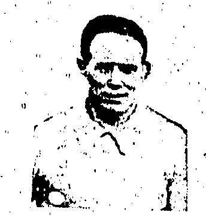
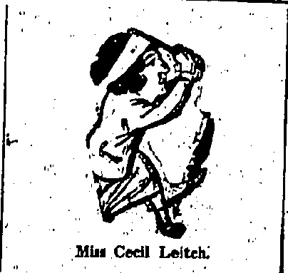
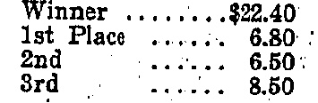

# “CHINA MAIL” SPORTS PAGE.

## STRANGLER" LEWIS

## "

HIS DIAMOND BELT.

(Router's American Service.)

MICHIGAN CITY, May 31.

"Strangler" Lewis, claimant for the world's heavyweight wrestling championship, threw Wayne Munn for two falls out of three by using a succession of headlocks.

Munn was carried from the ring. Lewis gets the bulk of the $30,000 purse and retains a $10,000 diamond belt.

## ANOTHER MATCH

WRESTLER TAKEN TO. HOSPITAL.

## BROKEN RIES

(Reuter's American Service.)

It is expected that Stecher will now meet "Strangler" Lewin for the world's championship.

Joe Stecher beat Zbyscko by two straight falls in a wrestling match for a purse of $50,000.

Zbyscko went into hospital after the match with internal injuries. Several ribs were broken and he injured his back.

## MARATHON RACE

## WINNER'S NEW RECORD TIME

HOLDER BEATEN.

At Stamford Bridge, the Polytechnic marathon from Windsor to London resulted:—1, Perris (Air Force, Uxbridge); 2, Zuna (United States); 3, McLeod Wright (Shettestone Harries, holder).

The time was 2 hours 35 mins. 58.1/5 secs., a record.

## "SOCCER" TOUR:

FOLLOWING CHINA'S FOOTSTEPS.

The football team sent out by the English F, A. defeated New South Wales by 3 goals to 2.

[The tourists have won every match to date.]

## THRILLING RACE

AUTOMOBILE GRAND PRIX

RESULT.

## RURE SPILLS

(Reuter's American Service.)

Automobile Grand Prix, run on the Speedway, was won by De Paolo, in a Duesenberg Special, after an exciting finish. The time was 4 hours 56 mins. 30 secs.

The International 500 Mil Automobile Grand Prix, run on the Speedway, was won by De Prole

The race was most thrilling. There were three spills, in each case the pilot crashing into a retaining wall but not being seriously hurt.

Most of the cars were eight cylindered and a number were provided with super-chargers, while unique entry was fitted with a front wheel drive and was placed second.

## RETURN BOUT?

## LATEST NEWS

## DUPRE AND JIM CARTLIDGE

Andre Dupre (ex-featherweight champion of France) is coming back to Hongkong and a return bout with C. P. O. Jim Cartlidge (undefeated Imperial Services champion and lightweight beltholder of the Colony) is practically certain.

Mr. J. Brook, the popular manager of the Hongkong Boxing Association, has received a cable that Dupre is returning here by the P. & O. S.S. Nagoya. Mr. T. G. Bennett, the enthusiastic hon. secretary and treasurer of the Association, has lost no time in making a start with the preparations for another big fight.

Dupre, on his arrival, will undergo a special course of training under Staff Sergt. Hunt, the well-known physical culturist and gymnast.

Cartlidge will train at his old quarters at the Kowloon British School.

No date has yet been fixed for the bout, but doubtless this awaits the actual arrival of Dupre on the scene.

It is understood that Dupre has now arrived in the Colony and that hopes exist of bringing the men together on June 18

## NEW CHAMPION

WORLD'S CRUISER WEIGHT TITLE

MCTIGUE DEFEATED.

SPLENDID RALLY IN LAST ROUND.

### (Reuter's American Service.)

Paul Berlenbach has been given decision over Mike McTigue, in light-heavyweight boxing championship of the world.

By defeating McTigue, Berlenbach becomes the fourth holder of the world's light-heavyweight title in three years.

Berlenbach was most aggressive. He repeatedly forced McTigue to the ropes and was boring in with hard rights and lefts but McTigue covered up and dodged causing Berlenbach frequently to miss. Nevertheless, Berlenbach landed in number of solid punches, cutting McTigue's eyes and mouth.

The defeated champion.

McTigue rallied gamely in the final round and took the offensive but the judges had no difficulty in awarding Berlenbach the decision.

## TRACK AND FIELD

MERICAN INTER-COLLEGE CHAMPIONS.

CALIFORNIA FIRST.

(Reuter's American Service.)

PHILADELPHIA. May 31.

The University of Southern California has won the 1925 inter-collegiate track and field championship.

## CLOSE FINISH

## CRICKET VICTORY BY ONE RUN

A match between the Diocesan Boys' School and the Hongkong University 2nd XI was played at the University Ground on Saturday. The University hit up a score of 106. The Diocesan School began badly, losing two wickets for one run. The third wicket put on 96 runs, after which there was a collapse and the University won an exciting match by one run. For the School, A. Lee took three wickets for 20 runs, E. Lee two wickets for 15 runs and F. Zimmer five wickets for 23 runs.

For the University Shahabudin took four for 18and Sudan seven six for34.

## University

E. Zimmern, b F. Zimmern..... 33

W. H. Sling, b A. Lee..... 8

B. N. Sudan, b A. Lee..... 13

C. K. Ong, b A. Lee..... 2

B. P. Ng, c & b F. Zimmern..... II

S. O. Shahabudin, b F. Zimmern..... 0

A. T. M. Barma, b A. Lee..... 2

N. P. Karanjla, not out..... 12

H. Hiptoola, c Featherstone, b Zimmern..... 6

H. T. M. Barma, b E. Lee..... 15

A. Baker, b E. Lee..... 0

Extras.

<table border=1 style='margin: auto; word-wrap: break-word;'><tr><td style='text-align: center; word-wrap: break-word;'>1. Lee</td><td style='text-align: center; word-wrap: break-word;'>0.</td><td style='text-align: center; word-wrap: break-word;'>M.</td><td style='text-align: center; word-wrap: break-word;'>R.</td><td style='text-align: center; word-wrap: break-word;'>W</td></tr><tr><td style='text-align: center; word-wrap: break-word;'>2. Goddard</td><td style='text-align: center; word-wrap: break-word;'>1.2</td><td style='text-align: center; word-wrap: break-word;'>20</td><td style='text-align: center; word-wrap: break-word;'>20</td><td style='text-align: center; word-wrap: break-word;'>28</td></tr><tr><td style='text-align: center; word-wrap: break-word;'>3. Lee</td><td style='text-align: center; word-wrap: break-word;'>5</td><td style='text-align: center; word-wrap: break-word;'>0</td><td style='text-align: center; word-wrap: break-word;'>28</td><td style='text-align: center; word-wrap: break-word;'>15</td></tr><tr><td style='text-align: center; word-wrap: break-word;'>4. I. Zimmerman</td><td style='text-align: center; word-wrap: break-word;'>2.3</td><td style='text-align: center; word-wrap: break-word;'>0</td><td style='text-align: center; word-wrap: break-word;'>15</td><td style='text-align: center; word-wrap: break-word;'>23</td></tr><tr><td style='text-align: center; word-wrap: break-word;'>5. L. Young</td><td style='text-align: center; word-wrap: break-word;'>13</td><td style='text-align: center; word-wrap: break-word;'>4</td><td style='text-align: center; word-wrap: break-word;'>23</td><td style='text-align: center; word-wrap: break-word;'>15</td></tr></table>

Total.....106 BOWLING ANALYSIS.

S. V. Gittins, b Shahabudin... (

W. A. Hunt, b Shahabudin.....

F. I. Zimmern, b Shahabudin...

Rev. W. T. Featherstone, b

Sudan.....52

F. Samy, c Hiptoola, b Sudan...

J. L. Youngsaye, c E. Zimmern

b Sudan.....0

L. R. Dixon, b Sudan.....

A. Lee, b Sudan.....

E. Goddard, b Shahabudin.....

L. J. Guterres, c & b Sudan.....

E. A. Lee, b Sudan.....

J. A. Fox, not out.....

Extras.....22

O. Shahabudin 16 7 18 4

N. Sudan 10.41 34 7

V. H. Sling..... 3 0 15 0

P. Ng..... 3 0 13 0

## HOME TURF

##### MR. H. E. MORRIS S TRIES

At Kompton, in the Redfern Two-Year-Old Stakes (five furlongs) the result, with starting prices, was:—

2.—Miss Buttall 7/2.

3.—Doushka 6/4.

Won by half a length; a head between second and third.

Miss Buttall belongs to Mr. Henry F. Morris of Shanghai who won the Epson Derby. This is Miss Buttall's first public appearance.

## MILITARY BOXING

SURREYS' PLATOON

"Tommies" Do Well

Bouts of three two-minute rounds under Service conditions were the order of things at Murray Barracks on Saturday night when the semi-finals and finals of the Surrey Regiment's platoon boxing tournament for the Montague Bates Cup were decided.

The three days' sport in the "Montague Bates" Platoon Boxing Tournament proved a success in every way, and those who went to witness the semi-finals and finals last night were treated to a display which was quite creditable in the realm of army boxing.

The best bout was easily the final of the bantamweight between Pte. Baxter and Drm. Simpson. Both men gave a splendid exhibition of clean boxing.

One bout in the semi-final of the flyweight and two in the welter-weights were not fought, one of the contentants in each case being indisposed, thus providing a walk-over for the others into the final. However, the latter gave exhibition fights with others who filled the gap.

Five out of the seven final events went the full distance,

Owing to a misunderstanding in the awarding of points for the Cup, an adjustment had to be made, the results at the conclusion being as follows:—Drums and Signals, total points 10; Machine Guns (Right Section), total points 8½.

Results:—

## SEMI-FINALS

## Flyweights

Pte. Edwards (R.S.) v. Pt Mabey (10). Edwards we knocked out in the first round.

Brazier (7). The fight opened with wild hitting on both sides, Baker taking the floor twice. and Brazier once. The latter with his longer reach had a slight advantage in the second round and swung lefts and rights, but Baker had piled up enough points at the end of the third round to be given the decision.

## Bantamweights

Pte. Foster (R.S.) v. Drm. Simpson (D.S.). Simpson went at a fast pace and disposed of his opponent by a knockout in the first round.

Pte. Baxter (1) v: Pte. Dawson (4). The fighting throughout the three rounds was slow, with Baxter doing the attacking. Dawson crouched often and was at his opponent's mercy, but the latter was not inclined to take advantage. Baxter won.

Pte. Lleliott (1) v. Drm, Bowles (D.S.). Lleliott was floored three times in the first round, and in the next received a knockout. Bowles fought well and his blows proved to be hard and accurate.

Pte. Williamson (1) v. Pte. Key (4). This was an evenly matched pair and the fight went the full way. Key was forced to fight at close quarters and in this his opponent had the better of him. Williamson won.

L-C. Leavey (D.S.) v. Pte. Simmons (7). Simmons disposed of his opponent easily by the K.O. route with a right swing early in the first round.

Middleweights.

Pte. Eaton (4) v. L.C. Wright (R.S.). Eaton did all the attacking, his opponent being content to back to the ropes where he got cornered and received a shower of blows. In the second and third rounds he received more punishment. Eaton won.

Pte. Problitts (1) v. Pte. Elliott (14). Problitts forced the fighting with left jabs following up in the next round with very effective

swinging blows which sent Elliott to his knees twice. The latter was a beaten man, but started well in the third round, only to be knocked out.

Light-heavyweight.

Pte. Gravett (7) v. Pte. Williams (D.S.) Gravett won easily in the first round by knocking out his opponent with a series of heavy right swings on the neck. Williams hardly retaliated.

## FINALS

## Flyweight

Pte. Mabey (10). v. Drm. Baker (D.S.). This bout went the full way. Mabey had the advantage in reach, and Baker at first was content to keep on jabbing. His fighting improved later, although Mabey occasionally broke through his defence. Baker won.

## Bantamweight

Drm. Simpson (D.S.) v. Pte. Baxter (1). This was the best bout of the evening and the spectators were treated to a spirited fight. Simpson started by delivering a round of left and right swings, many of which, however, missed. In the second round there was hard hitting on both sides, Simpson receiving a cut below his right eye after he had done the like to his opponent in a lesser degree. Heavy blows were also exchanged in the third round. Baxter was given the decision.

## Featherweight

Pte. Cooper (2 v. Drm. Bowles (D.S.)). Bowles started to chase his man round after he had floored him with a heavy right. Cooper had to be continually on his guard and by constantly attacking Bowles gained enough points to gain the decision.

## Lightweight

Pte. Williamson (1) v. Private Simmons (7). With a heavy left early in the first round, Williamson sent his opponent to the floor for a knockout.

## Welterweight

Pte. Mann (1) v. Pte. Pooley (3). The fight was given up by Pooley at the end of the second round as he had injured his arm. He was the aggressor, but there was hardly any forceful hitting. Middleweight.

Pte. Eaton (4) v. Pte. Problitts (1). In the first two rounds problitts did most of the attacking and seemingly tired himself in chasing his opponent round the ring. The blows created little impression on Eaton, who fought smilingly. In the third round Eaton tried to clinch matters by rushing, but they were both soon exhausted and were hardly able to strike. Problitts won.

## Light-heavyweight

Pte. Gravett (7). v. L.-C. Brand (R.S.). Gravett started the pace with heavy right swings, but soon found himself placed on his guard with his opponent getting the better of him in the exchanges. Dodging very neatly the swings sent in his direction, Brand got home some powerful lefts in the second round, following up with a variety of right and left swings and straights. Gravett fought gamely. Brand won.

## LADIES' GOLF

After several months' absence from the game through illness, Miss Cecil Leitch returned to competitive golf when at Moor Park the annual tournament among the Medical, Legal, Parliamentary, and United Services ladies' golfing associations was decided.

## LLNESSEOYER

Miss Cecl Leitch

Miss Leitch led the first named association, who secured the trophy in 1928 and 1924, but, although she won both her games and her side was successful in the semi-final against the Parliamentary team, United Services took the shield by defeating Medical in the afternoon by 7 games to 2. A feature of the morning play, when Medical beat Parliamentary by 7 to 1 (a player being absent from either side), and United Services beat Legal by 5 to 4, was the contrast in the short game of the two sisters, Miss Cecil and Miss Edith Leitch. Both were on the side of the Medicals, and whereas the ex-champion wouther games by most accurate putting Miss Edith Leitch could do little that was right on the greens, and lost to Mrs. E. Martin Smith by 2 and 1.

## RACE MEETING

## GOOD DIVIDENDS:

Except in the most important race of the day, good fields were sent out for the various events of the card on Saturday—the first day of the Whitsuntide extra meeting which continues this afternoon.

A drizzle now and then did not dampen the enthusiasm of the spectators who attended.

Racing honours were evenly distributed but Mr. Pollock rode three winners in five attempts.

H.E. the Governor (Sir R. E. Stubbs): accompanied by his A.D.C. (Captain R. Neville, R.M.L.I.) and Private Secretary (Mr. T. J. Galsford St. Lawrence) arrived in time to led in his pony, Gaudie, which ran third in the opening event; this race was won by Lady Severn's Jambu (the griffin's second victory) and the Hon. Sir Claud Severn was also present.

It is interesting to note that Hailsham, who finished between Jambu and Gaudie, was once the property of Captain Neville. The A.D.C.'s entry, Valiant, was unplaced in the same event. In the sixth race Gaudie was placed second and Valiant third. Langsat, another of Lady Severn's ponies, was backed in preference to either Gaudie or Valiant, but was unplaced.

Grey Morn retained his un-

beaten "extra meeting" career;

Saligia earned winning brackets

in fine style at the first time of

asking; Grey Knight returned to

winning after several disappoint-

ments; and Demon Boy at last

won for Mr. J. H. Taggart after

many second places.

In the absence of Lt.-Col. G. K. Hall Brutton, Mr. P. M. Hodgson made a welcome return as starter after an absence of many years and Mr. C. L. Oliphant officiated with the white flag.

Below will be found the results of the Cash Sweeps. The numbers of the winning tickets and the respective prizes are given. Drawers of unplaced starters get $50 each.

Race 1.

<table border=1 style='margin: auto; word-wrap: break-word;'><tr><td style='text-align: center; word-wrap: break-word;'>No.</td><td style='text-align: center; word-wrap: break-word;'>554</td><td style='text-align: center; word-wrap: break-word;'>$1,658.30</td></tr><tr><td style='text-align: center; word-wrap: break-word;'>,,</td><td style='text-align: center; word-wrap: break-word;'>282</td><td style='text-align: center; word-wrap: break-word;'>473.80</td></tr><tr><td style='text-align: center; word-wrap: break-word;'>,,</td><td style='text-align: center; word-wrap: break-word;'>340</td><td style='text-align: center; word-wrap: break-word;'>236.90</td></tr><tr><td style='text-align: center; word-wrap: break-word;'>&quot;Inpleged&quot;</td><td style='text-align: center; word-wrap: break-word;'>No.</td><td style='text-align: center; word-wrap: break-word;'>840</td></tr></table>

## Race 4

No. 665 $5,588.10

324 1,596.60

484 798.30

## KACE 5

No. 788 $2,489.20

484 711.20

407 355.60

Unplaced Nos. 555 602 125

## Kace 6

No. 677 $2,503.20

43 715.20

86 357.60

Unplaced Nos. 35, 687, 340.

Race 7.

No. 729 $2,653.70

115 758.20

589 379.10

Unplaced Nos. 766, 34, 412,

42, 779.

In the results below, the pony which ran fourth is mentioned first in the list of “also rans.” Results:—

1. — CHESHAM HANDICAP: “B” CLASS: SIX FUR-LONGS.—For China ponies. Entrance fee $5. 1st prize: $400. 2nd prize: $150. 3rd prize: $100.

Lady Severn's Jambu (late Stunner Dahlia), 160 lbs. (Mr. Pollock) 1 Lt.-Com. C. R. Thompson's Hailsham, 144 lbs. (owner) 2 H.E. Sir Edward Stubbs's Gaudie, 162 lbs. (Mr. Davies) 8 Also ran:—New York (Mr. Brodie), Valiant (late Valiant Dahlia) (Mr. Gibson), Uncle Tam (Mr. Harriman), Toomai (Mr. da Roza), Solly (Mr. Buck). Time: 1.34.

<table border=1 style='margin: auto; word-wrap: break-word;'><tr><td style='text-align: center; word-wrap: break-word;'>Winner</td><td style='text-align: center; word-wrap: break-word;'>$19.30</td></tr><tr><td style='text-align: center; word-wrap: break-word;'>1st Place</td><td style='text-align: center; word-wrap: break-word;'>7.20</td></tr><tr><td style='text-align: center; word-wrap: break-word;'>2nd</td><td style='text-align: center; word-wrap: break-word;'>23.10</td></tr><tr><td style='text-align: center; word-wrap: break-word;'>3rd</td><td style='text-align: center; word-wrap: break-word;'>11.40</td></tr></table>

Four ponies were well backed. To the consternation of his supporters, Jambu (the favourite) failed to get into his stride and was left from a good start. Bolly, Gaudie and Uncle Tam (in the order named) led, but the field was bunched on entering the straight. New York challenged Jambu who was running well, but the former swerved. Both Hailsham and Gaudie were well placed, but could not catch Jambu, who won a good race in the straight.

2. — GRANVILLE STAKES ONE MILE. For China ponies, Griffiths of this season: W. I. Winners of not more than two races 7 lbs. extra; winners of three "or more races" 12 lbs. extra. Subscription Griffiths of this season allowed 7 lbs. Unplaced runners allowed 5 lbs. Jockey allowance. Entrance Fee $5. 1st prize: $400. 2nd prize: $150. 3rd prize: $100. Messrs. Hall and Shenton's "Saligia, 155 lbs...... (Mr. Pollock) 1 Messrs. Dyer and Beith's Blotting Paper, 162 lbs...... (Lt. Com. Thompson) 2 Mr. Bagram's Dictator Dahlia, 167 lbs.... (Mr. Harriman) 3 Also ran: The Wasp (Mr. da Roza), Uncle Charlie. (late Carnation Leaf) (Mr. Buck), Wimera (Mr. Gibson). Time: 2.05.2/5.

6 lengths. 5 lengths.

<table border=1 style='margin: auto; word-wrap: break-word;'><tr><td style='text-align: center; word-wrap: break-word;'>Winner</td><td style='text-align: center; word-wrap: break-word;'>$10.30</td></tr><tr><td style='text-align: center; word-wrap: break-word;'>1st Place</td><td style='text-align: center; word-wrap: break-word;'>5.70</td></tr><tr><td style='text-align: center; word-wrap: break-word;'>2nd</td><td style='text-align: center; word-wrap: break-word;'>7.30</td></tr><tr><td style='text-align: center; word-wrap: break-word;'>3rd</td><td style='text-align: center; word-wrap: break-word;'>6.00</td></tr></table>

To an even start, Wimera led on the rails followed by The Wasp and Saligia. At the Rock, Saligia moved up and The Wasp fell back. With a great burst of speed, Saligia drew away at the 1/4 mile post and won easily. Dictator Dahlia liked neither his weight nor the going and was a bad third, with the unplaced ponies strung out at the rear.

3. — CHESHAM HANDICAP: "A" CLASS: SIX FURLONGS.

— For China ponies. Entrance fee $5. 1st prize: $400. 2nd prize: $150. 3rd prize: $100.

Mr. H. P. White's Gypsy Lové, 158 lbs...... (Mr. Buck) 1 Messrs. Dunbar and Stanton's Seattle, 153 lbs...... (Mr. Brodie) 2 Mr. Dynasty's King Emperor, 140 lbs...... (Mr. Davies) 3 Also ran: — Grey Streak (Mr. Pollock), Rothesay (Lt.-Com. Thompson), Gymp. (Mr. Harriman), Rayfield (Mr. Gibson). Time: 1.32.4/5.

2½ lengths, short head. Pari-mutuel:—

Through Grey Streak swerving when the field was nicely lined up, a well-timed start was spoiled. The King and Seattle (favourite) were first away but Gypsy Love immediately passed them and shot away to lead by three lengths at the Rock from the King with the others much further behind. Rounding the last bend, the leader seemed to lose ground, but he maintained his lead to the finish. A rattling fight on the rails ensued from the distance post with Seattle just heading King Emperor. Rothesay ran wide again and was fifth.

## ，

4.—RIBBLESDALE STAKES: ONE MILE.—For China ponies that have started in at least two races in Hongkong since 1st January, 1925. Catchweights 165 lbs. Winners of two races since January 1, 1925, allowed 7 lbs., of one race 12 lbs. allowance; non-winners 15 lbs. allowance. Griffiths of this season allowed 8 lbs. Subscription Griffiths of this season allowed 7 lbs. Allowances accumulative. Jockey allowance. Entrance fee $5. 1st prize: $500. 2nd prize: $200. 3rd prize: $100.

Messrs. Dyer and Beith's Grey Morn, 162 lbs.

(Lt.-Com. Thompson)

Messrs. Dunbar and Stanton's Chicago, 162 lbs.

(Mr. Brodie)

Mr. Bagram's Magnificent Dahlia, 153 lbs.

(Mr. Harriman)

Time: 2.041/5.

Many lengths; many lengths.

Pari-mutuel:___

Winner.....$6.40

The return of Grey Morn after one absence prevented a large field from turning out in the "big event" of the day. Chicago, on the strength of his excellent time (2.03.2/5) four weeks ago, was sent out, but failed signally. After an even despatch, Grey Morn took the rails with Chicago by his side. Chicago was about a head in front for most of the way, but Grey Morn refused to give him the lead, content to retain the favourable position. At the quarter mile post, Grey Morn shot through and won in a canter. At the mile post Chicago also dropped into a canter, and Magnificent Dahlia, sent out to pick up third money, was about 100 yards behind the winner.

F. NOUTICES RACE: ONCE ROUND For China points: non-winner, and subscription

ridden by Jockeys who have not had more than 4 winning mounts. W. I. Jockeys allowed 5 lbs. but penalized 2 lbs. for each flat race won. Entrance fee $5. 1st prize: $400. 2nd prize: $150. 3rd prize: $100. Mr. J. H. Taggatt's Demon Boy, 147 lbs. (Mr. Ralph) 1 Mr. H. P. White's Saracen, 159 lbs. (Mr. Buck) 2 Mr. Fate's Two Pairs, 152 lbs. (Mr. Potts) 3 Also ran: — Tadworth (Mr. Bartholomew), Alcantra (Mr. da Roza), Auchenreoch (Captain Hall), Quab (Mr. Stanton), Stimo (late Smart Guy) (Mr. Simmons), May Leaf (late The Hottentot, late Dignity) (Captain Oxspring).

Time: 1.57.

<table border=1 style='margin: auto; word-wrap: break-word;'><tr><td style='text-align: center; word-wrap: break-word;'>Winner</td><td style='text-align: center; word-wrap: break-word;'>$100.30</td></tr><tr><td style='text-align: center; word-wrap: break-word;'>1st Place</td><td style='text-align: center; word-wrap: break-word;'>11.20</td></tr><tr><td style='text-align: center; word-wrap: break-word;'>2nd</td><td style='text-align: center; word-wrap: break-word;'>5.60</td></tr><tr><td style='text-align: center; word-wrap: break-word;'>3rd</td><td style='text-align: center; word-wrap: break-word;'>7.70</td></tr></table>

Nine ponies were saddled for the Novices Race in which the hot favourite was beaten through his rider resorting to the whip when challenged. Saracen is, according to experts, a pony who will not gallop when whipped. Mr. da Roza led at the start on Alcantra but threw away the race on rounding the seven furlong post. He was followed by Demon Boy, who was always in the van and who won with ease in the straight. Tadworth was third at the fall of the flag and finished a good fourth. At the half mile post Saracen, who had started "held down" by a mafoo, was first but petered out at the distance post. Two Pairs was prominent at the finish, but failed to catch Saracen.

6.—WATERFORD PLATE: “B CLASS HANDICAP: ONE AND A QUARTER MILES.—For China ponies. Entrance fee $5. 1st prize: $450. 2nd prize: $200. 3rd prize: $100. Mr. H. Birkett's Beldorney Star, 152 lbs. (Mr. Brodie) 1 H.E. Sir Edward Stubbs's Gaudie, 162 lbs.

(Mr. Davies) 2 Captain R. Neville's Valiant (late Valiant Dahlia), 159 lbs. …… (Mr. Gibson) 3 Also ran:—Mowgli (Mr. Harriman), A.B. (Mr. da Roza), Langsat (Mr. Pollock). Time: 2.45.4/5. 2½ lengths, 2 lengths.

<table border=1 style='margin: auto; word-wrap: break-word;'><tr><td style='text-align: center; word-wrap: break-word;'>Winner</td><td style='text-align: center; word-wrap: break-word;'>$21.90</td></tr><tr><td style='text-align: center; word-wrap: break-word;'>1st Place</td><td style='text-align: center; word-wrap: break-word;'>10.20</td></tr><tr><td style='text-align: center; word-wrap: break-word;'>2nd</td><td style='text-align: center; word-wrap: break-word;'>15.20</td></tr><tr><td style='text-align: center; word-wrap: break-word;'>3rd</td><td style='text-align: center; word-wrap: break-word;'>22.40</td></tr></table>

The punters made Mowgli, one of the best subscription griffins of last season, favourite against Beldorney Star, a Derby griffin. A.B., Gaudie and Mowgli made the running. Rounding the post for the first time, A.B. still showed the way, but Valiant and Gaudie were moving up close together, and these two were in front at the foot of the incline, whilst the Star had taken third position. Hereabouts Mowgli was not too well placed, and he failed in a last fight on the straight. Valiant made a second effort and slipped through on the rails to deprive the favourite of place money by a short head with Gaudie, all out, unable to catch the winner but a safe second.

7.—WATERFORD PLATE: "A" CLASS HANDICAP: -ONE AND A QUARTER MILES.—For China ponies. Entrance fee $5. 1st prize: $450. 2nd prize: $200. 3rd prize: $100. Mrs. R. M. Austin's Grey Streak, 162 lbs.

(Mr. Pollock) 1

Mr. A. A. Alves's Golden Chrysanthemum, 156 lbs.

(Mr. da Roza) 2

Mr. Ferdinand's Curiosity Shops, 160 lbs.

(Mr. Gibson) 3

Also ran: Poppy Leaf (Mr. Harriman), Loch Rannoch (Lt. Com. Thompson), Beauty Dahlia (Mr. Davies), Uncle Alf (late Primrose Leaf) (Mr. Buck). Baby Eyes (Mr. Brodie). Time: 2.44.2/5. 3 lengths, 1/2 length.

Pari-mutuel:—

Beauty Dahlia led when the flag fell but, turning into the straight, the field bunched up with Loch Rannoch last. Going up to the Rock, Curiosity Shop ran level with the Dahlia Grey Knight also improved his position and Poppy Leaf (favourite because of his light impost in a field which included several useful griffins, whereas he is only a sub) was lying handy. Grey Knight made his spurt in the straight and drew away to win comfortably. There was a determined struggle for the other two places, Golden Chrysanthemum was on the outside and running strongly but the Shop swerved toward him. These two fought for second place and they both beat Poppy Leaf which had come up on the raid.