
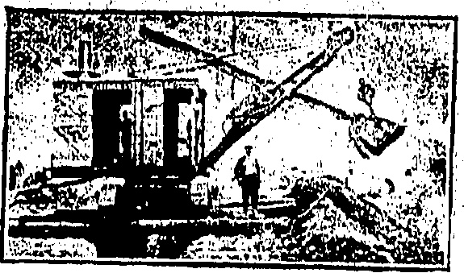

WITH COMPLETE

STEAM

SHOVEL

EQUIPMENT

Try them and you will like them.

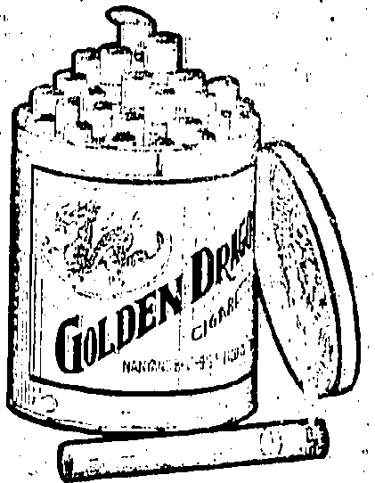

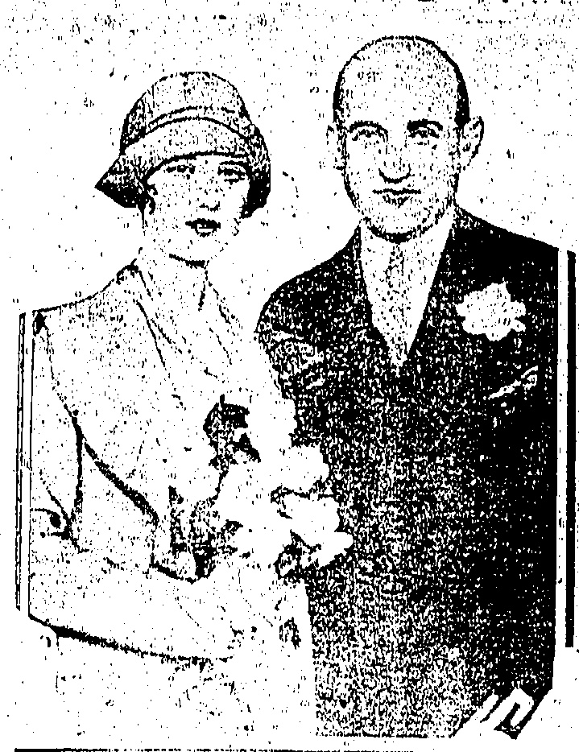

SAM GOLDWYN AND BRIDE, 1982

Pretty Frances Howard movie picture actress, became Mrs. Sam Goldwyn in a quiet wedding in a judge's office. Although the courtship of the motion picture producer was amid the tinsel trappings of a studio, the ceremony was quite matter-of-fact.

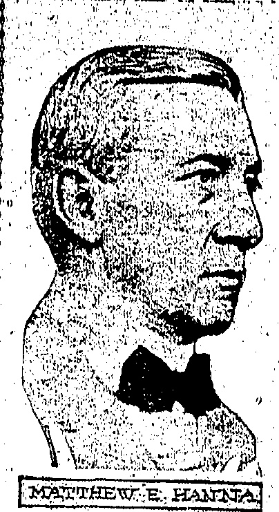

Matthew Eling Hanna, First Secretary of the Embassy in Berlin, is soon to marry the Baroness Gustave von der Tann, daughter of the late Baron George von Rheinlndon, of Prussin. Her first husband was killed in the war and in 1920 she divorced von der Tann.

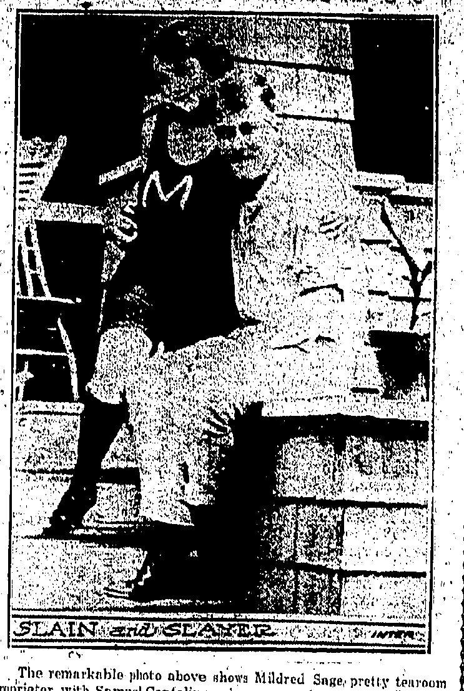

The remarkable photo above shows Mildred Sage pretty teuroom proprietor, with Samuel Cantalino, who was married to another woman. Shortly after this picture was taken she shot him, using two revolvers

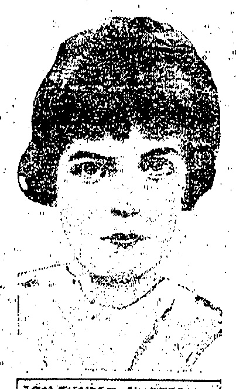

Miss Ducim/e CHANTERON

An armed police with orders to shoot to kill is scouring the vicinity of Granville, Vermont, seeking Miss Lucille Cheaterton, II, believed to have been carried off by an ex-convict.

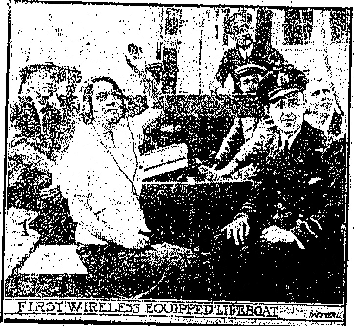

IRST WIRELESS EQUIPPED LIBROQAT

Photo shows Donita 다일보를 관리하는 새로

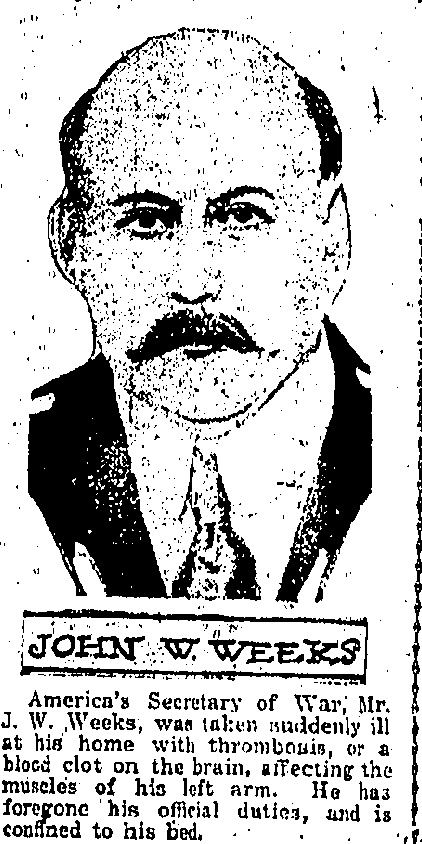

America's Secretary of War, Mr. J. W. Weeks, was taken suddenly ill at his home with thrombosis, or a blood clot on the brain, affecting the muscles of his left arm. He has foregone his official duties, and is confined to his bed.

# MEE FONG STUDIO

Spacious New Premises

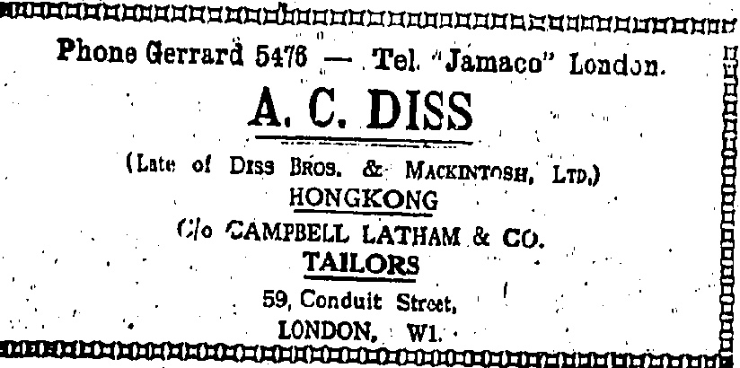

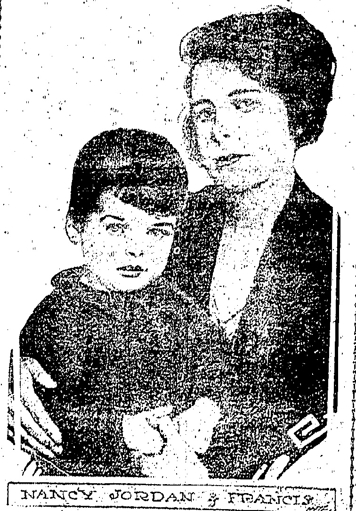

NANCY JORDAN FRANCIS

Miss Nancy Jordan, young English girl who figured in an international war romance several years ago, is the object of a search by the police; following her dispensance. She was recently divorced from Claude Hetherington Clarke.

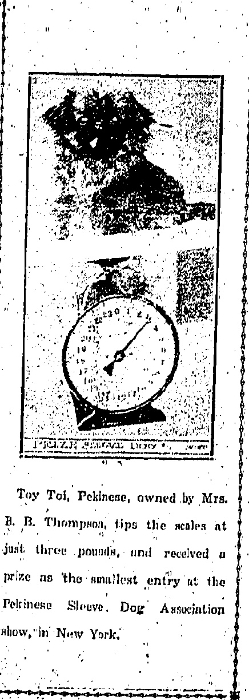

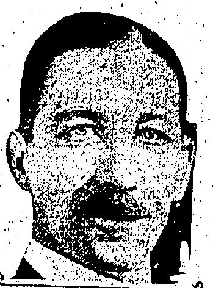

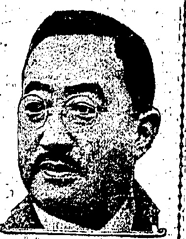

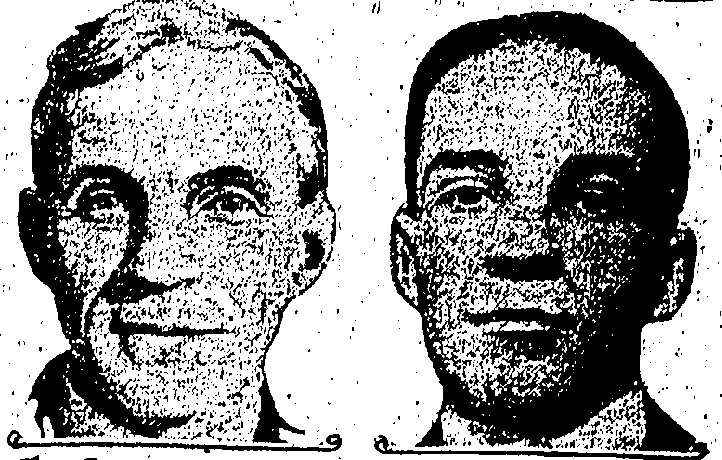

Chow: SIR BRODRICK HARTWELL/F TUNEO MASSUDAIRA

Belw: HENRY & EDSEIL HORD

Sir Brodrick Hartwall, titled rum runner, who has been financing his rum running by paying subscribers 20 per cent. profit in 60 days, has admitted that the activity of revenue cutters has practically wiped out his business. Tsunoo: Matsudaira, Japanese Ambassador to America, has denied that Japan had any secret treaties with Russia. Henry and Edsel Ford, who are already using aeroplanes commercially, are believed ready to engage in the building of huge dirigibles.

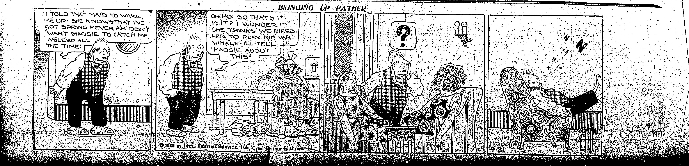

