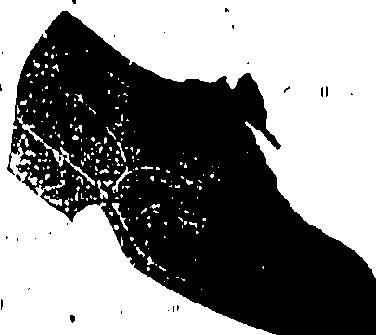
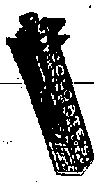
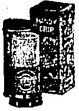
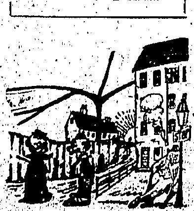
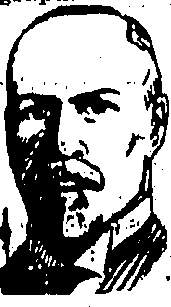

# WATSON'S

## DRY GINGER ALE

Its unique 'dryness,' delightful aroma and rich flavour are features which give this beverage the IMMENSE POPULARITY it deserves.

It has been repeatedly declared by travellers, tourists and others, that WATSON'S DRY GINGER ALE is UNIQUALLED by any similar product throughout the world.

A. S. WATSON & CO., LTD.

AERATED WATER MANUFACTURERS.

## ☐☐☐☐☐☐☐☐☐☐☐☐☐☐☐☐☐☐☐☐☐☐☐☐☐☐☐☐☐☐☐☐☐☐☐☐☐☐☐☐☐☐☐☐

Powell Ltd

Telephone 0. 3146.

QUALITY STYLE AND CHARACTER

STYLE $3850

PRICE $22.50

ONLY FOUND IN

BECTIVE SHOES

WE ARE THE SOLE AGENTS

SHOES SPECIALISTS

PEDDER STREET.

◇◇◇◇◇◇◇◇◇◇◇◇◇◇◇◇◇◇◇◇◇◇◇◇◇◇◇◇◇◇◇◇◇◇◇◇◇◇◇◇◇◇◇◇◇◇◇◇◇◇◇◇◇◇◇◇◇◇◇◇◇◇◇◇◇◇◇◇◇◇◇◇◇◇◇◇◇◇◇◇◇◇◇◇◇◇◇◇◇◇◇◇◇◇◇◇◇◇◇◇◇◇◇◇◇◇◇◇◇◇◇◇◇◇◇◇◇◇◇◇◇◇◇◇◇◇◇◇◇◇◇◇◇◇◇◇◇◇◇◇◇◇◇◇◇◇◇◇◇◇◇◇◇◇◇◇◇◇◇◇◇◇◇◇◇◇◇◇◇◇◇◇◇◇◇◇◇◇◇◇◇◇◇◇◇◇◇◇◇◇◇◇◇◇◇◇◇◇◇◇◇◇◇◇◇◇◇◇◇◇◇◇◇◇◇◇◇◇◇◇◇◇◇◇◇◇◇◇◇◇◇◇◇◇◇◇◇◇◇◇◇◇◇◇◇◇◇◇◇◇◇◇◇◇◇◇◇◇◇◇◇◇◇◇◇◇◇◇◇◇◇◇◇◇◇◇◇◇◇◇◇◇◇◇◇◇◇◇◇◇◇◇◇◇◇◇◇◇◇◇◇◇◇◇◇◇◇◇◇◇◇◇◇◇◇◇◇◇◇◇◇◇◇◇◇◇◇◇◇◇◇◇◇◇◇◇◇◇◇◇◇◇◇◇◇◇◇◇◇◇◇◇◇◇◇◇◇◇◇◇◇◇◇◇◇◇◇◇◇◇◇◇◇◇◇◇◇◇◇◇◇◇◇◇◇◇◇◇◇◇◇◇◇◇◇◇◇◇◇◇◇◇◇◇◇◇◇◇◇◇◇◇◇◇◇◇◇◇◇◇◇◇◇◇◇◇◇◇◇◇◇◇◇◇◇◇◇◇◇◇◇◇◇◇◇◇◇◇◇◇◇◇◇◇◇◇◇◇◇◇◇◇◇◇◇◇◇◇◇◇◇◇◇◇◇◇◇◇◇◇◇◇◇◇◇◇◇◇◇◇◇◇◇◇◇◇◇◇◇◇◇◇◇◇◇◇◇◇◇◇◇◇◇◇◇◇◇◇◇◇◇◇◇◇◇◇◇◇◇◇◇◇◇◇◇◇◇◇◇◇◇◇◇◇◇◇◇◇◇◇◇◇◇◇◇◇◇◇◇◇◇◇◇◇◇◇◇◇◇◇◇◇◇◇◇◇◇◇◇◇◇◇◇◇◇◇◇◇◇◇◇◇◇◇◇◇◇◇◇◇◇◇◇◇◇◇◇◇◇◇◇◇◇◇◇◇◇◇◇◇◇◇◇◇◇◇◇◇◇◇◇◇◇◇◇◇◇◇◇◇◇◇◇◇◇◇◇◇◇◇◇◇◇◇◇◇◇◇◇◇◇◇◇◇◇◇◇◇◇◇◇◇◇◇◇◇◇◇◇◇◇◇◇◇◇◇◇◇◇◇◇◇◇◇◇◇◇◇◇◇◇◇◇◇◇◇◇◇◇◇◇◇◇◇◇◇◇◇◇◇◇◇◇◇◇◇◇◇◇◇◇◇◇◇◇◇◇◇◇◇◇◇◇◇◇◇◇◇◇◇◇◇◇◇◇◇◇◇◇◇◇◇◇◇◇◇◇◇◇◇◇◇◇◇◇◇◇◇◇◇◇◇◇◇◇◇◇◇◇◇◇◇◇◇◇◇◇◇◇◇◇◇◇◇◇◇◇◇◇◇◇◇◇◇◇◇◇◇◇◇◇◇◇◇◇◇◇◇◇◇◇◇◇◇◇◇◇◇◇◇◇◇◇◇◇◇◇◇◇◇◇◇◇◇◇◇◇◇◇◇◇◇◇◇◇◇◇◇◇◇◇◇◇◇◇◇◇◇◇◇◇◇◇◇◇◇◇◇◇◇◇◇◇◇◇◇◇◇◇◇◇◇◇◇◇◇◇◇◇◇◇◇◇◇◇◇◇◇◇◇◇◇◇◇◇◇◇◇◇◇◇◇◇◇◇◇◇◇◇◇◇◇◇◇◇◇◇◇◇◇◇◇◇◇◇◇◇◇◇◇◇◇◇◇◇◇◇◇◇◇◇◇◇◇◇◇◇◇◇◇◇◇◇◇◇◇◇◇◇◇◇◇◇◇◇◇◇◇◇◇◇◇◇◇◇◇◇◇◇◇◇◇◇◇◇◇◇◇◇◇◇◇◇◇◇◇◇◇◇◇◇◇◇◇◇◇◇◇◇◇◇◇◇◇◇◇◇◇◇◇◇◇◇◇◇◇◇◇◇◇◇◇◇◇◇◇◇◇◇◇◇◇◇◇◇◇◇◇◇◇◇◇◇◇◇◇◇◇◇◇◇◇◇◇◇◇◇◇◇◇◇◇◇◇◇◇◇◇◇◇◇◇◇◇◇◇◇◇◇◇◇◇◇◇◇◇◇◇◇◇◇◇◇◇◇◇◇◇◇◇◇◇◇◇◇◇◇◇◇◇◇◇◇◇◇◇◇◇◇◇◇◇◇◇◇◇◇◇◇◇◇◇◇◇◇◇◇◇◇◇◇◇◇◇◇◇◇◇◇◇◇◇◇◇◇◇◇◇◇◇◇◇◇◇◇◇◇◇◇◇◇◇◇◇◇◇◇◇◇◇◇◇◇◇◇◇◇◇◇◇◇◇◇◇◇◇◇◇◇◇◇◇◇◇◇◇◇◇◇◇◇◇◇◇◇◇◇◇◇◇◇◇◇◇◇◇◇◇◇◇◇◇◇◇◇◇◇◇◇◇◇◇◇◇◇◇◇◇◇◇◇◇◇◇◇◇◇◇◇◇◇◇◇◇◇◇◇◇◇◇◇◇◇◇◇◇◇◇◇◇◇◇◇◇◇◇◇◇◇◇◇◇◇◇◇◇◇◇◇◇◇◇◇◇◇◇◇◇◇◇◇◇◇◇◇◇◇◇◇◇◇◇◇◇◇�

WHY GO BLIND?

Take no chances. If your eyes trouble you consult

THE CHINESE OPTICAL CO

## 嚮閒歩鑑卋鑑卋鑑卋鑑卋鑑卋鑑卋鑑卋鑑卋鑑卋鑑卋鑑卋鑑卋鑑卋鑑卋鑑卋鑑卋鑑卋鑑卋鑑卋鑑卋鑑卋鑑卋鑑卋鑑卋鑑卋鑑卋鑑卋鑑卋鑑卋鑑卋鑑卋鑑卋鑑卋鑑卋鑑卋鑑卋鑑卋鑑卋鑑卋鑑卋鑑卋鑑卋鑑卋鑑卋鑑卋鑑卋鑑卋鑑卋鑑卋鑑卋鑑卋鑑卋鑑卋鑑卋鑑卋鑑卋鑑卋鑑卋鑑卋鑑卋鑑卋鑑卋鑑卋鑑卋鑑卋鑑卋鑑卋鑑卋鑑卋鑑卋鑑卋鑑卋鑑卋鑑卋鑑卋鑑卋鑑卋鑑卋鑑卋鑑卋鑑卋鑑卋鑑卋鑑卋鑑卋鑑卋鑑卋鑑卋鑑卋鑑卋鑑卋鑑卋鑑卋鑑卋鑑卋鑑卋鑑卋鑑卋鑑卋鑑卋鑑卋鑑卋鑑卋鑑卋鑑卋鑑卋鑑卋鑑卋鑑卋鑑卋鑑卋鑑卋鑑卋鑑卋鑑卋鑑卋鑑卋鑑卋鑑卋鑑卋鑑卋鑑卋鑑卋鑑卋鑑卋鑑卋鑑卋鑑卋鑑卋鑑卋鑑卋鑑卋鑑卋鑑卋鑑卋鑑卋鑑卋鑑卋鑑卋鑑卋鑑卋鑑卋鑑卋鑑卋鑑卋鑑卋鑑卋鑑卋鑑卋鑑卋鑑卋鑑卋鑑卋鑑卋鑑卋鑑卋鑑卋鑑卋鑑卋鑑卋鑑卋鑑卋鑑卋鑑卋鑑卋鑑卋鑑卋鑑卋鑑卋鑑卋鑑卋鑑卋鑑卋鑑卋鑑卋鑑卋鑑卋鑑卋鑑卋鑑卋鑑卋鑑卋鑑卋鑑卋鑑卋鑑卋鑑卋鑑卋鑑卋鑑卋鑑卋鑑卋鑑卋鑑卋鑑卋鑑卋鑑卋鑑卋鑑卋鑑卋鑑卋鑑卋鑑卋鑑卋鑑卋鑑卋鑑卋鑑卋鑑卋鑑卋鑑卋鑑卋鑑卋鑑卋鑑卋鑑卋鑑卋鑑卋鑑卋鑑卋鑑卋鑑卋鑑卋鑑卋鑑卋鑑卋鑑卋鑑卋鑑卋鑑卋鑑卋鑑卋鑑卋鑑卋鑑卋鑑卋鑑卋鑑卋鑑卋鑑卋鑑卋鑑卋鑑卋鑑卋鑑卋鑑卋鑑卋鑑卋鑑卋鑑卋鑑卋鑑卋鑑卋鑑卋鑑卋鑑卋鑑卋鑑卋鑑卋鑑卋鑑卋鑑卋鑑卋鑑卋鑑卋鑑卋鑑卋鑑卋鑑卋鑑卋鑑卋鑑卋鑑卋鑑卋鑑卋鑑卋鑑卋鑑卋鑑卋鑑卋鑑卋鑑卋鑑卋鑑卋鑑卋鑑卋鑑卋鑑卋鑑卋鑑卋鑑卋鑑卋鑑卋鑑卋鑑卋鑑卋鑑卋鑑卋鑑卋鑑卋鑑卋鑑卋鑑卋鑑卋鑑卋鑑卋鑑卋鑑卋鑑卋鑑卋鑑卋鑑卋鑑卋鑑卋鑑卋鑑卋鑑卋鑑卋鑑卋鑑卋鑑卋鑑卋鑑卋鑑卋鑑卋鑑卋鑑卋鑑卋鑑卋鑑卋鑑卋鑑卋鑑卋鑑卋鑑卋鑑卋鑑卋鑑卋鑑卋鑑卋鑑卋鑑卋鑑卋鑑卋鑑卋鑑卋鑑卋鑑卋鑑卋鑑卋鑑卋鑑卋鑑卋鑑卋鑑卋鑑卋鑑卋鑑卋鑑卋鑑卋鑑卋鑑卋鑑卋鑑卋鑑卋鑑卋鑑卋鑑卋鑑卋鑑卋鑑卋鑑卋鑑卋鑑卋鑑卋鑑卋鑑卋鑑卋鑑卋鑑卋鑑卋鑑卋鑑卋鑑卋鑑卋鑑卋鑑卋鑑卋鑑卋鑑卋鑑卋鑑卋鑑卋鑑卋鑑卋鑑卋鑑卋鑑卋鑑卋鑑卋鑑卋鑑卋鑑卋鑑卋鑑卋鑑卋鑑卋鑑卋鑑卋鑑卋鑑卋鑑卋鑑卋鑑卋鑑卋鑑卋鑑卋鑑卋鑑卋鑑卋鑑卋鑑卋鑑卋鑑卋鑑卋鑑卋鑑卋鑑卋鑑卋鑑卋鑑卋鑑卋鑑卋鑑卋鑑卋鑑卋鑑卋鑑卋鑑卋鑑卋鑑卋鑑卋鑑卋鑑卋鑑卋鑑卋鑑卋鑑卋鑑卋鑑卋鑑卋鑑卋鑑卋鑑卋鑑卋鑑卋鑑卋鑑卋鑑卋鑑卋鑑卋鑑卋鑑卋鑑卋鑑卋鑑卋鑑卋鑑卋鑑卋鑑卋鑑卋鑑卋鑑卋鑑卋鑑卋鑑卋鑑卋鑑卋鑑卋鑑卋鑑卋鑑卋鑑卋鑑卋鑑卋鑑卋鑑卋鑑卋鑑卋鑑卋鑑卋鑑卋鑑卋鑑卋鑑卋鑑卋鑑卋鑑卋鑑卋鑑卋鑑卋鑑卋鑑卋鑑卋鑑卋鑑卋鑑卋鑑卋鑑卋鑑卋鑑卋鑑卋鑑卋鑑卋鑑卋鑑卋鑑卋鑑卋鑑卋鑑卋鑑卋鑑卋鑑卋鑑卋鑑卋鑑卋鑑卋鑑卋鑑卋鑑卋鑑卋鑑卋鑑卋鑑卋鑑卋鑑卋鑑卋鑑卋鑑卋鑑卋鑑卋鑑卋鑑卋鑑卋鑑卋鑑卋鑑卋鑑卋鑑卋鑑卋鑑卋鑑卋鑑卋鑑卋鑑卋鑑卋鑑卋鑑卋鑑卋鑑卋鑑卋鑑卋鑑卋鑑卋鑑卋鑑卋鑑卋鑑卋鑑卋鑑卋鑑卋鑑卋鑑卋鑑卋鑑卋鑑卋鑑卋鑑卋鑑卋鑑卋鑑卋鑑卋鑑卋鑑卋鑑卋鑑卋鑑卋鑑卋鑑卋鑑卋鑑卋鑑卋鑑卋鑑卋鑑卋鑑卋鑑卋鑑卋鑑卋鑑卋鑑卋鑑卋鑑卋鑑卋鑑卋鑑卋鑑卋鑑卋鑑卋鑑卋鑑卋鑑卋鑑卋鑑卋鑑卋鑑卋鑑卋鑑卋鑑卋鑑卋鑑卋鑑卋鑑卋鑑卋鑑卋鑑卋鑑卋鑑卋鑑卋鑑卋鑑卋鑑卋鑑卋鑑卋鑑卋鑑卋鑑卋鑑卋鑑卋鑑卋鑑卋鑑卋鑑卋鑑卋鑑卋鑑卋鑑卋鑑卋鑑卋鑑卋鑑卋鑑卋鑑卋鑑卋鑑卋鑑卋鑑卋鑑卋鑑卋鑑卋鑑卋鑑卋鑑卋鑑卋鑑卋鑑卋鑑卋鑑卋鑑卋鑑卋鑑卋鑑卋鑑卋鑑卋鑑卋鑑卋鑑卋鑑卋鑑卋鑑卋鑑卋�

Use COLGATE'S Ribbon Dental

Cream and Handy Grip Shaving Sticks.

SOLE AGENTS:

The Hongkong Trading Co. Ltd.

HONGKONG.

乙膠鎖狹鎻頗筥筥栞盧杗儱帀瑪朲鑑冚郿亜閰乚鎻丩鎻丩哖怚鄽杙鑬柺鑑

THE MOST FOR YOUR MONEY.

$1.00-ONE DOLLAR-$1.00

BUYS A

DOLLAR DIRECTORY

FOR

1925

IT CONTAINS A MASS OF INVALUABLE INFORMATION WHICH EVERY RESIDENT SHOULD HAVE. DO YOU KNOW—

WHO'S WHO?

YOU CAN FIND ALL THIS AND MUCH MORM DM

THE PUBLISHERS

(China Mail Building)

5, Wyndham St.

# MOUTRIE PIANOS.

PLAYERS. GRANDS. UPRIGHTS.

It is always a source of satisfaction to have things about you that can be relied upon to function as they are supposed to do.

"MOUTRIE" owners have this satisfaction about their Planos

Made for the climate — in the climate — by experienced workmen.

Easiest terms arranged.

S. MOUTRIE & CO., LTD., Chaver Rd.

N. LAZARUS

Ophthalmic Optician

(Hongkong's only European Optician)

12, Queen's Rd. Central.

Manager:—R. A. COOPER

Qualified by Canadian Government Examination

Fellow of the American Optometric Association.

◇◇◇◇◇◇◇◇◇◇◇◇◇◇◇◇◇◇◇◇◇◇◇◇◇◇◇◇◇◇◇◇◇◇◇◇◇◇◇◇◇◇◇◇◇◇◇◇◇◇◇◇◇◇◇◇◇◇◇◇◇◇◇◇◇◇◇◇◇◇◇◇◇◇◇◇◇◇◇◇◇◇◇◇◇◇◇◇◇◇◇◇◇◇◇◇◇◇◇◇◇◇◇◇◇◇◇◇◇◇◇◇◇◇◇◇◇◇◇◇◇◇◇◇◇◇◇◇◇◇◇◇◇◇◇◇◇◇◇◇◇◇◇◇◇◇◇◇◇◇◇◇◇◇◇◇◇◇◇◇◇◇◇◇◇◇◇◇◇◇◇◇◇◇◇◇◇◇◇◇◇◇◇◇◇◇◇◇◇◇◇◇◇◇◇◇◇◇◇◇◇◇◇◇◇◇◇◇◇◇◇◇◇◇◇◇◇◇◇◇◇◇◇◇◇◇◇◇◇◇◇◇◇◇◇◇◇◇◇◇◇◇◇◇◇◇◇◇◇◇◇◇◇◇◇◇◇◇◇◇◇◇◇◇◇◇◇◇◇◇◇◇◇◇◇◇◇◇◇◇◇◇◇◇◇◇◇◇◇◇◇◇◇◇◇◇◇◇◇◇◇◇◇◇◇◇◇◇◇◇◇◇◇◇◇◇◇◇◇◇◇◇◇◇◇◇◇◇◇◇◇◇◇◇◇◇◇◇◇◇◇◇◇◇◇◇◇◇◇◇◇◇◇◇◇◇◇◇◇◇◇◇◇◇◇◇◇◇◇◇◇◇◇◇◇◇◇◇◇◇◇◇◇◇◇◇◇◇◇◇◇◇◇◇◇◇◇◇◇◇◇◇◇◇◇◇◇◇◇◇◇◇◇◇◇◇◇◇◇◇◇◇◇◇◇◇◇◇◇◇◇◇◇◇◇◇◇◇◇◇◇◇◇◇◇◇◇◇◇◇◇◇◇◇◇◇◇◇◇◇◇◇◇◇◇◇◇◇◇◇◇◇◇◇◇◇◇◇◇◇◇◇◇◇◇◇◇◇◇◇◇◇◇◇◇◇◇◇◇◇◇◇◇◇◇◇◇◇◇◇◇◇◇◇◇◇◇◇◇◇◇◇◇◇◇◇◇◇◇◇◇◇◇◇◇◇◇◇◇◇◇◇◇◇◇◇◇◇◇◇◇◇◇◇◇◇◇◇◇◇◇◇◇◇◇◇◇◇◇◇◇◇◇◇◇◇◇◇◇◇◇◇◇◇◇◇◇◇◇◇◇◇◇◇◇◇◇◇◇◇◇◇◇◇◇◇◇◇◇◇◇◇◇◇◇◇◇◇◇◇◇◇◇◇◇◇◇◇◇◇◇◇◇◇◇◇◇◇◇◇◇◇◇◇◇◇◇◇◇◇◇◇◇◇◇◇◇◇◇◇◇◇◇◇◇◇◇◇◇◇◇◇◇◇◇◇◇◇◇◇◇◇◇◇◇◇◇◇◇◇◇◇◇◇◇◇◇◇◇◇◇◇◇◇◇◇◇◇◇◇◇◇◇◇◇◇◇◇◇◇◇◇◇◇◇◇◇◇◇◇◇◇◇◇◇◇◇◇◇◇◇◇◇◇◇◇◇◇◇◇◇◇◇◇◇◇◇◇◇◇◇◇◇◇◇◇◇◇◇◇◇◇◇◇◇◇◇◇◇◇◇◇◇◇◇◇◇◇◇◇◇◇◇◇◇◇◇◇◇◇◇◇◇◇◇◇◇◇◇◇◇◇◇◇◇◇◇◇◇◇◇◇◇◇◇◇◇◇◇◇◇◇◇◇◇◇◇◇◇◇◇◇◇◇◇◇◇◇◇◇◇◇◇◇◇◇◇◇◇◇◇◇◇◇◇◇◇◇◇◇◇◇◇◇◇◇◇◇◇◇◇◇◇◇◇◇◇◇◇◇◇◇◇◇◇◇◇◇◇◇◇◇◇◇◇◇◇◇◇◇◇◇◇◇◇◇◇◇◇◇◇◇◇◇◇◇◇◇◇◇◇◇◇◇◇◇◇◇◇◇◇◇◇◇◇◇◇◇◇◇◇◇◇◇◇◇◇◇◇◇◇◇◇◇◇◇◇◇◇◇◇◇◇◇◇◇◇◇◇◇◇◇◇◇◇◇◇◇◇◇◇◇◇◇◇◇◇◇◇◇◇◇◇◇◇◇◇◇◇◇◇◇◇◇◇◇◇◇◇◇◇◇◇◇◇◇◇◇◇◇◇◇◇◇◇◇◇◇◇◇◇◇◇◇◇◇◇◇◇◇◇◇◇◇◇◇◇◇◇◇◇◇◇◇◇◇◇◇◇◇◇◇◇◇◇◇◇◇◇◇◇◇◇◇◇◇◇◇◇◇◇◇◇◇◇◇◇◇◇◇◇◇◇◇◇◇◇◇◇◇◇◇◇◇◇◇◇◇◇◇◇◇◇◇◇◇◇◇◇◇◇◇◇◇◇◇◇◇◇◇◇◇◇◇◇◇◇◇◇◇◇◇◇◇◇◇◇◇◇◇◇◇◇◇◇◇◇◇◇◇◇◇◇◇◇◇◇◇◇◇◇◇◇◇◇◇◇◇◇◇◇◇◇◇◇◇◇◇◇◇◇◇◇◇◇◇◇◇◇◇◇◇◇◇◇◇◇◇◇◇◇◇◇◇◇◇◇◇◇◇◇◇◇◇◇◇◇◇◇◇◇◇◇◇◇◇◇◇◇◇◇◇◇◇◇◇◇◇◇◇◇◇◇◇◇◇◇◇◇◇◇◇◇◇◇◇◇◇◇◇◇◇◇◇◇◇◇◇◇◇◇◇◇◇◇◇◇◇◇◇◇◇◇◇◇◇◇◇◇◇◇◇◇◇◇◇◇◇◇◇◇◇◇◇◇◇◇◇◇◇◇◇◇◇◇◇◇◇◇◇◇◇◇◇◇◇◇◇◇◇◇◇◇◇◇◇◇◇◇◇◇◇◇◇◇�

## The China Mail

(Every evening except Sunday. Annual subscription, excluding postage abroad, H.K. $36, payable in advance. Local delivery free.)

@orland China Mail

(The weekly edition of the "China Mail." Annual subscription, exobiding postage abroad, UK $12, payable in advance.)

No. 5,WYNDLAH ST., HONGKONG

Telephones Central 22 & 4641. Cable Address:—Mail Hongkong.

All communications should be addressed to the Newspaper Enterprise, Ltd., to whom all remittances should be made payable.

London Offices:—Tbn Far Eastno Advertising Agency (London), Ltd., 24, Devonshire Street, Bloomsbury, W.C.1.

## BIRTH

CLARKE.—On June 8, 1925, at Dr. Fearn's Sanitorium, Shanghai, to Mr. and Mrs. N. W. B. Clarke, a daughter.

## DEATHS

BULLDEATH.—On June 1, 1925, at Swatow, Millie, dearly beloved daughter of Mr. and Mrs. R. Buldeath, C. M. Customs, Swatow, aged 18 months. Deeply mourned. NESVADBA.—On June 8, 1925.

## Hongkong: Friday, June 12, 1925

## NOT INIMICAL

Once again attention has been directed in the House of Commons to the campaign "by those interested" against the Treaty rights of foreigners which are alleged to be inimical to the well-being of China. That is not only a mere shibboleth, the constant reiteration of which is becoming wearisome, but it is a gross perversion of the truth. The statement by Mr. Ronald McNeill was made in the course of a reply to a number of questions regarding the Shanghai trouble, when the Under Secretary for Foreign Affairs expressed the opinion that the origin of the disturbances was owing to the lack of a strong Central Government, destructive wars, and irritation of the Chinese with petty local rulers, resulting in discontent. Furthermore, he pointed out that industrial conditions hardly operated at all as part of the cause of the troubles, and he called attention to the very striking fact that the strike began

the conditions were equal or superior to anything in China. And he clinched the position so far as Great Britain is concerned by stating that it is intended to seek a solution of the difficulties in a conciliatory spirit, whilst insisting on the maintenance of law and order in the foreign Settlement.

The bitterest partisan of the anti-foreign movement in China can find little to complain of in a policy of the kind enunciated by Mr. Ronald McNeill. If there is the slightest defect in the treaties between China and the Powers the foreign diplomats on the spot may be trusted to bring such to the notice of their respective Governments with a view to revision. But it is not the place of interested outsiders—if the phrase be permitted—to make those treaty rights a bone of contention between China and the subjects of the Powers. The best possible proof of the equity of those treaty rights in the foreign-Settlement is to be found in the fact that nearly two million Chinese are content to live therein and enjoy the solid protection that these afford in preference to the shadowy and fleeting protection of the Chinese in their own distinct territory. Why is it that these two million Chinese have not "packed up" long ago and gone to live under the Chinese flag and not under the flags of the foreign Powers? The answer is obvious—life would not be worth living for the very reasons that have been cited above as the causes of the present disturbances: the lack of a strong Central Government, destructive wars and the irritation caused by petty local rulers. Furthermore, on the score of industrial conditions, these may not be exactly perfect, but even in the Japanese cotton mills they "are the equal or superior to anything in China." Wherein, then, can the treaty rights of foreigners be inimical to the well-being of China? Until the Bolshevik intrusion in Chinese affairs, precious little was heard of those treaty rights being inimical. The best brains of the Chinese themselves made China a party to such treaty rights, and they in their day never conceived any idea of repealing them either by conciliation, or by propaganda, or by violence. Why, then, should the Chinese leaders of today harken to the evil counsels of outsiders whose interests are certainly not the interests of China? Until China rests out those evil spirits in her midst regains her former confidence in the Powers.

her own house in order, she cannot be expected to occupy that place in the comlity of nations in the Far East in which her best friends would like to see her.

The day is past when there can be any truth in the allegation that the foreigners are only out to exploit the Chinese with a ruthless disregard for the ethics of business morality. To-day the foreigners are as convinced as the Chinese themselves that a peaceful and tranquil and settled China is not only the best in the interests of China herself but also the best in the interests of the Far East, commercially, socially, and educationally. What is more, the Powers are anxious to assist China toward this very desirable end without a thought of mercenary exploitation. It but remains for China to help herself first!

## Traffic Sense

The Chinese generally are accused of lacking what is known as a traffic sense. It would be interesting to know how far past and present authorities have helped to make the absence of that sense more pronounced. The earlier Governments had probably no idea of the expansion that was to take place later. They jogged along a day at a time and narrow and rural roads were the rule and not the exception and sufficed for the number of residents and the mode of traffic then in vogue. Those in charged during the last decade must be accused of a lack of foresight. And even to-day that lack seems much in evidence. Legacies from early days are still in evidence. Quite a number of roads can be indicated where there is either no side-walk for the pedestrian, or so little of one as to make walking on it no attraction at all. The pedestrian—European as well as Chinese — cannot be blamed if he or she clings to the moderate spaciousness of the middle or near middle, portion of a road. The attempt to dislodge either from it has failed as is clearly proved by the failure of the Captain Superintendent of Police to get pedestrians to keep to the sidewalks. Evidence of the Government's lack of foresight is shown in the number of times new roads have been widened to make room for motor traffic. All along it has been motor traffic first—others not at all. A walk along the Praya East reclamation bears this out. For a considerable portion of it there is no room for the pedestrian at all. The space is there but in the main it is given over to temporary buildings, some verging to the edge of what was once a sidewalk. It is useless expecting people to keep to the left, or right, if no opportunities are available for so doing. The wonder is that there is not a daily list of accidents. This must be ascribed to that Providence said to watch over drunks and fools; certainly not to the Government.

## THEY SAY THAT-

Those who build houses should be as proud of their work as those who built cathedrals.—Mr. H. R. Selley.

The modern man does not worship a golden calf, but he is in danger of worshipping a fixed bath.—Lord Hugh Cecil.

The faunting of luxury by the popular Press is a far greater asset to the agitator than his own papers.—Dr. A. Shadwell.

An incorrigibly bad citizen ought to be removed, not because he is atrociously wicked, but because he is an intolerable nuisance.—Denn Inge.

The ordinary, member of Parliament, I fear, regards his constituency rather as a wild beast from which he successfully fled than as an old friend whose wishes he must constantly consult.—Mr. G. K. Chesterton.

## TO-DAY'S SMILE

During the war when those Cool. South African soldiers Generals Botha and Smuts were much to the front in Europe, two young flappers of sixteen or so approached General Smuts and asked for his auto-

# SHREDS AND PATCHES.

“I haven't got a f o u n t ain-pen,” said the General, much flattered. “Will pencil do?” “Yes, said the other flapper.

"Can you trust Jensen with anything?"

"Oh, yes. I lent him 100 Kroner months ago, and he never says a word about it!"

Klods Hans, Copenhagen

"So I took out my pencil," related the General who loved to tell the story, "and signed my name in the little book that she dainty bound little book that she had given me.

"The flapper studied the signature with a frown."

"Then she looked up and said:

" 'Aren't you General Botha?'

" 'No,' I said, 'I'm- General

Smuts.'

“The flapper turned to her friend with a shrug of disgust. ‘Lend me your india-rubber, May,’ she said.”

ICE CREAM. grow on trees in the backyard of America. A report of the discovery by experts of the Depart- partment of Agriculture of cherimoyas, or "vegetable ice cream trees," growing in Ecuador, has attracted attention in Wall Street, which is the part of New York in which ideas and money ultimately meet, and if it should succeed in making any mouths water there, it may easily stimulate a correspondent flow of capital. It should appeal at once to the soda fountain seneschals, of course, for it is said to combine in each mouthful the flavours of bananas, pineapples and strawberries. An attempt to send the fruits to New York and Paris was made several years ago, the Ecuadorian Consul-General in New York says, but the trip was too long to avoid losing the flavour, and the cotton packing required to keep the very soft skin intact made them too expensive. It ought to be possible, however, the Consul believes, to grow the trees from their small nuts at least in the warmer parts of the United States. After a little acclimatization, of course, the trees will probably be crossed with wheat and the ice cream cone industry established on a permanent basis.

Judged by the number of FUN. shootings in America by women the hand that账

FUN. shootings in America by women the hand that rocks the cradle also pulls the trigger. Jazz music is dying, we read. That is why it sounds like that.

A suspicious man is a Scotsman who, when asking for a glass of whisky, takes a hazel twig with him.

A convention of the world's fat men is to be held in Vienna if room can be found for them.

America is said to have more gold than any other country, and this is not the first time Americans have had gold thrown in their teeth.

A woman's idea of it would be "to have and to hold."

An Aberdeen man is reported to have fainted in a taxicab. He had been watching the meter.

The Melbourne under ADVERTISE. taker was conveying an elderly invalid to

a hospital in his private ambulance one day last week, when the bright thought occurred to him. Turning to one of the relatives he whispered: "If anything happens to the old chap you won't forget the firm, will you?"

Playing cards have been CARDS. called the Devil's Books.

and coming to us from the East where they are of remote antiquity, they have been used for spells and divination through numberless ages. To attempt anything like a detailed description of these is difficult, but it may be added an old tradition. Declares whoever gets the deuce of Clubs will have a run of good luck, while the four of Clubs — sometimes called the Devil's Bedstead—is a sign of misfortune. Brand, in his "Antiquities," quotes "an old chapbook" as giving the following account of how the future may be read by the drawing of cards blindfold from the pack:—

This noble king of diamonds

shows---

Thou long shalt live where pleasure flows;

But when a woman draws the king, a Great melancholy songs she'll

Great melancholy songs she is sing.

Now if the Queen of Diamonds

She shows thou. shalt some office bear;

U, Woman, it she falls to you, Friends thou wilt have and not a few.

If now the Knav of Diamond. come,

Be sure to be aware the martial drum;

Yet if a woman draws the knave,

She shall much better-fortune have.

He that draws the ace of hearts

Shall surely be a man of parts; But she that draws it, I profess,

It doth betide her cruel hard. The man who gets hold of this tray,

Will sure drink brandy by the aunt.

... It is... unfortunate---or the reverse --- that Brand's quotation breaks off here and gives the meaning of no other cards.

# CREASED TROUSERS.

The passionate loyalty of the Labour party to their leader, we learn with surprise and regret, draws the line somewhere—draws it, in fact, at Mr. MacDonald's trousers, remarks the "Daily Telegraph" (London.) This would seem a domestic matter best settled at one of those happy gatherings of the party in which the followers, going into secret session, tell the leaders how to behave. But Mr. Ramsay MacDonald's is one of those sensitive souls which cannot bear to suffer without a cry; and he has never been so affecting as upon his trousers. It appears that certain ignoble creatures in the ranks of Labour have cast it up against Mr. MacDonald that his trousers are too elegant. We do not know how to express our emotions about this, but if we may say so without offence, we are surprised and horrified. Conscious of virtue, he might well have disdained such slander. But his gentle nature could not bear it. He had to tell the miners of Cymmer the whole history of those trousers. It is an affecting story, perhaps a little too pitiful for a May Day festival, but glowing with him, interest. On his recent holiday Mr. MacDonald took out an old pair of trousers and found when he put them on they had a beautiful crease. He happened to be photographed in these. It was then said that he had deserted the workers because the crease in his trousers showed that he was getting far too respectable. But this is not all. All another time he went into most respectable company.

and some newspapers said that "he turned up in a hat much worn and a pair of trousers not pressed for some time." We do not know which was the most unkindest cut of all, but any sympathetic mind will understand how this sort of thing hurts a man like Mr. Ramsay MacDonald. The wickedness of criticism is not even satisfied with the trousers. He is, he explained to the miners, moving. We seem to have heard of it—about the size of the drawing-room which is going to be a library, and the bantams which are to be kept in the garden. Mr. MacDonald, like Mr. Crummies, must wonder how these things get into the papers. But the dreadful thing is that, although his doctor has really ordered him "out of a house in which he is overcrowded," the miners are told, "He is now a plutocrat; you should turn him out." No wonder that in anguish of soul he appeals to his miners. "Now what am I to do?" But in our dull bourgeois, why we could suggest one or two medientive things which he might do. He might cease to cry out so loud every time he is hurt. He might train himself to believe that he is, after all, much as other men are. He might abstain from making speeches which proclaim that everybody who enjoys a comfortable income, everybody who is as well off as he is, is a brutal capitalist grinding the faces of the poor. For until he practises that form of self-control it is very probable that the attacks which he delivers on people who live as he does will be directed by his faithful followers to his own address.