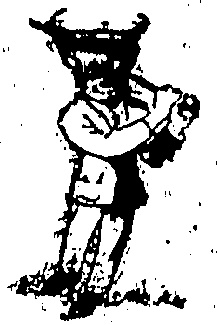

# “CHINA MAIL” SPORTS PAGI

## BRITAIN WINS

DADES INTERNATIONAL TENNIS

At Rochampton, in an international ladies' dawn tennis match, Britain beat Australia (the Australian ladies Wimbledon team) by 5 matches to 8.

[ Four fudies have travelled from Australia to compete at Wimbledon, viz., Miss Daphnia Akhurst, Mrs. Sylvia Harper, Miss Esma Boyd and Mrs. Gwen Utz.]

#### U. S. INVASION

WIMBLEDON TENNS

PROSPECTS.

### (Router's Service.)

At Eastbourne, Britain head America (Wimbledon contingent at lawn tennis by 3 matches to 2 (4 singles and 1 doubles as in Davis Cup tiea).

Hennessey (America) beat J.D.P. Wheatley 7-5, 6-2, 4-6, 7-5.

Gilbert (Britain) beat Censey 9-7, 9-7, 6-3.

[The Wimbledon championship commence on Monday, June 22.] WHO THEY ARE.

Of America's 1925 Wimbledon team, A. Wallis Myers, C.B.E., writes:—

The six American players who are coming to Wimbledon in June to play an international match against England and to compete in the championships will, with two exceptions, be making their debut in this country. They are a young, post-war team, and their advent in our midst is another proof of the United States Association's desire, by an interchange of players, to strengthen the ties of friendship.

Charles (“Chuck”) S. Garland is the oldest member of the team, and will lead it. He was here in 1920 with the American Davis Cup team which beat England and France. In partnership with R. N. Williams he won the doubles championship at the old Wimbledon, defeating Tilden and Johnston in the semifinal, and Paike and Kingscote in the final. Pressure of business in Pittsburgh kept Garland out of the game for two years after his return to America, but he is now resident in New York, and has made a welcome reappearance on court. John Henmessey, hailing from Chicago, is one of the Middle West players, trained on "dirt" courts, who have sprung to the front in the last year or two. He beat G. L. Patterson and B. I. C. Norton in his own district last summer, and at Forest Hills in September was responsible for Jean Borotra's defeat in the America championship. He is ranked No. 7 in his own country.

Ray - Casey, like Johnston and McLoughlin, has emerged from the golden gate of the West. He is ranked No. 2. in California, and won the doubles championship of Mexico with Vincent Richards last year, the pair defeating the brothers Kinsey; the present doubles champions of America. He has a powerful service and a smash almost as violent. Lucien Williams, a former captain of Yale, and ranked No. 11 in the national list, visited England with the Yale and Harvard University team in 1922. He is now the third best player in the Middle West, coming next to Hennessy and George Lott, the U.S.A. junior champion. Of Lawrence B. Rice, the New England player, Tilden has always held a high opinion. He was No. 9 in America in 1921 and No. 11 in 1922. At present he is No. 15, but his opportunities for play have been restricted by business ties, and he may very well shine over here as brightly as any of his fellows.

The American team will probably compete in the French national championships at St. Cloud before coming to Wimbledon. The majority of them have learnt and developed their game on non-turf courts; they will indeed, be more at home on the Paris courts than at Wimbledon. They may not contain a Wimbledon winner among them, yet they are all products of the modern, aggressive, quickfooted school, and their presence at Wimbledon is sure to provide a stimulus—and possibly a surprise.

## RECORD ROUND

NORTHERN GOLF PRO.S'

TOURNEY.

ABE MITCHILL TOP.

(Réuter's Service.)

London, June 18.

At Lytham, St. Anne's the northern professional golf championship which was most interesting in view of the proximity of the Open Championship, was won by Abe Mitchell

Abe Mitchell.

with a score of 305 over 72 holes. His first round was done in 71, course record.

All the leading professionals were engaged.

## TENNIS LEAGUE

THREE DIVISIONS THIS SEASON.

YESTERDAY'S MEETING.

Three sections, A, B and C, instead of two last year, was the principal change advocated at yesterday's meeting of the Hongkong Lawn Tennis League, in the H.K.C.C. Pavilion.

Representatives were present from a good many clubs and Mr. G. Miskin presided. Mr. Miskin proposed and Mr. S. E. Green (the ex-champion) seconded the proposal anment on extra league division. Other matters discussed included the playing of fixtures on Wednesdays and Saturdays and the opening date which was ultimately fixed for June 27.

Mr. R. Hancock was elected President; Mr. G. Miskin vice-president and Mr. C. W. E. Bishop, hon. secretary.

Subject to confirmation teams will be entered as follow:—

H.K.C.C., Kowloon C.C., Indian R. C. and Chinese R. C.: one team in each of the three divisions.

Mitsui Busson Kushu, University

id United Services R.C., teams

A and B divisions.

and Craigengower C.C., teams in B and C divisions.

Royal Engineers, division C.

The number of teams for each

division, tentatively, is 7 in A, 10 in B. and 8 in C.

## COUNTY CRICKET

## NOTT'S WIN AT TRENT BRIDGE

## LATEST MATCH

London, June 18.

At Trent Bridge, Nottingham,

Notts defeated Worcestershire by

seven wickets after two days' play.

Scores.

Worcester (1st innings) 161. Williams (?) scored 56.

Worcester (2nd innings) 110.

Higgins (H. L. or J. B.?) scored

50. Staples, S. J., took 4 wickets

for 29 runs and Larwood, H., 3 for

19.

Notts (2nd innings) 100 for 8 wickets.

## WEEK-END SPORT

LEAGUE BASEBALL FIXTURES.

A "DOUBLE-HEADER."

Baseball fixtures for this week end are:—

Saturday, Filipino Club v. Volunteer Defence Corps; Hongkong Baseball Club v. University Baseball Club.

Sunday, South China A.A. v. Indian Recreation Club.

## HOME TURF

## ASCOT GOLD CUP RESULT

FAVOURITE THIRD

(Reuter's Service.)

The Gold Cup (2½ miles) at Ascot resulted:—

Six ran. Won by a length. Four lengths between second and third.

Starting prices: —10/1 against Santorb, 4/1 Salmon Trout, evens St. Germans

[All the placed horses were among the best of last year's three-year-olds. Santorb was second to the St. Leger which was won by H. H. the Aga Khan with Salmon Trout and St. Germans was second in the Derby for Lord Astor

## OLYMPIC GAMES

AMERICA FAVOURS LOS ANGELES.

SUGGESTED VENUES.

New York, May 12.

The Olympic Council is considering offers from Rome, Berlin, Paris, and Lausanne.

The question of the eligibility of Eric H. Liddell to compete this summer in the races of Edinburgh University having been raised, it has transpired that as a student at an Edinburgh Theological College he was qualified to take part in the Edinburgh University sports, the Scottish inter-varsity sports and in the Scottish championships on June 27, but this meeting will be his last appearance on the Home track, for he is due to sail-for China on missionary work in the following week.

To-day a two-day fixture commences at Lord's, M.C.C. v. Royal Artillery.

equal with whom they were

Results of other matches now being played but not completed will be published in tomorrow's "China Mail."

To-Morrow's Fixturing.

Several important matches: commence to-morrow, the programme being:—

Overall.—Burrey v. Somerset.

Hull.—Yorkshire v. Leicester

Birmingham.—Warwickshire

Kent.

Kettering.—Northamptonshire

Manchester. — Lancashire

Hampshire.

Chesterfield.—Derbyshire v. Worcestershire.

Brigation.—Sussex v. Cambridge

University.

Oxford University,

## LAWN BOWLS

## LATEST LEAGUE PROSPECTS

NOTES AND COMMENT.

The following is the league

rogramme for to-morrow:

Civil Service C.C. v. Taikbo

R. C.

Kowloon Dock R.C. v. Kowloon

Kowloon's Dock R.C. v. Kowloon B. G. Club.

Kowloon C.C. v. Craigengower

C.C.

SECOND DIVISION.

Taikoo R.C. v. East Point R.C.

Indian R.C. v. Police R.C.

R.H.K. Yacht Club v. Kowloon

C.C.

Last week's results were about as expected, although. Taikoo managed a wonderful victory against the Dock Club, I understand that with two rinks finished and the third rink only two heads to go, Taikoo wanted nine to win. They laid a five and a four and thus pulled the game out of the fire, scoring an almost impossible victory.

.The Bowling Green Club decisively defeated〉the Cricket Club, whilst Craigengower retain their position at the head of the league by a fine victory over the Civil Service on the latter's green.

The Police, by defeating the Taikoo second string by a substantial margin, retain their unbeaten record in the second division. They seem almost certain to gain promotion at the end of the season. Playing with a very weakened team at Sookumpoo, the Kowloon Cricket Club were overwhelmed by the Indians, whilst at East Point the home team secured their first win at the expense of the Yacht Club.

## * * * *

From a visit paid to the various greens in the Coolny it seems that none has suffered any special damage from the very heavy rains. The Civil Service green had a marvellous escape, thanks to the high banking around it. The Police-green has a little mud on it but this should be cleared in time for their next home game.

Of the games to be played in the first division, that between the Civil Service and Taikoo would appear to be the most interesting, for the home team will need to win to save themselves from relegation, whilst the visitors will try hard for the two points to keep them in the running for the championship.

Having previously drawn their game, both sides scoring 57 points, the return. Kowloon "Derby" between the Dock and the Bowling Green should also be very-interesting. With the advantage of playing at home, the Dock should win.

Judging from the Cricket Club's recent form, Craigen-gower, although playing away, should secure the two points.

In the second division, Taikoo should dispose of the East Point team. I understand the K.C.C. team will be considerably weakened by the absence of some of their best players to-morrow and the Yacht Club might, with a slice of luck, pick up two valuable points.

The Police are visiting the Indians' ground with a firm determination to lower the home team's undefeated (home) record. They appear to be the only team who are likely to do it, but they will need to play all they know to accomplish this. Should they do so, their chances of going through the competition undefeated will be rosy.

The "Watson Cup" rink competition: The following have been selected to represent the Police R.C. in the above competition: A. Clark, A. Reid, J. Grant and J. Clark (skip).

## BOWLING TALENT

LANCASHIRE'S MANY

Now that E. K. Macdonald, the Australian fast bowler has joined up with Lancashire, Nelson, the league cricket club have soared the series of J. M. Blunkenberg, the South African Test Match number.

## TROUBLE

## TO-DAY'S EARLIER CABLES

OUTLOOK GRAVER.

## PERKING AGITATORS MAKING MISCHIEF

(Router's Service.)

## Peking, June 18

Despite official statements that every effort would be made to prevent anti-foreign riots, nothing is being done to hinder dangerous inflammatory agitation.

Thousands of incendiary and provocative posters have been posted up throughout Peking, this morning, depicting British police shooting and bayonetting defenceless students, women and children lying on the ground.

While thus stirring up the masses, students and other educated Chinese refuse to face the real facts.

Mr. Palaret H.B.M. Chargé d'Affaires, unofficially offered to see the student deputation and explain the British point of view, but the offer was refused. The vernacular papers are mostly refusing to print Reuter telegrams. They are inserting an absurdly garbled version of events. For example: The Japanese at Hankow are alleged to have injured each other; the foreign buildings at Kiukiang caught fire themselves; while the Yi Ship Pao asserts that Mr. Mackenzie died of sickness and that the British Consul ordered the doctor to mutilate the remains and then accused the Chinese of murder.

## Negotiations Broken Off

The diplomatic commission has broken off negotiations, owing to the divergence of Chinese and Foreign views.

The commission, sent to Shanghai by representatives of the interested Powers in order to investigate recent events and endeavour to find an immediate solution of the difficulties which were the direct outcome of those events, met the Chinese delegates to day for the third time, at the office of the Commissioner for Foreign Affairs.

At this meeting, the commission handed to the Chinese delegation certain concrete proposals which in their opinion, constituted a fair basis for settlement.

The Chinese delegation presented, once again to the commission a series of demands, which had no direct connection with the recent regrettable occurrences, although the commission had been careful to emphasise from the very start that it had not been authorised to deal with these points.

The Chinese delegation intimately, moreover, that these points must be dealt with at the same time as the incidents themselves.

## Shanghai, June 18

It is to be noted that the instructions given to the commission are based on the Note, addressed to the Legations by the Waichiaopu, in which mention only is made of four points, all of which are directly connected with the incidents themselves.

Under the circumstances, these two points of view would seem to be altogether too divergent to admit of any hope of an early solution on the spot; and the commission has, in consequence, decided to leave for Peking tonight.

The previous message was an official translation of the French text of the communiqué on the matter. The commission entrains to night; and the whole question, therefore, goes back to Peking.

It is understood the Chinese delegation to-day presented the whole thirteen original demands, including the rendition of the Mixed Court; the dismissal of the Secretary of the Municipal Council and that municipal franchise be given to the Chinese.

### Troops for Peking. Peking, June 18

The Note sent yesterday, to the Walchiapou by the interested Powers, was discussed at a Cabinet meeting to day. As a result, it is understood that the Walchiapou has been instructed to draft a Note in reply, controlling the statements made:

Two brigades of War Minister Wu Kwang-hsin's Fengtien troops have arrived in the vicinity of Peking.

In Chinese military circles it is explained that they will act as special guards for the Chief Executive.

Marshall Chang Tso-lin has also sent one battalion for special police duty in Peking.

Shanghai Hot heads

Shanghai June 16

The shipping aides are streaming. The Fortune What Collies struck this morning, also the staff in the National

## PLUCKY WOMEN

## ROBBERS WHO CAUGHT TARTARS

## FIVE YEARS APIEOE

In each of three cases of robbery or attempted robbery heard yesterday at the Criminal Sessions the prisoners owed their appearance to the plucky conduct of the women of the households whom probably they had looked upon as easy victims.

Escaping from her bonds and ungagging herself a woman at Shanghai Street, Mongkoktsui, pursued one of the robbers who had taken jewellery from the house. Her action led to his arrest and he was sentenced to five years' imprisonment.

One of four women playing dominoes in a house at Chatham Road, Hunghom, when robbers rushed in and presented revolvers had the pluck to defy them and run to the verandah blowing a police whistle. The intending robbers immediately decamped but one was captured by Mr. Fokin, of Alex Ross and Co., who was passing by.

The captured man was sentenced to five years' imprisonment.

The spirited resistance of a woman at Shamshuipo scared other robbers who entered a house in Ki Lung Street, and they decamped without taking anything. A Chinese living on the bottom floor grappled with one of them and managed to detain him until the police arrived and he also was sentenced to five years' imprisonment.

though the tugs and launches are still working.

Ocean-going steamers are not yet affected but there is apprehension in this respect. Otherwise the situation in the Settlement is unchanged.

On the other hand, there have been renewed activities by the extremists in the adjoining Chinese territory, where students are haranguing crowds and tearing down British and Japanese advertisements.

Ninety former members of the Municipal Police led a huge procession into Chapei yesterday.

They smashed the windows of shops; containing British and Japanese goods, until General Chang Hsueh-liang's troops interfered and subdued the growing frenzy of the mob.

The crowd, subsequently, sent a delegation to ask General Chang Hsueh-liang to throw in his lot with the strikers; Chang counselled prudence and patience.

Late last night, strikers started a fire at the Japanese Kungdah Cotton Mill, but the police discovered the lighted cotton and extinguished it, before much damage was done.

## A General Summary

## Shanghai, June 17

A wireless message states that despite the former assurances of the Chungking Commandants, the agitation has again flared up and the situation has become critical. The British Consul was forced to leave the Consulate and has taken up his residence at Lungmen Temple.

Britons have been stoned and assaulted in the streets.

H.M.S. Tael is protecting the Asiatic Petroleum Company's installation.

A message from Swatow states that it is expected the strike will extend to shipping.

No news is to hand either from Amoy or Swatow.

Kiukiang reports gradual improvement.

Information from - Hankow shows that the situation is quiet. A number of posts have been reduced, but a strong emergency party is kept in readiness. H.M.S. Hollyhock has left Han-

H.M.S. Hollyhock has left Han

kow for Nanking.

H.M.S. Foxglove, from Wei-hai-wei is due at Shanghai to-day. Chungking is Silent.

There is no further news fron Chungking and the U.S.S. Palosi on its way there.

Lung Men-hao, whither the Consul has gone, is on the South side of the river. It is sparsely populated with Chinese, but there are a number of foreign residences there.

## MOTORIST CHARGED

### MR. WERSCHKUL'S EVENING RIDE

## REPULSE HAY INCIDENTS

The greater part of three hours was taken up at the Central Magistracy yesterday afternoon with the hearing of the case against Mr. Howard T. Werschkul, a young American flour broker, who was charged with causing bodily harm to an Indian watchman in the employ of the Repulse Bay Hotel by wanton and furious driving.

The case for the Crown was that he drove a car in a zigzag course past the entrance to the Hotel on the night of Saturday, June 6, that he had not full control of the car and that as a result he knocked down the watchman who was standing outside the Hotel.

Witnesses called all attributed to the defendant's car a dangerous speed for such a spot. Mr. F. G. H. Haslam, who watched the car's progress from the main flight of steps leading up to the Hotel while he was waiting for his own car, said that the occupants were laughing and singing. The car was zigzagging along the road at a speed of about 20-25 miles an hour. He did not see the watchman but heard the crash. The car did not stop. Mr. M. M. Maas, of the A.P.C. gave corroborative evidence.

Mr. C. Edwards, of the Hongkong and Shanghai Bank, who was waiting at the foot of the steps to the Hotel in the main road said that the car was travelling at considerable speed and cut in on another car in such a manner that it caused simultaneous exclamations of surprise from himself and others who were with him. He should think it was going at 18 miles an hour when it passed the Hotel.

Mr A. Grimmett, of the Revenue Office, who was outside the Hotel at the time at the top of the steps said that he thought the car was going to run over the spot where he and his wife were standing. He pushed his wife out of the way and jumped clear himself. The car swerved and hit the watchman on the opposite side. Witness called to the driver to stop but the latter took no notice. The car was going at about 25 miles an hour in his opinion. He noticed that the number was 175.

Mr. Graham, of the Colonial Secretariat, said that the Indian watchman seeing his danger jumped in an attempt to get clear but was caught and carried for some yards.

The injuries sustained were a fractured thigh bone and abrasions, said Dr. W. L. Paterson.

The case for the Crown having been closed the defendant went into the witness box.

On the night in question he had dinner with some friends, among whom were M. Dupre, the boxer, and after watching the dancers it was suggested that they should go for a ride. They got as far as the Hotel garage in the car when it was found that no one had any cigarettes so they returned. On driving off again witness (who was driving) felt something strike the front of the car but thought they had struck the rail. Later when they stopped for a puncture near Tytam Tuk reservoir they found that the front head light had been broken and that it was no longer functioning. At Shaukiwan they were stopped by a police officer who told them he had been warned to keep a lookout for a car of their number.

Mr. Werschkul said that the first drink of an alcoholic nature he had on the day in question was a cocktail or two before dinner. He was going at a speed of fifteen miles, an hour at the time he passed the Hotel which he admitted was faster than he ought to have been travelling at that spot. When he drove down the hill after returning to procure the cigarettes the car was in first gear and he changed into second at the bottom as he took the turn to approach the hotel for the second time.

Mr. Andre Dupre gave corrosive evidence and said that in his opinion the car was travelling at a speed of about ten miles or fifteen kilometres an hour.

The case was adjourned until this afternoon.

The Coroner's Inquiry into the death of a coolie as the result of a motor car running into the pavement at West Point, which, as stated yesterday, opened at the Central Magistracy, concluded in the afternoon when a verdict of manslaughter against the driver was returned. A warrant is out for the arrest of the driver, Fun Pulang, who is absconded whilst on bail of $5,000.

TAKE THE REFORM GOING

In this world to be a good way

to the world of science and science

and the world of art and art

and the world of culture and culture

and the world of science and science

and the world of art and art

and the world of culture and culture