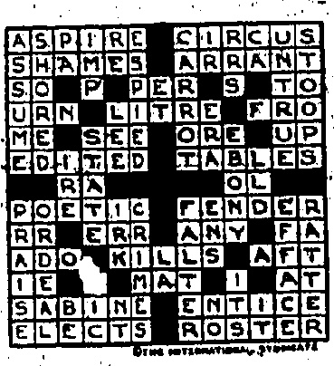
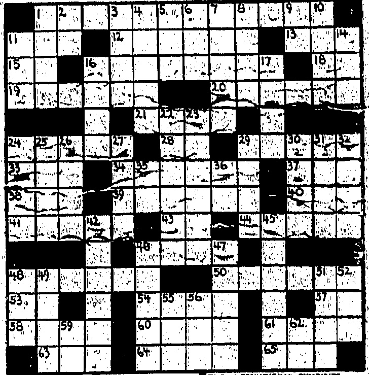

## BOWLS LEAGUE

## CRAIGENGOWER CHECKED AT TAIKOO

## POLICE ON TOP

Some very unexpected results were seen on Saturday in the bowls league. Playing at home the Kowloon Cricket Club secured a victory at the expense of the Dock team, by a margin of five points. Contrary to expectation Craigen, grower were defeated by an overwhelming majority by Taikoo. The Civil Service Club proved that they are a team to be reckoned with when they defeated the Bowling Green Club by twenty-seven points on their own green-a sure sign that they mean to do well irrespective of their away defeats. In the Second Division the Police remain at the head of the table by defeating the Kowloon Cricket Club by a comfortable margin. The Indians came very close to losing their home record of no defeat, the East Point Club running them to one point. The Yacht Club were not strong enough to make an impression on the Taikoo second string who won by a very comfortable margin. The results are as follows.

## First Division

### TAIKOO v. CRAIGENGOWER

Robinson Lammert Nicholls Hyde

## CIVIL SERVICE

## Second Division

<table border=1 style='margin: auto; word-wrap: break-word;'><tr><td colspan="3">R.H.K.Y.C. v. TAIKOO</td></tr><tr><td style='text-align: center; word-wrap: break-word;'>Williamson</td><td style='text-align: center; word-wrap: break-word;'>Stewart</td><td style='text-align: center; word-wrap: break-word;'></td></tr><tr><td style='text-align: center; word-wrap: break-word;'>Moore</td><td style='text-align: center; word-wrap: break-word;'>McKechnie</td><td style='text-align: center; word-wrap: break-word;'></td></tr><tr><td style='text-align: center; word-wrap: break-word;'>Vaux</td><td style='text-align: center; word-wrap: break-word;'>Matthews</td><td style='text-align: center; word-wrap: break-word;'></td></tr><tr><td style='text-align: center; word-wrap: break-word;'>Jamie</td><td style='text-align: center; word-wrap: break-word;'>Young</td><td style='text-align: center; word-wrap: break-word;'>(S.) 23</td></tr><tr><td style='text-align: center; word-wrap: break-word;'></td><td style='text-align: center; word-wrap: break-word;'>(S.) 11</td><td style='text-align: center; word-wrap: break-word;'>Mitchell</td></tr><tr><td style='text-align: center; word-wrap: break-word;'>Bullock</td><td style='text-align: center; word-wrap: break-word;'></td><td style='text-align: center; word-wrap: break-word;'>St.wart</td></tr><tr><td style='text-align: center; word-wrap: break-word;'>Keen</td><td style='text-align: center; word-wrap: break-word;'></td><td style='text-align: center; word-wrap: break-word;'>Chapman</td></tr><tr><td style='text-align: center; word-wrap: break-word;'>Adams</td><td style='text-align: center; word-wrap: break-word;'></td><td style='text-align: center; word-wrap: break-word;'>Dianan</td></tr><tr><td style='text-align: center; word-wrap: break-word;'>Dixon</td><td style='text-align: center; word-wrap: break-word;'>(S.) 9</td><td style='text-align: center; word-wrap: break-word;'>(S.) 26</td></tr><tr><td style='text-align: center; word-wrap: break-word;'></td><td style='text-align: center; word-wrap: break-word;'>J. Sloan</td><td style='text-align: center; word-wrap: break-word;'></td></tr><tr><td style='text-align: center; word-wrap: break-word;'>Rutton</td><td style='text-align: center; word-wrap: break-word;'></td><td style='text-align: center; word-wrap: break-word;'>Maxwell</td></tr><tr><td style='text-align: center; word-wrap: break-word;'>Reid</td><td style='text-align: center; word-wrap: break-word;'></td><td style='text-align: center; word-wrap: break-word;'>Grimes</td></tr><tr><td style='text-align: center; word-wrap: break-word;'>Carpenter</td><td style='text-align: center; word-wrap: break-word;'>(S) 10</td><td style='text-align: center; word-wrap: break-word;'>Muirhead (S) 24</td></tr><tr><td style='text-align: center; word-wrap: break-word;'></td><td style='text-align: center; word-wrap: break-word;'>30</td><td style='text-align: center; word-wrap: break-word;'>Total...... 73</td></tr><tr><td colspan="3">POLICE v. K. C. C.</td></tr><tr><td style='text-align: center; word-wrap: break-word;'>Post</td><td style='text-align: center; word-wrap: break-word;'>Jack</td><td style='text-align: center; word-wrap: break-word;'></td></tr><tr><td style='text-align: center; word-wrap: break-word;'>Whant</td><td style='text-align: center; word-wrap: break-word;'>Buckburrough</td><td style='text-align: center; word-wrap: break-word;'></td></tr><tr><td style='text-align: center; word-wrap: break-word;'>Mair</td><td style='text-align: center; word-wrap: break-word;'>Labrum</td><td style='text-align: center; word-wrap: break-word;'></td></tr><tr><td style='text-align: center; word-wrap: break-word;'>J. Clarke</td><td style='text-align: center; word-wrap: break-word;'>(S) 29</td><td style='text-align: center; word-wrap: break-word;'>Davidson (S) 15</td></tr><tr><td style='text-align: center; word-wrap: break-word;'>Blackman</td><td style='text-align: center; word-wrap: break-word;'></td><td style='text-align: center; word-wrap: break-word;'>Benson</td></tr><tr><td style='text-align: center; word-wrap: break-word;'>Logan</td><td style='text-align: center; word-wrap: break-word;'></td><td style='text-align: center; word-wrap: break-word;'>Harris</td></tr><tr><td style='text-align: center; word-wrap: break-word;'>Grant</td><td style='text-align: center; word-wrap: break-word;'></td><td style='text-align: center; word-wrap: break-word;'>Gorvin</td></tr><tr><td style='text-align: center; word-wrap: break-word;'>West</td><td style='text-align: center; word-wrap: break-word;'>Goldenburg</td><td style='text-align: center; word-wrap: break-word;'></td></tr><tr><td style='text-align: center; word-wrap: break-word;'>(S) 17</td><td style='text-align: center; word-wrap: break-word;'>(S) 15</td><td style='text-align: center; word-wrap: break-word;'></td></tr><tr><td style='text-align: center; word-wrap: break-word;'>Sword</td><td style='text-align: center; word-wrap: break-word;'>Robinson</td><td style='text-align: center; word-wrap: break-word;'></td></tr><tr><td style='text-align: center; word-wrap: break-word;'>Glendinning</td><td style='text-align: center; word-wrap: break-word;'>Goodwin</td><td style='text-align: center; word-wrap: break-word;'></td></tr><tr><td style='text-align: center; word-wrap: break-word;'>Reid</td><td style='text-align: center; word-wrap: break-word;'>Smith</td><td style='text-align: center; word-wrap: break-word;'></td></tr><tr><td style='text-align: center; word-wrap: break-word;'>A. Clarke</td><td style='text-align: center; word-wrap: break-word;'>(S) 27</td><td style='text-align: center; word-wrap: break-word;'>Horridge (S) 17</td></tr><tr><td style='text-align: center; word-wrap: break-word;'>Total</td><td style='text-align: center; word-wrap: break-word;'>73</td><td style='text-align: center; word-wrap: break-word;'>Total...... 47</td></tr><tr><td colspan="3">INDIAN R.C. v. E. POINT R.C.</td></tr><tr><td style='text-align: center; word-wrap: break-word;'>Espina</td><td style='text-align: center; word-wrap: break-word;'>Webster</td><td style='text-align: center; word-wrap: break-word;'></td></tr><tr><td style='text-align: center; word-wrap: break-word;'>Kitchell</td><td style='text-align: center; word-wrap: break-word;'>Glenu</td><td style='text-align: center; word-wrap: break-word;'></td></tr><tr><td style='text-align: center; word-wrap: break-word;'>Nazarin</td><td style='text-align: center; word-wrap: break-word;'>Forbes</td><td style='text-align: center; word-wrap: break-word;'></td></tr><tr><td style='text-align: center; word-wrap: break-word;'>Ismail</td><td style='text-align: center; word-wrap: break-word;'>(S) 13</td><td style='text-align: center; word-wrap: break-word;'>Fowler (S) 20</td></tr><tr><td style='text-align: center; word-wrap: break-word;'>Bux</td><td style='text-align: center; word-wrap: break-word;'>G.M. Shaw</td><td style='text-align: center; word-wrap: break-word;'></td></tr><tr><td style='text-align: center; word-wrap: break-word;'>Ismail</td><td style='text-align: center; word-wrap: break-word;'>Douglas</td><td style='text-align: center; word-wrap: break-word;'></td></tr><tr><td style='text-align: center; word-wrap: break-word;'>Ram</td><td style='text-align: center; word-wrap: break-word;'>McKellar</td><td style='text-align: center; word-wrap: break-word;'></td></tr><tr><td style='text-align: center; word-wrap: break-word;'>D. Rumjahn</td><td style='text-align: center; word-wrap: break-word;'>Hamilton</td><td style='text-align: center; word-wrap: break-word;'>(S.) 22</td></tr><tr><td colspan="3">(S.) 19</td></tr><tr><td style='text-align: center; word-wrap: break-word;'>Mader</td><td style='text-align: center; word-wrap: break-word;'>Barclay</td><td style='text-align: center; word-wrap: break-word;'></td></tr><tr><td style='text-align: center; word-wrap: break-word;'>J.All</td><td style='text-align: center; word-wrap: break-word;'>Thorburn</td><td style='text-align: center; word-wrap: break-word;'></td></tr><tr><td style='text-align: center; word-wrap: break-word;'>Hussian</td><td style='text-align: center; word-wrap: break-word;'>Williamson</td><td style='text-align: center; word-wrap: break-word;'></td></tr><tr><td style='text-align: center; word-wrap: break-word;'>Omar</td><td style='text-align: center; word-wrap: break-word;'>Leo</td><td style='text-align: center; word-wrap: break-word;'>(S.) 15</td></tr><tr><td style='text-align: center; word-wrap: break-word;'>Total</td><td style='text-align: center; word-wrap: break-word;'>58</td><td style='text-align: center; word-wrap: break-word;'>Total...... 57</td></tr></table>

## CORRESPONDENCE

Sir,—I have recently returned from Home to find certain conditions of public service. aggravated without any comment being made in public concerning them. In private there is the comment sarcastic, but this does not reach the ears of officialdom and therefore does not penetrate its pachydermous hide.

Some months ago your Sunday contemporary commented on the number of officials who were to carry out the duties of holiday departing officials "in addition to their other duties." The comment was resented in the quarters which imagine themselves given over to the cult of "Good form," and who deplore straight words to the Government. Several warmly upheld the system, on the grounds of expense, of other officials doing the work of those gone home. Very well. What is the position in one great department of Government service? I refer to the Government's Law Department. Three of its principal officials are at the present moment on Home leave—Messrs. J. H. Kemp, A. Dyer Ball, and J. H. B. Nihill. "Will anyone uphold this method of doing business, and if so on what grounds? It has led to what I think is a remarkable feature of our life in this Colony—the sense of unreality that pervades things out here. Sir Henry Pollock has accepted the office of Acting Attorney-General. Presumably the usual salary of the Attorney-General goes with this post. Where is the economy in allowing three officials from one Department to be away at the same time, and engaging an outside expert to do their work? What, may one ask, governs the appointment of an acting Attorney-General? Is the position advertised? Had we had one of the departed officials, acting, should we have had the Governor's reference to recent legislation containing, perhaps, the longest sentence in English? This particular appointment means that certain effort of a public nature must necessarily be either dropped altogether or suspended; and it seems to me that such questions as Constitutional Reform become a mere farce. I cannot see why a former member of the Legislative Council in an unofficial capacity should become an official member unless his unpaid public work is to cease altogether.

There is also one other matter, and that is the participation in legislation—in shaping it—of unofficial members who, more often than not, are directly connected with concerns at which legislation is aimed. It is surely not right that members of the Council who are likely to become directors of the new Telephone Company should take part in discussions concerning the terms under which such a company is to operate. I do not for a moment question the bona fides of the members of the Council. I simply contend that a member of the Council should not be a member of any Board of Directors in the Colony. Members of the Home Cabinet are thus debarred: why not Legislative Councillors? The situation might be met by paying members of the Council for their time and trouble which I think is considerable. I put these views forward in no niggardly spirit and with due appreciation of the work done by those whose names appear in this letter.

## Teaching English

Sir,—Is there any reason why gramophones should not be introduced into our schools for the pronunciation of English? With so many of our teachers coming from different parts of the world—including the northern part of Britain—it seems very desirable there should be one standard of pronunciation. In this way children would start from the scrutch so to speak.

"Yes," said the teacher, "we have several plants and flowers named with the prefix 'dog.' Of course, the dog-rose and 'dog-violet' are well known to you all. Can any of you tell me other's?"

For some seconds the class remained dumb. Then a bright idea illuminated the face of a pupil, and up went his hand. "Collie flowers miss!" said he.

Russian refugees seem to be finding their way into London life with unusual success and aptitude, considering that their lives in palaces and castles formed no training ground for a battle of life. Prince Alexis Obolensky, who escaped from the revolution, out any possessions save a. Strud violin and a string of his wife's pearls, will embark on his career as a public singer at the London Coliseum.

Before the war he used to sing o the officers in his regiment, never dreaming that his bass voice would be the means of his earning livelihood.

It was the Duchess of Rutland who obtained this engagement for me," he told a representative of the "Sunday Times." "Melba advised me to take up singing professionally when I met her in the South of France, and she then took me on tour with her through Canada, America, and Australia."

Another Russian who has embarked in the professions is Princess Gnalitzine; the wife of the son of the last Prime Minister under the Tsarist régime. The Princess was an American girl, Miss Frances Stevens.

She studied Futurism with its founder, Marinetti, in Italy, and exhibited portraits at Paris and other salons. Recently she went down to the new racecourse at Bournemouth to practise a new art.

"I want to combine art with sport," she told the "Sunday Times" representative, "so I am going to take pictures of horses in their own environment, and treat the portraits with a special method which will make them look like old sporting prints."

With one called "Sunshine," a high jumper, she has had many successes, and she dreams of his being a prospective Grand National winner.

"I can't be a Munnings, but there is so much scope for art on a racecourse."

The Princess, who is settling in London, is also going to join the ranks of women race-horse owners, for she is bringing over from America some of the horses from her stable.

## ACID ATTACK

## JEALOUS MAN'S

When Samuel Hudson, 46, turner, was charged at the Old Bailey with throwing sulphuric acid over his wife, it was stated that owing to disputes she left her husband and went into service. As she left a theatre he threw the acid over her. She had lost the sight of one eye, part of her ear was destroyed, and she was otherwise permanently disfigured.

Hudson, in a long statement, said there was trouble because she went about with a dancing partner. He said:

“What has happened in the climax of two years of bitter anguish. When I threw the acid I was no longer in control of my physical actions. My mind was tortured; I could not work. It was concentrated on her. In my anguish the one predominating thought was that I must take from her that which makes her attractive.”

Hudson broke down and cried. "I throw myself on your justice," he said: "I do not ask for mercy." Mr. Justice Mackinnon, in passing sentence of five years' penal servitude, said the crime was a detestable one. Even on his own story Hudson had the most trivial reasons for his jealousy.

## LYNCH LAW" DRAMA,

JEW TAKEN FROM PRISON AND MUTILATED.

An unusual case of lynch law is reported from North Carolina, one of the foremost States in the fight for legislation declaring that man is not descended from the ares.

Four men, believed to have taken a Jew from prison and to have left him wounded on a lonely road, are now guarded in the same prison from possible attack by people who actually symphasised with their doings.

The story begins with an accusation made by a girl of 17 that a Jewish commercial traveller from Philadelphia, named Joe Needleman, had assaulted her. A man named Sparrow, said to be one of four who took Needleman from jail, drove him into the country, mutilated him, and left him to crawl back two miles to his hotel, spread the allegations.

The day after the attack he married the girl, whose story was then discovered to be a fornight old. Mob opinion then began to veer round and is now threaten, ing vengeance on Sparrow and his comrades and idolising Needleman, filling the hospital ward with messages and flowers.

Questions concerning an early painting by Watts, in one of the committee-rooms of the House of Commons, showing King Alfred inviting the Saxons to prevent the landing of the Danes, were the subject of much amusement in Parliament.

Mr. A. S. Sandeman (C, Middleton and Prestwich) asked if the First Cir. missiooper of Works would remove the painting on account of its "irritating effect" on members.

Mr. G. Locker-Lampson (Under-Secretary, Home Office) said he was not aware that the picture had the suggested effect upon mom-bers.

Mr. Sandeman: Will the hon. member go for five minutes and try to contemplates the legs of King Alfred; and, having done so, will he try to concentrate on the work that is going on in the committee-room, and, having come to the same conclusion as I have, will he at least have the picture put at the other end the room? Or, falling all the options, would he like to go down. > posterity with legs on him such as those of King Alfred. (Laughter.)

Mr. Locker-Lampson: I have looked at the picture this morning. I do not know whether the hon. member realises that it is a very fine example of the early work of Watts.

Mr. F. A. Macquisten (C., Argyllshire): Will he consider the advisability of getting a picture painted for the other end of the room showing the members for Glasgow resisting the invasion of Irishmen into Scotland? (Loud laughter.)

Major Hore-Belisha (Lv Devonport): In view of King Alfred's connection with cakes, will the hon. gentleman have the picture put in the tea-room? (Laughter.)

Mr. Neil Maclean (Soc., Govan):

Vill he also consider putting

another picture on the side wall

of the same committee-room showing the member for Argyllshire being rejected by Glasgow at the election? (Laughter.)

## BOY KIDNAPPED

A kidnapping case, similar in its preliminary aspects to that perpetrated by the youths Leopold and Loeb, who kidnapped a millionaire's son and, according to their confession, murdered him "for sport." is exciting Chicago.

The 12-year-old son of Mr. Walter A. Graff, a rich lumber merchant, failed to return home. Soon after his disappearance was noticed the parents received a mysterious note couched in terms resembling those used by the young murderers of the millionaire's son.

The letter threatened that the missing boy and his sister Ruth, aged 15, would both be kidnapped unless £200, in old bank-notes wrapped in a package, was left at the foot of a tree in Washington Park.

Mr. Graff placed a decoy package in the place indicated, but the watching detectives failed to see anyone approaching it in a suspicious manner.

The authorities have adopted elaborate precautions to trace the extortioners should they attempt to communicate further with Mr. Graff's home by telephone or otherwise.

The missing boy is a student at the school that was attended by Bobble Franks, the youth whom Loeb and Leopold murdered.

## GIRLS ARRESTED

EMINENTLY RESPECTABLE

When Sarah Peake, 17, and Edith Sheppard, 15, factory hands, were charged at North London with insulting behaviour at Highbury-place, N., a police officer said they were indulging in horse-play. The residents complained bitterly of the conduct of the young people. Mr. Clarke Hall, the magistrate:

“You’ve heard what the last witness said,” persisted the counsel, “and yet your evidence is to the contrary. Am I to infer that you doubt her veracity?”

As the end of a perfect day, a visit to the Theatre Royal this evening can be heartily commended. The “Our Cabaret” entertainment goes from strength to strength. On Saturday there was a splendid audience and the relationship between it, and those on the stage was of the happiest. Each member of the Cabaret was in fine form. Frank Milne supplied the major portion of the humour. He is a mimic of rare, discerning powers, whilst his “talk” never fails to false hearty laughter. Reginald Selleck once again proved his dominance of the piano. Muriel Varna earned our sympathies if only by reason of the fact of her faith that in all the preponderating male influence in the world there should be one for ma'. Charles Chamier sang delightfully as did Madge Carter; whilst Jan Caryll and Dolyse danced with superb technique. In addition there was Gertrude Clegg at the piano, and sketches of a highly humorous turn. Encores were in frequent demand and readily conceded. A very good show indeed.

The polite young man waved a deprecating hand.

"Not at all," he replied. "I merely wish to make it clear what a liar I am if she's speaking the truth."

## SATURDAY'S SOLUTION

I cannot imagine why these girls should have been arrested, dragged through the streets, and placed in a cell as if they had been guilty of some criminal offence. It is monstrous and very injurious to the girls. The police have to see that order is kept in the streets, but in this case it could have been done by summons. If there had not been relatives near, this girl of 15 would have been all night in the cells.

Sheppard: I did not think there was any harm in what we were doing.

The Magistrate: I do not think there was, except that it Annova's home highly respectable people who live in this eminently respectable enterprise. They don't like it.

## CHINA MAIL'S CROSS-WORD PUZZLE

(These crossword puzzles have been made by experts but our readers are warned to watch out for occasional phonetic spellings, such as harbor, plow, and altho.)

SUGGESTIONS FOR SOLVING CROSSWORD PUZZLES

Start out by filling in the words of which you feel reasonably sure. These will give you a clue to other words crossing them, and they in turn to still others. A letter belongs in each white space, words starting at the numbered squares and running either horizontally or vertically or both.

## HORIZONTAL

1—A tidy for the back of a chair

11—To go back and forth

12—A coast town and peninsula near Boston, Mass.

13—Correlative of neither

15—Man's name. (familiar)

16—A city in N. E. Pennsylvania

18—In this or that manner

19—Female divinity of the woods

(pl)

20—Conjectured

21—Chopped

24—Prefix, Acroos

28—American Institute (abbr.)

29—Man's name

33—A fabulous bird

34—A strong fortress

37—Southern constellation

38—Suffix, same as "an"

39—An originator

40—A direction in music—"slower"

(abbr.)

41—Big

43—Electrical Engineer (abbr.)

44—Stoutly built two-masted boat

46—Goss wrong

48—A malicious old woman

50—Stupor apathy

53—In contrast with the upper surface of

54—Prefix meaning "one"

57—Prefix meaning "two"

58—A common metal

60—A large pitcher

61—A cricket

63—A female deer

64—To abound

65—Even (post)

## VERTICAL

2—Eastern State of U.S. (abbr.)

3—A measure of length

4—Low wet land

5—Interjection

6—To be able

7—A man's name

8—Cease

9—Indefinite article

10—Most popular of flowers

11—A sylvan spirit

14—A long smooth stick

16—To stretch from side to side

17—A number

22—A Christian festival

23—To drop

24—Marked by tidiness

25—A loud noise

26—A skin disease

27—Said to a cat

29—Prick up, as care

30—A kind of small sweet pie

31—Man's name

32—Early (obs.)

33—Augustus (abbr.)

34—Interjection

42—To bring forward for consideration

45—To anger

46—Another name for the ant

47—To go easily about

48—Pen name of Charles Dickens

49—Girl's name

51—Chief of Norma gods

52—To equip

53—To be indebted

54—French for "born"

55—Regative

56—Prefix meaning "back"

app: *in to-morrow's

crosbow word puzzle.)

The solution of the above crossword puzzle will

THE CORONET

TO-DAY AT 2.30, 5.15, 7.15 & 9.30 p.m.

# many Tiekford in DOROHY VERNON of HADDON HALL

From the romante, novel by Charles Major × ~ Adapted by Walter Young

A MARSHALL NEILAN PRODUCTION

Photography by Charles Rother

Her Beauty Makes You Gasp!

Never was Mary Pickford so gorgeously beautiful as in this, her most beautiful photoplay—a picture story filled with tender romance, thrilling action and delicious comedy.

Supremely Appealing Fascinating Enthralling