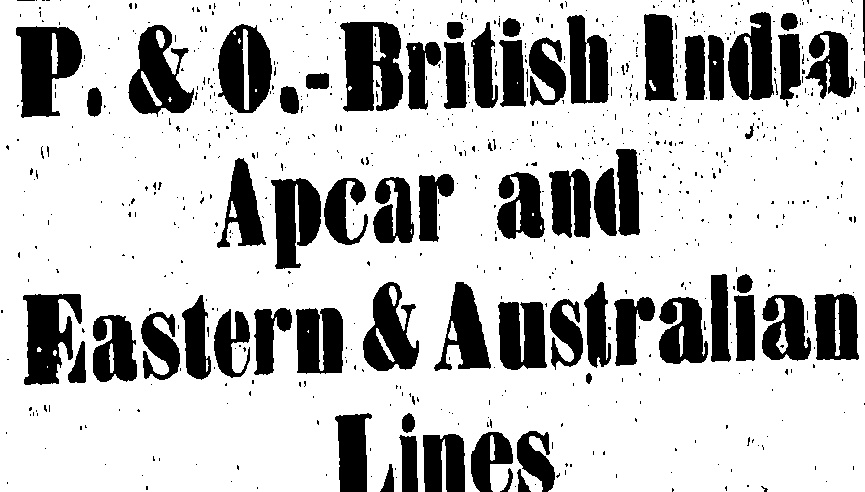

## Lines

(COMPANIES incorporated in ENGLAND).

## MAIL AND PASSENGER SERVICES

MAITS, JAVA, BURMA, CEYLON, INDIA, PERSIAN GULF, EAST INDIES, MAURITIUS, EAST AND SOUTH AFRICA, AUSTRALASIA, INCLUDING NEW ZEALAND AND QUEENSLAND PORTS, AND RED SEA, EGYPT, EUROPE, &.

### PENINSULAR & ORIENTAL DIRECT ROYAL MAIL (Under Contract with J.M

FORT NIGHTLY

STEAMERS

<table border=1 style='margin: auto; word-wrap: break-word;'><tr><td style='text-align: center; word-wrap: break-word;'></td><td style='text-align: center; word-wrap: break-word;'></td><td style='text-align: center; word-wrap: break-word;'>(About)</td></tr><tr><td style='text-align: center; word-wrap: break-word;'>&quot;HAGOYA&quot;</td><td style='text-align: center; word-wrap: break-word;'>6,864</td><td style='text-align: center; word-wrap: break-word;'>3rd June at Noon.</td></tr><tr><td style='text-align: center; word-wrap: break-word;'>&quot;BIOILTA&quot;</td><td style='text-align: center; word-wrap: break-word;'>6,812</td><td style='text-align: center; word-wrap: break-word;'>1stth June</td></tr><tr><td style='text-align: center; word-wrap: break-word;'>&quot;KALYAN&quot;</td><td style='text-align: center; word-wrap: break-word;'>8,118</td><td style='text-align: center; word-wrap: break-word;'>13thth June at Noon</td></tr><tr><td style='text-align: center; word-wrap: break-word;'>&quot;JEYP PRE&quot;</td><td style='text-align: center; word-wrap: break-word;'>5,319</td><td style='text-align: center; word-wrap: break-word;'>17thth June</td></tr><tr><td style='text-align: center; word-wrap: break-word;'>&quot;MIRZAPORE&quot;</td><td style='text-align: center; word-wrap: break-word;'>6,715</td><td style='text-align: center; word-wrap: break-word;'>23thth June</td></tr><tr><td style='text-align: center; word-wrap: break-word;'>&quot;MILWA&quot;</td><td style='text-align: center; word-wrap: break-word;'>10,841</td><td style='text-align: center; word-wrap: break-word;'>27thth June</td></tr><tr><td style='text-align: center; word-wrap: break-word;'>&quot;DELTA&quot;</td><td style='text-align: center; word-wrap: break-word;'>8,097</td><td style='text-align: center; word-wrap: break-word;'>11thth July</td></tr><tr><td style='text-align: center; word-wrap: break-word;'>&quot;KASHMIR&quot;</td><td style='text-align: center; word-wrap: break-word;'>8,985</td><td style='text-align: center; word-wrap: break-word;'>11thth July</td></tr><tr><td style='text-align: center; word-wrap: break-word;'>&quot;MANTUA&quot;</td><td style='text-align: center; word-wrap: break-word;'>10,902</td><td style='text-align: center; word-wrap: break-word;'>25thth July</td></tr><tr><td style='text-align: center; word-wrap: break-word;'>&quot;BOUDAN&quot;</td><td style='text-align: center; word-wrap: break-word;'>6,666</td><td style='text-align: center; word-wrap: break-word;'>6thth Aug.</td></tr><tr><td style='text-align: center; word-wrap: break-word;'>&quot;KASHGAR&quot;</td><td style='text-align: center; word-wrap: break-word;'>9,05</td><td style='text-align: center; word-wrap: break-word;'>8thth Aug.</td></tr><tr><td style='text-align: center; word-wrap: break-word;'>&quot;Macedonia&quot;</td><td style='text-align: center; word-wrap: break-word;'>17,099</td><td style='text-align: center; word-wrap: break-word;'>12ndth Aug.</td></tr><tr><td style='text-align: center; word-wrap: break-word;'>&quot;BIOILTA&quot;</td><td style='text-align: center; word-wrap: break-word;'>6,813</td><td style='text-align: center; word-wrap: break-word;'>3rdth Sept.</td></tr><tr><td style='text-align: center; word-wrap: break-word;'>&quot;NARKUNDA&quot;</td><td style='text-align: center; word-wrap: break-word;'>6,237</td><td style='text-align: center; word-wrap: break-word;'>5thth Sept.</td></tr><tr><td style='text-align: center; word-wrap: break-word;'>&quot;KHYBER&quot;</td><td style='text-align: center; word-wrap: break-word;'>9,114</td><td style='text-align: center; word-wrap: break-word;'>19thth Sept.</td></tr><tr><td style='text-align: center; word-wrap: break-word;'>&quot;KARMALA&quot;</td><td style='text-align: center; word-wrap: break-word;'>9,123</td><td style='text-align: center; word-wrap: break-word;'>3rdth Oct.</td></tr><tr><td style='text-align: center; word-wrap: break-word;'>&quot;MALWA&quot;</td><td style='text-align: center; word-wrap: break-word;'>10,941</td><td style='text-align: center; word-wrap: break-word;'>17thth Oct.</td></tr><tr><td style='text-align: center; word-wrap: break-word;'>&quot;KEHVA&quot;</td><td style='text-align: center; word-wrap: break-word;'>9,135</td><td style='text-align: center; word-wrap: break-word;'>31stth Oct.</td></tr><tr><td style='text-align: center; word-wrap: break-word;'>&quot;MANTUA&quot;</td><td style='text-align: center; word-wrap: break-word;'>10,902</td><td style='text-align: center; word-wrap: break-word;'>14thth Nov.</td></tr><tr><td style='text-align: center; word-wrap: break-word;'>&quot;KALYAN&quot;</td><td style='text-align: center; word-wrap: break-word;'>9,444</td><td style='text-align: center; word-wrap: break-word;'>28thth Nov.</td></tr><tr><td style='text-align: center; word-wrap: break-word;'>&quot;MOREA&quot;</td><td style='text-align: center; word-wrap: break-word;'>10,911</td><td style='text-align: center; word-wrap: break-word;'>19thth Dec.</td></tr></table>

Government

Singapore and Bombay

Singapore, Penang, Colombo

Marselliles and London

S'apore, Penang, Collo & B'bay

Marselliles, London Antwerp & Hull

Marselliles & London

S'pore, Penang, Collo & Bombay

Marselliles, London, Antwerp

Marselliles and London

S'apore, Penang, Collo & B'bay

Marselliles and London

Marselliles, London and Antwerp

Marselliles, London & Antwerp

Marselliles & London

Marselliles, London, and Antwerp

Marselliles and London

Marselliles, London and Antwerp

Marselliles and London

Singapore, Penang & Calcutta.

Singapore, Penang & Calcutta.

Manila, Kolambugan, Sandakan, Thursday Island, Townsville, Brisbane. Sydney and Melbourne.

<table border=1 style='margin: auto; word-wrap: break-word;'><tr><td style='text-align: center; word-wrap: break-word;'>TANDA</td><td style='text-align: center; word-wrap: break-word;'>6,800</td><td style='text-align: center; word-wrap: break-word;'>at Noon.</td></tr><tr><td style='text-align: center; word-wrap: break-word;'>ARAFURA</td><td style='text-align: center; word-wrap: break-word;'>8,000</td><td style='text-align: center; word-wrap: break-word;'>8th July</td></tr><tr><td style='text-align: center; word-wrap: break-word;'>ST. ALBANS</td><td style='text-align: center; word-wrap: break-word;'>4,500</td><td style='text-align: center; word-wrap: break-word;'>5th Aug.</td></tr><tr><td style='text-align: center; word-wrap: break-word;'>TANDA</td><td style='text-align: center; word-wrap: break-word;'>6,958</td><td style='text-align: center; word-wrap: break-word;'>2nd Sept.</td></tr><tr><td style='text-align: center; word-wrap: break-word;'>ARAFURA</td><td style='text-align: center; word-wrap: break-word;'>6,000</td><td style='text-align: center; word-wrap: break-word;'>1st Oct.</td></tr><tr><td style='text-align: center; word-wrap: break-word;'>ST. ALBANS</td><td style='text-align: center; word-wrap: break-word;'>4,500</td><td style='text-align: center; word-wrap: break-word;'>4th Nov.</td></tr></table>

+S.B. "Tanda" Calls at Kolambaga.

Tas E. & A. S.S. Co., Ltd. steamers will also call at Shanghai, Iloilo, Uclon, Klambugan, Tawso, Timor, Darwin, or other ports an route as inducement offers. Frequent connections from Australia with the following:

<table border=1 style='margin: auto; word-wrap: break-word;'><tr><td style='text-align: center; word-wrap: break-word;'>&quot;KASHMIR&quot;</td><td style='text-align: center; word-wrap: break-word;'>8,985</td><td style='text-align: center; word-wrap: break-word;'>1sth June</td><td style='text-align: center; word-wrap: break-word;'>Shanghai, Mojil and Kobe.</td></tr><tr><td style='text-align: center; word-wrap: break-word;'>&quot;DELTA&quot;</td><td style='text-align: center; word-wrap: break-word;'>8,097</td><td style='text-align: center; word-wrap: break-word;'>1sth June</td><td style='text-align: center; word-wrap: break-word;'>Shanghai and Kobe.</td></tr><tr><td style='text-align: center; word-wrap: break-word;'>&quot;ARAFURA&quot;</td><td style='text-align: center; word-wrap: break-word;'>6,000</td><td style='text-align: center; word-wrap: break-word;'>13th June</td><td style='text-align: center; word-wrap: break-word;'>Mojil, Kobe and Yokohama.</td></tr><tr><td style='text-align: center; word-wrap: break-word;'>&quot;TILAWA&quot;</td><td style='text-align: center; word-wrap: break-word;'>10,008</td><td style='text-align: center; word-wrap: break-word;'>21st June</td><td style='text-align: center; word-wrap: break-word;'>Kobe</td></tr><tr><td style='text-align: center; word-wrap: break-word;'>&quot;TALAMBA&quot;</td><td style='text-align: center; word-wrap: break-word;'>8,018</td><td style='text-align: center; word-wrap: break-word;'>24th June</td><td style='text-align: center; word-wrap: break-word;'>Kobe</td></tr><tr><td style='text-align: center; word-wrap: break-word;'>&quot;MANTUA&quot;</td><td style='text-align: center; word-wrap: break-word;'>10,902</td><td style='text-align: center; word-wrap: break-word;'>25th June</td><td style='text-align: center; word-wrap: break-word;'>Shanghai, Mojil &amp; Kobe.</td></tr><tr><td style='text-align: center; word-wrap: break-word;'>&quot;TAKLIWA&quot;</td><td style='text-align: center; word-wrap: break-word;'>7,926</td><td style='text-align: center; word-wrap: break-word;'>5th July</td><td style='text-align: center; word-wrap: break-word;'>Kobe</td></tr><tr><td style='text-align: center; word-wrap: break-word;'>&quot;KASHGAR&quot;</td><td style='text-align: center; word-wrap: break-word;'>8,005</td><td style='text-align: center; word-wrap: break-word;'>10th July</td><td style='text-align: center; word-wrap: break-word;'>Shanghai, Mojil and Kobe</td></tr><tr><td style='text-align: center; word-wrap: break-word;'>&quot;SOUDAN&quot;</td><td style='text-align: center; word-wrap: break-word;'>6,696</td><td style='text-align: center; word-wrap: break-word;'>10th July</td><td style='text-align: center; word-wrap: break-word;'>Shanghai and Kobe.</td></tr><tr><td style='text-align: center; word-wrap: break-word;'>&quot;BT. ALBANS&quot;</td><td style='text-align: center; word-wrap: break-word;'>4,500</td><td style='text-align: center; word-wrap: break-word;'>11th July</td><td style='text-align: center; word-wrap: break-word;'>Shanghai, Mojil, Kobe &amp; Yokohama</td></tr><tr><td style='text-align: center; word-wrap: break-word;'>&quot;MACEDONIA&quot;</td><td style='text-align: center; word-wrap: break-word;'>11,089</td><td style='text-align: center; word-wrap: break-word;'>24th July</td><td style='text-align: center; word-wrap: break-word;'>Shanghai, Mojil and Kobe</td></tr><tr><td style='text-align: center; word-wrap: break-word;'>&quot;KEYBER&quot;</td><td style='text-align: center; word-wrap: break-word;'>9,144</td><td style='text-align: center; word-wrap: break-word;'>7th Aug.</td><td style='text-align: center; word-wrap: break-word;'>Shanghai, Mojil and Kobe</td></tr><tr><td style='text-align: center; word-wrap: break-word;'>&quot;SIOILIA&quot;</td><td style='text-align: center; word-wrap: break-word;'>6,813</td><td style='text-align: center; word-wrap: break-word;'>7th Aug.</td><td style='text-align: center; word-wrap: break-word;'>Shanghai and Kobe.</td></tr><tr><td style='text-align: center; word-wrap: break-word;'>&quot;TANDA&quot;</td><td style='text-align: center; word-wrap: break-word;'>6,958</td><td style='text-align: center; word-wrap: break-word;'>8th Aug.</td><td style='text-align: center; word-wrap: break-word;'>Mojil, Kobe &amp; Yokohama</td></tr><tr><td style='text-align: center; word-wrap: break-word;'>&quot;NARKUNDA&quot;</td><td style='text-align: center; word-wrap: break-word;'>16,227</td><td style='text-align: center; word-wrap: break-word;'>21st Aug.</td><td style='text-align: center; word-wrap: break-word;'>Shanghai</td></tr><tr><td style='text-align: center; word-wrap: break-word;'>&quot;KARMALA&quot;</td><td style='text-align: center; word-wrap: break-word;'>9,128</td><td style='text-align: center; word-wrap: break-word;'>4th Sept.</td><td style='text-align: center; word-wrap: break-word;'>Shanghai, Mojil &amp; Kobe.</td></tr><tr><td style='text-align: center; word-wrap: break-word;'>&quot;DELTA&quot;</td><td style='text-align: center; word-wrap: break-word;'>6,097</td><td style='text-align: center; word-wrap: break-word;'>4th Sept.</td><td style='text-align: center; word-wrap: break-word;'>Mojil, Kobe and Yokohama</td></tr><tr><td style='text-align: center; word-wrap: break-word;'>&quot;ARAFURA&quot;</td><td style='text-align: center; word-wrap: break-word;'>6,000</td><td style='text-align: center; word-wrap: break-word;'>15th Sept.</td><td style='text-align: center; word-wrap: break-word;'>Shanghai and Kobe</td></tr><tr><td style='text-align: center; word-wrap: break-word;'>&quot;MALWA&quot;</td><td style='text-align: center; word-wrap: break-word;'>10,941</td><td style='text-align: center; word-wrap: break-word;'>18th Sept.</td><td style='text-align: center; word-wrap: break-word;'>Shanghai, Mojil and Kobe</td></tr><tr><td style='text-align: center; word-wrap: break-word;'>&quot;KHIVA&quot;</td><td style='text-align: center; word-wrap: break-word;'>9,135</td><td style='text-align: center; word-wrap: break-word;'>2nd Oct.</td><td style='text-align: center; word-wrap: break-word;'>Shanghai, Mojil and Kobe.</td></tr><tr><td style='text-align: center; word-wrap: break-word;'>&quot;SOUDAN&quot;</td><td style='text-align: center; word-wrap: break-word;'>6,908</td><td style='text-align: center; word-wrap: break-word;'>2nd Oct.</td><td style='text-align: center; word-wrap: break-word;'>Shanghai, Mojil and Kobe.</td></tr><tr><td style='text-align: center; word-wrap: break-word;'>&quot;ST. ALBANS&quot;</td><td style='text-align: center; word-wrap: break-word;'>4,503</td><td style='text-align: center; word-wrap: break-word;'>10th Oct.</td><td style='text-align: center; word-wrap: break-word;'>Mojil, Kobe and Yokohama</td></tr><tr><td style='text-align: center; word-wrap: break-word;'>&quot;MANTUA&quot;</td><td style='text-align: center; word-wrap: break-word;'>10,902</td><td style='text-align: center; word-wrap: break-word;'>17th Oct.</td><td style='text-align: center; word-wrap: break-word;'>Shanghai, Mojil and Kobe.</td></tr><tr><td style='text-align: center; word-wrap: break-word;'>&quot;KALYAN&quot;</td><td style='text-align: center; word-wrap: break-word;'>9,144</td><td style='text-align: center; word-wrap: break-word;'>1st Nov.</td><td style='text-align: center; word-wrap: break-word;'>Shanghai, Mojil and Kobe.</td></tr><tr><td style='text-align: center; word-wrap: break-word;'>&quot;TANDA&quot;</td><td style='text-align: center; word-wrap: break-word;'>6,958</td><td style='text-align: center; word-wrap: break-word;'>7th Nov.</td><td style='text-align: center; word-wrap: break-word;'>Mojil, Kobe and Yokohama.</td></tr><tr><td style='text-align: center; word-wrap: break-word;'>&quot;MOREA&quot;</td><td style='text-align: center; word-wrap: break-word;'>10,911</td><td style='text-align: center; word-wrap: break-word;'>14th Nov.</td><td style='text-align: center; word-wrap: break-word;'>Shanghai, Mojil and Kobe.</td></tr><tr><td style='text-align: center; word-wrap: break-word;'>&quot;A Steamer&quot;</td><td style='text-align: center; word-wrap: break-word;'>11,089</td><td style='text-align: center; word-wrap: break-word;'>28th Nov.</td><td style='text-align: center; word-wrap: break-word;'>Shanghai, Mojil and Kobe.</td></tr><tr><td style='text-align: center; word-wrap: break-word;'>&quot;MACEDONIA&quot;</td><td style='text-align: center; word-wrap: break-word;'>6,030</td><td style='text-align: center; word-wrap: break-word;'>11th Dec.</td><td style='text-align: center; word-wrap: break-word;'>Shanghai, Mojil and Kobe.</td></tr><tr><td style='text-align: center; word-wrap: break-word;'>&quot;ARAFURA&quot;</td><td style='text-align: center; word-wrap: break-word;'>6,030</td><td style='text-align: center; word-wrap: break-word;'>12th Dec.</td><td style='text-align: center; word-wrap: break-word;'>Mojil, Kobe &amp; Yokohama.</td></tr></table>

Alldatus are appropriate and subject to alteration without notice. TELEGRAPHY FITTED ON ALB STAMKES.

*Passengers for Rangoon must defray their own Hotel expenses at Singapore

a Cabinmenight was less than $2.50 x $1.11 will be received at the

l'arcais Measuring not more than $2.50 x $1.11 will be received at the

company's Office up to noon on the day previous so selling

## OREGON ORIENTAL LINE

Steamer

U.S.B. Oakridge

U.S.S.B. Oakridge

U.S.S.B. West Jesup

All callings sublect to change with no cause

Carro ascented for Minis. Iollo and Oba.

Through Bills of Lating Issued to all rail O�rslad Points in the U.S.A., also to New Orleans, Savannah, Charlestown, Norfolk, Baltimore, Philadelphia, New York, Boston, and Portland, Maine, with transhipment at Portland, Ore. via Pains Interastial steamers.

## PASSENGERS

Room 25, Bank of Canton Building, John Manners and Co., Ltd.,

6. De Vaux Road Central Telephone Central 487L

## ARRIVALS

Per A. O. L. s.a. "Pros. Madison" on May 30: Miss Marie Braga, Mrs Delores Carroll, Mr. Conrado Chudian, Captain M.R. King, Mrs Helen M. King, Master Donald K. King, Mr. Pun. Lee, Mr. J. F. Tompkins, Mr E. G. Woodger, Mr and Mrs A. A. Bryan, Mr Ross V. Craggs, Mr and Mrs W. P. Dennis, Mr and Mrs M. A. Smith, Master M. Smith, Mrs Leonard Wood, Miss Louise Wood, Mr and Mrs Gordon Yates, Mr John R. McFle, Jr., Mr Ralph E. McFle, Mr J. W. Archer, Mr E. C. Earle, Mr J. Velasquez, Mr H. S. Woolley.

Per B. L. s.a. "Tanda" on June 1: — Mr J. H. Tait, Mr and Mrs Scheerer, Mrs J. G. Austin, Mr D. Warren, Mrs and Miss Fowler, Captain W. Johnstone; Mr P. T. Susman, Col. and Mrs Johnston, Mr P. R. Buchanan, Mrs and Miss Bertie, Mrs L. Henry, Mr P. N. Heymanson, Mr Heyman, Mr J. C. Lee, Mr and Mrs R. A. McCulloch.

## STEAMER MOVEMENTS

The O.P.S. R.M.S. "Nupress of Australia" is due to a p. 30. on Time 4 and will birth at Pier 6., Kwood

The O.P & R M.S. Compres of Russia's due at Nagasaki Day at a m.

"The N.Y.K. 'Akita Miru' (Rang van Lino) left Mojifr Hongkong on May 17 and is expected here today"

The R F s.a.3) Automedon for Genus

Havre, Liverpool and Gangow will be

despatched at 4 p.m. to day.

The U.O.L.S. "Pres. Jackson" which is due at this port on June 6 asiled from Seattle on May 15, on schedule.

The B. F. s. Mennon's Salt Liver pool on Apr. 74 for Straits Hongkong, Shanghai, Robs and Yokohama and is due at this port or about June 6.

The B. F. s "Troilus" 11t Livr pool on May for Hongkong, shanghai, Taku and Dalny and is due to our about June 11.

The C.P.J., R.M.S. Ampress of Asia left Vancouver for Hongkong via Japan ports and Shazah on May 28 and is due here on June 15.

The N.Y.K. 8.8. "Kam" M+ru (European-Passenger Line) left London for Hongkong via Suez on May 9 and is expected here on June 18.

The B. F. s. "Marion s" left Liver's pol'on. May 18 for Struts, Hongkong. Shanghai: Moji. Kobo and Yokohama and is due at this port on or about June 80.

The B F a Patroclon left Liver pool on May 93 for Hongkong. Shanghai, Taku and Dslny and is due here on or about June 92

The m.v. s.s. "Formus" (Swedish East Acistle Co., Lti.), left Duckirk on May 23 and is due here on or about June 30

The B. F. s.s. "Eurvpylus." left Liverpool on May 28 for Straits, Hongkong, Shanghai, Mojii Kobe and Yokohama and is due here on or about July 1.

## CONSIGNEES' NOTICES

Cargo arrived per s.s. "Bengloe" remaining undelivered after today will be subject to rent. Agents - Gibb, Livingston Co., Ltd.

Cargo arrived per f.n. "Bonalder," remaining undelivered after June 4, will be subject to rent. Agents.—Gibb, Livingston & Co., Ltd.

'A notoriously absent-minded professor was one day observed walking along the street with one foot continually in the gutter, the other on the pavement.

A pupil meeting him said: "Good evening, professor. How are you?"

"Well," answered the professor "I thought I was all right when I left home, but now I don't know what's the matter with me. I've been linpin for the last half hour."

## ADVERTISEMENTS

BY ORDER OF THE MORTWAGEE

ARTICULAR3 AND CONDITION3

Yaumati, in the Colony of HongKong

No. 752 with No. 47 Portland Str et

## PUBLIC AUCTION

TUESDAY, the 9th day of June 1936

All that piece of pirce of ground situte at Yaumatin the Dependency of Kowloon and Chony of Hongkong, and known and registered in the Land Office as Section T of Kowloon Island Lot No. 759 together with the messungs or tenement erations and buildings thereon now known as No. 47 Portland Street. The property is held for the unexpired residue of the term of 75 years from the 1st day of January 1898 created by an Tendenture of Crown Lease dated the 11th day of May 1898 and made between Her late Majesty Queen Victoria of the one part and Emanuel Raphael Belilios of the other part Annual Crown Rent $2.35

Total area 1012.5 square feet.

Messrs. D'ALMADA and MASON, Mortgagee's S. licitors

Mr. E. V. M. R. DE SOUSA.

Hongkong, zuo jue,

## PUBLIC AUCTION

Undersigned have received instructions to sell by Public Auction

FRIDAY, 5th JUNE, 1985.

at "Durban House" No. 11, Cameron Road, Kowloon

(Full Particul $ \underline{\text{a}} $m from Ostalogue).

On View on day of Sale

LAMMERT BHOB. Auctioneers.

Hongkong, 2nd June, 1915.

FURNITURE AUCTIONS

L. E. S. HODGE,

Austinoer.

## CONSIGNEES

THE EEN LINE STEAMERS, LTD.

## THE Steamship

1 BENALDER

No claims will be admitted after the goods have left the Godown, and all Goods remaining underlevered after the 4th June, will be subject to rent.

Consignees of Cargo are hereby informed that all Goods are being landed at their risk into the hazardous and/or extra hazardous Godowns of the Hongkong and Kowloon Wharf and Godown Co., Ltd., whence, and/or from the wharves, delivery may be obtained.

All claims against the steamer must be presented to the Under signed on or before 11th June, or they will not be recognized.

All broken, chafed, and damaged goods are to be left in the Go down, where they will be examined on the 4th June, at 10 a.m.

No Fire Insurance has been effected.

Bills of Lading will be countersigned by

GIBB, LIVINGSTON & CO., LTD.

Hongkong, 27th May, 1925

CHAMBERLAIN'S COLIC AND DIARRHOEA REMEDY.

Chamberlain's Colic and Diarrhoea Remedy possesses one unique characteristic among medicines. It is made solely and only for the one purpose of immediately relieving severe pain in the stomach and bowels, for intestinal cramps (whatever the cause) colic and diarrhoea. Every family should keep it handy. For sale everywhere.

# HONGKONG TO BANGKOK

REGULAR FREIGHT AND PASSENGER SERVICE

S/S. "BANKA"

4th June

Will leave for Bangkok

Will leave for Bangkok via

Swatow on or about

M/S. "BINTANG"

For partner particulars please

JOHN MANNERS & CO., LTD.

THE EAST ASIATIC CO., LTD.

## ☐

PIANOS for SALE or Hiro

TSANG FOOK PIANO CO.,

Tel C. 4648 No.8, Des Vocux Road Central.

0

TELEGRAPHIC ADDRESS "MANIFESTO" HONGKONG.

# THE HONGKONG & WHAMPOA DOCK CO., LTD.

Codes Used: A1, A.B.C. Fifth Edition; Engineering: First and Second Edition; Western Union and Watkins.

DOCK OWNERS, SHIP BUILDERS, MARINE AND LAND ENGINEERS, BUILDER MARINON AND BRASS FOUNDERS, FORGE MASTERS, ELECTRICIANS.

Steel Twin Screw Ocean Going Tux and Salvage Steamer

## “HENRY KESWICK”

Watt, unmed and equipped complete by The Hongkong & Whampon Dock U., Ltd., Hongkong, 1921, Length 165 R.P., Breadth 34 (m) Depth 17 (m) L H.P.

for their own service. 1921. Length: 165 ft. P. Breadth: 84 (m) &c. (m) &c. &c. &c.

Please address enquiries to the Uniter manager: R. MDYER, R.Sc., M.I.N.A., Kovkon Dock, Hongkong.

Through Bill of Lading Issued to all Overland Ommmon Points in U.S.A. & Canada

Through passage rates to Europe vs. America Monday: G$405, G$410, G$440, Tst June at 12 a.m.

KAGA MARU Monday, 1st June at 11 a.m.

IYO MARU Friday, 28th June.

MARSEILLES, LONDON & ANTWERP via Singapore & Porta.

Saferday 28th June at 11 a.m.

HAKOZAKI MARU Saturday, 6th June, at 11 a.m.

HAKUSAN MARU Saturday, 20th June, at 11 a.m.

MATSUYE MARU Monday, 8th June.

MATSUMOTO MARU Friday, 10th July.

MATSUYO MARU Friday 10

TAJIMA MARU Friday, 12th June.

LYONS MARU Wednesday, 15th July.

TANGO MARU Wednesday, 24th June at 11 a.m.

AKI MARU Wednesday, 22nd July at 11 a.m.

NEW YORK and/or BOSTON via PANAMA.

TAKAOKA MARU Saturday, 8th Jund BUENOS AIRES via Singapore, Durban & Cape Town.

BOMBAY via Singapore & Colombo.

SADO MARIL Tuesdav. 9th June.

AKITA MARU (omit Calcutta)..... Wednesday, 3rd June.

NAGASAKI, KOBE & YOKOHAMAI

AKI MARU Thursday,

For further information apply to— NIPPON YUSEN KAISHA

# HAMBURG - AMERICA LINIE.

N.S. "PILKUSEN".....12th June

HOMEWARD: "For Gennon, Valencia, Antwerp, Bunn and Hamburg via Manila & Singapore" for Murda with June

*M.V. "VOPIAND" for Manila 10th June

Couton-Carlowitz & Co.

Swatow-Gabridor House.

Foochow-Hammsen & Krohn.

Mnoso-A.A. de Mello.d

Amoy-C. Martons

AUSTRIA

ARNHOLD & CO., LTD.

ARNNOLD & CO., LTD.

7. Queens Bond: Phone C. H00.

## BOSTON, NEW YORK & BALTIMORE

(OCEAN S.S. CO., LTD. & CHINA MUTUAL S.N. CO., LTD.)

AMERICAN & MANCHURIAN LINE

(ELLERMAN & BUCKNALL S.S. COLTD.)

SAILINGS FROM HONGKONG.

Steamers proceed via Suez Canal or Panama Canal at Owners' Option. Subject to change without notice.

BUTTERFIELD & SWIRE or THE BANK LINE, LD., Hongkong.

Hongkong & Canton: JARDINE, MATHESON & CO., LTD., Canton.

1

THE BANK LINE LT

AGENTS FOR THE FOLLOWING SERVICES.

## NEW YORK, BOSTON & BALTIMORE

AMERICAN & MANCHURIAN LINE.

via Suez Canal

19th Juno

## BOSTON & NEW YORK

AMERICAN & ORIENTAL LINE.

M.V. BIRCHBANK

## UNITED KINGDOM & CONTINENT

E.S. SUTON HALL

London Rotterdam and Hamburg

MODERATE RATES TO MARSEILLES AND LONDON.

## MAURITIUS & SOUTH AFRICA ORIENTAL-AFRICAN LINE

B.B. SURAT

Sailu Hongkong End July

Loading for Mauritius, Delagon Bay, Durban, East London Algon Bay, Port Elizabeth, Mossel Bay and Capetown

Through Bills of Lading issued to Beira, Quilimame, 100, Fors Amalia, Mozambique, Chinde, Inhambane, Zanzibar, Mombasa, Knifindini, Port Nolloth, Luderitz Bay, Walvis Bay and Madagascar.

AUSTRAL-EAST INDIES LINE.

Sailings from Singapore on 6th of every month by "OTTY OR PALERMO" or "MALATIAN" to Java, Fremantle, Adelaide, Melbourne and Sydney, and Vice Versa.

Through freight and passenger bookings from Hongkong in conjunction with “Ellerman” Lines or other services.

FOR FREIGHT OR PASSAGE ON ANY OF THE ABOVE LINES

APPLY TO:

Tel. Cont. 4791. THE BANK LINE, LTD.